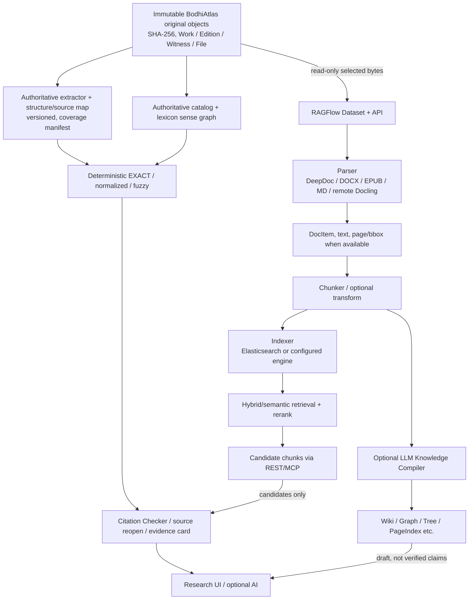

# Technology Assessment — RAGFlow

**Mã nghiên cứu:** P01 · **Ngày chốt chứng cứ:** 16/11/2026 (Asia/Ho_Chi_Minh) · **Đối tượng:** [RAGFlow](https://github.com/infiniflow/ragflow) · **Loại:** nền tảng RAG/ingestion/search/agent, **không phải** corpus Phật học, chuẩn thư mục học hay bộ kiểm chứng học thuật.  
**Phiên bản được thẩm định:** `v1.0.0` (GA, 06/11/2026), **commit của tag đã xác minh:** [`db1cd5929a7885a3074547791f5ecc4d2f891739`](https://github.com/infiniflow/ragflow/tree/db1cd5929a7885a3074547791f5ecc4d2f891739). Repository public, chưa archived khi kiểm; nhánh mặc định `main`. **Không lấy mã `main` sau ngày phát hành hoặc nhánh Python đời cũ làm đại diện cho tag.**  
**Analyst:** thẩm định kỹ thuật độc lập do AI hỗ trợ, cho BodhiAtlas; **không phải** chứng nhận bảo mật, tư vấn pháp lý hay kiểm nghiệm học thuật độc lập.  
**Phương tiện:** đọc toàn văn PRD, sổ tay rủi ro và định hướng V1 Core qua GitHub; đọc README, release/tag, LICENSE, cây thư mục, các file Go, các test Go và tài liệu chính thức RAGFlow phiên bản 1.0.0; đối chiếu QMD và repo BuddhismDocuments-for-AI. **Không** clone/build/khởi chạy Docker, không dùng dữ liệu tài liệu thật để benchmark, không gọi server RAGFlow/Zotero đang hoạt động. Vì vậy các phép thử vận hành dưới đây **NOT TESTED**. Đường dẫn code ghim ở commit nêu trên; `#Lx-Ly` là số dòng đã đọc ở snapshot này.  
**Phạm vi kết luận:** khả năng thích hợp để làm lõi V1 Core *và* làm dịch vụ/thành phần mở rộng; không đánh đồng “không đạt lõi học thuật” với “sản phẩm kém cho RAG”.

**Cơ sở BodhiAtlas đã đọc:** [PRD V1.4](https://github.com/quoctran-2608/bodhi-atlas/blob/main/docs/PRD.md), [Academic Risks & Verification v1.0](https://github.com/quoctran-2608/bodhi-atlas/blob/main/docs/ACADEMIC_RISKS_AND_VERIFICATION.md), [V1_CORE_FOUNDATION v1.0](https://github.com/quoctran-2608/bodhi-atlas/blob/main/docs/V1_CORE_FOUNDATION.md); [BuddhismDocuments-for-AI](https://github.com/quoctran-2608/BuddhismDocuments-for-AI). Hai tài liệu bắt buộc **đọc được đầy đủ**. Tài liệu nền thứ ba là định hướng, không thay thế PRD.

## 1. Executive Decision

**Khuyến nghị: `USE AS COMPONENT` — tin cậy `MEDIUM`.** RAGFlow 1.0.0 xứng đáng được thử như một **dịch vụ ingestion/OCR cho một số loại PDF, lập chỉ mục và hybrid/semantic retrieval, giao diện thử nghiệm, RAG hoặc Wiki tùy chọn**. Mã nguồn cho thấy EPUB được parse trực tiếp bằng Go, PDF có cấu trúc page/bbox ở một số đường parser, REST/MCP phục vụ lấy chunk và có connector Zotero nhập attachment PDF. Đây là giá trị đáng kể; không nên bác bỏ sản phẩm chỉ vì nó không tự sở hữu mô hình học thuật Work–Expression–Edition–Witness.

Tuy nhiên, **không chọn RAGFlow làm nguồn sự thật và lõi tra cứu mặc định của BodhiAtlas** trước khi chứng minh được khả năng giữ nguyên văn, locator ổn định và tìm đầy đủ mọi lần xuất hiện `EXACT`. Retrieval hiện là pipeline lấy ứng viên, tính tương đồng và rerank có giới hạn cửa sổ; citation gắn vào câu AI bằng similarity với chunk, không phải kiểm chứng chính xác file/ấn bản/vùng chữ. Knowledge Compilation tạo nội dung bằng LLM; dữ liệu nguồn ở Wiki được gom ở mức tài liệu/chunk, chưa xác lập truy nguyên từng claim. RAGFlow cũng không mặc định triển khai ontology, từ điển theo *sense*, phân biệt bản dịch–dị bản hay SHA-256 nguồn bất biến theo PRD.

**Ba rủi ro lớn nhất:** (1) trích dẫn có vẻ hợp lệ nhưng không mở lại đúng đoạn gốc, nhất là scan/EPUB; (2) thiếu kết quả vì OCR, tokenization hoặc candidate cap nhưng người dùng tưởng tra cứu đầy đủ; (3) Wiki/AI biến nội dung suy diễn thành dữ kiện đã xác minh. Chiến lược đúng là **core BodhiAtlas có catalog + immutable blob + structured extraction/source map + deterministic search + Citation Checker riêng**, sau đó nối RAGFlow để tăng recall và hỗ trợ AI. **Quyết định mua/triển khai production vẫn chờ POC các cổng P0.**

## 2. Sources & Evidence Ledger

**Ký hiệu:** `[DOC]` tuyên bố/tài liệu; `[CODE]` đọc mã tại tag; `[TESTED]` bản thân người thẩm định đã chạy (trong báo cáo này **không có**); `[ISSUE]` vấn đề cộng đồng chưa tái hiện; `[INFERRED]` suy luận có tiền đề; `[UNKNOWN]` chưa xác minh. “Có file test” **không** tính là `[TESTED]`. Dùng bản tag/commit nêu đầu báo cáo cho các đường `code` trong bảng.

| claim_id | Nhận định | Mức | URL/permalink | Version | Ghi chú / giới hạn |
|---|---|---|---|---|---|
| E01 | Tag GA 1.0.0 phát hành 06/11/2026, mã tag xác định | [DOC] | [Release](https://github.com/infiniflow/ragflow/releases/tag/v1.0.0), [tag ref](https://api.github.com/repos/infiniflow/ragflow/git/ref/tags/v1.0.0) | v1.0.0 | Tag ref trả SHA ghi ở đầu |
| E02 | Mã RAGFlow phát hành theo Apache-2.0 | [CODE] | [LICENSE](https://github.com/infiniflow/ragflow/blob/db1cd5929a7885a3074547791f5ecc4d2f891739/LICENSE) | v1.0.0 | Không suy ra license model, dataset hoặc dịch vụ liên quan |
| E03 | Build/deploy ưu tiên Linux, gợi ý 4 CPU/16 GiB RAM/50 GB disk, DeepDoc CPU | [DOC] | [Build Docker](https://ragflow.io/docs/v1.0.0/build_docker_image) | v1.0.0 | Đây là starting configuration, không phải benchmark corpus |
| E04 | Có native parser EPUB ZIP→OPF spine→XHTML→DocItem | [CODE] | [epub_parser.go L73–117](https://github.com/infiniflow/ragflow/blob/db1cd5929a7885a3074547791f5ecc4d2f891739/internal/parser/parser/epub_parser.go#L73-L117) | v1.0.0 | Parser tồn tại; luồng GUI/API với fixture cần POC |
| E05 | EPUB parser giải mã/thay thực thể khoảng trắng và gộp text item; chưa thấy CFI phát ra | [CODE] | [epub_parser.go L286–348](https://github.com/infiniflow/ragflow/blob/db1cd5929a7885a3074547791f5ecc4d2f891739/internal/parser/parser/epub_parser.go#L286-L348) | v1.0.0 | Thiếu chứng cứ về CFI; không khẳng định mọi đường xuất không thể sinh CFI |
| E06 | DOCX parser dùng native extraction/office_oxide có phụ thuộc CGO | [CODE] | [docx_parser.go L30–68](https://github.com/infiniflow/ragflow/blob/db1cd5929a7885a3074547791f5ecc4d2f891739/internal/parser/parser/docx_parser.go#L30-L68) | v1.0.0 | Định vị paragraph-id bất biến chưa chứng minh |
| E07 | PDF position row chuẩn `[page,left,right,top,bottom]`, page 1-based | [CODE] | [pdf_positions.go L5–23](https://github.com/infiniflow/ragflow/blob/db1cd5929a7885a3074547791f5ecc4d2f891739/internal/parser/parser/pdf_positions.go#L5-L23) | v1.0.0 | Là vùng parser/chunk, không phải char offset tự động |
| E08 | PDF OCR provider có thể chuyển vị trí thành `positions`/`_pdf_positions` | [CODE] | [pdf_parser_paddleocr.go L26–43](https://github.com/infiniflow/ragflow/blob/db1cd5929a7885a3074547791f5ecc4d2f891739/internal/parser/parser/pdf_parser_paddleocr.go#L26-L43), [L123–135](https://github.com/infiniflow/ragflow/blob/db1cd5929a7885a3074547791f5ecc4d2f891739/internal/parser/parser/pdf_parser_paddleocr.go#L123-L135) | v1.0.0 | Phụ thuộc dữ liệu OCR trả về và geometry |
| E09 | Docling chuẩn cố gắn prov page+bbox vào đoạn văn tương ứng | [CODE] | [pdf_parser_docling.go L445–505](https://github.com/infiniflow/ragflow/blob/db1cd5929a7885a3074547791f5ecc4d2f891739/internal/parser/parser/pdf_parser_docling.go#L445-L505) | v1.0.0 | Ghép theo text normalized; không khớp thì không có position |
| E10 | **Docling chunked response không có page provenance**, code phát warning | [CODE] | [pdf_parser_docling.go L127–139](https://github.com/infiniflow/ragflow/blob/db1cd5929a7885a3074547791f5ecc4d2f891739/internal/parser/parser/pdf_parser_docling.go#L127-L139) | v1.0.0 | Chọn chế độ đáp ứng phù hợp trong POC |
| E11 | Metadata `Document` có `content_hash` cột dài 32, không sẵn Work/Edition/Witness/SHA-256 | [CODE] | [entity/document.go L22–46](https://github.com/infiniflow/ragflow/blob/db1cd5929a7885a3074547791f5ecc4d2f891739/internal/entity/document.go#L22-L46) | v1.0.0 | Không đồng nhất `content_hash` với SHA-256; ontology có thể ở nơi khác nhưng chưa thấy mô hình đầy đủ |
| E12 | Retrieval sử dụng candidate window, `knn_top_k` max 2048 và mặc định vector weight 0.3 | [CODE] | [dataset/search.go L28–80](https://github.com/infiniflow/ragflow/blob/db1cd5929a7885a3074547791f5ecc4d2f891739/internal/service/dataset/search.go#L28-L80) | v1.0.0 | Không phải API exhaustive string occurrence |
| E13 | Retrieval dùng embedding, hybrid + reranking và hạn chế pagination khi có rerank model | [CODE] | [nlp/retrieval.go L50–109](https://github.com/infiniflow/ragflow/blob/db1cd5929a7885a3074547791f5ecc4d2f891739/internal/service/nlp/retrieval.go#L50-L109), [L144–170](https://github.com/infiniflow/ragflow/blob/db1cd5929a7885a3074547791f5ecc4d2f891739/internal/service/nlp/retrieval.go#L144-L170) | v1.0.0 | Không diễn dịch `total` thành đếm tất cả occurrences |
| E14 | `use_kg` của đường `SearchDatasets` cảnh báo chưa triển khai trong Go | [CODE] | [dataset/search.go L300–347](https://github.com/infiniflow/ragflow/blob/db1cd5929a7885a3074547791f5ecc4d2f891739/internal/service/dataset/search.go#L300-L347) | v1.0.0 | **Không phủ nhận** Graph artifact của Knowledge Compilation |
| E15 | `cross_languages`, `keyword extraction` trong retrieval có gọi chat LLM | [CODE] | [chunk/chunk.go L309–344](https://github.com/infiniflow/ragflow/blob/db1cd5929a7885a3074547791f5ecc4d2f891739/internal/service/chunk/chunk.go#L309-L344) | v1.0.0 | Cần tắt khi đo code-only; embedding vẫn là mô hình ML |
| E16 | InsertCitations gắn citation vào *câu trả lời* dựa cosine của answer sentence/chunk | [CODE] | [citation.go L55–103](https://github.com/infiniflow/ragflow/blob/db1cd5929a7885a3074547791f5ecc4d2f891739/internal/service/citation.go#L55-L103), [L249–273](https://github.com/infiniflow/ragflow/blob/db1cd5929a7885a3074547791f5ecc4d2f891739/internal/service/citation.go#L249-L273) | v1.0.0 | Không xác minh được literal quote hay exact locator từ phép đo này |
| E17 | Wiki metadata merge gộp `source_doc_ids`/`source_chunk_ids` | [CODE] | [wiki_merge.go L162–194](https://github.com/infiniflow/ragflow/blob/db1cd5929a7885a3074547791f5ecc4d2f891739/internal/ingestion/knowledge_compile/wiki_merge.go#L162-L194) | v1.0.0 | Provenance ở page/artifact-level, chưa chứng minh từng claim |
| E18 | Knowledge Compilation cần LLM; Graph/Tree/PageIndex/Mindmap/Timeline/Wiki | [DOC] | [Overview](https://ragflow.io/docs/v1.0.0/knowledge_compilation/overview) | v1.0.0 | Là sản phẩm phái sinh, không thay raw text |
| E19 | Đổi template **không tự sửa** artifact cũ; phải compile lại | [DOC] | [FAQ](https://github.com/infiniflow/ragflow/blob/db1cd5929a7885a3074547791f5ecc4d2f891739/docs/guides/knowledge_compilation/faq.md#L37-L39) | v1.0.0 | Cần kiểm version/diff thủ công |
| E20 | Có connector Zotero PDF attachment, Zotero Storage hoặc WebDAV | [CODE] + [DOC] | [zotero.go L42–79](https://github.com/infiniflow/ragflow/blob/db1cd5929a7885a3074547791f5ecc4d2f891739/internal/syncer/connector/zotero.go#L42-L79), [Hướng dẫn](https://ragflow.io/docs/v1.0.0/add_data_source/data_source_configuration) | v1.0.0 | Cấp auth tối thiểu và quyền download riêng |
| E21 | Zotero connector chỉ đưa khóa attachment/parent/filename vào metadata, không đủ hồ sơ edition/author | [CODE] | [zotero.go L296–315](https://github.com/infiniflow/ragflow/blob/db1cd5929a7885a3074547791f5ecc4d2f891739/internal/syncer/connector/zotero.go#L296-L315) | v1.0.0 | Cần bridge Zotero parent bibliographic metadata → catalog |
| E22 | MCP `ragflow_retrieval` giới hạn cửa sổ 512 và trả chunks/metadata | [DOC] | [MCP tools](https://ragflow.io/docs/v1.0.0/mcp_tools) | v1.0.0 | Không thể dùng làm API occurrence exhaustive |
| E23 | REST có `/api/v1/retrieval` và truy cập chunk, v1.0 thay đổi alias/schema | [DOC] | [HTTP API v1.0](https://ragflow.io/docs/v1.0.0/http_api_reference) | v1.0.0 | Không chép SDK cũ nguyên xi |
| E24 | Unit/integration tests hiện diện cho EPUB, Docling, Zotero, retrieval, Wiki | [CODE] | [parser tests](https://github.com/infiniflow/ragflow/tree/db1cd5929a7885a3074547791f5ecc4d2f891739/internal/parser/parser), [Zotero test](https://github.com/infiniflow/ragflow/blob/db1cd5929a7885a3074547791f5ecc4d2f891739/internal/syncer/connector/zotero_test.go), [API test](https://github.com/infiniflow/ragflow/blob/db1cd5929a7885a3074547791f5ecc4d2f891739/test/api/retrieval_api_test.go) | v1.0.0 | **Đã đọc file test, chưa tự chạy** |
| E25 | QMD là search engine local, ưu tiên Markdown/BM25/vector/rerank | [DOC] | [QMD repo](https://github.com/tobi/qmd) | nhánh hiện hành lúc đọc | Không mặc định OCR hay catalog editions |
| E26 | BuddhismDocuments-for-AI có 13 upstream pinned, SQLite/FTS và resolver source-specific | [DOC] | [README](https://github.com/quoctran-2608/BuddhismDocuments-for-AI/blob/main/README.md) | README tại 16/11/2026 | Các tuyên bố test của repo không phải phép test của báo cáo |
| E27 | Không có chứng cứ POC thực chạy v1.0.0 với bộ sách BodhiAtlas | [UNKNOWN] | [test plan §9](#9-practical-poc--reproduction-plan) | v1.0.0 | Phải chạy để chuyển UNKNOWN→TESTED |
| E28 | RAGFlow thích hợp làm dịch vụ mở rộng hơn làm authoritative provenance core | [INFERRED] | E07–E17, [PRD](https://github.com/quoctran-2608/bodhi-atlas/blob/main/docs/PRD.md) | v1.0.0 | Kết luận kiến trúc, không phải benchmark bên bán |

**Bằng chứng yêu cầu, không phải tính năng RAGFlow:** PRD và sổ tay rủi ro mô tả yêu cầu và quality gates của **BodhiAtlas**; không dùng chúng chứng minh RAGFlow đã hỗ trợ. `[ISSUE]`: [ragflow#21215](https://github.com/infiniflow/ragflow/issues/21215) từng phản ánh Docling/page position trong nhánh Go; **không** coi đó là lỗi v1.0.0 đang tái hiện vì đường standard hiện có code gắn provenance (E09), chỉ nêu để thiết kế regression test.

## 3. Architecture & Data Flow



> Sơ đồ ở trên **đề xuất kiến trúc tích hợp**, không phải toàn bộ sơ đồ nội bộ RAGFlow. Một kết quả tìm từ RAGFlow phải đi **qua** `Citation Checker` của BodhiAtlas trước khi được xuất là chứng cứ.

**Nội bộ RAGFlow được xác minh ở mức mã/tài liệu:** giao diện frontend + API; ingest worker (`Ingestor`), `Syncer` nhận external connector (bao gồm Zotero), `Admin`/control; pipeline Parser→Chunker→[Compiler]→Indexer; metadata MySQL, object storage MinIO/S3-compatible, cache Kvrocks, messaging NATS; engine tài liệu Elasticsearch mặc định hoặc Infinity và backend khác theo cấu hình; model provider có embedding, reranker, chat/LLM. Xem [README tag](https://github.com/infiniflow/ragflow/blob/db1cd5929a7885a3074547791f5ecc4d2f891739/README.md), [Docker Compose](https://github.com/infiniflow/ragflow/tree/db1cd5929a7885a3074547791f5ecc4d2f891739/docker), [retrieval.go](https://github.com/infiniflow/ragflow/blob/db1cd5929a7885a3074547791f5ecc4d2f891739/internal/service/nlp/retrieval.go).

**Nguồn gốc / dẫn xuất:** blob BodhiAtlas và hash SHA-256 là thẩm quyền; `Document`, text parser, chunk index và các artifact RAGFlow là **bản sao/dẫn xuất có thể làm lại**. `doc_id`/`chunk_id` của RAGFlow **không** được làm ID học thuật của passage. `content_hash` trong model RAGFlow không được mặc định là chứng nhận SHA-256 toàn file.

**Điểm cần model:** baseline extraction DeepDoc dùng model OCR/layout có thể chạy CPU, không nhất thiết chat LLM; semantic/hybrid query cần embedding (machine-learning, nhưng không nhất thiết LLM tạo sinh); cross-language translation tự động, keyword extraction tùy chế độ, Chat/RAG answer và Knowledge Compilation dùng chat LLM. Code-only BodhiAtlas *không* gọi các chế độ sinh này.

**Sơ đồ chi tiết về bằng chứng:**

```text
Source bytes + SHA256 + catalog IDs (authoritative)
  ├─ extraction run {parser,version,settings,coverage}
  │    └─ raw structured transcript + page/element locator (authoritative only after verification)
  │        ├─ deterministic index (EXACT/NORMALIZED/FUZZY/LEXICON)
  │        └─ RAGFlow chunk/vector/keyword index (optional, replaceable)
  ├─ quote reopen: original bytes -> locator -> text/bbox/CFI -> compare
  └─ verification status -> Evidence Card
AI answer / Wiki / Knowledge Graph = derivative analysis, no direct evidence authority
```

## 4. Feature Fit–Gap Matrix

`NATIVE`: triển khai thấy trong bản nghiên cứu; `CONFIG`: có, nhưng tùy cấu hình/phụ thuộc; `EXTENSION`: phải thêm code/adapter; `EXTERNAL`: trách nhiệm của thành phần khác; `MISSING`: chưa thấy cơ chế native đáp ứng yêu cầu; `UNKNOWN`: chứng cứ hiện tại chưa đủ; `N/A`: không thuộc vai trò sản phẩm. Bảng đánh giá RAGFlow **trong hệ BodhiAtlas**, không đo chất lượng tổng quát của RAGFlow. Ước lượng công sức là mức tương đối (`S/M/L`) **chưa phải cam kết timeline**.

| C | Năng lực | Trạng thái | Chứng cứ/độ tin | Tác động lên V1 Core | Công sức bù | Phương án bù / gate |
|---|---|---|---|---|---|---|
| C01 | Multi-format ingest | **NATIVE** | E04, E06; PDF/MD code | Có PDF text/scan, DOCX, EPUB, MD ở parser; UI/ingest path cần chứng minh | S–M | POC 5 định dạng, kiểm MIME/size/partial |
| C02 | OCR/layout/reading order | **CONFIG** | E07–E10; DeepDoc parser | Có OCR, bbox ở một số nhánh; hai cột, footnote, scan không đảm bảo | M–L | Chạy gold layout, trả `OCR_UNCERTAIN` khi sai |
| C03 | Canonical text + reversible source map | **EXTENSION** | E05, E09–E11 | Chưa có identity + byte/char-level map bất biến đầy đủ | L | Canonical extraction store riêng, locator versioned |
| C04 | Work/Expression/Edition/Witness | **EXTERNAL** | E11; PRD | Dataset/Document không thay ontology học thuật | M–L | Catalog BodhiAtlas + Zotero mapping có kiểm duyệt |
| C05 | Exhaustive `EXACT` occurrences no LLM | **MISSING** | E12, E13, E22 | **P0 blocker**: top-K hybrid không chứng minh đầy đủ mọi vị trí | M–L | SQLite FTS + substring verification/trigram + complete pagination riêng |
| C06 | Normalized multilingual match | **EXTENSION** | E12, E15; chưa có analyzer acceptance | Không chứng minh accent-fold Việt, Hán giản–phồn, Tạng/Wylie | L | Normalization index có provenance transform/offset map |
| C07 | Fuzzy/OCR-error/near-duplicate | **EXTENSION** | Hybrid E13 ≠ diff-aware fuzzy | Similarity giúp candidate, không thay deterministic diff/threshold | M–L | N-gram, edit distance, char shingles, review UI |
| C08 | Sense-aware multilingual lexicon | **EXTERNAL** | E11; PRD/risks | Không có xác nhận từng nghĩa, truyền thống, quan hệ theo nguồn | L | Sense IDs + linked attestations + reviewer status |
| C09 | Semantic/hybrid/RAG | **NATIVE** | E12–E16 | Phù hợp đúng vai trò mở rộng; kết quả chỉ là ứng viên | S–M | Dùng có điều kiện sau code-only; lọc theo ACL |
| C10 | Verified citation card & source reopen | **EXTENSION** | E07–E10, E16 | **P0 blocker**; similarity marker không là trích nguồn chính xác | L | Citation Checker mở blob gốc, compare byte/text/context |
| C11 | Note/Wiki/claim memory | **CONFIG** | E17–E19 | Wiki và knowledge artifacts có; claim approval và diff không mặc định | M–L | Dùng như draft; authoritative claim ledger bên ngoài |
| C12 | REST/MCP/export & integration | **NATIVE** | E22–E23 | API + MCP retrieval có, nhưng chưa là provenance export | M | Adapter versioned, export riêng phiếu và catalog |
| C13 | Coverage, quality, incremental | **EXTENSION** | E09–E10, E19–E21 | Sync tồn tại; per-page OCR coverage, reindex invalidation chưa đủ | M–L | Coverage manifest, hashes, invalidation queue, golden tests |
| C14 | Auth/license/privacy/backup | **CONFIG** | E02, E20, E22; code permission | Tenant/dataset auth có; document-level AI rights cần chính sách bổ sung | M–L | Threat model, egress policy, ACL mirroring, restore drill |
| C15 | Independent deployment/simple ops | **CONFIG** | E03, README/Docker | Self-host nhưng multi-service; đáng giá cho RAG, nặng cho exact-only | M | Docker profile tối thiểu; nếu chỉ core thì không triển khai RAGFlow |

**Gate interpretation:** C05 và C10 là *hard gates*, không cho trung bình C09 tốt bù cho chúng. Không dùng `N/A` vì đang đo RAGFlow như thành phần có các ranh giới tích hợp rõ; những phần chuyên biệt không native được giao `EXTERNAL` thay vì chấm sản phẩm thất bại không đúng vai trò.

## 5. Deep Technical Findings

### 5.1. Parsing / DeepDoc / chunking và format

- **PDF text và PDF scan:** RAGFlow có backend parser PDF, DeepDoc OCR/layout, tích hợp nhiều parser qua cấu hình như Docling, OpenDataLoader, PaddleOCR/MinerU/TCADP ở các đường cụ thể. Các code pointers: [PDF core](https://github.com/infiniflow/ragflow/tree/db1cd5929a7885a3074547791f5ecc4d2f891739/internal/deepdoc/parser/pdf), [PDF dispatcher](https://github.com/infiniflow/ragflow/tree/db1cd5929a7885a3074547791f5ecc4d2f891739/internal/parser/parser), [Parser component](https://github.com/infiniflow/ragflow/blob/db1cd5929a7885a3074547791f5ecc4d2f891739/internal/ingestion/component/parser.go), [Chunker](https://github.com/infiniflow/ragflow/tree/db1cd5929a7885a3074547791f5ecc4d2f891739/internal/parser/chunk). CPU OCR không có nghĩa chính xác đối với kinh bản scan hai cột/chú giải phức tạp. Độ chính xác cụ thể **NOT TESTED**.
- **Docling:** đường *standard structured* trả `json_content.texts[].prov` có thể gắn page/bbox lên những text item khớp sau chuẩn hóa (E09); đường *chunked* có cảnh báo thiếu page positions (E10). Vì ghép theo text đã normalized và vị trí có thể thiếu, không bảo đảm mỗi ký tự trong OCR có tọa độ đảo ngược. Không được điền “trang” từ `page_count` tổng cho một đoạn cụ thể.
- **DOCX:** `docx_parser.go` dựa trên `office_oxide`/CGO; cấu trúc paragraph/table có thể lấy, song không thấy bằng chứng Word bookmark/para ID và offset được lưu trọn tới public retrieval. Nên giữ `w:p` anchor/hierarchy do extractor BodhiAtlas tạo riêng.
- **EPUB:** **không cần chuyển EPUB sang PDF/Markdown** để parse ở đường backend tìm thấy: `epub_parser.go` mở ZIP, OPF manifest và spine, đọc XHTML. Nhưng parser chuẩn hóa thực thể/whitespace và không chứng minh giữ EPUB `href#fragment`/CFI tới từng paragraph và chunk. Vì thế không chấp nhận EPUB citation là verified chỉ với tên chương; hãy lưu spine/href/DOM path hoặc CFI ở core. Kiểm thêm API hỗ trợ upload `.epub` cho tag cụ thể.
- **Markdown:** parser Go có `ParseWithResult`; `heading`, bảng và nội dung có thể chuyển sang DocItem/chunk. Offset dòng/byte trên **file đã ghim hash** cần tạo ở ngoài; không dùng line number của file có thể sửa làm định danh bền.
- **Chunking:** đường `internal/parser/chunk/{preprocess,split,execute,postprocess}.go` tạo chunk để tìm kiếm, có thể chia hoặc gộp đoạn. Khi trích qua chunk dài/xuyên ranh giới, phải lấy ngữ cảnh từ transcript/source map độc lập. Bất kỳ `chunk_id` nào đều là địa chỉ tạm để candidate retrieval, không là passage identifier lâu dài.

**Tình huống cần kiểm đầu tiên:** scan 2 cột có chú thích chân trang và từ phủ định; nếu thứ tự chữ bị trộn hoặc đoạn mất bbox, báo fail/uncertain thay vì “đã parse xong”. Tài liệu học thuật yêu cầu *phạm vi bao phủ trang* và *trạng thái* chứ không chỉ `progress = 1`.

### 5.2. Search, hybrid, citation, reranking và API EXACT

- REST `/api/v1/retrieval` thực hiện tìm chunk theo truy vấn với dataset/document filters, `page/page_size`, `similarity_threshold`, `vector_similarity_weight` và cấu hình liên quan ([v1.0 API](https://ragflow.io/docs/v1.0.0/http_api_reference)). Đường gọi Go [SearchDatasets](https://github.com/infiniflow/ragflow/blob/db1cd5929a7885a3074547791f5ecc4d2f891739/internal/service/dataset/search.go#L28-L80) tạo yêu cầu [RetrievalService](https://github.com/infiniflow/ragflow/blob/db1cd5929a7885a3074547791f5ecc4d2f891739/internal/service/nlp/retrieval.go#L50-L109), không là vòng quét tất cả occurrences trên canonical string.
- **Không được suy luận `vector_similarity_weight=0` = EXACT:** nó đổi trọng số, không biến pipeline candidate/top-K/threshold thành enumerator. `total` chỉ nói số hit hợp lệ trong miền retrieval/chunk, **không** là tổng occurrence; 1 chunk có thể chứa nhiều lần xuất hiện. Full-text index/BM25 cũng không tự bảo đảm nguyên văn có dấu, dấu câu, substring Hán 1–2 chữ, hoặc mọi occurrence.
- MCP `ragflow_retrieval` có fixed window 512 (`page × page_size`), REST/Go cũng có giới hạn candidates và pagination, ví dụ `KNNTopK` max 2048 và `rerank_candidates_count` max 1024. Điều này **bác bỏ cách dùng endpoint làm lời hứa exhaustive**, không nhất thiết bác bỏ việc có thể viết query DB riêng.
- `cross_languages` dịch câu hỏi bằng LLM và `keyword` dùng LLM extraction ở đường [chunk.go L309–344](https://github.com/infiniflow/ragflow/blob/db1cd5929a7885a3074547791f5ecc4d2f891739/internal/service/chunk/chunk.go#L309-L344); phải disable khi benchmark code-only. Vector embedding không đồng nghĩa LLM *tạo sinh* nhưng không phải giải pháp deterministic index theo chuẩn PRD.
- Citation code [InsertCitations](https://github.com/infiniflow/ragflow/blob/db1cd5929a7885a3074547791f5ecc4d2f891739/internal/service/citation.go#L55-L103) *đọc câu trả lời đã sinh*, embedding câu, đo cosine so với chunk rồi thêm `[ID:n]`; marker trỏ đến **vị trí chunk trong danh sách tham chiếu** chứ không có nghĩa đoạn gốc được xác minh. Phân biệt: (a) chữ trong nguồn được parser/chunk gán `positions` là metadata code; (b) marker bổ sung trên câu trả lời code dựa similarity; (c) nội dung và những marker do LLM tự viết — không phần nào tự cấp trạng thái `TEXT_AND_LOCATOR_VERIFIED`.
- `use_kg` ở dataset retrieval của Go **bị skip với cảnh báo chưa triển khai** ([code](https://github.com/infiniflow/ragflow/blob/db1cd5929a7885a3074547791f5ecc4d2f891739/internal/service/dataset/search.go#L329-L333)). Đừng gộp điều đó với việc **Graph artifact** có trong Compiler ở một đường khác.
- **Tôi không xác minh được một lệnh/REST API native thực sự enumerate mọi occurrence EXACT có dấu, bao gồm tất cả vị trí trong chunk**. Mức đánh giá: `MISSING` đối với gate native mà PRD đòi. Nếu trong tương lai tìm được hidden native backend API, phải nêu tên route và chạy thử với fixtures rồi sửa gate — không suy ra từ mô tả “full-text search”.

### 5.3. Knowledge Compilation — Wiki, Graph, Tree, PageIndex, Mindmap, Timeline

- Theo [overview 1.0](https://ragflow.io/docs/v1.0.0/knowledge_compilation/overview), template điều khiển Compiler dùng **LLM** sinh Graph/Tree/PageIndex/Mindmap/Timeline/Wiki. Đây là *generated knowledge artifact*, không là corpus gốc hoặc kết quả đối chiếu đã chứng thực. PageIndex giúp tìm phần/chương, **không chứng nhận** tọa độ sách in/CFI hay accuracy của lời diễn giải.
- Wiki ở cấp dataset có xử lý bất đồng bộ sau khi document ingestion hoàn tất; cần quan sát `Logs > Dataset` và trạng thái compiler, tránh coi “mới parse xong nhưng chưa thấy Wiki” là dữ liệu không được xử lý ([FAQ](https://github.com/infiniflow/ragflow/blob/db1cd5929a7885a3074547791f5ecc4d2f891739/docs/guides/knowledge_compilation/faq.md#L13-L17)).
- Code `wiki_contribution.go` có `source_doc_ids`, `source_chunk_ids` và contribution hash; `wiki_merge.go` hợp nhất các tập này theo page. **Điểm yếu quan trọng:** chuỗi `source_chunk_ids` bên cạnh *cả trang Wiki* không tự khẳng định mỗi **claim** trong trang bắt nguồn từ chunk nào, ai duyệt, còn hiệu lực hay có phản chứng. Không được chuyển `source_doc_ids` thành thẻ “claim verified”.
- Khi template thay đổi, artifact cũ **không được tự động regenerate**; phải chạy compile lại, theo FAQ. Việc gộp/ghi `content_md_raw` trong metadata cho thấy có nội dung Markdown bên trong, nhưng **chưa xác minh endpoint xuất file Markdown độc lập, claim-scoped history, before/after diff, reviewer approval**. Gắn `[UNKNOWN]` cho export UI/API và khả năng audit hoàn chỉnh cho tới POC.
- Đề xuất: cho phép AI biên soạn Wiki bản nháp với `generated_from`, `model_id`, `prompt_hash`, `source_chunk_ids`, nhưng chỉ BodhiAtlas `claim_review` có trạng thái `PROPOSED/REVIEWED/REJECTED`; nếu cần công bố phải kèm evidence card đã qua G2 và rà ngữ nghĩa G3.

### 5.4. Zotero connector: có thật nhưng chỉ tới một ranh giới nhất định

- **Native ở v1.0.0:** `internal/syncer/connector/zotero.go` đồng bộ **PDF attachments**, hỗ trợ Zotero cloud / WebDAV (đúng [docs](https://ragflow.io/docs/v1.0.0/add_data_source/data_source_configuration)); các unit tests có download/retry. **Không** cần viết lại việc fetch PDF ở quy trình thử nghiệm thông thường.
- **Giới hạn code rõ:** `zoteroItemData` chỉ giữ `itemType,title,filename,contentType,linkMode,dateModified,parentItem`. `buildDocument` phát hành metadata chỉ `source,zotero_item_key,zotero_parent,filename` và fingerprint nội dung ([L296–315](https://github.com/infiniflow/ragflow/blob/db1cd5929a7885a3074547791f5ecc4d2f891739/internal/syncer/connector/zotero.go#L296-L315)). Không lấy bibliographic `creators`, `date`, `edition`, `translator`, `DOI`, `ISBN`, `relations`, Zotero collections và sửa đổi bản dịch làm model học thuật mặc định.
- Đặc điểm vận hành: default batch 4, PDF tối đa 100 MiB mỗi attachment (theo code); item key `zotero:userID:attachmentKey` làm ID sync, **không** tự là `edition_id`. Các scan ngoài giới hạn/mode WebDAV/attachment chưa có quyền tải phải được biểu diễn là failed/partial, không rơi lặng khỏi coverage.
- Cần đồng bộ metadata parent qua **Zotero API riêng hoặc một sync bridge**: gắn `zotero_parent_item_key → work_id / expression_id / edition_id`, giữ bản chép Zotero item JSON, timestamp và revision, không dựa chỉ vào tiêu đề. Khi Zotero xóa attachment, tránh cascade xóa bản gốc bất biến nếu BodhiAtlas còn nghĩa vụ lưu bằng chứng.

### 5.5. Schema/permission/test pointers bổ sung

**Paths đã kiểm tra:** `internal/entity/document.go`, `internal/parser/parser/{epub_parser,docx_parser,markdown_parser,pdf_positions,pdf_parser_docling,pdf_parser_paddleocr}.go`, `internal/parser/chunk/`, `internal/service/{citation,chunk/chunk,dataset/search,nlp/retrieval}.go`, `internal/ingestion/knowledge_compile/{wiki_contribution,wiki_merge}.go`, `internal/syncer/connector/{zotero,zotero_test}.go`, `internal/mcp/`, `internal/permission/`, `test/api/retrieval_api_test.go`; Docker và docs dưới tag. Điều này đáp ứng khảo sát 3–8 file trọng tâm **vượt mức tối thiểu**. Chưa kiểm mọi branch tùy chọn hoặc tất cả end-to-end tests.

Quyền sử dụng dataset có check trong [chunk.go L173–181](https://github.com/infiniflow/ragflow/blob/db1cd5929a7885a3074547791f5ecc4d2f891739/internal/service/chunk/chunk.go#L173-L181); MCP chạy theo user đã auth; đồng bộ source-level ACL và **quyền cho AI gửi ra model** phải thử tách biệt. Với đối thủ cố ý prompt-inject qua PDF, cần đối xử toàn bộ text/caption/attachment là untrusted content và chặn tool/cross-tenant leakage. Các test file xuất hiện trong repo không xác nhận đã chạy thành công trong môi trường ở đây.

## 6. Source Fidelity & Provenance

### 6.1. Đánh giá theo đơn vị truy nguyên

| Đơn vị / dữ kiện | Có trong RAGFlow 1.0.0? | Giới hạn quan trọng | Quy tắc BodhiAtlas |
|---|---|---|---|
| Raw original file bytes | Có upload/storage/file API [DOC] | Không được lấy đường upload làm chứng minh file bất biến | Core lưu blob WORM/versioned; SHA-256 riêng |
| Raw extracted text nguyên văn | Có parser text [CODE] | OCR/markdown normalize/transform, chunker gộp và chia | Cất transcript extraction versioned, không sửa `raw` |
| PDF logical page | Có ở vài đường parser [CODE] | Page count ≠ page cụ thể cho every chunk | Page index 1-based, ghi `pdf_page` được xác nhận |
| PDF bbox | Có `positions` `[page,left,right,top,bottom]` [CODE] | Tùy parser, chunk, coord origin, Docling text-match; có thể rỗng | Lưu bbox, parser, confidence, provenance từng segment |
| Printed page | **UNKNOWN** native verified | Số trang in khác page PDF, có front matter | Chỉ nhập nếu đọc/đối chiếu được; `printed_page_verified` |
| Char/byte offsets và reversible map | **Chưa xác minh** ở output chain | Text normalization và chunk boundaries làm sai offset | External source-map biểu diễn span & transform chain |
| EPUB `href`/CFI | Có `href` lúc đọc [CODE]; CFI **UNKNOWN** | Không thấy sinh CFI/DOM locator trong emitted item | `spine_href`, DOM path, EPUB CFI khi validate |
| DOCX/Markdown stable locator | **UNKNOWN** | Sửa DOCX hoặc MD đổi line/path | Source hash + style/paragraph path + extract-span |
| Work/Expression/Edition/Witness | **Không thấy** trong Document schema [CODE] | `kb_id`/`doc_id` không thay ấn bản | Catalog riêng + quan hệ có nguồn duyệt |
| Citation check độc lập | Citation similarity [CODE], **không đạt G2** | Dẫn đúng chunk chưa xác nhận câu chữ/vị trí | Reopen source file, verify text+locator+context |
| OCR/ingestion coverage | Có progress, warning ở parser [CODE] | Chưa có per-page coverage gate đồng nhất | Manifest per page/region, `READY/PARTIAL/UNCERTAIN` |

**Quy tắc không thể đánh đổi:** người dùng nhập `anattā`, trả `anattā` theo `EXACT` phải hiện đúng dạng text của source; nếu đã bỏ macron thì bắt buộc `NORMALIZED`, công thức biến đổi, span alignment và raw source khác nhau. Không gán relevance/embedding score thành probability chân lý. Corpus bị thiếu trang thì câu “không thấy” chỉ được phạm vi phần đã lập chỉ mục.

### 6.2. Cấu trúc evidence card bắt buộc (contract đề xuất, *không phải schema có sẵn của RAGFlow*)

```json
{
  "work_id": "W:...", "expression_id": "X:...", "edition_id": "E:...",
  "witness_id": "WT:...", "file_id": "F:...", "file_sha256": "<64 hex>",
  "source_kind": "pdf|epub|docx|markdown|structured_corpus",
  "extraction_run_id": "ER:...", "parser_version": "...",
  "passage_id": "P:...", "raw_text": "<exact extracted source span>",
  "raw_span": {"start_byte": 0, "end_byte": 0},
  "locator": {"pdf_page_1based": null, "pdf_bbox": null,
              "printed_page": null, "printed_page_verified": false,
              "epub_href": null, "epub_cfi": null, "docx_path": null,
              "markdown_path": null},
  "match": {"type": "EXACT|NORMALIZED|FUZZY|LEXICON|SEMANTIC",
            "query": "...", "rule_ids": [], "diff": null},
  "coverage": {"status": "READY|PARTIAL|OCR_UNCERTAIN|NOT_INDEXED",
               "region_reviewed": false, "missing_regions": []},
  "technical_verification": "TEXT_AND_LOCATOR_VERIFIED|TEXT_ONLY|OCR_NEEDS_REVIEW|MISMATCH|UNVERIFIABLE",
  "claim_assessment": "NOT_ASSESSED|SUPPORTS|PARTIAL|CONTRARY|DISPUTED|INSUFFICIENT",
  "source_display": "<source text only>",
  "researcher_commentary": null,
  "ragflow_candidate": {"dataset_id": null, "document_id": null, "chunk_id": null}
}
```

*Các giá trị có dấu `...`, `<...>` và `0/null` chỉ là placeholder schema — **không phải** trích dẫn/số trang thực, cũng không phải bằng chứng đã được kiểm nghiệm.* `file_sha256` phải tính từ **byte file gốc**. Với OCR, exact trên transcript OCR **chưa chắc exact trên ảnh nguồn**: chỉ được nâng `TEXT_AND_LOCATOR_VERIFIED` sau bước đối chiếu kỹ thuật phù hợp và rà OCR rủi ro.

### 6.3. Quy trình reopen/reverify độc lập

1. Chọn `file_id` → lấy blob đã xác định SHA-256 → kiểm hash → lấy `extraction_run_id` và parser config. Sai hash = `MISMATCH`/dừng.
2. Dùng locator **không phụ thuộc chunk** để mở PDF page và bbox hoặc EPUB href/CFI; đọc vùng/đoạn gốc. Nếu thiếu locator → `TEXT_ONLY/UNVERIFIABLE`, không suy ra trang.
3. So sánh nguyên văn theo chế độ khai báo; `EXACT` phải byte/codepoint policy minh bạch; OCR chưa kiểm → `OCR_NEEDS_REVIEW`.
4. Mở ngữ cảnh trước/sau, kiểm đoạn phủ định/nhân vật phát ngôn/tác giả dẫn lại; việc này tách khỏi string match.
5. Chỉ sau đó đưa AI/người đọc đánh giá `SUPPORTS/PARTIAL/CONTRARY...`. Người duyệt phê chuẩn kết luận quan trọng; lưu reviewer, timestamp, revision, source scope.
6. Reindex/chunk lại: evidence card cũ phải mở được đúng blob/locator đã ghim hoặc nhận `STALE/REVERIFY_REQUIRED`, tuyệt đối không remap ngầm sang chunk khác.

## 7. Multilingual & Retrieval Behavior

**Trạng thái dưới đây là kết quả khảo sát RAGFlow 1.0.0, không phải toàn bộ khả năng của engine ElasticSearch khi tự viết plugin/custom analyzer.** Đối với lớp riêng do BodhiAtlas xây, dùng `custom`; ngoài phần có chứng cứ, `unknown` thay vì đoán.

| Mode / ngôn ngữ | Native/Custom/Unknown | Điều đã xác minh & cách thử | Cảnh báo |
|---|---|---|---|
| EXACT literal full occurrences | **custom** | Retrieval native có top-K/threshold (E12–E13); core quét span string sau index | Phải trả mọi occurrence, không chỉ 1 lần/chunk |
| NORMALIZED Unicode NFC/NFD & dấu Việt | **custom** | Có tokenization/lexical search nhưng chưa thấy acceptance đảm bảo `vo thuong → vô thường` đúng type | Không sửa raw, transform+map riêng |
| FUZZY typo/OCR error | **custom** | Hybrid/rerank là semantic candidate, không phải char-diff fuzzy xác nhận | Per-match edit distance, diff/threshold riêng |
| LEXICON theo nghĩa xác minh | **custom** | Không thấy data model sense + source verification native | Cấm nối nghĩa bắc cầu không giới hạn |
| SEMANTIC/hybrid | **native** | `retrieval.go`, vector+lexical+rerank | Score là relevance, không là true probability |
| Tiếng Việt | **unknown** native quality | Thử `vô thường`/`vo thuong`, `khổ`/`kho` với non-diacritic collisions | Analyzer cụ thể chưa nghiệm thu |
| Hán phồn/giản (`無常`/`无常`) | **unknown** native; **custom** mapped lexicon | Thử một chữ/two-character query, không chỉ multi-token | Segmentation, giản–phồn có thể không khớp |
| Pāli/Sanskrit Latin (`anatta`, `anattā`, `anātman`) | **unknown** native; **custom** normalization | NFC/NFD, macron/diacritics, false friends | Không coi sanskrit/pāli là cùng nghĩa mặc định |
| Chữ Tạng Unicode/Wylie | **unknown** native; **custom** transliteration | Chuẩn tách tsheg, combining marks, Wylie finite mapping | Chưa chứng minh hỗ trợ tìm hai chiều |
| Anh stemming/lemmatization | **unknown** profile analyzer cụ thể | Test plural/morphology, audit stemming mismatch | Không gọi stemming là EXACT |
| Query xuyên ngôn ngữ | **native LLM-assisted optional**; **custom** verified lexicon | `cross_languages` gọi LLM ở retrieval (E15) | LLM không được tự phong quan hệ đồng nghĩa |

**Mô hình index đề nghị:** `(file_id, extraction_run, raw_char_span)` giữ nguyên; phụ `NFC`, case-fold, accent-fold có kiểm soát, Hán variant map **có version**, Pāli/Sanskrit transliteration, Tibetan Wylie **được kiểm nguồn**, ngram/fuzzy; mỗi hit giữ `transformation_path` và quay ngược span raw. Từ điển `lexeme_id → sense_id → relation(type,scope,tradition,citation,verification_status)`; ví dụ `anattā` liên hệ `anātman`, `無我`, `vô ngã` *nếu* có chứng cứ riêng theo từng nghĩa, không tự coi chúng là một bản văn hay nghĩa duy nhất.

**Định lượng lỗi:** với tìm Hán 1–2 chữ, đếm precision/recall theo *occurrence* do người gán nhãn; với tác giả liên hệ `vô thường/khổ`, code-only chỉ lấy ứng viên co-occurrence và lexicon expansions, không chấm “đã tìm đúng tác giả phân biệt” nếu chưa đọc lập luận.

## 8. Integration Options for BodhiAtlas

### Option A — RAGFlow sidecar độc lập, **ưu tiên thử**

**Kiến trúc:** BodhiAtlas core giữ file original/catalog/source-map/exact-index và xuất bản sao document đã được phép vào RAGFlow. Sync adapter gửi metadata `external_file_id`, `edition_id`, hash, extraction_run và ACL scope; lưu bảng nối `external_doc_id ↔ ragflow_dataset_id/doc_id`; có thể nhập bản text OCR kiểm tra xong hoặc để RAGFlow ingest bản sao làm *second parser*. Search adapter gọi `/api/v1/retrieval` và trả **candidate**; bộ kiểm chứng BodhiAtlas mở nguồn nguyên bản cho user.

**Input contract:** `IngestionEnvelope{file_id,sha256,edition_id,source_uri,content_type,rights_scope,extraction_run_id,metadata_version}`; chỉ gửi bytes/text có quyền. **Output contract:** `Candidate{dataset_id,document_id,chunk_id,content,score,maybe_positions,parser_config_version}` rồi `EvidenceCard` từ core; RAGFlow **không** được trả tự thân `verified=true`.

**Đường code cần viết:** `sync/ragflow_adapter`, `mapping` table, ACL enforcement, dedup/reindex detector, candidate-to-source-span resolver, event log, integration fixtures, rate-limit. Không cần fork RAGFlow giai đoạn đầu. **Rollback:** ngưng adapter, xoá/reindex bộ dẫn xuất RAGFlow, core vẫn còn blob/metadata/provenance/evidence; giữ export adapter state và replay queue.

**Ưu/nhược:** giảm fork risk và dễ tách tương lai; có hai bộ chỉ mục và chi phí vận hành phụ. Nếu RAGFlow OCR làm source-map khác canonical extraction, chỉ dùng kết quả như search leads.

### Option B — RAGFlow + Zotero connector, tùy biến thêm catalog bridge

**Kiến trúc:** Zotero giữ record thư mục, file attachment source; RAGFlow native Zotero connector nhận PDF; `zotero-bibliography-sync` lấy parent item metadata và revisions vào BodhiAtlas catalog; BodhiAtlas lại tính SHA-256, khóa edition/file, giữ original ở kho riêng. `zotero_parent` + item key là link; **không giả** key attachment chính là Edition. `Citation Checker` lấy source byte qua kho BodhiAtlas, không qua Wiki summary.

**Input:** `{zotero_library_id,parent_item_key,attachment_key,item_json,attachment_sha256,rights,work_id,edition_id}`. **Output:** catalog record, attachment link, RAGFlow dataset/doc mapping, ingestion coverage. Sync deletion là tombstone có review; không auto-delete original; các update item metadata phải không đổi file hash nếu byte không đổi.

**Code cần thêm:** gọi Zotero Items API với phép đọc đúng phạm vi, xử lý creators/translators/edition/DOI/ISBN/relations và multi-collection, duplicate resolution, provenance/audit, ACL. RAGFlow connector **đã có sẵn** việc đọc PDF attachment; không nên sửa `zotero.go` trừ khi POC phát hiện thiếu. **Rollback:** dừng Zotero connector/RAGFlow sync, giữ catalog+immutable originals; audit trang/file trước khi phục hồi.

**Rủi ro:** connector chỉ PDF; EPUB/DOCX/MD Zotero attachment không được mô tả là được sync cùng cách. Bibliography về Zotero có thể bất nhất nếu người dùng sửa metadata; cần snapshot và reviewer xác nhận.

### Option C — Fork RAGFlow làm primary platform (**không khuyến nghị V1 Core**)

Muốn đưa `Work/Edition/Witness`, `ProvenanceSpan`, per-page coverage, normalized/exact occurrence engine, citation verifier, claim ledger và access policy vào chính RAGFlow phải sửa Go entities/migrations/API, parser/chunker/indexer, UI/source opener, syncer, retrieval/MCP, test suite; giữ tương thích các bản release/DB migration và học thuật. **Công sức cao, rủi ro merge lớn.** Chỉ đánh giá lại nếu sidecar không thể đáp ứng performance/UX sau POC và dự án có team maintain dài hạn. Không biến fork thành nơi duy nhất lưu dữ liệu học thuật.

### Ranh giới bất biến chung

`BodhiAtlas file SHA-256 + Edition identity + extraction run + source-map + human verification` luôn là thẩm quyền. Embeddings, RAGFlow chunks, Wiki, agent notes và reranked score luôn là dẫn xuất. Không có đường từ `LLM generated claim` trực tiếp nâng lên `verified citation`.

## 9. Practical POC / Reproduction Plan

**Trạng thái tất cả phép thử:** `NOT TESTED` tại 16/11/2026. Code và test có trong repo nhưng không chạy trực tiếp ở đây. Mục tiêu là chuyển bằng chứng `[CODE]` thành `[TESTED]` khi có Docker, fixtures có quyền sử dụng, golden đáp án và logs. Định nghĩa threshold là **ngưỡng nghiệm thu đề xuất** (không là số đo hoặc lời hứa sản phẩm).

### 9.1. Ghim môi trường và lệnh khởi động

```bash
# Máy Linux; Docker >= 24 / Compose >= 2.26; dung lượng nên dự phòng >= 50 GiB
set -euo pipefail
git clone https://github.com/infiniflow/ragflow.git
cd ragflow
git fetch --tags
git checkout v1.0.0
EXPECTED=db1cd5929a7885a3074547791f5ecc4d2f891739
ACTUAL=$(git rev-parse HEAD)
test "$EXPECTED" = "$ACTUAL" || { echo "WRONG VERSION: $ACTUAL"; exit 1; }
printf 'RAGFlow commit: %s\n' "$ACTUAL"

# Với Elasticsearch, bảo đảm kernel setting theo docs, ví dụ:
sysctl vm.max_map_count
# Nếu < 262144: sudo sysctl -w vm.max_map_count=262144
cd docker
docker compose -f docker-compose.yml up -d
curl -f http://localhost/api/v1/system/healthz
# Thu thập log, versions của images, parser/config, model, backend và thời điểm:
docker compose -f docker-compose.yml ps
docker compose -f docker-compose.yml logs --no-color --tail=200 > ../poc-compose.log
```

**Chú ý:** trong 1.0 DeepDoc dùng CPU; Docker backend vẫn cần các service và model cấu hình cho embedding/hybrid. Không tự lấy model cloud hoặc đẩy sách bản quyền sang model provider nếu chưa được phép. `docker compose down -v` có thể xoá dữ liệu; tuyệt đối không dùng với thư viện thật. Một mẫu `.env` phải tách credentials khỏi report; ghi digest image chứ không in secret.

### 9.2. Fixtures/golden data tối thiểu

```text
poc/
  fixtures/
    P01_text.pdf                 # 2 trang, embedded text; printed page offset
    P02_scan_2col.pdf            # 2 cột, footnote, chữ phủ định, 1 trang OCR low-confidence
    E01_spine.epub               # 2 XHTML spine, anchor ID, 2 lần anattā
    D01_table_footnote.docx      # heading/table/footnote, anattā ở hai đoạn
    M01_unicode.md              # NFC/NFD, 無我/无我, vô thường/vo thuong
    C01_structured.jsonl         # witness_id, segment_id, raw text
  gold/
    files.jsonl                 # SHA256, Work/Edition/File and permission, source pages
    spans.jsonl                 # raw literal + occurrence start/end + expected locator
    pages.jsonl                 # page geometry, column order, coverage / OCR masks
    lexicon.jsonl               # reviewed sense and relations, not synonyms by guess
    claims.jsonl                # which statements are supported / contradicted
  scripts/
    ingest.sh, test_exact.py, test_source_reopen.py, measure.py
```

Không cung cấp “trích nguyên văn” giả. Fixtures cần tạo từ tài liệu có bản quyền phù hợp hoặc tự sáng tác; mỗi occurrence được **hai người kiểm thủ công** trên file đó, có answer-key JSONL với `raw_text`/`sha256`/locator. Khi thử kinh bản gốc thực, phải lưu metadata ấn bản và quyền xử lý.

### 9.3. API smoke test có thể tái lập

```bash
# Sau khi tạo dataset, upload/ingest từ UI hoặc endpoint Upload/ingest tương ứng
# trong HTTP API v1.0 (ghi request/response thật). Không giả rằng upload đã chạy.
export RAGFLOW_URL=http://localhost
export RAGFLOW_API_KEY='SET_LOCALLY_NOT_IN_REPORT'
export DATASET_ID='SET_AFTER_DATASET_CREATION'

# Kiểm retrieval native (candidate-only), không bật LLM keyword/cross_languages:
curl -fsS "$RAGFLOW_URL/api/v1/retrieval" \
  -H "Authorization: Bearer $RAGFLOW_API_KEY" \
  -H 'Content-Type: application/json' \
  -d "{\"question\":\"anattā\",\"dataset_ids\":[\"$DATASET_ID\"],\"page\":1,\"page_size\":30,\"similarity_threshold\":0,\"vector_similarity_weight\":0,\"keyword\":false,\"cross_languages\":[]}" \
  | tee poc-retrieval.json

# Chú ý: trả 200 vẫn cần kiểm response code == 0.
# Không so total chunks với số occurrences vàng (khác đơn vị đo).
```

**Pseudocode test cho code-only core:**

```python
for fixture in files:
    src = read_immutable_bytes(fixture.path)
    assert sha256(src) == gold_files[fixture.id].sha256
    extracted, source_map, coverage = extract_with_versioned_config(src)
    assert report_missing_pages(coverage) == gold_pages[fixture.id].missing
    for query in gold_queries:
        got = exact_enumerate_all(extracted.raw_text, query)  # literal, case policy fixed
        compare_occurrence_multiset(got, gold_spans[fixture.id, query])
        for hit in got:
            assert reopen_original_and_verify(fixture, source_map, hit) is classified_correctly
```

### 9.4. Ten cases phân biệt và pass/fail cụ thể

| Test | Fixture/query/action | Ground truth / expected output | Ngưỡng đề xuất & failure acceptance |
|---|---|---|---|
| T01 | `P01_text.pdf`, `anattā` 2 lần trang khác | 2 occurrences trên transcript, đúng page/bbox; phân biệt trang PDF/printed | **100%** đúng occurrence; **0** false `VERIFIED` |
| T02 | `P02_scan_2col.pdf` có chú thích, phủ định, trang mờ | Đọc theo thứ tự cột, không trộn tác giả/chú thích; vùng lỗi gắn OCR uncertain | 100% vùng thiếu được ghi, bất kỳ false verified P0 = fail |
| T03 | `E01_spine.epub`, `anattā` ở 2 XHTML | 2 occurrences; mở đúng `href` + fragment/CFI hoặc báo `TEXT_ONLY` | Reopen 100% cho verified; thiếu CFI phải không đánh verified locator |
| T04 | `D01_table_footnote.docx` và `M01_unicode.md` | Chia đúng đoạn/footnote, hash và path; không sinh dòng/chữ giả | Đúng text mọi đoạn gold đã nhập; partial hiển thị |
| T05 | `anatta`, `anattā`, `anātman`, `無我`, `无我`, `vô ngã` | Tách EXACT/NORMALIZED/LEXICON; sense relation có reviewer | 0 kết quả normalized gắn nhãn EXACT; lexicon không tự bắc cầu |
| T06 | `無常`/`苦` 1–2 ký tự; Hán giản/phồn | Mọi occurrence thực trong phạm vi gold được tìm, không phụ thuộc space | EXACT recall 100%; no-hit phải kèm coverage scope |
| T07 | 2 edition PDF chứa câu giống nhưng page in khác | Work liên kết, Edition và File riêng; SHA-256 khác; page đúng từng bản | 100% citation card không lẫn edition/printed page |
| T08 | Rechunk/reindex và đổi pipeline/template | Evidence card đã lưu mở đúng nguồn; Wiki draft có version/update và giới hạn | 0 silent mislink; chỉ regenerated Wiki được gắn version mới |
| T09 | Tạo Wiki chứa 3 claims, một claim xuyên 2 chunks, một claim sai | Kiểm từng claim có source-span riêng; claim sai không tự “verified” | 0 false verified; nếu chỉ page-level IDs → FAIL claim-level gate |
| T10 | 2 users/AI scopes, 1 file cấm gửi cloud, Zotero delete/retry | Cross-user search không lộ; egress cấm, sync nhận lỗi; core raw không xóa | 0 unauthorized leak; quyền nghi vấn → block/dừng |

### 9.5. Công thức đo và kiểm soát benchmark

- **Occurrence recall** `TP_occ / (TP_occ + FN_occ)`, theo *từng nguyên văn/vị trí*, không theo chunk. Mẫu gold phải có đủ occurrences và phiên bản file rõ ràng.
- **Occurrence precision** `TP_occ / (TP_occ + FP_occ)`; định nghĩa TP cần khớp `file_id`, `extraction_run`, raw span (và page locator nếu đòi verified).
- **Locator accuracy** `# verified hits reopen đúng file+span+locator / # hits được hệ thống gắn verified`. Mục tiêu ban đầu **100%**, cho phép ít `verified` và nhiều `uncertain`; không chấp nhận dẫn sai.
- **OCR page coverage** `# trang có kết quả xử lý/đánh dấu lỗi rõ / # trang file gốc` phải **100% có trạng thái**, không có nghĩa OCR WER 0. Đo Character Error Rate `(S+D+I)/N` trên các vùng được gõ lại từ ảnh; báo riêng theo script/region và missing, không đặt một ngưỡng duy nhất cho mọi hệ chữ trước pilot.
- **Unsupported/false-evidence block rate** `# claim không đủ chứng cứ bị chặn / # claim không đủ chứng cứ được đưa vào thử` mục tiêu **100%** đối với trường hợp phát hành; mọi false verified = blocker.
- **Runtime/ops** ghi wall clock, CPU peak/RAM peak, throughput trang/phút theo parser, embedding calls, token LLM, disk bytes, cache hits, Docker images, retry rate; so sánh từng profile trên cùng máy/dataset. **Không ghi số đo giả.**

**Điều kiện thả POC:** `exact` và `source fidelity` phải đạt *qua core* bất kể RAGFlow native có hỗ trợ hay không. Nếu cần sản phẩm không có core bổ sung, ghi `FAIL` cho hai cổng; đừng đánh tráo bằng chất lượng chat tốt.

## 10. Deployment, Security, Legal, Cost

**Hạ tầng đã xác minh qua docs/Compose:** Docker Compose trên Linux, nhiều thành phần như API/Admin/Ingestor/Syncer, MySQL, object storage MinIO, cache Kvrocks, NATS và engine Elasticsearch mặc định/Infinity tùy profile. Gợi ý giai đoạn build: **4 CPU, 16 GiB RAM, 50 GB free disk**; đây là mức mở đầu của tác giả, chưa đủ dự toán cho corpus multi-GB, nhiều concurrent OCR hoặc nhiều ngôn ngữ. Open-source RAGFlow 1.0 DeepDoc CPU inference; mô hình embedding/rerank/chat có thể là dịch vụ ngoài hoặc local, tốn RAM/GPU/điện riêng tùy lựa chọn. `vm.max_map_count >= 262144` khi dùng ES. macOS không hỗ trợ backend Go native theo docs build; chạy Linux VM/host.

**Security/ACL:** token/API user, team/dataset checks và connector credentials tồn tại, nhưng bắt buộc POC: quyền file-level, kiểm user A vs B, AI-run permissions khác user, API key compromise, prompt-injection từ PDF, SSRF/download untrusted links, MIME/ZIP bomb, oversized PDF, malicious font, virus scan, outbound egress, logging PII, delete/tombstone và tenancy leakage. Zotero connector có HTTPS/host validation và giới hạn download trong code; **không** thay thế security review toàn hệ. Chạy container least privilege; không expose MySQL/MinIO/NATS công khai; TLS/secret manager/network policy/audit logs.

**Data rights:** `LICENSE` **Apache-2.0 cho RAGFlow code**; cần lập riêng bảng license/điều khoản của **DeepDoc weights**, ONNX runtime/native libraries, OCR providers (Docling/MinerU/PaddleOCR/TCADP...), embedding/chat/rerank models, Zotero API/attachments, từng bộ kinh/tài liệu và corpus upstream. Tách `can_store`, `can_index`, `can_send_to_external_llm`, `can_share_with_other_users`, `can_export_excerpt`, `retention/deletion`. Dữ liệu bản quyền/riêng tư không được mặc định gửi cloud model. AI được đọc tài liệu ít quyền hơn người dùng nếu chính sách yêu cầu.

**Backup & portability:** snapshot **riêng** kho file original BodhiAtlas, catalog Work–Edition–Witness/rights, extraction/transcript/source-map, lexicon/claims/review log; RAGFlow MySQL + object storage + search index + connectors + templates/LLM configs là bản sao cần backup có consistency. Chạy restore drill trên host trống, kiểm SHA-256 và các evidence cards, rồi reindex RAGFlow. Tránh coi backup vector DB là backup duy nhất của chứng cứ. Nâng v0.27.2→v1.0 có migration tự động: backup trước và thử rollback với bản DB snapshot; không dựa vào downgrade đảo schema.

**Ước lượng nguồn lực theo giả định (không bịa giá tiền):**

| Công việc | Khối lượng tương đối | Giả định / tác nhân đội chi phí |
|---|---|---|
| Cài RAGFlow staging + vận hành | S–M | 1 môi trường Linux, quản lý 5+ service, không HA |
| Zotero connector smoke + basic sync | S–M | PDF attachments hợp quyền, không có schema học thuật |
| Zotero catalog bridge/rights sync | M–L | Nhiều edition/translations, auth, conflict resolution |
| Canonical extractor + source-map multi-format | L | PDF scan 2 cột, EPUB href/CFI, DOCX anchors |
| Exact/fuzzy/lexicon + Citation Checker | L | Nhiều hệ chữ, spans, review status và hồi quy |
| Quality gates, security + restoration POC | M–L | Dữ liệu vàng, nhiều tenants/ACL, backups |
| Optional Wiki review/version/diff | M | Review claim-level; model cost phụ thuộc corpus/questions |

**Không có** USD/mức thuê cloud, throughput, GPU budget hay SLA đã đo; phải lấy báo giá/hóa đơn thật sau POC. Nếu chỉ cần search EXACT có chứng cứ, stack RAGFlow có thể nặng hơn một core nhỏ SQLite/FTS + object storage; nếu cần agent/semantic/Wiki, chi phí vận hành có thể hợp lý hơn so với tự xây toàn bộ RAG platform.

## 11. Comparison & Trade-offs

So sánh **đúng vai trò**: RAGFlow là platform ingestion/RAG; Zotero là công cụ thư mục/attachment; QMD là local retrieval; BuddhismDocuments-for-AI là code + corpus connectors/phê bình chứng cứ chuyên biệt; custom core là dự án xây mới. Không chấm Zotero thấp vì không OCR hay QMD thấp vì không có manager PDF nếu phần việc không thuộc sản phẩm. Đánh giá **chưa chạy benchmark so sánh**.

| Tiêu chí | RAGFlow + Zotero | QMD + BuddhismDocuments-for-AI | BodhiAtlas custom core (+ optional RAGFlow) |
|---|---|---|---|
| Vai trò chính | Quản thư mục PDF + ingestion/RAG/Wiki | Local search Markdown + resolver các upstream Phật học | Kho nguồn/locator/catalog và code search có thẩm quyền |
| PDF scan/EPUB/DOCX/MD | RAGFlow parser nhiều định dạng; Zotero native connector chỉ PDF | QMD chủ yếu text/Markdown; không thay universal ingest; corpus repo tập trung nguồn cấu trúc | Phải tự chọn parser/adapter, dễ kiểm source map |
| Không biến LLM thành điều kiện tìm kiếm | Hybrid dùng embedding; chat LLM optional nhưng retrieval model-oriented | QMD `search` BM25 local; query rerank có model; corpus code-only | **Có thể thiết kế** EXACT/NORM/FUZZY/LEXICON code-only |
| Exhaustive literal & occurrence map | Không chứng minh bằng native API; chunk/candidate cap | SQLite/FTS corpus có search nguồn cấu trúc nhưng phải xem completeness từng corpus; QMD snippet không thay full scan | Thiết kế/rà test trực tiếp theo spans; chi phí code cao |
| PDF page+bbox/EPUB CFI verified | PDF bbox một số parser; EPUB CFI chưa chứng minh | Không phải chức năng của QMD; repo corpus có locator riêng theo upstream | Có thể cưỡng chế gate theo định dạng, phải triển khai |
| Works/editions/witness/sense | Zotero bibliography giúp metadata nhưng cần mapping & sense graph | Corpus repo có witness/provenance theo nguồn, không bao phủ mọi sách | Sở hữu ontology/catalog và chuẩn review |
| Semantic/RAG/Wiki | **Mạnh theo vai trò**; Wiki AI-generated cần review | QMD vector/rerank local; không có Wiki compilation platform RAGFlow | Có thể cắm RAGFlow/QMD sau khi core đủ chắc |
| Auth/cloud/đa user | Multi-user, token, API, plugin, nhưng phải test file/AI scopes | Local-first; quyền nhiều user/cloud cần lớp host | Sở hữu ACL theo nguồn nhưng phải xây & audit |
| Vận hành/independent deployment | Docker nhiều service, tự host | CLI/local nhỏ hơn, thích hợp prototype/one researcher | Hệ core riêng có chi phí triển khai + bảo trì |
| Phù hợp V1 Core hiện tại | **Partial** nếu sidecar + source checker | **Partial** cho corpus có pin, thiếu universal ingest | **Mạnh ở quyền kiểm soát thiết kế**, nhưng chưa có app thật |

**Kết luận trade-off:** sử dụng **BuddhismDocuments-for-AI như tài sản source-aware sẵn có** để tận dụng resolver đối với Bilara/CBETA/84000 và corpus pins; không tự đặt nó làm bộ OCR PDF tổng quát. QMD hữu ích cho tài liệu Markdown/note và retrieval local nhưng không là storage/source-map học thuật. **RAGFlow + Zotero** đạt value nhanh ở ingest/PDF Q&A. **Core tự sở hữu tối thiểu** (catalog, blob hash, source-map, deterministic query, citation check) là cách ít rủi ro nhất để đáp ứng PRD; RAGFlow làm optional sidecar/second brain.

**Các phát biểu cần tránh:** “QMD thua vì không OCR”; “RAGFlow sai vì chỉ trả top-K”; “Zotero tạo được complete Work–Witness graph”; “BuddhismDocuments-for-AI chạy toàn bộ V1 Core”. Mỗi lựa chọn xử lý một trách nhiệm khác nhau.

## 12. Decision Record for Master Synthesis

**Quyết định sơ bộ:** chọn `USE AS COMPONENT` cho RAGFlow, **không** chọn làm authoritative V1 Core; chỉ đưa staging vào danh sách thử nghiệm, dùng tag `v1.0.0`/commit pin. **Việc chấp nhận RAGFlow làm hệ production** cần một bản POC có logs trên bộ sách thực và green gates cho đường tích hợp được chọn.

### 5 phát hiện có giá trị quyết định

1. **[CODE]** EPUB đã có parser Go native, song preservation CFI/href downstream vẫn là khoảng trống phải test; không nên lẫn với chuyện chuyển đổi EPUB bắt buộc.
2. **[CODE]** PDF bbox hiện diện ở đường parser nhất định; đặc biệt Docling chuẩn có thể gắn positions, **Docling chunked** cảnh báo mất page provenance.
3. **[CODE]** Native retrieval hybrid có candidate/pagination limits; không thay `EXACT` enumerate tất cả occurrences của V1 Core.
4. **[CODE]** Citation postprocessor dựa cosine giữa câu answer và chunk; không phải phép kiểm tra literal source/locator.
5. **[CODE+DOC]** Zotero connector PDF đã tồn tại và Wiki Compilation có source chunk IDs, nhưng không có metadata Edition đầy đủ/claim-by-claim verification mặc định.

### 5 blockers cần xử lý trước quyết định production

1. **B1/P0:** canonical source-map & reopen độc lập cho PDF/EPUB/DOCX/MD, không để missing locator thành trang giả.
2. **B2/P0:** occurrence `EXACT` exhaustive không LLM, phân biệt `NORMALIZED/FUZZY/LEXICON` với versioned transforms.
3. **B3/P0:** provenance Work–Expression–Edition–Witness–File + SHA-256 + source rights và mô hình ấn bản.
4. **B4/P0:** per-page OCR/ingest coverage và cảnh báo `PARTIAL/OCR_UNCERTAIN`; tỷ lệ false verified phải bằng 0 trong bộ gold.
5. **B5/P0:** ACL tách quyền người dùng/AI, kiểm cloud egress, claim-review và backup/restore + reindex không làm trôi dẫn chứng.

### 5 experiments ưu tiên, theo thứ tự

1. **X1:** PDF scan 2 cột + OCR/page bbox/footnote/printed-page, so gold và cảnh báo missing.
2. **X2:** EPUB 2 XHTML + DOCX + Markdown: ingest bản thật, kiểm `href`/CFI, paragraph path và source-map sau chunk.
3. **X3:** `anatta/anattā/anātman/無我/无我/vô ngã`, chữ Hán 1–2 chữ, test recall tất cả occurrences code-only và phân loại type.
4. **X4:** Xuất Evidence Card; mở lại nguyên file/page/region; reindex/rechunk rồi mở lại, fail-safe `STALE`.
5. **X5:** Zotero parent/attachment metadata và Wiki source claim: thay file, đổi template, xóa attachment, policy/no-cloud, reviewer.

### 3 câu hỏi phải chốt tại hội đồng kiến trúc

1. **Ranh giới:** đồng ý **core BodhiAtlas mới là source of truth**, RAGFlow chỉ làm derived ingestion/retrieval/Wiki hay muốn platform-first và chấp nhận sửa sâu?
2. **SLA học thuật:** trang/bbox PDF, EPUB CFI và `TEXT_AND_LOCATOR_VERIFIED` bắt buộc từ V1 cho **mọi** format hay chỉ các nhóm tài liệu được chứng minh có locator, phần còn lại luôn `TEXT_ONLY`?
3. **Dữ liệu/chi phí:** giấy phép, cấp quyền outbound AI, nơi đặt data, nguồn vàng/nhân sự duyệt và ngân sách vận hành cho POC được xác nhận thế nào?

**Ý nghĩa gate tổng hợp:** `fail` trong bảng cuối là **không đạt với chức năng native standalone theo yêu cầu**, *không phải* tuyên bố không thể đáp ứng bằng kiến trúc tích hợp. `unknown` là chưa có đo lường/tracing đủ; không được chuyển thành pass bằng suy luận.

## 13. Appendix

### A. URL, version pin và thư mục đã khảo sát

- **BodhiAtlas:** [PRD.md](https://github.com/quoctran-2608/bodhi-atlas/blob/main/docs/PRD.md); [ACADEMIC_RISKS_AND_VERIFICATION.md](https://github.com/quoctran-2608/bodhi-atlas/blob/main/docs/ACADEMIC_RISKS_AND_VERIFICATION.md); [V1_CORE_FOUNDATION.md](https://github.com/quoctran-2608/bodhi-atlas/blob/main/docs/V1_CORE_FOUNDATION.md); [repo](https://github.com/quoctran-2608/bodhi-atlas).
- **RAGFlow:** [repo](https://github.com/infiniflow/ragflow); [tag v1.0.0](https://github.com/infiniflow/ragflow/tree/v1.0.0); [release](https://github.com/infiniflow/ragflow/releases/tag/v1.0.0); [license](https://github.com/infiniflow/ragflow/blob/v1.0.0/LICENSE); [Docker](https://github.com/infiniflow/ragflow/tree/v1.0.0/docker); [docs version 1.0](https://ragflow.io/docs/v1.0.0/); [HTTP API](https://ragflow.io/docs/v1.0.0/http_api_reference); [MCP tools](https://ragflow.io/docs/v1.0.0/mcp_tools); [knowledge compilation](https://ragflow.io/docs/v1.0.0/knowledge_compilation/overview).
- **Code pointers:** `internal/parser/parser/epub_parser.go`, `docx_parser.go`, `markdown_parser.go`, `pdf_positions.go`, `pdf_parser_docling.go`, `pdf_parser_paddleocr.go`; `internal/deepdoc/parser/pdf/`; `internal/parser/chunk/`; `internal/service/dataset/search.go`; `internal/service/nlp/retrieval.go`; `internal/service/chunk/chunk.go`; `internal/service/citation.go`; `internal/entity/document.go`; `internal/ingestion/knowledge_compile/wiki_contribution.go`, `wiki_merge.go`; `internal/syncer/connector/zotero.go`; `internal/mcp/`; `internal/permission/`.
- **Tests đọc nhưng chưa chạy:** `internal/parser/parser/epub_parser_test.go`, `pdf_parser_docling_test.go`, `docx_parser_test.go`, `markdown_parser_test.go`; `internal/syncer/connector/zotero_test.go`; `internal/ingestion/knowledge_compile/wiki_contribution_test.go`; `internal/service/chunk/chunk_test.go`; `test/api/retrieval_api_test.go`. Chúng **không** thay acceptance trên corpus BodhiAtlas.
- **So sánh:** [QMD](https://github.com/tobi/qmd); [BuddhismDocuments-for-AI](https://github.com/quoctran-2608/BuddhismDocuments-for-AI), [CLI guide](https://github.com/quoctran-2608/BuddhismDocuments-for-AI/blob/main/docs/CLI.md), [manifest](https://github.com/quoctran-2608/BuddhismDocuments-for-AI/blob/main/manifest.json), [V2 acceptance](https://github.com/quoctran-2608/BuddhismDocuments-for-AI/blob/main/docs/v2/ACCEPTANCE.md). Tài liệu khác ngoài README corpus **chưa được thẩm định đầy đủ** trong báo cáo này.

### B. Commands bổ sung để tái lập kiểm tra mã/test (chưa chạy)

```bash
# Tại repository root đã checkout đúng v1.0.0; yêu cầu toolchain Go/CGO/native deps:
git status --short
git rev-parse HEAD
# Các test Go đơn vị tùy thuộc native resources và service setup:
go test ./internal/parser/parser -run 'Test.*(EPUB|Docling|DOCX|Markdown)' -count=1 -v
go test ./internal/syncer/connector -run 'TestZotero' -count=1 -v
go test ./internal/ingestion/knowledge_compile -run 'Test.*Wiki' -count=1 -v
go test ./internal/service/nlp -count=1
# Lưu stderr/stdout và machine/config; nếu thiếu resources hãy ghi SKIPPED/NOT RUN,
# không coi lỗi môi trường là bằng chứng về accuracy sản phẩm.
```

**Điểm cần chú ý:** regex `go test -run` trên chỉ là selector dự kiến, chưa đối chiếu với mọi tên test được export; không coi lệnh là đã chạy/đạt. Với native Go 1.0 cần build toolchain/docs/tag (Go version cụ thể phải kiểm `go.mod` khi tái lập), runtime resources và container dependencies theo [launch from source](https://github.com/infiniflow/ragflow/blob/v1.0.0/docs/develop/launch_ragflow_from_source.md).

### C. Những điều **chưa thể xác minh** và những gì *không* được kết luận

- **Không có** runtime RAGFlow 1.0.0 được khởi động trong nghiên cứu; không có output từ `go test`, `docker compose`, REST thật hay đo benchmark. **Không có** số WER/CER, precision/recall, latency, throughput, RAM peak, số tiền hay chi phí token đã đo.
- Chưa chứng minh native full EPUB upload qua mọi UI/API path; no verified `href`/CFI emitted sau chunk; no stable DOCX/MD spans; printed page detection không xác minh; multi-column OCR accuracy và char-level bbox chưa thử.
- Chưa kiểm từng tokenizer/analyzer production profile cho Việt/Hán/Tạng/Pāli/Sanskrit; **không** xem hỗ trợ Unicode nói chung là hỗ trợ đầy đủ các hệ chữ.
- Chưa chứng minh export Markdown độc lập của toàn Wiki, claim-level source attachment, audit-version-diff và human approval native; `use_kg` chỉ nói về một retrieval path cụ thể, **không** kết luận toàn bộ KG không tồn tại.
- Chưa phân tích đầy đủ quyền license **từng model/weight** hoặc quyền từng corpus/tài liệu; Apache-2.0 của RAGFlow không thay thế việc này.
- Chưa audit thông lượng và quyền truy cập từng document đối với AI API token, tenant sharing, encrypted storage, backup consistency và đường mở sang model cloud.
- Không kiểm sâu source code nội bộ QMD và mọi module của BuddhismDocuments-for-AI, nên so sánh ở cấp kiến trúc/chức năng đã đọc và có mức tin cậy hạn chế.
- Không suy ra “không có kết quả” từ scan lỗi/partial = “không có nguồn”; không suy ra trùng chuỗi = trùng edition/witness; không suy ra chunk citation = bằng chứng luận điểm đúng.

### D. Bảng quyết định chuẩn — bản cuối cho master synthesis

| Field | Value | Evidence/assumption |
|---|---|---|
| TARGET | RAGFlow | GitHub `infiniflow/ragflow` |
| CLASS | platform | Platform ingest / RAG / knowledge artifacts, không phải corpus/standard |
| DATE / VERSION / COMMIT | 2026-11-16 / v1.0.0 / `db1cd5929a7885a3074547791f5ecc4d2f891739` | E01, tag ref/GA release trực tiếp |
| PRIMARY_ROLE | Optional ingestion/OCR, hybrid retrieval, RAG/Wiki sidecar; Zotero PDF sync | E04–E10, E12–E22 |
| BEST_FIT_V1_CORE | partial | Chỉ nếu core BodhiAtlas sở hữu provenance/exact; standalone: no |
| SOURCE_FIDELITY_GATE | fail | Native standalone chưa bảo đảm original↔char/locator/edition/reopen; E05, E09–E11, E16 |
| CODE_ONLY_EXACT_GATE | fail | Native retrieval candidate-limited, không enumerate all literal spans; E12–E13, E22 |
| MULTILINGUAL_GATE | unknown | Chưa có acceptance Việt/Hán/Tạng/Pāli/Sanskrit trên gold corpus |
| OCR_COVERAGE_GATE | unknown | Có OCR/positions nhưng chưa chứng minh coverage per-page/2-column error handling end-to-end |
| RIGHTS_SECURITY_GATE | unknown | Code license Apache-2.0; permissions có; document-level AI/model rights & recovery chưa POC |
| INTEGRATION_COST | high | Khi bao gồm catalog/source-map/exact/ACL/citation core; riêng basic REST/Zotero sync có thể low–medium |
| MAINTENANCE_RISK | medium | Upstream 1.0 active + connector native; rủi ro tăng thành high nếu fork Go nhiều module |
| RECOMMENDATION | COMPONENT | `USE AS COMPONENT`; chỉ cho production sau POC/hard gates, không dùng làm authoritative core |
| CONFIDENCE | medium | Nhiều bằng chứng [CODE]/[DOC] ở tag, nhưng không có runtime [TESTED] |
| NEXT_POC | 1 scan PDF hai cột + 1 text PDF + 1 EPUB + 1 DOCX + 1 MD; `anattā`; Evidence Card/open source; Wiki claim + Zotero PDF sync | §9; ưu tiên nguồn gốc, exhaustive exact, coverage và quyền |
