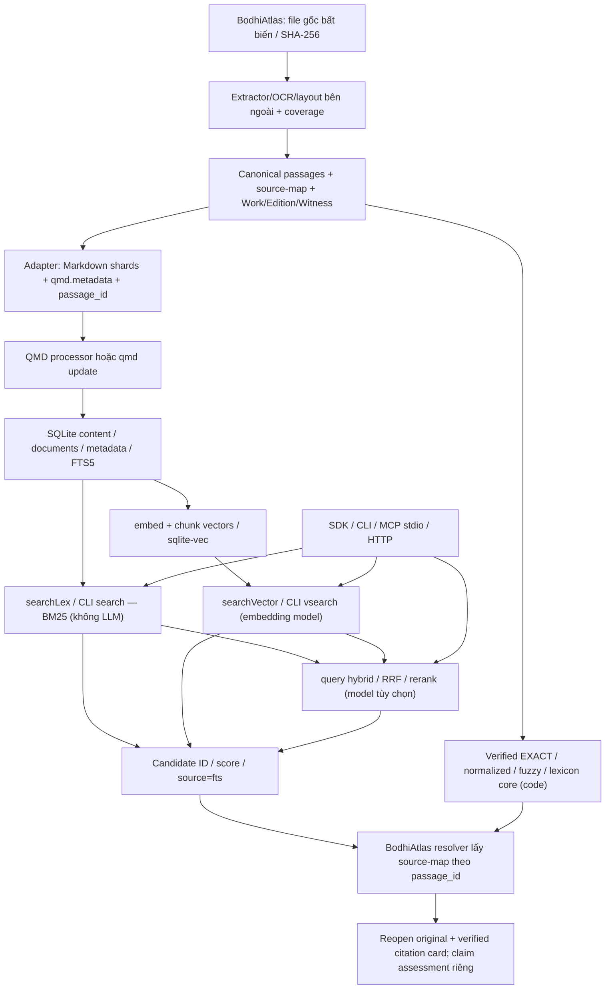

# Technology Assessment — QMD (tobi/qmd)

- **Mã thẩm định:** P02; **ngày snapshot:** 2026-11-16 (Asia/Ho_Chi_Minh); **analyst:** ChatGPT, thẩm định mã nguồn/tài liệu độc lập cho BodhiAtlas.
- **Đối tượng:** [tobi/qmd](https://github.com/tobi/qmd); **repo HEAD được xác minh:** `ee88c16d4dc4ac8e5a835ad775ec69e92fb20c23` (commit `main` ngày 2026-11-15, merge PR #1117 collection processors); **package `@tobilu/qmd`:** `2.8.3` theo `package.json` tại HEAD; **release GitHub mới nhất quan sát được:** [`v2.8.3`](https://github.com/tobi/qmd/releases/tag/v2.8.3), phát hành 2026-08-16. **Chú ý:** HEAD có thay đổi sau release; không đồng nhất code trên `main` với binary phát hành.
- **Trạng thái:** public, chưa archived (GitHub repo metadata tại ngày kiểm); **giấy phép code:** MIT tại [`LICENSE`](https://github.com/tobi/qmd/blob/ee88c16d4dc4ac8e5a835ad775ec69e92fb20c23/LICENSE). Giấy phép các GGUF model, weights và dữ liệu riêng **chưa được thẩm định độc lập**.
- **Bối cảnh đã đọc toàn văn:** [BodhiAtlas PRD V1.4](https://github.com/quoctran-2608/bodhi-atlas/blob/main/docs/PRD.md) và [Academic Risks & Verification](https://github.com/quoctran-2608/bodhi-atlas/blob/main/docs/ACADEMIC_RISKS_AND_VERIFICATION.md), qua GitHub connector. Đối chiếu repo [BodhiAtlas](https://github.com/quoctran-2608/bodhi-atlas), README repo [BuddhismDocuments-for-AI](https://github.com/quoctran-2608/BuddhismDocuments-for-AI) và cấu trúc của chúng; **không** mặc định các yêu cầu PRD là năng lực đã triển khai.
- **Công cụ và giới hạn:** GitHub connector đọc trực tiếp README, package, license, docs, file TypeScript, tests, issue và API release/commit; web đọc đặc tả SQLite/OpenSearch/RAGFlow. **Không cài/chạy QMD**, không tải GGUF/corpus, không có kết quả benchmark POC. Các test file trong repo được **đọc**, không được tính `[TESTED]`. Bất kỳ kết luận hiệu năng hay tỷ lệ recall nào bên dưới là giả thuyết/tiêu chí POC, không phải số đo.
- **Thang bằng chứng:** `[DOC]` mô tả chính thức; `[CODE]` đoạn code đã mở; `[ISSUE]` báo cáo ngoài chưa tự tái hiện; `[INFERRED]` suy luận kỹ thuật từ code/đặc tả; `[UNKNOWN]` chưa kiểm chứng; `[TESTED]` chỉ khi tác giả báo cáo tự chạy có log (báo cáo này **không có** `[TESTED]`). **Cổng đánh giá** phân biệt *standalone platform* với *candidate-retrieval component*; một khả năng không thuộc vai trò QMD được ghi `N/A` hoặc `EXTERNAL`, không chấm như thất bại phần mềm.

## 1. Executive Decision

**Khuyến nghị: `USE AS COMPONENT` — triển khai thử có kiểm soát, không `ADOPT` làm nền tảng V1 Core. Độ tin cậy: `MEDIUM`.** QMD là công cụ search/index cục bộ chuyên cho Markdown, gồm BM25 trên SQLite FTS5, vector từ `sqlite-vec`, hybrid/rank fusion, model-based expansion/rerank, SDK và MCP/HTTP. Trên nhánh `main` đã có **per-collection document processors**, tạo thuận lợi cho adapter chuyển file hoặc dữ liệu cấu trúc thành Markdown có khóa ổn định; phiên bản release `2.8.3` trước thay đổi này cần phân biệt riêng.

Đối với BodhiAtlas, điểm mạnh thực dụng nhất là một **candidate retriever tùy chọn** trên những `Passage` đã được canonical hóa và gắn metadata ở hệ thống nguồn. `qmd search`/SDK `searchLex` có thể chạy **không cần LLM** để tìm tài liệu ứng viên; `vsearch` cần embedding model, còn `query` mặc định có expansion/rerank bằng model. Tuy nhiên, chỉ mục FTS của QMD là **document-level**, dùng tokenizer `porter unicode61` (stem, case/diacritic folding), trả danh sách tài liệu, **không** cam kết liệt kê tất cả vị trí nguyên văn theo ký tự. Vector trả chunk gần nhất, không phải mọi occurrence. QMD không phải hệ quản trị Work–Expression–Edition–Witness, OCR/layout, PDF bbox/printed page, EPUB CFI, lexicon theo từng nghĩa, hay Citation Checker.

**Ba rủi ro P0:** (1) biến khớp token/điểm relevance thành khớp nguyên văn hay bằng chứng đã xác minh; (2) sai/sót Unicode, tiếng Hán ngắn, dấu Pāli/Việt và câu vượt chunk; (3) mất liên kết tới đúng file/ấn bản/locator khi biến đổi Markdown hoặc reindex, đồng thời MCP HTTP chưa có auth ứng dụng. **Quyết định hành động:** để BodhiAtlas hoặc `BuddhismDocuments-for-AI` nắm kho gốc, provenance và authoritative exact scanner; QMD chỉ đề cử `passage_id`, không tạo citation đã duyệt. Chạy POC 50 truy vấn với đối chiếu full-occurrence và các failure gate trước khi phê duyệt tích hợp.

## 2. Sources & Evidence Ledger

**Quy ước URL:** Mọi permalink tới QMD gắn SHA HEAD nêu ở đầu, không trỏ `main` không cố định; repo khác là nguồn bối cảnh. `CODE` xác minh **hình thức triển khai**, không xác minh runtime hay chất lượng thực tế.

| claim_id | nhận định | mức | URL/permalink | version | ghi chú |
|---|---|---|---|---|---|
| Q01 | `@tobilu/qmd` v2.8.3, Node >=22, MIT, SQLite/vec/llama phụ thuộc | [CODE] | [package.json](https://github.com/tobi/qmd/blob/ee88c16d4dc4ac8e5a835ad775ec69e92fb20c23/package.json#L1-L110), [LICENSE](https://github.com/tobi/qmd/blob/ee88c16d4dc4ac8e5a835ad775ec69e92fb20c23/LICENSE) | HEAD | Package version khác thời điểm commit |
| Q02 | FTS5 `filepath,title,body`, `tokenize='porter unicode61'` | [CODE] | [store.ts L1075–1085](https://github.com/tobi/qmd/blob/ee88c16d4dc4ac8e5a835ad775ec69e92fb20c23/src/store.ts#L1075-L1085) | HEAD | Token match không bằng byte-exact |
| Q03 | CJK run tách thành các codepoint ngăn cách khi index/query | [CODE] | [store.ts L925–956](https://github.com/tobi/qmd/blob/ee88c16d4dc4ac8e5a835ad775ec69e92fb20c23/src/store.ts#L925-L956) | HEAD | Không tự chuyển giản/phồn |
| Q04 | `searchFTS` dùng BM25 `1.5,4.0,1.0`; trả một hit/tài liệu có `LIMIT` | [CODE] | [store.ts L4740–4835](https://github.com/tobi/qmd/blob/ee88c16d4dc4ac8e5a835ad775ec69e92fb20c23/src/store.ts#L4740-L4835) | HEAD | Score là relevance, không phải xác suất |
| Q05 | `SearchResult` có `chunkPos` tùy chọn cho vector, không có tất cả offset/PDF bbox | [CODE] | [store.ts L2737–2758](https://github.com/tobi/qmd/blob/ee88c16d4dc4ac8e5a835ad775ec69e92fb20c23/src/store.ts#L2737-L2758), [L2830–2837](https://github.com/tobi/qmd/blob/ee88c16d4dc4ac8e5a835ad775ec69e92fb20c23/src/store.ts#L2830-L2837) | HEAD | Thiếu trường không khẳng định mọi extension đều bất khả |
| Q06 | QMD có content-addressed *derived text*, `documents` liên kết hash, `content_vectors` | [CODE] | [store.ts L1240–1365](https://github.com/tobi/qmd/blob/ee88c16d4dc4ac8e5a835ad775ec69e92fb20c23/src/store.ts#L1240-L1365) | HEAD | `hash` QMD **không** là SHA-256 file PDF gốc |
| Q07 | `searchVec` KNN sqlite-vec, gom nearest chunk thành document, trần KNN 4096 | [CODE] | [store.ts L4830–5120](https://github.com/tobi/qmd/blob/ee88c16d4dc4ac8e5a835ad775ec69e92fb20c23/src/store.ts#L4830-L5120) | HEAD | Không full-occurrence |
| Q08 | `searchLex` không gọi LLM; `searchVector` cần model; `search` bình thường expand/rerank | [CODE] | [index.ts L229–335](https://github.com/tobi/qmd/blob/ee88c16d4dc4ac8e5a835ad775ec69e92fb20c23/src/index.ts#L229-L335), [L475–550](https://github.com/tobi/qmd/blob/ee88c16d4dc4ac8e5a835ad775ec69e92fb20c23/src/index.ts#L475-L550) | HEAD | CLI `search`/`vsearch`/`query` tương ứng |
| Q09 | Processor nhận source bytes + source SHA-256, xuất nhiều Markdown stable key | [CODE] | [processors.ts](https://github.com/tobi/qmd/blob/ee88c16d4dc4ac8e5a835ad775ec69e92fb20c23/src/processors.ts#L8-L27), [PROCESSORS.md](https://github.com/tobi/qmd/blob/ee88c16d4dc4ac8e5a835ad775ec69e92fb20c23/docs/PROCESSORS.md) | HEAD **sau release** | Source SHA processor là ngõ tích hợp, không source-map native |
| Q10 | Processor giới hạn 10 MiB/source, 1000 outputs, 16 MiB Markdown, atomic từng source | [CODE] | [processors.ts L25–83](https://github.com/tobi/qmd/blob/ee88c16d4dc4ac8e5a835ad775ec69e92fb20c23/src/processors.ts#L25-L83), [PROCESSORS.md](https://github.com/tobi/qmd/blob/ee88c16d4dc4ac8e5a835ad775ec69e92fb20c23/docs/PROCESSORS.md#L85-L103) | HEAD | Kiểm dữ liệu sách lớn |
| Q11 | CLI/project-local trust với command processor/hook nhưng không phải OS sandbox | [CODE] | [PROCESSORS.md L34–55](https://github.com/tobi/qmd/blob/ee88c16d4dc4ac8e5a835ad775ec69e92fb20c23/docs/PROCESSORS.md#L34-L55), [trust.ts](https://github.com/tobi/qmd/blob/ee88c16d4dc4ac8e5a835ad775ec69e92fb20c23/src/trust.ts) | HEAD | Quyền thực thi tiến trình vẫn cần cô lập |
| Q12 | MCP stdio/HTTP cùng `POST /mcp`, `/query`, `/search`, `/metadata`; HTTP không có auth tích hợp | [CODE]+[DOC] | [README L133–183](https://github.com/tobi/qmd/blob/ee88c16d4dc4ac8e5a835ad775ec69e92fb20c23/README.md#L133-L183), [server.ts](https://github.com/tobi/qmd/blob/ee88c16d4dc4ac8e5a835ad775ec69e92fb20c23/src/mcp/server.ts#L1100-L1490) | HEAD | Origin/Host guard không thay OAuth/RBAC |
| Q13 | Metadata namespaced frontmatter scalar/flat homogeneous arrays, SQL filter | [CODE] | [metadata.ts L1–96](https://github.com/tobi/qmd/blob/ee88c16d4dc4ac8e5a835ad775ec69e92fb20c23/src/metadata.ts#L1-L96), [metadata-filter.ts](https://github.com/tobi/qmd/blob/ee88c16d4dc4ac8e5a835ad775ec69e92fb20c23/src/metadata-filter.ts) | HEAD | Metadata ≠ đồ thị quan hệ học thuật |
| Q14 | Test có cho CJK, separators, processors, path, MCP origin nhưng **chưa chạy ở nghiên cứu này** | [CODE] | [test/store-cjk-fts.test.ts](https://github.com/tobi/qmd/blob/ee88c16d4dc4ac8e5a835ad775ec69e92fb20c23/test/store-cjk-fts.test.ts), [test/processors.test.ts](https://github.com/tobi/qmd/blob/ee88c16d4dc4ac8e5a835ad775ec69e92fb20c23/test/processors.test.ts), [test/path-fidelity.test.ts](https://github.com/tobi/qmd/blob/ee88c16d4dc4ac8e5a835ad775ec69e92fb20c23/test/path-fidelity.test.ts) | HEAD | **NOT TESTED** |
| Q15 | NFD combining marks có nguy cơ false-negative trong query builder | [ISSUE] | [#966](https://github.com/tobi/qmd/issues/966) | open, 2026-09 | Reporter nói ảnh hưởng main, không release 2.8.3 |
| Q16 | FTS CJK có thể trả 0 khi một cụm bắt buộc không có, dù còn từ liên quan | [ISSUE] | [#976](https://github.com/tobi/qmd/issues/976) | open | Kết quả hợp lệ theo AND nhưng rủi ro recall |
| Q17 | CLI `vsearch` default threshold 0.3 có thể giấu hit tiếng Hán | [ISSUE] | [#1110](https://github.com/tobi/qmd/issues/1110) | open, 2026-11-11 | Chưa tái hiện |
| Q18 | Chinese/Cantonese expansion có báo cáo bỏ ý chính | [ISSUE] | [#920](https://github.com/tobi/qmd/issues/920), [#454](https://github.com/tobi/qmd/issues/454) | open | LLM expansion không phải lexicon được kiểm duyệt |
| Q19 | Báo cáo lỗi vector model tại context batch-boundary | [ISSUE] | [#897](https://github.com/tobi/qmd/issues/897) | open | Chưa xác minh; POC phải đo vector integrity |
| Q20 | SDK rename collection có báo cáo mất mapping cũ | [ISSUE] | [#1019](https://github.com/tobi/qmd/issues/1019) | open | Không đổi ID/citation theo collection path |
| Q21 | PRD yêu cầu tất cả exact occurrence, đa ngữ, re-open và G1/G2 | [DOC] | [PRD.md](https://github.com/quoctran-2608/bodhi-atlas/blob/main/docs/PRD.md), [Academic Risks](https://github.com/quoctran-2608/bodhi-atlas/blob/main/docs/ACADEMIC_RISKS_AND_VERIFICATION.md) | PRD V1.4 | Đây là yêu cầu dự án, không phải mô tả QMD |
| Q22 | Corpus repo đã có 13 upstream pins, SQLite/FTS, provenance và Quick resolver giới hạn | [DOC] | [BuddhismDocuments-for-AI README](https://github.com/quoctran-2608/BuddhismDocuments-for-AI/blob/main/README.md), [manifest](https://github.com/quoctran-2608/BuddhismDocuments-for-AI/blob/main/manifest.json) | README truy cập 2026-11-16 | V2 research **chưa** được phê duyệt ngữ nghĩa |
| Q23 | `unicode61` mặc định bỏ dấu Latin (một số ngoại lệ), trigram không giải quyết FTS query ngắn <3 ký tự | [DOC] | [SQLite FTS5](https://www.sqlite.org/fts5.html#tokenizers) | SQLite docs | Cần nguyên văn checker độc lập |
| Q24 | RAGFlow quản lý dataset/chunk và citation UI; không chứng minh source-map học thuật | [DOC]+[INFERRED] | [RAGFlow docs](https://ragflow.io/docs) | kiểm 2026-11-16 | Cần benchmark nguồn ngang nhau |
| Q25 | OpenSearch built-in `cjk` dùng bigram; `icu_analyzer` có thể phù hợp hơn nhưng cần thử | [DOC] | [OpenSearch CJK analyzer](https://docs.opensearch.org/latest/analyzers/language-analyzers/cjk/) | docs current | Không tự bảo đảm raw offset/edition |

## 3. Architecture & Data Flow

**Phân lớp:** QMD là *index/search component* và ứng dụng local retrieval trên corpus Markdown, **không** phải corpus, chuẩn dữ liệu, hệ OCR hay thư viện quản lý ấn bản học thuật. Hạt nhân thực thi `src/store.ts`, SDK `src/index.ts`, CLI `src/cli/qmd.ts`, MCP `src/mcp/server.ts`; model access `src/llm.ts`, vector `sqlite-vec`, config/metadata trong `src/collections.ts`, `src/metadata*.ts`.



**Chủ quyền dữ liệu:** source bytes, SHA gốc, locator/bbox/CFI, edition–witness và nhật ký coverage do **BodhiAtlas** giữ. QMD sở hữu **index phái sinh** (text Markdown và hash text, FTS, vector, metadata, cache). Không đồng nhất `qmd://collection/path`, QMD docid 6 ký tự, `content.hash` với `file_id`/`sha256` bất biến của source. Cơ chế QMD FTS có thể hoạt động không có `sqlite-vec` (theo `initializeDatabase`), trong khi semantic không thể nếu thiếu vector/mô hình. Source raw không được QMD gọi lại để xác minh bbox; tích hợp phải cung cấp validator.

**Dòng `query`:** query gốc → expansion kiểu `lex/vec/hyde` bằng local generation model (trừ khi người gọi truyền structured queries) → FTS/vector → weighted RRF và top-rank bonus → rerank model theo mặc định → đoạn ứng viên. `search`/`searchLex` thuần lexical không đòi LLM, nhưng match này vẫn **tokenized**, không phải raw exact. Score: FTS biến đổi từ BM25, vector từ cosine similarity, hybrid từ fusion/rerank; **không phải likelihood mệnh đề đúng**.

## 4. Feature Fit–Gap Matrix

*Trạng thái áp cho QMD trong vai trò ứng viên retriever; `EXTERNAL` là chức năng thuộc BodhiAtlas hoặc hệ nhập khác; effort ước lượng tương đối (`S/M/L`) dưới giả định đã có canonical ingestion. G1/G2 trong PRD/Risks vẫn áp dụng cho hệ tổng thể.*

| Code | Năng lực | Trạng thái | Chứng cứ | Tác động/gap với BodhiAtlas | Công sức bù | Phương án bù |
|---|---|---|---|---|---|---|
| C01 | Multi-format ingest | EXTENSION | Q09–Q10, PROCESSORS.md | Native chủ yếu Markdown; PDF/EPUB/DOCX qua converter/processor custom, 10 MiB/source processor | M–L | Ingest canonical trước, export Markdown shards hoặc viết processor có phân vùng |
| C02 | OCR/layout/reading order | EXTERNAL | Q06, docs processors | Không engine OCR/hai cột/footnote/layout native | L | Tách OCR/layout/quality ngoài, lưu vùng lỗi |
| C03 | Canonical text & source map | EXTERNAL | Q05–Q06 | QMD hash text dẫn xuất, không có source-map PDF tọa độ | L | BodhiAtlas owns immutable canonical + source-map version |
| C04 | Works/editions/witnesses | EXTERNAL | Q06, Q13 | Metadata lọc được nhưng không quan hệ `translation_of/parallel_to` | M | Catalog/knowledge model ngoài, QMD chỉ mirror `edition_id` |
| C05 | Exhaustive EXACT | MISSING | Q02, Q04–Q05 | FTS trả ranked document, normalization tokenizer, không mọi codepoint offsets | M–L | Deterministic exact scanner/index theo canonical passage; QMD không xác nhận EXACT |
| C06 | Normalized multilingual search | EXTENSION | Q03, Q15, Q23 | Case/Latin diacritics và CJK char spacing nhưng không fully controlled Vi/Pāli/Hán/Tạng/Wylie | M–L | Normalized parallel index + transformation provenance + language tests |
| C07 | Fuzzy OCR/near duplicate | EXTENSION | `findSimilarFiles` [store.ts L3996–4088](https://github.com/tobi/qmd/blob/ee88c16d4dc4ac8e5a835ad775ec69e92fb20c23/src/store.ts#L3996-L4088) | Levenshtein trên **filename** không đồng nghĩa fuzzy body; semantic ≠ OCR edit distance | M | Char n-gram/edit distance passages, diff original, confidence |
| C08 | Sense-aware lexicon | EXTERNAL | Q13, PRD 2.4 | Không sense ID + nguồn xác minh làm lexical expansion | L | Curated sense–variant–language mappings có evidence |
| C09 | Semantic/hybrid/RAG | NATIVE | Q07–Q08 | Có vector/hybrid/rerank; cần model và đo multi-script, không verified academic claims | M | Chỉ bật sau model eval; không dùng model score làm proof |
| C10 | Verified citation card & reopen | EXTERNAL | Q05–Q06 | QMD path/line/snippet không xác minh file–page–bbox | L | Canonical resolver, hash check, OCR status, citation validator G2 |
| C11 | Note/wiki/claim memory | N/A | README, SDK | QMD tìm notes có sẵn; không phải claim-review/Second Brain workflow | M | Bổ sung lớp notes/claims ở ứng dụng nếu cần, không chấm QMD thiếu |
| C12 | API/MCP/export/integration | NATIVE | Q08, Q12 | SDK, CLI JSON, MCP, HTTP khả dụng; contract `passage_id` custom | S–M | Adapter có version pin, JSON schema, gateway authentication |
| C13 | Quality coverage + incremental | CONFIG | Q10, file_sync_state | Incremental/content hash/processor ledger có, **không** OCR page coverage theo PRD | M | Synchronization manifest, OCR coverage log và reindex audit ngoài |
| C14 | Auth/licensing/privacy/backup | EXTENSION | Q01, Q11–Q12 | MIT code, HTTP không auth, model/data licenses riêng, cần backup | M–L | Loopback + auth proxy/ACL, permission isolation, backup replay tests |
| C15 | Operational simplicity / independent deploy | NATIVE | package.json, README | SQLite single-process/local đơn giản hơn cluster; native deps/GGUF kéo tài nguyên | S–M | Docker/Node 22 pinned, lock migrations & model artifacts; FTS-only profile |

**Cổng không thỏa nếu dùng QMD độc lập:** C03/C05/C10 là **P0 blockers**, không phải vì QMD thiết kế sai, mà vì vai trò search engine khác library-of-record. Nếu dùng QMD chỉ **candidate retriever**, C02/C03/C04/C08/C10 thuộc hệ chủ/ngoài phạm vi và không cần QMD tự đảm trách.

## 5. Deep Technical Findings

### 5.1. Indexer, schema, hash và incremental

- [CODE] `src/store.ts` có `content(hash,doc,created_at)` và `documents(id,collection,path,title,hash,...,active)`; `documents_fts(filepath,title,body)` đồng bộ theo indexed Markdown; `file_sync_state` theo mtime/size/hash giúp bỏ qua unchanged; `content_vectors(hash,seq,pos,model,embed_fingerprint,total_chunks,embedded_at)` trỏ chunk embeddings. Đây là data model **document-vs-content**, không phải Work/Edition/Witness. Nên phân biệt SHA-256 **Markdown body** dùng `content.hash` với SHA-256 **bytes file gốc**, và với vector model fingerprint. [store.ts L1240–1365](https://github.com/tobi/qmd/blob/ee88c16d4dc4ac8e5a835ad775ec69e92fb20c23/src/store.ts#L1240-L1365).
- [CODE] Default `DEFAULT_GLOB="**/*.md"`, regex chunk khoảng **900 tokens / overlap 15%** (tương đương đại diện chars 3600/540, không cam kết token-char mapping). AST chunker nhắm code TS/JS/Python/Go/Rust, còn Markdown dùng regex. Câu vượt ranh giới có thể không lọt một vector chunk, dù FTS document-level phrase có khả năng tìm cùng document nếu token adjacency còn nguyên. **Phải thử câu xuyên trang/fragment do adapter tạo**. [store.ts L168–175](https://github.com/tobi/qmd/blob/ee88c16d4dc4ac8e5a835ad775ec69e92fb20c23/src/store.ts#L168-L175), [README](https://github.com/tobi/qmd/blob/ee88c16d4dc4ac8e5a835ad775ec69e92fb20c23/README.md#L767-L795).
- [CODE] Từ HEAD 2026-11-15 có `DocumentProcessor` source snapshot (`bytes`, `hash` SHA-256, `relativePath`, `modifiedAt`, `collection`), xuất `[{key,markdown}]` có ID ổn định và metadata frontmatter. Hỗ trợ nạp JSON cấu trúc tốt và có thể gọi converter PDF; **không có OCR/layout/locator do QMD tự tạo**. Giới hạn 10 MiB đầu vào/1000 outputs/16 MiB Markdown aggregate/source và thời gian thực thi; sách PDF lớn nên xử lý outside hoặc chia nguồn trước. Failure giữ children lần publish thành công: hữu ích cho tính sẵn sàng nhưng phải báo `INDEX_STALE`, không được lặng im dùng citation cũ. [docs/PROCESSORS.md](https://github.com/tobi/qmd/blob/ee88c16d4dc4ac8e5a835ad775ec69e92fb20c23/docs/PROCESSORS.md), [processor-store.ts L92–217](https://github.com/tobi/qmd/blob/ee88c16d4dc4ac8e5a835ad775ec69e92fb20c23/src/processor-store.ts#L92-L217).
- [CODE] `docid` hiển thị từ **6 hex ký tự đầu** của content hash; không dùng làm citation persistent key, nguy cơ trùng tăng theo số lượng documents. `qmd://collection/path` thuận cho lookup nhưng collection rename/path change không phải bất biến. QMD content hash giống nhau có thể chia sẻ content/vector, nhưng **hai ấn bản trùng văn bản không thể tự động nhập một Work/Edition**. [store.ts L2737–2758](https://github.com/tobi/qmd/blob/ee88c16d4dc4ac8e5a835ad775ec69e92fb20c23/src/store.ts#L2737-L2758), [#1019](https://github.com/tobi/qmd/issues/1019).

### 5.2. FTS5, tokenizer, BM25 và exhaustive exact

- [CODE] `documents_fts` dùng `porter unicode61` trên `filepath, title, body`. `porter` stem tiếng Anh; `unicode61` mặc định case-insensitive, bỏ phần lớn Latin diacritics. QMD có một số tự biến đổi query như tách dấu câu và prefix trên từ đơn. Vì vậy `qmd search 'anatta'` có thể match `anattā` mà **không thể gắn nhãn EXACT**; `"vô thường"` là *FTS token phrase*, không phải chứng minh nguyên văn có đúng dấu, dấu câu, byte hay Unicode normalization. [SQLite FTS5](https://www.sqlite.org/fts5.html#tokenizers).
- [CODE] Query builder `buildFTS5Query` thêm `AND` giữa positive terms, `NOT` cho terms bị loại; quoted phrase chỉ yêu cầu chuỗi token liền nhau, không đồng nghĩa substring codepoint. `searchFTS` `MATCH` + `bm25(documents_fts, 1.5, 4.0, 1.0)` + `ORDER BY` + `LIMIT`, trả **một hàng mỗi document**, không có `start_char/end_char` cho từng occurrence. Sau BM25, QMD biến điểm theo `abs(x)/(1+abs(x))`; điểm cao chỉ là ranking. [store.ts L4561–4835](https://github.com/tobi/qmd/blob/ee88c16d4dc4ac8e5a835ad775ec69e92fb20c23/src/store.ts#L4561-L4835).
- [INFERRED] **Cổng code-only exhaustive EXACT: FAIL đối với QMD API native.** Dù đặt `limit` rất lớn, bạn vẫn chỉ có tài liệu khớp token chứ không có mọi start/end offsets; duplicate occurrence trong một file không được liệt kê. Chuỗi dài qua chunk có thể được BM25 tìm document, nhưng không trả chính xác vị trí. Phải chạy `find_all` trên **canonical raw text** với các boundary rules công khai, lưu mapping từng span sang locator, không dùng chỉ `snippet()` hoặc `chunkPos` để khẳng định G2. Nếu canonical source là Markdown đã bị adapter thêm YAML/header, offset phải tính trong body gốc hoặc duy trì offset-map chính xác.
- [CODE] CJK normalization thành các token ký tự rời bằng chèn khoảng trắng, rồi query CJK thành phrase tokens; cải thiện từ issue #617 (closed), nhưng **chỉ là tokenization cho CJK run**, không phải giản↔phồn, không phải full linguistic segmentation, không bảo đảm một/two-character false-positive/false-negative bằng chính nguyên văn. [store.ts L925–956](https://github.com/tobi/qmd/blob/ee88c16d4dc4ac8e5a835ad775ec69e92fb20c23/src/store.ts#L925-L956).
- [ISSUE] #966 báo NFD combining marks bị regex `FTS5_SEPARATOR_RUN` xem là separator, nguy cơ silent false-negative cho Pāli/Vietnamese/Mac paths; #976 báo all-or-nothing CJK phrase AND query, #922 scoped FTS prefilter false empty **đã closed** và HEAD code dùng full materialized match set khi lọc. Trạng thái issue không thay được kiểm thử trên phiên bản phát hành. [#966](https://github.com/tobi/qmd/issues/966), [#976](https://github.com/tobi/qmd/issues/976), [#922](https://github.com/tobi/qmd/issues/922).

### 5.3. Vector, hybrid/RRF và model boundary

- [CODE] `searchVec` dựa `sqlite-vec` KNN (cosine), mặc định lấy nearest chunks rồi quy về một row/doc; vector result có `chunkPos` là position của chunk, không phải offset khớp một câu cụ thể. SQL vec KNN có trần `k=4096`, code có partition-aware scan và xử lý các model fingerprint incompatibility. Model swap đòi re-embedding. [store.ts L4830–5120](https://github.com/tobi/qmd/blob/ee88c16d4dc4ac8e5a835ad775ec69e92fb20c23/src/store.ts#L4830-L5120).
- [CODE] `reciprocalRankFusion` tính đóng góp `weight/(60+rank+1)` (mặc định k=60), thưởng top-rank `+0.05` hoặc `+0.02`, sau đó reranker tùy chế độ. Có trace giải thích nguồn đóng góp, **không** chứng minh logic của luận đề; `source` trả `fts/vec`. [store.ts L5490–5590](https://github.com/tobi/qmd/blob/ee88c16d4dc4ac8e5a835ad775ec69e92fb20c23/src/store.ts#L5490-L5590).
- [CODE] Phân biệt chính xác API: CLI `qmd search` → BM25 lexical **code only**; `qmd vsearch` → vector cần model embedding và index đã embed; `qmd query` → hybrid + LLM query expansion + reranking; SDK `searchLex`, `searchVector`, `search({query})`, `search({queries:[{type:'lex',query:'...'}],rerank:false})` cho control; `expandQuery()` gọi model. Cấu hình model local qua node-llama-cpp hoặc embedding remote; `remote` sẽ có data-egress tới endpoint cấu hình. **Không** gọi `query` là no-LLM vì score được tính bằng code. [index.ts L229–335](https://github.com/tobi/qmd/blob/ee88c16d4dc4ac8e5a835ad775ec69e92fb20c23/src/index.ts#L229-L335), [L475–550](https://github.com/tobi/qmd/blob/ee88c16d4dc4ac8e5a835ad775ec69e92fb20c23/src/index.ts#L475-L550), [README usage](https://github.com/tobi/qmd/blob/ee88c16d4dc4ac8e5a835ad775ec69e92fb20c23/README.md#L961-L985).
- [DOC] Mô hình mặc định theo README: embeddinggemma-300M Q8 khoảng **300 MB**, Qwen3 Reranker 0.6B Q8 khoảng **640 MB**, query expansion 1.7B Q4 khoảng **1.1 GB**; chỉ kích thước model tham khảo, không phải peak RSS/VRAM đã đo. GGUF có thể tải lần đầu từ Hugging Face, offline thật cần prefetch/pin/hash và kiểm license; QMD có thể dùng Qwen3 Embedding 0.6B đa ngữ theo README, **không** chứng minh phù hợp Pāli/Tạng. [README model](https://github.com/tobi/qmd/blob/ee88c16d4dc4ac8e5a835ad775ec69e92fb20c23/README.md#L571-L615).
- [ISSUE] Cần mô phỏng #1110 về `vsearch` hard threshold CLI và #897 về embeddings tại batch boundary 512 tokens; chưa biết phạm vi lỗi ở mọi CPU/GPU/binary. Đặc biệt không gán vector recall thấp là không có nguồn; trước hết kiểm embedding quality/integrity. [#1110](https://github.com/tobi/qmd/issues/1110), [#897](https://github.com/tobi/qmd/issues/897).

### 5.4. SDK, API, HTTP/MCP, metadata, lỗi vận hành

- [CODE] Public SDK `createStore({dbPath,config|configPath})`, `searchLex`, `searchVector`, `search`, `get`, `getDocumentBody(fromLine,maxLines)`, `multiGet`, `addCollection`, `update({processors})`, `embed`, `listMetadata`; TypeScript interface công khai là hợp đồng tốt cho integration **nhưng không phải cam kết API ổn định vĩnh viễn**, nhất là khi dùng HEAD chưa release. [index.ts L301–445](https://github.com/tobi/qmd/blob/ee88c16d4dc4ac8e5a835ad775ec69e92fb20c23/src/index.ts#L301-L445).
- [CODE]+[DOC] `qmd mcp` chạy stdio; `qmd mcp --http` dùng Streamable HTTP và REST JSON `POST /query`/`/search`, `/metadata`. Mặc định loopback. `Origin`/`Host` filtering giảm DNS rebinding nhưng **request không có Origin có thể được chấp nhận và HTTP endpoints không có authentication/authorization nội bộ**; bind `0.0.0.0` mà không proxy là rủi ro rò toàn index. MCP tool/read các snippet có thể chứa dữ liệu bản quyền; cần access control trên mỗi collection trước QMD, không tin client tự gửi filter. [origin-guard.ts L88–158](https://github.com/tobi/qmd/blob/ee88c16d4dc4ac8e5a835ad775ec69e92fb20c23/src/mcp/origin-guard.ts#L88-L158); [README HTTP](https://github.com/tobi/qmd/blob/ee88c16d4dc4ac8e5a835ad775ec69e92fb20c23/README.md#L133-L183).
- [CODE] Metadata `qmd.metadata` hỗ trợ string/number/boolean, danh sách phẳng cùng kiểu; filter được compiled SQL. Có thể lọc `work_id`, `edition_id`, `source_type`, `language`, `rights_class`; nhưng mọi giá trị này **phải được sinh/xác minh bởi BodhiAtlas**. Không có native typed relation table Work/Expression/Edition/Witness hoặc schema sense-aware. [metadata.ts](https://github.com/tobi/qmd/blob/ee88c16d4dc4ac8e5a835ad775ec69e92fb20c23/src/metadata.ts), [metadata-filter.ts](https://github.com/tobi/qmd/blob/ee88c16d4dc4ac8e5a835ad775ec69e92fb20c23/src/metadata-filter.ts).
- [CODE] Hệ indexing incremental và housekeeping (`cleanupOrphanedVectors`, FTS `optimize`, vector repack), có test cập nhật và path. Chưa có bằng chứng SLA index tốc độ trên corpus Phật học/di sản cụ thể. Issue #1019 về collection rename: dùng immutable `passage_id` không thay, test rollback/sync sau rename. [store.ts L3182–3510](https://github.com/tobi/qmd/blob/ee88c16d4dc4ac8e5a835ad775ec69e92fb20c23/src/store.ts#L3182-L3510).

## 6. Source Fidelity & Provenance

**Phạm vi:** Đây là **điều kiện tích hợp do BodhiAtlas thực thi**, không một claim QMD bản thân đã hỗ trợ. PRD ưu tiên `File/SHA-256`, `Work–Expression–Edition–Witness`, `Passage` định vị, trạng thái OCR, cite card và kiểm lại từ source; Academic Risks nhấn R01–R05, R07, R27, G1/G2.

| Thành tố | QMD bản thân | Bắt buộc ở lớp chủ quản |
|---|---|---|
| Original bytes + SHA-256 | Processor input có SHA bytes tạm thời; QMD `content.hash` là text dẫn xuất | Immutable object store, `file_id`, full file_sha256, rights, revision |
| Canonical raw text | QMD lưu body Markdown index; có thể gắn header/frontmatter | Raw extracted text bất biến theo extraction_version; representation/index khác raw |
| PDF page & bbox | Không thấy trong native result/schema | `pdf_page_index` (0/1-base quy ước rõ), bbox chuẩn hóa/hệ tọa độ, page image verify |
| Printed page | Không có native | Chỉ lưu khi con người/xử lý đáng tin đã xác nhận, không suy từ offset PDF |
| EPUB CFI/href | Không có native | `spine_id`, `href`, CFI/anchor đã tái mở được trong đúng EPUB version |
| DOCX/Markdown locator | Có line text retriever, không bảo đảm original DOCX/XML | `paragraph_id`, run/structural anchor, raw text offsets và digest |
| Works/versions/witnesses | Path/metadata filter phẳng | Catalog quan hệ, không gộp translation/parallel/variant, provenance relation |
| All exact occurrences | Ranked matched doc/chunk | Index/scanner giữ `start_char,end_char` (quy ước Unicode), duplicate occurrence trong mọi passage |
| OCR coverage/errors | Index health/metadata, không OCR quality map | Coverage manifest theo page/region, errors và `PARTIAL/OCR_UNCERTAIN` |
| Citation reopen/reverify | `get` lấy Markdown body | Fetch exact original source và locator, re-extract/check text + hash, reviewer nếu OCR uncertain |

**Contract gợi ý cho passage canonical (đề xuất, không phải QMD schema):**

```json
{
  "passage_id": "pa_000142",
  "work_id": "w_001", "expression_id": "ex_001", "edition_id": "ed_004",
  "witness_id": "wi_004", "file_id": "fi_037",
  "file_sha256": "<64 hex bytes-of-original>",
  "extraction_version": "extract-v3",
  "raw_text_sha256": "<64 hex canonical-extracted-text>",
  "text_raw": "... nguyên văn từ nguồn / bản trích xuất ...",
  "locator": {"kind":"pdf", "pdf_page_index":42,
              "printed_page":"37", "printed_page_verified":true,
              "bbox":[0.12,0.30,0.88,0.42]},
  "coverage": {"status":"OCR_UNCERTAIN", "ocr_reviewed":false},
  "access_class": "research-only"
}
```

`bbox` trên chỉ là **shape/schema minh họa** (giá trị giả trong contract), **không** phải citation hoặc vị trí thực tế. Production phải có coordinate system, page dimension, extraction provenance, checksum và quy tắc xác minh. Không bao giờ dùng ví dụ này để tạo trích dẫn.

**Tra cứu và kiểm nguồn độc lập:** QMD trả `qmd://collection/edition-passage.md` và `qmd.metadata.passage_id`; resolver xác định `file_sha256`, edition, locator, text raw, coverage trong hệ chủ; EXACT chạy raw substring scan, NORMALIZED chạy index riêng có `normalized_span → raw_span` map; trước khi xuất cite `TEXT_AND_LOCATOR_VERIFIED`, phải mở đúng file, đối chiếu đoạn/khung gốc và coverage. OCR chưa duyệt → `OCR_NEEDS_REVIEW`, không coi `TEXT_AND_LOCATOR_VERIFIED`. Đánh giá tác giả *có thật sự lập luận phân biệt vô thường và khổ hay không* chỉ sau context reading và reviewer: `NOT_ASSESSED` là mặc định, BM25/vector không được tự gán `SUPPORTS`.

**Full-occurrence:** cùng cụm xuất hiện 7 lần ở 2 trang của 1 PDF vẫn phải trả 7 `occurrence_id` riêng cùng raw offsets/source locators. Không lấy 1 QMD hit làm 7. Vượt ranh giới page: dùng cross-page searchable canonical stream **có explicit boundaries** hoặc search windows với nguồn tọa độ từng phần; không nối câu qua trang nếu OCR reading order nghi vấn. Nếu có page missing, ghi `PARTIAL` và câu `0 result trong phần đã lập chỉ mục`, không khẳng định không có trong sách.

## 7. Multilingual & Retrieval Behavior

| Chế độ/ngôn ngữ | QMD native / custom / not supported / unknown | Chứng cứ và giới hạn | Khuyến nghị |
|---|---|---|---|
| EXACT raw codepoint | **not supported** qua public FTS API | Porter/unicode61 stem và fold, doc-level; Q02/Q04/Q05 | Own raw matcher để đạt full-occurrence + provenance |
| NORMALIZED tiếng Việt bỏ dấu | **native một phần / custom đầy đủ** | unicode61 strip nhiều dấu Latin mặc định, ngoại lệ `remove_diacritics=1`; chưa điều khiển `vô thường` khác `vo thuong` theo typed match | Custom fold NFC/NFD, case, biến thể `đ/d`, recorded transform |
| Pāli `anattā/anatta`, `nibbāna` | **native một phần / custom** | Diacritic folding có thể cho candidates nhưng dễ mơ hồ; issue #966 NFD | Pair gold query NFC/NFD, chuẩn Pāli có từ nguyên/biến thể riêng |
| Sanskrit `anātman/anatman` | **native một phần / custom** | Romanized Latin tokenize; conversion Devanāgarī và morphology chưa có | Curated variants + transliteration external |
| CJK `無常`, `苦` (1–3 Han chars) | **native CJK spacing + custom safeguards** | `normalizeCjkForFTS`; exact character sequences thành FTS phrase, nhưng chưa bảo đảm mọi matched offset | Use raw scanner cho 1–2 chars; test 3 chars và trigram/bigram |
| Han giản↔phồn `無常/无常` | **not supported** như verified mapping | Không thấy OpenCC/map/orthographic variants trong code đã xem | External curated OpenCC map + rules + candidate verification |
| Hán–Việt từ dịch theo nghĩa | **not supported** native | Không có lexicon sense/tradition/source records | Lexicon sense-aware, `LEXICON` chứ không EXACT |
| Tạng Unicode | **unknown/partial tokenization** | Unicode61 nhận letters theo Unicode category, chưa thấy analyzer dành riêng cho Tạng / syllable boundary | POC Unicode + tsek + combining stacks, raw exact external |
| Tibetan Wylie ↔ chữ Tạng | **not supported** verified native | Không có evidence converter/chuyển tự trong code đã đọc | Wylie parser/normalizer external, mapping sense contextual |
| FUZZY OCR edit & near-duplicate passage | **custom** | `findSimilarFiles` là fuzzy filename; vector returns semantic candidates, không edit distance span | Character n-gram, weighted Levenshtein và diff source |
| SEMANTIC đa ngữ | **native, model-dependent** | Local GGUF/remote embed; README gợi ý Qwen3 Embedding CJK | Đo từng script, giữ original/lex fallback, không auto-verify |
| Lexicon sense-aware | **not supported** | Metadata không thay sense graph; model expansion không nguồn xác minh | Source-supported lexicon riêng, tránh suy diễn đồng nghĩa |

**Bốn loại match BodhiAtlas mặc định:** `EXACT` **chỉ** khi raw pass; `NORMALIZED` khi phép chuyển đổi cụ thể tạo candidate và offset được map lại; `FUZZY` kèm edit diff và score; `LEXICON` kèm `sense_id/lexicon_source`; `SEMANTIC` khi dùng model và rõ model/version. Không gắn nhãn `EXACT` chỉ vì QMD FTS nhãn “exact phrase”. Cần hồi quy Unicode `NFC` vs `NFD`, dấu Pāli (`ā ṭ ḍ ñ ṇ ṃ ṅ`), tiếng Việt (`đ`, hỏi/ngã, tổ hợp dấu), 2-script giản/phồn, Han 1–2 char và Tạng/Wylie trước production.

**Failure modes phải chủ động bẫy:** OCR hai cột đảo lời chú, mất phủ định; romanization đồng dạng nhưng khác nghĩa; CJK phrase AND dẫn 0 mặc dù thuật ngữ liên quan ở corpus; source trùng vì ba bản dịch cùng witness; partial/no-hit bị diễn dịch thành vắng mặt phổ quát; vector score threshold bỏ các hit hữu ích; `qmd.metadata` thiếu extraction sẽ làm filter loại mất tài liệu. QMD không bắt buộc phải giải quyết toàn bộ, nhưng orchestration không được giấu phần chưa kiểm.

## 8. Integration Options for BodhiAtlas

### Phương án A — **Sidecar derived Markdown + SDK searchLex** (ưu tiên POC)

1. Existing `BuddhismDocuments-for-AI` hoặc BodhiAtlas canonical pipeline xuất `passages` từ nguồn đã pin/đã quyền. Mỗi `passage_id` là bất biến theo Work/Edition/File/locator và mapping revision; không có câu bịa từ embedding.
2. Xuất `qmd_docs/<edition_id>/<passage_id>.md`, frontmatter `qmd.metadata` chứa `passage_id`, `work_id`, `edition_id`, `file_id`, `language`, `rights_class`, `extraction_version`; `body` là **indexable text**, không coi YAML/header là original. Tạo bảng `index_binding(passage_id, qmd_virtual_path, canonical_text_hash, source_map_version, index_generation)` ngoài QMD.
3. `createStore({dbPath,config:{collections:{passages:{path:'/abs/qmd_docs',pattern:'**/*.md'}}}})`, `await store.update()`, `await store.searchLex(query,{collection:'passages',limit:...})`; output chỉ `Candidate{passage_id, match_mode:'QMD_FTS_CANDIDATE', qmd_score, qmd_path, index_generation}`.
4. Với BM25 match, `BodhiAtlas.match_exact/normalized/fuzzy/lexicon()` độc lập chạy trên canonical text, lấy mọi `occurrence_id`, locator và states; không trả raw QMD snippet làm verified citation. **Mọi link thư mục sang QMD là dẫn xuất có thể xóa/rebuild**.
5. Incremental: compute source checksum/extraction version, viết staging generation, cập nhật atomically metadata binding sau `qmd update` và health check; đổi text/version → invalidate citation cache hoặc relink bằng stable anchors; rollback giữ generation trước và original bytes. Đồng bộ không phụ thuộc QMD collection rename.

**Nguồn cần sửa/tạo:** Chủ yếu adapter/bridge **BodhiAtlas** (`export_qmd_passages`, `QmdCandidateAdapter`, `CitationResolver`, `SyncManifest`), dùng public `src/index.ts` không cần fork QMD; nếu phát hiện thiếu filter cho normalized modes, không sửa index raw, bổ sung sidecar normalized index riêng. **Giới hạn:** directory export có thể lộ dữ liệu; isolate permissions.

### Phương án B — **SDK `DocumentProcessor` trực tiếp trên corpus records** (khi chốt HEAD và tests)

- Dùng SDK `store.update({processors:{'corpus': processor}})` đọc JSON/TEI fragments hoặc records; `ProcessorDocument.key` là `passage_id.md`, metadata có foreign-key. Processor **không được trực tiếp tạo citation từ output Markdown**. Reuse `ProcessorInput.hash` để đối soát SHA **đầu vào**; nếu source là JSON phái sinh, hash ấy không phải PDF gốc. Nếu files >10 MiB, shard upstream, không bypass bằng cách cắt mù trang. Processor fingerprint chứa version source-map/extractor, idempotent, no external side effects; list rejections as coverage.
- Ưu điểm: đầu ra Markdown generated-in-index, per-source atomic + incremental ledger; nhược: tính năng nằm **trên main sau v2.8.3**, cần pin SHA/build và kiểm packaging, tối đa 1000 output/source/16 MiB/60s; lỗi processor giữ children cũ, phải hiện stale. [PROCESSORS.md](https://github.com/tobi/qmd/blob/ee88c16d4dc4ac8e5a835ad775ec69e92fb20c23/docs/PROCESSORS.md).
- Phạm vi sửa: chủ yếu adapter external; nếu cần expose `source_file_sha256`, `source_map_ref`, `index_generation` ở response một cách first-class có thể fork `src/index.ts`, `src/store.ts`, `src/mcp/server.ts`, metadata schema và test. Không ưu tiên fork khi metadata suffices.

### Phương án C — **QMD service sau gateway authentication** (chỉ khi đa tiến trình)

- Deploy pinned QMD `qmd mcp --http` chỉ `127.0.0.1` hoặc private container network; HTTPS reverse proxy có authN/authZ, per-tenant ACL và allowlisted collections **do server quyết định**. `POST /query`/MCP trả candidates; adapter chuyển QMD IDs thành canonical `passage_id`, sau đó **fetch source chỉ tại BodhiAtlas authority**. Không cho AI/browser truy cập trực tiếp port QMD.
- **Risks:** HTTP native không auth, request body có thể làm lọt snippet, remote embed nếu bật gửi đoạn sách ra model endpoint, QMD caches có dữ liệu nhạy cảm; cần deny-by-default, egress policy, logs scrub, threat test Origin/Host/no-Origin. Phương án này tốn vận hành hơn A; **không giải quyết C03/C05/C10**.

**Phương án không phù hợp:** Dùng QMD làm primary canonical catalog/source-of-truth, hoặc coi `qmd query` trực tiếp là “phiếu truy nguyên” học thuật. Nếu POC cho thấy BM25 không cải thiện recall/latency đáng kể so với SQLite hiện có, **không tích hợp QMD** vào V1 Core; không cần ép phải có công nghệ mới.

**Tận dụng tài sản có sẵn:** README `BuddhismDocuments-for-AI` xác nhận 13 upstream pins, SQLite/FTS local, CLI `search/context/work/parallels/resolve/variants/compare/provenance/evidence`, Quick resolver Bilara JSON/CBETA TEI/84000 TEI. Trước khi thêm QMD, baseline chính xác corpus/locator mà repo hiện **thực sự** hỗ trợ; Quick G2 đã có giới hạn, không coi research V2 đã duyệt ngữ nghĩa hoặc tự bao phủ PDF. Đây là **một candidate source/verification asset**, không phải lý do loại bỏ mọi hệ V1 mới. [Repo README](https://github.com/quoctran-2608/BuddhismDocuments-for-AI/blob/main/README.md).

## 9. Practical POC / Reproduction Plan

**Trạng thái hiện tại: `NOT TESTED`.** Không chạy QMD binary, không thu logs benchmark; lệnh dưới đây là **kế hoạch tái lập**, xác minh cú pháp chính bằng README/SDK. Bất cứ con số ngưỡng nào là **acceptance target được đề xuất**, không phải kết quả hiện có.

### 9.1. Phiên bản, máy và fixtures cần khóa

- Pin QMD **hai biến thể tách nhau**: `v2.8.3` (release) và HEAD `ee88c16...` (processors); pin Node `>=22` chính xác, sqlite-vec `0.1.9`, better-sqlite3, OS/CPU/RAM/GPU/FS (NFC/NFD), SQLite version/options (`fts5`, extension), model SHA/file/license, config, date/time.
- Bộ corpus do người nghiên cứu tạo/cho phép: tối thiểu một PDF text, một scan hai cột + footnote + lỗi phủ định, một EPUB, một DOCX, Markdown, một corpus JSON/TEI; mỗi file gốc có SHA-256, `edition_id`, một `page_manifest`, `source_map`; một số nguồn cố tình thiếu page và trùng câu giữa editions. Ground truth ghi **từng occurrence** raw `(file_sha256,edition_id,passage_id,start,end,locator,OCR status)` và **mỗi query** có `expected_candidate_passages`, `expected_occurrences`, `forbidden_claims`.
- **50 truy vấn chuẩn:** 10 EXACT (bao gồm lặp 2–10 lần, 1–2 câu vượt chunk), 10 NORMALIZED Việt/Pāli/Sanskrit NFC–NFD/đ–d, 10 Hán 1–3 chữ/trad–simp/giữa từ, 5 Tạng Unicode/Wylie, 5 metadata/multi-edition, 5 fuzzy OCR/near duplicate, 5 negatives/partial corpus/claim trap. Mỗi query thử **4 backends** trên cùng canonical text, cùng scope, cùng rights filter, chốt warm/cold.

### 9.2. 10 ca ưu tiên có expected output kiểm được

| ID | Fixture/query | Expected, được chấm bởi ground truth | Failure acceptance |
|---|---|---|---|
| TQ01 | `anatta`, `anattā`, `anātman` cùng và khác văn bản | Từng `EXACT` đúng dấu raw; `NORMALIZED` riêng kèm transform; không coi ba từ đồng nghĩa tự động | **0** false `EXACT` từ fold |
| TQ02 | `無我`, `无我`, `vô ngã` | Raw exact theo script; giản–phồn, Hán–Việt chỉ `NORMALIZED/LEXICON` nếu có map/source | **0** label sai nghĩa |
| TQ03 | Hán 1–2 chữ `苦`, `無常` và 3 chữ có trùng | Các occurrence offsets và type match đúng; không thiếu 1/2 char | Không chấp nhận false-verified |
| TQ04 | `vo thuong` → `vô thường`; NFD vs NFC, `đ/d` | `NORMALIZED` có transforms và raw quote có dấu, không thay canonical | Các spelling khác meaning không bị ép nhất nghĩa |
| TQ05 | Tạng Unicode với dấu tsek + Wylie | Chính xác Unicode literal; Wylie mapping riêng nếu triển khai | `UNKNOWN/NOT_SUPPORTED` thay vì cite giả |
| TQ06 | Cùng nguyên văn 7 lần trong 2 edition; PDF page lệch printed page | 7 occurrence IDs, đúng mỗi edition và đúng page/bbox nếu checked | **0** nhầm ấn bản/trang |
| TQ07 | Câu dài vượt chunk; nối cuối trang/đầu trang | Raw exact scanner tìm đủ khi reading order proven; QMD chỉ candidates | Không bỏ sót âm thầm khỏi verified search |
| TQ08 | Scan hai cột, footnote, từ phủ định OCR sai | Coverage `PARTIAL/OCR_UNCERTAIN`; không in câu OCR sai là G2 verified | **0** sai OCR được chứng nhận |
| TQ09 | Metadata `edition_id` hoặc `source_type` + source duplicate | Chỉ ứng viên eligible, không trộn translations/parallel/witness | **0** leak ngoài scope/rights |
| TQ10 | Câu hỏi “Tác giả nào phân biệt vô thường và khổ; họ lập luận thế nào?” | Code-only trả passages candidates, source detail; `NOT_ASSESSED` cho argument support; human/AI sau mới giải nghĩa | **0** `SUPPORTS` tự phát từ score |

### 9.3. Lệnh tái lập dự kiến

```bash
# Chạy từ môi trường thử nghiệm đã cài package/Node phù hợp, KHÔNG trên thư mục nguồn riêng tư.
node --version
qmd --version
sha256sum poc/original/*  # hoặc công cụ tương đương theo OS
qmd collection add "$PWD/poc/qmd_docs" --name ba-poc --mask '**/*.md'
qmd update
qmd status
qmd search '"anattā"' -c ba-poc -n 100 --json > runs/qmd_anatta_fts.json
qmd search '無常' -c ba-poc -n 100 --json > runs/qmd_wuchang_fts.json
qmd search '"vô thường"' -c ba-poc -n 100 --json > runs/qmd_vothuong_fts.json
# Chỉ thực hiện vector profile khi model đã được cấp quyền và pin/hash:
qmd embed
qmd vsearch 'impermanence and suffering' -c ba-poc -n 100 --json > runs/qmd_vec.json
qmd query 'impermanence and suffering' -c ba-poc -n 100 --json > runs/qmd_hybrid.json
```

Nếu binary dùng cách ghi `--format json` thay `--json`, kiểm `qmd --help` bản được pin và ghi lệnh thực tế trong manifest. Đối với Node SDK, pseudocode không phụ thuộc hình thức trình bày CLI:

```ts
import { createStore } from '@tobilu/qmd';
const store = await createStore({ dbPath: './poc/index.sqlite',
  config: { collections: { passages: { path: '/absolute/poc/qmd_docs', pattern: '**/*.md' } } } });
await store.update();
const candidates = await store.searchLex('"無常"', { collection: 'passages', limit: 100 });
// DO NOT mark these as EXACT or verified citations.
// For each candidate, independently look up passage_id and re-scan canonical raw text.
await store.close();
```

**Pseudocode full-occurrence checker** (thiết kế kiểm benchmark, chạy độc lập với QMD):

```python
for query in gold_queries:
    eligible_passages = canonical_catalog.scope(query.scope, query.permissions)
    expected = gold_occurrences[query.id]
    found = []
    for p in eligible_passages:
        if p.coverage == 'NOT_INDEXED':
            continue  # report missing coverage, not absence
        start = 0
        while True:
            start = p.raw_text.find(query.literal_text, start)
            if start < 0: break
            end = start + len(query.literal_text)
            found.append((p.passage_id, start, end))
            start += 1  # support overlaps; span convention documented
    assert set(found) == set(expected)  # only for EXACT query in gold
```

**Chú ý offset:** Python `len/find` đếm Unicode code points; QMD JS `.length` đếm UTF-16 code units. Không so offsets trực tiếp mà không convert; source-map storage nên pin một đơn vị (ví dụ Unicode scalar indices + text hash), đồng thời trích `start_byte` cho kiểm lại byte khi cần. Normalize phải có alignment map để phục hồi span trong raw canonical.

### 9.4. Metric, công thức, ngưỡng bắt đầu

- `candidate_recall@k = |TopK_unique_passage_ids ∩ Gold_relevant_passage_ids| / |Gold_relevant_passage_ids|`, tính theo từng nhánh/kiểu truy vấn. Kết hợp `precision@k`, MRR, nDCG nếu có graded relevance; tránh gộp với exact.
- `full_occurrence_recall = |Verified_retrieved_occurrence_ids ∩ Gold_all_literal_occurrences| / |Gold_all_literal_occurrences|`; **mẫu số là mọi lần xuất hiện**, không phải số document. Đếm trùng, độc lập `top-k`, không tính QMD 1 doc hit như mọi occurrence.
- `raw_match_precision = exact_verified_correct_occurrences / total_claimed_exact_occurrences`; `locator_accuracy = correct_original_file_edition_page_span / total_technically_verified_citations`. Nguồn OCR chưa kiểm không được đưa vào mẫu đã verified, đồng thời phải thống kê riêng tỷ lệ `UNVERIFIABLE`.
- `coverage = processed_or_verified_source_units / expected_source_units`, theo PDF page/region, EPUB spine, DOCX paragraph; báo số unit `NOT_INDEXED/OCR_UNCERTAIN/SOURCE_UNAVAILABLE` riêng.
- Index throughput `passages/s`, p50/p95 query latency, peak RSS/VRAM, index+model disk, offline success, log data-egress, source reindex rollback, wrong-tenant retrieval rate.
- **Gate đề xuất** (không phải đo được): trên **corpus readable canonical gold** raw-exact **100% full-occurrence recall và 0 wrong-verified citations**; `candidate_recall@20 ≥ 0.95` cho tập liên quan đã duyệt để cân nhắc dùng QMD, phải công bố khoảng tin cậy theo từng script; `0` retrieval ngoài ACL; OCR false verification `0`; index errors/coverage phải được báo. Nếu ngưỡng recall không đạt, coi QMD là opt-in secondary suggestions, không ảnh hưởng authoritative search.
- Built-in QMD benchmark ở [`src/bench/bench.ts`](https://github.com/tobi/qmd/blob/ee88c16d4dc4ac8e5a835ad775ec69e92fb20c23/src/bench/bench.ts) dựa `expected_files`; **không thay** benchmark per-occurrence và locator. Lưu `runs/manifest.json` với code SHAs, config, model SHA, fixture rights/digests, commands, stdout/stderr, raw JSON và adjudication notes.

## 10. Deployment, Security, Legal, Cost

**Vận hành:** Node >=22, Bun tùy chọn, native `better-sqlite3` và `sqlite-vec`; trên macOS README yêu cầu Homebrew SQLite nếu native extension cần. FTS lexical có thể hoạt động khi `sqlite-vec` unavailable; semantic cần vector, có thể cần GPU nhưng CPU-only tùy model/khối lượng. Model ~300MB/640MB/1.1GB là **tải GGUF theo README**, chưa tính SQLite index, JS runtime, llama buffers, peak RAM/VRAM; không đưa ngân sách phần cứng giả. Chạy 2 profile: **FTS-only** dùng không LLM cho mặc định V1; **optional vector** khóa model và đo tài nguyên. Container image chỉ chứa binary/weights có license hợp lệ, không tự tải qua Internet khi offline.

**Auth/privacy:** QMD HTTP/MCP server không có user/tenant RBAC nội bộ, dù có origin/host guard. Chỉ bind loopback/internal, gateway bảo vệ endpoint, quyền truy vấn giới hạn bởi service-side session ACL (không tin filter/collection từ model). Tách quyền người dùng đọc source, quyền AI nhận snippet và quyền export toàn văn; strip secrets từ logs/cache, giới hạn request body/query và tránh overlong prompt/corpus injection. Chặn egress nếu tài liệu chưa cho phép đưa tới model/cloud. Processor command và update hook dù có trust vẫn chạy quyền OS, không sandbox; dùng unprivileged worker/no network/readonly mounts và không duyệt config từ file upload. [README HTTP](https://github.com/tobi/qmd/blob/ee88c16d4dc4ac8e5a835ad775ec69e92fb20c23/README.md#L133-L183), [PROCESSORS.md](https://github.com/tobi/qmd/blob/ee88c16d4dc4ac8e5a835ad775ec69e92fb20c23/docs/PROCESSORS.md).

**Pháp lý:** QMD source MIT (đã đọc). Dependencies phải khóa/SBOM, rà license của `sqlite-vec`, node-llama-cpp và tree-sitter grammars; **weights 3 model riêng và các model đổi sang Qwen3, remote service TOS/licensing:** chưa xác minh đủ → `UNKNOWN`, không gán MIT cho model. Quyền tác phẩm/scan/translation/TEI/JSON upstream của `BuddhismDocuments-for-AI` độc lập QMD MIT; lưu/extract/embeddings/LLM API/export phải được cho phép theo từng nguồn. Không gửi file riêng tư đến HuggingFace/LLM chỉ để tiện vận hành.

**Backup/recovery:** Sao lưu source object store, canonical catalog, source-map, OCR coverage, lexicon senses, claim review và manifests riêng; SQLite QMD, model cache, FTS/vector là **derived**, có thể backup snapshot nhưng phải **rebuild-from-canonical reproducibly**. Test khôi phục sau xóa QMD DB, đổi chunk size, đổi model, rename collection, corrupt/broken processor; citations đã duyệt vẫn mở theo canonical IDs, không phụ thuộc DB index. Track `index_generation` cùng query run.

**Effort sơ bộ với giả định:** có canonical passage/locator/review trong asset đã có, one engineer Node/Python có kinh nghiệm: (a) FTS-only bridge và regression fixtures **S–M**, (b) 50-query multilingual/gold benchmark **M**, (c) PDF/EPUB/DOCX+OCR source-map chuẩn **L**, (d) rights/auth/backup **M–L**, (e) graph Work/Edition/Witness + sense lexicon **L**. Nếu chưa có canonical extraction cho tài liệu người dùng, effort thực tế tăng; không báo ngày công hay tiền khi chưa biết page count/ngôn ngữ/OCR chất lượng và hạ tầng.

## 11. Comparison & Trade-offs

**Cùng loại bài toán:** so QMD retrieval với **RAGFlow retrieval**, **OpenSearch search**, **SQLite FTS5 custom** trên *cùng dữ liệu canonical, same query/scope/gold*. Không chấm Zotero hay một corpus khi không phải engine retrieval cùng vai trò. Tất cả phương án vẫn cần authoritative source catalog + citation checker để đạt BodhiAtlas V1.

| Tiêu chí cùng dữ liệu | QMD | RAGFlow retrieval | OpenSearch | SQLite FTS5 custom |
|---|---|---|---|---|
| Vai trò phù hợp | Local Markdown candidate search | Document-parsing + RAG retrieval platform | Configurable search service | Minimal deterministic index layer |
| Lexical code-only | **Có** BM25 `searchLex` | Có retrieval pipeline nhưng cần kiểm model/chunk dependency theo config | **Có** BM25/term/phrase; custom analyzer | **Có** FTS5, tự điều chỉnh tokenizer |
| Vector/hybrid | **Có**, model + sqlite-vec | **Có**, embeddings/RAG pipeline | **Có**, vector/hybrid khi cấu hình | External/extension; không mặc định |
| Multi-format/OCR | Custom processors, no native OCR shown | Native document parsing & OCR workflow theo docs; kiểm quality | External OCR/ETL | External OCR/ETL |
| CJK 1–2 char | Codepoint-spacing FTS, chưa gold test | Unknown analyzer behavior, cần POC | Built-in `cjk` bigram; 1-char still custom | Custom per-character inverted or alternative; trigram alone <3 không đủ |
| Vietnamese/Pāli exact diacritics | `porter unicode61` folds → **không raw exact** | Unknown, must test normalized vs exact | Custom keyword/raw and analyzer dual field | Có thể lưu raw exact và normalized column tách rời |
| Exhaustive raw occurrences | **Không native** | Không mặc định từ ranked chunks | Phải viết raw scanning/offset verifier riêng | Phải viết raw scan/spans, chủ động làm được |
| Edition/witness and source-map | External | Metadata/document/chunk không thay catalog source | External typed catalog/join | Có thể đặt chung SQLite schema custom |
| Verified citation card | External | Citation UI/chunk citation **không mặc nhiên G2** | External | Custom validator |
| Ops | Local Node+SQLite+optional GGUF | Nhiều dịch vụ/models, tài nguyên cao hơn | JVM search service/cluster config | Đơn giản nhất nếu đã có Python/SQLite asset |
| Key lock-in risk | Path/docid, index schema, model choices | Parsing/chunk schema + service state | Analyzer/mappings/version/cluster | Own code/schema maintenance |
| Loại license | QMD MIT, model TBD | RAGFlow repo Apache-2.0 cần confirm dependencies/models | OpenSearch Apache-2.0 family; rà plugins | SQLite public-domain, custom code own license |
| POC/fairness | Compare recall@k + all-occurrence separately | Same corpus + disable generated answer for retrieval-only baseline | Same canonical text + analyzer defined | Same canonical text + strict exact baseline |

**Nguồn so sánh:** [RAGFlow official quickstart](https://ragflow.io/docs) mô tả dataset upload/parsing/chunk/citation; [OpenSearch CJK analyzer docs](https://docs.opensearch.org/latest/analyzers/language-analyzers/cjk/) nói bigram và ICU alternative; [SQLite FTS5](https://www.sqlite.org/fts5.html) mô tả unicode61/porter/trigram và giới hạn trigram <3 Unicode chars. **Không có benchmark thực chạy bốn engine**, do đó không xếp hạng điểm tổng hay khẳng định performance hơn/kém. RAGFlow có thể hỗ trợ ingest tốt hơn QMD theo loại sản phẩm, nhưng không có nghĩa đạt source fidelity G2. OpenSearch mạnh ở analyzer/scaling nhưng chi phí ops lớn hơn SQLite cho 1 người dùng local — đây là suy luận triển khai, chưa đo. SQLite FTS5 hiện có trong `BuddhismDocuments-for-AI` cần được benchmark **trước** khi thêm hệ mới.

**Decision trade-off:** Nếu mục tiêu V1 là raw exact/normalized multi-script có xác minh, chọn canonical SQLite/custom engine làm **authority**, QMD chỉ nên bổ sung search BM25/hybrid khi POC chứng minh tăng recall/mức tiện dụng. Nếu nhu cầu upload đa format+OCR là ưu tiên và chấp nhận ops, thử riêng RAGFlow ingestion; **không** để RAGFlow citations thay G2. Nếu quy mô corpus/concurrency/filter phức tạp và nhiều tenant, OpenSearch đáng nghiên cứu sâu; hiện chưa có evidence phải dùng ngay.

## 12. Decision Record for Master Synthesis

**Record:** `P02-QMD-2026-11-16`; **recommendation machine label:** `COMPONENT` (human wording: `USE AS COMPONENT`), **confidence:** `medium`, **implementation path:** sidecar candidate engine + authoritative core, **POC state:** `NOT TESTED`.

**5 phát hiện quan trọng:**

1. [CODE] `qmd search`/SDK `searchLex` là lexical code-only, nhưng FTS tokenized, không đạt byte-exact hay tất cả char offsets.
2. [CODE] `SearchResult` FTS trả tài liệu; vector có `chunkPos` của chunk gần nhất; không phải PDF locator.
3. [CODE] QMD main có processors source-bytes→Markdown ổn định sau release v2.8.3, giảm chi phí adapter nhưng giới hạn input size và thiếu OCR/source-map.
4. [CODE]+[ISSUE] CJK per-codepoint workaround có ích song NFD, threshold vector, Chinese query expansion/corpus AND vẫn cần regression.
5. [DOC] `BuddhismDocuments-for-AI` đã có corpora pinned, deterministic SQLite/FTS/provenance; QMD chỉ nên là một **secondary index** có thể tắt/rebuild.

**5 blockers trước quyết định production:**

1. P0: Chưa có bằng chứng QMD đáp ứng exhaustive raw EXACT/all-occurrence; native API **không** trả đúng contract (G2 fail standalone).
2. P0: Chưa chứng minh `file_sha256`/edition/locator PDF bbox/printed page/CFI→reopen không trôi sau reindex.
3. P0: Chưa có quality gold cho Việt/Hán 1–2 chữ/Tạng/Pāli, Unicode NFC/NFD và OCR partial; issue open chưa tái hiện.
4. P0: HTTP auth/tenant permissions/AI export/remote model egress và license weights/data chưa phê duyệt.
5. P1: Không có benchmark thực tế hoặc chi phí/tốc độ trên corpus BodhiAtlas; processors HEAD sau release chưa đóng gói/QA production.

**5 experiments ưu tiên:**

1. Gold 50 queries trên bốn engines — đo candidate recall@k **và** full-occurrence recall khác nhau.
2. Unicode/han-nhỏ stress: 1/2/3 Han, giản/phồn, dấu Việt/Pāli, NFD/NFC, Tạng/Wylie, lexical filter scope.
3. POC processor/adapter PDF text + scan + EPUB + DOCX + JSON, SHA gốc và exact source-map verification/coverage.
4. Reindex/rename/duplicate editions/chunk change crash recovery test: citation IDs bất biến, rollback, no stale false citation.
5. Security+model tests: ACL/no-Origin HTTP, malicious processor config, remote embedding egress, embedding boundary integrity/memory throughput.

**3 câu hỏi cần chốt ở cuộc họp:** (i) Chấp nhận QMD **chỉ** làm candidate retriever và tuyệt đối không là authoritative EXACT/citation engine? (ii) Với `BuddhismDocuments-for-AI` đang có SQLite/FTS và corpus resolvers, QMD mang lại lợi ích định lượng nào đủ để duy trì một index nữa? (iii) Phạm vi V1 nào phải hoàn thành trước: canonical PDF/EPUB/DOCX+OCR/source map hay semantic/hybrid optional, và ai được quyền xem/export dữ liệu qua AI?

**Định hướng quyết định:** Thử A trước với FTS-only (không LLM, giảm rủi ro). Chỉ bật B/C hoặc vector/hybrid nếu POC có minh chứng tăng recall phù hợp và G1/G2/ACL đã qua. Nếu không tăng giá trị, chọn `TRIAL ONLY`/loại khỏi V1 deployment **mà không đánh giá QMD là kém trong vai trò vốn có**.

## 13. Appendix

### A. Đường dẫn nghiên cứu đã xem

- QMD repo: https://github.com/tobi/qmd; snapshot: https://github.com/tobi/qmd/tree/ee88c16d4dc4ac8e5a835ad775ec69e92fb20c23; release https://github.com/tobi/qmd/releases/tag/v2.8.3; package/license/README.
- QMD deep code: [`src/store.ts`](https://github.com/tobi/qmd/blob/ee88c16d4dc4ac8e5a835ad775ec69e92fb20c23/src/store.ts); [`src/index.ts`](https://github.com/tobi/qmd/blob/ee88c16d4dc4ac8e5a835ad775ec69e92fb20c23/src/index.ts); [`src/db.ts`](https://github.com/tobi/qmd/blob/ee88c16d4dc4ac8e5a835ad775ec69e92fb20c23/src/db.ts); [`src/llm.ts`](https://github.com/tobi/qmd/blob/ee88c16d4dc4ac8e5a835ad775ec69e92fb20c23/src/llm.ts); [`src/collections.ts`](https://github.com/tobi/qmd/blob/ee88c16d4dc4ac8e5a835ad775ec69e92fb20c23/src/collections.ts); [`src/processors.ts`](https://github.com/tobi/qmd/blob/ee88c16d4dc4ac8e5a835ad775ec69e92fb20c23/src/processors.ts); [`src/processor-store.ts`](https://github.com/tobi/qmd/blob/ee88c16d4dc4ac8e5a835ad775ec69e92fb20c23/src/processor-store.ts); [`src/metadata.ts`](https://github.com/tobi/qmd/blob/ee88c16d4dc4ac8e5a835ad775ec69e92fb20c23/src/metadata.ts); [`src/metadata-filter.ts`](https://github.com/tobi/qmd/blob/ee88c16d4dc4ac8e5a835ad775ec69e92fb20c23/src/metadata-filter.ts); [`src/mcp/server.ts`](https://github.com/tobi/qmd/blob/ee88c16d4dc4ac8e5a835ad775ec69e92fb20c23/src/mcp/server.ts); [`src/mcp/origin-guard.ts`](https://github.com/tobi/qmd/blob/ee88c16d4dc4ac8e5a835ad775ec69e92fb20c23/src/mcp/origin-guard.ts); [`src/remote-http.ts`](https://github.com/tobi/qmd/blob/ee88c16d4dc4ac8e5a835ad775ec69e92fb20c23/src/remote-http.ts); [`src/cli/qmd.ts`](https://github.com/tobi/qmd/blob/ee88c16d4dc4ac8e5a835ad775ec69e92fb20c23/src/cli/qmd.ts); docs `PROCESSORS.md`/`SYNTAX.md`.
- Tests **đã đọc, KHÔNG chạy**: [`test/store-cjk-fts.test.ts`](https://github.com/tobi/qmd/blob/ee88c16d4dc4ac8e5a835ad775ec69e92fb20c23/test/store-cjk-fts.test.ts), [`test/store-fts-separator-queries.test.ts`](https://github.com/tobi/qmd/blob/ee88c16d4dc4ac8e5a835ad775ec69e92fb20c23/test/store-fts-separator-queries.test.ts), [`test/processors.test.ts`](https://github.com/tobi/qmd/blob/ee88c16d4dc4ac8e5a835ad775ec69e92fb20c23/test/processors.test.ts), [`test/path-fidelity.test.ts`](https://github.com/tobi/qmd/blob/ee88c16d4dc4ac8e5a835ad775ec69e92fb20c23/test/path-fidelity.test.ts), [`test/mcp-origin-guard.test.ts`](https://github.com/tobi/qmd/blob/ee88c16d4dc4ac8e5a835ad775ec69e92fb20c23/test/mcp-origin-guard.test.ts), [`test/structured-search.test.ts`](https://github.com/tobi/qmd/blob/ee88c16d4dc4ac8e5a835ad775ec69e92fb20c23/test/structured-search.test.ts), [`src/bench/bench.ts`](https://github.com/tobi/qmd/blob/ee88c16d4dc4ac8e5a835ad775ec69e92fb20c23/src/bench/bench.ts).
- Issues reviewed [#966](https://github.com/tobi/qmd/issues/966), [#976](https://github.com/tobi/qmd/issues/976), [#1110](https://github.com/tobi/qmd/issues/1110), [#920](https://github.com/tobi/qmd/issues/920), [#897](https://github.com/tobi/qmd/issues/897), [#1019](https://github.com/tobi/qmd/issues/1019), [#617](https://github.com/tobi/qmd/issues/617), [#922](https://github.com/tobi/qmd/issues/922), [#825](https://github.com/tobi/qmd/issues/825), [#886](https://github.com/tobi/qmd/issues/886), [#105](https://github.com/tobi/qmd/issues/105).
- Grounding BodhiAtlas: [PRD V1.4](https://github.com/quoctran-2608/bodhi-atlas/blob/main/docs/PRD.md), [Academic Risks](https://github.com/quoctran-2608/bodhi-atlas/blob/main/docs/ACADEMIC_RISKS_AND_VERIFICATION.md), [BuddhismDocuments-for-AI README](https://github.com/quoctran-2608/BuddhismDocuments-for-AI/blob/main/README.md); official refs [SQLite FTS5](https://www.sqlite.org/fts5.html), [OpenSearch CJK](https://docs.opensearch.org/latest/analyzers/language-analyzers/cjk/), [RAGFlow](https://ragflow.io/docs).

### B. Ví dụ metadata mirror vào QMD (không phải nguồn citation)

```markdown
---
qmd:
  metadata:
    passage_id: pa_000142
    work_id: w_001
    edition_id: ed_004
    file_id: fi_037
    language: vi
    source_type: translation
    rights_class: research-only
    extraction_version: extract-v3
---
# Candidate passage pa_000142
Đây là văn bản mẫu của index, không phải trích dẫn từ bất kỳ sách thực nào.
```

**Quan trọng:** `qmd.metadata` và filepath hỗ trợ lọc/sync, nhưng phải có sidecar authoritative mapping. Hệ thống chỉ được hiện `TEXT_ONLY` hoặc candidate nếu thiếu raw `file_sha256`/locator kiểm lại.

### C. Điều chưa xác minh và kiểm sau

1. Chưa cài/run QMD release/HEAD trên OS cụ thể; không có log CLI/SDK, throughput, memory, recall, correctness hay OCR. Chưa chứng minh clone source có thể build clean trong môi trường offline.
2. Chưa kiểm tra model weights/cards/licenses/digests hoặc quality với Tạng, Pāli, Hán/Vietnamese; không xác nhận GPU support trên máy đích hay chi phí token/CPU.
3. Chưa có full corpus permission matrix và page image/CFI ground truth; không thực nghiệm source-map PDF/EPUB/DOCX qua processor.
4. Chưa truy toàn bộ commit của từng issue/open PR để xác định fix áp dụng phiên bản nào; trạng thái issue mở/đóng chỉ chỉ báo, không phải test.
5. Chưa benchmark RAGFlow/OpenSearch/SQLite FTS5 cùng golden queries; mọi comparison chỉ là capability/category judgment và tài liệu chính thức, không có tốc độ/số điểm giả.
6. Chưa phân tích toàn bộ nhánh/tài liệu phụ `BuddhismDocuments-for-AI` đến mức chứng nhận các pipeline cho mọi source; chỉ xem đây là tài sản có code/contract đã mô tả với giới hạn resolver.

### D. Bảng quyết định chuẩn — bắt buộc ở cuối báo cáo

| Field | Value | Evidence/assumption |
|---|---|---|
| TARGET | QMD (tobi/qmd) | GitHub connector repo đã đọc |
| CLASS | component | Markdown/SQLite candidate retrieval, không phải corpus/standard |
| DATE / VERSION / COMMIT | 2026-11-16 / package 2.8.3; latest release v2.8.3 (2026-08-16) / `ee88c16d4dc4ac8e5a835ad775ec69e92fb20c23` | Q01; commit main 2026-11-15, HEAD có processor sau release |
| PRIMARY_ROLE | Optional code-only BM25 / semantic hybrid candidate retriever on canonical passage exports | Q02–Q10 |
| BEST_FIT_V1_CORE | partial | Có search nhưng P0 fidelity/exact/citation/lexicon/OCR thuộc external canonical core |
| SOURCE_FIDELITY_GATE | fail | **Standalone QMD** thiếu original file SHA/edition/locator verified, Q05–Q06; **integration total** chưa test |
| CODE_ONLY_EXACT_GATE | fail | `searchLex` code-only nhưng doc token match, không full exact offsets/all occurrences, Q02/Q04/Q05 |
| MULTILINGUAL_GATE | unknown | CJK support một phần; thiếu POC Việt/Pāli/Tạng/Wylie, Q03/Q15–Q18 |
| OCR_COVERAGE_GATE | n/a | OCR không phải vai trò candidate engine; **BodhiAtlas system** phải đạt G1 ngoài QMD |
| RIGHTS_SECURITY_GATE | unknown | MIT code, HTTP unauthenticated; weights/data licenses và proxy ACL chưa nghiệm thu, Q01/Q11/Q12 |
| INTEGRATION_COST | medium | Sidecar output + SDK relatively bounded, full provenance/high-quality ingest external |
| MAINTENANCE_RISK | medium | Native dependencies/models, HEAD-release skew, new processors, issues open |
| RECOMMENDATION | COMPONENT | USE AS COMPONENT **sau** TRIAL 50 gold queries; không ADOPT V1 canonical core |
| CONFIDENCE | medium | Source code/docs/issues checked, runtime POC NOT TESTED |
| NEXT_POC | Gold 50 queries QMD vs RAGFlow vs OpenSearch vs SQLite FTS5; candidate recall@k + exhaustive raw occurrence/locator verification + rights/Unicode/rollback tests | §9 acceptance gates; no fabricated measurements |
