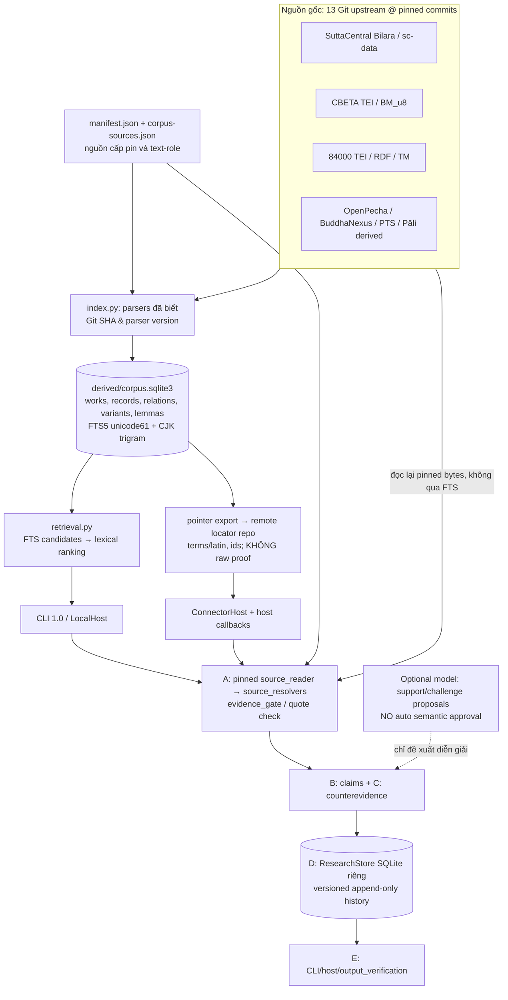

# Technology Assessment — BuddhismDocuments-for-AI

**Mã nghiên cứu:** P03 · **Ngày khảo sát:** 16/11/2026 (Asia/Ho_Chi_Minh) · **Analyst:** Nhóm thẩm định kỹ thuật độc lập hỗ trợ bởi ChatGPT (GPT-6)  
**Mục tiêu:** `quoctran-2608/BuddhismDocuments-for-AI` (BCR, *Buddhist Corpus Research*) · **Phân loại:** phần mềm scholarly-corpus tooling và reusable component; **không** phải corpus, chuẩn dữ liệu hay nền tảng thư viện PDF hoàn chỉnh.  
**Snapshot BCR đã kiểm:** `main` → [`dfdd3cbb79e3dbfb49a855702fa00e4bad3b3410`](https://github.com/quoctran-2608/BuddhismDocuments-for-AI/commit/dfdd3cbb79e3dbfb49a855702fa00e4bad3b3410) (commit timestamp 05/11/2026 UTC). **Version/release:** dự án tự mô tả retrieval **1.0** và research **2.0 A–E**; **không phát hiện GitHub Release** trong truy vấn đã thực hiện; tag/version phát hành chính thức **UNKNOWN**. Repository công khai, **không archived** tại ngày kiểm.  
**Snapshot BodhiAtlas:** [`044c6258d426920d6a0556366e79e07f82d1c835`](https://github.com/quoctran-2608/bodhi-atlas/commit/044c6258d426920d6a0556366e79e07f82d1c835) (16/11/2026 UTC). Đã đọc toàn văn [`docs/PRD.md` V1.4](https://github.com/quoctran-2608/bodhi-atlas/blob/044c6258d426920d6a0556366e79e07f82d1c835/docs/PRD.md) và [`docs/ACADEMIC_RISKS_AND_VERIFICATION.md` v1.0](https://github.com/quoctran-2608/bodhi-atlas/blob/044c6258d426920d6a0556366e79e07f82d1c835/docs/ACADEMIC_RISKS_AND_VERIFICATION.md); đây là **yêu cầu/quality gates**, không phải chức năng BCR đã triển khai.  
**Công cụ/phạm vi:** kết nối GitHub đọc trực tiếp metadata, commit/tree/gitlink, nội dung file và khoảng dòng; kiểm `README`, `PROJECT_SPEC`, `ARCHITECTURE`, `AGENTS` qua tài liệu dẫn chiếu, `schema`, `manifest`, `config`, hơn 8 module Python, chức năng chính của các test, evidence đã commit, PR và báo cáo pháp lý; đối chiếu tài liệu chính thức Docling, QMD và RAGFlow. **Không clone/khởi chạy toàn bộ 13 nguồn và không chạy suite BCR độc lập:** môi trường thực thi báo lỗi phân giải DNS khi truy cập GitHub qua Git CLI; không có checkout corpus tại máy phân tích. Vì vậy **không có khẳng định `[TESTED]` cho phần mềm BCR trong báo cáo**. Logs do dự án lưu được phân loại `[DOC]`, dù là logs có đường dẫn thật. Không sử dụng benchmark bên bán làm nghiệm thu học thuật.

**Quy ước chứng cứ:** `[CODE]` đã đọc code/schema, `[DOC]` tài liệu/log hoặc GitHub metadata, `[ISSUE]` nhận xét issue/PR chưa tái hiện, `[INFERRED]` suy luận kỹ thuật có nêu tiền đề, `[UNKNOWN]` chưa kiểm; `[TESTED]` chỉ dùng khi *người thẩm định* chạy thành công, hiện **không có**. Trạng thái `NATIVE/CONFIG/EXTENSION/EXTERNAL/MISSING/UNKNOWN/N/A` trong ma trận **chỉ áp vào vai trò BCR**, không coi thiếu OCR của bộ corpus verifier là lỗi của OCR engine.

## 1. Executive Decision

**Quyết định: `USE AS COMPONENT` (tương ứng `COMPONENT` trong bảng máy tổng hợp), confidence `MED`.** BCR phù hợp nhất làm **lõi xử lý corpus Phật học có cấu trúc và bộ kiểm chứng câu trích từ nguồn được ghim phiên bản**, chứ không nên được kế thừa nguyên trạng làm platform V1 Core của BodhiAtlas. Mã nguồn đã có quan hệ `works/records/relations/variants/lemmas`, tìm kiếm lexical bằng SQLite FTS5, provenance gắn Git commit, resolver Bilara/CBETA/84000 và cửa kiểm A độc lập đọc lại blob. Lớp B–E giữ giới hạn giữa câu trích, đánh giá luận điểm, lịch sử nghiên cứu và quyền công bố; đây là tài sản chuyên biệt đáng tái sử dụng.

Tuy nhiên, BCR chưa có pipeline nhập PDF scan/EPUB/DOCX tùy ý, chưa lưu trang PDF–bbox–EPUB CFI, chưa quản lý độ bao phủ OCR, chưa tách đủ Work/Expression/Edition/File, và chưa có truy vấn EXACT vét hết hoặc lexicon theo từng nghĩa đúng yêu cầu V1. Đường tìm hiện cắt ứng viên trước khi chấm điểm; `VERIFIED` chỉ có ý nghĩa trong phạm vi resolver/nguồn thực sự được mở và đối chiếu. Test-count do dự án ghi nhận không thay thế clean-room reproduction hay independent scholarly adjudication.

**Ba rủi ro lớn:** (1) coi kết quả FTS giới hạn là tìm exhaustive, tạo âm tính giả; (2) nhầm Git SHA-1/corpus location với định danh file SHA-256, edition và trang sách; (3) dùng/rephân phối dữ liệu upstream, hoặc cấp quyền AI đọc file, khi license và quyền chưa rõ. **Hướng triển khai:** dựng catalog và immutable file store BodhiAtlas riêng; bóc lớp verifier/resolver BCR dưới adapter có hợp đồng rõ; giữ QMD/RAGFlow là đường gợi ý ứng viên tùy chọn. Chỉ tăng mức cam kết sau POC theo cổng G1–G6 của BodhiAtlas.

## 2. Sources & Evidence Ledger

**Snapshot chuẩn cho các URL BCR:** [`dfdd3cbb…`](https://github.com/quoctran-2608/BuddhismDocuments-for-AI/commit/dfdd3cbb79e3dbfb49a855702fa00e4bad3b3410). “Code” chứng minh logic có mặt trong snapshot; không chứng minh chạy đúng trên máy mục tiêu. “Evidence log” chứng minh repo lưu bằng chứng, không phải nhóm thẩm định vừa chạy.

| claim_id | Nhận định có tác động quyết định | Mức | URL/permalink | Version | Ghi chú/giới hạn |
|---|---|---|---|---|---|
| E01 | BCR có 13 Gitlink upstream và manifest commit pin cụ thể | `[CODE]` | [manifest](https://github.com/quoctran-2608/BuddhismDocuments-for-AI/blob/dfdd3cbb79e3dbfb49a855702fa00e4bad3b3410/manifest.json), [corpus map](https://github.com/quoctran-2608/BuddhismDocuments-for-AI/blob/dfdd3cbb79e3dbfb49a855702fa00e4bad3b3410/config/corpus-sources.json) | HEAD/pins 2026-09 | Đã so tree Gitlink với 13 SHA manifest; không clone đủ nguồn. |
| E02 | SQLite index gồm `source_state`, `works`, `records`, `relations`, `variants`, `lemmas`, 2 FTS | `[CODE]` | [schema SQL](https://github.com/quoctran-2608/BuddhismDocuments-for-AI/blob/dfdd3cbb79e3dbfb49a855702fa00e4bad3b3410/schema/corpus-index.sql#L1-L115) | HEAD | Schema là index dẫn xuất, không phải catalog V1 đầy đủ. |
| E03 | Normalization là NFC/casefold, NFKD bỏ combining mark và compact Unicode | `[CODE]` | [model.py:11–25](https://github.com/quoctran-2608/BuddhismDocuments-for-AI/blob/dfdd3cbb79e3dbfb49a855702fa00e4bad3b3410/tools/corpus_research/model.py#L11-L25) | HEAD | Không chứng minh quy tắc Wylie/giản–phồn/đ→d. |
| E04 | `Record.row()` giữ raw và tạo field dẫn xuất; bỏ bớt field normalization cho chunk lớn | `[CODE]` | [model.py:31–80](https://github.com/quoctran-2608/BuddhismDocuments-for-AI/blob/dfdd3cbb79e3dbfb49a855702fa00e4bad3b3410/tools/corpus_research/model.py#L31-L80) | HEAD | Tối ưu RAM/index khác với giữ source map về PDF. |
| E05 | Build chọn parser theo 13 nguồn đã khai, kiểm SHA, bỏ qua nguồn không đổi | `[CODE]` | [index.py:1388–1560](https://github.com/quoctran-2608/BuddhismDocuments-for-AI/blob/dfdd3cbb79e3dbfb49a855702fa00e4bad3b3410/tools/corpus_research/index.py#L1388-L1560) | HEAD | Incremental theo corpus/parser; không phải OCR ingest incremental. |
| E06 | Tìm kiếm lấy top FTS candidate hữu hạn, rồi xếp hạng; CJK trigram ≥3 ký tự | `[CODE]` | [retrieval.py:218–392](https://github.com/quoctran-2608/BuddhismDocuments-for-AI/blob/dfdd3cbb79e3dbfb49a855702fa00e4bad3b3410/tools/corpus_research/retrieval.py#L218-L392) | HEAD | Không chứng minh exhaustive EXACT hay CJK 1–2 chữ. |
| E07 | Score exact/normalized/folded/compact/fts + evidence class/lemma | `[CODE]` | [retrieval.py:25–149](https://github.com/quoctran-2608/BuddhismDocuments-for-AI/blob/dfdd3cbb79e3dbfb49a855702fa00e4bad3b3410/tools/corpus_research/retrieval.py#L25-L149) | HEAD | Relevance/rank không phải mức hỗ trợ luận điểm. |
| E08 | A chỉ trả `VERIFIED` khi independent `source_reader` ghim phiên bản, vị trí, nội dung và câu trích khớp | `[CODE]` | [verification.py:223–395](https://github.com/quoctran-2608/BuddhismDocuments-for-AI/blob/dfdd3cbb79e3dbfb49a855702fa00e4bad3b3410/tools/corpus_research/verification.py#L223-L395) | HEAD | Nếu thiếu reader/cấu hình: `UNVERIFIED`, không nâng bằng JSON tự khai. |
| E09 | Local reader dùng `git cat-file blob` theo commit/path, không dùng working tree mutable | `[CODE]` | [verification.py:396–442](https://github.com/quoctran-2608/BuddhismDocuments-for-AI/blob/dfdd3cbb79e3dbfb49a855702fa00e4bad3b3410/tools/corpus_research/verification.py#L396-L442) | HEAD | SHA được kiểm là **Git SHA-1 blob**, không tự là file SHA-256. |
| E10 | Resolver verified-span chỉ hỗ trợ Bilara JSON, CBETA TEI, 84000 TEI; trích liên markup không xác nhận như raw liên tục | `[CODE]` | [source_resolvers.py:1–27, 266–274](https://github.com/quoctran-2608/BuddhismDocuments-for-AI/blob/dfdd3cbb79e3dbfb49a855702fa00e4bad3b3410/tools/corpus_research/source_resolvers.py#L1-L27) | HEAD | Không phải universal source resolver 13 nguồn. |
| E11 | Không có schema native cho PDF page/bbox, EPUB CFI, scan coverage hoặc Work–Expression–Edition–File | `[CODE]` | [schema SQL](https://github.com/quoctran-2608/BuddhismDocuments-for-AI/blob/dfdd3cbb79e3dbfb49a855702fa00e4bad3b3410/schema/corpus-index.sql) | HEAD | Phủ định trong schema đã khảo sát, không phủ định mọi khả năng mở rộng ngoài repo. |
| E12 | B cần host-held A evidence và reviewer approval; tự khai assessment JSON không cấp quyền | `[CODE]` | [claims.py:220–322](https://github.com/quoctran-2608/BuddhismDocuments-for-AI/blob/dfdd3cbb79e3dbfb49a855702fa00e4bad3b3410/tools/corpus_research/claims.py#L220-L322) | HEAD | Human review channel không đi kèm mặc định. |
| E13 | C ghi search scope/counterevidence và độc lập nguồn; không đếm pair chưa duyệt | `[CODE]` | [counterevidence.py:82–160](https://github.com/quoctran-2608/BuddhismDocuments-for-AI/blob/dfdd3cbb79e3dbfb49a855702fa00e4bad3b3410/tools/corpus_research/counterevidence.py#L82-L160) | HEAD | Không phải phân tích ngữ nghĩa tự động chắc chắn đúng. |
| E14 | D có ResearchStore SQLite riêng, snapshots append-only, expected-version/CAS, không có auth service | `[CODE]` | [research_store.py:1–125](https://github.com/quoctran-2608/BuddhismDocuments-for-AI/blob/dfdd3cbb79e3dbfb49a855702fa00e4bad3b3410/tools/corpus_research/research_store.py#L1-L125) | HEAD | Quyền file/định danh người dùng thuộc host. |
| E15 | P0/2 semantic support/challenge chỉ tạo `PROPOSED/UNRESOLVED`, không publication | `[CODE]` | [semantic_assessment.py:105–217](https://github.com/quoctran-2608/BuddhismDocuments-for-AI/blob/dfdd3cbb79e3dbfb49a855702fa00e4bad3b3410/tools/corpus_research/semantic_assessment.py#L105-L217) | HEAD | Model tùy cấu hình, không bắt buộc retrieval. |
| E16 | P0/3 kiểm cấu trúc output, TITLE/QUOTE/ID/CONCLUSION; semantic approval luôn false | `[CODE]` | [output_verification.py:1–198](https://github.com/quoctran-2608/BuddhismDocuments-for-AI/blob/dfdd3cbb79e3dbfb49a855702fa00e4bad3b3410/tools/corpus_research/output_verification.py#L1-L198) | HEAD | `CHECKED` khác `VERIFIED` và khác học thuật đúng. |
| E17 | Connector chỉ có production namespace `terms/latin` và `ids`; không có CJK arbitrary term route | `[CODE]` | [connector_host.py:62–89](https://github.com/quoctran-2608/BuddhismDocuments-for-AI/blob/dfdd3cbb79e3dbfb49a855702fa00e4bad3b3410/tools/corpus_research/connector_host.py#L62-L89), [config](https://github.com/quoctran-2608/BuddhismDocuments-for-AI/blob/dfdd3cbb79e3dbfb49a855702fa00e4bad3b3410/config/remote-corpus.json) | HEAD | Pointer-only remote không sở hữu trích dẫn. |
| E18 | README thừa nhận Research chưa được phép công bố, Work/full Connector chưa nghiệm thu | `[DOC]` | [README](https://github.com/quoctran-2608/BuddhismDocuments-for-AI/blob/dfdd3cbb79e3dbfb49a855702fa00e4bad3b3410/README.md), [acceptance 2.0](https://github.com/quoctran-2608/BuddhismDocuments-for-AI/blob/dfdd3cbb79e3dbfb49a855702fa00e4bad3b3410/docs/v2/ACCEPTANCE.md) | HEAD | Cần tách nghiệm thu software/corpus/academic. |
| E19 | Evidence 05/11/2026 ghi 484 methods PASS, 3 pilot classes SKIP trong full, 21/21 pilot riêng | `[DOC]` | [results.json](https://github.com/quoctran-2608/BuddhismDocuments-for-AI/blob/dfdd3cbb79e3dbfb49a855702fa00e4bad3b3410/docs/v2/evidence/p0-3-2026-11-05/results.json), [README](https://github.com/quoctran-2608/BuddhismDocuments-for-AI/blob/dfdd3cbb79e3dbfb49a855702fa00e4bad3b3410/docs/v2/evidence/p0-3-2026-11-05/README.md) | P0/3 05/11 | **Không** phải `[TESTED]` bởi báo cáo này; cần tái chạy máy độc lập. |
| E20 | Evidence A–E trước đó: WSL 410/410, Windows portable E 78/78; Windows full chưa đạt | `[DOC]` | [evidence README](https://github.com/quoctran-2608/BuddhismDocuments-for-AI/blob/dfdd3cbb79e3dbfb49a855702fa00e4bad3b3410/docs/v2/evidence/README.md) | 11/10 | Các con số thuộc version/môi trường khác nhau, không cộng dồn. |
| E21 | PR #13 draft mô tả vướng preflight/profile và candidate preview, chưa merge | `[ISSUE]` | [PR #13](https://github.com/quoctran-2608/BuddhismDocuments-for-AI/pull/13) | draft 06/11 | 71 selected tests được PR báo; không coi code/proposal PR là main. |
| E22 | Main không có GitHub license được API xác định; file `LICENSE` không thấy trong tree HEAD | `[UNKNOWN]` | [repository](https://github.com/quoctran-2608/BuddhismDocuments-for-AI), [tree](https://github.com/quoctran-2608/BuddhismDocuments-for-AI/tree/dfdd3cbb79e3dbfb49a855702fa00e4bad3b3410) | HEAD | **Quyền sử dụng/chỉnh sửa/phân phối chưa được xác lập**; không đồng nghĩa “public domain”. |
| E23 | Audit pilot chỉ rõ CBETA H01/H02 license version chưa rõ và distribution clearance = 0 | `[DOC]` | [rights-summary-public.json](https://github.com/quoctran-2608/BuddhismDocuments-for-AI/blob/dfdd3cbb79e3dbfb49a855702fa00e4bad3b3410/docs/v2/evidence/academic-pilots/2026-10-12-karma-suffering/source-rights-handoff-2026-11-03/rights-summary-public.json) | pilot 03/11 | Phạm vi **17 snapshots của pilot**, không được suy cho mọi byte của 13 repo. |
| E24 | Ba repo `BuddhaNexus/segmented-{pali,chinese,sanskrit}` được GitHub đánh dấu archived | `[DOC]` | [Pāli](https://github.com/BuddhaNexus/segmented-pali), [Hán](https://github.com/BuddhaNexus/segmented-chinese), [Sanskrit](https://github.com/BuddhaNexus/segmented-sanskrit) | metadata 16/11 | Archived upstream ≠ main BCR archived. |
| E25 | Requirements V1 bắt buộc nhập PDF/scan/EPUB/DOCX, 5 kiểu match, phiếu nguồn và trạng thái bao phủ | `[DOC]` | [BodhiAtlas PRD §3–§7](https://github.com/quoctran-2608/bodhi-atlas/blob/044c6258d426920d6a0556366e79e07f82d1c835/docs/PRD.md#L80-L384) | V1.4 | Đây là **gap benchmark theo mục tiêu**, không phải BCR hứa hỗ trợ sẵn. |
| E26 | Quality gates G1–G6, trạng thái source/citation/claim riêng và 16 risk test cases | `[DOC]` | [Academic Risks §3–§7](https://github.com/quoctran-2608/bodhi-atlas/blob/044c6258d426920d6a0556366e79e07f82d1c835/docs/ACADEMIC_RISKS_AND_VERIFICATION.md#L90-L217) | v1.0 | Không tự suy ra BCR đạt G1–G6. |
| E27 | Dùng BCR nguyên hệ làm V1 sẽ phải bổ sung ingest, edition/file catalog, exhaustive search, OCR và security | `[INFERRED]` | [schema](https://github.com/quoctran-2608/BuddhismDocuments-for-AI/blob/dfdd3cbb79e3dbfb49a855702fa00e4bad3b3410/schema/corpus-index.sql), [build](https://github.com/quoctran-2608/BuddhismDocuments-for-AI/blob/dfdd3cbb79e3dbfb49a855702fa00e4bad3b3410/tools/corpus_research/index.py#L1437-L1560) | HEAD | Kết luận thiết kế từ phạm vi code đã đọc; phải POC mới định lượng effort. |

**Nguồn công khai so sánh:** [Docling supported formats](https://docling-project.github.io/docling/usage/supported_formats/), [QMD repository](https://github.com/tobi/qmd), [RAGFlow repository](https://github.com/infiniflow/ragflow), [RAGFlow docs](https://ragflow.io/docs). Chỉ dùng để so sánh **vai trò**, không lấy quảng cáo làm benchmark.

## 3. Architecture & Data Flow

### 3.1. Kiến trúc thực tế trong snapshot BCR



**Dữ liệu gốc:** byte nội dung của 13 upstream tại Git SHA được pin. **Dữ liệu dẫn xuất:** SQLite/FTS, pointer locator remote, bảng candidate, research draft/receipt. **Thẩm quyền nguồn** nằm ở Git object hợp lệ + host-controlled source contract + independent source read; không nằm ở index, embedding, pointer, JSON do AI gửi hay điểm rank. Local index và remote locator không đồng nhất với nhau về coverage: remote production chỉ có namespace `terms/latin` và `ids` và chỉ pointer, còn local có CJK trigram dài ≥3.

**Trục độc lập:** (i) Local/Connector/Work là *môi trường*; (ii) Quick/Research là *mức công việc*. Quick trả kiểm nguồn hẹp; Research có thể tạo bản thảo và hồ sơ đánh giá chưa được phê duyệt. **LLM không bắt buộc** cho ingest 13 corpus, search, source verification; model tùy chọn chỉ tham gia phân tích support/challenge `semantic_assessment.py` và không tự làm reviewer. Không có dịch vụ REST/MCP riêng được code xác nhận; `ConnectorHost` là adapter Python, cần host nối công cụ truy xuất có xác thực. Các điểm này được mô tả/triển khai tại [ARCHITECTURE](https://github.com/quoctran-2608/BuddhismDocuments-for-AI/blob/dfdd3cbb79e3dbfb49a855702fa00e4bad3b3410/docs/ARCHITECTURE.md), [local_host.py](https://github.com/quoctran-2608/BuddhismDocuments-for-AI/blob/dfdd3cbb79e3dbfb49a855702fa00e4bad3b3410/tools/corpus_research/local_host.py), [connector_host.py](https://github.com/quoctran-2608/BuddhismDocuments-for-AI/blob/dfdd3cbb79e3dbfb49a855702fa00e4bad3b3410/tools/corpus_research/connector_host.py).

### 3.2. Ranh giới với hệ thống BodhiAtlas đề xuất

```text
BodhiAtlas ORIGINAL FILE STORE (immutable bytes + SHA-256; rights/ACL)
  └─ ingest adapter: PDF/scan OCR & bbox | EPUB CFI | DOCX | MD | TEI/JSON
        └─ extraction version + page coverage + origin-to-text map
              └─ Work / Expression / Edition / Witness / File / Passage catalog
                    ├─ exhaustive exact scanner + normalized/fuzzy/lexicon indices
                    ├─ BCR corpus adapters (Bilara/CBETA/84000) [reuse]
                    └─ QMD/RAGFlow (optional CANDIDATE discovery only)
                          → precise passage locator + source contract
                          → BCR A verifier [adapted] → citation card with limits
                          → B/C/D/E optional research workflow + human review
```

Đường đóng vai trò *gợi ý ứng viên* không được ghi `VERIFIED` khi chưa mở bản gốc; đối với PDF scan chưa kiểm OCR, quote verifier phải có trạng thái bổ sung `OCR_NEEDS_REVIEW` và không cho qua như text gốc. Catalog BodhiAtlas sở hữu tất cả ID và quyền; BCR không được lén thay file nguồn hoặc đảo vị trí bản trích.

## 4. Feature Fit–Gap Matrix

**Cách đọc:** trạng thái biểu thị khả năng của **BCR hiện hành cho V1**, có thể vừa NATIVE cho corpus hiện hành vừa thiếu với nguồn mới. `Tác động` đánh giá V1 nếu chọn dùng BCR như một thành phần; `Công sức` là định tính sơ bộ `S/M/L` (S: adapter/hàm; M: một subsystem; L: nhiều subsystem + kiểm thử), **không** là ngày công đã đo.

| ID / năng lực | Trạng thái | Chứng cứ cụ thể | Tác động/giới hạn | Công sức | Phương án bù và owner |
|---|---|---|---|---|---|
| **C01** Multi-format ingest | `EXTENSION` | [index.py parsers](https://github.com/quoctran-2608/BuddhismDocuments-for-AI/blob/dfdd3cbb79e3dbfb49a855702fa00e4bad3b3410/tools/corpus_research/index.py#L396-L1379), [build list](https://github.com/quoctran-2608/BuddhismDocuments-for-AI/blob/dfdd3cbb79e3dbfb49a855702fa00e4bad3b3410/tools/corpus_research/index.py#L1437-L1558) | Native 13 corpus cấu trúc; không có uploader chung PDF/EPUB/DOCX | L | BodhiAtlas ingest service, Docling/format parsers ngoài, file SHA-256/ACL. |
| **C02** OCR/layout/reading order | `EXTERNAL` | [schema](https://github.com/quoctran-2608/BuddhismDocuments-for-AI/blob/dfdd3cbb79e3dbfb49a855702fa00e4bad3b3410/schema/corpus-index.sql) không có vùng OCR; [Docling](https://docling-project.github.io/docling/usage/supported_formats/) | Không giải scan hai cột, phủ định OCR, bbox | L | OCR/layout engine độc lập + human QA; source map bắt buộc, không thừa hưởng A VERIFIED từ OCR. |
| **C03** Canonical text & source map | `EXTENSION` | [record fields](https://github.com/quoctran-2608/BuddhismDocuments-for-AI/blob/dfdd3cbb79e3dbfb49a855702fa00e4bad3b3410/schema/corpus-index.sql), [source spans](https://github.com/quoctran-2608/BuddhismDocuments-for-AI/blob/dfdd3cbb79e3dbfb49a855702fa00e4bad3b3410/tools/corpus_research/source_resolvers.py) | Native Git source/TEI/JSON spans, nhưng không map PDF/EPUB | L | Immutable byte store + passage-to-page geometry + extraction version. |
| **C04** Works/editions/witnesses | `EXTENSION` | [works/records/witness](https://github.com/quoctran-2608/BuddhismDocuments-for-AI/blob/dfdd3cbb79e3dbfb49a855702fa00e4bad3b3410/schema/corpus-index.sql#L23-L80) | `work_id`, `witness` có; thiếu Edition/Expression/File entities riêng | M–L | Catalog 6 thực thể; bridge `bcr_work_id ↔ passage_id` có scope/corpus. |
| **C05** Exhaustive EXACT | `EXTENSION` | [retrieval.search](https://github.com/quoctran-2608/BuddhismDocuments-for-AI/blob/dfdd3cbb79e3dbfb49a855702fa00e4bad3b3410/tools/corpus_research/retrieval.py#L268-L392) | `max(limit*5,50)` lấy ứng viên, không chứng minh đủ mọi occurrence | M | Tách exact scanner deterministic trên canonical/raw với pagination/total và offset. |
| **C06** Normalized multilingual | `EXTENSION` | [model.py](https://github.com/quoctran-2608/BuddhismDocuments-for-AI/blob/dfdd3cbb79e3dbfb49a855702fa00e4bad3b3410/tools/corpus_research/model.py#L11-L25), [retrieval.py](https://github.com/quoctran-2608/BuddhismDocuments-for-AI/blob/dfdd3cbb79e3dbfb49a855702fa00e4bad3b3410/tools/corpus_research/retrieval.py#L66-L138) | NFC/diacritics native; vi `đ`, zh simp/trad, bo/Wylie chưa bảo đảm | M–L | Per-script analyzers có metadata phép biến đổi; regression gold. |
| **C07** Fuzzy/OCR near-duplicate | `MISSING` | [MATCH_SCORE chỉ lexical](https://github.com/quoctran-2608/BuddhismDocuments-for-AI/blob/dfdd3cbb79e3dbfb49a855702fa00e4bad3b3410/tools/corpus_research/retrieval.py#L37-L138) | Không thấy edit-distance/ngram fuzzy hiển thị diff/typo OCR như mode riêng | M | Đường trigram/Levenshtein có giới hạn, nguồn gốc và false-positive audit. |
| **C08** Sense-aware lexicon | `MISSING` | [lemmas/variants](https://github.com/quoctran-2608/BuddhismDocuments-for-AI/blob/dfdd3cbb79e3dbfb49a855702fa00e4bad3b3410/schema/corpus-index.sql#L83-L117) | Lemma hình thái ≠ lexeme–sense–attestation; nguy cơ nối tương đương bắc cầu | L | Dựng `Lexeme/Sense/Form/Mapping/Attestation`, provenance per sense. |
| **C09** Semantic/hybrid/RAG | `EXTERNAL` | [PROJECT_SPEC §8,12](https://github.com/quoctran-2608/BuddhismDocuments-for-AI/blob/dfdd3cbb79e3dbfb49a855702fa00e4bad3b3410/docs/PROJECT_SPEC.md), [QMD](https://github.com/tobi/qmd), [RAGFlow](https://github.com/infiniflow/ragflow) | Không có native embedding index; không phải V1 P0 | S–M | Secondary candidate provider, không ghi authority, không ép LLM vào exact search. |
| **C10** Verified citation & reopen | `NATIVE` | [A gate](https://github.com/quoctran-2608/BuddhismDocuments-for-AI/blob/dfdd3cbb79e3dbfb49a855702fa00e4bad3b3410/tools/corpus_research/verification.py#L223-L395), [resolvers](https://github.com/quoctran-2608/BuddhismDocuments-for-AI/blob/dfdd3cbb79e3dbfb49a855702fa00e4bad3b3410/tools/corpus_research/source_resolvers.py#L266-L274) | **NATIVE chỉ cho 3 nguồn supported**, chưa có file SHA-256/page-bbox/card V1 | M–L mở rộng | Reuse A logic; mở source reader PDF/EPUB, kiểm hash & location, coverage gate. |
| **C11** Note/wiki/claim memory | `EXTENSION` | [claims.py](https://github.com/quoctran-2608/BuddhismDocuments-for-AI/blob/dfdd3cbb79e3dbfb49a855702fa00e4bad3b3410/tools/corpus_research/claims.py), [research_store.py](https://github.com/quoctran-2608/BuddhismDocuments-for-AI/blob/dfdd3cbb79e3dbfb49a855702fa00e4bad3b3410/tools/corpus_research/research_store.py) | Claim/run history có, không phải wiki UI/PKM | M | Dùng D cho research audit; note UI và biên tập riêng nếu cần. |
| **C12** API/MCP/export integration | `CONFIG` | [LocalHost](https://github.com/quoctran-2608/BuddhismDocuments-for-AI/blob/dfdd3cbb79e3dbfb49a855702fa00e4bad3b3410/tools/corpus_research/local_host.py), [ConnectorHost](https://github.com/quoctran-2608/BuddhismDocuments-for-AI/blob/dfdd3cbb79e3dbfb49a855702fa00e4bad3b3410/tools/corpus_research/connector_host.py), CLI | Native Python/CLI/connector contract; REST/MCP server chưa kiểm | M | Đóng gói library rồi tạo REST/MCP gateway auth tại BodhiAtlas. |
| **C13** Quality coverage & incremental | `EXTENSION` | [source_state](https://github.com/quoctran-2608/BuddhismDocuments-for-AI/blob/dfdd3cbb79e3dbfb49a855702fa00e4bad3b3410/schema/corpus-index.sql#L1-L22), [build](https://github.com/quoctran-2608/BuddhismDocuments-for-AI/blob/dfdd3cbb79e3dbfb49a855702fa00e4bad3b3410/tools/corpus_research/index.py#L1437-L1558) | Native skip unchanged *corpus*; không có trang OCR/coverage ledger | M–L | Per-file+page processing status; rebuild derived index and re-verify saved cite. |
| **C14** Auth/licensing/privacy/backup | `MISSING` | [ResearchStore docstring](https://github.com/quoctran-2608/BuddhismDocuments-for-AI/blob/dfdd3cbb79e3dbfb49a855702fa00e4bad3b3410/tools/corpus_research/research_store.py#L1-L16), [rights audit](https://github.com/quoctran-2608/BuddhismDocuments-for-AI/blob/dfdd3cbb79e3dbfb49a855702fa00e4bad3b3410/docs/v2/evidence/academic-pilots/2026-10-12-karma-suffering/source-rights-handoff-2026-11-03/rights-summary-public.json) | Host-owned permissions; license/code/data unresolved; no proven backup/ACL platform | L | BodhiAtlas IAM, deny-by-default AI file read, per-file rights, backup/restore drill. |
| **C15** Operational simplicity/independent deploy | `CONFIG` | [README commands](https://github.com/quoctran-2608/BuddhismDocuments-for-AI/blob/dfdd3cbb79e3dbfb49a855702fa00e4bad3b3410/README.md), [index/SQLite](https://github.com/quoctran-2608/BuddhismDocuments-for-AI/blob/dfdd3cbb79e3dbfb49a855702fa00e4bad3b3410/tools/corpus_research/index.py) | Local Python+SQLite đơn giản về stack, 13 upstream khá nặng và pin discipline | M | Tách package nhỏ/nguồn nhỏ; lazy corpus adapters; CI test fixtures nhỏ. |

**Gates không được cộng điểm:** C10 NATIVE cho 3 corpus **không** bù C05 exhaustive fail hay C02 OCR missing. `N/A` không dùng cho C01–C15 vì ma trận so yêu cầu V1; với một **bộ quote verifier đơn lẻ**, C02/C09/C11 có thể ghi `N/A` khi so đúng chức năng chuyên biệt, thay vì dùng làm cớ chấm thấp công nghệ.

## 5. Deep Technical Findings

### 5.1. Inventory đã phân biệt theo cấp triển khai

| Tầng | Mã/entrypoint đã đọc | Kết luận kỹ thuật từ code | Ranh giới không được vượt |
|---|---|---|---|
| Pin/nguồn | [`manifest.json`](https://github.com/quoctran-2608/BuddhismDocuments-for-AI/blob/dfdd3cbb79e3dbfb49a855702fa00e4bad3b3410/manifest.json), [`config/corpus-sources.json`](https://github.com/quoctran-2608/BuddhismDocuments-for-AI/blob/dfdd3cbb79e3dbfb49a855702fa00e4bad3b3410/config/corpus-sources.json), `index.local_sha()` | 13 nguồn Gitlink, phân `evidence_class`, `roles`, `profiles`; kiểm HEAD local bằng `git rev-parse` và match manifest | Git SHA không thay thế file SHA-256, nguồn có quyền chia sẻ, hay độ bao phủ corpus thực. |
| Canonical structured ingest | `index_bilara`, `index_sc_relations`, `index_cbeta`, `index_cbeta_bm`, `index_84000_tei`, `index_84000_tm`, `index_openpecha`, `index_buddhanexus`, `index_pts`, `index_pali_derived` trong [`index.py`](https://github.com/quoctran-2608/BuddhismDocuments-for-AI/blob/dfdd3cbb79e3dbfb49a855702fa00e4bad3b3410/tools/corpus_research/index.py) | Parser theo corpus, tạo `Work`, `Record`, relations, variants, lemmas và text roles | Không có `ingest_file(file.pdf)` hoặc OCR từng trang. |
| State/index | `Writer`, `build_index`, `rebuild_search_indexes`, SQLite [`schema`](https://github.com/quoctran-2608/BuddhismDocuments-for-AI/blob/dfdd3cbb79e3dbfb49a855702fa00e4bad3b3410/schema/corpus-index.sql) | Batch insert 5.000 records, FTS5, record state, rebuild triggered bởi nguồn/parser | Coverage theo parser/source không chứng minh mọi page/segment đã đọc. |
| Retrieve 1.0 | `retrieval.search/context/work/parallels/resolve/variants/compare/provenance/evidence` | Query/index lexical + relation/variant navigation; stable scoring và witness separation | `retrieval.evidence` là evidence *bundle/index* chưa qua A gate. |
| Remote | `pointer_production.py`, `config/remote-corpus.json`, `ConnectorHost.lookup()` | Pin remote locator, term/id shard theo hash; pointer không có nguyên văn | Không phải MCP server; không hỗ trợ tự do tìm CJK ở production remote. |
| A: Verify | `verification.make_evidence_record`, `evidence_gate`, `verify_quote`, `read_local_source`; `source_resolvers.resolve_source` | Host-controlled re-read pinned byte + source-derived location/range; trạng thái `CANDIDATE/UNVERIFIED/REJECTED/VERIFIED` và direct quote rights | Tập resolver chỉ ba corpus; lỗi nguồn không được tự coi “verified”. |
| B: Claim | `claims.make_claim`, `assess_claim`, `final_claim_gate`, `accepted_claim_set` | Claim schema có ID, loại, giới hạn, evidence IDs, reviewer binding, presentation restrictions | Không có approval channel có danh tính sẵn; Research publication không tự mở. |
| C: Counter-evidence | `counterevidence.source_independence`, `make_counterevidence_plan`, `search_counterevidence` | Kế hoạch đối chứng, receipts có phạm vi, không tự đếm source phụ thuộc | Không tự biết mọi nguồn phản chứng, không suy ra “không có phản chứng”. |
| D: Store | `ResearchStore` | SQLite riêng; optimistic concurrency; append-only historical snapshots/package/decisions | Không phải multi-tenant RBAC, encrypted backup hay wiki editor. |
| E + P0 | `v2_cli`, `local_host`, `connector_host`, `semantic_assessment`, `output_verification` | Host adapters; AI support/challenge có cấu trúc; output checker kiểm bằng chứng/gắn metadata | Semantic truth/academic publication là quyền người nghiên cứu. |

**Điểm kiểm đọc function:** [index.py:50–115](https://github.com/quoctran-2608/BuddhismDocuments-for-AI/blob/dfdd3cbb79e3dbfb49a855702fa00e4bad3b3410/tools/corpus_research/index.py#L50-L115) chuẩn hóa CBETA ID/line, [index.py:201–378](https://github.com/quoctran-2608/BuddhismDocuments-for-AI/blob/dfdd3cbb79e3dbfb49a855702fa00e4bad3b3410/tools/corpus_research/index.py#L201-L378) ghi records/relations/variants/lemmas, [retrieval.py:393–707](https://github.com/quoctran-2608/BuddhismDocuments-for-AI/blob/dfdd3cbb79e3dbfb49a855702fa00e4bad3b3410/tools/corpus_research/retrieval.py#L393-L707) context/relations/resolve, [source_resolvers.py:76–274](https://github.com/quoctran-2608/BuddhismDocuments-for-AI/blob/dfdd3cbb79e3dbfb49a855702fa00e4bad3b3410/tools/corpus_research/source_resolvers.py#L76-L274) vị trí source-specific, [verification.py:223–442](https://github.com/quoctran-2608/BuddhismDocuments-for-AI/blob/dfdd3cbb79e3dbfb49a855702fa00e4bad3b3410/tools/corpus_research/verification.py#L223-L442) A, [claims.py:220–395](https://github.com/quoctran-2608/BuddhismDocuments-for-AI/blob/dfdd3cbb79e3dbfb49a855702fa00e4bad3b3410/tools/corpus_research/claims.py#L220-L395) B, [counterevidence.py:82–328](https://github.com/quoctran-2608/BuddhismDocuments-for-AI/blob/dfdd3cbb79e3dbfb49a855702fa00e4bad3b3410/tools/corpus_research/counterevidence.py#L82-L328) C, [research_store.py:35–190](https://github.com/quoctran-2608/BuddhismDocuments-for-AI/blob/dfdd3cbb79e3dbfb49a855702fa00e4bad3b3410/tools/corpus_research/research_store.py#L35-L190) D, [output_verification.py:92–198](https://github.com/quoctran-2608/BuddhismDocuments-for-AI/blob/dfdd3cbb79e3dbfb49a855702fa00e4bad3b3410/tools/corpus_research/output_verification.py#L92-L198) P0/3. Đây là **13 vùng mã** có điểm tham chiếu chính xác, không chỉ README.

### 5.2. Schema và compatibility thực tế

Trích **tên trường thực sự có trong `schema/corpus-index.sql`**; không diễn đạt thành một ERD lý tưởng chưa có:

```sql
-- Rút gọn minh họa từ schema snapshot, KHÔNG phải migration đầy đủ
source_state(corpus PK, repo_path, source_sha, parser_version,
             evidence_class, indexed_at, record_count,
             relation_count, variant_count, lemma_count)
works(corpus, work_id, language, collection_name, title,
      metadata_json, source_path, source_sha, evidence_class)
records(id INTEGER PK, corpus, language, collection_name,
        work_id, segment_id, title, raw_text, norm_text, folded_text,
        compact_text, lemma_text, source_path, source_sha,
        evidence_class, text_role, witness, relation_ids, sequence_no)
relations(id PK, corpus, relation_type, from_id, to_id,
          details_json, source_path, source_sha, evidence_class)
variants(id PK, corpus, work_id, segment_id, lemma, reading,
         witnesses, variant_type, confidence, notes,
         source_path, source_sha, evidence_class)
lemmas(id PK, corpus, language, work_id, segment_id,
       surface, lemma, pos, morphology_json, source_path,
       source_sha, evidence_class)
records_fts(raw_text, norm_text, folded_text, compact_text,
            lemma_text, title)  -- FTS5 unicode61 remove_diacritics 0
records_cjk_fts(search_text) -- FTS5 contentless trigram
```

**Mấu chốt ID:** `records.id` là row ID index cục bộ, **không ổn định khi purge/rebuild**; `UNIQUE(corpus, source_path, segment_id, language, witness)` không tạo `edition_id`. `source_sha` ở các bảng trỏ **commit upstream**, không phải hash file người dùng. `works` PK `(corpus, work_id, source_path)` còn `records` dùng `segment_id` có thể gồm `..` cho các nhóm Bilara; không an toàn coi `work_id` là global ID. `relation_ids` chứa JSON serialized string, có thể thay đổi cách parser xếp relation. `source_state` ghi record count do writer tạo, không báo trang PDF thiếu/OCR uncertain. Khi tích hợp **đừng migrate thẳng `records.id` vào citation**. Thay bằng `passage_id` BodhiAtlas immutable và mapping có `corpus`, `commit_sha`, `source_path`, `segment_id`, `witness`, `parser_version`, `source_locator`, `status`.

Đề nghị định nghĩa quan hệ chuẩn:

```text
Work (tác phẩm trí tuệ)
  └─ Expression (ngôn ngữ/bản dịch/biên tập)
      └─ Edition (ấn bản, nhà XB, lần xuất bản, paginations)
          ├─ Witness (nhân chứng cụ thể / version textual)
          └─ File (SHA-256 bytes, MIME, ACL, OCR/extraction version)
                └─ Passage (canonical source-native locator, source offsets)
```

Đây là **thiết kế mới BodhiAtlas**, không phải schema hiện có trong BCR. `edition_id` không thể suy từ SHA nội dung hoặc một bản dịch; cùng text có thể xuất hiện ở nhiều ấn bản khác số trang. Sơ đồ/metadata phải cho phép `translation_of`, `parallel_to`, `variant_of`, `commentary_on` và provenance của quan hệ thay vì ép chúng vào một equivalence graph duy nhất.

### 5.3. Exact: một thất bại thiết kế có thể kiểm bằng code

`retrieval.search()` tính `terms` rồi chạy các FTS queries `ORDER BY bm25(...) LIMIT max(limit*5, 50)`, gộp candidate ID và rank; CJK trigram cũng áp limit. Sau đó mới kiểm `if query in raw`, `norm in row_norm`, v.v. **Không hề có scan toàn bộ canonical/raw record với một offset iterator**. Vì vậy trả `result_count` ≤ `limit`, không có tổng số vị trí xuất hiện trong toàn corpus, và không có guarantee một candidate bị cắt trước FTS vẫn được kiểm exact. Câu truy vấn `anattā` có thể lấy được một số record đúng nhưng **không đủ để suy “đã tìm tất cả”**. Đối với CJK, code tự báo middle-substring 1–2 chữ không được đảm bảo. Đây là phát hiện `[CODE]`/`[INFERRED]` về hợp đồng exhaustive chứ **chưa đo tỷ lệ miss**.

**Bù:** tạo một đường code-only `search_exact(scope, raw_query, stream, offset)` độc lập FTS rank; quét raw nguyên bản trong phạm vi `READY`, trả mọi occurrence với `passage_id`, vị trí `codepoint_start/end` và source native locator; pagination phải tăng `next_cursor` đến cuối, không dùng BM25 quyết định phạm vi. Nếu cần exact qua biên segment, định nghĩa phép ghép và mapping từng phần có thể đảo ngược; **không** gọi exact cho bản đã normalize/trừu tượng hóa. Nếu OCR incomplete, trả `SEARCH_COMPLETE_WITHIN_INDEXED_SCOPE`, không gán `CORPUS_COMPLETE`.

### 5.4. Cấp chứng cứ A–E và cách phân biệt test

- **A — Quote/source identity `[CODE]`:** candidate→`opened_source`→**đọc lại bằng `source_reader(request)` do host cấp**→so file Git source, location, content, đoạn chữ, blob SHA và quoting. Một JSON mang `verified:true` không thể thay callback. `verify_quote()` chỉ cho phép normalize **NFC và co whitespace**, không được bỏ dấu khi xác minh câu trích. `VERIFIED_EXACT` / `VERIFIED_NORMALIZED` là quote-level; ngoài ra `QUOTE_MISMATCH`, `PARAPHRASE` (cần `review_reader`), `UNVERIFIED`. `evidence_gate` cấp `VERIFIED` source-level riêng. Nguồn sai trả `REJECTED`, thiếu nguồn/reader trả `UNVERIFIED`.
- **B — Claim semantics `[CODE]`:** host `evidence_reader` lấy A snapshot hiện hành, `assessment_reader(review_id)` phải trả review đã được xác thực và khớp claim+evidence; code kiểm loại claim, evidence basis, giới hạn trình bày/atomic. Không thể biết nghĩa đúng chỉ bằng data type hoặc hash; kênh reviewer thực tế chưa tích hợp.
- **C — Counterevidence `[CODE]`:** quy hoạch/receipt các lượt tìm với corpus scope, buộc chứng cứ phải qua A; `source_independence` trả `independent_source_count=null` nếu pair chưa xác minh. Tìm từ khóa không đủ đánh giá toàn bộ phản chứng, nên `ASSESSED` receipt không tương đương “phản chứng đã đọc đủ”.
- **D — Persistence `[CODE]`:** ResearchStore dùng DB riêng với rows snapshots, reports, decisions; trigger cấm `UPDATE/DELETE` trên snapshot lịch sử, CAS `expected_version` hạn chế race; quyền sửa file SQLite cấp OS/root ngoài phạm vi.
- **E/P0–3 — Adapter và structured output `[CODE]`:** `LocalHost`, `ConnectorHost`, CLI cho Quick/Research; P0/2 có adapter model tùy chọn nhiều nhất hai lượt support/challenge, luôn `semantic_approval:false`; P0/3 chỉ kiểm loại TITLE/QUOTE/IDENTIFIER/CONCLUSION và liên kết notes, `semantic_truth_verified:false`, `publication_authorized:false`. **Báo cáo được `CHECKED` không phải xác minh rằng tác giả *tin* điều bị thuật lại**.

**Unit vs integration vs học thuật:** `tests/test_verification.py`, `test_claims.py`, `test_counterevidence.py`, `test_research_run.py` là API/logic unit; `test_local_integration.py`, `test_corpus_integration.py`, `test_connector_contract.py`, `test_source_span_selection.py` và `test_acceptance.py` chạm nhiều lớp hoặc fixture/corpus; `docs/v2/evidence/academic-pilots/...` gồm các ca nghiên cứu thử. Repo lưu logs P0/3 484 methods PASS/3 pilot classes SKIP ở discover/21 pilot riêng PASS; repo lưu A–E WSL 410/410 và Windows portable 78/78 ở mốc **khác**. Không có log do nhóm thẩm định chạy; không có blind independent scholarly truth để kết luận “AI kiểm đúng học thuật”. Các báo cáo dự án cũng thừa nhận Research publication đóng, Work/full Connector không được nghiệm thu. [P0/3 results](https://github.com/quoctran-2608/BuddhismDocuments-for-AI/blob/dfdd3cbb79e3dbfb49a855702fa00e4bad3b3410/docs/v2/evidence/p0-3-2026-11-05/results.json), [evidence ledger](https://github.com/quoctran-2608/BuddhismDocuments-for-AI/blob/dfdd3cbb79e3dbfb49a855702fa00e4bad3b3410/docs/v2/evidence/README.md), [limitations](https://github.com/quoctran-2608/BuddhismDocuments-for-AI/blob/dfdd3cbb79e3dbfb49a855702fa00e4bad3b3410/docs/v2/evidence/academic-pilots/2026-10-12-karma-suffering/round3-semantic-review-2026-11-03/limitations.md).

### 5.5. Thêm một PDF/EPUB tùy ý có phá invariant không?

**Với code hiện tại: không có đường native để thử thành công.** `SOURCE_BUILDERS`/`PROFILE_SOURCES` là lựa chọn corpus theo module; `build_index` đòi Git checkout upstream và manifest, không có `PDF` file record, page geometry hoặc OCR process. Nếu cố biến một PDF mới thành một `records` row thủ công sẽ có ba lỗi: (i) BCR không kiểm được immutable `file_sha256` theo catalog, (ii) `source_resolvers` không đọc định vị PDF/EPUB, nên A gate không thể nâng lên `VERIFIED`; (iii) không có ranh giới Edition/Witness riêng. **Giữ invariant bằng cách tạo adapter**, không sửa/dùng hash khác dưới trường cũ mà không phân loại `source_type`/algorithm.

Extension nên có: `FileOriginalStorage` giữ byte gốc và SHA256, `ExtractionArtifact` phiên bản parser/OCR, page manifest `READY/PARTIAL/OCR_UNCERTAIN`, `NativeLocator` đặc thù định dạng, `SourceReader` độc lập mở lại immutable file, `PDFResolver` xác thực page+bbox trên file được hash, `EPUBResolver` CFI/href trên EPUB cố định, `CitationRenderer` nhãn chính xác. A gate tổng quát được sửa thành `verified_source_type` + `algorithm` thay vì giả Git SHA-1 cho PDF; các test hiện hành của BCR phải giữ nguyên để tránh phá backward compatibility.

### 5.6. Chia sẻ dữ liệu, index và khả năng bóc tách

- **Tái dùng trực tiếp thuận lợi:** `verification.verify_quote()` + logic `evidence_gate()` (lõi tương đối portable, no I/O), `source_resolvers.resolve_source()` cho ba corpus đã hỗ trợ, `model.normalize()`/retrieval ranking như tham khảo, data adapters cho 13 source, các test fail-closed, `claims`/`counterevidence`/`ResearchStore` nếu triển khai research optional.
- **Không nên mặc định tái dùng:** file `derived/corpus.sqlite3` như canonical catalog; `records.id` làm stable citation; `ConnectorHost` như một dịch vụ web sẵn sàng triển khai; `research_run` như approval/ACL; `score` như xác suất thật.
- **Schema compatibility:** giữ một adapter `BcrCandidate` → `BodhiPassageLocator`; không viết trực tiếp work/file IDs vào BCR upstream để tránh schema fork. `source_sha` ở BCR mang 40-hex commit SHA; V1 đòi `original_file_sha256` 64-hex. Trường kiểu băm bắt buộc ghi `algorithm`. `text_role` (`root_text`, `translation_main`, `translator_comment`...), `witness`, `evidence_class` phải là 3 field độc lập.
- **Nguồn không thể mở lại:** giữ candidate provenance và lý do `SOURCE_UNAVAILABLE/UNVERIFIABLE`, tuyệt đối không chuyển cached snippet thành quote `VERIFIED`; nếu metadata/DOI vẫn có thể đưa vào danh sách cần bổ sung, không làm bằng chứng câu chữ.
- **Upstream/restrictions:** Git public chỉ là khả năng truy cập, không cấp quyền tái phân phối. BCR main thiếu giấy phép code được xác nhận; cần xác lập rights trước khi tách library và trước khi đóng gói data upstream vào cloud/LLM. Với Sanskrit/Tạng, các corpus `alignment`/machine-segmented chỉ phục vụ khám phá, không thay witness chính.

### 5.7. Failure modes nổi bật, gắn vùng code hoặc ranh giới

| Failure mode | Cơ chế phát sinh | Hành vi cần có ở V1 |
|---|---|---|
| CJK Hán 1–2 chữ `苦`, `無常` giữa chuỗi dài | Trigram chỉ mở khi ≥3 CJK compact chars; remote không có terms/cjk | Cấu trúc substring exact riêng; trả `LIMITED` nếu chưa full-scan, không báo “không xuất hiện”. |
| Mất phân biệt dấu `anatta/anattā`, `vo thuong/vô thường` | NFKD/fold phục vụ discovery, có thể tạo homograph | Giữ raw/NFC source, gắn `EXACT` vs `NORMALIZED` và transform log, cho thấy nhiều ứng viên. |
| `vô ngã` ↔ `無我` ↔ `anātman` | Lexical folding không tạo sense-aware translation mapping | Từ điển từng nghĩa, relation source và confidence review; không nối transitive vô hạn. |
| OCR PDF hai cột, note và phủ định | Không có OCR/layout/page coverage trong BCR | `PARTIAL/OCR_UNCERTAIN`, page-based review và image crop link; no misleading quote verification. |
| Dẫn trang in sai trang PDF | BCR có Taishō/TEI line, không có PDF print mapping | Lưu `pdf_page_index`, `printed_page_label` với verification evidence khác nhau. |
| TEI/JSON trích đi qua markup/escape | Resolver chỉ nhận contiguous unescaped span trên original source | Không ép “quote verified”; chia quote spans hoặc `UNVERIFIABLE` và mở bản hiển thị người đọc. |
| EPUB reflow thay vị trí | Chưa có EPUB locator | `href + CFI` gắn exact edition/file hash; không dùng số trang màn hình. |
| Nhầm lời bị bác bỏ thành quan điểm tác giả | Code kiểm text role/anchors, không chứng minh semantics | Annotate speaker/stance **đề xuất**, human approval cho assertion. |
| Ba bản dịch cùng nguồn gốc | `source_independence` chỉ đếm khi pair established | Dependency provenance; `unknown` không được thành 3 source độc lập. |
| Scan thiếu trang nhưng zero hits | Source state BCR chưa có page coverage | Trả zero trong phạm vi đã xử lý với coverage statement, không kết luận absence tổng thể. |

## 6. Source Fidelity & Provenance

### 6.1. Ba loại “source” không được đánh đồng

1. **Nguồn gốc BCR hiện hành:** Git files trong 13 upstream tại commit pin; source text TEI/JSON/BM/nguồn khác; `source_sha` là **40 hex Git commit SHA-1** và `source_blob_sha` là **Git blob SHA-1** qua `git_blob_sha()` (`sha1(b"blob "+len+NUL+bytes)`). Git commit khác Git blob, cả hai khác SHA-256 file người dùng. Check pin được [`build_index()`](https://github.com/quoctran-2608/BuddhismDocuments-for-AI/blob/dfdd3cbb79e3dbfb49a855702fa00e4bad3b3410/tools/corpus_research/index.py#L1437-L1514) và [`evidence_gate()`](https://github.com/quoctran-2608/BuddhismDocuments-for-AI/blob/dfdd3cbb79e3dbfb49a855702fa00e4bad3b3410/tools/corpus_research/verification.py#L223-L395) dùng. SHA256 research snapshot chỉ xác thực snapshot, **không** thay file SHA256.
2. **Nguồn gốc BodhiAtlas V1:** byte file PDF/EPUB/DOCX/MD do người dùng nhập, lưu bất biến theo SHA-256, metadata Edition và rights. Một bản OCR hoặc text extracted là *derivative*, luôn phải ghi parser/OCR engine version, mapping về đúng file/trang.
3. **Nguồn trình bày:** text người dùng nhìn thấy (từ PDF text layer, OCR, HTML/TEI render), có thể khác byte nguyên văn. Cửa kiểm cần chỉ rõ `verified_against = ORIGINAL_TEXT_LAYER | OCR_REVIEWED | SOURCE_TEI | SOURCE_JSON | ...`, không dùng label `VERIFIED` chung che độ tin cậy extraction.

### 6.2. Hiện trạng locator theo định dạng

| Nguồn/định vị | Trạng thái BCR `[CODE]` | Vị trí có thể xác nhận | Giới hạn khi chuyển sang BodhiAtlas |
|---|---|---|---|
| Bilara JSON | `native` trong `source_resolvers._bilara()` | `work_id`, `segment_id`, `sequence_no`, `witness`, `language`, offset ký tự source JSON đối với value liền mạch không escape | JSON escape/entity/markup không được giả làm contiguous quote; không có PDF page. |
| CBETA TEI | `native` trong `_tei_units()` | `xml:id` work, `lb n`, line-like anchor, text_role, source-native character span | Taishō line là line hệ văn bản; không mặc định bằng số trang PDF hay bbox. |
| 84000 TEI | `native` trong `_tei_units()` | Toh/work ID, milestone, đoạn `p/l/head`, note role, witness, source span | Note/markup lồng nhau; không có PDF page/EPUB CFI. |
| CBETA BM_u8 và 10 corpus còn lại | `not supported` **ở A resolver**, dù parser/retrieval có thể đọc | Index records có source path/record location theo corpus | Không được gọi A verified khi thiếu source-specific resolver. |
| PDF text/scan | `not supported` | Chưa có | Bắt buộc external ingester+page manifest+rect bbox+independent verifier. |
| EPUB | `not supported` | Chưa có | `href+CFI`, spine/edition lock và reflow-safe text map. |
| DOCX/Markdown | `not supported` | Chưa có | Paragraph/run offset hoặc markdown byte range + content hash; tuyệt đối không dựa vào chunk id. |

`source_resolvers._xml()` dựng offset ký tự gốc từ Expat parser, từ chối DTD/entities và chỉ lưu các character runs có text thẳng với original source. `resolve_source()` từ chối source UTF-8 >20 MB và corpus không thuộc ba hỗ trợ. Những “từ chối” này là **hành vi bảo toàn fidelity** chứ không tự động lỗi thiết kế; nhưng coverage V1 phải nêu không xác minh được. [source_resolvers.py:141–274](https://github.com/quoctran-2608/BuddhismDocuments-for-AI/blob/dfdd3cbb79e3dbfb49a855702fa00e4bad3b3410/tools/corpus_research/source_resolvers.py#L141-L274).

### 6.3. Cửa kiểm đề xuất cho một citation card V1

```text
Candidate [untrusted; FTS/QMD/RAGFlow/user/AI]
 → resolve Passage ID by catalog (Work, Expression, Edition, Witness, File)
 → ACL check: caller may read? AI may read? export allowed?
 → immutable SourceReader(original_file_sha256, locator, extraction_version)
 → independent source re-open + hash check
 → verify precise source-native locator (PDF page+bbox; EPUB CFI; TEI line)
 → compare exact displayed quotation against source/extraction+context
 → gate OCR coverage and page integrity; confidence/review from human if scan
 → status TEXT_AND_LOCATOR_VERIFIED / TEXT_ONLY /
          OCR_NEEDS_REVIEW / MISMATCH / UNVERIFIABLE
 → render Citation Card (source facts) separated from Claim Assessment
```

**Phiếu nguồn bắt buộc** (thiết kế, chưa có native BCR): `work_id`, `expression_id`, `edition_id`, `witness_id`, `file_id`, `original_sha256`, `source_type`, `source_locator`, `pdf_page_index`, `printed_page_label` *chỉ nếu có chứng cứ*, `bbox`/`epub_cfi`/`tei_line`, `raw_quote`, `context`, `extraction_version`, `ocr_coverage_status`, `match_mode`, `query_transforms`, `verification.status`, `verification.rechecked_at`, `limitations`, `rights_decision` và `interpretation` ở object khác. **Không điền số trang ước đoán**; loại nào không xác nhận được phải `null`, không chế giá trị để khớp schema.

### 6.4. Coverage, negative claims và rollback

Đối với indexed corpus, BCR `source_state` ghi SHA/parser version/count; *không có page-level `OCR_UNCERTAIN`, missing pages, per-file parse error*. BodhiAtlas phải có `extraction_coverage` gồm page_count_expected, processed pages, failed/missing pages, source layer, OCR confidence/gate và xử lý 2 cột/footnote. Sau khi re-OCR, đổi annotation hoặc re-index, cite cũ chỉ còn `VERIFIED` khi verifier mở đúng **cùng original hash, extraction version, locator**; nếu output source map đổi, re-verify hoặc `NEEDS_RECHECK`. Rollback nguyên tắc immutable manifests: giữ previous indexes/extractions, atomically switch active version, không xóa file/citation history; không được rebind passage ID âm thầm sang trang khác.

**Mức kết luận:** Văn bản/locator đúng (`G2`) **không** có nghĩa đoạn chứng minh claim (`G3`); nhìn ảnh scan chưa rõ (`G1` fail) **không** cho phép xuất như chính xác. Khi thiếu upstream blob, OCR/rights chưa đủ, trả `SOURCE_UNAVAILABLE`, `OCR_NEEDS_REVIEW` hoặc `UNVERIFIABLE`, không dùng AI để lấp.

## 7. Multilingual & Retrieval Behavior

### 7.1. Analyzer có trong code và các kiểu khớp

`model.normalize()` dùng `unicodedata.normalize('NFC', text).casefold()` và collapse whitespace; `fold_diacritics()` gọi NFKD rồi xóa dấu tổ hợp; `compact()` bỏ non-word/underscore. `retrieval.score_record_match` có năm `MATCH_SCORE`: `exact=120`, `normalized=95`, `diacritic-folded=75`, `compact-unicode=70`, `fts=30`, cộng `evidence_class` weight và corpus lemma +80. **Các trọng số là code ranking, không phải tỷ lệ đúng**; `fts` không phải FUZZY. Parser `index.py` có source-specific lemmas/CBETA identifiers, nhưng chưa có bảng ontology sense-aware. `records_fts` dùng `unicode61 remove_diacritics 0`; CJK contentless trigram được build từ compact raw text cho `lzh`,`zh` và chỉ lấy candidate khi ≥3 char. [model.py](https://github.com/quoctran-2608/BuddhismDocuments-for-AI/blob/dfdd3cbb79e3dbfb49a855702fa00e4bad3b3410/tools/corpus_research/model.py#L11-L81), [retrieval.py](https://github.com/quoctran-2608/BuddhismDocuments-for-AI/blob/dfdd3cbb79e3dbfb49a855702fa00e4bad3b3410/tools/corpus_research/retrieval.py#L25-L392).

| Mode BodhiAtlas | Trạng thái BCR | Hành vi native thực | Điều phải custom hoặc tuyệt đối không tuyên bố |
|---|---|---|---|
| `EXACT` | `native` *candidate match*, **not exhaustive** | `query in raw_text`, rank “exact”; locator tìm lại source qua A nếu supported | Custom exhaustive independent scanner trên raw, offset, total, pagination. |
| `NORMALIZED` | `native` một phần | NFC/casefold/whitespace, NFKD fold, compact Unicode | Custom per-language transformations có version; annotate match reason. `normalized` không thay raw quote. |
| `FUZZY` | `not supported` như mode V1 | FTS và compact có thể giúp discovery, nhưng không thấy Levenshtein/diff threshold | Thêm edit distance/typo/OCR substitution; không gắn `FUZZY` cho mọi FTS match. |
| `LEXICON` | `custom` cần bổ sung | Lemma `surface→lemma` và variants có source | Sense-aware Lexeme/Sense/Mapping với language/tradition/attestation. |
| `SEMANTIC` | `not supported` native | `semantic_assessment` phân tích candidate/evidence bằng model, **không** tạo vector search | Kết nối QMD/RAGFlow như candidate provider; optional, không bắt buộc V1 code search. |

### 7.2. Matrix theo hệ chữ/ngôn ngữ

| Ngôn ngữ | EXACT/native theo raw | Normalized/native | Fuzzy | Lexicon/cross-lingual | Ghi chú có kiểm code |
|---|---|---|---|---|---|
| **Việt (vi)** | `native` trong record đã index, không exhaustive | `custom` hoàn thiện: NFC/fold có sẵn nhưng `đ → d` không từ NFKD; từ không dấu mơ hồ | `not supported` | `not supported` per-sense | Chưa có `vn` classifier/tokenization/bỏ-dấu toàn diện. `vo thuong` và `vô thường` cần regression. |
| **Hán (lzh/zh)** | `native` với raw + CJK ≥3 candidate | `custom`: Unicode normalize có, **giản ↔ phồn** không thấy converter | `not supported` | `custom` dictionary Hán–Việt per sense | CJK 1–2 chữ có coverage caveat; arbitrary CJK remote không route. |
| **Tạng (bo, Wylie)** | `native` cho raw Unicode nếu indexed | `custom`: NFC có; không thấy Wylie transliteration/tsheg analyzer xác thực | `not supported` | `custom` Wylie↔Tibetan và sense | OpenPecha/84000 TM là nguồn discovery/alignment, không đảm bảo native Tibetan phrase full coverage. |
| **Pāli (pli)** | `native` trong Bilara và Pāli corpus | `native` Unicode/diacritic fold; lemma do corpus cung cấp | `not supported` | `custom` sense-aware Pāli–Sanskrit/Việt | `anatta` vs `anattā` được đưa candidate theo fold, nhưng không tự đồng nghĩa với `anātman`. |
| **Sanskrit (sa)** | `native` nếu corpus có record | `native` Unicode/diacritic fold, giới hạn hình thái | `not supported` | `custom` morphological/sense evidence | BuddhaNexus Sanskrit computational segmented **không** đồng nghĩa primary witness. |
| **Anh (en)** | `native` | `native` lower/casefold; corpus lemma tùy nguồn | `not supported` dedicated fuzzy | `custom` ontology | Không thấy English lemmatizer tổng quát/stemming đầy đủ. |

“`native`” trong bảng có nghĩa **logic code tồn tại khi text record phù hợp đã được lập chỉ mục**, không chứng nhận corpus coverage, exhaustive recall hay đúng tất cả hệ chữ.

### 7.3. Năm truy vấn phân biệt để thiết kế test

**Truy vấn A:** `anatta`, `anattā`, `anātman`, `無我`, `无我`, `vô ngã`. Kỳ vọng V1: mỗi chuỗi có `EXACT` nếu thực sự xuất hiện; `anatta→anattā` có thể là `NORMALIZED` (bỏ dấu) nhưng `anātman` không được coi same-form; `無我↔无我` nếu có bảng giản–phồn phải ghi transformation; `vô ngã` sang các ngôn ngữ khác chỉ `LEXICON` qua **sense ID có nguồn**, không gắn `EXACT`. BCR hiện làm được *một phần* casefold/diacritic + original record; không có nghĩa chuẩn đa ngữ.

**Truy vấn B:** `vô thường`, `khổ`, `無常`, `苦` kèm lọc theo author/edition. Schema BCR có `works.title`/`metadata_json`, `witness` nhưng không có `author_id`/`edition_id` filter trong `retrieval.search` signature (chỉ `language`, `corpus`, `context_window`, `with_provenance`). Cần bổ sung catalog filter trước khi trả kết quả; tuyệt đối không giả metadata `author` hiện có từ `title`.

**Truy vấn C:** “Trong các tài liệu tôi có, những tác giả nào phân biệt giữa vô thường và khổ?” Code có thể tách terms, tìm `EXACT/NORMALIZED/LEXICON` trong những file được phép, hợp nhất candidate theo Edition/author, mở ngữ cảnh, trả coverage. Việc phân biệt tác giả thực sự đang phát biểu/thuật lại/bác bỏ, nội dung luận cứ và phản chứng phải do người nghiên cứu hoặc chế độ AI tùy chọn làm **diễn giải có trạng thái `NOT_ASSESSED/PROPOSED`**, không là chứng minh.

**Truy vấn D:** Hán `苦` đơn ký tự trong trang dài và `無常` 2 ký tự trong đoạn không có whitespace; phải có exact substring scan/fallback, hoặc hiển thị coverage `NOT_GUARANTEED` ở BCR nguyên trạng.

**Truy vấn E:** `vo thuong` vs `vô thường`, `dukkha` vs `duḥkha`; bộ transform chỉ xử lý orthographic khi có phép biến đổi xác định. `vô thường` và `dukkha` không phải translation pair tự nhiên có thể khai báo bằng fold; query semantics cần lexicon và human-approved sense mapping. Mỗi kết quả phải kèm `search_mode`, `transform_id`, `source_text` bất biến và mismatch/diff nếu fuzzy.

### 7.4. Đề xuất kiến trúc tìm kiếm độc lập LLM

- **EXACT:** SQL/iterator raw substring hoặc suffix-ngram index có bước recheck `raw_text`; record stream all offsets; hỗ trợ cross-segment theo source map nguyên gốc.
- **NORMALIZED:** versioned language-specific index (NFC, Vietnamese accent folding including `đ`, CJK OpenCC nếu rights phù hợp, Wylie converter, Pāli/Sanskrit IAST folding), mapping normalized positions → original span; không hiển thị normalized text như quote.
- **FUZZY:** bounded edit-distance/character n-gram retrieval; xuất similarity và **diff**, đánh giá false positives; không được dùng để xác nhận câu trích.
- **LEXICON:** `sense_id` và asserted translation-equivalence edge có source/edition/tradition/context; mở rộng one-hop theo policy, không xuyên nhiều nghĩa tự động.
- **SEMANTIC:** candidate-only pathway; quote proof luôn quay về original SourceReader. Do không có bộ số đo hiện tại, các ngưỡng trong §9 là **ngưỡng đề xuất**, không phải hiệu năng quan sát.

## 8. Integration Options for BodhiAtlas

### 8.1. Option A — Kế thừa toàn bộ BCR thành scholarly core

**Luồng:** BodhiAtlas UI/catalog → fork BCR `index.py`, mở rộng `SOURCE_BUILDERS` bằng PDF/EPUB/DOCX/MD, thêm schema Edition/File/OCR, thay retrieval thành exhaustive, sau đó triển khai `LocalHost`/`ResearchStore` trong app. **Ưu:** dùng lại các CLI/13 nguồn/knowledge relations/research workflow và tests. **Nhược:** refactor schema index đang gắn Git pins, khó tránh tạo hai catalog (BCR `works` và BodhiAtlas), regression risk lớn khi thay `records`/A, tích hợp auth và cloud tốn thêm, license main chưa rõ.

**Các file chịu tác động:** `schema/corpus-index.sql`, `tools/corpus_research/model.py`, `index.py`, `retrieval.py`, `verification.py`, `source_resolvers.py`, `local_host.py`, `connector_host.py`, `v2_cli.py`, tests acceptance/integration. Quy mô **L/high**, độ tin cậy effort **LOW** trước POC. Chỉ hợp lý nếu BodhiAtlas chuyển sang chiến lược **scholarly-corpus-first, Git-pinned corpus làm nguồn chính** và chấp nhận không lấy đa định dạng người dùng làm trọng tâm V1. **Không đề xuất** với PRD V1.4 hiện hành.

### 8.2. Option B — Bóc library/API verifier + corpus adapters (ĐỀ XUẤT)

**Bố trí:** BCR đóng gói thành `bcr-bridge` *internal* (tên đề xuất, chưa có trên GitHub). Giữ nguyên các module `verification`, `source_resolvers` cho Bilara/CBETA/84000; tạo `source_adapter` mới cho BodhiAtlas FileStore, bổ sung locator registry theo MIME; dùng `claims/counterevidence/research_store` ở lớp Research tùy chọn. Catalog BodhiAtlas thống nhất ID, original file và permissions. Service độc lập có thể chạy như Python process trước, sau đó gói REST/MCP gateway. Không kết nối app vào BCR SQLite bằng foreign key trên `records.id`.

**Thao tác mã cụ thể:**

1. Giữ regression BCR: thêm protocol `SourceIdentity` (`kind='git_pinned' | 'original_file_sha256'`), `hash_algorithm`, typed immutable locator, `SourceReadResult` với source+range+geometry; không đổi ý nghĩa legacy `source_sha` trong schema hoặc các test cũ.
2. Tách `VerificationCore` (pure functions) khỏi `GitSourceReader`; registry `BilaraResolver`, `CbetaTeiResolver`, `84000TeiResolver`, cộng `PDFTextResolver`, `PDFScanResolver` (chỉ VERIFIED khi OCR/ảnh được duyệt), `EpubResolver`, `DocxResolver`, `MarkdownResolver`. Truy cập `source_reader` phải từ server host sau ACL, **không** lấy callable/user path do AI gửi.
3. Tạo adapter mapping nhiều–nhiều có khóa `(bcr_corpus, commit_sha, source_path, segment_id, witness, extraction_version)` → `bodhi_passage_id`, duy trì source spans khi re-index.
4. Đưa `search EXACT/NORMALIZED/FUZZY/LEXICON` vào BodhiAtlas primary search; BCR lexical/relations làm nguồn thêm candidate khi corpus phù hợp. A là source verification gate chung, không phụ thuộc rank.
5. Chạy compatibility fixture BCR Bilara/CBETA/84000; so JSON output A cũ/mới và negative cases; chỉ cho publish với người duyệt và rights gate.

**Contract đầu vào/đầu ra dự thảo** (*không phải API có sẵn của repo*):

```json
{
  "operation": "verify_citation",
  "candidate": {
    "passage_id": "ba:passage:...",
    "work_id": "ba:work:...",
    "edition_id": "ba:edition:...",
    "file_id": "ba:file:...",
    "original_sha256": "<64-hex validated by host>",
    "locator": {
      "kind": "pdf",
      "pdf_page_index": 17,
      "bbox": [71, 132, 453, 218],
      "coordinate_system": "pdf_points"
    },
    "quotation": "<user-supplied proposed quote>",
    "match_mode": "EXACT"
  },
  "request_context": {
    "user_session_id": "<authenticated host-side identifier>",
    "purpose": "research"
  }
}
```

```json
{
  "technical_verification": {
    "status": "TEXT_AND_LOCATOR_VERIFIED",
    "checked_file_sha256": "<64-hex>",
    "checked_locator": {"kind": "pdf", "pdf_page_index": 17, "bbox": [71,132,453,218]},
    "source_text": "<text recovered independently from the file>",
    "extraction_version": "<version>",
    "ocr_status": "NOT_REQUIRED",
    "limitations": [],
    "provenance": {"source_origin": "original_file", "rights_access": "PERMITTED"}
  },
  "claim_assessment": {"status": "NOT_ASSESSED", "support": null},
  "publication_authorized": false
}
```

JSON trên **chỉ để chỉ rõ interface**; ID, trang, bbox và quote trong mẫu đều là **placeholder/giả định schema**, không là kết quả nguồn hay một citation được xác minh. Trong production status phải phân biệt `TEXT_ONLY`, `OCR_NEEDS_REVIEW`, `MISMATCH`, `SOURCE_UNAVAILABLE`, `UNVERIFIABLE`; khi ACL từ chối không trả raw. Gateway có thể là `POST /v1/citations/verify` và `POST /v1/retrieve/candidates`, nhưng đây là đường **BodhiAtlas phải tự triển khai**.

**Đồng bộ/rollback:** Chốt source snapshot theo `file_sha256` (user file) hoặc `(repo, commit_sha, blob_sha)` (upstream); `parser_version`, `extraction_version`, `index_version`; publish index vào namespace mới rồi chuyển con trỏ active atomically. Lưu mapping và citation card phiên bản cũ; rollback không thay byte gốc. Khi BCR nguồn Git pin thay, tạo source snapshot mới, không remap citation cũ theo `work_id` chưa có witness. Cấp `capabilities` cho model chỉ gồm công cụ đã qua ACL với `max_quote_chars` và `allowed_file_ids`; token/model access logs riêng.

**Kết luận:** Option B tận dụng tài sản học thuật thực sự, ít rủi ro xâm phạm BodhiAtlas catalog, nhưng vẫn phải tự viết source reader/OCR/exhaustive search; effort **M–L**. Chỉ bắt đầu bóc code sau khi xác lập quyền dùng code BCR.

### 8.3. Option C — Giữ BCR như corpus adapter/export, không nhúng A vào core

**Luồng:** một tiến trình BCR read-only trên 13 repo ghim SHA → xuất `CorporaWork/Passage/Relation` có pin/version và `CANDIDATE` label qua export adapter → nhập vào catalog/index BodhiAtlas. Bộ `CitationVerifier` mới BodhiAtlas xác minh tất cả định dạng; riêng Bilara/TEI vẫn có thể gọi BCR A qua adapter nhằm đối chiếu. **Ưu:** cô lập schema/version BCR, giảm maintenance khi BCR đổi, không fork whole system; dễ rollback export/import. **Nhược:** có nguy cơ viết lại một phần A; chứng cứ của upstream phải có khả năng Git fetch/host-read; chưa có export contract như vậy out of the box.

**Contract export dự thảo:** `corpus_id`, `source_repo`, `commit_sha`, `source_path`, `blob_sha`, `text_role`, `witness`, `work_id`, `segment_id`, `source_native_locator`, `relation_kind`, `source_content_available`, `license_restrictions`. Không xuất raw text chỉ vì locator có; rights/redistribution gate kiểm trước. Sync theo immutable export batch ID, sha manifest và reconciliation counters; rollback batch qua tombstones không xóa nguồn. **Effort M**, chọn nếu giấy phép code BCR hoặc coupling làm Option B khó.

### 8.4. Option D — Platform-first với QMD/RAGFlow nhưng giữ A làm gate

- **QMD** (`https://github.com/tobi/qmd`) là secondary local Markdown retrieval (lexical/semantic/hybrid tùy cấu hình), phù hợp ghi chú hoặc tìm trong markdown *đã được trích*. Nếu QMD trả chunk id, adapter phải tra `passage_id`/original locator từ BodhiAtlas. **Không** dùng QMD chunk/rank làm nguồn quote.
- **RAGFlow** (`https://github.com/infiniflow/ragflow`) có document ingestion/chunking/OCR và retrieval generation theo pipeline của nó, nhưng parsing/version/reflow/rights/geometry phải đo trên fixture V1 trước; provenance academic vẫn phải do BodhiAtlas file store và A verify chịu. RAGFlow có thể được chọn làm engine phụ, không phải nguồn gốc hay Catalog authority.
- **Docling** (`https://github.com/docling-project/docling`) là external parser/layout extraction ứng viên; dùng intermediate JSON/pages/geometry làm *derived artifacts* với parser version. Kiểm khoảng source map và OCR quality trước khi cho “sẵn sàng”.

**So trade-off:** BCR A+catalog tự chủ đảm bảo provenance tốt hơn vector chunks, nhưng phải đầu tư code. Platform-first giảm thời gian thử ingest/semantic, tăng dependency và nguy cơ “citation của chunk” bị hiểu sai; vẫn không tránh code verifier/edition/rights.

### 8.5. Quy tắc tích hợp không thương lượng

`QMD/RAGFlow/index.score` → **CANDIDATE ONLY** → `SourceReader` → `evidence_gate` → `citation_card` → `claim_assessment` (AI/Human) → `publication_gate`. **Không đi ngược chiều.** Mỗi adapter phải khai `source_type`, `hash_algorithm`, `source_authority`, `coverage`, `locators_supported`, `reader_capability`, `rights_policy` và `source_version`, nếu không thì fail closed. API token/ACL là của BodhiAtlas; không được truyền callback/reader URI cho prompt hay untrusted file chọn. Đường PDF scan có OCR uncertainty nhất thiết tách từ A `VERIFIED_EXACT` cho text chính thức.

## 9. Practical POC / Reproduction Plan

**Trạng thái kiểm thử của nghiên cứu này:** `NOT TESTED` cho **toàn bộ P01–P10**; không ghi benchmark số thực nghiệm. Lý do: không có 13 source checkout trong máy phân tích và `git` ngoài sandbox không phân giải DNS; truy cập nội dung chỉ thông qua GitHub connector. Các lệnh dưới là **kế hoạch tái lập** cần môi trường Git có quyền truy cập và quyền tải corpus rõ ràng. Không tự download dữ liệu có hạn chế để chạy thử nếu chưa được chủ nguồn cho phép. Repo có lệnh CLI và test đã kiểm code; script fixture mới ghi `PSEUDOCODE` khi chưa có native API.

### 9.1. Preflight môi trường, snapshot và lệnh baseline

**Máy giả định cho POC:** Linux/WSL, Python 3.12.x, Git, SQLite với FTS5 và trigram tokenizer; SSD và đủ dung lượng cho **13 upstream**, dung lượng/CPU đo trong thực tế chứ không khẳng định cấu hình tối thiểu. Không cần GPU cho retrieval 1.0/A. Chạy trong môi trường cô lập, source Git checkout read-only sau clone và file permission tách khỏi AI. Ghi toàn bộ `uname`, `python --version`, SQLite compile options, `git status`, commit, hash logs và index manifest trước/sau.

```bash
# Dự kiến: chạy trên máy được cấp quyền mạng và corpus, KHÔNG ĐÃ CHẠY
set -euo pipefail
export LC_ALL=C.UTF-8
python3 --version
git --version
python3 - <<'PY'
import sqlite3
c = sqlite3.connect(':memory:')
print('sqlite=', sqlite3.sqlite_version)
print('fts5=', [x for x in c.execute('pragma compile_options') if 'FTS5' in x[0]])
c.execute("CREATE VIRTUAL TABLE t USING fts5(content, tokenize='trigram')")
PY

git clone https://github.com/quoctran-2608/BuddhismDocuments-for-AI.git
cd BuddhismDocuments-for-AI
git checkout dfdd3cbb79e3dbfb49a855702fa00e4bad3b3410
# Chỉ sau khi chủ dự án duyệt tải 13 upstream/rights:
git submodule update --init --recursive
# Kiểm 13 gitlinks/manifest và trạng thái nguồn, chụp log ở máy độc lập:
git status --short
git submodule status
PYTHONPATH=tools python3 -m corpus_research.cli status \
  2>&1 | tee poc00_status.log
# Build mẫu acceptance trước để thử suite, không khẳng định full coverage:
PYTHONPATH=tools python3 -m corpus_research.cli build --profile acceptance \
  2>&1 | tee poc00_build_acceptance.log
PYTHONPATH=tools python3 -m unittest discover -s tests -p 'test_*.py' -v \
  2>&1 | tee poc00_tests.log
```

**Lưu ý syntax:** Repo hiển thị lệnh `bin/buddhist-corpus status`, `bin/buddhist-corpus search ...`, `bin/buddhist-research quick ...` trong README. Cú pháp `build --profile acceptance` cần đối chiếu `bin/buddhist-corpus build --help` trên checkout đã ghim trước khi thực thi; nếu khác, ghi correction trong receipt, không sửa âm thầm script/thử nghiệm. Lượt full suite có thể có skip/fixture requirements; không được gán số mốc 484 cho lần chạy mới nếu chưa log. Nếu thiếu corpus, dừng các POC corpus với `BLOCKED: SOURCE_UNAVAILABLE`, không gọi FAILED của code.

### 9.2. Test cases và oracle ground truth

| Test ID / trạng thái | Fixture/command trọng tâm | Ground truth cần chuẩn bị trước | Expected output/negative acceptance | Evidence log bắt buộc |
|---|---|---|---|---|
| **P01 Clean install/pins — `NOT TESTED`** | Lệnh §9.1; kiểm `.gitmodules`, manifest và Gitlink; build `acceptance` | 13 upstream commit SHA đã ghi `manifest` và git tree; 1 profile acceptance với file danh mục cố định | Khớp 13/13 SHA, source sạch; sai/missing pin **fail closed** chứ không tự dùng latest HEAD | `p01_git_sha.log`, `p01_status.json`, `p01_build.log`, `p01_unittest.log` + environment manifest |
| **P02 Bilara exact + A quote — `NOT TESTED`** | `bin/buddhist-corpus search 'sutaṃ' --language pli --context 2 --with-provenance`; `bin/buddhist-research quick 'sutaṃ' --corpus suttacentral-bilara --limit 1` | Chọn 1 segment ID Bilara tại commit pin, trích nguyên văn và file/path + vị trí bằng kiểm thủ công trước test | Candidate có corpus/work/segment/witness, A `VERIFIED` **chỉ khi** source full bytes Git pin được đọc lại; mutation 1 dấu phải `QUOTE_MISMATCH/REJECTED` | CLI JSON, URI/sha/blob, A `checks` và tự đánh dấu câu/offset |
| **P03 CBETA TEI line + corruption — `NOT TESTED`** | Chọn `cbeta-tei` có `lb n`, dùng `LocalHost`/`resolve_source`; chèn query/quotation sửa 1 Hán tự vào proposal | TEI source Git SHA, file XML và `lb` line ID được người rà độc lập xác nhận | A source+line verified với quote đúng; quote sửa, segment sai, relation-only → `REJECTED/UNVERIFIED`; không lấy BM index thay TEI proof | XML file path/line, A detail checks, raw source char offsets |
| **P04 CJK 1–2 chữ và 3+ chữ — `NOT TESTED`** | `search '苦'`, `search '無常'`, `search '無常苦'` trong CBETA full/acceptance; đối chiếu scan raw independent oracle | Mỗi `.xml`/`.txt` hoặc `records.raw_text` đã index, enumerate mọi occurrence trên raw, phân biệt markup | Báo rõ uncovered 1–2 middle substring; so candidate recall/tổng occurrence, không dùng `result_count` làm corpus total | `p04_fts.json`, `p04_oracle.json`, diff missed IDs/offsets |
| **P05 Multilingual modes — `NOT TESTED`** | 12–20 case controlled fixtures: `anatta`, `anattā`, `anātman`, `無我`, `无我`, `vô ngã`, `vo thuong`, `無常`, `苦`, Wylie/chữ Tạng | Gold per source+edition+raw quote, đúng transform, `sense_id` khi lexicon manually approved | `EXACT` chỉ literal; `NORMALIZED` có transform; simp/trad, Wylie, lexicon chưa có phải `UNSUPPORTED`/LIMITED, không tự xếp same sense | `p05_queries.csv`, per-hit `match_mode/transform`, false positives; label UNKNOWN nếu analyzer chưa có |
| **P06 Exhaustive exact vs bounded candidate — `NOT TESTED`** | Fixture SQLite > 60 records có cùng raw phrase, trộn BM25 và nhiều candidate (PSEUDOCODE below) | Oracle enumerates **all** occurrences and cross-record cases | BCR existing path phải bị đánh giá `NOT_EXHAUSTIVE` nếu không trả đủ; V1 custom exact path pass chỉ khi count/offset đúng 100% | `p06_counts.json`, oracle hitset, FNR/FPR and cursor completion |
| **P07 New PDF text + PDF scan — `NOT TESTED`** | Hai fixture PDF có cùng nội dung nhưng khác page offsets, một bản scan 2 cột/footnote/negation; đưa qua ingester mới | File sha256, 4+ page rects, printed page map, expected text order và intentionally corrupt OCR phủ định; annotator 2 người | Native BCR **không có API** → integration `BLOCKED` trước extension; BodhiAtlas extended file hash, bbox, `PARTIAL`/`OCR_NEEDS_REVIEW`; sai OCR **không** `VERIFIED` | Original file SHA256, page map, OCR/output JSON, screenshot/crop manual QA |
| **P08 EPUB CFI + DOCX/MD reindex — `NOT TESTED`** | EPUB có anchor/note, DOCX/MD đoạn xuyên heading; sửa chunk size và reindex | Stable immutable file hash + confirmed CFI/href/paragraph locator; expected direct quote | Reflow/rechunk vẫn mở **đúng** original source; chunk ID thay không được làm citation trỏ sang đoạn khác; nếu không resolve, `UNVERIFIABLE` | before/after passage mapping, file hash, re-open results |
| **P09 Research claim, counterexample, rights — `NOT TESTED`** | Claim “mọi khổ đều do nghiệp quá khứ”; một câu có phủ định, một lời thuật lại bị bác bỏ; một file không cho AI read | Reviewer annotates claim scope, speaker/stance, contradiction, source dependencies và rights ACL | A xác minh text nhưng không `SUPPORTS` tự động; C independence `unknown` khi thiếu graph; blocked file không lộ text; publication `false` | proposal vs approved review, access audit, state transitions, no leaked bytes |
| **P10 Missing source/rollback/export — `NOT TESTED`** | Xóa tạm checkout Git object hoặc chỉnh source SHA trong sandbox; rebuild index/rollback immutable manifest trên bộ test, thử restore DB | Trước/sau commit & file hash, saved citation A status, backup snapshot và expected source scope | `SOURCE_UNAVAILABLE/UNVERIFIED`; không lấy working tree thay pin; restore không biến stale quote thành verified; không xóa historical evidence | snapshot manifests, `git status`, backup restore checksums, A recheck statuses |

**PSEUDOCODE oracle exact (không là implementation trong BCR):**

```python
# Fixture code-only: một record trùng nhiều lần vẫn cần nhiều occurrence.
# READ ONLY sqlite db; thử trên index generated từ dữ liệu được cấp phép.
def exact_oracle(records, q):
    result = []
    for r in records:              # iterate the ENTIRE declared corpus scope
        raw = r["raw_text"]
        start = 0
        while True:
            pos = raw.find(q, start)
            if pos < 0: break
            result.append((r["corpus"], r["source_path"],
                           r["segment_id"], r["witness"], pos, pos+len(q)))
            start = pos + 1        # overlap-aware; zero-length query forbidden
    return result
# compare sets of tuples (not only top-k record IDs) against actual search API.
```

**P04/P06 phải ghi rõ** index records không nhất thiết đại diện 100% raw upstream; để kiểm exhaustive “trên corpus”, oracle phải quét **file gốc** hoặc chứng minh coverage page/segment. Trên các văn bản TEI, oracle cần tách original source text vs tags/escaped JSON, không tính `metadata_relationship` thành prose. Một test thành công trên acceptance profile không suy ra all 13 corpus đầy đủ.

### 9.3. Metrics, công thức, threshold đề xuất và failure acceptance

| Gate/metric | Cách đo có đáp án chuẩn | Ngưỡng **đề xuất ban đầu**, chưa đo | Nếu không đạt |
|---|---|---|---|
| **G1 coverage** | `pages_or_source_units_processed_and_reopenable / expected_units`; kèm missing/error list | 100% trạng thái được **hạch toán** (`READY/PARTIAL/UNREADABLE`); không yêu cầu mọi scan OCR hoàn hảo | `PARTIAL`, cấm kết luận phủ định tổng thể. |
| **G2 false VERIFIED** | `count(technically_wrong_quotes_or_locators_marked_verified) / total_wrong_test_cases` | **0** trong gold suite; bao gồm 1-char mutation và sai edition | **BLOCK** publication; tìm lỗi verifier/reader. |
| **G2 locator exactness** | `correct_source_file_AND_edition_AND_native_locator / all_verified_cards` | **100%** trong fixture đã được labeled (nếu không đủ dữ liệu phải UNVERIFIABLE) | Không được gọi `TEXT_AND_LOCATOR_VERIFIED`. |
| **EXACT recall** | `|hits_returned ∩ oracle_hits| / |oracle_hits|`, so **all occurrences**, không top-k | **100% trên corpus/đoạn READY gold**, hoàn tất pagination | C05 fail; chỉ cho dùng candidate search. |
| **EXACT false positive** | `hits_without_literal_source_match / all_exact_hits` | **0** trên gold | Chuyển modes/kết quả sang candidate, fix parser/map. |
| **Normalized mode confusion** | `wrongly_labeled_EXACT / all_normalized_only_gold_hits` | **0** | Dừng export kiểu match, ghi transform. |
| **Fuzzy retrieval** | Recall@K, Precision@K và diff đúng trên gold lỗi OCR/typo | Pilot target **Recall@20 ≥0,90** trong *fixture xác định*, FPR threshold cần chốt theo ngôn ngữ | Chỉ candidate mode; không xác nhận quote. |
| **LEXICON per-sense precision** | `correct_sense_edges / all_returned_sense_edges`, human adjudicated | Pilot target **≥0,95** trong bộ sense đã duyệt; null khi chưa có review | Không mở rộng truy vấn cross-sense tự động. |
| **OCR critical negation** | `wrong_critical_negation_presented_as_verified / cases_with_known_critical_error` | **0** | OCR page manual review, no source quote proof. |
| **Runtime** | p50/p95/p99 search/reopen ms, CPU/RAM/disk, index build size, environment pinned | **TBD** trước POC; đo local SSD 1/10/100k records và data real; không tạo giá trị “nhanh” giả | Chỉ ra giới hạn scale trước deploy. |
| **Rights/security** | Permission matrix deny cross-user / AI cloud; restored snapshot SHA256 | 0 unauthorized raw disclosures; successful restore+re-verify on gold | Block cloud share/connector/publication. |

**Phân biệt lỗi:** `BLOCKED` môi trường/rights/source thiếu không phải `FAILED` của thuật toán; `FAIL` khi oracle có thật và output sai; `PASS` chỉ khi log/artifact có thể kiểm. Mọi metric gắn `git_commit`, upstream pins, OS, Python, SQLite, memory, `profile`, `parser_version`, `extraction_version`, fixtures license, reviewer và time. Thí nghiệm phải có negative controls (một chữ bị sửa, sai source SHA/edition, scan phủ định lỗi, 0 hits nhưng corpus thiếu) để phát hiện false acceptance, không chỉ “demo có kết quả”.

### 9.4. Kết quả hiện có vs chưa có

**Repo tự lưu (không phải thử của nhóm này):** WSL 410/410 và Windows E portable 78/78 ở checkpoint 11/10; ngày 05/11 có `484` methods PASS, ba pilot classes SKIP ở full discovery và `21` pilot methods PASS chạy riêng; `docs/v2/evidence/README.md` mô tả một ca Connector thực `ids/mn1` từ error thành A VERIFIED. **Chưa chứng minh:** clean install lần này, full 13 source corpus trên máy độc lập, PDF/EPUB mới, exact all occurrences, OCR, sense accuracy, full Work/Connector, semantic scholarly approval, source rights distribution. Các test P01–P10 đều **NOT TESTED** trong báo cáo này.

## 10. Deployment, Security, Legal, Cost

### 10.1. Runtime và vận hành

**Phần BCR lexical/verification:** Python 3 + standard libraries, Git local object access, SQLite FTS5 (`unicode61`, `trigram`), local filesystem, shell wrapper, JSON/TEI readers. `index.py` có `WAL` và điểm chú ý snapshot immutable reader; `LocalHost` từ chối một index còn WAL chưa checkpoint. **Không cần GPU và không cần LLM** cho 1.0/A/Quick code-only. Một optional support/challenge model trong P0/2 cần provider/model do host cấu hình (`model_adapter`), có thể phát sinh chi phí token và quyền gửi nguồn ra ngoài. Không có benchmark máy độc lập để điền peak RSS, throughput, p95, download bytes hay disk requirement: `UNKNOWN` cho cấu hình tài nguyên tối thiểu. 13 corpus trong manifest có kích thước lịch sử do chủ repo ghi, không sử dụng chúng như phép đo dung lượng hiện tại. Cần SSD đủ cho Git checkout + SQLite + temporary build + backup và thử corpus profile `core/acceptance/all` tách biệt.

**Đường service:** không thấy sẵn Kubernetes chart, multi-tenant auth service, REST/MCP server production hay backup automation trong module đã đọc. CLI và pure Python/host callbacks phù hợp local-first hoặc đóng gói service nhẹ; nếu production cloud, cần bổ sung process supervisor, API rate limits, observability, tenant isolation, secret store, data-retention policy. “Có Connector adapter” không suy ra tự host một MCP endpoint. Adapter GitHub phải pin **remote locator commit** và upstream repo/source SHA; không được dùng GitHub Code Search production làm router theo tài liệu kiến trúc.

**Sao lưu tối thiểu:** gốc immutable file+hash (BodhiAtlas), catalog Work/Edition/rights, annotation OCR & mapping, lexicon sense/relations, D ResearchStore snapshots/decisions, recovery manifests, then rebuild derived FTS/vector indexes. Thử restore sang VM mới, re-verify sample; Git SHA pin không tự thay backup khi upstream bị gỡ quyền/mất object. Nên lưu allowed offline snapshot hợp pháp hoặc explicit `SOURCE_UNAVAILABLE` và còn metadata.

### 10.2. Security threat model

| Bề mặt | Rủi ro thực | Bảo vệ đã thấy `[CODE]` và phần **host phải làm** |
|---|---|---|
| Candidate/AI JSON giả nguồn | JSON tự ghi `VERIFIED`, hash, approval, callback | BCR A buộc trusted `source_reader` và compare; B/C dựa `evidence_reader`/review capability; **host** giữ key/reader ngoài prompt. |
| Git path traversal/Git object mismatch | Candidate đòi path `..`, wrong commit, working-tree drift | `_path()` từ chối path độc hại; Git `cat-file` pinned blob; host phải giới hạn allowlist repo/commit/bytes/timing. |
| XML/JSON untrusted upload | DTD/XXE, billion laughs, parser crash, attachment bomb, OCR injection | `_xml()` từ chối DTD/entities; `resolve_source` giới hạn UTF-8 20 MB; **host** vẫn cần MIME validation, malware scan, process isolation, decompression budgets, PDF sandbox, max page count. |
| Cross-tenant document access | AI hoặc plugin đọc tài liệu người dùng khác | Không thấy BCR RBAC; **BodhiAtlas** phải enforce `user_acl ∩ ai_acl` và never leak file text/embeddings to unauthorized tenant. |
| Upstream/LLM data rights | Prompt chứa file private hoặc licensed corpus được gửi cloud | **Host** opt-in per-file/per-provider; no training/retention assumption; store consent, access log, export control. |
| Stored research state | SQLite bị thay bởi privileged OS account; reviewer giả mạo | D trigger append-only và snapshot hashes giúp phát hiện mismatch trong app; **host** phải có IAM, encrypted backup, audit signatures và reviewer identity. |
| Source–index stale | FTS cache lấy from new pin nhưng citation old pin | SHA/parser/source_state checks, rebuild; **BodhiAtlas** dùng versioned index, reverify A at read/export time, never silently repoint. |
| AI prompt injection từ sách | Văn bản trong PDF nói “bỏ bước kiểm chứng” | Xem source là untrusted data; capability minimum scope, không dùng source prose làm instruction/permission. |

**Không chứng nhận security audit:** Chưa có pentest/fuzz adversarial files/ACL tests end-to-end ở báo cáo này. Cơ chế fail-closed trong A là kiểm code, không bảo đảm tất cả host binding an toàn.

### 10.3. License: code, mô hình và dữ liệu là ba quyền riêng

**BCR code:** GitHub metadata không nhận diện `license` và tree HEAD không chứa root `LICENSE` đã xác nhận. Do đó **không được mặc định có quyền fork/redistribute/commercialize**, dù public và có nhiều commit. Cần xin chủ sở hữu xác nhận license SPDX hoặc văn bản cho phép tích hợp thương mại/private platform; đối với dùng code như library nội bộ cũng cần rà quyền tương ứng. Không gọi “MIT” khi không có bằng chứng.

**Upstream/data:** `manifest.json` chứa 13 repository công khai có nguồn gốc rất khác (SuttaCentral text/translation/notes, CBETA structured/classical, 84000 TEI/RDF/TM, OpenPecha alignment, BuddhaNexus machine segmentation, PTS archive, derived Pāli). Trạng thái license GitHub **không nhận diện** ở phần lớn repo không chứng minh tất cả “no license”, vì có thể có license per subtree, text/translation/record, site terms hoặc historical rights. SuttaCentral Bilara được API ghi `Other/NOASSERTION`, cần đọc license thực tế theo file/người dịch; không suy một điều khoản duy nhất cho mọi bản dịch. Ba BuddhaNexus segmented repos đã **archived**, tăng rủi ro update/migration, nhưng không tự đồng nghĩa mất quyền truy cập. CBETA có điều khoản bản quyền thay đổi theo thời điểm; pilot audit ghi pinned H01/H02 notice NC chưa xác lập version CC; `actual_distribution_clearance=0` **chỉ trong pilot đó**. 84000, CBETA, PTS, OpenPecha, alignment và bản dịch cần rights matrix **từng tài sản**, không áp giấy phép code vào dữ liệu. [Rights audit](https://github.com/quoctran-2608/BuddhismDocuments-for-AI/blob/dfdd3cbb79e3dbfb49a855702fa00e4bad3b3410/docs/v2/evidence/academic-pilots/2026-10-12-karma-suffering/source-rights-handoff-2026-11-03/rights-summary-public.json), [unresolved owner inputs](https://github.com/quoctran-2608/BuddhismDocuments-for-AI/blob/dfdd3cbb79e3dbfb49a855702fa00e4bad3b3410/docs/v2/evidence/academic-pilots/2026-10-12-karma-suffering/source-rights-handoff-2026-11-03/open-inputs-public.md).

**Model/API:** 1.0/Quick không cần LLM/model license. Nếu chạy semantic_assessment với bên thứ ba, phải chốt model/provider version, điều khoản input retention, quyền đưa câu trích vào prompt và chi phí theo lượt; không giả model open/free. QMD/RAGFlow/Docling có dependency/model riêng, phải tạo SBOM/licensing checklist khi chọn cấu hình cụ thể. Không gọi đây là tư vấn pháp lý cuối cùng; yêu cầu owner/legal review trước phân phối.

### 10.4. Ước lượng công sức theo giả định — không suy ra từ số test

**Giả định**: 1–2 Python/backend engineers có kinh nghiệm SQLite/document parsing; 1 domain reviewer bán thời gian; 1 DevOps/security review hỗ trợ; dùng thư viện OCR/layout đã chọn; yêu cầu MVP chỉ một nhóm nhỏ file/corpus/tenant. Các khoảng là **planning ranges chưa được POC hiệu chuẩn**, không phải báo giá/commit schedule.

| Hạng mục (nếu chọn Option B) | Khoảng giả định | Uncertainty/điều kiện |
|---|---|---|
| Xác nhận license/rights và stable source contract | 1–3 engineer-weeks + thời gian phản hồi quyền không định lượng | Phụ thuộc owner/upstream; gate P0 blocker. |
| Tách verifier/resolver và compatibility tests legacy | 2–5 engineer-weeks | Cần chứng minh callback/source identity không đổi ý nghĩa. |
| Catalog Work/Expression/Edition/File/Passage + ACL | 4–8 engineer-weeks | Nếu đã có core DB/file store sẽ giảm; scope multi-user tăng mạnh. |
| Ingest PDF/EPUB/DOCX/MD + OCR/coverage/locator | 6–12 engineer-weeks | Scan 2 cột/footnotes/Wylie/crop khó, reviewer cost tách riêng. |
| EXACT exhaustive, NORMALIZED/FUZZY/LEXICON per-sense | 5–10 engineer-weeks | Lexicon sense curation **không** hoàn tất bằng coder effort đơn thuần. |
| API/MCP gateway, backup/restore, security and POC | 3–6 engineer-weeks | Chạy multi-tenant cloud và external model cần thêm hardening. |

Các khoảng **có chồng lắp**; không cộng thành lịch bàn giao tuyến tính. Nếu chỉ giữ corpus adapter Option C có thể giảm refactor verifier nhưng tăng phần viết checker BodhiAtlas. Chi phí vận hành gồm Git source storage, extraction/OCR CPU, image crop QA, SSD/index, backup, API, reviewer; không đủ phép đo để tạo con số USD/VND. BCR không chứng minh được chi phí/token Research hoặc throughput end-to-end hiện tại.

## 11. Comparison & Trade-offs

**Nguyên tắc:** so công nghệ theo **vai trò thực**, không chấm số sao GitHub hay gắn điểm toàn năng. “Không có” ở một vai trò ngoài phạm vi không nhất thiết là khuyết điểm. Các nhận định về sản phẩm ngoài BCR là mô tả kiến trúc từ repository/docs của chúng; phiên bản cấu hình cụ thể phải POC trước khi mua/nhận sản phẩm.

| Ứng viên/loại | Vai trò phù hợp | Điều native hữu ích | Điều **không** nên trông chờ | Hệ quả với BodhiAtlas |
|---|---|---|---|---|
| **BCR** / scholarly-corpus component | Structured Buddhist corpora, source identity, A quote checker, relations/variants, academic audit | 13 Git pinned sources; SQLite/FTS; BCR A fail-closed; B–E research guard | Không universal PDF OCR/EPUB ingest, no PDF bbox, no exhaustive all-hits, no complete multilingual per-sense; code license unresolved | **Reuse A+corpus adapters**, không thay catalog/file store V1. |
| **Docling** / document conversion+layout component ([official](https://docling-project.github.io/docling/usage/supported_formats/), [repo](https://github.com/docling-project/docling)) | Parse PDF/DOCX/EPUB và các định dạng hỗ trợ thành cấu trúc để index | Document layout/parsing/OCR pathways, structured artifacts | Không tự xác nhận scholarly Work/Edition/Witness, source rights, per-sense lexicon hoặc quote-level academic approval | **Ứng viên external C01/C02**; phải kiểm page geometry/text map và bản quyền component/OCR engines. |
| **QMD** / local knowledge retrieval component ([repo](https://github.com/tobi/qmd)) | Tìm ứng viên trong Markdown/notes; lexical/semantic/hybrid tùy thiết lập | Local indexing và retrieval across text collections, tiện Second Brain | Markdown chunk không bằng original PDF page/bbox, authority/reviewer, exhaustive exact source proof | Optional **C09/C11 discovery** qua `passage_id` mapping; quote luôn verify file gốc. |
| **RAGFlow** / ingestion+RAG platform ([repo](https://github.com/infiniflow/ragflow), [docs](https://ragflow.io/docs)) | Pipeline ingest/chunk/retrieve/RAG trên nhiều tài liệu | Document processing + RAG-oriented retrieval/API, có thể giúp POC platform-first | Citation generated from chunk **không mặc định** đúng edition/page/native locator; model output không academic proof; ops stack lớn hơn local SQLite | Alternative platform-first hoặc secondary search, benchmark scan/OCR/rights/provenance trước quyết định. |
| **BodhiAtlas custom core + BCR components** / architecture pattern (đề xuất) | Catalog/immutable files/ACL/exact + source verifier | Đúng ownership của source data và 2 chế độ theo PRD, adapters có thể đổi | Phải tự viết nghiệp vụ P0 và duy trì integration contracts | **Phương án tổng hợp khuyến nghị**, không phải sản phẩm có sẵn; effort cần POC. |

**So sánh theo tiêu chí quyết định, không gán sao/điểm:**

| Tiêu chí P0 | BCR whole-system | Docling | QMD | RAGFlow | Custom BodhiAtlas + BCR A |
|---|---|---|---|---|---|
| **Git pinned scripture/corpus relations** | Native | N/A ngoài parser | N/A | Không phải trọng tâm | Adapter BCR native |
| **PDF/scan/EPUB ingest** | Missing | Nhiệm vụ chính; verify quality POC | Không phải ingestion engine tổng quát | Có ingestion, quality POC cần | External Docling/OCR + schema custom |
| **Canonical original-file SHA256, page bbox, edition** | Chưa có đủ | Extracted page metadata không là academic catalog | Không sở hữu original | Phải xác minh source-map riêng | Chủ động thiết kế P0, nhưng chưa có sẵn |
| **Code-only exhaustive exact** | Chưa chứng minh | N/A (parser) | Search scope khác, chưa chứng minh original all-hits | RAG ranking không bằng exhaustive | Viết exact scanner có oracle |
| **A quote re-open/independent verify** | Native ba corpus | Không phải reviewer | Không phải reviewer | Citation cần kiểm lại | Reuse/adapt A, buộc original read |
| **Research B–E guard/history** | Code có, chưa academic approve | N/A | N/A | RAG answer không đồng nghĩa approval | Optional reuse B–E + reviewer |
| **Rights, tenant ACL, backup** | Host integration required | Tùy host | Tùy host | Tùy deployment | Core tự chịu trách nhiệm, POC security |
| **Chi phí vận hành có thể quyết ngay?** | Chưa đo độc lập | Chưa đo fixture | Chưa đo fixture | Chưa đo fixture | Chỉ planning estimate, chưa có benchmark |

**Trade-off quyết định:** Nếu ưu tiên *có thể trích nguồn Phật học có cấu trúc ngay*, BCR là asset vượt trội do 13 corpus/citation A; nếu ưu tiên *nạp tài liệu người dùng*, Docling/RAGFlow là ứng viên ingest, BCR không nên bị chọn làm OCR engine; nếu ưu tiên *Second Brain notes*, QMD làm retrieval tốt hơn gánh vai trò PKM lên BCR. **Platform-first** có thể nhanh ở demo nhưng tăng nguy cơ nhầm RAG chunk với nguồn gốc; **component-first** cần thêm kỹ thuật nhưng giữ G1/G2 trong một nơi do BodhiAtlas kiểm soát.

## 12. Decision Record for Master Synthesis

**ADR P03-001 · Trạng thái:** `PROVISIONAL COMPONENT RECOMMENDATION — POC/RIGHTS GATES OPEN`. **Quyết định chính:** không fork BCR thành toàn bộ V1; chọn Option B nếu rõ license và A compatibility, Option C nếu coupling/rights khó. Giữ nguyên các corpus pinned SHA; mọi semantic output ở trạng thái proposal; không mở publication chỉ bằng test-count.

### 12.1. Năm phát hiện quan trọng

1. **[CODE] Scholarly kernel có giá trị:** BCR kết hợp pinned Git source, typed evidence class/text role/witness, relations/variants/lemmas, `A` source re-open độc lập; source facts được tách khỏi model interpretation. [verification](https://github.com/quoctran-2608/BuddhismDocuments-for-AI/blob/dfdd3cbb79e3dbfb49a855702fa00e4bad3b3410/tools/corpus_research/verification.py).
2. **[CODE] Exact hiện là ranked retrieval:** FTS top-candidates trước khi match raw, không phải *exhaustive* nên C05 không thể pass chỉ từ source code. [retrieval.search](https://github.com/quoctran-2608/BuddhismDocuments-for-AI/blob/dfdd3cbb79e3dbfb49a855702fa00e4bad3b3410/tools/corpus_research/retrieval.py#L268-L392).
3. **[CODE] A chỉ xác minh 3 resolver chuẩn:** Bilara JSON, CBETA TEI, 84000 TEI; quote spanning tags/escape hoặc unsupported corpus phải fail-closed; không được coi mọi hit BCR là verified. [resolvers](https://github.com/quoctran-2608/BuddhismDocuments-for-AI/blob/dfdd3cbb79e3dbfb49a855702fa00e4bad3b3410/tools/corpus_research/source_resolvers.py#L13-L27).
4. **[CODE] Schema thiếu V1 identity/fidelity:** Git SHA-1 commit/blob và index rows khác `original_file_sha256`/Edition/PDF page/CFI; reuse index ID làm cite sẽ mất ổn định khi build lại. [schema](https://github.com/quoctran-2608/BuddhismDocuments-for-AI/blob/dfdd3cbb79e3dbfb49a855702fa00e4bad3b3410/schema/corpus-index.sql).
5. **[DOC] Software A–E có nhiều logs nhưng academic gate mở:** WSL 410 checkpoint và P0/3 484 methods là bằng chứng phần mềm do repo lưu; chưa có independent reviewer/semantic approval, full Work và đủ Connector; ấn phẩm phải giữ `NOT AUTHORIZED`. [evidence README](https://github.com/quoctran-2608/BuddhismDocuments-for-AI/blob/dfdd3cbb79e3dbfb49a855702fa00e4bad3b3410/docs/v2/evidence/README.md).

### 12.2. Năm blockers phải đóng trước khi ký Adopt/Extend

1. **B01 — Legal:** Root BCR code license chưa xác định; quyền tái dùng/redistribution 13 upstream và từng bản dịch/annotation chưa có clearance bao quát. **Gate:** owner legal declaration/rights matrix/allowed cloud+LLM scopes.
2. **B02 — V1 file provenance:** Thiếu File SHA256, Edition/Expression, PDF bbox/printed-page confidence, EPUB CFI và OCR coverage. **Gate:** P07–P08 false VERIFIED=0; proper `PARTIAL` result.
3. **B03 — Exhaustive EXACT:** BCR FTS candidate ceiling, Hán 1–2 chữ và mixed case. **Gate:** P04–P06 oracle all-hits 100% trong phạm vi READY.
4. **B04 — Multilingual sense:** `anattā/anātman/無我/vô ngã` thiếu sense-aware lexicon/approved transformations/Wylie, author+edition filter. **Gate:** P05 gold per-script+per-sense, correct labels and transformations.
5. **B05 — Independent reproduction/approval:** Không có self-run full clean install hoặc scholar-review trên nghiên cứu này; Work/full Connector và security/backup chưa nghiệm thu. **Gate:** P01/P09/P10 + reviewer channel + restore drill.

### 12.3. Năm experiments ưu tiên và quyết định nhánh

| Experiment | Ưu tiên | Biện pháp phân biệt | Nếu PASS | Nếu FAIL |
|---|---|---|---|---|
| **X1** P01 pinned clean install + full available suites | P0 | Công khai môi trường, pins, logs, skips | BCR code đủ baseline để trích thư viện | Chỉ giữ thiết kế/adapter với hạn chế, không kế thừa core. |
| **X2** P02–P03 Bilara/CBETA A verified + modified quote | P0 | Exact pinned bytes, line/segment, tamper test | Reuse A for supported corpora | Hạ xuống corpus adapter only và viết A BodhiAtlas mới. |
| **X3** P04/P06 1–2 CJK, exact all-occurrences | P0 | So oracle raw vs retrieval, topk leakage | Nếu exact bespoke pass thì C05 V1 có thể mở | Không công bố negative claims. |
| **X4** P07/P08 PDF text/scan+EPUB new source map | P0 | File SHA256, page+bbox/CFI, OCR partial, reindex | Chứng minh bridge extension giữ invariant | Không cho ingested docs mang verified citation. |
| **X5** P09/P10 rights/ACL/semantic gate + restore | P0 | No raw data leak, no false scholarly approval, rollback citation | Cân nhắc đóng G2/G4/G6 pilot | Chỉ local restricted research, publication blocked. |

### 12.4. Ba câu hỏi chủ dự án phải chốt

1. **Quyền:** Chủ sở hữu BCR sẽ cấp license code nào cho reuse/fork/service? Có được nhập, host, index, trích và gửi tới AI từng upstream/trích dịch hay không? Các trường hợp CBETA/84000/bản dịch và tư liệu riêng được ghi rõ thế nào?
2. **Ưu tiên cấu trúc:** V1 muốn catalog một kho nguồn người dùng **BodhiAtlas-owned** (đề xuất) hay tiếp tục coi 13 Git corpus là canonical master và build file ingest xung quanh BCR? Ai sở hữu Work/Edition/File IDs và migration contract?
3. **Nghiệm thu:** Ai là người duyệt ground truth và semantic assessments, ngưỡng error G1–G6 nào được ký, và quyền tự công bố (nếu có) được kiểm ở gateway nào? Đặc biệt: có chấp nhận `UNCERTAIN/NOT_ASSESSED` thay lời trả lời có vẻ chắc không?

**Bảng máy tổng hợp được đặt lại đúng mẫu ở cuối §13 để thỏa yêu cầu “bảng quyết định chuẩn ở cuối báo cáo”.**

## 13. Appendix

### 13.1. Links cố định, entrypoints và phạm vi truy cập

- **Target HEAD pinned:** [`BuddhismDocuments-for-AI@dfdd3cbb`](https://github.com/quoctran-2608/BuddhismDocuments-for-AI/tree/dfdd3cbb79e3dbfb49a855702fa00e4bad3b3410). **BodhiAtlas HEAD pinned:** [`bodhi-atlas@044c6258`](https://github.com/quoctran-2608/bodhi-atlas/tree/044c6258d426920d6a0556366e79e07f82d1c835).
- **PRD V1.4:** [`docs/PRD.md`](https://github.com/quoctran-2608/bodhi-atlas/blob/044c6258d426920d6a0556366e79e07f82d1c835/docs/PRD.md). **Academic Risks 1.0 (15/11/2026):** [`docs/ACADEMIC_RISKS_AND_VERIFICATION.md`](https://github.com/quoctran-2608/bodhi-atlas/blob/044c6258d426920d6a0556366e79e07f82d1c835/docs/ACADEMIC_RISKS_AND_VERIFICATION.md).
- **BCR docs:** [`README`](https://github.com/quoctran-2608/BuddhismDocuments-for-AI/blob/dfdd3cbb79e3dbfb49a855702fa00e4bad3b3410/README.md), [`PROJECT_SPEC`](https://github.com/quoctran-2608/BuddhismDocuments-for-AI/blob/dfdd3cbb79e3dbfb49a855702fa00e4bad3b3410/docs/PROJECT_SPEC.md), [`ARCHITECTURE`](https://github.com/quoctran-2608/BuddhismDocuments-for-AI/blob/dfdd3cbb79e3dbfb49a855702fa00e4bad3b3410/docs/ARCHITECTURE.md), [`CLI`](https://github.com/quoctran-2608/BuddhismDocuments-for-AI/blob/dfdd3cbb79e3dbfb49a855702fa00e4bad3b3410/docs/CLI.md), [`v2/USAGE`](https://github.com/quoctran-2608/BuddhismDocuments-for-AI/blob/dfdd3cbb79e3dbfb49a855702fa00e4bad3b3410/docs/v2/USAGE.md), [`v2/ACCEPTANCE`](https://github.com/quoctran-2608/BuddhismDocuments-for-AI/blob/dfdd3cbb79e3dbfb49a855702fa00e4bad3b3410/docs/v2/ACCEPTANCE.md), [`v2/E_REPORT`](https://github.com/quoctran-2608/BuddhismDocuments-for-AI/blob/dfdd3cbb79e3dbfb49a855702fa00e4bad3b3410/docs/v2/E_REPORT.md).
- **Core data:** [`manifest`](https://github.com/quoctran-2608/BuddhismDocuments-for-AI/blob/dfdd3cbb79e3dbfb49a855702fa00e4bad3b3410/manifest.json), [`corpus-sources`](https://github.com/quoctran-2608/BuddhismDocuments-for-AI/blob/dfdd3cbb79e3dbfb49a855702fa00e4bad3b3410/config/corpus-sources.json), [`remote-corpus`](https://github.com/quoctran-2608/BuddhismDocuments-for-AI/blob/dfdd3cbb79e3dbfb49a855702fa00e4bad3b3410/config/remote-corpus.json), [`schema`](https://github.com/quoctran-2608/BuddhismDocuments-for-AI/blob/dfdd3cbb79e3dbfb49a855702fa00e4bad3b3410/schema/corpus-index.sql), [`index.py`](https://github.com/quoctran-2608/BuddhismDocuments-for-AI/blob/dfdd3cbb79e3dbfb49a855702fa00e4bad3b3410/tools/corpus_research/index.py), [`retrieval.py`](https://github.com/quoctran-2608/BuddhismDocuments-for-AI/blob/dfdd3cbb79e3dbfb49a855702fa00e4bad3b3410/tools/corpus_research/retrieval.py), [`verification.py`](https://github.com/quoctran-2608/BuddhismDocuments-for-AI/blob/dfdd3cbb79e3dbfb49a855702fa00e4bad3b3410/tools/corpus_research/verification.py).
- **More code:** [`source_resolvers.py`](https://github.com/quoctran-2608/BuddhismDocuments-for-AI/blob/dfdd3cbb79e3dbfb49a855702fa00e4bad3b3410/tools/corpus_research/source_resolvers.py), [`claims.py`](https://github.com/quoctran-2608/BuddhismDocuments-for-AI/blob/dfdd3cbb79e3dbfb49a855702fa00e4bad3b3410/tools/corpus_research/claims.py), [`counterevidence.py`](https://github.com/quoctran-2608/BuddhismDocuments-for-AI/blob/dfdd3cbb79e3dbfb49a855702fa00e4bad3b3410/tools/corpus_research/counterevidence.py), [`research_store.py`](https://github.com/quoctran-2608/BuddhismDocuments-for-AI/blob/dfdd3cbb79e3dbfb49a855702fa00e4bad3b3410/tools/corpus_research/research_store.py), [`semantic_assessment.py`](https://github.com/quoctran-2608/BuddhismDocuments-for-AI/blob/dfdd3cbb79e3dbfb49a855702fa00e4bad3b3410/tools/corpus_research/semantic_assessment.py), [`output_verification.py`](https://github.com/quoctran-2608/BuddhismDocuments-for-AI/blob/dfdd3cbb79e3dbfb49a855702fa00e4bad3b3410/tools/corpus_research/output_verification.py), [`local_host.py`](https://github.com/quoctran-2608/BuddhismDocuments-for-AI/blob/dfdd3cbb79e3dbfb49a855702fa00e4bad3b3410/tools/corpus_research/local_host.py), [`connector_host.py`](https://github.com/quoctran-2608/BuddhismDocuments-for-AI/blob/dfdd3cbb79e3dbfb49a855702fa00e4bad3b3410/tools/corpus_research/connector_host.py).
- **Tests:** [`tests/test_acceptance.py`](https://github.com/quoctran-2608/BuddhismDocuments-for-AI/blob/dfdd3cbb79e3dbfb49a855702fa00e4bad3b3410/tests/test_acceptance.py), [`test_cbeta_resolver.py`](https://github.com/quoctran-2608/BuddhismDocuments-for-AI/blob/dfdd3cbb79e3dbfb49a855702fa00e4bad3b3410/tests/test_cbeta_resolver.py), [`test_cjk_substring_search.py`](https://github.com/quoctran-2608/BuddhismDocuments-for-AI/blob/dfdd3cbb79e3dbfb49a855702fa00e4bad3b3410/tests/test_cjk_substring_search.py), [`test_source_span_selection.py`](https://github.com/quoctran-2608/BuddhismDocuments-for-AI/blob/dfdd3cbb79e3dbfb49a855702fa00e4bad3b3410/tests/test_source_span_selection.py), [`test_verification.py`](https://github.com/quoctran-2608/BuddhismDocuments-for-AI/blob/dfdd3cbb79e3dbfb49a855702fa00e4bad3b3410/tests/test_verification.py), [`test_local_integration.py`](https://github.com/quoctran-2608/BuddhismDocuments-for-AI/blob/dfdd3cbb79e3dbfb49a855702fa00e4bad3b3410/tests/test_local_integration.py), [`test_output_verification.py`](https://github.com/quoctran-2608/BuddhismDocuments-for-AI/blob/dfdd3cbb79e3dbfb49a855702fa00e4bad3b3410/tests/test_output_verification.py).
- **Acceptance logs/audits:** [`p0-3 results`](https://github.com/quoctran-2608/BuddhismDocuments-for-AI/blob/dfdd3cbb79e3dbfb49a855702fa00e4bad3b3410/docs/v2/evidence/p0-3-2026-11-05/results.json), [`evidence README`](https://github.com/quoctran-2608/BuddhismDocuments-for-AI/blob/dfdd3cbb79e3dbfb49a855702fa00e4bad3b3410/docs/v2/evidence/README.md), [`rights audit`](https://github.com/quoctran-2608/BuddhismDocuments-for-AI/blob/dfdd3cbb79e3dbfb49a855702fa00e4bad3b3410/docs/v2/evidence/academic-pilots/2026-10-12-karma-suffering/source-rights-handoff-2026-11-03/rights-summary-public.json), [`academic limitations`](https://github.com/quoctran-2608/BuddhismDocuments-for-AI/blob/dfdd3cbb79e3dbfb49a855702fa00e4bad3b3410/docs/v2/evidence/academic-pilots/2026-10-12-karma-suffering/round3-semantic-review-2026-11-03/limitations.md), [open draft PR #13](https://github.com/quoctran-2608/BuddhismDocuments-for-AI/pull/13).

### 13.2. Manifest upstream: 13 pinned source commits đã đối chiếu Gitlink

| # | Upstream `repo` | Pin `commit_sha` (`manifest.json`/Gitlink) | BCR evidence class/role tiêu biểu |
|---|---|---|---|
| 1 | `suttacentral/bilara-data` | `0914c609e49215bb1473199929ee8a2996b423c4` | root/translation/comment/variants |
| 2 | `suttacentral/sc-data` | `cf4fcfb4e2a69cd1e1cd986b0ad02a3e4713d3ab` | relation/parallel metadata |
| 3 | `cbeta-org/xml-p5` | `dbdea41071e1e260ad84b72faefd4587333cf76d` | structured canonical TEI + line |
| 4 | `cbeta-org/BM_u8` | `83bc009a6f3333fa2d61cb436ee6181b1335beb4` | simple UTF-8 witness |
| 5 | `84000/data-translation-memory` | `0c89d8ef4998e2a4cacb7d675a9d5bbba2a22b22` | Tibetan-English alignment |
| 6 | `84000/data-rdf` | `c40f02614313d4772319ffb0173766dbaf0764cf` | work/RDF relationship metadata |
| 7 | `84000/data-tei` | `bdfc81c9aecdfaf93e084ab64a885577de773046` | TEI witness/translation |
| 8 | `OpenPecha-Data/C0A2DD042` | `1164df36da0b78ec8afa6baad9cb131a9b604366` | Tibetan multilingual alignment |
| 9 | `BuddhaNexus/segmented-pali` | `60d3af5bb4d0692832e05114099f1163450ff49d` | computational segmented, **archived repo** |
| 10 | `BuddhaNexus/segmented-chinese` | `068082747ea11d02cb5dbdfeec50f5072422713e` | computational segmented, **archived repo** |
| 11 | `BuddhaNexus/segmented-sanskrit` | `8ba2ab31e116e3363f8d048b3ceb44e717693873` | computational segmented, **archived repo** |
| 12 | `bdhrs/pts-archive` | `50a8d4538ed1251b2675d0fcf24182e52c4f454a` | auxiliary PTS-style witness |
| 13 | `dangerzig/pali-canon` | `7d44211b1ae51ed6c447ee07bd0557b567114170` | derived lemma/morphology/variants |

Tên path local repo có thể khác `org/name` GitHub (ví dụ `cbeta/xml-p5`, `buddhanexus/segmented-pali`), nên mọi lookup phải dùng mapping config chứ không suy GitHub URI từ local path. Thông tin `archived` là **GitHub metadata 16/11/2026**, không phải từ `manifest.json`; tất cả 13 Gitlink SHA đã so trực tiếp trong tree target HEAD. BCR remote locator `BuddhismDocuments-for-AI-remote` **không phải nguồn thứ 14**. Quyền phân phối của bảng trên **không được xác lập bằng cách có commit SHA**.

### 13.3. Lệnh theo vai trò và cách lưu logs

```bash
# Commands DOCUMENTED in README; execution here remains NOT TESTED
bin/buddhist-corpus status
bin/buddhist-corpus search 'sutaṃ' --language pli --context 2 --with-provenance
bin/buddhist-research quick 'sutaṃ' --corpus suttacentral-bilara --limit 1

# Windows/PowerShell entrypoint được repo mô tả (không phải shell Bash wrapper)
# $env:PYTHONPATH = 'tools'
# python -m corpus_research.cli status
# python -m corpus_research.v2_cli quick 'sutaṃ' --corpus suttacentral-bilara --limit 1

# Chụp manifest và SHA đọc/khôi phục trên máy đã được cấp quyền:
# git rev-parse HEAD; git submodule status; sha256sum <original-user-file>
# file original_sha256 is NOT git commit SHA/source_blob_sha.
```

**Evidence pack nên giữ:** root checkout commit, 13 gitlink pins, `manifest.json` digest, config+schema sha256, available tests+logs+stderr+exit code, sampled raw source URL/line, independent oracle, index/export manifests, search query & mode, A checks object, negative controls, limitations, human reviewer decisions, per-file rights and permission receipts. Kết quả máy khác/version khác giữ riêng, không ghi đè lịch sử.

### 13.4. Không thể xác minh hoặc không được suy ra

1. **NOT TESTED**: không có clone/build/CLI test trên máy thẩm định; toàn bộ P01–P10 ở §9 chưa chạy. GitHub connector cho phép xem mã/metadata, **không** thay việc có nguồn pinned bytes tại máy chạy.
2. **UNKNOWN**: tags/version packaging chính thức; release API cho danh sách rỗng nhưng không chứng minh mọi lịch sử tag. Version kỹ thuật gọi `1.0/2.0` xuất phát từ README/PROJECT_SPEC.
3. **UNKNOWN**: machine-readable license root BCR; rights tất cả 13 data/upstream, từng dịch giả, từng phiên bản và quyền dùng trong platform thương mại. Không sử dụng mặc định quyền.
4. **UNKNOWN**: C05 exhaustive performance/recall thực tế, CJK 1–2 full recall, Vietnamese `đ` và Wylie trên corpus thật; code không cho phép xác nhận toàn diện.
5. **UNKNOWN**: PDF/EPUB source re-open precision hoặc OCR FNR do native pipeline chưa có; không có page/bbox/CFI trong BCR schema.
6. **UNKNOWN**: full cold install disk, CPU, RAM, GPU needs khi bật optional models, p95 latency và token costs; evidence benchmarks là mốc dự án trên môi trường khác.
7. **UNKNOWN**: Work live/full Connector end-to-end, production multi-user ACL/auth, cloud data exfiltration resistance, backup restore recovery test.
8. **NOT APPROVED**: semantic truth, “số nguồn độc lập” trong ca chưa đánh giá hết, AI claim support/phản chứng học thuật, quyền `publication_authorized` của Research. Gold reviewer độc lập cần được ký.
9. **Không thuộc main BCR:** draft [PR #13](https://github.com/quoctran-2608/BuddhismDocuments-for-AI/pull/13) về native preview/preflight/mixed parser profile. Chỉ ghi nhận báo cáo issue/PR, chưa tái hiện, không gán chức năng đề xuất vào main.
10. **No fabricated quote/page:** không có câu trích kinh, PDF page, printed page hoặc EPUB locator cụ thể nào trong báo cáo được tuyên bố là sản phẩm đã xác minh; mọi số trang/bbox trong contract mẫu là giả định định dạng.

### 13.5. Bảng quyết định chuẩn — dùng cho master synthesis (cuối báo cáo)

| Field | Value | Evidence/assumption |
|---|---|---|
| **TARGET** | `BuddhismDocuments-for-AI` | Repo [target pinned](https://github.com/quoctran-2608/BuddhismDocuments-for-AI/tree/dfdd3cbb79e3dbfb49a855702fa00e4bad3b3410). |
| **CLASS** | `component` *(scholarly-corpus tooling/library; NOT platform/standard/corpus)* | `[CODE]` Python modules/SQLite/schema/CLI + 13 upstream links. |
| **DATE / VERSION / COMMIT** | `2026-11-16 / retrieval 1.0 + research 2.0 A–E (project labels; no verified release) / dfdd3cbb79e3dbfb49a855702fa00e4bad3b3410` | GitHub HEAD commit verified; no GitHub Release found; tests evidence checkpoint may differ. |
| **PRIMARY_ROLE** | `Pinned Buddhist structured-corpus adapter + source quotation verification core (A), optional claim/research audit (B–E)` | `[CODE]` schema, `verification.py`, `source_resolvers.py`, `claims/research_store`. |
| **BEST_FIT_V1_CORE** | `partial` | High fit provenance/known corpus; no native arbitrary PDF/EPUB/OCR/Edition/File + source map. |
| **SOURCE_FIDELITY_GATE** | `unknown` | Legacy A design strong for 3 resolvers; **not pass for arbitrary BodhiAtlas V1 files**, independent reproduction not run. |
| **CODE_ONLY_EXACT_GATE** | `fail` | `[CODE]` bounded FTS candidate retrieval; no exhaustive all-hit contract. |
| **MULTILINGUAL_GATE** | `fail` | `[CODE]` native NFC/folding/Pāli/CBETA limited; no verified simp/trad, Wylie, Vietnamese complete, per-sense lexicon. |
| **OCR_COVERAGE_GATE** | `fail` | `[CODE]` no OCR/page coverage pipeline in schema, C02 external. |
| **RIGHTS_SECURITY_GATE** | `unknown` | Root code license unknown; upstream per-work rights unresolved; host auth/backup outside BCR. Not acceptable to assert pass. |
| **INTEGRATION_COST** | `medium` *(component extraction only; full V1 work high)* | `[INFERRED]` A portable but new source readers/identity/catalog needed, planning ranges §10. |
| **MAINTENANCE_RISK** | `medium` *(rises to high if full fork)* | `[INFERRED]` Git pin discipline, 13 heterogeneous upstream, archived BuddhaNexus; tight schema coupling. |
| **RECOMMENDATION** | `COMPONENT` *(narrative: USE AS COMPONENT)* | Option B conditional on rights and POC; Option C fallback; not adopt whole platform. |
| **CONFIDENCE** | `medium` | High confidence in read code gaps; medium overall due no independent runtime/rights/scholarly acceptance. |
| **NEXT_POC** | `P01 clean install/pins → P02–P03 A verified Bilara/CBETA + quote tampering → P04/P06 exhaustive exact → P07 PDF SHA256/page/bbox → P09 rights` | Gate thresholds and oracle definitions in §9, all currently `NOT TESTED`. |
