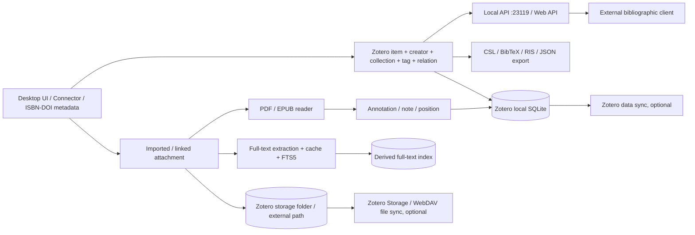
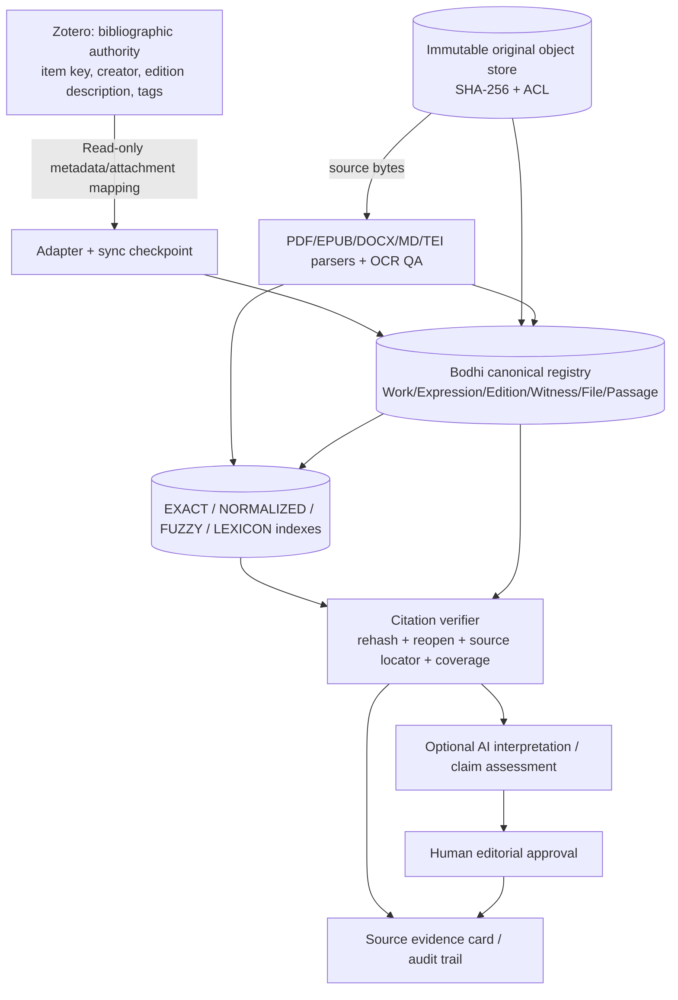

# Technology Assessment — Zotero

> **BodhiAtlas / P05 / P0** · Ngày thẩm định: **2026-11-16** (Asia/Ho_Chi_Minh) · Analyst: **Independent technical assessment / ChatGPT (GPT-6)**  
> **Sản phẩm phát hành:** Zotero **10.0.9** (changelog chính thức: 2026-11-10). **Git tag `10.0.9` → commit `0f25aca5e5e087fa44404c134fd384e2aeca4eda`** (giải tham chiếu từ annotated tag object `bb0925e777bd18d784f868e66b828f87c944d070`). `zotero/zotero` công khai, không archived tại thời điểm kiểm tra.  
> **Snapshot phát triển riêng:** `main` tại `992853536935dce3249a4ecf61d0d129883f85c4` (2026-11-14), file `version` ghi `11.0.SOURCE`; **không được đánh đồng với bản phát hành 10.0.9**.  
> **Nguồn dự án đã đọc toàn văn:** `bodhi-atlas/docs/PRD.md` (V1.4, 398 dòng; blob `58d967c642d625180c436e1a6e6a75fa2e7070e3`); `docs/ACADEMIC_RISKS_AND_VERIFICATION.md` (239 dòng, 2026-11-15). Đã đọc README và manifest của `BuddhismDocuments-for-AI`; đọc mã nguồn Zotero ở tag 10.0.9, unit tests, tài liệu chính thức và issue.  
> **Công cụ:** GitHub connected read-only API, website chính thức Zotero/Calibre, đọc nội dung mã nguồn và test, phân tích API contract; **không cài đặt/khởi chạy Zotero, không tạo thư viện thử, không chạy test/benchmark**. Vì vậy **không có claim `[TESTED]` về năng lực runtime**. Mọi chỉ số ở phần POC là *ngưỡng đề xuất*, không phải đo được.  
> **Quy ước:** `[DOC]` đặc tả/tài liệu chính thức; `[CODE]` mã nguồn hoặc test code đã đọc, *chưa chạy*; `[ISSUE]` báo cáo/đề xuất issue; `[INFERRED]` suy luận kỹ thuật có giải thích; `[UNKNOWN]` chưa xác minh; `[TESTED]` chỉ dành cho phép thử chúng tôi tự thực thi (không có trong nghiên cứu này). `N/A` khác `MISSING`: không yêu cầu Zotero phải là engine OCR hay kiểm chứng học thuật khi chỉ dùng làm catalog thư mục.

## 1. Executive Decision

**Khuyến nghị: `USE AS COMPONENT` — chỉ sử dụng Zotero làm *bibliographic system of record* tùy chọn, không làm lõi duy nhất của BodhiAtlas V1.** **Độ tin cậy: MEDIUM** cho quyết định tích hợp; chưa có POC vận hành. Zotero 10.0.9 có giá trị rõ ràng trong quản trị item, creator, DOI/ISBN, collection, tag, attachment, note, annotation, nhóm nghiên cứu, trích dẫn và đồng bộ. Web API v3 và Local API cho phép nối metadata, attachment key, export và phần văn bản đã index sang hệ thống khác.

Nhưng **item trong Zotero không tự tương đương Work/Expression/Edition/Witness**, `related items` không phải mô hình thư mục học thuật có quan hệ được chứng thực. Text index và highlight của Zotero cũng **không cung cấp hợp đồng provenance bao trùm mỗi lần xuất hiện nguyên văn**: không bảo đảm SHA-256 file gốc, per-hit bbox/EPUB CFI, trang in đã kiểm, trạng thái lỗi OCR theo vùng, xác minh quotation hay tìm `EXACT` exhaustive theo cách BodhiAtlas đặt ra. Tính năng tìm kiếm mới mạnh hơn không được lấy làm bằng chứng vượt qua quality gates của V1.4.

**Ba rủi ro lớn:** (1) dẫn nhầm file/ấn bản/trang và nhầm annotation locator với source map toàn văn; (2) hai catalog cùng ghi gây lệch danh tính, xung đột metadata/sync và nhầm MD5 với SHA-256; (3) đưa dữ liệu riêng tư tới cloud/LLM hoặc API localhost không được bảo vệ đúng. **Quyết định:** POC hẹp với *một tác phẩm, hai bản dịch/ấn bản, một PDF và một EPUB*, nối `Zotero item/attachment keys → Bodhi canonical IDs/SHA-256/verified locator` trước khi chốt đưa vào vận hành. Tận dụng khả năng retrieval/provenance có sẵn ở `BuddhismDocuments-for-AI`, không tự viết lại những gì đã tồn tại.

## 2. Sources & Evidence Ledger

URL gắn với snapshot tag cố định khi là mã nguồn; URL tài liệu chính thức là tài liệu đang được duy trì, nên cần chụp lại vào biên bản POC để chống drift.

| claim_id | Nhận định trọng yếu | Mức | URL/permalink | Version | Ghi chú/giới hạn |
|---|---|---|---|---|---|
| E01 | Yêu cầu chính là deterministic retrieval, hồ sơ SHA-256, edition/witness, source map, tách code và AI | [DOC] | [Bodhi PRD V1.4](https://github.com/quoctran-2608/bodhi-atlas/blob/main/docs/PRD.md) | Blob `58d967c…` | Đã đọc đủ 398 dòng; G1–G6 xem E02 |
| E02 | Quality gates về ingest, citation, claim, external, lexicon, publish và 28 rủi ro | [DOC] | [Academic risks](https://github.com/quoctran-2608/bodhi-atlas/blob/main/docs/ACADEMIC_RISKS_AND_VERIFICATION.md) | 2026-11-15; 239 dòng | Đã đọc đủ |
| E03 | Zotero 10.0.9 là bản mới nhất công bố trong changelog tại snapshot này | [DOC] | [Version history](https://www.zotero.org/support/changelog) | 10.0.9, 2026-11-10 | Không suy ra bản beta/11-dev là stable |
| E04 | Tag 10.0.9 được ghim vào commit cụ thể | [CODE] | [Tag ref](https://api.github.com/repos/zotero/zotero/git/ref/tags/10.0.9), [tag object](https://api.github.com/repos/zotero/zotero/git/tags/bb0925e777bd18d784f868e66b828f87c944d070) | `0f25aca5e5e087fa44404c134fd384e2aeca4eda` | Annotated tag; không nhầm SHA của tag với commit |
| E05 | Source chính ghi Zotero phát hành theo AGPLv3 | [CODE] | [COPYING L8–15](https://github.com/zotero/zotero/blob/0f25aca5e5e087fa44404c134fd384e2aeca4eda/COPYING#L8-L15) | 10.0.9 | Cần rà riêng từng dependency, plugin và bộ dữ liệu |
| E06 | Zotero item cung cấp fields, attachment, relations; không phải ontology witness chuyên ngành | [CODE] | [item.js](https://github.com/zotero/zotero/blob/0f25aca5e5e087fa44404c134fd384e2aeca4eda/chrome/content/zotero/xpcom/data/item.js#L237-L290), [relations.js L28–35](https://github.com/zotero/zotero/blob/0f25aca5e5e087fa44404c134fd384e2aeca4eda/chrome/content/zotero/xpcom/data/relations.js#L28-L35) | 10.0.9 | Kết luận ontology là gap theo yêu cầu Bodhi, không có nghĩa Zotero item vô ích |
| E07 | Stored và linked attachment là hai vòng đời file khác nhau | [DOC]+[CODE] | [Attaching files](https://www.zotero.org/support/attaching_files), [attachments.js L63–232](https://github.com/zotero/zotero/blob/0f25aca5e5e087fa44404c134fd384e2aeca4eda/chrome/content/zotero/xpcom/attachments.js#L63-L232) | 10.0.9 | Stored file có thể bị xóa theo attachment; linked không file-sync chuẩn |
| E08 | Local API v3 đọc trên localhost:23119; Zotero 10 hỗ trợ ghi sau consent; server ID riêng | [DOC]+[CODE] | [Local API](https://www.zotero.org/support/dev/web_api/v3/local_api), [server_localAPI.js L54–61](https://github.com/zotero/zotero/blob/0f25aca5e5e087fa44404c134fd384e2aeca4eda/chrome/content/zotero/xpcom/server/server_localAPI.js#L54-L61) | 10.0.9 | Quyền localhost không phải quyền AI; không expose port |
| E09 | Local API có `/file/view/url`, trả local file URL, có unit test | [CODE] | [Endpoint L1273–1276](https://github.com/zotero/zotero/blob/0f25aca5e5e087fa44404c134fd384e2aeca4eda/chrome/content/zotero/xpcom/server/server_localAPI.js#L1273-L1276), [test L323–330](https://github.com/zotero/zotero/blob/0f25aca5e5e087fa44404c134fd384e2aeca4eda/test/tests/server_localAPITest.js#L323-L330) | 10.0.9 | **Test file đã đọc, chưa thực thi**; chỉ trên máy có Zotero và file khả dụng |
| E10 | Web/Local fulltext API trả `content`, `indexedPages/totalPages` hoặc char counts | [DOC]+[CODE] | [Full-text API](https://www.zotero.org/support/dev/web_api/v3/fulltext_content), [test L340–346](https://github.com/zotero/zotero/blob/0f25aca5e5e087fa44404c134fd384e2aeca4eda/test/tests/server_localAPITest.js#L340-L346) | API v3, 10.0.9 | Không có per-hit source map trong payload ví dụ |
| E11 | Full-text dùng FTS5/index trạng thái partial, có index limits; không phải OCR review | [CODE]+[DOC] | [fulltext.js L26–52](https://github.com/zotero/zotero/blob/0f25aca5e5e087fa44404c134fd384e2aeca4eda/chrome/content/zotero/xpcom/fulltext.js#L26-L52), [Search preferences](https://www.zotero.org/support/preferences/search) | 10.0.9 | Mặc định max **500,000 ký tự/file** theo doc; phải cấu hình và đo |
| E12 | Fulltext PDF/EPUB/HTML/plain text, **không index fulltext DOCX/ODT** native | [DOC] | [Search preferences](https://www.zotero.org/support/preferences/search) | Tài liệu đọc 2026-11-16 | DOCX vẫn đính kèm/metadata được, không đồng nghĩa fulltext searchable |
| E13 | Annotation lưu `text`, `pageLabel`, JSON `position` (có pageIndex/rects đối với PDF fixture) | [CODE] | [annotations.js L138–165](https://github.com/zotero/zotero/blob/0f25aca5e5e087fa44404c134fd384e2aeca4eda/chrome/content/zotero/xpcom/annotations.js#L138-L165), [test L10–19](https://github.com/zotero/zotero/blob/0f25aca5e5e087fa44404c134fd384e2aeca4eda/test/tests/annotationsTest.js#L10-L19) | 10.0.9 | **Chỉ annotation đã tạo**, không phải bbox của mọi hit; pageIndex zero-based |
| E14 | Reader có chuyển vị trí, notes gắn link về PDF page | [DOC]+[CODE] | [PDF reader](https://www.zotero.org/support/pdf_reader), [reader.js L2913–2916](https://github.com/zotero/zotero/blob/0f25aca5e5e087fa44404c134fd384e2aeca4eda/chrome/content/zotero/xpcom/reader.js#L2913-L2916) | 10.0.9 | Không tự xác nhận định danh printed page hay CFI có thể xuất đại trà |
| E15 | Zotero 10 đổi tìm kiếm (FTS, CJK, diacritics) nhưng không thành chuyên dụng cross-language sense search | [DOC]+[INFERRED] | [Changelog 10.0](https://www.zotero.org/support/changelog), [search settings](https://www.zotero.org/support/preferences/search) | 10.0 | Khả năng mới cần chạy fixture Việt/Hán/Tạng/Pāli |
| E16 | Zotero sync metadata qua Zotero server, file qua Zotero Storage/WebDAV tùy cấu hình, sync hai chiều | [DOC] | [Syncing](https://www.zotero.org/support/sync) | Tài liệu đọc 2026-11-16 | WebDAV file ≠ self-host metadata server |
| E17 | API attachment có `md5`,`mtime`, không mặc định đưa ra SHA-256 nguồn bất biến | [DOC]+[INFERRED] | [File uploads](https://www.zotero.org/support/dev/web_api/v3/file_upload) | API v3 | Bodhi phải hash SHA-256 riêng; MD5 không thay cho SHA-256 |
| E18 | Full-text v2 có đề xuất các metadata chất lượng/anchor mới, chưa được coi là feature phát hành | [ISSUE] | [Issue #5673](https://github.com/zotero/zotero/issues/5673) | Issue, không phải release | Mức độ/thời gian hoàn thành không bảo đảm |
| E19 | Kho BuddhismDocuments-for-AI đã có deterministic retrieval, source pins, evidence tools nhưng chưa đạt mọi gate AI Research | [DOC] | [BuddhismDocuments README](https://github.com/quoctran-2608/BuddhismDocuments-for-AI/blob/main/README.md), [manifest](https://github.com/quoctran-2608/BuddhismDocuments-for-AI/blob/main/manifest.json) | README snapshot 2026-11-16 | **Là tài sản dự án có sẵn**, không mặc nhiên là Zotero |
| E20 | Calibre có `calibredb`, Content server, FTS và quản lý format EPUB/e-books | [DOC] | [Calibre CLI](https://manual.calibre-ebook.com/generated/en/calibredb.html) | Calibre docs 9.18.0 | Không chấm Calibre là không tìm fulltext; so đúng vai trò |
| E21 | Chưa kiểm chứng độ chính xác CFI/rects trên EPUB, quyền API từng group, hành vi search trên 10k sách | [UNKNOWN] | [Local API](https://www.zotero.org/support/dev/web_api/v3/local_api) | POC chờ chạy | Không được biến thiếu test thành kết luận chắc chắn |

### Bản đồ nguồn và độ tin cậy

- **Nguồn thẩm quyền cao:** hai tài liệu chuẩn BodhiAtlas; Zotero support/dev API + changelog; source/tag Zotero 10.0.9. 
- **Đọc mã thực thi:** `item.js`, `relations.js`, `attachments.js`, `fulltext.js`, `annotations.js`, `server_localAPI.js`, `reader.js`; test `server_localAPITest.js`, `fulltextTest.js`, `annotationsTest.js` (>=7 code và 3 test pointers). 
- **Không biến issue thành hành vi runtime:** ví dụ #5673 chỉ là đề xuất; performance, complete API schema và chính xác source-map cần POC.

## 3. Architecture & Data Flow

### 3.1. Kiến trúc bản thân Zotero (không nhầm với kiến trúc BodhiAtlas)



- `[CODE/DOC]` **Item** chính là bibliographic metadata, attachment có thể là child item. Collections là nhóm logic; tags/relations/notes/annotations là đối tượng người dùng thao tác, lưu trạng thái được.
- `[CODE]` **Index** là dữ liệu dẫn xuất có thể reindex; FTS5 trong `fulltext.js`, text cache trong profile. **Không coi** Zotero FTS text là raw source bất biến của Bodhi.
- `[DOC]` **API** cung cấp JSON metadata, fulltext content và local file view URL. Đường `file://` dùng được với local process có quyền hệ điều hành, không dùng cho remote service/AI.
- **Không cần LLM** để quản lý thư mục, lấy metadata, đọc annotation, truy xuất fulltext mà Zotero đã index, lọc item. **Không có LLM nào được phép tự cấp trạng thái VERIFIED**. Diễn giải tranh luận học thuật/quan hệ lập luận là quy trình ngoài Zotero, tùy chọn AI + người duyệt.

### 3.2. Kiến trúc tích hợp BodhiAtlas khuyến nghị



- **Source of truth phân vùng:** Zotero sở hữu **bibliographic assertions người biên mục**; Bodhi sở hữu **canonical scholarly identity, file hash, raw text, locator, OCR quality, verification, claim state**. Không có hai catalog cùng được ghi cùng một field một cách tự động.
- **Bất biến:** File gốc không bị sửa bởi normalize/OCR/index; mọi derived artifact mang `extractor_version/index_version/source_sha256`; annotation `pageIndex` không mặc nhiên được chuyển thành printed page.
- **AI permission boundary:** adapter chỉ cấp công cụ đọc các file có quyền đối với phiên AI hiện tại; không gửi `file://` hay đường dẫn máy tính sang dịch vụ từ xa; không cho AI write vào Zotero mặc định.

## 4. Feature Fit–Gap Matrix

**Cách đọc:** trạng thái là *khả năng Zotero xét đúng vai trò catalog/bibliographic manager*, không phải chấm điểm toàn bộ sản phẩm BodhiAtlas. Một hàng có thể nói `NATIVE` ở phần thư mục nhưng vẫn cần hệ ngoài khi truy nguyên sâu. Effort là ước lượng tích hợp định tính, không phải benchmark.

| C | Năng lực / vai trò Zotero | Trạng thái | Chứng cứ | Tác động đối với Bodhi V1 | Công sức / phương án bù |
|---|---|---|---|---|---|
| C01 | Nhập PDF/EPUB và lưu DOCX/MD attachment + metadata | **NATIVE** | E07,E12 | Lưu tài liệu không đồng nghĩa đọc/định vị hết nội dung | M: Bodhi ingest DOCX/MD/TEI và PDF scan riêng |
| C02 | OCR, layout, reading order, hai cột, footnote | **N/A** | E11,E12; PRD §§3–5 | Gate G1/G2 không thể dựa vào Zotero | H: OCR/layout QA + per-page manifest |
| C03 | Canonical raw text, immutable original, source map | **MISSING** | E10,E13,E17 | Nguy cơ dẫn chứng sai file/offset | H: immutable store + SHA + page/offset/bbox/CFI map |
| C04 | Work/Expression/Edition/Witness/translation/parallel | **EXTENSION** | E06; PRD §2 | `related items` không biểu diễn đủ loại quan hệ/độ chứng thực | M–H: Bodhi registry tách thực thể; Zotero item link |
| C05 | Exhaustive EXACT theo từng occurrence + raw quote | **EXTERNAL** | E10,E11; PRD §4.1 | Search UI chỉ trả item ứng viên; không chứng minh recall hay offsets | H: scan canonical raw / positional index độc lập |
| C06 | Normalized Việt/Hán/Tạng/Pāli/Sanskrit theo chế độ | **CONFIG** | E11,E15 | FTS5 diacritic/CJK cải thiện ≠ phép chuẩn hóa có audit | M–H: analyzer từng hệ chữ, raw vs normalized index |
| C07 | Fuzzy, OCR error/near-duplicate passage | **EXTERNAL** | E11; yêu cầu PRD §4.2 | Không đủ cơ chế giải thích sai khác/recall | M: trigram/Levenshtein/passage n-gram, diff |
| C08 | Lexicon `sense` / tradition / source-qualified mapping | **N/A** | PRD §2.4; E06 | Không được đồng nhất `anattā`, `無我`, `vô ngã` không điều kiện | M–H: sense registry đã duyệt |
| C09 | Semantic/hybrid/RAG | **N/A** | PRD §6.2; E18 | Không phải blocker chọn Zotero | L–M để nối adapter, H nếu tự xây RAG |
| C10 | Note link & annotation reopen; verified citation card toàn văn | **EXTERNAL** | E09,E13,E14 | Chỉ PDF annotation có `rects` chưa đủ G2 | H: verifier xác nhận page/bbox/hash/context |
| C11 | Note/tag/related item/annotation | **NATIVE** | E06,E13,E14 | Tốt cho second-brain thư mục, chưa là G3 claim graph | M: Bodhi claim memory tách proof khỏi ghi chú |
| C12 | Official Web/Local API, export CSL/BibTeX/RIS | **NATIVE** | E08–E10; API docs | Đây là lý do chính dùng Zotero | L–M: REST polling + export bridge + ACL |
| C13 | Index incremental + stats (`PARTIAL`), QA OCR coverage | **NATIVE** | E10,E11 | `indexedPages` aggregate không xác nhận trang nào OCR sai | M–H: page/region coverage + extraction version |
| C14 | Local control, sync/group, auth/backup, rights per AI | **CONFIG** | E08,E16,E05 | Có thể rò cloud/localhost hoặc AI đọc vượt quyền | M: explicit policy, vault secrets, restore drill |
| C15 | Desktop installation và library quy mô lớn | **UNKNOWN** | E03,E08; PRD §7 | Zotero không phải luôn-on headless source verification service | M: chạy adapter sidecar/đọc Web API; benchmark thực |

**Hard gate:** Nếu dùng Zotero một mình để thực thi **C03+C05+C10**, gate **FAIL** cho V1; nếu chỉ yêu cầu thư mục, các mục OCR/semantic/claim thuộc **N/A**, không phải lỗi của Zotero.

## 5. Deep Technical Findings

### 5.1. Data model: item, attachment, collection, relation, note, group

**[DOC/CODE]** Thực thể Zotero trọng tâm là **bibliographic item**, có `itemType`, title, creators, date, publicationTitle/ISBN/DOI và trường `extra` tùy loại, tags, collections, relations, version; notes và attachments là item dạng riêng, thường là con của item thư mục (`parentItem`). Collection là tổ chức thư viện; một item có thể tham gia nhiều collections; related items dùng relation được lưu. Zotero group giúp hợp tác nhưng chia sẻ dữ liệu theo cấu trúc của Zotero, không tự tạo partition ACL cho AI. API trả JSON với `key`, `version`, `data`; `data` có field phụ thuộc itemType. Xem [item.js](https://github.com/zotero/zotero/blob/0f25aca5e5e087fa44404c134fd384e2aeca4eda/chrome/content/zotero/xpcom/data/item.js), [API basics](https://www.zotero.org/support/dev/web_api/v3/basics), [types & fields](https://www.zotero.org/support/dev/web_api/v3/types_and_fields).

**[CODE]** `relations.js` định nghĩa `dc:relation`, `owl:sameAs`, `dc:replaces`, nhưng **không có đảm bảo dạng ontology** `translation_of`, `expression_of`, `witness_of`, `parallel_to` và provenance quan hệ theo trường `verified_by/source/method` như BodhiAtlas cần. Có thể lưu ký hiệu phụ trợ trong Extra/tags/relations, **nhưng Extra là vùng tiện ích, không phải bảng chuẩn hóa thực thể**. Khuyến nghị: `bodhi_work_id`, `bodhi_expression_id`, `bodhi_edition_id`, `bodhi_witness_id` là khóa Bodhi bên ngoài; mối quan hệ có người xác minh cùng độ tin cậy và nguồn.

**Ví dụ mô hình ánh xạ — minh họa thiết kế, KHÔNG phải JSON API response thực tế:**

```json
{
  "zotero": {"server_id":"LOCAL_DB_ID", "library_id":"0", "item_key":"ITEMKEY1", "attachment_key":"ATTKEY01", "item_version":17},
  "bodhi": {"work_id":"W-001", "expression_id":"X-TR-VI-01", "edition_id":"E-1998-01", "witness_id":"WI-001", "file_id":"F-001", "file_sha256":"<64 lowercase hex digits>"},
  "mapping": {"status":"HUMAN_CONFIRMED", "source":"catalog-curation", "valid_from":"2026-11-16"}
}
```

Không dùng ISBN/DOI làm ID Work độc nhất: metadata có thể vắng, sai, hoặc tái sử dụng; DOI mô tả item xuất bản, không phải instance file/variant.

### 5.2. Web API và Local API: khác biệt cốt yếu

| Hạng mục | Zotero Web API v3 | Zotero Local API v3 (Zotero 10+) | Hệ quả |
|---|---|---|---|
| Endpoint | `https://api.zotero.org/users/<id>/...` / groups | `http://localhost:23119/api/users/0/...` | Web cho server không cần desktop; Local cần Zotero desktop chạy |
| Read / auth | Public có thể đọc; private cần API key/OAuth | Read thường không auth, phải bật trong Settings | **Không mở port localhost ra mạng** |
| Write | Credentials cấp phép và version condition | API key cấp sau consent `POST /api/local/authorize`; header Server-ID | POC đọc một chiều tránh quyền ghi |
| Version / sync | Version gắn library/server account | Version **cục bộ** gắn `Zotero-Server-ID` | Không so sánh phiên bản Web với Local bằng phép toán |
| Attachments | Cloud file fetch/download theo permissions | `/file/view/url` trả `file://...` | Chỉ local adapter có thể mở và hash file |
| Search | API có tìm item/fulltext-related endpoints | Ngoài ra chạy saved search `/searches/:key/items` | Không coi search response là toàn bộ occurrences |
| Fulltext | GET `/items/:attachment/fulltext` | Tương tự | Chỉ aggregate text + counts, chưa per-hit provenance |

Điểm an toàn: `Zotero-Server-ID` trong local API là định danh database instance, dùng để partition cache; write phải kèm header này, và có thể phải reauthorize khi key dùng một lần. Cần xử lý `403/401/412/428/429` và vắng file, không vòng lặp vô hạn. `Last-Modified-Version`/`since` và conditional writes là công cụ tăng dần, **không thay được** checkpoint/merge policy của Bodhi. Web API key scope và local write consent là hai mô hình khác nhau.

Ví dụ truy vấn read-only tại desktop (đòi Zotero chạy và bật Local API):

```bash
BASE=http://localhost:23119/api
curl -sS -D zotero-headers.txt "$BASE/"
curl -sS -H 'Zotero-API-Version: 3' "$BASE/users/0/items?limit=100"
curl -sS "$BASE/users/0/items/ITEMKEY1/children"
curl -sS "$BASE/users/0/items/ATTKEY01/fulltext"
curl -sS "$BASE/users/0/items/ATTKEY01/file/view/url"
```

`ITEMKEY1`/`ATTKEY01` là placeholder; **không chạy trong báo cáo này**. Không viết `curl file://` hoặc đưa file URL vào AI remote. Với Web API, nên dùng endpoint `items?limit/start`, `since` và các scope đã cấp; export `format=bibtex`, `format=csljson` hoặc translator phù hợp phải kiểm tương thích cụ thể khi POC.

### 5.3. Reader, annotations, locator: có nhưng không đủ

**[CODE]** `annotations.js` xây nội dung annotation với `annotationText`, `annotationPageLabel`, `annotationSortIndex`, `annotationPosition` (JSON); `annotationsTest.js` fixture PDF có `position.pageIndex` **0-based** và các `rects` float. **[DOC]** UI PDF reader tạo note kéo annotation, note có link trở lại PDF page; reader xử lý PDF/EPUB và cải tiến EPUB restore trong changelog 10.

**Ranh giới:** `annotation.position` chỉ tồn tại nếu người dùng/reader tạo annotation tương ứng; không thể giả từ `GET .../fulltext` rằng **mọi kết quả tìm kiếm** đều có `pageIndex + rects` hoặc CFI xác thực. `pageLabel` thuộc reader/annotation không phải trang in của đúng ấn bản đã có người kiểm. EPUB reflow làm “trang số” tùy thiết bị; một href/CFI (nếu reader expose đúng dạng) vẫn phải thử mở lại, kiểm text và version/chunk. Chưa xác minh contract **public API ổn định** để xuất/nhập CFI của mọi candidate passage.

### 5.4. Fulltext v10: thực chất và giới hạn

**[DOC/CODE]** Zotero 10.0 cải tiến indexing/search dùng FTS5 và tìm có dấu/không dấu, xử lý cụm CJK tốt hơn. `fulltext.js` có các trạng thái `UNAVAILABLE/UNINDEXED/PARTIAL/INDEXED/QUEUED`, cache và bảng FTS5, và các bộ đếm `indexedPages/totalPages`, `indexedChars/totalChars`. Hệ thống đủ cho **bibliographic discovery** và ứng viên sách, **không đủ đảm bảo exhaustive occurrences hoặc citation-grade exact match**. [Search preferences](https://www.zotero.org/support/preferences/search) nêu mặc định giới hạn **500,000 ký tự/file**, dễ âm tính giả với sách dài nếu không tăng giới hạn, kiểm tình trạng index và so với ground truth. Zotero fulltext **không native index DOCX/ODT**; PDF scan phải OCR bên ngoài/đảm bảo text layer đọc được. Một hit FTS5 được tokenization, có thể không giữ phân biệt raw Unicode/chuẩn hóa như Bodhi `EXACT` cần; nếu muốn EXACT byte/Unicode, đối chiếu lại với immutable extracted raw + offsets.

**[CODE]** `test/tests/fulltextTest.js` có test candidate phrase không được khớp qua dấu câu — minh họa cần verify candidate với cached text; test không thay cho benchmark. **[ISSUE]** [Full-text v2 (Draft) #5673](https://github.com/zotero/zotero/issues/5673) mô tả các khả năng text quality/anchor đang được cân nhắc: **không gắn nhãn NATIVE chỉ dựa vào issue**.

### 5.5. Đồng bộ, lưu file, export, khóa catalog

- **Stored attachment**: Zotero sao chép vào thư mục dữ liệu, tự quản lý file; nếu xóa attachment trong Zotero có thể xóa bản stored. **Linked attachment**: giữ file bên ngoài theo đường dẫn; phù hợp kho object bất biến hơn nhưng có hạn chế đồng bộ, group library/mobile và portability. [Attaching files](https://www.zotero.org/support/attaching_files).
- **Sync**: metadata qua Zotero servers khi bật; file qua Zotero Storage hoặc WebDAV theo chế độ; WebDAV không biến toàn bộ hệ thành self-host và không hỗ trợ như nhau cho group attachments. Đồng bộ hai chiều có resolve conflict, không phải immutable event sourcing. [Sync](https://www.zotero.org/support/sync).
- **Export**: CSL JSON/BibTeX/RIS để đưa citation và metadata sang quy trình viết sách; export thư mục không bảo đảm mang đủ `file_sha256/source_map/OCR_coverage`. Khi import/export phải giữ crosswalk `itemKey` ngoài dữ liệu CSL vì key có thể mất giữa định dạng.
- **Hàng nghìn sách**: workflow Zotero có ưu thế nhập từ browser/DOI/ISBN, gắn tag/collection, duplicate merge, annotations. Tuy nhiên các yếu tố cần kiểm định là tỉ lệ metadata sai, performance của Local API/GUI, attachment path drift, dung lượng đồng bộ, và sửa đổi hàng loạt; **không có số throughput chính thức nào được xác nhận ở nghiên cứu này**. Calibre có lợi khi định dạng EPUB lớn/convert ebook; nên chỉ chọn **một chủ thư mục** để tránh double catalog.

### 5.6. Rủi ro nghiên cứu chuyên ngành

Các failure modes **Zotero không tự loại bỏ**: chọn trùng tựa khác dịch giả, nhầm tái bản với edition độc lập; PDF page vs printed page; bản scan cột đôi/footnotes; thiếu ký tự phủ định do OCR; Hán 1–2 ký tự bị tokenizer bỏ sót hoặc xếp hạng sai; Pāli dấu dài/retroflex; Tạng Unicode phân đoạn/Wylie; trích dài qua chunk; câu người khác nói bị gán cho quan điểm tác giả; ba bản dịch chung nguyên bản bị đếm ba chứng cứ; Web API chỉ có metadata/abstract nhưng bị dùng như fulltext; file thuộc nhóm riêng tư bị gửi cho AI. Cần các **quality gates** G1–G6 ngoài Zotero.

## 6. Source Fidelity & Provenance

### 6.1. Bảng năng lực thực tế theo lớp

| Lớp | Zotero có gì | Điều BodhiAtlas còn phải sở hữu | Quy tắc không được phá |
|---|---|---|---|
| Bibliography | item key, type/creators, DOI/ISBN, tags, attachment child | Work/Expression/Edition/Witness + nguồn xác nhận quan hệ | Không lấy item key làm edition/witness ID toàn cục |
| Original file | imported/linked attachment và file path qua Local API | Kho gốc immutable + object version + **SHA-256** + rights | `md5` không thay SHA-256; file thay là FileID mới |
| Extracted raw | indexed text, fulltext cache | Canonical extracted raw **versioned**, mapping sang bytes/page/DOM | Normalize không ghi đè raw |
| Page/area | reader annotation PDF `pageIndex`, `rects`, `pageLabel` | Mọi passage candidate: bbox/offset, printed page human-verified | Annotation ≠ auto source map; pageIndex 0-based |
| EPUB | EPUB reader/annotation | Stable `spine_id/href/CFI/text quote` đã tự reopen test | CFI không tự bền khi EPUB bytes thay |
| DOCX/MD | attachment/metadata | XML paragraph id/run offsets hoặc MD line/heading/byte offsets | Locator phụ thuộc converter version |
| OCR | có thể tìm PDF đã có text layer; aggregate indexedPages | Per-page/region coverage, confidence, reading order, QA | `indexedPages == totalPages` ≠ chữ OCR đúng |
| Citation card | annotations/citations và bibliography | `TEXT_AND_LOCATOR_VERIFIED` kèm raw quote/namespace/hash/context | Không suy evidence support từ relevance |

### 6.2. Contract cho một phiếu truy nguyên nguồn

**Schema đề xuất bởi nhóm thẩm định, không phải schema Zotero native:**

```json
{
  "record_type": "bodhi.evidence.v1",
  "source": {
    "work_id": "W001", "expression_id": "X001", "edition_id": "E001",
    "witness_id": "WI001", "file_id": "F001", "sha256": "<verified-file-sha256>",
    "zotero": {"library_id": "0", "item_key": "<item>", "attachment_key": "<attachment>"}
  },
  "passage": {
    "raw_quote": "<verbatim passage from immutable extracted source>",
    "context_before": "...", "context_after": "...",
    "locator": {"kind": "pdf", "page_index_zero_based": 41,
                "pdf_page_one_based": 42, "printed_page": null,
                "rects": [], "extraction_offset": [1234, 1291]},
    "extractor_id": "parser@pinned-version",
    "source_map_version": "v1"
  },
  "retrieval": {"mode": "EXACT", "query_original": "anattā", "transformations": [], "score_kind": "relevance_only"},
  "coverage": {"status": "PARTIAL", "unreadable_pages": [43], "ocr_review": "PENDING"},
  "citation_verification": {"state": "TEXT_ONLY", "checked_at": null},
  "claim_assessment": {"state": "NOT_ASSESSED", "reviewer": null}
}
```

**Giải thích:** số trang, offset, quote, bbox và hash ở đây **đều là placeholder ví dụ**, không phải số đo hay câu trích có thật. Không đưa trường `printed_page` khi chưa xác nhận; để `null`. Bbox `[]` buộc `TEXT_ONLY`, không được `TEXT_AND_LOCATOR_VERIFIED` nếu policy đòi vùng. Mã Word/Expression/Edition/Witness cần truy về người lập catalog và tài liệu gốc xác nhận.

### 6.3. Exact reopen + reverify độc lập

1. Đọc `file_id → sha256 + immutable object URI + ACL`; rehash bytes; thiếu file/chênh hash thì **FAIL CLOSED** và đánh dấu `SOURCE_CHANGED/UNAVAILABLE`.
2. Đọc `locator.kind`, map sang PDF page/bbox, EPUB spine/href/CFI hoặc DOCX/MD paragraph/offset. Cần engine thích hợp để mở bản tương ứng, không “ước lượng trang”.
3. Kiểm câu `raw_quote` và phần trước/sau với bản trích xuất đã ghim version; kiểm bản text OCR có tin cậy hay không; kiểm page/bbox ảnh gốc khi rủi ro cao.
4. Kết quả kỹ thuật `TEXT_AND_LOCATOR_VERIFIED / TEXT_ONLY / OCR_NEEDS_REVIEW / MISMATCH / UNVERIFIABLE` độc lập với `SUPPORTS/PARTIAL/CONTRARY/...` của claim.
5. Trong trường hợp nội dung index thay đổi/chunk ID đổi, locator bám source file + canonical offsets và mapping version; nếu không tái mở được thì tạo hàng chờ remap, **không âm thầm trỏ sang đoạn khác**.

Bộ tiêu chí này là cách hiện thực hóa PRD §5 và Academic Risks G1/G2/G3; **không phải là feature Zotero được chứng minh có sẵn**.

## 7. Multilingual & Retrieval Behavior

**Phải tách “Zotero fulltext search” và “Bodhi target search”.** Chữ “native” bên dưới chỉ có nghĩa tồn tại chức năng tìm kiếm hoặc đọc dạng đó, không bảo đảm recall 100% hay đúng analyzer từng hệ chữ.

| Mode / hệ chữ | Zotero 10.0.9 | BodhiAtlas target & analyzer cần thêm | Trạng thái chắc chắn |
|---|---|---|---|
| EXACT nguyên văn, dấu/case/Unicode | Quick/advanced fulltext item matching, không exposed mọi offset | Raw-scan / positional inverted index + literal equality + per-hit location | **custom**, Zotero native chỉ discovery |
| NORMALIZED tiếng Việt (`vo thuong`→`vô thường`) | Changelog 10 cải thiện diacritics-insensitive search | Index song song, NFC/NFD, casefold, remove diacritics, **ghi transformation**, exact tách riêng | **native basic + custom audited** |
| Hán phồn/giản (`無常`/`无常`) | CJK term search cải tiến theo changelog | Han variant table / OpenCC policy, char n-gram cho 1–2 chữ, original retained | **custom** cho mapped variants |
| Pāli/Sanskrit (`anatta/anattā/anātman`) | Unicode text search/diacritic normalization chung | IAST diacritics-aware aliases, transliteration rules, morphology theo corpus, sense registry | **custom**; không khẳng định đồng nghĩa |
| Tạng Unicode + Wylie | Có thể lưu và tìm văn bản Unicode nếu indexer nhận token | Unicode segmentation TSHEG, normalization, Wylie transliteration, variant QA | **unknown** behavior native, **custom** target |
| Lexicon cross-language (`無我/vô ngã/anattā`) | Tags/relations bibliographic, không sense-aware termbase | `lexeme → sense → attested form → tradition/source/validity` | **external custom** |
| FUZZY typographic/OCR/near-parallel | Search Zotero không được chứng minh đáp ứng có kiểm chứng lỗi OCR | Trigram/ngram + bounded edit distance + alignment + inspectable diff | **external custom** |
| SEMANTIC / hybrid RAG | Không cần để làm thư mục; issue Fulltext v2 không phải release | Optional vector index trên passages đã xác minh + rule-based filtering | **external optional** |
| English stemming/lemma | FTS general, tokenizer/coverage chưa benchmark | Language-specific morphology; labeled transformation | **custom** để nghiệm thu V1 |

**Nguyên tắc kiểm tra bắt buộc:**

- Truy vấn `anatta` không được sửa câu `anattā` trong file thành câu giả; trả candidate `NORMALIZED` với giải thích bỏ dấu.
- `anātman` không mặc nhiên bằng `anattā`, `無我`, `无我`, `vô ngã`: nếu `LEXICON`, phải trỏ tới quan hệ *từng sense* có chứng cứ và phạm vi.
- `無常`, `苦`, `vô thường`, `khổ`: lọc tác giả/edition trước/sau search; trả đoạn ứng viên, không kết luận tác giả có lập trường nào chỉ vì từ khóa.
- Hán 1–2 chữ và Tạng/Wylie phải thử độc lập, không dựa vào recall tiếng Anh.
- Câu hỏi “những tác giả nào phân biệt vô thường và khổ, lập luận thế nào?”: **code retrieval** tạo danh sách passage ứng viên + vị trí; **analysis** (người/AI tùy chọn) xác định chủ thể phát ngôn, khẳng định, phản biện, ngoại lệ và hỗ trợ luận điểm; kết quả diễn giải luôn là `NOT_ASSESSED` trước duyệt.

## 8. Integration Options for BodhiAtlas

### Phương án A — Preferred: Zotero desktop + Local API read-only → Bodhi sidecar

**Vai trò:** Zotero là authority về bibliographic item/citation/annotation. Bộ máy BodhiAtlas là authority về Work/Edition/Witness/File/Passage, original SHA, OCR, search, citation verification. Adapter chạy cùng máy với Zotero, **không expose localhost API**, chỉ kéo metadata và đường dẫn attachment nếu người dùng đã cho phép đọc file.

**Luồng:**

1. Poll `GET /api/` lấy `Zotero-Server-ID`, API/schema version; kiểm thay instance.
2. Pull `GET /api/users/0/items?start=...&limit=...`; map item key, version, attachments `children`, tags, creators/ISBN/DOI, relations và notes/annotations khi được phép.
3. Với linked/stored file đã tồn tại, `GET /items/:attachmentKey/file/view/url`; adapter local resolve file URL, kiểm symlink/path traversal/quyền OS, copy bytes vào immutable store hoặc map nếu đã canonical, **tự tính SHA-256**. Không ghi `file://` vào response AI.
4. `crosswalk` giữ item/attachment key và version, checksum; curator chốt Work/Expression/Edition/Witness mapping; parser tạo source map; sync incremental; phục hồi từ full refresh nếu checkpoint lệch.
5. Deletion trong Zotero → tombstone/sync notice; **không cascade delete** original Bodhi/citations; nhãn `CATALOG_LINK_REMOVED` và chờ policy.

**Code cần viết:** `adapters/zotero_local.py` (REST/client), `catalog/zotero_crosswalk.sql`, `ingest/immutable_import.py`, `jobs/sync_zotero.py`, `policies/rights.py`, `tests/test_zotero_mapping.py` (**đường dẫn đề xuất, không có nghĩa hiện tồn tại**). Kết nối vào API retrieval/provenance hiện hữu của `BuddhismDocuments-for-AI` bằng adapter, không can thiệp Git submodule pins.

**Contract tối thiểu** (pseudo-JSON):

```json
{
  "direction": "zotero_to_bodhi",
  "catalog_source": "zotero-local",
  "instance_id": "<Zotero-Server-ID>",
  "library_key": "users/0",
  "item_key": "<key>",
  "attachment_key": "<key>",
  "zotero_object_version": "<integer-local>",
  "file_sha256": "<hash-computed-by-bodhi>",
  "metadata": {"title":"...", "creators":[], "language":"...", "date":"...", "isbn":null, "doi":null},
  "rights": {"import_allowed":false, "send_to_ai_allowed":false},
  "state": "DISCOVERED"
}
```

**Rollback:** dừng adapter, giữ immutable originals + crosswalk + event log; rebuild derived index từ source pins; không có auto write-back làm bẩn Zotero. Tham chiếu note Zotero chỉ được mở khi credential/user tương ứng có quyền.

### Phương án B — Web API v3 → standalone import service

**Khi dùng:** nhiều máy, Zotero GUI không luôn chạy, có quyền đọc **thư mục và attachment cloud**. Service chỉ nhận API key scope phù hợp và HTTPS; kéo changed items (`since`/pagination), attachment metadata, fulltext khi có quyền. Service không thể sử dụng `file://` Local API; để lấy bytes phải dùng Zotero file download đúng entitlement hoặc người dùng tải/upload vào Bodhi object store. File gốc vẫn giữ SHA do Bodhi tự tính. Cần quota/backoff, key rotation, kiểm backup/privacy, reconcile xung đột Zotero cloud/local. **Không cho phép AI dùng Zotero API key thô**; host proxy làm ACL.

**Ưu:** server vận hành độc lập desktop, thuận lợi hệ phân tán. **Nhược:** phụ thuộc cloud, rate limits, quyền tài liệu, attachment chưa sync/không cloud; Web API versions không đồng nhất Local object versions.

### Phương án C — Offline metadata export adapter (không realtime)

Zotero xuất `CSL JSON` / `BibTeX` / `RIS` + manifest do Bodhi tự cấp ID/hash. Import để có nguồn bibliographic cho manuscript, nhưng **không** suy Work/Witness từ format export; mất link/relationship phải có crosswalk riêng. Thích hợp tài liệu nhạy cảm/no-cloud và dễ rollback, nhưng update thủ công, đồng bộ chậm và không bảo đảm annotation position. **Không dùng export như canonical source map**.

### Ma trận authority & conflict

| Field/đối tượng | Owner duy nhất | Luồng | Nếu xung đột |
|---|---|---|---|
| Title/creator/ISBN/DOI/citation style | Zotero (nếu dùng thành phần) | Zotero → Bodhi cache | User sửa trong Zotero, adapter re-pull |
| Work/Expression/Edition/Witness/parallel relation | Bodhi curator | Bodhi-only; Zotero key là external alias | Review quan hệ, không sửa tự động |
| File bytes/SHA/source-map/OCR coverage | Bodhi immutable store | Attachment → Bodhi versioned import | Hash mismatch → File version mới; reverify |
| Zotero notes/annotations | Zotero/user | Opt-in read → Bodhi evidence candidate | Not verified cho đến khi mở lại raw file |
| Verified citation/claim assessment | Bodhi citation reviewer | Bodhi → reporting only | Không dùng Zotero note hoặc AI để tự nâng gate |
| Rights/AI permission | User/org policy engine | Policy check tại mỗi call | Deny by default; audit trail |

**Không đề nghị direct embedding vào Zotero core**: sửa AGPLv3 client + gánh updates phức tạp, trong khi REST adapters đạt mục tiêu. Chỉ cân nhắc Zotero plugin nếu API thực sự không expose annotation position/callback cần thiết và POC chứng minh cần, kèm security/license review.

## 9. Practical POC / Reproduction Plan

**Trạng thái chung: `NOT TESTED`** — chúng tôi đã đọc test source, chưa chạy phần mềm, chưa thu logs, chưa quan sát UI, chưa đo latency. Bộ fixtures dưới đây là **cần tạo từ tài liệu BodhiAtlas có quyền sử dụng**; đáp án chuẩn cần hai người rà độc lập đối với các hit scholarly rủi ro cao. Không tải/mượn nội dung bản quyền khi không có quyền.

### 9.1. Fixtures, môi trường, commands

- **F01:** 1 Work, 2 bản dịch/Expression và 2 Edition có metadata phân biệt tác giả/dịch giả/năm; mỗi edition tối thiểu 1 attachment: PDF có text layer và EPUB. **Trường hợp lý tưởng của POC ưu tiên:** 2 edition × 2 attachment PDF/EPUB nếu có bản gốc được phép dùng; nếu chỉ 2 file tổng cộng thì phải ghi giới hạn coverage.
- **F02:** PDF scan hai cột, footnotes, 1 câu phủ định bị OCR sai; trang in lệch PDF; một trang thiếu/không OCR.
- **F03:** đoạn Hán (1–2 ký tự và dài), Pāli có dấu, Sanskrit IAST, Tạng Unicode/Wylie, Việt có/không dấu, English; ít nhất 10 hit dương và 10 hit âm mỗi nhóm để có ground truth tối thiểu. **Không chế tác trích dẫn học thuật từ ký ức**; fixture có thể là nội dung giả *được gắn nhãn synthetic* để test tokenizer và không dùng trong báo cáo học thuật.
- **F04:** 1 DOCX, 1 Markdown; cùng câu có footnote, heading, offset, và file cập nhật version mới.
- **F05:** 2 Zotero clients hoặc 2 thời điểm thay đổi metadata, 1 deleted attachment, 1 missing linked file, 1 account không có quyền đọc.

**Môi trường ghi khi chạy:** OS + kiến trúc, Zotero 10.0.9 installer checksum, `git` SHA code fixture, `sqlite3 -version`, CPU/RAM/storage, Python version, PDF/EPUB extractor version, OCR engine version/language packs, Docker image digests nếu có, `LC_ALL`, timezone, snapshot dataset hash. Không chạy GPU trừ khi chọn OCR/embedding GPU và báo riêng.

```bash
# Các lệnh đề xuất, CHƯA CHẠY — yêu cầu cài Zotero desktop 10.0.9 và bật Local API.
curl -sS -D headers.txt http://localhost:23119/api/
curl -fsS 'http://localhost:23119/api/users/0/items?limit=100' > items-page-1.json
curl -fsS 'http://localhost:23119/api/users/0/items/ITEMKEY1/children' > children.json
curl -fsS 'http://localhost:23119/api/users/0/items/ATTKEY01/fulltext' > fulltext.json
curl -fsS 'http://localhost:23119/api/users/0/items/ATTKEY01/file/view/url' > file-url.txt

# KHÔNG tải mù quáng URL từ file-url.txt; chỉ adapter local được phép resolve và hash.
sha256sum /path/to/authorized-local-attachment.pdf

# Nếu dùng asset có sẵn và môi trường đã được chuẩn bị đúng theo README của chính repo:
git clone --recurse-submodules https://github.com/quoctran-2608/BuddhismDocuments-for-AI.git
cd BuddhismDocuments-for-AI
bin/buddhist-corpus status
# Không gọi build/retrieval nếu pins/submodules chưa đầy đủ; đọc docs/CLI.md trước.
```

**Pseudo-test automation:**

```python
# DESIGN PSEUDOCODE — NOT EXECUTED
for fixture in fixtures:
    assert sha256(original_bytes(fixture)) == fixture.expected_sha256
    zotero = local_api.get_item(fixture.zotero_item_key)
    children = local_api.get_children(zotero.key)
    assert sorted(c.key for c in children) == fixture.expected_attachment_keys
    mapping = bodhi.crosswalk.resolve(zotero.key, fixture.edition_id)
    assert mapping.edition_id == fixture.edition_id
    for hit in fixture.gold_hits:
        result = bodhi.search(hit.query, mode=hit.match_mode)
        assert hit.passage_id in {x.passage_id for x in result}
        evidence = bodhi.verify(hit.passage_id)
        assert evidence.file_sha256 == fixture.expected_sha256
        assert evidence.locator == hit.expected_locator
    assert all(x.verification_state != 'TEXT_AND_LOCATOR_VERIFIED'
               for x in bodhi.search(fixture.ocr_unreadable_probe))
```

### 9.2. Bộ test cases và acceptance

| Test | Thao tác và ground truth | Expected output / điều kiện fail | Status |
|---|---|---|---|
| P01 | 1 Work, 2 bản dịch/edition, 2–4 PDF/EPUB; curator đã gắn ID chuẩn | Zotero trả item/attachment keys; Bodhi phân biệt IDs/hash; không hợp nhất cùng tên sai. **Fail:** nhầm edition/file | NOT TESTED |
| P02 | So `GET children`, `GET file/view/url`, hash 2 files thật | Đúng file bytes và SHA-256; `file://` chỉ local; missing link → unavailable, không fabricated content | NOT TESTED |
| P03 | Highlight một câu PDF, đọc JSON annotation position rồi mở lại reader | Có `pageIndex` 0-based/rects nếu supported; đúng PDF page; printed page chỉ từ ground truth; đoạn không highlight không tự có rects | NOT TESTED |
| P04 | EPUB có đoạn trước/sau reflow, mở trên hai kích thước cửa sổ | Locator thực tế (CFI/href nếu expose) vẫn reopen đúng câu; không giả public CFI API nếu không tìm thấy | NOT TESTED |
| P05 | `anatta`, `anattā`, `anātman`, `無我`, `无我`, `vô ngã` | `EXACT`, `NORMALIZED`, `LEXICON` tách đúng; không sửa raw; lexicon kèm sense/source và không mở rộng bắc cầu vô điều kiện | NOT TESTED |
| P06 | `vô thường` / `khổ` / `無常` / `苦`, lọc author/edition; Hán 1–2 chữ, Tạng/Wylie | Đủ gold passages trong indexed/covered scope; no invented hit; ghi transformation/tokenizer; out-of-scope báo rõ | NOT TESTED |
| P07 | PDF OCR 2 cột, footnote, sai phủ định, missing page; search term trên trang lỗi | Đúng reading order nếu xử lý; vùng lỗi là `OCR_NEEDS_REVIEW/PARTIAL`; **0 xác minh sai** | NOT TESTED |
| P08 | DOCX/Markdown có câu/heading; so Zotero native search với Bodhi custom | Zotero attachment/metadata có nhưng DOCX fulltext native gap được ghi; Bodhi định vị đúng paragraph/line | NOT TESTED |
| P09 | Reindex đổi chunk IDs, thay file bytes, xóa Zotero attachment; restore backup | Chứng cứ vẫn trỏ đúng source hash hoặc fail closed/remap; file gốc không bị xóa cascade | NOT TESTED |
| P10 | Chuyển local/web sync, sửa field đồng thời, user deny cloud/AI, credential không đủ | Checkpoint partition đúng `server_id`; no silent overwrite; không remote-send file không phép | NOT TESTED |

### 9.3. Chỉ số và ngưỡng **đề xuất ban đầu, chưa đo**

- **Coverage** = số trang/đoạn **đọc được & có kiểm soát chất lượng** / số trang/đoạn dự kiến; báo riêng `MISSING`, `OCR_UNCERTAIN`, `PARTIAL`, `NOT_INDEXED`; **không** dùng `indexedPages/totalPages` thay đánh giá OCR chất lượng.
- **Exact recall@all** = số **gold literal occurrences** được trả trong phạm vi indexed + verified source maps / tổng số gold literal occurrences trong cùng phạm vi; ngưỡng cho tập fixture đủ điều kiện **100%** (vì exhaustive literal là yêu cầu hard). Với corpus thiếu, tỷ số phải gắn nhãn *scope-limited*, không chấm toàn bộ truyền thống.
- **Precision@k** = số true passage candidates trong top-k / k, `k` được đăng ký trước khi đo; fuzzy và lexicon phải đo từng mode; ngưỡng tạm POC `P@10 ≥ 0.90` nếu ground truth đủ lớn, điều chỉnh theo chuyên gia (không gộp vào exact gate).
- **Citation locator accuracy** = số `TEXT_AND_LOCATOR_VERIFIED` đúng đúng file+edition+page/CFI/bbox / số đã gắn verified; ngưỡng **100% trên bộ test rủi ro** và 0 hallucinated pages.
- **False verification rate** = số câu OCR/source mismatch bị đánh dấu verified / tổng câu không hợp lệ thử → ngưỡng **0**; fail test nếu >0.
- **Conflict/rights violation** = lần overwrite Zotero không chủ ý hoặc gửi toàn văn trái quyền / tổng phép thử → ngưỡng **0**.
- **Latency/index speed/storage**: ghi p50/p95 cold/warm, books/min, bytes/book từ máy thật; **chưa đặt số tuyệt đối** trước khi chọn máy và số lượng tài liệu. Mọi phép đo phải lưu command, commit, fixture hash, output logs.

**Release decision cho POC:** PASS chỉ khi P01/P02/P03/P07/P09/P10 qua hard gates, bản ghi chưa thể xác minh không được phát thành chứng cứ; các thử nghiệm tìm kiếm CJK/Tạng/Pāli còn FAIL thì Zotero vẫn có thể **PASS vai trò bibliographic component** nhưng Bodhi V1 search phải dùng engine khác. Không được dùng một điểm tổng kết che hard gate thất bại.

## 10. Deployment, Security, Legal, Cost

### 10.1. Deployment / tài nguyên

- **Zotero desktop + local adapter:** ứng dụng desktop, SQLite profile và storage, cổng localhost:23119 chỉ loopback. Chạy trên máy người dùng và có thể offline; không có **headless server** được bảo đảm cho chính Local API trong scope này. Service luôn bật phù hợp dùng Web API hoặc adapter chạy theo phiên.
- **Storage:** metadata/items trong data directory; stored attachments cũng ở đó; linked attachments ở nơi do người dùng quản lý. FTS5 index/cache và Zotero profile là dữ liệu cần backup theo policy; source canonical bất biến của Bodhi được sao lưu **riêng**.
- **CPU/RAM/GPU:** Zotero bibliographic + FTS không yêu cầu GPU như bước bắt buộc đã quan sát; không có cấu hình tối thiểu theo workload 1,000–10,000 sách được benchmark tại đây. Mọi khuyến nghị phần cứng là giả định quy hoạch; test trên laptop CPU-only trước, tách phép đo OCR/layout/LLM nếu dùng GPU.
- **Ops:** upgrade/changelog, migration DB, check missing attachments, auth/keys, indexing stats, backup and restore, index rebuild, schema diff, plugin pin, privacy audit. Đừng tự đồng bộ trực tiếp thư mục SQLite đang mở bằng công cụ file sync có thể gây corruption.

### 10.2. Security threat model

1. **Local API read không auth** `[DOC]`: người dùng bật Local API đồng nghĩa app cục bộ có thể đọc thư viện. Không reverse-proxy, không expose tới mạng LAN/Internet; deny inbound firewall; bắt buộc OS/session isolation nếu shared desktop.
2. **Local write consent** `[DOC]`: Zotero 10 có grant qua dialog, kèm server-id; với POC chọn read-only; production không cấp AI trực tiếp write; API key lưu secrets vault, không ghi log; invalidate/rotate khi rò.
3. **Web API/Cloud**: riêng tư metadata/notes và file sync là hai phạm vi; Zotero data sync lên máy chủ Zotero nếu bật; WebDAV chỉ file attachments trong phần cấu hình hỗ trợ; nhóm/libraries có khả năng sync khác. Trước khi bật cần map dữ liệu được phép cloud theo từng collection, license và user consent. Đọc quyền thực tế, không suy gói cloud là mã hóa E2E cho mọi thành phần.
4. **Untrusted PDF/EPUB/DOCX/HTML**: path traversal/zip bomb/XXE/macro/exploit; parse trong sandbox CPU/memory/time limits, chặn network, không thực thi macro, không làm theo chỉ dẫn nhúng tài liệu. Hãy giữ raw bytes, đồng thời scan malware theo policy.
5. **Prompt injection**: nội dung PDF/website **là data, không phải instruction** cho AI. Không nâng quyền đọc người dùng, không chạy lệnh/gọi URL theo lời tài liệu; ACL enforce trước retrieval/LLM.
6. **Plugin ecosystem**: plugin Zotero có khả năng can thiệp máy/profile; cần whitelist, kiểm license/provenance/permission, tránh plugin không cập nhật; changelog Zotero 10.0.8 có bản vá **ngăn dangerous plugin-provided `zotero://` handlers** ([changelog](https://www.zotero.org/support/changelog)).
7. **Bảo toàn nguồn**: immutable object lock/version, checksum SHA, encrypted backup, restoration drill gồm Zotero profile + mapping + Bodhi source + derived regeneration. Nếu file bị xóa từ Zotero không làm mất source đã trích dẫn.

### 10.3. Pháp lý / license

- **Zotero code:** `AGPLv3` trong `COPYING`; kế hoạch fork/redistribution, tích hợp plugin và modified network service cần rà nghĩa vụ copyleft/phân phối source tương ứng với counsel. Dùng API để nối thành phần độc lập thường khác việc sửa/phân phối code Zotero; **không phải ý kiến pháp lý**.
- **Reader/translators/styles/schema dependencies:** `.gitmodules` trỏ các repo/submodule khác (ví dụ `zotero/reader`, `zotero/zotero-schema`, CSL locales). **Chưa rà license từng repo tại pinned submodule commit**; ghi `UNKNOWN`, bắt buộc kiểm trước bundling.
- **Sách/PDF/corpus:** copyright, quyền OCR, cloud upload, dịch thuật, quote length, redistributing PDF, data processing và quyền AI model **độc lập với AGPL**. Một bản PDF được phép lưu cá nhân không mặc nhiên được upload cho LLM thương mại hay tái công bố.
- **Bộ model/OCR (nếu thêm):** phải ghi tên engine, version, model weights/license, language pack và nguồn dữ liệu; **không có model cố định** để kết luận phép dùng thương mại trong khảo sát Zotero.

### 10.4. Ước lượng công sức (giả định, không tiền/báo giá)

Ước lượng *tương đối* theo một kỹ sư đã biết Python/HTTP/SQL và nguồn test do người nghiên cứu chuẩn bị; có thể tăng nhiều nếu OCR đa ngữ cực khó:

| Workstream | Effort | Điều kiện / deliverable |
|---|---|---|
| Local API read-only connector, pagination/checkpoint | **LOW–MEDIUM** | metadata+children+file view URLs, unit/integration tests |
| Crosswalk Zotero ↔ scholarly catalog, curator workflow | **MEDIUM** | Work/Expression/Edition/Witness mapping, duplicate policy |
| Immutable store/hash/ACL/backup and restore | **MEDIUM** | copy-on-ingest, SHA, registry, audit, tombstone |
| PDF/EPUB/DOCX/MD/TEI source map + OCR coverage | **HIGH** | per-hit locator, reverify, coverage, human QA |
| Multilingual EXACT/normalized/fuzzy/lexicon | **HIGH** | 5 script/language test corpora và sense curation |
| Human-review evidence/claim workflow | **MEDIUM–HIGH** | G2/G3, quyền duyệt, diff & rollback |

**Không ước tính USD** vì chưa biết license corpus, số sách, số trang scan, cloud retention, nhóm biên tập và target SLA. Quyết định mua Zotero Storage vs WebDAV vs local based on quyền và khối lượng file, không chỉ đơn giá.

## 11. Comparison & Trade-offs

So đúng ứng viên **bibliographic/library catalog**, không loại Zotero vì thiếu OCR nếu nó chỉ là hệ thư mục. Calibre hiện cũng có FTS/CLI: không gán `không có fulltext` cho Calibre.

| Tiêu chí | Zotero 10.0.9 | Calibre (docs 9.18) | Custom Bodhi catalog/core |
|---|---|---|---|
| Quản lý tài liệu tham khảo, DOI/ISBN, citation CSL/Word/Google Docs | **Mạnh, native** | Mạnh về ebook metadata; citation scholarly không phải định vị chính | Phải tự xây hoặc lấy từ Zotero |
| Thư viện EPUB/e-book lớn, convert formats, Content server | EPUB reader, quản lý metadata/attachment | **Mạnh**, `calibredb`, conversion, FTS, server | Có thể tích hợp renderer/converter khác |
| Tag, collection, note, highlight | **Native** nhiều workflow nghiên cứu | Native ebook library, annotation/notes mức phù hợp ebook | Tự dựng UX |
| Web + Local API / automation | **Web v3 + Local v3** chính thức | `calibredb`, Content server, CLI/FTS endpoints | API tự thiết kế toàn quyền nhưng tốn công |
| File gốc SHA-256 immutable, Work/Expression/Edition/Witness | Không native đầy đủ | Không native đầy đủ | **Có thể thiết kế đúng**, phải test |
| Per-hit source map/Bodhi citation verification | Annotation locator có giới hạn, không đủ | Cần POC; không có chứng cứ đáp ứng gate V1 | **Bắt buộc phải custom/extend** |
| Structured corpus TEI/Bilara/openpecha witness provenance | Not main use case | Not main use case | Tận dụng asset `BuddhismDocuments-for-AI` |
| Cloud sync và cộng tác viết học thuật | **Mạnh**, nhưng xét privacy và group | Content server khác collaborative citation sync | Phải tự vận hành auth/sync |
| Lock-in / vận hành | Metadata Web API/export tốt; Zotero sync phụ thuộc dịch vụ khi bật | ebook folder/database + export, server do mình quản | Ít vendor lock-in, **high maintenance** |
| Khuyến nghị vai trò | **Best bibliographic record** | Nếu tủ EPUB/format conversion là trung tâm | **Canonical scholarly/provenance core** |

**Phương án platform-first:** dùng Zotero như nguyên nền tảng cho all-in-one. Ưu: thời gian có library UI/citation rất nhanh. Nhược: không qua hard fidelity gate; phải sửa sâu/ghép nhiều plugin, license và upgrade burden; **không đề nghị cho V1 core**.

**Phương án component-first (khuyến nghị):** Zotero bibliographic authority → adapter metadata → Bodhi immutable source/search verifier. Ưu: tránh tự viết catalog UX và không khóa retrieval vào Zotero; có thể thay metadata source bằng Calibre/export adapter sau này. Nhược: crosswalk và đồng bộ quyền/phiên bản, cần POC.

**Phương án custom-only:** tự tạo catalog gốc và Web UI, không dùng Zotero. Ưu: một authority nhất quán, có thể thiết kế Work/Edition/Witness ngay. Nhược: mất nhập DOI/ISBN, word processor citations, user notes, sync, thư viện UX, support; chỉ chọn nếu POC cho thấy Zotero workflow không phù hợp hoặc quyền dữ liệu yêu cầu độc lập hoàn toàn.

**Quy tắc tránh hai catalog chủ:** nếu Zotero là bibliographic master, Calibre chỉ là *import/conversion tool* không ghi ngược title/edition; nếu Calibre là master cho EPUB library, Zotero chỉ là citation client theo export cố định; **không tạo auto two-way sync Zotero ↔ Calibre**.

## 12. Decision Record for Master Synthesis

### 12.1. Decision & rationale

- **Decision ID:** `P05-ZOTERO-2026-11-16`.
- **Recommendation:** `USE AS COMPONENT` (`COMPONENT` trong standardized row).
- **Scope:** Zotero làm bibliographic system of record và UI quản trị sách/citation/notes; BodhiAtlas tiếp tục làm scholarly catalog/provenance/search, khai thác `BuddhismDocuments-for-AI` cho structured corpus.
- **Status:** CONDITIONAL / POC REQUIRED, **NOT TESTED**; không chấp nhận Zotero-only làm V1 core.
- **Điều kiện đổi quyết định:** POC thất bại trong mapping attachment/edition/crosswalk hoặc quyền dữ liệu; khi đó đổi sang Calibre làm ebook manager hoặc custom bibliographic catalog + export/import citation.

### 12.2. Năm phát hiện quan trọng

1. `F1 [DOC/CODE]` Zotero 10.0.9 có Web API v3 + Local API ghi sau user consent, giảm công adapter.
2. `F2 [CODE]` Annotation PDF có `pageIndex/rects` thật ở fixture, nhưng **không phủ mọi search hit**; không coi như source-map engine.
3. `F3 [DOC/CODE]` Fulltext v10 có FTS5/index state và aggregate pages; **giới hạn ký tự mặc định 500k** và không native index DOCX/ODT.
4. `F4 [DOC]` Stored file, linked file và Zotero data/file sync là các quyền sở hữu, vòng đời, quyền cloud khác nhau.
5. `F5 [DOC]` Bodhi hiện có corpus pins và retrieval/provenance primitives; tái sử dụng được thay vì xây một engine mới theo Zotero.

### 12.3. Năm blockers nếu dùng Zotero-only làm V1

1. `B1` Thiếu native Work/Expression/Edition/Witness canonical IDs và sourced relation assertions.
2. `B2` Thiếu proven exhaustive `EXACT` every-occurrence + raw offsets và source map cho mọi passage, PDF bbox/EPUB locator.
3. `B3` Thiếu SHA-256 immutable file versioning trong citation contract; Zotero attachment MD5 không đủ.
4. `B4` Thiếu OCR per-region QA/coverage để tránh hallucinated absence/citations, không đảm bảo DOCX/Markdown ingest sâu.
5. `B5` Chưa có permission/claim-review/audit gate nối Zotero user, AI agent và original source; cloud/localhost rủi ro cần thiết kế.

### 12.4. Năm experiments ưu tiên

1. `X1` **POC được yêu cầu:** 1 Work × 2 dịch/edition × 2 PDF/EPUB; lấy metadata + attachment keys API → verified crosswalk.
2. `X2` Đọc annotation PDF/EPUB, source locators, so printed/PDF page; kiểm mở lại và annotation position permissions.
3. `X3` Fulltext boundary: DOCX, PDF scan, sách >500k ký tự, OCR hai cột, thiếu trang; fail closed.
4. `X4` Multilingual exact/normalization/fuzzy/lexicon, Hán ngắn, Pāli/Sanskrit/Việt/Tạng; chấm theo từng mode và context.
5. `X5` Sync/backup/rights: duplicate metadata, `server_id` đổi, deleted/missing attachment, restored citation, AI deny/allow.

### 12.5. Ba câu hỏi cần quyết định của BodhiAtlas

1. **Authority:** Chọn Zotero làm master thư mục người dùng, hay chỉ là import client? Nếu chọn master, có bắt buộc group collaboration và cite plugin Word/Google Docs?
2. **Custody/rights:** Corpus sách cá nhân có được phép sync Zotero metadata lên cloud không? Stored attachments lên Zotero Storage, WebDAV, hay chỉ linked vào immutable Bodhi store?
3. **Review workflow:** Ai tạo/xác nhận `Work/Expression/Edition/Witness` và printed page? Khi OCR/locator chưa xác minh, có chặn xuất trích dẫn cho bản thảo V1 không? (Khuyến nghị: **có**.)

### 12.6. Bảng quyết định chuẩn — bắt buộc cho tổng hợp

| Field | Value | Evidence/assumption |
|---|---|---|
| TARGET | Zotero | E03 |
| CLASS | `platform` (dùng như `component`) | Zotero là sản phẩm hoàn chỉnh, không phải corpus/standard |
| DATE / VERSION / COMMIT | `2026-11-16 / Zotero 10.0.9 / 0f25aca5e5e087fa44404c134fd384e2aeca4eda` | E03,E04; main là dev 11.0.SOURCE, không thay cho tag |
| PRIMARY_ROLE | Bibliographic system of record; citations/notes/attachments; metadata export | E06–E09,E14 |
| BEST_FIT_V1_CORE | `partial` | Tốt ở phần thư mục, không full source/search core |
| SOURCE_FIDELITY_GATE | `fail` **nếu Zotero-only**; component boundary `n/a` | E10,E13,E17; gate PRD §5 |
| CODE_ONLY_EXACT_GATE | `fail` **nếu Zotero-only**; component boundary `n/a` | E10,E11; exact per-occurrence chưa có chứng cứ |
| MULTILINGUAL_GATE | `unknown` | E15; chưa POC đa ngữ đủ scope |
| OCR_COVERAGE_GATE | `fail` **nếu Zotero-only**; component boundary `n/a` | E11,E12; OCR/layout QA external |
| RIGHTS_SECURITY_GATE | `unknown` | E08,E16; chưa test cấu hình ACL/cloud/AI |
| INTEGRATION_COST | `medium` | Adapter dễ hơn source map; giả định existing Bodhi tools tái sử dụng |
| MAINTENANCE_RISK | `medium` | API stable nhưng schema, sync, plugin và mapping cần giữ |
| RECOMMENDATION | `COMPONENT` | `USE AS COMPONENT`, conditional POC |
| CONFIDENCE | `medium` | Nguồn/code mạnh, runtime benchmark chưa chạy |
| NEXT_POC | 1 Work, 2 translations/editions, 2 PDF/EPUB files, metadata+attachment keys → SHA-256+edition+locator verification | P01–P03, X1 |

## 13. Appendix

### A. Source URLs được kiểm tra

**BodhiAtlas và tài sản có sẵn**

- [PRD V1.4](https://github.com/quoctran-2608/bodhi-atlas/blob/main/docs/PRD.md) — đọc toàn văn, blob `58d967c642d625180c436e1a6e6a75fa2e7070e3`.
- [Academic Risks & Verification](https://github.com/quoctran-2608/bodhi-atlas/blob/main/docs/ACADEMIC_RISKS_AND_VERIFICATION.md) — đọc toàn văn; R01–R28, G1–G6.
- [BodhiAtlas repo](https://github.com/quoctran-2608/bodhi-atlas).
- [BuddhismDocuments-for-AI README](https://github.com/quoctran-2608/BuddhismDocuments-for-AI/blob/main/README.md), [manifest](https://github.com/quoctran-2608/BuddhismDocuments-for-AI/blob/main/manifest.json), [CLI](https://github.com/quoctran-2608/BuddhismDocuments-for-AI/blob/main/docs/CLI.md).

**Zotero product/API**

- [Zotero repo](https://github.com/zotero/zotero), [10.0.9 tag](https://github.com/zotero/zotero/tree/10.0.9), [resolved commit](https://github.com/zotero/zotero/commit/0f25aca5e5e087fa44404c134fd384e2aeca4eda), [changelog](https://www.zotero.org/support/changelog), [license](https://github.com/zotero/zotero/blob/0f25aca5e5e087fa44404c134fd384e2aeca4eda/COPYING).
- [Developer docs](https://www.zotero.org/support/dev/start), [Web API v3 basics](https://www.zotero.org/support/dev/web_api/v3/basics), [Local API](https://www.zotero.org/support/dev/web_api/v3/local_api), [Write requests](https://www.zotero.org/support/dev/web_api/v3/write_requests), [File uploads](https://www.zotero.org/support/dev/web_api/v3/file_upload), [Fulltext](https://www.zotero.org/support/dev/web_api/v3/fulltext_content), [Types & fields](https://www.zotero.org/support/dev/web_api/v3/types_and_fields).
- [Search preferences](https://www.zotero.org/support/preferences/search), [PDF reader & notes](https://www.zotero.org/support/pdf_reader), [Adding files](https://www.zotero.org/support/attaching_files), [Data/file sync](https://www.zotero.org/support/sync).
- [Full-text v2 proposed issue #5673](https://github.com/zotero/zotero/issues/5673); [EPUB navigation issue #5224](https://github.com/zotero/zotero/issues/5224), [annotation rects URL issue #4508](https://github.com/zotero/zotero/issues/4508). Những issue này **không phải test verdict**.

**Calibre**

- [Calibre `calibredb` CLI (docs 9.18.0)](https://manual.calibre-ebook.com/generated/en/calibredb.html) — FTS, API/Content Server, format, export, notes.

### B. Repo layout và code pointers đã kiểm tra

| File | Điểm đọc / hành vi | Commit |
|---|---|---|
| [`README.md`](https://github.com/zotero/zotero/blob/0f25aca5e5e087fa44404c134fd384e2aeca4eda/README.md) | Giới thiệu ngắn / hỗ trợ | `0f25aca` |
| [`COPYING` L8–15](https://github.com/zotero/zotero/blob/0f25aca5e5e087fa44404c134fd384e2aeca4eda/COPYING#L8-L15) | AGPLv3, trademark | `0f25aca` |
| [`.gitmodules`](https://github.com/zotero/zotero/blob/0f25aca5e5e087fa44404c134fd384e2aeca4eda/.gitmodules) | reader, schema, translators, styles | `0f25aca` |
| [`xpcom/data/item.js` L237,662,6400](https://github.com/zotero/zotero/blob/0f25aca5e5e087fa44404c134fd384e2aeca4eda/chrome/content/zotero/xpcom/data/item.js#L237-L290) | Field/model, relation keys | `0f25aca` |
| [`xpcom/data/relations.js` L28–35](https://github.com/zotero/zotero/blob/0f25aca5e5e087fa44404c134fd384e2aeca4eda/chrome/content/zotero/xpcom/data/relations.js#L28-L35) | Relation predicates | `0f25aca` |
| [`xpcom/attachments.js` L63–232](https://github.com/zotero/zotero/blob/0f25aca5e5e087fa44404c134fd384e2aeca4eda/chrome/content/zotero/xpcom/attachments.js#L63-L232) | Import/link file handling | `0f25aca` |
| [`xpcom/fulltext.js` L26–52, 665](https://github.com/zotero/zotero/blob/0f25aca5e5e087fa44404c134fd384e2aeca4eda/chrome/content/zotero/xpcom/fulltext.js#L26-L52) | FTS5, index states, counts | `0f25aca` |
| [`xpcom/annotations.js` L138–165, 235–247](https://github.com/zotero/zotero/blob/0f25aca5e5e087fa44404c134fd384e2aeca4eda/chrome/content/zotero/xpcom/annotations.js#L138-L165) | Highlight text/position/pageLabel | `0f25aca` |
| [`xpcom/server/server_localAPI.js` L54–61, 1273–1276](https://github.com/zotero/zotero/blob/0f25aca5e5e087fa44404c134fd384e2aeca4eda/chrome/content/zotero/xpcom/server/server_localAPI.js#L1273-L1276) | Authorization/version/file view route | `0f25aca` |
| [`xpcom/reader.js` L2913–2916](https://github.com/zotero/zotero/blob/0f25aca5e5e087fa44404c134fd384e2aeca4eda/chrome/content/zotero/xpcom/reader.js#L2913-L2916) | Open URI/location | `0f25aca` |
| [`test/tests/server_localAPITest.js` L323–346](https://github.com/zotero/zotero/blob/0f25aca5e5e087fa44404c134fd384e2aeca4eda/test/tests/server_localAPITest.js#L323-L346) | Tests local file URL/fulltext; **not run** | `0f25aca` |
| [`test/tests/fulltextTest.js` L68–74,237–244](https://github.com/zotero/zotero/blob/0f25aca5e5e087fa44404c134fd384e2aeca4eda/test/tests/fulltextTest.js#L68-L74) | Phrase verification, invalid EPUB cases; **not run** | `0f25aca` |
| [`test/tests/annotationsTest.js` L10–19](https://github.com/zotero/zotero/blob/0f25aca5e5e087fa44404c134fd384e2aeca4eda/test/tests/annotationsTest.js#L10-L19) | PDF pageIndex + rects fixture; **not run** | `0f25aca` |

### C. Lệnh để người vận hành ghim snapshot, khôi phục và đo test

```bash
# Chỉ là reproducibility plan: CHƯA CHẠY trong phiên đánh giá.
git clone https://github.com/zotero/zotero.git
cd zotero
git fetch --tags
git rev-parse 10.0.9^{}   # dự kiến 0f25aca5e5e087fa44404c134fd384e2aeca4eda
git checkout --detach 0f25aca5e5e087fa44404c134fd384e2aeca4eda
git submodule update --init --recursive
cat version
# Bộ build/test của Zotero phụ thuộc toolchain và hướng dẫn tại:
# https://www.zotero.org/support/dev/source_code
```

**Audit capture trong POC:** lưu `zotero-version.txt`, `git sha`, `env.txt`, `dataset-manifest.json` SHA-256, HTTP request metadata đã redacted, local API Server-ID được mask ở logs public, `measurements.csv`, `ground-truth.csv`, stderr/stdout cho mỗi test, bản ký curator. Không đưa API key/token/file URL/path riêng tư vào repo public.

### D. Những điều chưa thể xác minh (UNKNOWN / follow-up)

1. **Không chạy Zotero 10.0.9** và chưa quan sát API thực với PDF/EPUB cá nhân: không tuyên bố runtime PASS.
2. Không kiểm POC Calibre/Zotero với **hàng nghìn/hàng vạn ebook**: không công bố tốc độ, mức RAM, tỷ lệ lỗi, latency hay storage cost.
3. Không chứng minh serializer/contract **EPUB CFI hoặc PDF bbox cho mọi hit** trong public API; test `annotationPosition` chỉ xác nhận annotation-specific schema.
4. Không chứng minh các normalized analyzers theo Hán phồn-giản, Wylie/Tạng, Pāli Sanskrit trên fixture thực; phải thử 1–2 chữ Hán riêng.
5. Không kiểm per-item/group permission của toàn bộ API cho data nhạy cảm, không chứng minh quyền LLM; mặc định deny.
6. Không giải quyết license của từng Zotero submodule/plugin/style/model/corpus hoặc quyền cloud đối với sách cụ thể.
7. Chưa test restore từ mất Zotero profile, hash drift giữa stored và linked file, sự bền vững locator sau replace/modify/reindex.
8. Chưa thẩm định mọi version của `BuddhismDocuments-for-AI` tại runtime hiện tại; README và manifest có mô tả năng lực/kết quả test do dự án công bố, **không được tái gắn nhãn `[TESTED]` của nghiên cứu này**.
9. Không có danh mục benchmarks độc lập cho Zotero vs Calibre theo cùng corpus; so sánh chỉ từ capability/docs, không gán điểm sentiment hay GitHub stars.

**Bottom line cho cuộc họp:** Zotero nên vào danh sách **component chọn thử ngay** cho metadata/citation/UI; BodhiAtlas vẫn phải giữ một **provenance & deterministic retrieval core** riêng. **Không chấp nhận xuất phiếu dẫn nguồn ở trạng thái Verified chỉ vì Zotero tìm thấy/hiển thị annotation.**
