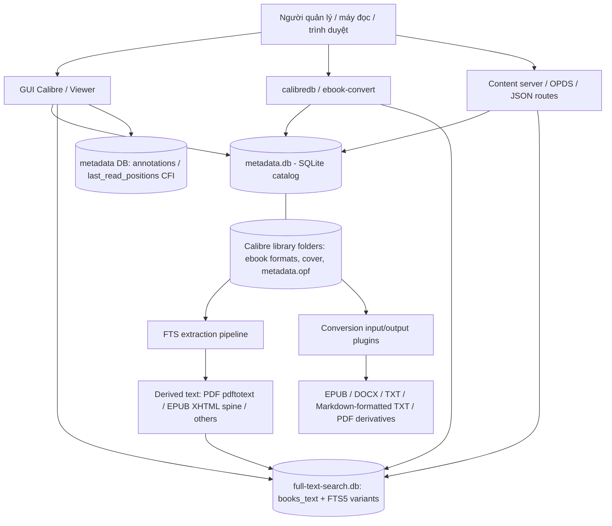
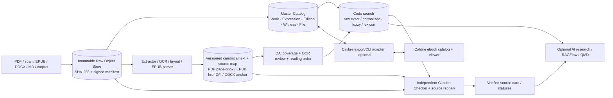
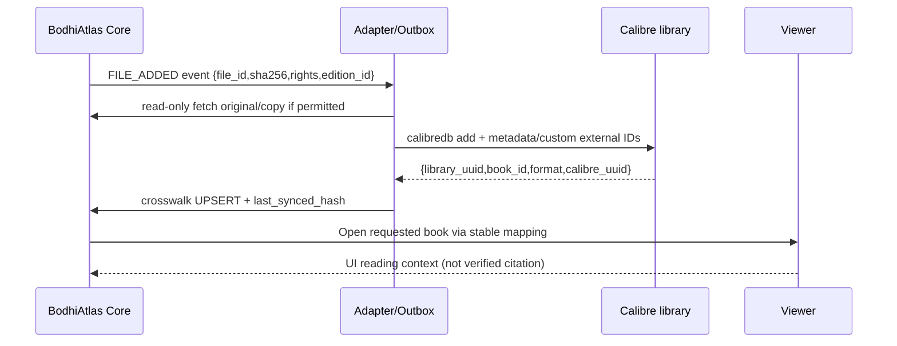

# Technology Assessment — Calibre

> **Mã:** P06 · **Đơn vị thẩm định:** nhóm đánh giá kỹ thuật độc lập cho BodhiAtlas (AI-assisted desk research) · **Ngày khảo sát:** 16/11/2026 (Asia/Ho_Chi_Minh)  
> **Đích:** [Calibre — kovidgoyal/calibre](https://github.com/kovidgoyal/calibre) · **Loại:** ứng dụng/nền tảng quản lý ebook mã nguồn mở, không phải corpus, chuẩn trích dẫn hay engine OCR học thuật.  
> **Bản phát hành công khai xác minh:** **9.18.0**, phát hành **06/11/2026**; nguồn: [release notes chính thức](https://calibre-ebook.com/whats-new), [Linux downloads](https://calibre-ebook.com/download_linux).  
> **Ảnh chụp mã đã đọc:** default branch tại commit **`5f53fce641f180cfaf0e976e703302d596e4fb2a`** qua GitHub connector; **chưa chứng minh commit này chính là tag phát hành 9.18.0**, do đó không đồng nhất hai định danh. Trạng thái nguồn: repo hoạt động, không có bằng chứng bị archived tại thời điểm khảo sát.  
> **Phạm vi:** phân tích chức năng ebook library, SQLite metadata/FTS, chuyển đổi PDF/EPUB/DOCX/TXT, viewer, content server, CLI/API, provenance, multilingual, bảo mật/pháp lý, tích hợp vào BodhiAtlas; đối chiếu Zotero và một số thành phần có liên quan.  
> **Phương pháp/công cụ:** đọc toàn văn hai tài liệu chuẩn BodhiAtlas qua GitHub connector; đọc README/LICENSE/COPYRIGHT, SQL schema, 10+ tệp triển khai, test FTS, manual/FAQ, changelog và tài liệu CLI/server; đối chiếu API và thiết kế POC. **Không cài đặt/chạy chương trình Calibre; không chạy POC; không đo benchmark.** Các ví dụ lệnh bên dưới là **NOT TESTED**.  
> **Quy ước bằng chứng:** `[DOC]` tài liệu/release note; `[CODE]` triển khai hoặc test source đã *đọc*; `[TESTED]` thử nghiệm do người viết chạy và lưu log — **không có** trong khảo sát này; `[ISSUE]` issue/ticket được bản phát hành dẫn lại, chưa chắc tái hiện; `[INFERRED]` phân tích có cơ sở; `[UNKNOWN]` chưa xác minh. Trạng thái năng lực `NATIVE/CONFIG/EXTENSION/EXTERNAL/MISSING/UNKNOWN/N/A` mô tả **vai trò cụ thể** chứ không chấm công bằng điểm tổng.

**Tài liệu BodhiAtlas đọc đủ:** [PRD V1.4](https://github.com/quoctran-2608/bodhi-atlas/blob/main/docs/PRD.md) (Git blob `58d967c642d625180c436e1a6e6a75fa2e7070e3`) và [Academic Risks & Verification V1.0, 15/11/2026](https://github.com/quoctran-2608/bodhi-atlas/blob/main/docs/ACADEMIC_RISKS_AND_VERIFICATION.md) (Git blob `cdb642633f3dc3f7f83cb0e49a96abfebc9f132e`). **Hai SHA vừa nêu là blob SHA, không phải commit SHA của repository.** Không giả định các tài liệu có chức năng triển khai sẵn; chúng là tiêu chí nghiệm thu. Chỉ khảo sát hiện diện ở mức repository của [BuddhismDocuments-for-AI](https://github.com/quoctran-2608/BuddhismDocuments-for-AI); chưa kiểm kê, đọc hoặc chạy corpus trong đó.

## 1. Executive Decision

**Khuyến nghị: `USE AS COMPONENT` — Calibre làm công cụ quản lý ebook, giao diện đọc và chuyển đổi phụ trợ; không chọn làm master catalog học thuật, authoritative source store hay search/provenance core của BodhiAtlas V1. Mức tin cậy: `MED` (trung bình) cho quyết định tích hợp, cao hơn đối với những khoảng trống đã xác nhận bằng schema/code.**

Calibre có thế mạnh được chứng minh qua tài liệu và mã nguồn: nhập, lưu, phân loại và quản lý nhiều ebook; metadata theo tác giả/series/tags/identifiers/custom columns; chuyển EPUB/PDF/DOCX, đọc sách, ghi chú, tìm toàn văn SQLite FTS5, CLI và Content server. Đây là ứng viên thực dụng cho thư viện ebook cá nhân. Tuy nhiên, hiệu năng với dữ liệu BodhiAtlas và nghiệp vụ truy nguyên nguồn **chưa được thử nghiệm**.

**Ba rủi ro chính:** **(1)** Mô hình `books → formats` không tương đương `Work/Expression/Edition/Witness/File/Passage`; `book_id`, ISBN và UUID chưa bảo đảm định danh ấn bản, dị bản và dẫn chứng bất biến. **(2)** FTS hoạt động trên văn bản đã trích xuất và chuẩn hóa dấu, trả kết quả cấp sách/định dạng, không lập bản đồ mọi occurrence tới PDF page/bbox hoặc EPUB CFI; EPUB→TXT/Markdown có thể làm mất locator. **(3)** Thiếu pipeline OCR coverage và citation checker độc lập đáp ứng G1–G2; “0 hit” không có nghĩa “không có nguồn”.

Nên triển khai POC **adapter một chiều, idempotent** để Calibre đóng vai trò ebook catalog/viewer tùy chọn, còn Core giữ file SHA-256 bất biến, Work–Edition–Witness, source map, các chế độ EXACT/NORMALIZED/FUZZY/LEXICON và phiếu truy nguyên. Thử 2 ấn bản/2 định dạng với locator có thể mở lại trước khi triển khai rộng. **Không khuyến nghị fork lõi Calibre** để xây hệ thống học thuật.

## 2. Sources & Evidence Ledger

**Bản cố định `S`** trong cột version/commit dưới đây là `5f53fce641f180cfaf0e976e703302d596e4fb2a` của code đã đọc, không mặc nhiên tương đương tag 9.18.0. Các permalink chỉ tới **cùng ảnh chụp code**, có chỉ định dòng nơi biết chắc; với tài liệu HTML dùng URL chính thức. Ghi chú `[INFERRED]` chỉ rõ điều không thể suy ra trực tiếp từ code.

| claim_id | Nhận định | Mức | URL/permalink | Version | Ghi chú, giới hạn |
|---|---|---|---|---|---|
| CAL-01 | Calibre là ứng dụng quản lý/đọc/chuyển đổi/catalog ebook đa nền tảng | DOC | [README.md](https://github.com/kovidgoyal/calibre/blob/5f53fce641f180cfaf0e976e703302d596e4fb2a/README.md) | S | Không phải bộ máy trích nguồn học thuật được công bố |
| CAL-02 | Release chính thức hiện kiểm tra được là 9.18.0 ngày 06/11/2026 | DOC | [What's new](https://calibre-ebook.com/whats-new) | 9.18.0 | Không có bằng chứng tag = SHA S |
| CAL-03 | Phần lõi Calibre GPL-3, có mã/thư viện phụ giấy phép khác | CODE | [LICENSE](https://github.com/kovidgoyal/calibre/blob/5f53fce641f180cfaf0e976e703302d596e4fb2a/LICENSE), [COPYRIGHT](https://github.com/kovidgoyal/calibre/blob/5f53fce641f180cfaf0e976e703302d596e4fb2a/COPYRIGHT) | S | Không suy ra quyền đối với sách, plugin, OCR models |
| CAL-04 | `books`, `authors`, `series`, `tags`, `identifiers`, `data` được lưu trong SQLite, một `format`/`book` là duy nhất | CODE | [metadata_sqlite.sql#L1-L130](https://github.com/kovidgoyal/calibre/blob/5f53fce641f180cfaf0e976e703302d596e4fb2a/resources/metadata_sqlite.sql#L1-L130) | S | `UNIQUE(book,format)` là ràng buộc chính |
| CAL-05 | Custom columns và annotation/CFI tồn tại trong schema | CODE | [metadata_sqlite.sql#L70-L180](https://github.com/kovidgoyal/calibre/blob/5f53fce641f180cfaf0e976e703302d596e4fb2a/resources/metadata_sqlite.sql#L70-L180) | S | Không chứng minh CFI annotation = locator citation bền vững sau chuyển đổi |
| CAL-06 | FTS lưu text và hash riêng vào `full-text-search.db` | CODE | [fts/connect.py#L42-L85](https://github.com/kovidgoyal/calibre/blob/5f53fce641f180cfaf0e976e703302d596e4fb2a/src/calibre/db/fts/connect.py#L42-L85), [fts_sqlite.sql](https://github.com/kovidgoyal/calibre/blob/5f53fce641f180cfaf0e976e703302d596e4fb2a/resources/fts_sqlite.sql) | S | Dữ liệu tìm kiếm là derived index |
| CAL-07 | FTS5 lập hai chỉ mục `remove_diacritics 2` và `porter` | CODE | [fts_sqlite.sql#L1-L44](https://github.com/kovidgoyal/calibre/blob/5f53fce641f180cfaf0e976e703302d596e4fb2a/resources/fts_sqlite.sql#L1-L44) | S | Không phải raw EXACT với dấu, dù bật `do-not-match-on-related-words` |
| CAL-08 | EPUB/OEB FTS flatten spine; PDF FTS dùng `pdftotext`; text NFC và bỏ soft hyphen | CODE | [fts/text.py#L19-L122](https://github.com/kovidgoyal/calibre/blob/5f53fce641f180cfaf0e976e703302d596e4fb2a/src/calibre/db/fts/text.py#L19-L122) | S | Không thấy page/bbox/xpath/CFI map trong output path này |
| CAL-09 | FTS search trả `book_id`, `format`, đoạn `text` tùy chọn; SQL MATCH, rank | CODE | [fts/connect.py#L175-L265](https://github.com/kovidgoyal/calibre/blob/5f53fce641f180cfaf0e976e703302d596e4fb2a/src/calibre/db/fts/connect.py#L175-L265) | S | Không có offset/locator trong type `FTSSearchResult` |
| CAL-10 | FTS CLI có JSON/snippets/restriction; index mặc định ngưỡng tiến độ 90% để tìm | CODE | [cmd_fts_search.py#L20-L170](https://github.com/kovidgoyal/calibre/blob/5f53fce641f180cfaf0e976e703302d596e4fb2a/src/calibre/db/cli/cmd_fts_search.py#L20-L170) | S | 90% là gate CLI, không bảo đảm 100% coverage |
| CAL-11 | FTS Content server `/fts/search`, `/fts/snippets`, quản lý index có restriction | CODE | [srv/fts.py#L1-L170](https://github.com/kovidgoyal/calibre/blob/5f53fce641f180cfaf0e976e703302d596e4fb2a/src/calibre/srv/fts.py#L1-L170) | S | Authorization cần deployment test; chỉ hạn chế sách được phép |
| CAL-12 | Chuyển TXT/Markdown hỗ trợ tùy chọn link/image, mặc định không giữ link | CODE | [txt_output.py#L10-L150](https://github.com/kovidgoyal/calibre/blob/5f53fce641f180cfaf0e976e703302d596e4fb2a/src/calibre/ebooks/conversion/plugins/txt_output.py#L10-L150) | S | Markdown là **formatting của TXT output**, không chứng minh output giữ EPUB CFI |
| CAL-13 | PDF Input chuyển PDF sang HTML với logic reflow/header/footer | CODE | [pdf_input.py#L10-L106](https://github.com/kovidgoyal/calibre/blob/5f53fce641f180cfaf0e976e703302d596e4fb2a/src/calibre/ebooks/conversion/plugins/pdf_input.py#L10-L106) | S | Không thay OCR engine/sourcemap PDF |
| CAL-14 | DOCX Input có plugin HTML conversion | CODE | [docx_input.py#L10-L73](https://github.com/kovidgoyal/calibre/blob/5f53fce641f180cfaf0e976e703302d596e4fb2a/src/calibre/ebooks/conversion/plugins/docx_input.py#L10-L73) | S | Không cung cấp paragraph/run ID học thuật xuyên conversion |
| CAL-15 | EPUB Input có parser/convert EPUB/Kepub | CODE | [epub_input.py#L25-L75](https://github.com/kovidgoyal/calibre/blob/5f53fce641f180cfaf0e976e703302d596e4fb2a/src/calibre/ebooks/conversion/plugins/epub_input.py#L25-L75) | S | DRM không phải phần được cam kết xử lý |
| CAL-16 | Test nguồn chứa diacritic, CJK, FTS phrase/NEAR và PDF đơn giản | CODE | [db/tests/fts.py#L30-L295](https://github.com/kovidgoyal/calibre/blob/5f53fce641f180cfaf0e976e703302d596e4fb2a/src/calibre/db/tests/fts.py#L30-L295) | S | **Đã đọc test, KHÔNG CHẠY**; không suy ra hỗ trợ chính xác toàn bộ Hán/Tạng |
| CAL-17 | FTS job có worker giới hạn 30 phút và ghi lỗi theo format | CODE | [fts/pool.py#L45-L124](https://github.com/kovidgoyal/calibre/blob/5f53fce641f180cfaf0e976e703302d596e4fb2a/src/calibre/db/fts/pool.py#L45-L124) | S | Không phải manifest theo trang/bbox hoặc OCR coverage |
| CAL-18 | Có metadata auto, backup thư viện bằng copy toàn folder, metadata.opf phục hồi | DOC | [GUI manual](https://manual.calibre-ebook.com/gui.html), [FAQ](https://manual.calibre-ebook.com/faq.html) | Manual hiện hành | Cần backup theo snapshot khi không còn writer |
| CAL-19 | CLI có `calibredb`, `ebook-convert`; Content server và viewer | DOC | [calibredb](https://manual.calibre-ebook.com/generated/en/calibredb.html), [server](https://manual.calibre-ebook.com/server.html), [viewer](https://manual.calibre-ebook.com/viewer.html) | Manual hiện hành | CLI/API không đồng nghĩa stable provenance contract |
| CAL-20 | 9.18 sửa phát hiện số trang PDF, TXT layout, lỗi DOCX và nâng cấp content server | DOC | [What's new, 9.18](https://calibre-ebook.com/whats-new) | 9.18 | Nên pin version và regression tests |
| CAL-21 | Ticket PDF number detection #2172155 được đóng theo release note | ISSUE | [9.18 release notes](https://calibre-ebook.com/whats-new), [Launchpad tracker](https://bugs.launchpad.net/calibre) | 9.18 | **Chưa đọc trực tiếp issue, chưa tái hiện**; chỉ chứng minh có ticket được dẫn |
| CAL-22 | Mô hình Calibre thiếu thực thể riêng Work/Expression/Edition/Witness/Passage trong schema gốc đã đọc | INFERRED | [metadata_sqlite.sql](https://github.com/kovidgoyal/calibre/blob/5f53fce641f180cfaf0e976e703302d596e4fb2a/resources/metadata_sqlite.sql) | S | Có thể mã hóa custom columns, nhưng không thành graph học thuật có kiểm chứng |
| CAL-23 | FTS không đủ điều kiện **exhaustive raw EXACT + locator** của PRD | INFERRED | [fts_sqlite.sql](https://github.com/kovidgoyal/calibre/blob/5f53fce641f180cfaf0e976e703302d596e4fb2a/resources/fts_sqlite.sql), [fts/connect.py](https://github.com/kovidgoyal/calibre/blob/5f53fce641f180cfaf0e976e703302d596e4fb2a/src/calibre/db/fts/connect.py) | S | Kết luận theo *API/schema đã kiểm*, không loại trừ viewer có cơ chế tìm riêng |
| CAL-24 | Calibre cài được 100k file với SLA P95 cụ thể | UNKNOWN | [FAQ](https://manual.calibre-ebook.com/faq.html) | Chưa thử | Không điền con số tốc độ/CPU/RAM/throughput chưa đo |
| BA-01 | PRD yêu cầu lưu nguồn bất biến, Work/Edition/File/SHA-256, 4 lớp code-search và citation checker | DOC | [BodhiAtlas PRD V1.4](https://github.com/quoctran-2608/bodhi-atlas/blob/main/docs/PRD.md) | V1.4, blob SHA như trên | Đây là tiêu chí, không phải Calibre native |
| BA-02 | Sổ tay yêu cầu phân tầng coverage/citation/claim; các gate G1–G6, rủi ro R01–R28 | DOC | [Academic Risks V1.0](https://github.com/quoctran-2608/bodhi-atlas/blob/main/docs/ACADEMIC_RISKS_AND_VERIFICATION.md) | 15/11/2026, blob SHA như trên | Cần dùng kiểm thử âm tính và failure policy |

**Phạm vi mã đã soi theo nhóm:** `resources/metadata_sqlite.sql`, `resources/fts_sqlite.sql`, `src/calibre/db/{fts/text.py,fts/connect.py,fts/pool.py,cli/cmd_fts_search.py,tests/fts.py}`, `src/calibre/srv/fts.py`, `src/calibre/ebooks/conversion/plugins/{txt_output.py,epub_input.py,pdf_input.py,docx_input.py}`, cùng README/LICENSE/COPYRIGHT/manual. Các đường dẫn là mã nguồn đã đọc thật; không dùng sự tồn tại của test file như chứng cứ TESTED.

## 3. Architecture & Data Flow

### 3.1 Kiến trúc Calibre quan sát được



**Ranh giới chính:** `metadata.db` là metadata catalog; file ebook là nội dung thư viện; `full-text-search.db` là chỉ mục phát sinh và có thể tái tạo; `metadata.opf` là metadata sidecar phục hồi. `books_text.format_hash`, `text_hash` không phải BodhiAtlas SHA-256 gắn file bất biến; `text_hash` được tính SHA-1 trong `fts/connect.py`, còn thuật toán `format_hash` chưa truy toàn chuỗi và không nên suy đoán. Annotation/CFI phục vụ đọc; không mặc nhiên dùng làm proof locator.

### 3.2 Kiến trúc khuyến nghị cho BodhiAtlas



`Master Catalog`, raw objects, mapping, index version, review history và verified citation là **authority** của BodhiAtlas. Calibre chỉ được nạp **bản copy hoặc view** của file có chính sách riêng; nếu thiếu quyền thì không đưa file sang content server. FTS Calibre là tiện ích duyệt đọc, không là bằng chứng rằng mọi trang/đoạn đã được kiểm. **LLM không bắt buộc** cho ingest chuẩn, exact/fuzzy/lexicon hoặc source reopen; chỉ tùy chọn khi giải thích ngữ nghĩa/kiểm luận điểm. Không dùng RAG chunk ID làm locator bền vững.

## 4. Feature Fit–Gap Matrix

**Quy ước:** Trạng thái là mức có sẵn **trong Calibre với vai trò đang thẩm định**, không phải độ khả thi của toàn bộ kiến trúc BodhiAtlas; `EXTERNAL` nghĩa là cần hệ ngoài, `EXTENSION` có thể lập trình adapter/plugin. Công sức tương đối của **phần bù**, không phải tổng giá phần mềm. Các cổng strict thuộc BodhiAtlas không được chấm đỗ chỉ nhờ UI có nút tìm kiếm.

| Tiêu chí | Trạng thái | Chứng cứ | Tác động đối với V1 / rủi ro | Công sức bù | Phương án bù và nghiệm thu |
|---|---|---|---|---|---|
| C01 Multi-format ingest | **NATIVE** | CAL-01,13–15,18–19 | Quản lý EPUB/PDF/DOCX mạnh; MD/corpus cấu trúc không phải format khoa học native | Thấp–TB | Adapter MD như file phụ/format TXT hoặc giữ ngoài; map metadata, SHA-256 từ Core |
| C02 OCR/layout/reading order | **EXTERNAL** | CAL-08,13,17 | Scan không có text sẽ không đầy đủ; PDF hai cột/footer dễ sai | Cao | Docling/Tesseract/OCR pipeline có page-region QA; giữ ảnh gốc |
| C03 canonical text/source map | **MISSING** | CAL-08,12,23 | Không có immutable raw+reversible character map mặc định | Cao | Canonical extraction artifacts versioned + file locator API |
| C04 Works/editions/witnesses | **EXTENSION** | CAL-04,05,22 | Book = record ebook, quan hệ edition/translation/witness không chuẩn hóa | TB–Cao | Core schema riêng; custom columns lưu *external ID* làm crosswalk, không là authority |
| C05 exhaustive EXACT | **EXTERNAL** | CAL-07,09,10,23 | FTS accent-insensitive và snippet/format-level; có thể sót occurrence | TB–Cao | Raw span scanner + positional index trên text chuẩn đã kiểm; mỗi occurrence có offset + locator |
| C06 normalized multilingual | **EXTENSION** | CAL-07,16 | Có bỏ dấu/stemming; không đủ Việt/Hán phồn-giản/Tạng/Wylie theo chính sách PRD | TB–Cao | Analyzer per-script; preserve raw; audit transformation; indexes tách lớp |
| C07 fuzzy/OCR errors | **EXTERNAL** | CAL-16,23 | FTS `NEAR`/prefix != edit-distance/near-duplicate theo span | TB | Trigram + edit distance + n-gram windows; align và hiển thị diff |
| C08 sense-aware lexicon | **MISSING** | CAL-04,22; BA-01 | Tags/identifiers không phải concept→sense→attestation | Cao | Lexicon service riêng với sense ID, quan hệ có nguồn và scope |
| C09 semantic/hybrid/RAG | **N/A** (Calibre ebook-role) | CAL-01; BA-01 | Chỉ là lớp tùy chọn của hệ thống tổng; không trừ điểm Calibre | TB nếu chọn | QMD/RAGFlow qua passages verified; bắt buộc back-link |
| C10 verified citation card/reopen | **EXTERNAL** | CAL-05,08,09,19,23 | Viewer có vị trí đọc; thiếu PDF bbox/ấn bản/hash/QA/citation checker | Cao | Citation service verify sha+text+locator+context, kiểm quyền |
| C11 note/wiki/claim memory | **EXTENSION** | CAL-05,19; release 9.18 notes CLI | Có notes/annotations, chưa có claim-evidence graph/review history | TB | Giữ notes Calibre làm reading notes; research graph ở Core hoặc Zotero |
| C12 API/MCP/export/integration | **NATIVE** cho CLI/API; **EXTERNAL** cho MCP học thuật | CAL-10,11,19–20 | API đủ kết nối, nhưng không có contract BodhiAtlas; không đồng nhất book ID với file UUID | TB | Adapter signed JSON, queue outbox, id mapping và MCP riêng |
| C13 quality coverage/incremental | **EXTENSION** | CAL-06,10,17 | Có dirty format/error/progress, thiếu page coverage và skipped region | TB–Cao | Per-page manifest, stale/version status, OCR review queue |
| C14 auth/licensing/privacy/backup | **CONFIG** trong phạm vi thư viện | CAL-03,11,18,19; BA-02 | Content server auth/restrictions; rights to send to AI, per-file copyright không native | TB–Cao | Reverse proxy, user–AI ACL, rights register, encrypted backups và test restore |
| C15 operational simplicity/independent deploy | **NATIVE** ở single-user ebook manager | CAL-01,18,19 | GUI/CLI gọn; chia sẻ cloud đa người dùng và sync library write đòi quản trị | Thấp–TB | Standalone instance, backup snapshots; không dùng Calibre làm cloud multi-tenant source authority |

**Không dùng điểm tổng.** C03/C05/C10 là **hard gates không đạt** nếu lấy Calibre làm Core; C09 là `N/A` xét đúng nhiệm vụ quản lý ebook. Một tính năng của Core có thể bù bằng hệ khác nhưng không được diễn đạt thành **native Calibre**.

## 5. Deep Technical Findings

### 5.1 Data model: thư viện ebook, không phải mô hình văn bản học

Schema trong [`resources/metadata_sqlite.sql`](https://github.com/kovidgoyal/calibre/blob/5f53fce641f180cfaf0e976e703302d596e4fb2a/resources/metadata_sqlite.sql) chỉ ra các thực thể vật lý tiêu biểu:

```text
books(id, title, sort, timestamp, pubdate, series_index,
      author_sort, path, uuid, has_cover, last_modified)
authors(id, name, sort, link)
books_authors_link(book, author)
books_series_link(book, series); series(id, name, sort)
books_tags_link(book, tag); tags(id, name)
identifiers(id, book, type, val, UNIQUE(book, type))
data(id, book, format, uncompressed_size, name, UNIQUE(book, format))
custom_columns(id, label, name, datatype, editable, is_multiple, normalized, ...)
last_read_positions(book, format, user, device, cfi, epoch, pos_frac)
annotations(book, format, user, annot_type, annot_data, ...)
```

`books.id` là record trong thư viện cụ thể; `books.uuid` là UUID của record, **không phải UUID toàn cục cho Work**. `data` liên kết các format của một record và cấm 2 file có cùng *format* cho một book record. Ví dụ một EPUB và một PDF có thể thuộc cùng record khi là hai cách đóng gói **cùng nội dung/ấn bản**, nhưng không nên kết luận chúng tương đương edition nếu chưa đối chiếu. Hai EPUB là hai ấn bản khác nhau phải là **2 records** hoặc file edition riêng ngoài Calibre. Dữ kiện ISBN/DOI ở `identifiers` hỗ trợ đối chiếu thư mục, không thay thế phân biệt expression, witness hay proof of passage. `series` có chỉ số, `tags` tự do, `custom_columns` linh hoạt nhưng không ràng buộc quan hệ có nguồn/phê duyệt.

**Đề xuất crosswalk, không sửa schema gốc:** `#ba_work_id`, `#ba_edition_id`, `#ba_primary_file_sha256`, `#ba_sync_state` dưới dạng custom fields, hoặc lưu bảng adapter riêng `calibre_library_uuid + calibre_book_id + format → BA_FILE_ID + BA_EDITION_ID + SHA256`. **Không gắn một Work cho tất cả file chỉ dựa title+author hoặc ISBN.** Vấn đề bản dịch: dùng Expression/translation relation của Core; Calibre language, title, translator metadata/custom columns chỉ là bản sao tiện dụng. Version/edition record phải do Core ra quyết định, có provenance và audit.

### 5.2 Ingest, conversion, original bytes, reading order

- EPUB: plugin `epub_input.py` đọc cấu trúc EPUB/KEPUB để chuyển sang flow HTML. FTS (`fts/text.py`) lấy các item spine, tìm `h:body`, loại bỏ các thẻ như `img`, `svg`, `math`, ruby `rt/rp/rtc`, nối bằng newline. Kết quả có thể mất chú thích/reading order lệch ở layout khó; nguồn không còn `href`/XPath/CFI trong chuỗi toàn văn FTS.
- PDF text: FTS **dùng `pdftotext`** lấy UTF-8. Conversion PDF→HTML trong `pdf_input.py` có `pdftohtml`, PDF reflow và lọc header/footer; kết quả đọc/chuyển đổi không đáng dùng làm oracle về page bbox hay printed page. **PDF scan image-only không tự được OCR đầy đủ theo FTS path đã đọc**. `pdftotext` xử lý text layer, không xác minh tính đúng bản scan.
- DOCX: plugin `docx_input.py` gọi `calibre.ebooks.docx.to_html.Convert`, có tùy chọn note/page-break; không chứng minh `w:p`/run locator bền qua chuyển đổi. Văn bản DOCX/MD phục vụ học thuật phải ghi anchor XML path/paragraph fingerprint hoặc line span trên *file original*.
- TXT/Markdown: `txt_output.py` ghi `TXT` với `--txt-output-formatting markdown` (nếu CLI hỗ trợ đúng option tương ứng). Các lựa chọn `keep_links`/`keep_image_references` mặc định `false`; có clean ASCII/newline rewriting. Không có thể suy ra EPUB `href`, `id`, CFI hoặc footnote association được bảo toàn trong `.txt` xuất ra.
- **Nguyên bản:** GUI Calibre nhập ebook thành bản sao do nó quản lý, có thể sửa/convert/replace format và embed metadata. Điều này tiện lưu trữ sách nhưng file trong Calibre *không nên* được coi là immutable canonical blob của BodhiAtlas. Core phải giữ bản gốc ở kho chỉ append theo SHA-256, với policy riêng khi Calibre xuất bản format mới.
- Các corpus có cấu trúc (TEI/XML/CSV/Witness graph), Markdown source-controlled không phải đối tượng Calibre tối ưu. Nên để Core quản lý, có thể đưa bản HTML/EPUB dẫn xuất vào Calibre để đọc, không mất nguồn gốc.

**Khác biệt text với file gốc kiểm chứng được từ code:** cuối `extract_text` trả `unicodedata.normalize('NFC', ans).replace('\u00ad', '')`; do vậy `exact search` trong FTS là khớp text **dẫn xuất**, không khớp raw byte hoặc codepoint sequence của original. Các file PDF khác nhau về page/reading order có thể tạo text trùng nhau, nhưng thuộc các witness khác nhau.

### 5.3 Full-text search thực sự hoạt động ở mức nào?

FTS dùng sidecar SQLite `full-text-search.db` chứa `books_text(book,format,searchable_text,format_hash,text_hash,err_msg)` và FTS5 table. Có hai biến thể: bỏ dấu và có Porter stemming. Hàm `search()` thực hiện `FTS5 MATCH`, `ORDER BY rank`; kết quả truyền ra gồm `book_id`, `format`, `text` hoặc đoạn snippet. Đây **không phải** bảng `hit(file_id, offset_start, offset_end, pdf_page, bbox, edition_id)`.

**Hai bẫy kỹ thuật:**

1. `--do-not-match-on-related-words` chỉ chuyển `use_stemming=false`, không tắt tokenizer `remove_diacritics 2`. Test nguồn `coộl` cho thấy query `cool` vẫn trả được `coộl`; không thể tự gắn nhãn `EXACT` raw cho kết quả này. Với dấu tiếng Việt, cần một raw substring verifier sau khi lấy ứng viên và chỉ gắn EXACT nếu codepoint sequence/trường hợp Unicode đã được định nghĩa rõ, không dựa trên FTS rank.
2. FTS GUI/CLI phục vụ **tìm sách có nội dung liên quan**, không chứng minh đã liệt kê *mọi lần xuất hiện* trong các trang. Manual GUI mô tả tìm toàn văn trả một kết quả đại diện ở cấp sách; muốn tìm các vị trí khác cần mở viewer. Viewer location deep link hữu ích cho UI, nhưng để xuất “phiếu truy nguyên nguồn” cần máy kiểm chứng độc lập ngoài viewer.

Nguồn kiểm thử Calibre đã đọc: `src/calibre/db/tests/fts.py` thực hiện tokenizer thử `你叫什么名字`, `coộl`, English stems, FTS5 phrase/NEAR và một PDF một trang `Hello World`; **không có chứng cứ rằng test của Calibre đã chạy trong cuộc khảo sát này**, hay test bao trùm mọi loại Hán/Tạng/Vietnamese academic corpus. Tương tự `text_hash` SHA-1 là fingerprint nội bộ của derived text, **không** thể dùng thay `sha256(original_bytes)`.

### 5.4 Metadata tự động, thư viện lớn, sao lưu

Calibre có tìm metadata (tùy nguồn online/ISBN), sửa tay, tag, virtual libraries, hàng loạt format, OPF sidecar, UI `Check library`/`Restore database`. Nó rất thực dụng khi **người quản lý sách** cần nhập hàng loạt. Nhưng title/author/ISBN metadata tự động không được nâng thành quan hệ scholarly verified; publisher, edition, translator cần người duyệt và trạng thái nguồn.

- **Hàng chục nghìn file:** kiến trúc SQLite/filesystem có thể phù hợp thư viện cá nhân; release notes 9.17 nói tới tối ưu large libraries. Nhưng **chưa có benchmark với corpora BodhiAtlas**, mức trễ P95, memory, tốc độ FTS-index hay áp lực khi 50k–100k file để UNKNOWN. SQLite đơn writer và công việc convert/OCR có thể thành nút thắt tùy workload.
- **Backup:** copy toàn bộ thư mục library chứa `metadata.db`, ebook formats, cover, OPF sidecars và các DB phụ hiện diện; backup riêng config/plugins, notes/export nếu policy cần. Snapshot nhất quán (tạm dừng writer) rồi kiểm tra khôi phục. Chỉ backup `metadata.db` **không đủ** file sách. Một bản backup Calibre không thay backup catalog, annotations, relations, index manifest riêng của BodhiAtlas.
- **Live cloud/NAS sync:** FAQ chính thức cảnh báo việc dùng library Calibre trực tiếp trên network drive/cloud sync có thể hỏng DB/race/case sensitivity. Chỉ quản lý một writer; dùng Content server/CLI/giao diện adapter, không biến Dropbox/Drive đồng bộ hai chiều của `metadata.db` thành giải pháp multi-user.

### 5.5 APIs, plugins, viewer và content server

`calibredb` cung cấp CLI thêm sách, sửa metadata, liệt kê, export, quản lý FTS; `ebook-convert` cho chuyển định dạng. `calibre-server` cung cấp giao diện web, metadata, reading, download, OPDS và các JSON endpoint, trong đó `src/calibre/srv/fts.py` có `/fts/search`, `/fts/snippets/{book_ids}`, `/fts/reindex`, `/fts/indexing`. Changelog 9.18 ghi OPDS 2.0, cải thiện Content server, CLI cho notes/annotations. Các API route trong mã có thể thay đổi theo release; nếu dùng private internals cần pin version và contract regression.

Viewer có highlight, bookmarks, annotation, CFI reading position và `calibre://view-book/...` URL scheme (xem [URL scheme](https://manual.calibre-ebook.com/url_scheme.html)). **Đây là vị trí trong trải nghiệm đọc**, không tự khẳng định file-hash, published printed-page hay PDF bbox có thể tái xác minh. Trường `last_read_positions.cfi` trong metadata schema chỉ minh chứng một số locator đọc tồn tại, không suy ra locator passage chính xác trên file chuyển dạng.

Plugins: API plugin Calibre hỗ trợ import/conversion/metadata/GUI, nhưng nếu dùng plugin bên thứ ba phải thẩm tra repo, license, sự tương thích bản 9.18 và quyền chạy code; **không cấp cho plugin quyền truy cập tự động vào canonical store**. Nếu triển khai chỉ đọc hoặc webhook một chiều thì an toàn hơn patch Calibre core.

### 5.6 Các giới hạn có thể gây nhận định học thuật sai

- **Lời thuật lại bị coi là quan điểm tác giả:** FTS không xác định speaker/stance; chỉ highlight từ.
- **Chú thích và dòng hai cột:** PDF reflow, spine flatten có thể thay thứ tự; cần page-region QA.
- **Trang in vs PDF index:** số trang in bắt buộc có mapping được đối chiếu; release note sửa PDF page detection không tạo đảm bảo học thuật.
- **Hán 1–2 chữ:** FTS tokenizer có test Chinese, song segmentation và variant handling theo bộ ngữ liệu Hán cổ là UNKNOWN; test `無常/无常` riêng.
- **Dấu phụ Pāli/Sanskrit/Tạng Wylie:** normalization không chứng minh semantic equivalence; nếu tokenizer trả result, phải phân lớp match.
- **Chứng cứ phủ định:** 0 hit trong FTS lúc mới index 90%, scan lỗi hoặc thiếu file ≠ không có nguồn. Phải có coverage matrix và unknown scope.

## 6. Source Fidelity & Provenance

### 6.1 Yêu cầu bất biến và đường truy nguyên

Đầu vào Core ghi `source_file_id`, `sha256`, `media_type`, `byte_size`, `ingested_at`, `rights_id`, `source_uri`, `blob_version`; **không sửa file gốc sau ingest**. `Work`, `Expression`, `Edition`, `Witness` và `File` là các thực thể khác nhau với quan hệ có nguồn/status: `translation_of`, `is_edition_of`, `parallel_to`, `variant_of`, `derived_from`, `commentary_on`. Không ép quan hệ từ tên file hoặc tên sách. Chuỗi dữ liệu nên là:

```text
Original file (SHA-256)
  -> Extraction run (tool + version + options + timestamp)
  -> Page/spine/paragraph coverage manifest
  -> Canonical raw-text segments (không làm mất nguồn gốc)
  -> Derived normalization/search tokens (không sửa raw)
  -> Every hit {file_id, edition_id, span_in_extraction, source_locator}
  -> Source reopen + text/context compare + rights check
  -> Citation verification state (separate from scholarly conclusion)
```

**Tách ba cấp trạng thái đúng Academic Risks:**

- `document_status`: `READY | PARTIAL | OCR_UNCERTAIN | NOT_INDEXED | SOURCE_UNAVAILABLE`.
- `citation_status`: `TEXT_AND_LOCATOR_VERIFIED | TEXT_ONLY | OCR_NEEDS_REVIEW | MISMATCH | UNVERIFIABLE`.
- `claim_assessment`: `NOT_ASSESSED | SUPPORTS | PARTIAL | CONTRARY | DISPUTED | INSUFFICIENT`.

Một chuỗi Unicode đúng không chứng minh ngữ cảnh/luận điểm đúng. Khi không có bản đồ nguồn, **chỉ được ghi `TEXT_ONLY` hoặc `UNVERIFIABLE`**, tuyệt đối không gán page/bbox ước đoán.

### 6.2 Locator theo định dạng

| Định dạng | Locator tối thiểu BodhiAtlas | Khả năng Calibre đã kiểm | Thiết kế bổ sung bắt buộc |
|---|---|---|---|
| PDF text | `pdf_page_index` 0-based + `bbox[x0,y0,x1,y1]`, page size/rotation, `printed_page` chỉ khi kiểm | PDF extraction và viewer, **không thấy mapping từ FTS hit sang bbox** | PyMuPDF/Docling hoặc PDF text extractor giữ tọa độ, page OCR alignment; reopen trang/rect |
| PDF scan | page + bbox ảnh + OCR engine/version/confidence + page quality | FTS `pdftotext` không thay thế OCR; source ảnh có thể hiện được trong viewer | OCR external, per-page/region coverage và visual review |
| EPUB | `spine_index`, `href`, `fragment_id`/XPath, CFI validated against **original EPUB** | Viewer có CFI reading state; FTS spine text flattened | Parse OPF spine + XHTML, anchor passage, CFI create/resolve và verify hash |
| DOCX | OOXML part + paragraph/run path/anchor; fallback paragraph fingerprints/offset theo version | DOCX→HTML conversion | Parser riêng lưu XML position, checksum + context offset |
| Markdown | blob SHA-256 + byte/line-column range in **original** encoding | Có thể lưu/đọc qua TXT/HTML; không native academic location | Offset byte và line-column provenance map; không lệ thuộc Markdown conversion |
| TEI/corpus | witness id, XML stable id/xpath, element-text offset | Không phải core feature Calibre | Ingest preserving TEI IDs, schema+version, critical apparatus |

**Ví dụ phiếu nguồn yêu cầu** *(JSON contract minh họa, tuyệt đối không phải kết quả thật)*:

```json
{
  "work_id": "W:demo",
  "expression_id": "X:demo-vietnamese-translation",
  "edition_id": "E:demo-ed2",
  "witness_id": "WI:demo-ed2-copy",
  "file_id": "F:demo-pdf",
  "sha256": "<64 hex digits computed from actual original>",
  "extractor": {"name": "<tool>", "version": "<pinned>", "run_id": "<run>"},
  "quote_raw": "<copy only after re-reading source>",
  "locator": {"kind": "pdf", "pdf_page_index": 12, "bbox": null, "printed_page": null},
  "match": {"type": "EXACT", "transformations": [], "query": "<query>"},
  "document_status": "PARTIAL",
  "citation_status": "TEXT_ONLY",
  "claim_assessment": "NOT_ASSESSED",
  "scope_checked": {"files": 1, "pages_checked": "<computed>", "pages_missing": "<computed>"}
}
```

Các ID/page trong ví dụ trên là **dữ liệu giả mô tả schema, không phải citation thực**; riêng `pdf_page_index:12` chỉ minh họa cấu trúc, `bbox:null` có chủ đích để không giả locator đã xác minh. Phiếu được xuất thật phải từ file/recheck rồi mới điền tọa độ.

### 6.3 Quy trình exact re-open/re-verify

1. Resolve citation → master `file_id + edition_id`, đọc immutable blob, tính lại SHA-256; nếu thay đổi trả `MISMATCH` và dừng.
2. Xác nhận extractor version + source map dùng đúng file; kiểm coverage trang/spine liên quan.
3. Mở đúng page+rect / EPUB href-CFI / DOCX paragraph / MD byte span; lấy **raw source text** tại vị trí.
4. So sánh quote từng ký tự theo chính sách EXACT; nếu query match NORMALIZED thì hiện raw quotation và phép biến đổi riêng. Bất kỳ sửa chữ OCR phải là review annotation, không ghi đè raw.
5. Mở thêm trước/sau, đánh dấu ai đang nói (author, cited opponent, commentary) khi đánh giá claim; không gọi argument supported chỉ nhờ lexical hit.
6. Log `verification_timestamp`, component versions, reviewer và verdict; khi đổi nguồn/extractor invalidate *kết quả kiểm chứng* và thử định vị lại, không di chuyển silently.

**Gates:** `G1` về coverage và `G2` về citation **không pass từ Calibre-only**. `G3` về hỗ trợ luận điểm cần người nghiên cứu/AI có giám sát, không thể được engine FTS chứng nhận.

## 7. Multilingual & Retrieval Behavior

**Các nhãn trong cột:** `native` = có đúng phần chức năng Calibre đã kiểm; `custom` = cần code/dữ liệu ngoài; `not supported` = không có năng lực như PRD trong path đã đọc; `unknown` = chưa có chứng cứ đủ cho script/corpus cụ thể. Không đồng nhất chữ giống nhau với nghĩa giống nhau.

| Chế độ/yêu cầu | Calibre | Kỹ thuật thực sự/giới hạn | Bổ sung cho V1 |
|---|---|---|---|
| EXACT Unicode verbatim exhaustive | **not supported** (strict) | FTS5 `remove_diacritics 2`, normalize query; trả doc/format, không exhaust occurrences | positional exact index + scan raw source spans và offsets |
| NORMALIZED diacritic-insensitive | **native** ở mức FTS candidate | Calibre tokenizer xuất variants; stemming tùy cờ; normalizer không báo transformation-specific match | index riêng với audit raw→normalized + status đúng |
| FUZZY typo/OCR/paraphrase gần chữ | **custom** | FTS5 phrase/NEAR/prefix chỉ là token matching; không là edit-distance passage alignment | trigram/Levenshtein window; diff, threshold có ground truth |
| LEXICON sense-aware | **not supported** | Tags/identifiers không có sense ID, language attestation và relation provenance | lemma/sense table, equivalence có điều kiện và human approval |
| SEMANTIC | **N/A** cho role Calibre | Không cần để vận hành thư viện ebook, dù Calibre 9.x có vài chức năng AI phụ không phải hệ citation | RAGFlow/QMD khi bật, output chỉ candidate rồi reopen |
| Tiếng Việt `vo thuong`↔`vô thường` | **native candidate**, **custom VERIFIED** | accent fold có thể giúp; không đảm bảo nguyên văn hay disambiguation | phân biệt EXACT/NORMALIZED, kiểm `đ`/`d` và biến thể; explicit rules |
| Hán `無我/无我` và Hán 1–2 chữ | **unknown full requirement** | test có Chinese token, không chứng minh tự động phồn↔giản hoặc dị thể | mapping biến thể có nguồn, char n-gram, audit normalization |
| Tạng Unicode ↔ Wylie | **custom/unknown native retrieval** | Không có chứng cứ engine Wylie transliteration verified | ICU/Tibetan tokenizer + transliteration, test grapheme clusters |
| Pāli/Sanskrit (`anatta/anattā/anātman`) | **native candidate for accent folding**, **custom lexical** | `anātman` không là spelling-only variant của mọi `anattā` trong mọi context | transliteration + lemma/sense scoped links; không mở rộng bắc cầu |
| English plural/stemming | **native** có giới hạn | Porter FTS table, test English stem; không mặc định lemmatization mọi ngôn ngữ | custom morphology khi có test |
| “Vô thường” và “khổ”: lọc author/edition | **custom for edition-safe** | `--restrict-to` có thể lọc metadata book; edition-id phải do adapter map | filter Work/Edition/Expression authoritative, rerank candidates |
| Luận đề “tác giả nào phân biệt vô thường và khổ?” | **not supported as scholarly answer** | FTS chỉ gợi đoạn, không kiểm stance, phủ định, ai đang nói | lexical+lexicon candidate retrieval; human/optional AI close reading |

**Ví dụ không được nhập nhằng:**

- `anatta` truy xuất `anattā` nhờ bỏ dấu phải ghi `NORMALIZED`, không ghi `EXACT` khi raw có dấu khác. `anātman` có quan hệ ngữ học/tương ứng theo nghĩa **nếu được kiểm chứng**, không gộp chỉ vì cùng âm gần giống; `無我/无我/vô ngã` cần bảng sense và chứng cứ sử dụng trong từng corpus.
- `無常/无常`: phồn–giản không phải tự động của tokenizer đã kiểm. Nếu mở rộng query bằng mapping phải lưu `transform_id` và ý nghĩa/độ chắc chắn; tránh coi mọi dị thể là identity.
- Văn bản Hán cực ngắn (`苦`) là truy vấn rất phổ biến; rank theo từ khóa không phải chứng cứ rằng tác giả đề cập khái niệm `dukkha` theo nghĩa cụ thể.
- Wylie không được giả thiết tìm thấy chữ Tạng nếu không chạy transliterator thật.
- Semantic RAG hoặc LLM nếu được kích hoạt cũng không có quyền sửa quote/location hay biến relevance thành probability claim.

## 8. Integration Options for BodhiAtlas

### Phương án A — `EXPORT ADAPTER / LOOSE COUPLING` (**ưu tiên POC**)

**Vai trò:** Calibre quản lý, hiển thị, chuyển format thứ cấp; Core quản lý source authority và semantic academic model. Luồng một chiều **Core → Calibre** hoặc **Calibre metadata snapshot → Core staging**, rồi human merge. Không cho cả hai bên đồng thời quyết định authoritative Work/Edition/File.



**Đầu vào contract** `file_added_v1`:

```json
{
  "event_id":"<idempotency-key>",
  "file_id":"<BA-immutable-ID>",
  "edition_id":"<BA-edition-ID>",
  "sha256":"<sha256>",
  "media_type":"application/epub+zip",
  "copy_policy":"ALLOW_CALIBRE_COPY | METADATA_ONLY | DENY",
  "blob_locator":"<internal-authorized-object-reference>",
  "metadata":{"title":"<verified or provisional>","authors":[],"lang":"<BCP47>"}
}
```

**Adapter output** `{event_id, state, library_uuid, calibre_book_id, calibre_format, calibre_book_uuid, source_sha256, adapter_version, warnings}`. Thiết kế `file_edition_xref` riêng có khóa `(library_uuid,book_id,format)` và `unique(file_id,adapter_version)` hoặc policies rõ; **không dùng `book_id` độc lập làm global key**. Đồng bộ qua `calibredb --with-library`, metadata OPF, export JSON, hoặc Content server endpoints *đã test*; không ghi trực tiếp DB SQLite khi Calibre đang chạy. Nếu nghiệp vụ yêu cầu cập nhật sách, **reconcile** thay vì giả overwrite giữ nguyên format hash. Record deletion ở Calibre chỉ xóa view, không xóa Core blob.

**Rollback:** lưu checkpoint outbox/crosswalk, xuất Calibre metadata snapshot, adapter UPSERT idempotent; nếu thất bại, đưa sự kiện vào dead-letter, đánh dấu `SYNC_ERROR`, vẫn giữ Core nguyên trạng. `ebook-convert` tạo bản dẫn xuất phải có `derived_from`, `calibre_version`, option manifest, hash riêng. Không cố đồng bộ Calibre → RAGFlow/QMD bằng sự kiện không gắn file SHA, kẻo **ID drift** khi book merge/split/reimport.

**Công việc:** adapter CLI, custom columns/external ID, rights policy, sync reconciliation, test restore; ước tính tương đối **TB** trong điều kiện đơn người quản lý và chỉ đồng bộ một chiều.

### Phương án B — `STANDALONE CALIBRE SERVICE` cho nhóm người đọc

Calibre chạy Content server/OPDS trên host riêng, có account/permissions và reverse proxy HTTPS. BodhiAtlas đặt Core API/MCP riêng; khi người dùng click nguồn đã verify, Core trả **deep-link Calibre khi thích hợp** *cộng* canonical reopen link cho verifier. Content server có thể là UI phụ/truy cập ebook từ browser, không phải API source truth. Adapter gọi endpoints chỉ khi đã xác nhận format schema trên pin release; không cho client cấp trực tiếp token admin Calibre. Ưu điểm phân tách triển khai và license/process; nhược điểm thêm vận hành, auth synchronization, content duplication và độ bền deep-link. **Không triển khai trực tiếp ra Internet với mặc định không TLS/không kiểm phân quyền**.

**Sync/rollback:** `Core → authorized Calibre copy`, nightly reconciliation dựa crosswalk; snapshot `metadata.db`+full folder, restore test định kỳ; tự động vô hiệu hóa link khi rights đổi. Đọc sách và ghi annotation trong Calibre không làm thay đổi verified source card của Core.

### Phương án C — Fork/nhúng code Calibre sâu vào Core (**không khuyến nghị**)

Có thể sửa các lớp `src/calibre/db/fts/{text,connect,pool}.py`, `src/calibre/srv/fts.py`, `resources/{metadata_sqlite,fts_sqlite}.sql`, plugins conversion và viewer để phát locator. Nhưng phải can thiệp schema migration, API, indexing updates, quality gate, rights, UI; gánh duy trì patch trên release, kiểm GPL nếu phân phối. Chi phí **cao**, tạo coupling không cần thiết, vẫn phải tự xây OCR/sense-aware scholar graph. Chỉ reconsider nếu POC chứng minh nguồn đáng tin có thể lấy ổn định bằng ít patch hơn Core tự xây.

### Phương án D — Không tích hợp Calibre vào Core (**fallback hợp lệ**)

Nếu workflow chính là manuscript research/lexicon, Calibre có thể chỉ là **desktop tool** của từng người, Core nạp trực tiếp source bất biến, Zotero quản lý references; hủy adapter khi POC thấy metadata drift/complexity cao hơn lợi ích UI. Phương án này giảm ràng buộc/duplication và giữ source authority.

**Đối với QMD/RAGFlow/Docling:** không đưa trực tiếp bản TXT “đã sạch” của Calibre vào chúng rồi coi chunk là nguồn. Input chuẩn: `{file_id,source_sha256,edition_id,extractor_run,passage_id,raw_text,locator,coverage,rights}`; Docling/OCR trả layout artifacts, QMD/RAGFlow lập chỉ mục *derived passages* và mọi result phải quy đổi về `passage_id → source map → raw reopen`. **Không cho RAG index quyết định SHA/edition/file ID**.

## 9. Practical POC / Reproduction Plan

**Trạng thái toàn bộ POC: `NOT TESTED`.** Môi trường báo cáo không cài Calibre CLI và không có corpus fixture/ground truth được phê duyệt. Chưa có lệnh nào dưới đây được chạy với Calibre; không có log, pass rate, tốc độ hay benchmark thực nghiệm. Script dưới đây là **quy trình dự kiến**, phải kiểm lại flag CLI với `--help` trên bản pin trước khi chạy; fixture để triển khai thử nghiệm chứ không phải data đã nạp.

### 9.1 Môi trường/fixture tối thiểu

- Pin Calibre `9.18.0` binary chính thức, ghi `calibre --version`, `calibredb --version`, OS, CPU/RAM/SSD, locale, hash binary/install source; đừng giả SHA S là tag này.
- Fixture `W1_E1.epub`: edition 1, nhiều XHTML spine, chữ Pāli `anattā`, từ Hán `無常`, `苦`, footnote, anchor `id`, một từ lặp ba lần trong *cùng* chương, href/CFI ground truth do người duyệt.
- Fixture `W1_E2.pdf`: **cùng Work**, edition 2, text-layer PDF có số trang PDF khác trang in, câu ghép/dấu khác edition 1; ground truth bbox từng span.
- Fixture `W1_E3_scan.pdf`: variant scan hai cột, chú thích và một trang cố ý mất/OCR sai chữ phủ định; QA ground truth.
- Fixture `W2.docx` và `W3.md`: paragraph anchor và markdown line/byte ranges.
- Manifest `gold.jsonl`: mỗi kỳ vọng phải có `file_sha256, edition_id, quote_exact, pdf_page_index/epub_href+anchor, bbox_if_verified, printed_page_if_verified, expected_hit_counts, document_status`, negative queries. Mỗi dòng được một reviewer xác nhận; không tự dùng output Calibre làm ground truth.

**Các lệnh POC dự kiến** (chạy trên máy Calibre đã cài, không chạy trong cuộc khảo sát):

```bash
set -euo pipefail
calibre --version
calibredb --version
mkdir -p ./poc/calibre-lib ./poc/out
sha256sum ./fixtures/W1_E1.epub ./fixtures/W1_E2.pdf ./fixtures/W1_E3_scan.pdf > ./poc/out/input_sha256.txt
LIB="$(pwd)/poc/calibre-lib"
# --duplicates: cố giữ 2 record khác edition, không âm thầm gộp title/author.
calibredb --with-library "$LIB" add --duplicates ./fixtures/W1_E1.epub
calibredb --with-library "$LIB" add --duplicates ./fixtures/W1_E2.pdf
calibredb --with-library "$LIB" list --for-machine --fields title,authors,formats,identifiers,uuid > ./poc/out/books.json
# Xem 'calibredb fts_index --help' ở version pin trước nếu option đổi.
calibredb --with-library "$LIB" fts_index enable --wait-for-completion
calibredb --with-library "$LIB" fts_search --output-format json --include-snippets --do-not-match-on-related-words 'anattā' > ./poc/out/fts_anatta.json
calibredb --with-library "$LIB" fts_search --output-format json --include-snippets '無常' > ./poc/out/fts_wuchang.json
ebook-convert ./fixtures/W1_E1.epub ./poc/out/W1_E1_md.txt --txt-output-formatting markdown
# Tách raw source-map oracle bằng EPUB/PDF parser KHÁC, không dùng TXT để tự xác minh.
```

**Lưu ý:** `--wait-for-completion` phải được xác minh qua `calibredb fts_index --help` ở bản thực cài; tên option trong thông báo lỗi nội bộ có thể không khớp manual. Nếu command sai, ghi stderr vào log, điều chỉnh theo help thật; không im lặng giả đã chạy. Lệnh `calibredb ... add` sẽ tạo copy format trong Calibre; đừng so hash file trong thư viện với raw original cho tới khi kiểm tra file read lại.

### 9.2 Test cases và expected output

| Test | Fixture/query/thao tác | Ground truth cần có | Kết quả chấp nhận/gate; **NOT TESTED** |
|---|---|---|---|
| P01 — 1 Work, 2 Edition, 2 Format | Import W1_E1 EPUB, W1_E2 PDF, metadata export, mapping external IDs | `Work=W1`, `Edition=E1/E2`, 2 SHA-256 khác; dịch giả, trang riêng | Không merge editions do title; mọi mapping Core↔Calibre đúng; 0 wrong edition |
| P02 — Preserve original | Hash trước import/export/convert; so nguyên bản + derived | Hash SHA-256 tính trước; file immutable trong Core | Core bytes không đổi; derived output có hash/version riêng; không cho silent overwrite |
| P03 — Raw EXACT exhaustive | `anattā` có ba occurrences; `anatta` có một occurrence raw khác | Danh sách char offsets/locators được người duyệt | Core EXACT trả **đúng mọi occurrence**; Calibre FTS chỉ candidate, không được gắn EXACT nhầm |
| P04 — Normalized/CJK | `vo thuong`, `vô thường`, `無常`, `无常`, `苦` | cặp expected literal vs mapped; Hán 1-char false positives | Phân biệt EXACT/NORMALIZED/LEXICON; log transformation và ambiguity; không bản dịch tự đoán |
| P05 — EPUB mapping under TXT conversion | EPUB spine có `href#id` và CFI; export Markdown formatting; re-open exact range | Anchor theo original EPUB, read order/footnote links | Không dùng TXT position như CFI; bất kỳ href/id mất phải report, không tự gắn VERIFIED |
| P06 — PDF locator | Tìm câu tại trang PDF khác trang in; duplicate quote xuyên 2 pages | page/bbox và printed page đã duyệt | Citation checker re-open đúng file/page/bbox, không suy printed page bằng PDF index |
| P07 — Scan/OCR negative evidence | W1_E3 scan hai cột, lỗi phủ định, 1 trang missing; search 0 hit | Page coverage + labels PARTIAL/OCR_UNCERTAIN | Không tuyên “không có nguồn”; quan điểm OCR sai không được verified |
| P08 — Annotation/ID drift | Rebuild FTS, chuyển format, delete/reimport Calibre record; thử reopen citation cũ | Immutable BA IDs và source map trước/sau | Tất cả canonical citation hoặc vẫn đúng hoặc báo STALE; 0 silent wrong source; Calibre book ID đổi không làm Core drift |
| P09 — Rights/API/restore | Restricted user, AI token, metadata-only rights; backup/restore | Policy matrix (user, file, AI, export) + snapshot | Unauthorized 403/denied, AI không thấy raw; restore sao cho verified links vẫn trỏ đúng SHA |
| P10 — Size/operability | 10k/50k file **nếu có corpus hợp lệ**, incremental + FTS/search | Exact host spec, mix format/OCR, dataset hashes | Báo ingest files/h, P50/P95 search latency, RAM max, DB size, errors; **không chọn SLA khi chưa đo** |

**Thử nghiệm học thuật về câu hỏi khó:** query “tác giả nào phân biệt vô thường và khổ?” trên 2 đoạn chứa cùng từ nhưng một đoạn bác bỏ, một đoạn đồng ý. Retrieval phải trả *candidates* và verified raw; claim assessment tách rời, không đánh “đã chứng minh” tự động. Có thể gộp thành P04/P07 với annotation của reviewer.

### 9.3 Metrics, ngưỡng POC và failure acceptance

- `exact_occurrence_recall = TP_valid_raw_locators / total_gold_occurrences`; **ngưỡng đề xuất cho bộ synthetic gate P0: 100%**, vì bộ test nhỏ và biết trước; không cam kết corpus thực đạt tuyệt đối.
- `precision@k = relevant_verified_hits_in_top_k / k`, `recall@k = relevant_verified_hits_in_top_k / all_known_relevant_gold`; báo theo từng loại truy vấn/ngôn ngữ; không gộp thành một điểm.
- `source_reopen_success = correctly_reopened_verified_cards / attempted_verified_cards`; **P0 cần 100% trên fixture**, 0 sai edition/hash/bbox được gắn nhãn VERIFIED. Có thể trả `UNVERIFIABLE` thay vì bịa locator — thất bại của coverage được ghi riêng.
- `coverage_by_page = pages_with_verified_parse_or_OCR / total_expected_pages`, kèm `missing_pages`, `error_regions`, `OCR_NEEDS_REVIEW`, `index_staleness`, `unknown_scope`.
- `unsafe_negative_claim_rate = false_global_absence_claims_when_coverage_partial / negative_query_cases`; **ngưỡng 0** trên fixture.
- `id_drift_rate = citations_silently_pointing_to_new_wrong_source / citations_revalidated`; **ngưỡng 0**.
- Tốc độ RAM/P95, upload/running cost **chỉ báo số đo + host + batch settings sau chạy**. Không dùng vendor benchmark làm quyết định.

**Dấu vết bắt buộc mỗi run:** source/tag/git SHA + binary version, command, stdout/stderr, time, host, fixture checksums, manifest ground truth/version, export raw JSON, diff, evaluator script checksum, reviewer và failed cases. Chia báo cáo thành `CODE/DOC` đã đọc và `TESTED` sau khi chính POC thực hiện; chỉ khi đó điền số.

## 10. Deployment, Security, Legal, Cost

### 10.1 Phụ thuộc và đơn vị vận hành

Calibre có bản GUI và CLI Linux/Windows/macOS; chạy Content server hay chuyển đổi dùng CPU/RAM/đĩa, **GPU không là điều kiện bắt buộc cho ebook management/SQLite FTS**. GUI có Qt; server/CLI cần dependencies được binary đóng gói, FTS SQLite/APSW và extractor PDF. **OCR engine hoặc semantic embedding GPU** là hạ tầng ngoài nếu lựa chọn, phải tách budget. Chưa đo số RAM/CPU cần cho BodhiAtlas; không bịa capacity. Với 10k/50k file, đề nghị một instance có local SSD; từ đó tiến hành P10 trước khi dự trù host.

Tách `calibre-server`/CLI (optional) khỏi Core API/MCP; tắt exposure không cần thiết, pin version, control plugins, giới hạn upload và timeout cho PDF/EPUB/DOCX untrusted. Job extract FTS có default timeout 30 phút theo `fts/pool.py`, nhưng vẫn cần limits ở reverse proxy, sandbox, quota, zip-bomb checks, antivirus nếu chính sách áp dụng. Metadata từ Internet và EPUB HTML luôn là dữ liệu không tin cậy, không được thực thi như hướng dẫn quản trị/AI.

### 10.2 Auth, privacy, rights, backups

- Calibre Content server có user/password và có code filter permitted book IDs trong FTS route; release 9.18 nêu sửa restriction ở một số điểm. **Chưa penetration-test/ACL-test**; phải thực thi P09 (bao gồm IDOR across libraries, metadata leak, sharing links, account role).
- Quyền **người đọc** và quyền **mô hình AI** khác nhau. Không nên để service token/AI đọc toàn bộ ebook cá nhân khi người dùng chỉ cho phép `metadata_only`. Duyệt cả quyền sao chép, OCR, index, gửi cloud, trích dài và export bản quyền trước khi nạp vào bất kỳ RAG/LLM provider.
- Storage: canonical immutable SHA-256 objects + versioned catalog backup là ngoài Calibre. Calibre library snapshot nên kèm DB và các ebook files; thử restore định kỳ và verify SHA + stable crosswalk; tránh đồng bộ `metadata.db` sống qua nhiều cloud writers. Encrypt backup và quản lý key theo quyền nội bộ.
- Security release history: changelog 2026 ghi nhiều hardenings/CVE (ví dụ CVE-2026-53511 về Python template metadata, CSP/ebook viewer và conversion hardening). Điều này cho thấy cần update policy và vulnerability monitoring, **không kết luận v9.18 còn dính lỗ hổng đã sửa**. Untrusted file upload đặc biệt cần sandbox và không cấp path đến Core raw storage.

### 10.3 License tách theo thành phần

| Thành phần | Tình trạng đã xác minh | Tác động |
|---|---|---|
| Calibre code | `GPL-3.0` theo `LICENSE`/`COPYRIGHT` chính thức; có thành phần phụ MIT/SIL OFL/BSD, xem NOTICE | Có thể dùng thương mại nếu tuân thủ GPL; nghĩa vụ phụ thuộc hành vi sửa/phân phối/liên kết; xin tư vấn luật khi embed/fork/publish appliance |
| Calibre plugin bên thứ ba | **UNKNOWN** theo từng plugin, không gộp license | Chỉ cài sau kiểm repo, permissions, upstream activity, license compatibility |
| Tesseract/Docling/OCR/model | **EXTERNAL**; license từng engine/model phải thẩm tra trước triển khai | Model weights/data khác code; không tự ghi “Calibre GPL => OCR cho phép thương mại” |
| Ebook/PDF/EPUB/corpus tải lên | Từng nguồn có copyright/terms/privacy riêng | Calibre là tool không cấp quyền sao chép, cloud processing hoặc trích dẫn dài |
| Zotero/bibliography plugin | Độc lập license, CSL styles và citation data | Nếu kết nối, kiểm điều khoản/sync từng provider, không suy ra từ GPL Calibre |

**Chi phí/công sức tương đối có giả định** (không phải báo giá): 1 backend engineer có kinh nghiệm Python/SQL và 1 research QA part-time, fixture đã sẵn, không tính OCR training/annotation lớn. Adapter one-way + rights/ID mapping ~**5–10 engineer-days**, prototype source-map EPUB/PDF + citation checker ~**15–30 engineer-days**, sense-aware multilingual normalization+QA ~**15–35 engineer-days**, vận hành backups/metrics/security review ~**5–12 engineer-days**; các phạm vi có thể chồng nhau, **chưa estimate toàn bộ Core**. Nếu phải tự dựng gold labels, PDF scan OCR nhiều cột, multi-tenant, hoặc hỗ trợ Tạng/Wylie nghiêm ngặt, công sức tăng đáng kể. Rủi ro chi phí thường nằm ở **kiểm chứng dữ liệu/locator và quyền dùng tài liệu**, không ở license fee Calibre (miễn phí).

## 11. Comparison & Trade-offs

Đối chiếu **đúng vai trò** — Zotero không bị xem là engine OCR; Docling không được chấm thấp vì không quản lý ebook kiểu GUI; Core tự xây mới chịu trách nhiệm academic provenance.

| Tiêu chí | Calibre | Zotero | Calibre-Web | Custom BodhiAtlas Core + Docling/QMD/RAGFlow tùy chọn |
|---|---|---|---|---|
| Bản chất | Ebook catalog, conversion, reader, content server | Reference manager, citation/bibliography/research notes | Web UI đọc/quản lý library Calibre | Academic source-of-truth, indexing, provenance pipeline (phải tự xây) |
| Metadata tác giả/series/tags, formats | **Mạnh**, native | Nghiên cứu thư mục, item/attachments, collection/tags | Kế thừa Calibre DB | Tùy schema; cần quản lý Work/Edition riêng |
| EPUB/PDF reader/conversion | Mạnh ebook-centric | PDF/EPUB annotation tùy phiên bản | Web reading/OPDS phụ thuộc backend | Parser/OCR chọn theo nhu cầu, không đương nhiên có UI |
| Citation/bibliography/Word/CSL | Không phải trọng tâm, hạn chế | **Mạnh**, native scholarly workflow | Hạn chế | Phải tích hợp CSL/Zotero hoặc custom cite exporter |
| Notes & nghiên cứu | Reading highlights, comments, notes | Notes gắn item/annotation, công cụ citation | UI reading/shelves | Claim graph và review statuses tự thiết kế |
| Full-text search | SQLite FTS5, book/format candidate | FTS catalog/attachment theo khả năng app | Phụ thuộc index Calibre và chức năng UI | Raw EXACT/normalized/fuzzy/lexicon do Core xây, semantic tùy chọn |
| Work–Edition–Witness & printed-page/bbox | **Không native** | **Không đầy đủ native** | Không | **Phải thiết kế và QA** |
| OCR scan source-map | Không phải OCR platform | Không phải engine OCR | Không | Docling/Tesseract/OCR + source map kiểm chứng |
| Cloud/multi-user | Content server, constraints SQLite/write | Zotero sync/collaboration, theo account/server | Có auth web, Calibre DB constraints | API auth/rights scalable tùy thiết kế |
| Tốt nhất khi | Cần thư viện ebook cá nhân/đọc/chuyển đổi | Cần quản lý trích dẫn, notes, bibliography | Cần web UI cho ebook library Calibre | Cần câu trích **đúng nguồn–ấn bản–vị trí** và scholarly retrieval |
| Đánh đổi chính | Dễ dùng nhưng provenance sâu thiếu | Research citation tốt nhưng không là source fidelity core | Thêm UI, không giải quyết academic model | Phải viết/duy trì code và kiểm thử nghiêm ngặt |

**Nguồn đối chiếu:** [Zotero documentation](https://www.zotero.org/support/), [Zotero Web API](https://www.zotero.org/support/dev/web_api/v3/start), [Calibre-Web repository](https://github.com/janeczku/calibre-web), [Docling provenance reference](https://docling-project.github.io/docling/reference/docling_document/), [QMD](https://github.com/tobi/qmd), [RAGFlow docs](https://ragflow.io/docs), cộng bằng chứng code CAL-xx. Những tính năng Zotero/Calibre-Web được ghi theo tài liệu công khai và chưa được chạy tương tác trong khảo sát này; không coi là benchmark.

**Lựa chọn nền tảng trước hay thành phần?** Calibre-first cho *reader/catalog* có lợi trong giai đoạn quản lý ebook; nhưng **Calibre-first làm academic Core** gây refactor schema, document fidelity verification vẫn phải viết. Tốt hơn lấy **BodhiAtlas Core làm authority** rồi gắn Calibre nếu lợi ích quản lý ebook vượt chi phí adapter; Zotero song song cho citation/bibliography. RAGFlow/QMD chỉ nhận *verified passages* và locator contracts, không được tự trở thành nguồn thật.

## 12. Decision Record for Master Synthesis

### 12.1 Bảng quyết định chuẩn

| Field | Value | Evidence/assumption |
|---|---|---|
| TARGET | **Calibre** | CAL-01 |
| CLASS | **platform** (ebook library manager; usable as component) | README và source architecture; không là standard/corpus |
| DATE / VERSION / COMMIT | **2026-11-16 / release 9.18.0 (2026-11-06) / source snapshot `5f53fce641f180cfaf0e976e703302d596e4fb2a`** | CAL-02; source SHA khác tag chưa reconciled |
| PRIMARY_ROLE | **ebook library catalog/viewer/conversion/FTS candidate source** | CAL-01,04,08,10–12,19 |
| BEST_FIT_V1_CORE | **partial** | Calibre cho ebook management; thiếu Core provenance, exact/lexicon |
| SOURCE_FIDELITY_GATE | **fail** (nếu dùng làm nguồn authoritative/verification Core) | CAL-08,12,22,23; không phán xét vai trò reader |
| CODE_ONLY_EXACT_GATE | **fail** (strict raw/exhaustive) | CAL-07,09,10,23 |
| MULTILINGUAL_GATE | **fail** (toàn bộ PRD languages/sense) | CAL-07,16 và không có Wylie/lexicon proof |
| OCR_COVERAGE_GATE | **fail** (Calibre alone) | CAL-08,13,17 |
| RIGHTS_SECURITY_GATE | **unknown** (end-to-end BodhiAtlas) | Auth/restrictions có nhưng chưa test per-file+AI rights, CAL-11,19 |
| INTEGRATION_COST | **medium** (one-way adapter); **high** (fork) | Section 8, phạm vi/timeline giả định |
| MAINTENANCE_RISK | **medium** (pinned adapter), **high** nếu patch core | Calibre evolving API/code; 9.18 release fixes |
| RECOMMENDATION | **COMPONENT** (`USE AS COMPONENT`) | Section 1; không làm academic core |
| CONFIDENCE | **medium** (`MED`) | Đọc mã & docs mạnh nhưng NOT TESTED on corpus, security |
| NEXT_POC | **P01–P06:** 1 EPUB + 1 PDF cùng Work, 2 editions, export metadata, test every hit + locator + SHA256 + reopen; sau đó P07–P10 | Section 9; gate 0 wrong edition/verified locator |

**Cách diễn giải `fail`:** chỉ có nghĩa Calibre **một mình** không đáp ứng **gate học thuật V1 Core**. Không phải Calibre là phần mềm quản lý ebook kém, và `N/A` của semantic/RAG không bị tính là lỗi.

### 12.2 Năm phát hiện then chốt

1. **Schema ebook-centric:** `books` + unique `(book,format)` có ích để quản lý format, không tự tạo Work/Expression/Edition/Witness/Passage (CAL-04,05,22).
2. **FTS5 accent-fold:** bảng `remove_diacritics 2` và Porter giúp discovery nhưng phân lớp EXACT/NORMALIZED và mọi occurrence cần Core riêng (CAL-07,16,23).
3. **Source map bị đứt:** FTS EPUB spine flatten, PDF `pdftotext`, TXT Markdown option bỏ link/image mặc định; phải tái lập từ original (CAL-08,12,13).
4. **API/CLI và viewer là giá trị tích hợp thực:** có `calibredb`, Content server endpoints, OPDS, annotations, deep-link; dùng như lớp phụ, tách citation verifier (CAL-10,11,19,20).
5. **Không có bằng chứng POC:** hiện chỉ `CODE/DOC` và ticket qua changelog; 9.18/SHA khác loại snapshot, không có benchmark hoặc test chạy trong khảo sát (CAL-02,16,21,24).

### 12.3 Năm blockers trước khi chọn làm Core

1. **B1 — R03/R04:** không có authoritative immutable original file/hash và edition/witness model, nguy cơ dẫn sang sai ấn bản.
2. **B2 — R01/R02/R05:** OCR scan, cột, footnotes và coverage theo trang không đủ; 0 hit không thể quy nạp không có nguồn.
3. **B3 — R07/R08:** strict raw exhaustive EXACT và phân biệt normalized/fuzzy/lexicon không được Calibre đảm bảo.
4. **B4 — G2/R17:** thiếu machine-verifiable `page+bbox/CFI/source-map/context` cho trích dẫn được lấy qua FTS.
5. **B5 — R24/R27:** chưa chứng minh phân quyền file giữa user/AI, reverse access, restore toàn Core, quyền cloud/LLM và plugin supply chain.

### 12.4 Năm thí nghiệm ưu tiên

1. **X1:** 1 EPUB + 1 PDF, 2 editions cùng Work, kiểm stable crosswalk and every byte SHA (P01/P02).
2. **X2:** so toàn bộ raw literal occurrences vs FTS candidates, `anatta/anattā` và `vo thuong/vô thường` (P03/P04).
3. **X3:** EPUB→Markdown, đọc source href/CFI, footnotes, repeated quote; thử reopen independent (P05).
4. **X4:** PDF text/page/printed-page+bbox, scan hai cột, OCR phủ định/mất trang (P06/P07).
5. **X5:** ID drift under merge/reindex/reimport, restricted AI user, restore backup và large-library P95 (P08/P09/P10).

### 12.5 Ba câu hỏi quyết định cho nhóm kiến trúc

1. **Calibre sẽ là desktop tool riêng, hay một service dùng chung?** Từ đó quyết định có cần adapter, rights sync và host hay không.
2. **Một file ebook trong Calibre được quản lý theo bản sao hay chỉ tham chiếu metadata?** Chốt chính sách canonical blob, conversion/replacement và duplication để không lệch ID/bytes.
3. **Ai là authority của Work–Edition–Witness, lexicon sense, citation verification?** Khuyến nghị Core BodhiAtlas; nếu muốn chuyển quyền cho Calibre phải chứng minh qua P01–P09, không dựa cảm tính.

## 13. Appendix

### 13.1 Danh mục nguồn chính và snapshot

**Calibre official:**

- Repo/README: https://github.com/kovidgoyal/calibre
- License: https://github.com/kovidgoyal/calibre/blob/5f53fce641f180cfaf0e976e703302d596e4fb2a/LICENSE
- Copyright/licenses per subtree: https://github.com/kovidgoyal/calibre/blob/5f53fce641f180cfaf0e976e703302d596e4fb2a/COPYRIGHT
- Release notes 9.18: https://calibre-ebook.com/whats-new
- Manual: https://manual.calibre-ebook.com/
- FAQ / conversion issues / backups: https://manual.calibre-ebook.com/faq.html
- GUI/FTS: https://manual.calibre-ebook.com/gui.html
- CLI `calibredb`: https://manual.calibre-ebook.com/generated/en/calibredb.html
- `ebook-convert`: https://manual.calibre-ebook.com/generated/en/ebook-convert.html
- Content server: https://manual.calibre-ebook.com/server.html
- Viewer: https://manual.calibre-ebook.com/viewer.html
- URL scheme: https://manual.calibre-ebook.com/url_scheme.html
- Plugins/customize: https://manual.calibre-ebook.com/customize.html
- Developer: https://manual.calibre-ebook.com/develop.html
- Launchpad bug tracker: https://bugs.launchpad.net/calibre (không đọc trực tiếp nội dung ticket được)

**BodhiAtlas:**

- V1.4 PRD: https://github.com/quoctran-2608/bodhi-atlas/blob/main/docs/PRD.md
- Academic risks V1.0: https://github.com/quoctran-2608/bodhi-atlas/blob/main/docs/ACADEMIC_RISKS_AND_VERIFICATION.md
- Source repository: https://github.com/quoctran-2608/bodhi-atlas
- Prior technical assets: https://github.com/quoctran-2608/BuddhismDocuments-for-AI (chưa audit dữ liệu cụ thể)

**Alternatives:**

- Zotero: https://www.zotero.org/support/ ; https://www.zotero.org/support/dev/web_api/v3/start
- Calibre-Web: https://github.com/janeczku/calibre-web
- Docling: https://docling-project.github.io/docling/
- QMD: https://github.com/tobi/qmd
- RAGFlow: https://ragflow.io/docs

### 13.2 Source code index để kiểm lại bằng permalink

| File | Lý do mở lại khi thẩm định sâu |
|---|---|
| [`resources/metadata_sqlite.sql`](https://github.com/kovidgoyal/calibre/blob/5f53fce641f180cfaf0e976e703302d596e4fb2a/resources/metadata_sqlite.sql) | exact SQLite tables, uniqueness, last_read_positions, annotations |
| [`resources/fts_sqlite.sql`](https://github.com/kovidgoyal/calibre/blob/5f53fce641f180cfaf0e976e703302d596e4fb2a/resources/fts_sqlite.sql) | derived text, FTS5 tokenizer/stemming, dirty queue |
| [`src/calibre/db/fts/text.py`](https://github.com/kovidgoyal/calibre/blob/5f53fce641f180cfaf0e976e703302d596e4fb2a/src/calibre/db/fts/text.py) | PDF `pdftotext`, EPUB flatten, NFC/soft hyphen |
| [`src/calibre/db/fts/connect.py`](https://github.com/kovidgoyal/calibre/blob/5f53fce641f180cfaf0e976e703302d596e4fb2a/src/calibre/db/fts/connect.py) | search results, FTS DB, hashes, dirty processing |
| [`src/calibre/db/fts/pool.py`](https://github.com/kovidgoyal/calibre/blob/5f53fce641f180cfaf0e976e703302d596e4fb2a/src/calibre/db/fts/pool.py) | worker timeout/error coverage boundary |
| [`src/calibre/db/cli/cmd_fts_search.py`](https://github.com/kovidgoyal/calibre/blob/5f53fce641f180cfaf0e976e703302d596e4fb2a/src/calibre/db/cli/cmd_fts_search.py) | FTS CLI args/query/index threshold |
| [`src/calibre/srv/fts.py`](https://github.com/kovidgoyal/calibre/blob/5f53fce641f180cfaf0e976e703302d596e4fb2a/src/calibre/srv/fts.py) | FTS server routes/restrictions |
| [`src/calibre/db/tests/fts.py`](https://github.com/kovidgoyal/calibre/blob/5f53fce641f180cfaf0e976e703302d596e4fb2a/src/calibre/db/tests/fts.py) | inspected source tests; no claim of executed tests |
| [`src/calibre/ebooks/conversion/plugins/txt_output.py`](https://github.com/kovidgoyal/calibre/blob/5f53fce641f180cfaf0e976e703302d596e4fb2a/src/calibre/ebooks/conversion/plugins/txt_output.py) | Markdown formatting and link default behavior |
| [`src/calibre/ebooks/conversion/plugins/epub_input.py`](https://github.com/kovidgoyal/calibre/blob/5f53fce641f180cfaf0e976e703302d596e4fb2a/src/calibre/ebooks/conversion/plugins/epub_input.py) | EPUB convert, not scholarly anchor guarantee |
| [`src/calibre/ebooks/conversion/plugins/pdf_input.py`](https://github.com/kovidgoyal/calibre/blob/5f53fce641f180cfaf0e976e703302d596e4fb2a/src/calibre/ebooks/conversion/plugins/pdf_input.py) | PDF conversion/reflow limitations |
| [`src/calibre/ebooks/conversion/plugins/docx_input.py`](https://github.com/kovidgoyal/calibre/blob/5f53fce641f180cfaf0e976e703302d596e4fb2a/src/calibre/ebooks/conversion/plugins/docx_input.py) | DOCX to HTML, note behavior |

### 13.3 Lệnh kiểm tra và cấu hình POC bổ sung (chưa chạy)

```bash
# Ghi lại binary and environment; không coi kết quả là TESTED cho tới khi chạy thật.
calibre --version
calibredb --help
calibredb fts_index --help
calibredb fts_search --help
ebook-convert --help
calibre-server --help
# Snapshot thư viện: dừng writers, copy toàn folder, sau restore kiểm sha256 manifest.
# Với client API, thử account hạn chế trước bất kỳ endpoint đọc/download/fts nào.
```

**Ví dụ Python pseudocode cho adapter** — code phải triển khai, không phải API Calibre chính thức:

```python
async def on_file_added(event, core, calibre_gateway, xref):
    assert core.sha256(event.file_id) == event.sha256
    if event.copy_policy == "DENY":
        return {"state": "SKIPPED_BY_RIGHTS"}
    if xref.processed(event.event_id, event.sha256):
        return xref.last_result(event.event_id)
    if event.copy_policy == "METADATA_ONLY":
        return await xref.record_catalog_only(event)
    file_copy = core.authorized_copy(event.file_id)  # not canonical mutable path
    result = await calibre_gateway.import_copy(file_copy, event.metadata,
                                                external_edition_id=event.edition_id)
    await xref.upsert(event.file_id, event.sha256, event.edition_id,
                      result.library_uuid, result.book_id, result.format,
                      outbox_id=event.event_id)
    return {"state": "SYNCED", "book_id": result.book_id}
```

### 13.4 Danh mục chưa xác minh và giới hạn minh bạch

1. Không có log cài đặt/chạy Calibre 9.18/FTS/export/ebook-convert trong môi trường này; do đó **không có `[TESTED]`**, không benchmark thời gian/độ chính xác/quality gates.
2. SHA `5f53fce641f180cfaf0e976e703302d596e4fb2a` là snapshot mã qua default branch; **chưa đối chiếu tag release 9.18.0**. Blob SHA PRD/Academic Risks là object checksum, không phải repo commit.
3. Chưa trực tiếp mở issue Launchpad #2172155 và các issue khác, dù release notes dẫn ticket; không suy ra issue vẫn hiện diện trong v9.18.
4. Chưa kiểm source map nằm ở toàn bộ **viewer internals** hoặc plugin bên thứ ba; kết luận thiếu provenance chuẩn là về **schema/API FTS đã kiểm**, không tuyên bố Calibre không có bất kỳ viewer navigation nào.
5. Chưa thử quyền server/notes/download với restricted users và AI service principal, chưa pen-test file upload, không đánh giá quyền sử dụng từng ebook.
6. Không có inventory thực tế corpus `BuddhismDocuments-for-AI`; không biết bao nhiêu file scan, PDF text, bilingual aligned corpora hay ngôn ngữ Tạng/Phạn và không giả có sẵn fixture.
7. Không benchmark 10k/50k/100k file, không xác nhận ổn định CFI khi chuyển đổi, không chứng minh restore/crosswalk drift.
8. Chưa audit cụ thể phiên bản/licensing của Calibre-Web, Docling, QMD, RAGFlow hoặc plugin Zotero trong một deployment BodhiAtlas. Chúng là phương án kiến trúc đề xuất, không thành phần đã triển khai.
9. Không có quyết định pháp lý về phân phối sản phẩm nối GPL; cần review luật và licensing data/model nếu build/distribute.
10. Chưa kiểm tra toàn bộ cây repo Calibre tới mọi file và release tag; đã đọc một tập trung tâm >8 source files, README, license, schema, tests, manual và release notes, đủ cho đánh giá có giới hạn nhưng **không thay POC**.

---

**Kết luận dùng cho chat tổng hợp:** `Calibre = COMPONENT`, phù hợp ebook catalog/viewer/conversion/optional FTS discovery; **không dùng** FTS Calibre làm raw-exhaustive EXACT hoặc citation/verifier. Cần Core độc lập cho immutable source SHA-256, Work–Expression–Edition–Witness, per-format source map, QA/OCR coverage, multilingual query modes và verified source card. Quyết định tích hợp rộng chỉ sau POC **2 ấn bản + EPUB/PDF + multiple exact hits + stable locator + SHA256 + rights restore** đạt các gate P0.
