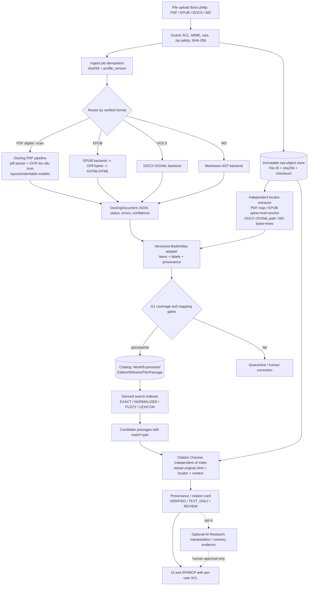

# Technology Assessment — Docling

**Mã thẩm định:** P12 · **Ngày nghiên cứu:** 16/11/2026 (Asia/Ho_Chi_Minh)  
**Đối tượng:** [Docling](https://github.com/docling-project/docling) — document ingestion/parsing/OCR/layout, **không phải** hệ thống thư viện học thuật hoặc công cụ tìm kiếm đầy đủ.  
**Snapshot ứng dụng:** `docling` **v2.150.1**, phát hành **14/11/2026**, Git tag `v2.150.1` → commit **[`5e600e8d37a11f70b62f795ea1e3ce3a4052e551`](https://github.com/docling-project/docling/commit/5e600e8d37a11f70b62f795ea1e3ce3a4052e551)**. Repo public, chưa archived khi kiểm tra.  
**Snapshot schema được đọc:** `docling-core` **v2.106.0**, commit **[`48c57f17260c370f8ac7d2f8bcacb0e83c17fd80`](https://github.com/docling-project/docling-core/commit/48c57f17260c370f8ac7d2f8bcacb0e83c17fd80)**. *Lưu ý*: `docling` yêu cầu `docling-core>=2.106.0,<3.0.0`, nên phiên bản schema thực thi phụ thuộc lockfile; v2.106.0 là bản **đã kiểm tra mã**, không phải khẳng định mọi môi trường sẽ tự cài đúng bản này.  
**Analyst:** Nhóm thẩm định giải pháp kỹ thuật độc lập của BodhiAtlas (nghiên cứu được trợ giúp bởi AI).  
**Phương pháp/công cụ:** đọc toàn văn hai tài liệu yêu cầu của BodhiAtlas; kiểm tra repo/README/LICENSE/tag/release/`pyproject.toml`/đường nạp từng định dạng, các backend và pipeline, `docling-core` schema, mã OCR/reading order, test files, tài liệu và một số issue; đối chiếu repo tài sản kỹ thuật hiện có. Truy xuất trực tiếp GitHub qua công cụ kết nối và tài liệu công khai. **Không cài hay chạy Docling, không chạy 4 fixture, không chạy benchmark** trong môi trường thẩm định này. Mọi kết quả thực thi bên dưới ghi **NOT TESTED**. Không có số liệu CER/WER, thời gian, RAM hoặc độ chính xác thực nghiệm do người thẩm định tạo ra.

**Chuẩn yêu cầu được đọc đầy đủ:** [PRD V1.4](https://github.com/quoctran-2608/bodhi-atlas/blob/main/docs/PRD.md) (398 dòng, Git blob `58d967c642d625180c436e1a6e6a75fa2e7070e3`) và [Academic Risks & Verification](https://github.com/quoctran-2608/bodhi-atlas/blob/main/docs/ACADEMIC_RISKS_AND_VERIFICATION.md) (239 dòng, Git blob `cdb642633f3dc3f7f83cb0e49a96abfebc9f132e`, tài liệu ghi 15/11/2026). Hai tài liệu **đã truy cập và đọc toàn văn**, không phải chỉ xem README. Đã đọc [BuddhismDocuments-for-AI README](https://github.com/quoctran-2608/BuddhismDocuments-for-AI/blob/main/README.md); chưa audit toàn bộ code và upstream của repo này trong phạm vi P12. Các link line ở báo cáo ghim commit đối với Docling/Docling Core, hạn chế nguy cơ trôi phiên bản.

**Quy ước chứng cứ:** `[DOC]` tài liệu tác giả tuyên bố; `[CODE]` đã trực tiếp đọc mã nguồn hay test source (không đồng nghĩa chạy); `[TESTED]` chính nhóm thẩm định chạy có log — **không có trong báo cáo này**; `[ISSUE]` vấn đề được báo cáo chưa chắc tái hiện ở snapshot; `[INFERRED]` suy luận kỹ thuật có nêu điều kiện; `[UNKNOWN]` chưa kiểm xác nhận. Trong ma trận, `NATIVE`/`CONFIG` chỉ phản ánh năng lực phần mềm/khả năng cấu hình, **không phải chất lượng đã nghiệm thu**.

## 1. Executive Decision

**Khuyến nghị: USE AS COMPONENT (COMPONENT), POC trước sản xuất; mức tin cậy MEDIUM.** Docling phù hợp tại **lớp nhập và trích xuất tài liệu phi cấu trúc** của BodhiAtlas: PDF chữ/scan, EPUB, DOCX và Markdown. Mã nguồn v2.150.1 xác nhận các backend, mô hình `DoclingDocument` và JSON có thông tin cấu trúc; với PDF, phần tử có thể mang `page_no`, `bbox`, `charspan`. OCR/layout không cần LLM tạo sinh, nhưng pipeline PDF tiêu chuẩn vẫn có mô hình xử lý tài liệu, không phải parser thuần code.

**Không chọn Docling làm nguồn chứng cứ hoặc ingestion backbone duy nhất.** Docling không sở hữu catalog Work/Expression/Edition/Witness, tìm kiếm `EXACT/NORMALIZED/FUZZY/LEXICON`, kiểm chứng citation và quyền học thuật. **Ba rủi ro lớn nhất:** (1) EPUB backend gộp XHTML và đổi liên kết, chưa chứng minh tái mở đúng `href`/CFI; (2) OCR hai cột, footnotes, chữ Hán/Tạng/Pāli có thể sai dù pipeline báo thành công; (3) `charspan`/bbox không tự bảo đảm byte nguồn, trang in hay locator Word/Markdown. Cần giữ nguyên file+hash, manifest coverage, adapter locator và Citation Checker độc lập; khi chưa xác minh chỉ hiển thị `PARTIAL/TEXT_ONLY/OCR_NEEDS_REVIEW`.

Ưu tiên tái sử dụng retrieval/provenance hiện có của `BuddhismDocuments-for-AI`; không dựng một search engine mới trong Docling. Chỉ nâng mức khuyến nghị sau POC bốn định dạng qua G1/G2 và đối chiếu độc lập với raw source. **Phân loại:** `component`, không phải platform/corpus/standard. **Các cổng fidelity, multilingual và OCR hiện `unknown` vì chưa chạy thử; CODE_ONLY_EXACT_GATE=`n/a` đối với vai trò parser**, nhưng sẽ không đạt nếu đòi Docling tự là toàn bộ V1 Core.

## 2. Sources & Evidence Ledger

**Nguyên tắc:** bảng chỉ xác nhận những điều nguồn tương ứng thực sự chứng minh. `[CODE]` đối với test source chỉ chứng minh test được viết; không biến thành kết quả chạy. URL GitHub dùng commit cố định ở các điểm quan trọng.

| claim_id | Nhận định | Mức | URL/permalink | Version | Ghi chú / giới hạn |
|---|---|---|---|---|---|
| D01 | Repository Docling ở `docling-project/docling`, không archived tại thời điểm kiểm | `[CODE]` | [Repo](https://github.com/docling-project/docling) | 16/11/2026 | Metadata repo được truy xuất; trạng thái có thể đổi |
| D02 | Tag v2.150.1 trỏ đến commit `5e600e8…`, release 14/11/2026 | `[DOC]` | [Release](https://github.com/docling-project/docling/releases/tag/v2.150.1), [commit](https://github.com/docling-project/docling/commit/5e600e8d37a11f70b62f795ea1e3ce3a4052e551) | 2.150.1 | Tag/commit đã tra qua GitHub API; không suy diễn bản mới hơn |
| D03 | Codebase mang giấy phép MIT; license model cần kiểm riêng | `[CODE]` | [LICENSE](https://github.com/docling-project/docling/blob/5e600e8d37a11f70b62f795ea1e3ce3a4052e551/LICENSE), [README L152–155](https://github.com/docling-project/docling/blob/5e600e8d37a11f70b62f795ea1e3ce3a4052e551/README.md#L152-L155) | 2.150.1 | Không đồng nghĩa tất cả model/dependency/dữ liệu đều MIT |
| D04 | `pyproject.toml` ghi `docling-slim` 2.150.1, Python ≥3.10, các dải phụ thuộc core/parser | `[CODE]` | [pyproject.toml](https://github.com/docling-project/docling/blob/5e600e8d37a11f70b62f795ea1e3ce3a4052e551/pyproject.toml#L1-L110) | 2.150.1 | Repro cần lock **toàn** dependency tree |
| D05 | `DocumentConverter` định tuyến PDF → `StandardPdfPipeline`/`ThreadedDoclingParseDocumentBackend` | `[CODE]` | [document_converter.py L338–360](https://github.com/docling-project/docling/blob/5e600e8d37a11f70b62f795ea1e3ce3a4052e551/docling/document_converter.py#L338-L360) | 2.150.1 | Đây là đường mặc định, còn tùy chọn native/VLM khác |
| D06 | EPUB → `EpubDocumentBackend`, DOCX → `MsWordDocumentBackend`, MD → `MarkdownDocumentBackend`, qua `SimplePipeline` | `[CODE]` | [document_converter.py L166–200](https://github.com/docling-project/docling/blob/5e600e8d37a11f70b62f795ea1e3ce3a4052e551/docling/document_converter.py#L166-L200), [L485–545](https://github.com/docling-project/docling/blob/5e600e8d37a11f70b62f795ea1e3ce3a4052e551/docling/document_converter.py#L485-L545) | 2.150.1 | Chứng minh routing; **chưa chứng minh fidelity** |
| D07 | `SimplePipeline` gọi trực tiếp backend `convert()` và nếu không exception trả `SUCCESS` | `[CODE]` | [simple_pipeline.py L18–49](https://github.com/docling-project/docling/blob/5e600e8d37a11f70b62f795ea1e3ce3a4052e551/docling/pipeline/simple_pipeline.py#L18-L49) | 2.150.1 | `SUCCESS` ≠ đủ các đoạn/chú thích/locator của BodhiAtlas |
| D08 | PDF pipeline có `do_ocr`, engine options, layout/table, `OcrMode` có lựa chọn theo vùng hoặc cả trang | `[CODE]` | [pipeline_options.py L106–125](https://github.com/docling-project/docling/blob/5e600e8d37a11f70b62f795ea1e3ce3a4052e551/docling/datamodel/pipeline_options.py#L106-L125), [L2164–2270](https://github.com/docling-project/docling/blob/5e600e8d37a11f70b62f795ea1e3ce3a4052e551/docling/datamodel/pipeline_options.py#L2164-L2270) | 2.150.1 | Không khẳng định hỗ trợ tốt mọi hệ chữ |
| D09 | OCR config dùng `OcrMode.FULL_PAGE`; `force_full_page_ocr` đã deprecated | `[CODE]` | [pipeline_options.py L196–328](https://github.com/docling-project/docling/blob/5e600e8d37a11f70b62f795ea1e3ce3a4052e551/docling/datamodel/pipeline_options.py#L196-L328) | 2.150.1 | Tránh sao chép ví dụ CLI cũ |
| D10 | Native PDF pipeline tạo `ProvenanceItem(page_no,bbox,charspan)` từ text cells | `[CODE]` | [native_pdf_pipeline.py L358–422](https://github.com/docling-project/docling/blob/5e600e8d37a11f70b62f795ea1e3ce3a4052e551/docling/pipeline/native_pdf_pipeline.py#L358-L422) | 2.150.1 | Native mode **không** chạy OCR/layout/table model |
| D11 | Schema `DoclingDocument` có `body`, `furniture`, `texts`, `pages`, `tables`, `pictures`, `origin` | `[CODE]` | [docling-core/document.py L206–246](https://github.com/docling-project/docling-core/blob/48c57f17260c370f8ac7d2f8bcacb0e83c17fd80/docling_core/types/doc/document.py#L206-L246) | core 2.106.0 | Core version trong vận hành phải ghim lại |
| D12 | `ProvenanceItem` có `page_no`, `bbox`, `charspan`; `DocItem.prov` là danh sách, có thể rỗng | `[CODE]` | [reference.py L202–224](https://github.com/docling-project/docling-core/blob/48c57f17260c370f8ac7d2f8bcacb0e83c17fd80/docling_core/types/doc/common/reference.py#L202-L224), [node.py L119–125](https://github.com/docling-project/docling-core/blob/48c57f17260c370f8ac7d2f8bcacb0e83c17fd80/docling_core/types/doc/items/node.py#L119-L125) | core 2.106.0 | Không phải global file byte offset hay CFI mặc định |
| D13 | TextItem có cả `orig` (untreated) và `text` (sanitized) | `[CODE]` | [text.py L19–46](https://github.com/docling-project/docling-core/blob/48c57f17260c370f8ac7d2f8bcacb0e83c17fd80/docling_core/types/doc/items/text.py#L19-L46) | core 2.106.0 | `orig` của item không thay thế hash/file bytes |
| D14 | Docling Core có `save_as_json`; JSON xuất được cấu trúc/provenance đã hiện diện | `[CODE]` | [document.py L3835–3884](https://github.com/docling-project/docling-core/blob/48c57f17260c370f8ac7d2f8bcacb0e83c17fd80/docling_core/types/doc/document.py#L3835-L3884) | core 2.106.0 | Không thể “bảo toàn” locator mà backend chưa tạo |
| D15 | EPUB đọc spine rồi **gộp XHTML** vào HTML, sửa `file.xhtml#id` thành `#id` | `[CODE]` | [epub_backend.py L329–363](https://github.com/docling-project/docling/blob/5e600e8d37a11f70b62f795ea1e3ce3a4052e551/docling/backend/epub_backend.py#L329-L363), [L423–535](https://github.com/docling-project/docling/blob/5e600e8d37a11f70b62f795ea1e3ce3a4052e551/docling/backend/epub_backend.py#L423-L535) | 2.150.1 | Mất định danh XHTML gốc trong output là rủi ro nghiêm trọng |
| D16 | EPUB backend tự khai giới hạn: đích anchor nội bộ có thể không giữ trong Markdown | `[CODE]` | [epub_backend.py L42–62](https://github.com/docling-project/docling/blob/5e600e8d37a11f70b62f795ea1e3ce3a4052e551/docling/backend/epub_backend.py#L42-L62) | 2.150.1 | Chưa kết luận mọi link trong JSON đều mất; phải test từng trường |
| D17 | DOCX không hỗ trợ pagination tự nhiên; đọc OOXML footnotes/endnotes | `[CODE]` | [msword_backend.py L1038–1084](https://github.com/docling-project/docling/blob/5e600e8d37a11f70b62f795ea1e3ce3a4052e551/docling/backend/msword_backend.py#L1038-L1084), [L5117–5180](https://github.com/docling-project/docling/blob/5e600e8d37a11f70b62f795ea1e3ce3a4052e551/docling/backend/msword_backend.py#L5117-L5180) | 2.150.1 | Footnotes thuộc `furniture` ở backend; adapter không được bỏ qua |
| D18 | MD không hỗ trợ pagination; dùng Marko AST và có thể chuyển qua HTML cho raw HTML | `[CODE]` | [md_backend.py L1290–1386](https://github.com/docling-project/docling/blob/5e600e8d37a11f70b62f795ea1e3ce3a4052e551/docling/backend/md_backend.py#L1290-L1386) | 2.150.1 | Cần tự giữ line/byte spans của file `.md` |
| D19 | Reading-order model có gắn footnotes và item provenance | `[CODE]` | [readingorder_model.py L120–162](https://github.com/docling-project/docling/blob/5e600e8d37a11f70b62f795ea1e3ce3a4052e551/docling/models/stages/reading_order/readingorder_model.py#L120-L162), [L247–263](https://github.com/docling-project/docling/blob/5e600e8d37a11f70b62f795ea1e3ce3a4052e551/docling/models/stages/reading_order/readingorder_model.py#L247-L263) | 2.150.1 | Không chứng minh đúng với PDF học thuật hai cột thực tế |
| D20 | Test source có kiểm EPUB links, DOCX heading, OCR mode và reading order | `[CODE]` | [test_backend_epub.py](https://github.com/docling-project/docling/blob/5e600e8d37a11f70b62f795ea1e3ce3a4052e551/tests/test_backend_epub.py), [test_reading_order.py](https://github.com/docling-project/docling/blob/5e600e8d37a11f70b62f795ea1e3ce3a4052e551/tests/test_reading_order.py), [test_e2e_ocr_conversion.py](https://github.com/docling-project/docling/blob/5e600e8d37a11f70b62f795ea1e3ce3a4052e551/tests/test_e2e_ocr_conversion.py) | 2.150.1 | **Không chạy**, không ghi `[TESTED]` |
| D21 | Có báo cáo cộng đồng về thứ tự hai cột/footnotes | `[ISSUE]` | [#2204](https://github.com/docling-project/docling/issues/2204), [#4433](https://github.com/docling-project/docling/issues/4433) | Issue trên các bản khác | Không suy ra v2.150.1 còn nguyên lỗi |
| D22 | Default remote services và external plugins là `False`, model weights có thể tải khi chạy lần đầu | `[CODE]` | [pipeline_options.py L1458–1496](https://github.com/docling-project/docling/blob/5e600e8d37a11f70b62f795ea1e3ce3a4052e551/docling/datamodel/pipeline_options.py#L1458-L1496) | 2.150.1 | `remote=False` không có nghĩa môi trường chưa từng tải weights |
| D23 | SHA-256 được tạo bởi utility hash của Docling | `[CODE]` | [utils/utils.py L23–46](https://github.com/docling-project/docling/blob/5e600e8d37a11f70b62f795ea1e3ce3a4052e551/docling/utils/utils.py#L23-L46) | 2.150.1 | BodhiAtlas vẫn phải tự tính hash trên bytes file bất biến |
| D24 | PRD yêu cầu code-only retrieval và independent source reopen, không coi relevance là evidence | `[DOC]` | [PRD V1.4 §4–6](https://github.com/quoctran-2608/bodhi-atlas/blob/main/docs/PRD.md) | PRD 1.4 | Yêu cầu hệ thống, không phải tính năng Docling |
| D25 | Risk handbook đòi G1/G2/G3 và trạng thái tài liệu/trích dẫn/luận điểm riêng | `[DOC]` | [Academic Risks §3, §5](https://github.com/quoctran-2608/bodhi-atlas/blob/main/docs/ACADEMIC_RISKS_AND_VERIFICATION.md) | 15/11/2026 | R01–R05, R07–R11, R23–R24, R27 đặc biệt liên quan |
| D26 | Repo corpus hiện có retrieval theo witness, provenance và SQLite/FTS; không được coi toàn 13 nguồn đã đạt kiểm chứng | `[DOC]` | [BuddhismDocuments-for-AI README](https://github.com/quoctran-2608/BuddhismDocuments-for-AI/blob/main/README.md) | main được xem 16/11/2026 | Báo cáo README tự phân biệt 3 resolver được kiểm với phạm vi lớn hơn |
| D27 | Docling không phải engine EXACT/LEXICON/citation verifier cho BodhiAtlas | `[INFERRED]` | [DocumentConverter](https://github.com/docling-project/docling/blob/5e600e8d37a11f70b62f795ea1e3ce3a4052e551/docling/document_converter.py), [PRD](https://github.com/quoctran-2608/bodhi-atlas/blob/main/docs/PRD.md) | snapshot trên | Kết luận từ ranh giới chức năng; không khẳng định không thể xây thêm bên ngoài |
| D28 | CER/WER, % coverage PDF hai cột Hán/Tạng và CFI đúng nguồn **chưa được đo ở POC BodhiAtlas** | `[UNKNOWN]` | [Bộ test đề xuất ở mục 9](#9-practical-poc--reproduction-plan) | POC chưa chạy | **NOT TESTED**, không dùng benchmark marketing làm kết quả |

### Bằng chứng còn thiếu

- Chưa có lockfile thực thi gồm Docling, Docling Core, `docling-parse`, OCR/models theo đúng máy và OS; chưa lấy hashes/giấy phép **mọi** model được bật.
- Chưa trực tiếp chạy fixtures BodhiAtlas và kiểm bằng người nghiên cứu; chưa có số đo CPU/RAM/GPU, CER/WER, trang in hoặc tỷ lệ mở nguồn đúng.
- Chưa đối chiếu model cards **từng** OCR/VLM checkpoint trên môi trường đích; chưa kiểm tra toàn bộ các file corpus thuộc quyền sở hữu của người sử dụng.

## 3. Architecture & Data Flow



**Nguồn dữ liệu bất biến** là bytes file gốc + SHA-256 + catalog ấn bản/witness/rights. **Dữ liệu dẫn xuất** gồm: JSON `DoclingDocument`, OCR text, confidence, metadata parser, mapping do adapter tạo, indexes, embeddings/chunks, lỗi OCR. Mỗi lần tái parse lưu `extractor_name`, `extractor_version`, `core_version`, `profile_hash`, `run_id` và đường dẫn JSON; việc thay extractor không bao giờ sửa `source_sha256` hoặc âm thầm đổi citation đã duyệt.

**Không có LLM tạo sinh bắt buộc** ở luồng ingest tiêu chuẩn, lập chỉ mục và tìm code-only. `StandardPdfPipeline` vẫn phụ thuộc mô hình ML cho layout/table và OCR engine có thể dùng ML; `VlmPipeline` là đường tùy chọn, **không** được coi tương đương deterministic text extraction. Không tự bật picture description, caption generation hoặc VLM inference khi mục tiêu là xác minh nguyên văn. API/MCP, ACL, backup, catalog và search **thuộc hệ thống BodhiAtlas/adapter**, không phải chức năng native Docling.

**Một file có thể có nhiều bản trích xuất:** `run A` trên PDF text, `run B` OCR toàn trang, `run C` parse chuyên biệt. Bản gốc dùng để đối chiếu cuối, không lấy phần tử mới của run khác làm chứng cứ đã duyệt nếu không ánh xạ lại.

## 4. Feature Fit–Gap Matrix

*Mức công sức là ước tính tương đối cho adapter phù hợp V1 (L/M/H), không phải đo đạc. N/A là ranh giới vai trò, **không tính như một thất bại**.*

| Capability | Trạng thái | Chứng cứ/ranh giới | Tác động với BodhiAtlas | Công sức bù | Phương án bù |
|---|---|---|---|---|---|
| **C01 Multi-format ingest** | **NATIVE** | `D05–D07`: PDF, EPUB, DOCX, MD qua converter và backend riêng | Đúng bộ định dạng V1 chính; corpus cấu trúc TEI/Bilara cần lối riêng | M | Router giữ nguyên đường nạp corpus; hợp nhất manifest và status |
| **C02 OCR/layout/reading order** | **CONFIG** | `D08–D10, D19–D21`: engine OCR/layout/table, native PDF tùy chọn | Năng lực mạnh nhưng khó tin với hai cột, footnotes, nhiều hệ chữ | H | Engine theo profile; kiểm vùng/trang, human review high-risk |
| **C03 Canonical text and source map** | **EXTENSION** | `D11–D18`: JSON có provenance PDF; EPUB/MD/DOCX thiếu locator nguyên trạng tương ứng | **Blocker G2** nếu không thể re-open | H | Giữ raw, build locator adapter riêng theo định dạng; mapping versioned |
| **C04 Works/editions/witnesses** | **N/A** | `DoclingDocument.origin` chỉ tả nguồn file, không phải thư mục học thuật | Không để parser tự gộp ấn bản/dịch giả | M (hệ thống) | Catalog BodhiAtlas; reuse IDs từ corpus hiện có |
| **C05 Exhaustive EXACT** | **N/A** | Converter/chunking không phải exhaustive lexical index | Cần trả *tất cả* khớp trong phần coverage | M (hệ thống) | SQLite/FTS hoặc index code-only, raw text theo passage/offset |
| **C06 Normalized multilingual search** | **N/A** | OCR `lang` không phải analyzer tìm kiếm | Bỏ dấu, giản/phồn, Unicode, Tạng/Wylie không có sẵn ở parser | H (hệ thống) | Derived analyzers/versioned transforms; giữ nguyên văn |
| **C07 Fuzzy/near-duplicate/OCR errors** | **N/A** | Không có contract tìm fuzzy BodhiAtlas native | Sai 1–2 chữ có thể làm lọt câu thật | M/H (hệ thống) | Character n-grams/edit-distance, OCR error candidates, diff |
| **C08 Sense-aware lexicon** | **N/A** | Không có catalog nghĩa/quan hệ đã xác minh | Rủi ro đồng nhất `anatta`/`anātman`/`無我` | H (hệ thống) | Lexicon `sense_id`, relation provenance, người duyệt |
| **C09 Semantic/hybrid/RAG** | **EXTERNAL** | `README` đề cập chunking/integrations, không phải hệ RAG học thuật hoàn chỉnh | Không cần cho V1 core; có thể gây thiếu nguồn do retrieval xếp hạng | L/M tùy chọn | RAG sau exact/lexicon; evidence vẫn qua Citation Checker |
| **C10 Verified citation card & source reopen** | **EXTENSION** | `ProvenanceItem` chỉ pointer; parser không tự xác nhận Work/Edition/printed page/CFI | **P0 blocker** nếu dẫn sai trang/ấn bản | H | Resolver gốc+locator+hash, trạng thái G2 riêng, context verification |
| **C11 Note/wiki/claim memory** | **N/A** | Không thuộc loại parser | Không làm mất hồ sơ nghiên cứu khi đổi parser | M (hệ thống) | Reuse evidence/claim history của corpus repo / catalog |
| **C12 API/MCP/export & integration** | **NATIVE** | Converter Python + JSON; README mô tả MCP integration | Dễ gọi như component; không đồng nghĩa API nghiên cứu có sẵn | M | Adapter REST/queue; MCP sau ACL và Citation Checker |
| **C13 Quality coverage + incremental** | **EXTENSION** | ConversionStatus/errors/confidence có; không đủ manifest coverage/compare file + per-page CER | Không được coi `SUCCESS` là đọc đủ từng trang và cước chú | H | Per-page G1 manifest, reference counts, counters, cache `(sha,profile)` |
| **C14 Auth/licensing/privacy & backup** | **EXTERNAL** | MIT code, remote/plugins opt-in; auth/rights/backup của app ngoài | P0 với tài liệu bản quyền/riêng tư | M/H | Worker cô lập, ACL trước export/AI, license BOM, backup+restore |
| **C15 Operational simplicity / independent deploy** | **CONFIG** | CLI/Python local/offline sau khi có model weights; dependency/model artifact khác nhau theo profile | Có thể self-host, nhưng ML OCR CPU/GPU và pin model nặng | M | Một worker pool, tách native/text và ML OCR profile, quota, logs |

**Diễn giải tránh nhầm:** Nếu một bên yêu cầu **Docling tự mình** đáp ứng toàn bộ sản phẩm BodhiAtlas, C04–C11/C14 là thiếu. Nếu xét **đúng vai trò parser chuyên biệt**, các mục search/tri thức là `N/A` — quyết định chọn Docling phụ thuộc chủ yếu C01, C02, C03, C10, C13 và ranh giới tích hợp.

## 5. Deep Technical Findings

### 5.1. Đường vào các định dạng — kiểm tra bằng code

| Input | Routing code đã đọc | Pipeline mặc định | Kết luận kỹ thuật | Điểm cần POC |
|---|---|---|---|---|
| PDF văn bản | `InputFormat.PDF` → `PdfFormatOption` → `ThreadedDoclingParseDocumentBackend` | `StandardPdfPipeline` (OCR và layout/table có cấu hình) | Có PDF text cells, vùng/bbox, reading order; có `NativePdfPipeline` không cần model cho baseline | Text ligatures, dấu phụ, trang PDF, bbox/footnotes |
| PDF scan | Cùng `InputFormat.PDF` | OCR qua `PdfPipelineOptions.do_ocr` + `ocr_options` và layout | Có OCR multi-engine và chế độ full-page/vùng | CER/WER, Hán/Tạng, cột, từ phủ định, confidence, duplicates |
| EPUB | `InputFormat.EPUB` → `EpubFormatOption`/`EpubDocumentBackend` | `SimplePipeline` → XHTML/HTML | Đọc OPF/spine, nối content files để parse; không là EPUB locator engine | Khôi phục chính xác OPF spine href/anchor/CFI, footnotes |
| DOCX | `InputFormat.DOCX` → `WordFormatOption`/`MsWordDocumentBackend` | `SimplePipeline` → OOXML tree | Có heading/lists/tables/comments/footnotes/endnotes theo code; không có trang Word đáng tin | XPath/paragraph/run anchor, footnote identity, heading false positives |
| Markdown | `InputFormat.MD` → `MarkdownFormatOption`/`MarkdownDocumentBackend` | `SimplePipeline` → Marko AST (GFM) | Có heading/paragraph/list/table; raw HTML có đường chuyển riêng | Byte/line offset, normalization, link/anchor, code blocks |
| Corpus TEI/Bilara JSON | Không tự suy ra từ EPUB/PDF route | Ngoài Docling, tùy nguồn | **Tài sản đã có ở repo corpus cần giữ parser riêng** | IDs witness, line segmentation, upstream provenance |

Nguồn: [converter routing](https://github.com/docling-project/docling/blob/5e600e8d37a11f70b62f795ea1e3ce3a4052e551/docling/document_converter.py#L166-L200), [EPUB route](https://github.com/docling-project/docling/blob/5e600e8d37a11f70b62f795ea1e3ce3a4052e551/docling/document_converter.py#L485-L545), [SimplePipeline](https://github.com/docling-project/docling/blob/5e600e8d37a11f70b62f795ea1e3ce3a4052e551/docling/pipeline/simple_pipeline.py).

### 5.2. Ba loại xử lý không được đánh đồng

1. **Parser cấu trúc/deterministic:** EPUB dựa trên EPUB ZIP, OPF và XHTML; DOCX dựa OOXML; MD dựa AST; PDF digital lấy chữ từ embedded text layer qua PDF backend. Không yêu cầu LLM tạo sinh. Nhưng text thu được có thể *biến đổi* bởi parser/sanitization/HTML flattening, khác raw bytes.
2. **OCR/layout/table machine learning:** `StandardPdfPipeline` có các giai đoạn OCR, layout detection, reading order, table structure. OCR engine có bộ nhận dạng; V1 có thể chạy local, không bắt buộc cloud LLM. **Không thể gọi toàn pipeline này là deterministic parser không mô hình**; cùng đầu vào có thể khác khi thay weights, lib, flags hoặc hardware.
3. **VLM/generative/description:** Docling còn tích hợp VLM/GraniteDocling và mô tả hình. Có nguy cơ tạo/sửa chữ thay vì sao chép đúng ảnh, nhất là chữ mờ hay chữ Hán/Tạng. Đối với chứng cứ nguyên văn, coi output VLM là *candidate* cần soát ảnh, **không** chứng nhận G2 từ VLM output. Lưu `extraction_mode=VLM` riêng, tuyệt đối không sửa `raw_text` của nguồn.

### 5.3. Schema thực tế, page, bbox, char span

Theo [`docling-core` v2.106.0](https://github.com/docling-project/docling-core/blob/48c57f17260c370f8ac7d2f8bcacb0e83c17fd80/docling_core/types/doc/document.py#L206-L246), cấu trúc quan trọng:

```python
DoclingDocument(
    schema_name="DoclingDocument", version="...", name="...",
    origin=DocumentOrigin(...),
    body=GroupItem(...), furniture=GroupItem(...),
    texts=[TextItem(...)], tables=[...], pictures=[...],
    pages={1: PageItem(...), ...}
)
# TextItem: text (sanitized), orig (parser untreated representation),
#           label, content_layer, self_ref, prov: list[ProvenanceItem]
# ProvenanceItem: page_no: int, bbox: BoundingBox, charspan: tuple[int,int]
# BoundingBox: l, t, r, b, coord_origin (TOPLEFT/BOTTOMLEFT)
```

**Các điều không được tự suy ra:** `charspan` là span trong item/representation, **không** phải byte offset nguồn PDF hoặc EPUB; `self_ref` là pointer đến vị trí trong cây JSON, không phải ID Passage ổn định sau reparse; `origin.binary_hash` không mang quan hệ ấn bản; `pages` đối với EPUB/DOCX/MD có thể rỗng, vì các backend báo `supports_pagination=False`. `orig` không có nghĩa là byte-for-byte raw hay chính tả OCR đã được phê duyệt. [`ProvenanceItem`](https://github.com/docling-project/docling-core/blob/48c57f17260c370f8ac7d2f8bcacb0e83c17fd80/docling_core/types/doc/common/reference.py#L204-L223) có bbox và page_no **khi được backend cung cấp**, không có printed page, EPUB CFI hay DOCX OOXML XPath built-in. `page_no` phải được xác thực là đúng vị trí PDF page index/number theo chính exporter đang dùng; không tự cộng/trừ 1 trong Citation Checker mà không chứng minh bằng test hai trang.

**Định dạng JSON:** [`save_as_json`](https://github.com/docling-project/docling-core/blob/48c57f17260c370f8ac7d2f8bcacb0e83c17fd80/docling_core/types/doc/document.py#L3835-L3884) phù hợp lưu richer provenance/cấu trúc hơn Markdown. Chọn `ensure_ascii=False`, `sort_keys=True`; lưu ảnh tham chiếu cùng artifacts directory với checksum. **“Lossless JSON”** trong README chỉ mô tả fidelity của biểu diễn `DoclingDocument` khi export, **không** chứng minh lossless với bytes/layout của tài liệu đầu vào.

### 5.4. Bảng, cột, tiêu đề, footnotes, printed page

- **Reading order**: `page_assemble_model.py` chuyển layout clusters thành phần tử; `readingorder_model.py` quyết định thứ tự, liên kết caption/footnote. Test regression có các ca 2 cột, và issue về 2 cột/footnotes đã được báo, nhưng **không** có chứng cứ rằng mọi PDF 2 cột được xử lý đúng trong v2.150.1. Với scan chữ Hán, bảng và cước chú cuối trang, đo riêng thứ tự các vùng và số lượng footnote, không chỉ độ giống nội dung toàn trang. [Code readingorder](https://github.com/docling-project/docling/blob/5e600e8d37a11f70b62f795ea1e3ce3a4052e551/docling/models/stages/reading_order/readingorder_model.py), [issue #2204](https://github.com/docling-project/docling/issues/2204).
- **Footnotes PDF**: model gán nhãn và có `footnotes` references, nhưng việc đọc đúng ký hiệu/đúng đoạn và quan hệ chú thích vẫn phụ thuộc detection + reading order. Cước chú có thể bị chép vào paragraph sai hoặc bị lọc furniture. POC so sánh cả `label=FOOTNOTE`, `content_layer`, vị trí bbox và link tới marker.
- **Footnotes DOCX**: mã xử lý `word/footnotes.xml`/`endnotes.xml` và đưa note text vào `furniture`; một adapter chỉ đọc `body` hoặc export Markdown mặc định có nguy cơ bỏ sót. Không được tính `source coverage=100%` nếu chưa thu cả notes. [Backend L5117–5180](https://github.com/docling-project/docling/blob/5e600e8d37a11f70b62f795ea1e3ce3a4052e551/docling/backend/msword_backend.py#L5117-L5180).
- **Heading DOCX**: dò style và `w:outlineLvl`; code thừa nhận `outlineLvl` đôi khi áp dụng cho paragraph không phải heading → false heading. Chốt ngưỡng theo fixture người duyệt. Release v2.150.1 có sửa heading từ paragraph `outlineLvl`. [Backend L2332–2418](https://github.com/docling-project/docling/blob/5e600e8d37a11f70b62f795ea1e3ce3a4052e551/docling/backend/msword_backend.py#L2332-L2418), [release](https://github.com/docling-project/docling/releases/tag/v2.150.1).
- **Printed page ≠ PDF page**: Docling provenance dựa PDF page index; số trang in cần phát hiện từ PDF header/footer hoặc metadata ấn bản, rồi xác nhận bằng người/ground truth. **Không dùng regex trang in làm nguồn “đã xác minh” chỉ từ một số trang.** Với EPUB reflow, trang in thậm chí không có một-một với chương/XHTML.
- **Source fidelity của PDF char-level**: bbox thường gắn vùng/đoạn, không có bảo đảm một bbox/charspan tương ứng trực tiếp mỗi ký tự Unicode ở ảnh. Khi cần highlight chính xác một từ, bổ sung char/word-level extraction đối chiếu bằng PDF backend/PyMuPDF; nếu thiếu, highlight vùng đoạn và gắn `LOCATOR_PARTIAL`.

### 5.5. EPUB: bằng chứng rủi ro locator trực tiếp

`EpubDocumentBackend._parse_epub_structure()` đọc OPF manifest và spine, nhưng `convert()` **ghép nội dung nhiều XHTML vào một HTML** và `_fix_internal_links()` đổi `chap02.xhtml#fn3` thành `#fn3` để hoạt động trong HTML tổng hợp. Docstring backend nêu rõ target anchor ID của footnote có thể không giữ lại trong Markdown. Vì vậy **đoạn văn có thể vẫn được trích**, còn **danh tính file XHTML gốc và target để mở lại** không được bảo đảm trong JSON/Markdown. Không thể tự dựng CFI chính xác từ một item nằm trong HTML đã gộp bằng cách nhìn index của item. Các lựa chọn:

1. Giữ original EPUB ZIP, `META-INF/container.xml`, OPF path, spine order, mỗi `href`/ID/anchor và DOM/XPath/character offset trong manifest riêng trước khi gọi Docling.
2. Liên kết item Docling với vùng XHTML theo kiểm chứng text+context và namespace `spine_idref/href/element_id`; nếu 2 đoạn trùng text, **không** tự chọn mơ hồ.
3. Đối với CFI, cần bộ sinh/giải mã chuẩn EPUB CFI trên DOM/ID đã ghim; nếu không triển khai đủ CFI, ưu tiên **`href#id` được đối chiếu** và ghi CFI `unavailable` — tuyệt đối không bịa chuỗi `/6/...`.
4. Trên Epub Reader gốc/HTML viewer riêng, tái mở `href` xác định và so exact excerpt. Chỉ khi đạt G2 mới xuất `TEXT_AND_LOCATOR_VERIFIED`; còn lại `TEXT_ONLY/UNVERIFIABLE`.

Nguồn: [epub backend: spine](https://github.com/docling-project/docling/blob/5e600e8d37a11f70b62f795ea1e3ce3a4052e551/docling/backend/epub_backend.py#L106-L175), [link rewrite](https://github.com/docling-project/docling/blob/5e600e8d37a11f70b62f795ea1e3ce3a4052e551/docling/backend/epub_backend.py#L329-L363), [merged HTML](https://github.com/docling-project/docling/blob/5e600e8d37a11f70b62f795ea1e3ce3a4052e551/docling/backend/epub_backend.py#L423-L535).

### 5.6. Coverage, confidence, quality, incremental

`ConversionStatus.SUCCESS/PARTIAL_SUCCESS/FAILURE`, `ConversionResult.errors` và confidence là các tín hiệu kỹ thuật hữu ích nhưng **khác nhau**. `SUCCESS` có thể chỉ cho biết pipeline chạy không exception; `OCR score` là đánh giá nội bộ mô hình chứ không phải CER/WER có ground truth; `parse_score` mô tả chất lượng text layer, có trường hợp OCR thay thế broken layer trong khi parse score vẫn giữ nguyên. Chỉ số BodhiAtlas phải có:

| Metric | Định nghĩa đề xuất | Đơn vị/nguồn ground truth | Cảnh báo |
|---|---|---|---|
| `page_attempt_coverage` | số trang chạy pipeline / tổng trang file gốc | % trang, manifest PDF page count | Không có nghĩa đã đọc mọi chữ |
| `page_text_coverage` | số trang có text đầy đủ được reviewer xác nhận / tổng trang kỳ vọng | % trang | Nếu scan trống đúng nguyên bản, cần trạng thái `BLANK_CONFIRMED` |
| `region_coverage` | số vùng/đoạn/footnote có mapping hợp lệ / tổng vùng gắn nhãn trong truth | % vùng | Dễ che missing footnotes nếu chỉ đếm words |
| `CER` | `(S + D + I) / N` trên ký tự chuẩn sau **quy tắc đánh giá công bố trước**, tách raw/exact và normalized | ký tự, truth thủ công | Không bỏ dấu trong CER raw; lỗi chữ phủ định đánh dấu severity |
| `WER` | `(S + D + I) / N` trên token chuẩn riêng mỗi hệ chữ | token, truth thủ công | Tiếng Hán không thể chỉ split khoảng trắng |
| `reading_order_error` | nghịch thế tương đối các block/trang so với thứ tự chuẩn | count / pairs | Đo cột/footnote độc lập |
| `duplicate_text_rate` | ký tự/đoạn dư lặp so với source truth | % | Cẩn trọng với lặp có thật trong kinh |
| `footnote_retention` | note marker + body + association đúng / tổng note ground truth | % | Một note body tồn tại nhưng nối sai vẫn không đạt |
| `locator_accuracy` | hits mở lại đúng file+edition+page/anchor và exact text / hits có truth | % | Phải đo trước khi gắn VERIFIED |
| `throughput/resources` | wall-clock, CPU %, RSS peak, VRAM peak theo file/profile | giây/trang, MiB/GiB | Không ghi giá trị nếu chưa đo |

**Incremental**: chưa thấy Docling là ingestion scheduler có incremental built-in theo file hash và quyền. `InputDocument` có SHA-256 và converter có cache initialized pipelines, nhưng BodhiAtlas phải cung cấp `job_key = (file_sha256, extraction_profile_hash, docling_version, docling_core_version, model_hashes)`; nếu file và profile không đổi có thể reuse JSON; nếu đổi version, chạy lại vào run mới và so diff trước khi đổi active run. **Không đặt Passage ID = chunk index**.

## 6. Source Fidelity & Provenance

### 6.1. Mô hình bảo toàn nguồn được đề xuất

```text
Work               bibliographic identity (not file hash)
└─ Expression      language, translation/commentary/recension
   └─ Edition      publisher, date, pagination, editor/translator, revision
      ├─ Witness   textual witness/variant with explicit relation
      └─ File      immutable bytes + sha256 + media type + rights
         └─ ExtractionRun (version, model hashes, config, statuses)
            ├─ SourceLocator (native locator + certainty)
            └─ Passage (stable BodhiAtlas ID, text excerpt, context,
               source locator, parse status; index chunks are DERIVED)
```

**Bất biến:** 1) không sửa bytes nguồn; 2) không “chữa” văn bản OCR lên raw; 3) không gộp File/Edition/Witness chỉ vì chuỗi text giống nhau; 4) relation `translation_of`, `parallel_to`, `variant_of`, `commentary_on` có nguồn xác nhận và trạng thái; 5) khi OCR đổi, mọi citation chưa reverified giữ nhãn cũ hoặc chuyển `RECHECK_REQUIRED`.

### 6.2. Hợp đồng locator theo định dạng

| Format | Locator ưu tiên | Tính native theo mã đã đọc | Cách re-open và giới hạn |
|---|---|---|---|
| PDF text | `pdf_page_index` + `bbox` + coordinate_origin + page_size + optional native text spans | `page_no`/bbox/charspan cho item; char-level nguồn không bảo đảm | Mở file SHA, đến trang, overlay bbox, so exact substring trong vùng; tránh nhầm PDF page và số trang in |
| PDF scan | như PDF, thêm `ocr_engine`, `model_id`, `ocr_status`, image crop hash | OCR/layout cung cấp candidate vùng | Mở ảnh trang, người so câu chữ ở vùng đặc biệt chữ Hán/Tạng; OCR chưa duyệt → `OCR_NEEDS_REVIEW` |
| EPUB | `opf_path`, `spine_idref`, `href`, `element_id`/DOM XPath, local offset, **CFI chỉ khi tạo/xác minh được** | **Không bảo đảm bởi EPUB backend hiện tại** | Mở đúng EPUB ZIP/XHTML, điều hướng anchor/DOM; page in chỉ khi xác nhận từ ấn bản |
| DOCX | `word/document.xml` + OOXML paragraph/run anchor hoặc bookmark ID, `part_name` cho notes | DOCX backend đọc nội dung, `supports_pagination=False` | Mở OOXML part, bookmark/paragraph index; pagination Word không ổn định theo font/renderer |
| MD | byte offset/UTF-8 line/column + stable heading anchor + exact hash | AST parse, `supports_pagination=False` | Mở raw `.md`, đối chiếu byte offsets, lưu newline convention và encoding |
| TEI/structured corpus | upstream canonical ID, witness, line/segment ID và immutable pin | Ngoài Docling; repo corpus hiện có | Gọi resolver nguồn có thẩm quyền, không chuyển thành PDF page giả |

### 6.3. Contract citation card: minh họa **schema, không phải trích dẫn có thật**

```json
{
  "work_id": "<catalog-work-id>",
  "expression_id": "<catalog-expression-id>",
  "edition_id": "<catalog-edition-id>",
  "witness_id": "<witness-id-or-null>",
  "file_id": "<immutable-file-id>",
  "file_sha256": "<64-lowercase-hex-from-original-bytes>",
  "passage_id": "<stable-catalog-id>",
  "extraction_run_id": "<run-id>",
  "quote_exact": "<exact-excerpt-or-null-if-unverified>",
  "raw_source_locator": {
    "type": "pdf_bbox|epub_href|epub_cfi|docx_ooxml|md_byte_range",
    "pdf_page_index": null,
    "printed_page_verified": null,
    "bbox": null,
    "href": null,
    "cfi": null
  },
  "match": {"type": "EXACT|NORMALIZED|FUZZY|LEXICON|SEMANTIC", "rule_id": null},
  "document_status": "READY|PARTIAL|OCR_UNCERTAIN|NOT_INDEXED",
  "citation_status": "TEXT_AND_LOCATOR_VERIFIED|TEXT_ONLY|OCR_NEEDS_REVIEW|MISMATCH|UNVERIFIABLE",
  "claim_assessment": "NOT_ASSESSED|SUPPORTS|PARTIAL|CONTRARY|DISPUTED|INSUFFICIENT",
  "coverage_scope": "<searched-page-and-index-manifest>",
  "verified_at": null,
  "verified_by": null,
  "parser_version": "2.150.1"
}
```

Giá trị trong dấu `<...>` là **placeholder**, không phải dữ kiện nguồn. `citation_status` độc lập `claim_assessment`: một câu trích xác định đúng file và trang **vẫn chưa** chứng minh một luận điểm. `search_score` (nếu có) chỉ để xếp hạng ứng viên, không xuất như xác suất đúng của luận điểm.

### 6.4. Quy trình kiểm tra độc lập (G1/G2/G3)

1. **G1 ingest:** xác nhận original hash, page/spine/part count, manifest vùng chưa xử lý, errors; chỉ mark `READY` khi đủ phạm vi kiểm, nếu không `PARTIAL/OCR_UNCERTAIN` kèm trang cụ thể. Mọi fail page được lưu, không giả `0 hits = 0 sources`.
2. **G2 citation:** gọi `open_original(file_id)`, tự tính lại SHA, resolver native locator, trích đoạn trong đúng Edition/Witness, kiểm nguyên văn và ngữ cảnh; text OCR high-risk cần người xem ảnh; không đủ locator → `TEXT_ONLY`, sai → `MISMATCH`, không truy cập được → `UNVERIFIABLE`.
3. **G3 claim:** khi hỏi “tác giả nào phân biệt vô thường và khổ?” code tìm passages theo thuật ngữ; đánh giá ai phát biểu, lập luận ủng hộ/bác bỏ/thuật lại, phản chứng, phụ thuộc giữa nguồn là *bài toán phân tích học thuật*, do người nghiên cứu phê duyệt (AI chỉ hỗ trợ tùy chọn). Không lấy kết quả `EXACT/LEXICON` làm bằng chứng tự động.

**Re-index/rollback:** mọi citation giữ `file_sha256`, native locator, extraction run đã tạo; re-chunk chỉ làm index alias mới. Trước promote run mới: tự động re-open ngẫu nhiên + toàn bộ citation đã duyệt bị ảnh hưởng; nếu lệch, giữ run trước, khoanh vùng `RECHECK_REQUIRED`, không relink ngầm.

## 7. Multilingual & Retrieval Behavior

Bảng này đánh giá **năng lực truy vấn** chứ không nhầm với khả năng nhận OCR một hệ chữ. Các parser không phải search engine: `native` về ingest Unicode khác `native` về tìm normalized. Docling không đảm bảo tổng quan các ngôn ngữ chỉ vì OCR engine có thể chọn `lang`.

| Mode | Docling theo vai trò | BodhiAtlas cần triển khai/đối chiếu | Dấu hiệu kiểm được |
|---|---|---|---|
| **EXACT** | **custom** (index/search ngoài Docling) | Index raw Unicode giữ dấu, all occurrences, source offsets; không stemming ở EXACT | `anattā` chỉ match đúng chuỗi, không tự thành `anatta` |
| **NORMALIZED** | **custom** | NFC/NFD policy, casefold, Vietnamese diacritic fold ở **index phụ**, giản–phồn từng ký tự có provenance, khoảng trắng/dấu câu tùy chế độ | `vo thuong` → `vô thường` có nhãn `NORMALIZED`, ghi rule |
| **FUZZY** | **custom** | char n-gram/Levenshtein, candidates sai OCR, near-duplicate/diff từng ký tự | `anatta` gần `anattā` nhưng không đổi quote |
| **LEXICON sense-aware** | **custom** | bảng `form, language, script, transliteration, sense_id, tradition, relation_type, source, reviewer` | `anatta`/`anātman`/`無我`/`无我`/`vô ngã` chỉ liên kết nghĩa khi đã xác minh |
| **SEMANTIC** | **external/optional** | Embedding/vector/RAG chỉ khi lexical không đủ, source cards qua G2 | Không dùng vector score thành xác suất đúng |

**Analyzer tối thiểu theo hệ chữ (đề xuất, chưa chạy):**

- **Việt:** raw NFC chính xác; derived lowercase/casefold, diacritic removal có đánh dấu ambiguity; bigrams/char-ngrams cho thiếu dấu, hỗ trợ lọc tác giả/ấn bản. `khổ` và `kho` không tự xem đồng nghĩa ở EXACT.
- **Hán:** raw CJK codepoint exact, substring search 1–2 chữ, không phụ thuộc white-space tokenization; giản–phồn với bảng ánh xạ có version, **ánh xạ 1↔n không mặc định đảo ngược duy nhất**; dị thể lịch sử chỉ từ nguồn được kiểm. `無我`/`无我` khác raw, link qua normalized mapping.
- **Tạng:** lưu nguyên Unicode và chuẩn hóa Unicode thận trọng; syllable delimiters/tsheg được xét riêng, converter Wylie có version; OCR chữ Tạng **chưa chứng minh** trên corpus và cần ground truth, không khẳng định search Wylie có sẵn trong Docling.
- **Pāli/Sanskrit:** raw IAST/Unicode, derived dấu phụ (`anattā` ↔ `anatta`) chỉ ứng viên normalized, transliteration và hình thái cần bảng quy tắc; `anātman` và `anattā` có thể liên quan học thuật nhưng **không** thành EXACT/đồng nghĩa chỉ vì bỏ dấu.
- **English:** exact case-sensitive raw; optional casefold/stemming/lemmatization, phrases/word boundaries; hiển thị chế độ match riêng.
- **Chuyển ngữ và multi-sense:** mỗi `sense_id` có quan hệ được dẫn nguồn và phạm vi truyền thống, không suy từ đường chuyển ngữ bắc cầu vô hạn (`A≈B≈C` không suy tự động `A=C`).

**Ba kịch bản người dùng cần phân định:**

1. `anatta/anattā/anātman/無我/无我/vô ngã`: parser phải giữ Unicode/diacritics khi nhận dạng; **search/lexicon nằm ngoài** Docling; display match type + rule + sense.
2. `vô thường`/`khổ`/`無常`/`苦` lọc tác giả/ấn bản: metadata thuộc catalog, `EXACT` lấy mọi đoạn trong **phạm vi đã index**, còn `LEXICON` theo từng nghĩa; không gán số trang chưa xác nhận.
3. Câu hỏi luận chứng “những tác giả nào phân biệt vô thường và khổ? họ lập luận thế nào?”: code chọn candidate paragraphs, lọc source type/edition; người/AI đánh giá lập luận đầy đủ, có trích dẫn và phản chứng. Công bố kết quả chỉ sau G2+G3.

## 8. Integration Options for BodhiAtlas

### Option A — **Direct embedding, adapter Python trong ingestion worker** (đề xuất cho POC)

**Kiến trúc:** một worker Python cài Docling đã lock → gọi `DocumentConverter` cho mỗi file -> lưu JSON/manifest bên cạnh nguyên bản -> chuyển `TextItem`/`prov` sang schema Passage/Locator phiên bản hóa -> đẩy sang catalog/index hiện có. Dùng cùng `file_id`, `edition_id` mà catalog cấp trước khi parse; không để filename/OCR text làm ID ấn bản. Phân biệt đường nạp TEI/Bilara đã có, không ép qua Docling.

**File/code cần tạo hoặc sửa (đề xuất, không phải đường dẫn đã tồn tại):** `ingestion/docling_adapter.py`, `ingestion/profiles.py`, `source_mapping/pdf_locator.py`, `source_mapping/epub_locator.py`, `source_mapping/docx_locator.py`, `source_mapping/md_locator.py`, `quality/coverage_manifest.py`, `citations/source_resolver.py`, `tests/fixtures/`. Kết nối tới CLI/Python/Connector contracts của `BuddhismDocuments-for-AI` qua interface rõ, không chỉnh sửa 13 upstream snapshot.

**Đầu vào contract:**

```json
{
  "file_id":"file-uuid",
  "file_sha256":"<sha256>",
  "original_object_uri":"immutable://...",
  "work_id":"work-uuid",
  "expression_id":"expression-uuid",
  "edition_id":"edition-uuid",
  "witness_id":null,
  "rights_policy_id":"policy-uuid",
  "media_type":"application/pdf",
  "extraction_profile":"pdf-text-v1|pdf-ocr-v1|epub-v1|docx-v1|md-v1"
}
```

**Đầu ra contract:** `run_id`, input hash/check, full `DoclingDocument` JSON blob URI, `manifest` per page/spine/part, `passages[]` gồm text, label, order, `source_locator`, `ocr_uncertainty`, `map_confidence`, `content_layer`, `parser_version`, `rights_policy_id`, lỗi và vùng chưa xử lý. Output không phát sinh `claim_assessment`; trạng thái G2 chỉ do Citation Checker cấp sau khi mở file gốc.

**Idempotency/sync:** job key `(original_sha256, canonical profile manifest SHA, exact Docling/Core/OCR/model hashes)`; insert run bất biến → verify G1 → `activate` atomically theo file. Reparse khác profiles lưu song song; rollback chuyển active run, không xóa raw/citation history; search index chỉ rebuild các đoạn thuộc run đổi. **ACL** áp trước khi đọc nguyên bản và trước khi trả excerpt cho API/AI.

**Ưu:** đơn giản, không thêm service; debug JSON trực tiếp, reuse scheduler hiện có. **Nhược:** phụ thuộc Python/models nặng và hot worker OCR cần cô lập; deploy rollback/queue/resource limits phải tự xây.

### Option B — **Standalone Docling extraction service qua queue/REST**

Một dịch vụ nội bộ `docling-extractor` chỉ có nhiệm vụ **parse**, không được tự sở hữu catalog hoặc raw-store master. Endpoint/queue task được chứng thực mang `file_id`/object reference và profile đã whitelist; service chỉ có quyền đọc object gốc đã cấp trong thời hạn ngắn, ghi JSON dẫn xuất và manifest; BodhiAtlas kiểm tra hash/status, gọi adapter và Citation Checker cục bộ. Không cung cấp arbitrary URL ingestion cho client; không cho người dùng inject plugin/model path.

**Ví dụ API logic:** `POST /extractions` → `job_id`; `GET /extractions/{id}` → `{status, source_sha256, parser_version, output_json_uri, errors, per_page_status}`. Callback idempotent, signed, expiring; output không cho AI access nếu document rights chưa duyệt. Worker cân bằng PDF-ML GPU/CPU và DOCX/EPUB/MD CPU, tách queue, quota, timeouts.

**Ưu:** cô lập upload, model weights và resource spikes; dễ thay Docling bằng parser khác. **Nhược:** thêm vận hành/API/auth/log/queue; tăng chi phí và bề mặt bảo mật; mapping provenance vẫn do BodhiAtlas sở hữu. Hợp lý khi lượng ingestion tăng, không cần ngay cho POC nhỏ.

### Option C — **Hybrid multi-parser: Docling + PyMuPDF + OCRmyPDF**

Đây là **đường dự phòng hoặc lựa chọn theo profile**, không phải thay toàn bộ Docling. PDF số có text layer tốt: PyMuPDF/native parser đọc char/word bboxes làm independent comparator, Docling giữ structure/reading order; PDF scan khó: OCRmyPDF tạo PDF có text layer **dẫn xuất mới** rồi Docling parse hoặc Tesseract/OCR trực tiếp. Mọi derivative gắn `derived_from=file_sha256`, không thay bytes file gốc. Chỉ dùng OCRmyPDF sau khi đo có lợi trên fixtures và giữ mapping về original page/bbox đã kiểm.

**Điểm cần chốt trước thi công:** kiến trúc *component-first* với một catalog/index/code-only core; không đẩy nguồn bất biến vào vector DB hoặc tự xây hai bộ search độc lập. Repo `BuddhismDocuments-for-AI` đã có deterministic retrieval với witness/provenance cho một số corpus; nên đánh giá reuse API trước khi tạo module tên mới. README của repo này ghi rõ Research chưa có phê duyệt học thuật thực tế — **không** suy ra toàn bộ hệ thống BodhiAtlas đã thành phẩm.

## 9. Practical POC / Reproduction Plan

**Trạng thái toàn bộ mục:** **NOT TESTED**. Chưa có file nguồn/thư viện OCR/models/cấu hình máy và đáp án chuẩn thật để chạy trong lượt nghiên cứu này. Các chỉ tiêu sau là **ngưỡng nghiệm thu đề xuất**, không phải hiệu năng đo được. **POC tối thiểu 4 tài liệu** dưới đây, cộng các test bổ sung để bắt lỗi G1/G2.

### 9.1. Test cases và expected observable

| Test | Fixture (do BodhiAtlas chuẩn bị và được quyền dùng) | Ground truth do người duyệt | Expected output / kiểm tra thất bại | Status |
|---|---|---|---|---|
| P01 | `scan_two_columns.pdf`: scan 2 cột có note cuối trang, chữ phủ định, Việt/Hán nếu có | Transcription per block, polygon/bbox, thứ tự cột, footnote marker+body | JSON có vùng/page; không đảo cột; chữ phủ định sai phải `OCR_NEEDS_REVIEW`, không VERIFIED | NOT TESTED |
| P02 | `digital_footnote.pdf`: text PDF, heading, page header/footer, footnote | Text raw chuẩn, char spans, bounding boxes, role labels | Reopen đúng physical page+bbox; footnote không gộp lời tác giả; hiển thị trang in riêng nếu xác nhận | NOT TESTED |
| P03 | `notes.epub`: OPF spine, `ch02.xhtml#fn3` → footnote, repeat same passage 2 chương | `spine_idref`, `href`, anchor, DOM path, note link | Không suy item index là CFI; adapter map đúng `href#id` hoặc báo `TEXT_ONLY` | NOT TESTED |
| P04 | `headings.docx`: heading styles + paragraph `outlineLvl`, comments, foot/endnotes | OOXML paragraph/run IDs, heading levels, note associations | Headings chính xác; notes không biến mất khi chỉ xem body; không bịa số trang Word | NOT TESTED |
| P05 | `mixed_unicode.md`: `anattā`, `anatta`, `無我`, `无我`, `vô thường`, raw HTML | UTF-8 bytes, line/column, exact excerpt | So raw byte offsets; không đổi raw thành normalized; chỗ HTML convert có ánh xạ | NOT TESTED |
| P06 | `pdf_page_shift.pdf`: bìa/preface khiến số trang sách lệch PDF page | Mapping ấn bản: page PDF ↔ printed page có căn cứ | Không tự gán trang in; reopen đúng physical page và Edition | NOT TESTED |
| P07 | `missing_pages_or_bad_ocr.pdf`: 1 trang rỗng, 1 trang lỗi, 1 trang chỉ có ảnh | Trang kỳ vọng và loại lỗi định trước | G1 manifest trang `PARTIAL`; tìm 0 hits không nói “không có nguồn” | NOT TESTED |
| P08 | `long_quote_multi_blocks.pdf`: câu trải nhiều đoạn/cột, hyphen line wrap | Chuỗi chuẩn + spans nhiều bbox | Trả multi-region source map; không bịa 1 bbox bao cả câu nếu không đúng | NOT TESTED |
| P09 | `same_text_two_editions.pdf` (hai file) | Hai Edition IDs, page offsets và hash khác nhau | Không gộp Citation ID, đúng edition/page riêng; re-chunk vẫn reopen | NOT TESTED |
| P10 | `malicious_embedded_text.epub`/DOCX hoặc URL trong tài liệu yêu cầu AI bỏ policy | Nội dung dữ liệu độc hại, quyền truy cập thử nghiệm | Coi chỉ dẫn là dữ liệu; không bật remote fetch/plugin/LLM; không tiết lộ file khác | NOT TESTED |

**Bộ đáp án chuẩn:** chọn tối thiểu 10–20 trang/vùng đa dạng (hoặc toàn bộ nếu ít), annotate bằng hai người khi là chứng cứ P0, có adjudication; lưu `truth_version`, hash fixture, polygon/bbox/char/role/citation, authoritative quote và link ảnh. Ghi đầy đủ tổ hợp ngôn ngữ và edition, không dùng cùng Docling output làm “ground truth”. Với Hán/Tạng cổ phải có reviewer chuyên môn, không lấy từ điển máy làm chuẩn. Không được suy chất lượng từ 4 file thành sản phẩm đã đạt mọi corpus.

### 9.2. Cài môi trường và lệnh dự kiến

```bash
# Chạy trên máy POC có quyền tải package/model hoặc mirror nội bộ đã phê duyệt.
python3 -m venv .venv
. .venv/bin/activate
python -m pip install --upgrade pip
python -m pip install 'docling==2.150.1'
# Cần lock đúng docling-core/parse và các wheels đã resolve:
python -m pip freeze > poc.lock.txt
python - <<'PY'
import importlib.metadata as md
for pkg in ('docling', 'docling-slim', 'docling-core', 'docling-parse'):
    try: print(pkg, md.version(pkg))
    except md.PackageNotFoundError: print(pkg, 'not installed')
PY
tesseract --version
tesseract --list-langs  # phải có 'vie', 'eng' nếu cấu hình như dưới
sha256sum tests/fixtures/*  # POSIX; dùng Get-FileHash trên Windows
```

`docling==2.150.1` là entrypoint POC theo README; vì repository `pyproject.toml` ghi `docling-slim`, phải **ghi lại package thực cài**, dependencies và tùy chọn extras trước benchmark. Nếu bị thiếu engine/weights hay offline, báo **blocked environment**, không giả đã chạy.

**Ví dụ script nghiên cứu `poc_docling.py`** (tham chiếu API snapshot, phải kiểm với lock thực khi chạy; chưa thực thi):

```python
import hashlib
import json
import sys
from pathlib import Path

from docling.datamodel.base_models import InputFormat
from docling.datamodel.pipeline_options import (
    OcrMode, PdfPipelineOptions, TesseractCliOcrOptions,
)
from docling.document_converter import DocumentConverter, PdfFormatOption

out = Path('poc-out')
out.mkdir(exist_ok=True)
pdf_options = PdfPipelineOptions()
pdf_options.do_ocr = True
pdf_options.do_table_structure = True
pdf_options.enable_remote_services = False
pdf_options.allow_external_plugins = False
pdf_options.ocr_options = TesseractCliOcrOptions(
    lang=['vie', 'eng'], mode=OcrMode.PDF_AWARE_LAYOUT_REGIONS,
)

converter = DocumentConverter(
    allowed_formats=[InputFormat.PDF, InputFormat.EPUB,
                     InputFormat.DOCX, InputFormat.MD],
    format_options={InputFormat.PDF: PdfFormatOption(pipeline_options=pdf_options)},
)

for arg in sys.argv[1:]:
    src = Path(arg)
    raw_sha = hashlib.sha256(src.read_bytes()).hexdigest()
    result = converter.convert(str(src), raises_on_error=False)
    prefix = out / (src.stem + '-' + raw_sha[:12])
    diagnostic = {
        'original_path': str(src), 'sha256': raw_sha,
        'status': str(getattr(result.status, 'value', result.status)),
        'errors': [e.model_dump(mode='json') for e in result.errors],
        'confidence': result.confidence.model_dump(mode='json'),
        'page_counts': len(result.pages),
        'items': [],
    }
    if result.document is not None:
        result.document.save_as_json(str(prefix) + '.docling.json',
                                     ensure_ascii=False, sort_keys=True)
        for item, level in result.document.iterate_items(with_groups=False):
            diagnostic['items'].append({
                'ref': getattr(item, 'self_ref', None),
                'label': str(getattr(item, 'label', '')),
                'text': getattr(item, 'text', None),
                'orig': getattr(item, 'orig', None),
                'layer': str(getattr(item, 'content_layer', '')),
                'prov': [p.model_dump(mode='json')
                         for p in getattr(item, 'prov', [])],
            })
    Path(str(prefix) + '.diagnostics.json').write_text(
        json.dumps(diagnostic, indent=2, ensure_ascii=False), encoding='utf-8'
    )
    print(src.name, diagnostic['status'], len(diagnostic['items']))
```

```bash
python poc_docling.py \
  tests/fixtures/scan_two_columns.pdf \
  tests/fixtures/digital_footnote.pdf \
  tests/fixtures/notes.epub \
  tests/fixtures/headings.docx \
  tests/fixtures/mixed_unicode.md
```

**Quan trọng về script:** chỉ lưu `DoclingDocument` và diagnostics, **chưa tạo EPUB CFI/MD line locator**. `result.pages` là đối tượng page pipeline, không là ground truth page coverage; reviewer phải đọc trang file gốc. Không sử dụng diagnostic JSON này như phiếu trích dẫn đã kiểm.

### 9.3. Baseline đối chứng và công thức đo

Chạy cùng fixtures trên (1) **Docling StandardPdfPipeline**, (2) **Docling NativePdfPipeline** cho PDF text, (3) **PyMuPDF** (`page.get_text('rawdict')`/words, dùng cùng file nguyên bản), (4) **OCRmyPDF + OCR engine đã pin** rồi trích xuất PDF dẫn xuất; EPUB/DOCX/MD so với raw XML/ZIP/markdown parser và native anchors thay vì buộc PDF tools làm việc chúng không được thiết kế để làm. Chọn thêm PaddleOCR/Surya cho scan khó **nếu giấy phép/model và tài nguyên phù hợp**. Mỗi baseline ghi hash/version/options/hardware riêng; giữ outputs dưới folders tách biệt. Không gán số tổng điểm cảm tính.

**Công thức:** `CER=(substitutions+deletions+insertions)/N_chars_truth`, `WER=(S+D+I)/N_tokens_truth`, `Recall_region=matched_truth_regions/all_truth_regions`, `Precision_locator=verified_correct_opened_hits/all_hits_claimed_verified`, `Footnote_link_accuracy=correct_note_connections/all_truth_note_connections`; `page_fail_rate=failed_or_unreviewed_pages/total_pages`. Fuzzy/normalizer không được dùng để tính CER raw vì che dấu lỗi dấu phụ. Đo `wall_seconds/page`, `peak_RSS`, `peak_VRAM`, `model_download_bytes` và cold/warm run tách nhau.

### 9.4. Ngưỡng ban đầu đề xuất và failure acceptance

Các ngưỡng là **proposal để hội đồng chỉnh theo mẫu**, không phải SLA mặc định của Docling:

- **Hard fail G2:** **0** kết quả trỏ sai file/Edition/Witness hoặc quote giả được gắn `TEXT_AND_LOCATOR_VERIFIED`; **100%** các kết quả được *gắn verified* phải mở lại đúng nguyên bản/locator trong POC, nếu không hạ nhãn. Không bắt buộc tất cả kết quả OCR đều verified; có thể trả `TEXT_ONLY/OCR_NEEDS_REVIEW`.
- **G1:** **100%** trang PDF có một trạng thái manifest rõ (`processed`, `blank_confirmed`, `failed`, `needs_review`) và lý do khi lỗi; không có trang bị bỏ âm thầm. EPUB cần manifest spine XHTML parts, DOCX cần note parts.
- **Khả năng đọc (ngưỡng thử, sẽ hiệu chuẩn):** trên subset scan Latin/Vietnamese sạch đặt mục tiêu CER ≤ **3%**; scan Hán/Tạng/cước chú/mờ không áp một ngưỡng gộp — yêu cầu review và phân tầng theo script, độ khó. Một từ phủ định bị OCR sai là **critical error** dù CER thấp.
- **Reading order / footnotes:** mục tiêu ≥ **95%** quan hệ block order và ≥ **98%** footnote body+marker retention ở subset đã gắn truth; mỗi nhầm lời chú thích thành lời tác giả là blocker G2/G3 cho đoạn đó.
- **EPUB:** với trường `href/CFI` được *tuyên bố verified*, yêu cầu **100%** resolve đúng chapter/anchor trong 4-file POC. Nếu chưa triển khai CFI, ghi `cfi=null` và *không phát hành verified-EPUB-CFI*; đây là failure của yêu cầu CFI hoàn chỉnh nhưng không phải tự động failure của ingestion text-only.
- **Regression:** đổi parser/weights/rechunk không làm citation đã duyệt trỏ sang vùng khác; nếu không tái định vị được thì `RECHECK_REQUIRED` thay vì chuyển link ngầm.
- **Security:** gửi file private sang remote model/service khi chưa có quyền hoặc phát tán nội dung file qua logs là **hard fail**. Thử phục hồi backup raw+catalog+run một lần.

**Điều kiện accept POC:** báo cáo phải công khai sample size, errors, threshold pass/fail cho **từng cổng**, không lấy metric tốt trung bình bù cho sai một trích dẫn đã verified. Nếu fail PDF/EPUB locator, vẫn có thể dùng Docling **TRIAL ONLY cho preview/text candidate** và dùng parser chuyên biệt làm nguồn locator.

## 10. Deployment, Security, Legal, Cost

### 10.1. Phụ thuộc và license

| Thành phần | Loại | License / tình trạng kiểm | Yêu cầu triển khai |
|---|---|---|---|
| Docling source | Python SDK/CLI parser | **MIT** đã đọc LICENSE v2.150.1 | Tuân notice/attribution; lock version |
| `docling-core` | Schema/model serializers | Chưa audit license package độc lập ở mức đầy đủ | Xác minh license từ installed package/REPO, lock version |
| `docling-parse`, `pypdfium2` | PDF backend libraries | Dependency versions được xác nhận, **license transitive chưa audit hết** | Làm SPDX/SBOM và legal approval |
| Layout model Heron | Weights/layout ML | Model card [Heron](https://huggingface.co/docling-project/docling-layout-heron) hiển thị Apache-2.0 khi tra; **phải pin revision** | Check weights hash/card/restrictions, downloads |
| OCR engine Tesseract/EasyOCR/RapidOCR/PaddleOCR | OCR/model stack tùy profile | Không đồng nhất license code với weights/ngôn ngữ/pack | License theo **engine + model checkpoint + traineddata**, đối chiếu thương mại |
| VLM/GraniteDocling/Surya | Optional generative/vision | **Không kết luận chung license**; cần kiểm mỗi model và điều khoản hiện hành | Tắt ở V1 citation mode trừ khi duyệt và qua verification |
| PyMuPDF | Baseline/add-on | **AGPL hoặc commercial license** tùy cách sử dụng; xem [licensing](https://pymupdf.io/licensing) | Legal review trước khi tích hợp proprietary distribution |
| OCRmyPDF | PDF OCR overlay utility | MPL-2.0 theo dự án; xác minh dependency/engine riêng | Tạo *derived PDF*, không thay nguyên bản |
| Tài liệu đầu vào/corpus | User data/licensed editions | Quyền phụ thuộc từng file/bản dịch, không theo giấy phép Docling | Lưu `rights_policy_id`, consent xuất ra cloud/AI, audit |

**Giấy phép MIT của Docling không cấp quyền thương mại với bản scan sách có bản quyền**; cũng không biến quyền chạy LLM/VLM bên ngoài thành hợp lệ. Có thể lưu nội bộ để tra cứu chỉ khi người dùng/cơ quan có quyền tương ứng, và hạn chế export/quotation theo policy.

### 10.2. Triển khai và vận hành

- **CPU/RAM/GPU:** DOCX/EPUB/MD chủ yếu parser CPU; PDF layout/OCR có thể tận dụng CPU/GPU tùy engine và kích thước trang/model. **Chưa đo** mức tối thiểu/peak và không đưa số vCPU/GB đảm bảo. Dùng POC tạo resource profile riêng `pdf-text`, `pdf-scan`, `epub/docx/md`, đặt concurrency/quota/timeout dựa trên peak p95 thực đo.
- **Offline/data residency:** `enable_remote_services=False`, `allow_external_plugins=False`; model artifacts phải **được download/pre-stage có kiểm license, hash và nguồn** vào đường `artifacts_path` trước khi chạy máy air-gapped. Kiểm thử tắt egress thực tế; flag alone không thay thế network policy. Không cho code parser fetch arbitrary remote images/URLs từ file độc hại.
- **Upload không tin cậy:** MIME sniffing/allowlist, size/page/ZIP entry limits, chống ZIP bombs/path traversal (EPUB, DOCX), XML parser hardening, timeout/OOM, sandbox không privileged, không thực thi macro/script, hard limits on extraction CPU/time, antivirus nếu policy yêu cầu. Mã EPUB có `ArchiveLimits`, nhưng phải chạy abuse tests mới coi đã bảo vệ.
- **Authentication & access:** ingestion service chỉ nhận file qua API đã xác thực, object storage `read-by-capability`; phân quyền per-library/per-file/per-user, signed URL ngắn hạn; không trả nguyên văn restricted qua MCP, LLM, logs hoặc embeddings index nhiều người dùng.
- **Prompt injection:** mọi văn bản bên trong PDF/EPUB/MD là *data*, không phải instruction cho agent. Không parse source text rồi cho quyền thay policy, gọi API ngoài hay mở hồ sơ người khác.
- **Data management:** giữ original immutable+SHA; derived JSON/thumbnail/model artifacts có retention/backup; catalog relation/work/witness và citation review/approval sao lưu riêng; thí nghiệm restore để bảo đảm không bị lệ thuộc vector/chunk IDs.
- **Quality operations:** bảng dashboard lỗi trên mỗi trang/cột/ngôn ngữ, queue human-review cho `OCR_UNCERTAIN`, metrics duplicate/footnote/locator, sampling regression sau update Docling/weights, quyền chỉnh sửa mapping có audit trail.

### 10.3. Ước lượng công sức/chi phí theo giả định

**Giả định:** có sẵn object storage + catalog/API cơ bản và repo corpus đang chạy; 1 kỹ sư Python/platform nắm dữ liệu nguồn và 1 reviewer học thuật bán thời gian; chỉ xử lý 4 định dạng POC, không xây OCR model mới, không triển khai công cụ collaborative notes full stack.

| Workstream | Phạm vi | Mức công sức tương đối | Điều làm tăng chi phí |
|---|---|---|---|
| Kết nối converter/JSON, hash, 4 profiles | 1 worker, idempotency và structured errors | **Low–Medium** | Môi trường GPU, model packaging, Unicode issues |
| PDF bbox/crop/printed-page mapping + G1/G2 | Viewer+Citation Checker+OCR-review queue | **High** | Nhiều bản scan/multi-column/cước chú xấu |
| EPUB spine/href/CFI adapter | Reverse locator, duplicate passages, reader re-open | **High** | EPUB malformed, dynamically generated/reflow, note links |
| DOCX/MD native source locator | OOXML bookmark/XPath, UTF-8 byte ranges | **Medium–High** | Footnotes/comments, file edited outside system |
| ACL, legal BOM, backup, offline prefetch, telemetry | Security/ops acceptance | **Medium–High** | Multi-tenant and third-party cloud restrictions |
| So baseline và annotate ground truth | 4–10 files, per-block/char truth | **Medium–High** | Cần chuyên gia Hán/Tạng/Pāli và nhiều editions |

**Không có ước lượng tiền hoặc hiệu năng có vẻ chính xác** khi chưa biết dung lượng corpus, số trang scan, tỉ lệ ký tự khó, số concurrent jobs, lựa chọn CPU/GPU/cloud và license models. Công thức tính sơ bộ sau POC: `total_compute = Σ/pages_profile × measured_seconds_per_page × unit_compute_rate` + storage object/derived/models + backup/egress + reviewer time; tách *cold model download* và *warm infer*. Không tính chi phí LLM ở core, vì không cần LLM cho tra cứu thông thường.

## 11. Comparison & Trade-offs

**So đúng vai trò:** các lựa chọn dưới là thành phần ingest/OCR, không phải toàn bộ system BodhiAtlas. Không dùng sao GitHub, lời quảng cáo benchmark hoặc điểm cộng tổng để bỏ qua source-fidelity failures.

| Tiêu chí | **Docling** | **PyMuPDF + OCRmyPDF** | **PaddleOCR** | **Surya** | **Apache Tika** |
|---|---|---|---|---|---|
| Vai trò chuẩn | General document parser + PDF ML layout/OCR pipeline + structured JSON | PDF native text geometry + OCR overlay; cần ghép pipeline | OCR/document AI engine | OCR, layout/reading order engine | Broad format text/metadata extraction framework |
| PDF text geometry | `page_no`, item bbox; need independent fine-grain verify | PyMuPDF có PDF geometry/words/chars; kiểm license | OCR regions, không ưu tiên embedded text canonical | OCR/layout, không đồng nhất PDF native char text | Không mặc định đủ exact bbox |
| PDF scan 2 cột/table | ML layout/reading order/table tích hợp; **cần POC** | OCRmyPDF text layer + manual order/adapter; **cần POC** | Khả năng OCR/layout phụ thuộc pipeline/model; **cần POC** | Khả năng OCR/ordering; **cần POC** | Thường cần OCR ngoài / not a replacement for layout review |
| EPUB/DOCX/MD | Các backends có sẵn; EPUB CFI/href chưa bảo toàn đảm bảo | Phải thêm thư viện parser riêng | Không cùng vai trò | Không cùng vai trò | Format coverage rộng, vẫn phải tự tạo native locator |
| Source provenance fidelity | JSON `prov` có với PDF; **EPUB mapping gap** | Có thể làm char bbox độc lập PDF; vẫn thiếu Work/Edition/CFI | Cần adapter native source map | Cần adapter native source map | Cần adapter native source map |
| Code-only EXACT/LEXICON | Ngoài vai trò | Ngoài vai trò | Ngoài vai trò | Ngoài vai trò | Ngoài vai trò |
| License risk | MIT code; model license riêng | PyMuPDF AGPL/commercial, OCRmyPDF MPL-2.0; dependencies riêng | Code/model license riêng cần kiểm | Code/weights điều kiện riêng cần kiểm kỹ | Apache-2.0 ecosystem, plugins và OCR dependencies riêng |
| Vận hành | Unified parser API nhưng models nặng | Nhiều executable, điều phối phức tạp nhưng dễ kiểm từng giai đoạn | Model inference / GPU tùy config | Model inference / GPU tùy config | Java runtime/Tika server optional |
| Fit cho BodhiAtlas | **Đầu vào tiện ích làm component**, chỉ cho VERIFIED khi có resolver | **Đối chứng PDF và fallback có giá trị**, chưa đủ các format khác | **OCR backend thay thế** cho tập scan | **OCR/layout candidate**, chi phí/license cần xét | **Broad metadata/text fallback**, không là citation engine |

**Quyết định:**

- **Docling làm ingestion backbone** chỉ chấp nhận theo nghĩa “default parser orchestration” *nếu* adapter nguồn chứng minh re-open và coverage trên POC. **Không** dùng JSON/Markdown xuất ra làm kho chứng cứ gốc duy nhất. Tại thời điểm này: **USE AS COMPONENT**, chưa ADOPT platform.
- **Parser phối hợp PyMuPDF + OCRmyPDF** là đối chứng nghiêm túc cho PDF, đặc biệt khi cần char-level geometry hoặc kiểm hai engine độc lập. Nhược: phải xây layout/table/footnotes mapping orchestration, license PyMuPDF có hệ quả. Có thể chọn hybrid cho PDF khó nếu kết quả G2 tốt hơn.
- **PaddleOCR/Surya** đánh giá theo mục tiêu OCR/layout và corpus/ngôn ngữ thực tế; không chấm thấp vì thiếu EPUB catalog hay search. Thử khi Docling OCR fails trên tập Hán/Tạng/2-column.
- **Tika** hữu ích fallback metadata/text throughput; không thay thế exact provenance hay CFI/Citation Checker. Nếu mục tiêu chỉ metadata đối với nguồn không thể parse, Tika có thể đơn giản hơn Docling.

Nguồn tham khảo: [Docling](https://github.com/docling-project/docling), [PyMuPDF manual](https://pymupdf.readthedocs.io/), [PyMuPDF licensing](https://pymupdf.io/licensing), [OCRmyPDF](https://github.com/ocrmypdf/OCRmyPDF), [PaddleOCR](https://github.com/PaddlePaddle/PaddleOCR), [Surya](https://github.com/datalab-to/surya), [Apache Tika](https://tika.apache.org/). **Chưa chạy benchmark trực tiếp so sánh 5 ứng viên; những nhận định so sánh nêu vai trò và rủi ro tích hợp, không phải điểm hiệu năng.**

## 12. Decision Record for Master Synthesis

### 12.1. Bảng quyết định chuẩn

| Field | Value | Evidence/assumption |
|---|---|---|
| TARGET | **Docling** | Repo/tag D01–D02 |
| CLASS | **component** | Document conversion/OCR/layout, không phải catalog/search platform |
| DATE / VERSION / COMMIT | **2026-11-16 / Docling v2.150.1 / `5e600e8d37a11f70b62f795ea1e3ce3a4052e551`** | Github tag, release; schema `docling-core` read at v2.106.0/`48c57f...` |
| PRIMARY_ROLE | **Multi-format ingestion/parser, PDF layout/OCR, structured extraction JSON** | Code D05–D19 |
| BEST_FIT_V1_CORE | **partial** | Good ingress; catalog/code-only search/citation verifier outside scope |
| SOURCE_FIDELITY_GATE | **unknown** | PDF bbox available; EPUB CFI/href and exact source reopen **NOT TESTED** |
| CODE_ONLY_EXACT_GATE | **n/a** | Search is BodhiAtlas role; as standalone full core would be fail |
| MULTILINGUAL_GATE | **unknown** | No independent Hán/Tạng/Pāli/Vietnamese OCR/retrieval POC; analyzers external |
| OCR_COVERAGE_GATE | **unknown** | ConversionStatus available; no measured per-page/footnote coverage |
| RIGHTS_SECURITY_GATE | **unknown** | MIT code and conservative flags, but per-model rights/upload/ACL/backup not audited in deploy |
| INTEGRATION_COST | **medium** | Direct Python/JSON adapter easy; provenance adapters high effort |
| MAINTENANCE_RISK | **medium** | Rapid model/dependency changes, separate library and weights; need pin/POC |
| RECOMMENDATION | **COMPONENT** | `USE AS COMPONENT`; POC gating before production |
| CONFIDENCE | **medium** | High on code architecture and EPUB gap; low on real-world quality without tests |
| NEXT_POC | **4 primary fixtures**: scan 2-column, PDF-text footnote, EPUB footnote/href, DOCX heading, then 6 regression cases | §9 metrics and G1/G2 gates |

### 12.2. Năm phát hiện chính

1. **Bốn định dạng V1 có routing thật** trong `DocumentConverter`, không chỉ lời quảng cáo; PDF dùng pipeline xử lý sâu, ba format còn lại parser cấu trúc qua SimplePipeline.
2. **DoclingDocument/provenance PDF là điểm cộng**: page/bbox/charspan, `orig` vs `text`, JSON structured; nhưng pointer nội bộ không thay native locator và file nguyên bản.
3. **EPUB là gap P0 cụ thể từ code**: gộp spine XHTML thành HTML, rewrite cross-file href. Đây không thể giải bằng cách “export JSON lossless” đơn thuần.
4. **DOCX footnotes hiện được xử lý, nhưng note ở furniture**; pipeline index nếu chỉ duyệt body tạo false negative nguy hiểm. Heading `outlineLvl` có giới hạn false-positive.
5. **Tài sản retrieval/provenance hiện có nên được tái sử dụng**, không xây duplicate corpus/search/claim logic trong Docling; code-only core và AI Research phải tách rõ.

### 12.3. Năm blockers trước production

1. Chưa có **ground truth có người duyệt** và logs test trên PDF scan 2 cột + PDF chữ có footnote + EPUB notes + DOCX headings (G1/G2).
2. Chưa có **native EPUB `href`/anchor/CFI resolver** mở lại nguyên file và chứng minh mapping không mơ hồ; hiện **block VERIFIED EPUB citation**.
3. Chưa có **comprehensive page/region/footnote coverage manifest** cùng ngưỡng OCR per-script và cơ chế `PARTIAL/OCR_NEEDS_REVIEW`.
4. Chưa có **independent Citation Checker** kiểm Work/Edition/File/SHA/locator/text vs raw; printed-page verification và re-chunk stability còn thiếu.
5. Chưa có **SBOM và license approval theo model/weights**, runtime isolation, ACL/rights-aware export, backup/restore được kiểm trên môi trường đích.

### 12.4. Năm experiments ưu tiên theo thứ tự

1. **E1 (P0):** chạy P01 PDF scan 2 cột; chấm CER raw, layout order, footnotes, từ phủ định và policy suppress unverified quotes; so với PyMuPDF/OCRmyPDF+OCR baseline.
2. **E2 (P0):** chạy P02 PDF digital footnote; kiểm char/paragraph bbox, PDF page vs printed page, per-excerpt reopen và correct author/footnote attribution.
3. **E3 (P0):** chạy P03 EPUB footnote; so output JSON và original OPF/XHTML links, tạo href/anchor adapter, cố tình lặp trùng đoạn để kiểm ambiguity; thử CFI chỉ khi có parser phù hợp.
4. **E4 (P0):** chạy P04 DOCX heading/footnotes và P05 MD; kiểm furniture/notes, heading false positives, OOXML/UTF-8 byte locator.
5. **E5 (P0/P1):** test failure partial and rollback P06–P10: missing pages, edition page shift, model version changes, wrong edition guard, ACL/restore; đo CPU/RAM/GPU theo profile.

### 12.5. Ba câu hỏi phải chốt với chủ dự án

1. **Mức locator EPUB trong V1 Core là bắt buộc CFI chuẩn hay chấp nhận `href#id + DOM/offset` được xác minh?** Nếu CFI bắt buộc, adapter/reader resolver trở thành milestone P0 độc lập, không thể đẩy sang “đã hỗ trợ” nhờ Docling.
2. **Phạm vi chứng nhận OCR:** những ngôn ngữ/hệ chữ và loại scan nào phải đạt G2 tự động ngay trong V1, và trường hợp nào chỉ cho `OCR_NEEDS_REVIEW`? Cần reviewer và ground truth cho Hán/Tạng/Pāli.
3. **Vị trí sở hữu Citation Checker và catalog:** tích hợp vào mã `BuddhismDocuments-for-AI` đang có hay một core BodhiAtlas mới với adapter thống nhất? Phải chọn **một** nguồn thẩm quyền ID và raw-store, giữ backward compatibility.

**Decision log:** `COMPONENT — conditional go for isolated POC, no production citation certification yet`. Chỉ đổi `SOURCE_FIDELITY_GATE` từ `unknown` sang `pass` bằng logs + ground truth + reviewer evidence; không dùng sự tồn tại mã test hoặc release notes làm bằng chứng đã chạy.

## 13. Appendix

### A. Pinned source code map (entrypoints, schema, 3–8+ trọng tâm)

| Thành phần | File @ snapshot | Chỗ đọc | Mục đích |
|---|---|---|---|
| Converter | [`docling/document_converter.py`](https://github.com/docling-project/docling/blob/5e600e8d37a11f70b62f795ea1e3ce3a4052e551/docling/document_converter.py) | L166–200; L338–418; L485–650 | format routing PDF/EPUB/DOCX/MD; entrypoint |
| Pipeline config | [`docling/datamodel/pipeline_options.py`](https://github.com/docling-project/docling/blob/5e600e8d37a11f70b62f795ea1e3ce3a4052e551/docling/datamodel/pipeline_options.py) | L106–125; L196–328; L1458–1496; L2164–2310 | OCR/remote/privacy/model options |
| PDF standard | [`docling/pipeline/standard_pdf_pipeline.py`](https://github.com/docling-project/docling/blob/5e600e8d37a11f70b62f795ea1e3ce3a4052e551/docling/pipeline/standard_pdf_pipeline.py) | PDF stages incl. page/error/partial | OCR-layout-table assembly |
| PDF native | [`docling/pipeline/native_pdf_pipeline.py`](https://github.com/docling-project/docling/blob/5e600e8d37a11f70b62f795ea1e3ce3a4052e551/docling/pipeline/native_pdf_pipeline.py) | L80–86; L358–422 | Model-free PDF cell text and provenance |
| Page assemble | [`docling/models/stages/page_assemble/page_assemble_model.py`](https://github.com/docling-project/docling/blob/5e600e8d37a11f70b62f795ea1e3ce3a4052e551/docling/models/stages/page_assemble/page_assemble_model.py) | L145–245 | Assign layout clusters to elements |
| Reading order | [`docling/models/stages/reading_order/readingorder_model.py`](https://github.com/docling-project/docling/blob/5e600e8d37a11f70b62f795ea1e3ce3a4052e551/docling/models/stages/reading_order/readingorder_model.py) | L120–162; L247–263; L843–849 | order, footnotes, bbox |
| EPUB | [`docling/backend/epub_backend.py`](https://github.com/docling-project/docling/blob/5e600e8d37a11f70b62f795ea1e3ce3a4052e551/docling/backend/epub_backend.py) | L42–62; L106–175; L329–363; L423–535 | OPF/spine, HTML concat, links |
| DOCX | [`docling/backend/msword_backend.py`](https://github.com/docling-project/docling/blob/5e600e8d37a11f70b62f795ea1e3ce3a4052e551/docling/backend/msword_backend.py) | L1038–1084; L2089–2418; L5117–5180 | heading, footnote, Word pagination |
| Markdown | [`docling/backend/md_backend.py`](https://github.com/docling-project/docling/blob/5e600e8d37a11f70b62f795ea1e3ce3a4052e551/docling/backend/md_backend.py) | L291–410; L1290–1386 | Marko AST, raw HTML fallback |
| Core schema | [`docling_core/types/doc/document.py`](https://github.com/docling-project/docling-core/blob/48c57f17260c370f8ac7d2f8bcacb0e83c17fd80/docling_core/types/doc/document.py) | L206–245; L1691+; L3835–3884 | document arrays, JSON export |
| Core pointers | [`common/reference.py`](https://github.com/docling-project/docling-core/blob/48c57f17260c370f8ac7d2f8bcacb0e83c17fd80/docling_core/types/doc/common/reference.py) | L204–224 | ProvenanceItem/page bbox/span |
| Core item | [`items/node.py`](https://github.com/docling-project/docling-core/blob/48c57f17260c370f8ac7d2f8bcacb0e83c17fd80/docling_core/types/doc/items/node.py), [`items/text.py`](https://github.com/docling-project/docling-core/blob/48c57f17260c370f8ac7d2f8bcacb0e83c17fd80/docling_core/types/doc/items/text.py) | L119–125; L19–46 | `prov` possibly empty, `orig`/`text` |
| Tests reviewed | [`test_backend_epub.py`](https://github.com/docling-project/docling/blob/5e600e8d37a11f70b62f795ea1e3ce3a4052e551/tests/test_backend_epub.py), [`test_backend_msword.py`](https://github.com/docling-project/docling/blob/5e600e8d37a11f70b62f795ea1e3ce3a4052e551/tests/test_backend_msword.py), [`test_reading_order.py`](https://github.com/docling-project/docling/blob/5e600e8d37a11f70b62f795ea1e3ce3a4052e551/tests/test_reading_order.py), [`test_e2e_ocr_conversion.py`](https://github.com/docling-project/docling/blob/5e600e8d37a11f70b62f795ea1e3ce3a4052e551/tests/test_e2e_ocr_conversion.py), [`test_failed_pages.py`](https://github.com/docling-project/docling/blob/5e600e8d37a11f70b62f795ea1e3ce3a4052e551/tests/test_failed_pages.py) | Tests source, **NOT RUN** | Regression scenarios, not independent scores |

### B. Các tài liệu và đối chứng chính

- Docling [repository](https://github.com/docling-project/docling), [docs](https://docling-project.github.io/docling/), [release v2.150.1](https://github.com/docling-project/docling/releases/tag/v2.150.1), [MIT license](https://github.com/docling-project/docling/blob/5e600e8d37a11f70b62f795ea1e3ce3a4052e551/LICENSE), [Python package index](https://pypi.org/project/docling/2.150.1/).
- Docling Core [schema sources](https://github.com/docling-project/docling-core/tree/48c57f17260c370f8ac7d2f8bcacb0e83c17fd80/docling_core/types/doc); [known EPUB limitation](https://github.com/docling-project/docling/blob/5e600e8d37a11f70b62f795ea1e3ce3a4052e551/docling/backend/epub_backend.py#L56-L61).
- Repo BodhiAtlas [PRD V1.4](https://github.com/quoctran-2608/bodhi-atlas/blob/main/docs/PRD.md) và [Academic Risks](https://github.com/quoctran-2608/bodhi-atlas/blob/main/docs/ACADEMIC_RISKS_AND_VERIFICATION.md) — nguồn yêu cầu bắt buộc đã đọc toàn văn.
- Tài sản kỹ thuật [BuddhismDocuments-for-AI](https://github.com/quoctran-2608/BuddhismDocuments-for-AI), trong đó README mô tả 13 upstream pinned, SQLite/FTS derived, witness/provenance và giới hạn acceptance Research.
- Vấn đề công khai để chọn fixture: [2-column issue #2204](https://github.com/docling-project/docling/issues/2204), [reading footnote/list issue #4433](https://github.com/docling-project/docling/issues/4433). **Issue là lời báo**, không phải tái hiện thực nghiệm trên v2.150.1.
- Đối chứng: [PyMuPDF docs](https://pymupdf.readthedocs.io/), [PyMuPDF licensing](https://pymupdf.io/licensing), [OCRmyPDF docs](https://ocrmypdf.readthedocs.io/), [PaddleOCR](https://github.com/PaddlePaddle/PaddleOCR), [Surya](https://github.com/datalab-to/surya), [Apache Tika](https://tika.apache.org/).

### C. Checklists để tái lập đúng bằng chứng

```text
[ ] Store original immutable bytes + independently calculated SHA256
[ ] Record exact Docling release/tag/SHA and docling-core/parse/ocr versions
[ ] Record OS, Python, CPU, RAM, GPU/VRAM, Docker digest (nếu dùng)
[ ] Record OCR model/traineddata checksum, license, language list, `artifacts_path`
[ ] Record per-file pipeline config, profile hash and raw file/edition/witness IDs
[ ] Save full Docling JSON + errors + confidence + timings + page manifest
[ ] Keep EPUB OPF/spine/href/anchor map; DOCX OOXML anchors; MD byte/line mapping
[ ] Annotate independent ground truth incl. columns, footnotes, negative words
[ ] Check all VERIFIED excerpts against raw original; report errors including false positives
[ ] Repeat under re-chunk and upgrade; rollback and restore backup
[ ] Repeat with restricted-rights file: no cloud/API/model leaks
[ ] Publish ONLY measured results, logs, thresholds, reviewer and versioned truth
```

### D. Những điều chưa thể xác minh — không tự lấp bằng suy đoán

1. Độ chính xác thực nghiệm PDF/scan 2 cột, chú thích, trang in vs PDF page, chữ Việt/Hán/Tạng/Pāli/Sanskrit trên corpus BodhiAtlas: **UNKNOWN/NOT TESTED**.
2. Độ chính xác/export CFI/href từ Docling JSON cho một EPUB cụ thể: **không được chứng minh**, code cho thấy rủi ro mất `href`; phải thử trước khi gắn VERIFIED.
3. `docling-core` phiên bản được pip resolver chọn trong máy thực tế, license/model hashes toàn bộ OCR/layout/VLM: **UNKNOWN** nếu chưa freeze và lưu SBOM.
4. CER/WER, time, CPU/RAM/GPU/VRAM, cost/page và thông lượng thực tế: **NOT TESTED**.
5. Bộ test của Docling v2.150.1 có vượt trên máy POC hay không: **NOT TESTED**. Mã test được đọc không đủ để gọi `[TESTED]`.
6. Khả năng restore và enforce ACL/rights trong BodhiAtlas deployment: **NOT TESTED**, bên ngoài vai trò parser.
7. Khả năng đối chiếu tất cả upstream corpus/repository với Docling: **chưa audit**, và không cần thiết để quyết định Docling làm parser phụ trợ.
8. `DoclingDocument` không tự cung cấp relation học thuật, claim verification hoặc search mode chuẩn của PRD; nếu xuất hiện sản phẩm tích hợp bổ sung các chức năng này thì đó là năng lực **hệ thống mở rộng**, không được gán cho Docling core.

---

**Kết luận gửi chat tổng hợp:** **Docling v2.150.1 — CLASS=component; RECOMMENDATION=COMPONENT; CONFIDENCE=medium; BEST_FIT_V1_CORE=partial.** Điểm mạnh xác minh bằng code: routing 4 định dạng, PDF layout/OCR và provenance JSON. Blocker quyết định là **source reopen/fidelity (EPUB href/CFI, footnotes, PDF OCR errors)** và coverage chưa POC. Chọn thử nghiệm theo G1/G2, giữ nguyên original+Edition/Witness+SHA, không thay search deterministic/citation architecture của BodhiAtlas bằng Docling hoặc RAG. **Không có benchmark nào trong báo cáo này được gắn nhãn TESTED.**

### E. Bảng quyết định chuẩn — bản cuối dùng cho máy tổng hợp

Bảng dưới đây lặp lại **cùng một quyết định** ở §12.1 để đáp ứng yêu cầu đặt bảng chuẩn ở cuối báo cáo; **không phải quyết định thứ hai**.

| Field | Value | Evidence/assumption |
|---|---|---|
| TARGET | Docling | D01–D02 |
| CLASS | component | Converter/OCR/layout, không là thư viện tri thức |
| DATE / VERSION / COMMIT | 2026-11-16 / v2.150.1 / `5e600e8d37a11f70b62f795ea1e3ce3a4052e551` | Git tag/release; core schema đã đọc v2.106.0 |
| PRIMARY_ROLE | Multi-format ingestion/parser + PDF OCR/layout + JSON | D05–D19 |
| BEST_FIT_V1_CORE | partial | Parser thôi; cần catalog, search, verifier |
| SOURCE_FIDELITY_GATE | unknown | PDF bbox có; EPUB href/CFI chưa POC |
| CODE_ONLY_EXACT_GATE | n/a | Ngoài vai trò parser; fail nếu xem là full V1 platform |
| MULTILINGUAL_GATE | unknown | Chưa đo OCR/normalizer Hán/Tạng/Pāli/Vietnamese |
| OCR_COVERAGE_GATE | unknown | Chưa có ground truth/coverage POC |
| RIGHTS_SECURITY_GATE | unknown | Model rights, ACL, backup chưa nghiệm thu |
| INTEGRATION_COST | medium | Adapter Python/JSON M; locator fidelity H |
| MAINTENANCE_RISK | medium | Dependencies/model versions và source mapping |
| RECOMMENDATION | COMPONENT | Conditional POC; chưa certify citation |
| CONFIDENCE | medium | Code verified; field tests NOT TESTED |
| NEXT_POC | 4-file POC: 2-column scan / text PDF footnote / EPUB footnote / DOCX headings | §9, G1/G2 |
