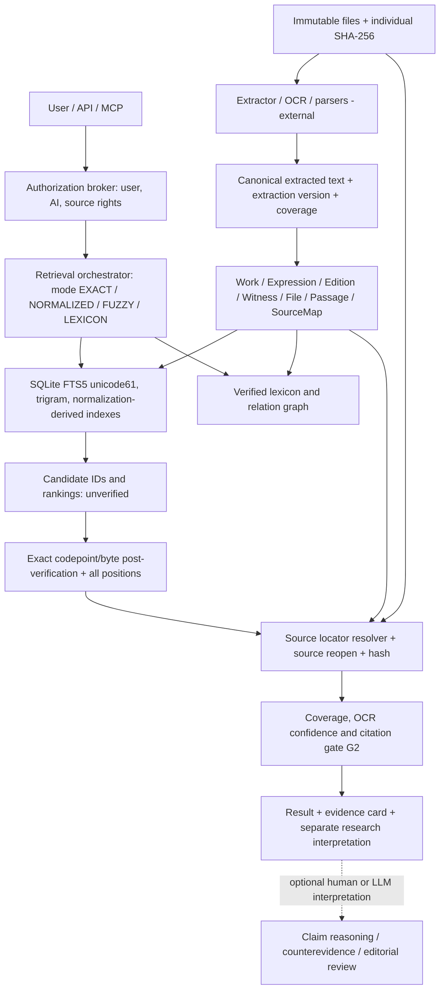

# Technology Assessment — SQLite FTS5 / trigram

> **Mã:** P20 · **Ngày snapshot:** 16/11/2026 (ICT) · **Analyst:** nhóm thẩm định kỹ thuật độc lập, hỗ trợ bởi GPT-6  
> **Đối tượng:** SQLite FTS5 (`unicode61`, `trigram`) — **thành phần thư viện C và chỉ mục SQL**, không phải một search platform, corpus hay bộ OCR.  
> **Phiên bản tài liệu/release kiểm:** SQLite 3.54.1 (16/10/2026; nhánh tính năng mới nhất quan sát được); danh sách lịch sử còn có các bản backport 3.53.6, 3.50.8, 3.44.7 ngày 13/11/2026. **Phiên bản thật đã chạy:** Python 3.13.5 với SQLite **3.46.1** có `ENABLE_FTS5`; không đánh tráo kết quả POC 3.46.1 thành 3.54.1.  
> **Mã nguồn SQLite đã đọc:** mirror `sqlite/sqlite`, `master` tại `1e54a70607cc7f2759ce1709541a282e04ffc0f4` (SHA của commit quan sát; **không khẳng định SHA này là tag 3.54.1**).  
> **BodhiAtlas:** `quoctran-2608/bodhi-atlas` tại `b40aa6c5f79545bef649a1815a1dc32cc9160b04`; **tài sản có sẵn:** `quoctran-2608/BuddhismDocuments-for-AI` tại `dfdd3cbb79e3dbfb49a855702fa00e4bad3b3410`; hai repo public, chưa archived tại thời điểm kiểm.  
> **Phạm vi:** đọc toàn văn PRD V1.4 và *Academic Risks & Verification* qua GitHub connector; đọc chính thức FTS5/WAL/backup/license; inspect mã C, test Tcl SQLite, schema/Python/tests/ADR tài sản hiện hữu; chạy POC 50 query/14 fixture, benchmark tổng hợp 1k/10k passage trong môi trường cô lập. **Không** chạy corpus 13 upstream, không thử PDF/EPUB/Docling/OCR hay 3.54.1, không đo 100k file, không cấp chứng nhận học thuật.  
> **Công cụ:** GitHub connector đọc file/SHA, SQLite docs & source qua web/GitHub, Python `sqlite3`, `regex`, script sinh fixture/benchmark, kiểm tra `PRAGMA compile_options`, `EXPLAIN QUERY PLAN`.

**Quy ước chứng cứ:** `[DOC]` đặc tả/ADR/tài liệu chính thức; `[CODE]` mã đã mở; `[TESTED]` chạy riêng và quan sát output; `[ISSUE]` lỗi/ghi nhận nguồn ngoài; `[INFERRED]` thiết kế/suy luận; `[UNKNOWN]` chưa đo/chưa xác minh. Bằng chứng `TESTED` ở đây **chỉ** áp dụng cho fixture tự sinh và bản SQLite 3.46.1.

## 1. Executive Decision

**Khuyến nghị: USE AS COMPONENT (`COMPONENT` trong bảng tổng hợp). Độ tin cậy: MEDIUM.** SQLite FTS5 là một lựa chọn hợp lý để giữ tầng **code-only lexical retrieval** cục bộ, offline, có khả năng tạo lại từ nguồn, *không phải* bộ máy chứng nhận tính chân thực của câu trích. FTS5 `unicode61` cung cấp phrase/NEAR, BM25 và token search; `trigram` hỗ trợ chuỗi con ba codepoint trở lên. Với BodhiAtlas, nên **mở rộng và sửa có mục tiêu triển khai SQLite/FTS5 đã có trong BuddhismDocuments-for-AI**, chứ không thiết kế song song một index không tương thích.

Để đạt V1 Core, lớp ứng dụng vẫn phải tự làm exhaustive EXACT bằng candidate retrieval **không cắt top-K**, post-verify trên canonical extracted text, truy xuất *mọi* vị trí, map về file/ấn bản/trang/bbox/CFI, coverage và kiểm hash; thêm index/đường tìm Hán văn 1–2 chữ, normalization có phiên bản và quan hệ lexicon theo nghĩa. Retrieval hiện hữu đã biết rõ một số giới hạn: CJK ngắn không được bảo đảm; API `search()` trả top-N; commit SHA của corpus không thay thế SHA-256 của **file nhập**. Vì vậy **gate exhaustive EXACT của hệ thống hiện tại chưa đạt**, dù 50 fixture POC của một pipeline thử nghiệm đã đạt 50/50.

**Ba rủi ro P0:** (1) gắn nhãn `EXACT` cho FTS token match hoặc bỏ sót do limit/chunk/short CJK; (2) dẫn sai ấn bản, locator hoặc tẩy mất dấu/đảo nghĩa từ OCR; (3) SQLite triển khai cũ có rủi ro WAL-reset concurrency và quyền đọc/đưa nội dung sang AI chưa được bảo vệ ở engine. Chỉ phê duyệt tiến bước sau khi 50+ gold queries trên corpus thật, Citation Gate G2 và kiểm version/WAL/ACL đạt.

## 2. Sources & Evidence Ledger

| claim_id | nhận định | mức | URL/permalink | version | ghi chú |
|---|---|---|---|---|---|
| P20-01 | FTS5 là extension full-text của SQLite, có `unicode61`, `trigram` | DOC | https://www.sqlite.org/fts5.html#tokenizers | official live | Không phải sản phẩm OCR |
| P20-02 | `unicode61` phân loại token bằng Unicode categories, mặc định tách punctuation | DOC/CODE | https://www.sqlite.org/fts5.html#unicode61_tokenizer ; https://github.com/sqlite/sqlite/blob/1e54a70607cc7f2759ce1709541a282e04ffc0f4/ext/fts5/fts5_tokenize.c#L350-L530 | master snapshot | Không đồng nhất raw byte |
| P20-03 | `remove_diacritics=1` có góc lỗi Unicode; `2` xử lý nhiều dấu Latin; `0` giữ phân biệt | DOC/CODE | https://www.sqlite.org/fts5.html#unicode61_tokenizer ; https://github.com/sqlite/sqlite/blob/1e54a70607cc7f2759ce1709541a282e04ffc0f4/ext/fts5/fts5_tokenize.c#L350-L415 | snapshot | Không suy ra mapping `đ→d` |
| P20-04 | Trigram chỉ MATCH được chuỗi con >=3 Unicode codepoints; `LIKE/GLOB` ngắn quét bảng | DOC/CODE | https://www.sqlite.org/fts5.html#the_trigram_tokenizer ; https://github.com/sqlite/sqlite/blob/1e54a70607cc7f2759ce1709541a282e04ffc0f4/ext/fts5/fts5_expr.c#L347-L425 | snapshot | CJK 1–2 là blocker riêng |
| P20-05 | Trigram mặc định case-insensitive; `case_sensitive=1` chỉ tối ưu GLOB, không LIKE | DOC/CODE | https://www.sqlite.org/fts5.html#the_trigram_tokenizer ; https://github.com/sqlite/sqlite/blob/1e54a70607cc7f2759ce1709541a282e04ffc0f4/ext/fts5/fts5_tokenize.c#L1270-L1420 | snapshot | Phân biệt MATCH và LIKE |
| P20-06 | `MATCH` phrase/NEAR vận hành theo token, không đồng nghĩa exact punctuation/newline | DOC/CODE | https://www.sqlite.org/fts5.html#full_text_query_syntax ; https://github.com/sqlite/sqlite/blob/1e54a70607cc7f2759ce1709541a282e04ffc0f4/ext/fts5/fts5_expr.c | snapshot | Cần post-verify |
| P20-07 | `bm25()` thấp hơn là tốt hơn, không phải xác suất luận đề đúng | DOC | https://www.sqlite.org/fts5.html#the_bm25_function | live | Ranking chỉ phục vụ retrieval |
| P20-08 | FTS5 có `highlight()`, `snippet()`, `xInstCount/xInst` token offsets, không phải `offsets()` kiểu FTS3/4 hay PDF bbox | DOC/CODE | https://www.sqlite.org/fts5.html#built_in_auxiliary_functions ; https://github.com/sqlite/sqlite/blob/1e54a70607cc7f2759ce1709541a282e04ffc0f4/ext/fts5/fts5_aux.c#L124-L310 | snapshot | Position ≠ source map |
| P20-09 | `detail=none/column` đánh đổi vị trí, phrase/NEAR và hiệu suất API occurrences | DOC | https://www.sqlite.org/fts5.html#the_detail_option | live | Không bật mù quáng |
| P20-10 | External content index cần đồng bộ row/trigger/rebuild, lệch có thể trả kết quả bất nhất | DOC | https://www.sqlite.org/fts5.html#external_content_table_pitfalls | live | Transaction + integrity-check |
| P20-11 | WAL cho nhiều reader/1 writer; lỗi WAL-reset đã vá từ 3.51.3 | DOC | https://www.sqlite.org/wal.html#the_wal_reset_bug | 2026-03/08 | Runtime POC 3.46.1 ở khoảng rủi ro |
| P20-12 | SQLite core/code deliverable thuộc public domain | DOC | https://www.sqlite.org/copyright.html | live | Không áp dụng cho 13 corpus |
| P20-13 | PRD yêu cầu 2 chế độ, EXACT/NORMALIZED/FUZZY/LEXICON, file hash và locator | DOC | https://github.com/quoctran-2608/bodhi-atlas/blob/b40aa6c5f79545bef649a1815a1dc32cc9160b04/docs/PRD.md | V1.4 | Đọc đủ 398 dòng Markdown |
| P20-14 | R01/R05/R07/R24 và G1–G6 yêu cầu không giả độ bao phủ/provenance | DOC | https://github.com/quoctran-2608/bodhi-atlas/blob/b40aa6c5f79545bef649a1815a1dc32cc9160b04/docs/ACADEMIC_RISKS_AND_VERIFICATION.md | 1.0, 15/11/2026 | Đọc đủ 239 dòng Markdown |
| P20-15 | BCR đã dùng `records_fts` unicode61, `records_cjk_fts` trigram | CODE | https://github.com/quoctran-2608/BuddhismDocuments-for-AI/blob/dfdd3cbb79e3dbfb49a855702fa00e4bad3b3410/schema/corpus-index.sql | BCR snapshot | Không được đề xuất “thêm FTS5 lần đầu” |
| P20-16 | BCR hiện dựng lại CJK từ `compact(raw_text)`, kiểm version, có `LIMIT max(limit*5,50)` candidate | CODE | https://github.com/quoctran-2608/BuddhismDocuments-for-AI/blob/dfdd3cbb79e3dbfb49a855702fa00e4bad3b3410/tools/corpus_research/index.py#L1385-L1560 ; https://github.com/quoctran-2608/BuddhismDocuments-for-AI/blob/dfdd3cbb79e3dbfb49a855702fa00e4bad3b3410/tools/corpus_research/retrieval.py#L270-L390 | snapshot | **Không exhaustive** |
| P20-17 | BCR `fold_diacritics()` chưa ánh xạ `đ/Đ`→`d/D`; chuỗi dài CJK bỏ một số field dẫn xuất | CODE | https://github.com/quoctran-2608/BuddhismDocuments-for-AI/blob/dfdd3cbb79e3dbfb49a855702fa00e4bad3b3410/tools/corpus_research/model.py#L10-L64 | snapshot | Cần test/bản đồ offset |
| P20-18 | BCR ADR-0003 nhận diện giới hạn CJK ngắn; ADR-0008 cấm materialize 45M trigram thành từ điển production | DOC | https://github.com/quoctran-2608/BuddhismDocuments-for-AI/blob/dfdd3cbb79e3dbfb49a855702fa00e4bad3b3410/docs/adr/0003-use-language-sensitive-lexical-retrieval.md ; https://github.com/quoctran-2608/BuddhismDocuments-for-AI/blob/dfdd3cbb79e3dbfb49a855702fa00e4bad3b3410/docs/adr/0008-do-not-materialize-cjk-trigram-vocabulary-in-production.md | 2026-10-06 | Số đo là của tài sản BCR, không phải POC này |
| P20-19 | BCR có tests CJK/normalization, nhưng sự tồn tại test file không phải test mới chạy | CODE | https://github.com/quoctran-2608/BuddhismDocuments-for-AI/blob/dfdd3cbb79e3dbfb49a855702fa00e4bad3b3410/tests/test_cjk_substring_search.py ; https://github.com/quoctran-2608/BuddhismDocuments-for-AI/blob/dfdd3cbb79e3dbfb49a855702fa00e4bad3b3410/tests/test_normalization.py | snapshot | Không đánh dấu TESTED |
| P20-20 | POC 50 query, 14 fixture, 77 exact occurrences: 50/50 exhaustive và 50/50 normalized document hits | TESTED | `§9` và `§13` của báo cáo này | SQLite 3.46.1 | Ground truth từ scan raw độc lập; **không thử corpus thật** |
| P20-21 | `unicode61` đơn lẻ bỏ sót ít nhất 8/50 fixture query có exact hits | TESTED | `§9` — case IDs 29–35,46 | SQLite 3.46.1 | Có CJK middle substring, `ana` bên trong token |
| P20-22 | Synthetic 1k/10k passage chiếm 6.43/52.05 MiB, latency và build đo riêng | TESTED | `§5.7` — log giả lập | SQLite 3.46.1 | Không ngoại suy thành cam kết production |
| P20-23 | `pg_trgm` hỗ trợ similarity và GIN/GiST, nhưng cũng không cấp source-map | DOC/INFERRED | https://www.postgresql.org/docs/current/pgtrgm.html | PostgreSQL 18 docs | Cần service/DB vận hành |
| P20-24 | OpenSearch có configurable `ngram` tokenizer | DOC | https://docs.opensearch.org/latest/analyzers/tokenizers/ngram/ | docs current | Không tự giải quyết evidence/ACL |
| P20-25 | Quyền code repo BCR và licenses từng upstream chưa được audit đến mức pháp lý phân phối | UNKNOWN | https://github.com/quoctran-2608/BuddhismDocuments-for-AI ; https://github.com/quoctran-2608/BuddhismDocuments-for-AI/blob/dfdd3cbb79e3dbfb49a855702fa00e4bad3b3410/manifest.json | snapshot | Không thấy LICENSE tại root tree, **không suy ra MIT** |

**Mã nguồn chính đã inspect:** `fts5_tokenize.c`, `fts5_expr.c`, `fts5_index.c`, `fts5_aux.c`, `fts5_main.c`; tests `fts5trigram.test`, `fts5unicode.test`, `fts5aux.test` thuộc `ext/fts5/test/`; BCR `index.py`, `retrieval.py`, `model.py`, `schema/corpus-index.sql`, `tests/test_cjk_substring_search.py`, `tests/test_normalization.py`, `tests/test_corpus_integration.py`, các ADR 0002/0003/0008. Mọi link C trên `master` chỉ chứng minh snapshot mã đọc, không tự chứng minh hành vi nhị phân 3.46.1 hay tag release 3.54.1.

## 3. Architecture & Data Flow



- **Immutable authority:** byte file đầu vào + SHA-256; đối với 13 upstream git, giữ *thêm* repo commit SHA và blob SHA, không nhập nhằng thành SHA-256 file PDF.
- **Derived, có thể rebuild:** parse/OCR output (phiên bản hóa), normalized view và char alignment map, FTS inverted index, ranking, result cache. **Không** ghi đè raw extraction để bỏ dấu.
- **State có thẩm quyền:** catalog Work/Edition/Witness và lexicon được người duyệt; citation/card có trạng thái; ACL policy. Không coi FTS shadow table là kho nguồn.
- **Không bắt buộc LLM:** ingest cơ bản (OCR có thể dùng model OCR phi-LLM), FTS query, fuzzy candidate, lexicon confirmed relations, exact verification, source reopen và citation technical gate. **Không thể tự động bảo đảm bằng FTS:** tác giả có *tán thành* điều được thuật lại không, lập luận của họ có hỗ trợ luận đề không; G3 cần người nghiên cứu/AI hỗ trợ và phê duyệt độc lập.

## 4. Feature Fit–Gap Matrix

Trạng thái là **đúng vai trò của FTS5**, không phải điểm cho cả hệ thống. `CONFIG` = cấu hình SQLite/FTS5; `EXTENSION` = tự lập trình trên SQLite; `EXTERNAL` = phụ thuộc pipeline khác; `N/A` nếu năng lực không thuộc thành phần (vẫn có tác động tích hợp).

| ID | Năng lực | State | Chứng cứ | Tác động / khoảng trống | Công sức bù (ước lượng) | Phương án bù |
|---|---|---|---|---|---|---|
| C01 | Multi-format ingest | EXTERNAL | PRD §3; FTS5 docs | FTS5 không đọc PDF/EPUB/DOCX | High (ở toàn pipeline) | Parser/OCR/adapters + versioned payload |
| C02 | OCR/layout/reading order | EXTERNAL | R01–R06; FTS5 tokenizer docs | OCR 2 cột/chú thích sai làm sai retrieval | High | Extraction + page/region QA, manual review |
| C03 | Canonical text & source map | EXTENSION | PRD §5; schema BCR | FTS không giữ bbox/CFI/offset origin | High | Canonical+SourceSpan+offset map riêng |
| C04 | Works/editions/witnesses | EXTENSION | BCR `works`, `records`; PRD §2 | BCR có work/witness nhưng thiếu đủ V1 ontology | Medium–High | Schema quan hệ chuẩn, edition/file IDs |
| C05 | Exhaustive EXACT | EXTENSION | FTS5 trigram; BCR `search()` LIMIT | **Chưa bảo đảm; không dùng FTS MATCH trực tiếp làm EXACT** | High | No top-K + post-verify all occurrences + across-boundary |
| C06 | Normalized multilingual | CONFIG + EXTENSION | unicode61/trigram; BCR `model.py` | đ, giản/phồn, Tạng/Wylie không native đồng nhất | Medium–High | Separate index/analyzers + rules/versioning |
| C07 | Fuzzy/OCR near-duplicate | EXTENSION | trigram candidate ≠ edit distance | Không native paragraph alignment/OCR correction | Medium–High | N-gram candidates + edit distance/MinHash, diff |
| C08 | Sense-aware lexicon | EXTERNAL | PRD §2.4; BCR relations/lemmas | Tokenizer không có nghĩa từng từ | High (lexicon data) | Verified sense IDs, attested relations |
| C09 | Semantic/hybrid/RAG | N/A | PRD Chế độ 2 | V1 core không bắt buộc | N/A | Optional embeddings/plugin elsewhere |
| C10 | Verified citation & reopen | EXTENSION | G2; FTS5 xInst != bbox | Search hits có thể không kiểm được file/trang | High | Resolvers + hash + locator/coverage gates |
| C11 | Note/wiki/claim memory | N/A | PRD §6.2; BCR ResearchStore | Vai trò search index, không phải memory | N/A | BCR store / catalog module |
| C12 | API/MCP/export/integration | EXTENSION | BCR CLI/Connector; SQLite C/Python API | SQLite không tự cung cấp multi-tenant HTTP | Medium | Search service/broker + pointer schema |
| C13 | Coverage + incremental | EXTENSION | FTS5 rebuild; BCR source state | Không tự biết PDF thiếu trang; rebuild CJK toàn phần hiện hữu | Medium–High | SHA/version/changelog + per-page state + queue |
| C14 | Auth/licensing/privacy & backup | EXTERNAL | WAL/backup docs; R24, R27 | File SQLite không làm RBAC/audit/export policy | Medium–High | Auth gateway, ACL per resource, online backup |
| C15 | Operational simplicity / deploy | NATIVE | SQLite single-file/offline docs; ADR-0002 | Lợi thế local; vẫn phải vận hành backup/migration | Low–Medium | Embed library, pin binary and test concurrency |

**Không cộng điểm.** Một gate C05/C10 thất bại sẽ chặn trích dẫn công bố dù C15 tốt.

## 5. Deep Technical Findings

### 5.1. `unicode61`: tokenization, phrase, NEAR, BM25

- `[DOC/CODE]` `unicode61` là tokenizer mặc định FTS5, dựa Unicode 6.1 categories: letters/numbers và một số category riêng là token; space/punctuation tách token. `tokenchars`/`separators` thay cách phân đoạn, `categories` điều chỉnh nhóm, `remove_diacritics=0/1/2`. `remove_diacritics=1` có bug trường hợp codepoint Latin chứa >1 dấu; `=2` khắc phục trường hợp đó; hai chế độ bỏ dấu đều **không tạo quan hệ lexicon** và không thay raw. Mã: `fts5_tokenize.c` `fts5UnicodeCreate()`, `fts5UnicodeTokenize()`.
- `[DOC]` FTS syntax: `MATCH '"alpha beta"'` là chuỗi **token** liên tiếp, kể cả nếu raw là `alpha.beta`; `NEAR(alpha beta, N)` nói về khoảng cách token; `AND`, `OR`, `NOT`, column filters, prefix; không thay cho substring raw. Query do người dùng nhập phải đặt trong parameter `?`, escape nháy nếu định tạo FTS phrase expression, kiểm soát operators, không truyền trực tiếp SQL.
- `[TESTED]` POC riêng: row chứa `A.B/C`; unicode61 `MATCH '"A B C"'` trả 1 dù raw **không chứa** `A B C`. `"vo thuong"` không match raw `vô thường` khi `remove_diacritics 0`; `nibbana` không match `nibbāna` không có normalized field. `MATCH '"無我"'` có thể khớp tại token boundary, nhưng query Hán con ở *giữa* chuỗi `如是我聞` dễ rơi khỏi candidate.
- `[DOC]` `bm25(table, weights...)` giá trị thấp hơn là ranked tốt hơn; có thể gán trọng số cột raw, normalized, title, lemma; ranking không là confidence of truth và không phù hợp làm tiêu chí dừng exhaustive. Lệnh `snippet(table,col,'[',']','…',N)` giới hạn 1–64 token; `highlight(table,...)` có thể bọc các token match; **cả hai đều không trả PDF bbox**.
- `[DOC/CODE]` FTS5 có API phụ trợ `xInstCount`, `xInst`, `xPhraseFirst/Next`, trả `(phrase_id, column_id, token_offset)`, có thể liệt kê *token occurrences của MATCH trên mỗi row*. **Không có hàm SQL built-in `offsets()` tương thích FTS3/4**; muốn byte start/end phải re-tokenize qua xTokenize callbacks (mã `fts5_aux.c`) hoặc search raw Python/C để lấy offsets. Token offset và char/byte/grapheme offset phải lưu khác đơn vị; không được coi số token là vị trí trang.

### 5.2. `trigram`: index substring và giới hạn cứng

- `[DOC/CODE]` Tokenizer trigram dùng 3 **Unicode codepoints liên tiếp** (không bảo đảm ba grapheme). `MATCH '"abcde"'` cho substring năm ký tự; có thể qua whitespace/punctuation. Text/chunk ngắn hơn 3 codepoints hoặc query `<3` không có trigram MATCH. `LIKE/GLOB` có wildcard literals dưới 3 ký tự thì fallback full-scan, **không phải zero matches** như MATCH. Mã `fts5_tokenize.c` `fts5TriCreate()/fts5TriTokenize()`; `fts5_expr.c` `sqlite3Fts5ExprPattern()`.
- `[DOC]` Mặc định `case_sensitive=0`, `remove_diacritics=0`. Nếu bật `remove_diacritics=1`, FTS trigram không tối ưu LIKE/GLOB; `case_sensitive=1` tối ưu `GLOB` nhưng **không** `LIKE`. `detail=none/column` tiết kiệm đĩa nhưng với `MATCH` token truy vấn dài hơn ba Unicode ký tự bị giới hạn; `phrase/NEAR` và position APIs bị vô hiệu/chậm theo chế độ. Với exhaustive EXACT nên ưu tiên `detail=full` khi cần vị trí, hoặc tách index `detail=none` chỉ phục vụ n-gram prefilter cùng post-scan; xác minh mọi thay đổi qua POC.
- `[TESTED]` `EXPLAIN QUERY PLAN` bản 3.46.1 cho `trigram` mặc định và `LIKE '%A.B%'` có virtual index `L0` (đủ 3 literal), `LIKE '%如%'` cũng báo nhánh `L0` **nhưng thực tế docs nói scan tất cả**, vì thiếu gram 3; không dùng plan string đơn lẻ để tuyên bố index có lọc thực. `case_sensitive=1` với `LIKE` không được tối ưu. Cần lệnh lặp đo đọc I/O trên build thật.
- `[DOC]` FTS5 token tối đa 32.768 **bytes**, dài hơn có thể bị truncate âm thầm, kể cả giữa một UTF-8 codepoint. Query câu cực dài cần chunk prefilter rồi verify toàn chuỗi; không dựa MATCH dài để khẳng định exhaustive.

### 5.3. EXACT theo byte, codepoint, grapheme; dấu câu, newline, multi-page

Đề nghị contract bắt buộc chọn rõ `exact_unit` và `whitespace_policy`:

1. **`EXACT_RAW_UTF8`**: so sánh chuỗi UTF-8 *của canonical extracted text* cùng byte value và boundary; `NFC` vs `NFD`, uppercase và ký tự `\n` khác nhau là **khác**. Không phải tìm chuỗi trong binary bytes của PDF (PDF thường nén/mã hóa glyph). Với chuỗi UTF-8 hợp lệ, post-verify theo decoded Unicode codepoints bảo toàn cùng chuỗi bytes, nhưng output offset phải chuyển về UTF-8 bytes từ raw prefix; cần kiểm grapheme boundaries khi hiển thị.
2. **`EXACT_UNICODE_SCALAR`**: so sánh codepoint sequence nguyên trạng (Python `str.find`, có thể nhận match nằm giữa grapheme nếu query là riêng dấu kết hợp). Nếu giao diện yêu cầu grapheme-aligned thì chỉ nhận khi đầu/cuối match là boundary `\X` theo Unicode segmentation profile đã pin; không đồng nhất với byte substring.
3. **`NORMALIZED`**: có phép biến đổi ghi nhãn rõ `NFC/casefold/strip-diacritic/đ→d/whitespace/punct` theo profile, cần alignment map normalized index span → raw range; không được trả normalized excerpt như nguyên văn.
4. **Punctuation/newline**: `"a.b"` vs `"a b"`, `"an\natta"` vs `"anatta"` phải tách theo mode. Long quote xuyên 2 chunk/trang có thể kiểm qua logical document text **nếu parser tạo continuous reading-order và source map nhiều spans**; nếu ghép tùy tiện thành câu không tồn tại, phải từ chối `EXACT`.
5. **Full occurrences**: candidate row set phải là supersets of all raw matches; quét mọi occurrence **kể cả chồng lấn** (`ana` trong `anana` xuất hiện 2 lần), trả byte/codepoint ranges, trang và file, phân trang với continuation token nhưng tổng đầy đủ kiểm được; không cắt bởi `LIMIT` xếp hạng. Với 1–2 ký tự: thêm inverted unigram/bigram hoặc bounded scan có warning rõ; không gọi `0` là không có nguồn.

**POC baseline cần dùng cho V1**: `trigram case_sensitive 1 MATCH` với query >=3 và post-verify all `raw_text.find(query,start)`; dưới 3 ký tự phải đi đường khác có chứng minh complete; `normalized` tìm trên derived index riêng kèm mapping. `FTS candidate` **chưa phải** verified citation. `[TESTED]` 50 query mock corpus, 77 occurrences (trong §9) chỉ chứng minh thuật toán trên fixture, không chứng minh exhaustive với 13 upstream/full pages.

### 5.4. Schema tối giản đề xuất cho V1 — tương thích, không phá schema BCR

Đây là **schema đề xuất `[INFERRED]`, chưa migration và chưa benchmark**; keys là opaque UUID/text hoặc integer ổn định, tách metadata theo các cấp thay vì gộp Work=File.

```sql
PRAGMA foreign_keys=ON;
CREATE TABLE work(work_id TEXT PRIMARY KEY,title TEXT NOT NULL);
CREATE TABLE expression(expression_id TEXT PRIMARY KEY,
  work_id TEXT NOT NULL REFERENCES work(work_id),lang TEXT,translator TEXT);
CREATE TABLE edition(edition_id TEXT PRIMARY KEY,
  expression_id TEXT NOT NULL REFERENCES expression(expression_id),
  publisher TEXT,publication_year TEXT,printed_page_scheme TEXT);
CREATE TABLE witness(witness_id TEXT PRIMARY KEY,
  edition_id TEXT NOT NULL REFERENCES edition(edition_id),kind TEXT,metadata_json TEXT);
CREATE TABLE source_file(file_id TEXT PRIMARY KEY,
  edition_id TEXT NOT NULL REFERENCES edition(edition_id),
  witness_id TEXT REFERENCES witness(witness_id), uri TEXT NOT NULL,
  sha256 TEXT NOT NULL CHECK(length(sha256)=64),media_type TEXT NOT NULL,
  rights_policy_id TEXT NOT NULL, immutable INTEGER NOT NULL DEFAULT 1);
CREATE TABLE extraction(extraction_id TEXT PRIMARY KEY,
  file_id TEXT NOT NULL REFERENCES source_file(file_id),
  parser_version TEXT NOT NULL,profile TEXT NOT NULL,
  coverage_status TEXT NOT NULL,version_hash TEXT NOT NULL);
CREATE TABLE passage(passage_id INTEGER PRIMARY KEY,
  stable_passage_id TEXT NOT NULL UNIQUE,
  extraction_id TEXT NOT NULL REFERENCES extraction(extraction_id),
  seq_no INTEGER NOT NULL,raw_text TEXT NOT NULL,
  lang TEXT,role TEXT NOT NULL DEFAULT 'main',
  UNIQUE(extraction_id,seq_no));
CREATE TABLE source_span(span_id INTEGER PRIMARY KEY,
  passage_id INTEGER NOT NULL REFERENCES passage(passage_id),
  raw_cp_start INTEGER NOT NULL,raw_cp_end INTEGER NOT NULL,
  pdf_page_index INTEGER,bbox_json TEXT,printed_page_label TEXT,
  epub_href TEXT,epub_cfi TEXT,docx_path TEXT,md_heading_path TEXT,
  locator_status TEXT NOT NULL, CHECK(raw_cp_end>=raw_cp_start));
CREATE TABLE normalized_passage(passage_id INTEGER NOT NULL REFERENCES passage(passage_id),
  profile_id TEXT NOT NULL,norm_text TEXT NOT NULL,
  alignment_blob BLOB NOT NULL,PRIMARY KEY(passage_id,profile_id));
CREATE TABLE coverage(extraction_id TEXT NOT NULL REFERENCES extraction(extraction_id),
  location_key TEXT NOT NULL,status TEXT NOT NULL,ocr_confidence REAL,
  note TEXT,PRIMARY KEY(extraction_id,location_key));
CREATE VIRTUAL TABLE passage_word_fts USING fts5(
  raw_text,content='passage',content_rowid='passage_id',
  tokenize='unicode61 remove_diacritics 0');
CREATE VIRTUAL TABLE passage_trigram_fts USING fts5(
  raw_text,content='passage',content_rowid='passage_id',
  tokenize='trigram case_sensitive 1');
CREATE VIRTUAL TABLE passage_norm_fts USING fts5(
  norm_text,content='normalized_passage',content_rowid='passage_id',
  tokenize='trigram'); -- Chỉ hợp lệ nếu một profile/rowid; tách bảng theo profile trong production.
```

**Cảnh báo design:** `passage_norm_fts` minh họa chỉ đúng khi có *một profile duy nhất với một rowid/passage*. Nhiều profile phải dùng `normalized_doc_id` riêng hoặc nhiều FTS virtual tables, vì `(passage_id,profile_id)` không thể map trực tiếp qua một `content_rowid`. `source_span` phải liên kết được một raw range tới **nhiều** bbox/trang và có validation spans không trùng sai; JSON bbox gồm page, rect, coordinate system, rotation; EPUB locator dựa đúng rendition/file revision. Trước khi migrate, định nghĩa thuật toán stable_passage_id và nhánh `RELOCATE_REQUIRED` khi parser thay đổi.

**Incremental correctness:** External-content FTS cần `AFTER INSERT/DELETE/UPDATE` triggers phù hợp hoặc commit migration rebuild atomically; current BCR uses batch `INSERT ... ('rebuild')` cho `records_fts`, `delete-all` + repopulate CJK. Incremental BCR source rows có version check, **nhưng CJK FTS vẫn rebuild toàn bộ khi chạy `rebuild_search_indexes()`**; tối ưu per-source/row cần thiết nếu 100k file. Thử `INSERT INTO passage_word_fts(passage_word_fts) VALUES('integrity-check')` sau rebuild; `PRAGMA integrity_check`, count cross-check và lookup golden identifiers. FTS shadow tables không được chỉnh sửa thủ công.

### 5.5. Đối chiếu chính xác code BCR đã có

- `[CODE]` `schema/corpus-index.sql`: các bảng `source_state`, `search_index_state`, `works`, `records`, `relations`, `variants`, `lemmas`; FTS5 `records_fts(... content='records', content_rowid='id', tokenize='unicode61 remove_diacritics 0')`; `records_cjk_fts(search_text, content='', tokenize='trigram')`.
- `[CODE]` `index.py`: 13 source builders/pins; index CJK từ `compact(raw_text)`, chỉ `language IN ('lzh','zh')`, ghi version `2026-09-23.cjk-trigram-v1`; có provenance `source_path` + upstream `source_sha`; rebuild full khi cuối build. `source_sha` ở đây là **Git source commit pin**, không phải SHA-256 bytes của file PDF người dùng.
- `[CODE]` `retrieval.py#search`: FTS sinh candidate `ORDER BY bm25 LIMIT max(limit*5,50)`; CJK cũng capped; `results=ranked[:limit]`, `result_count=min(len(ranked),limit)`, `fail_closed=not ranked`. Đây là **search top-N explorer**, không phải endpoint `EXACT_ALL_OCCURRENCES`. Nếu `len(candidate)>cap`, false negative vì cắt trước post-verify; `fail_closed` cũng không diễn đạt toàn bộ coverage.
- `[CODE]` `model.py#fold_diacritics`: `NFKD + bỏ combining`, không map `đ/Đ→d`, nên `dao` không tự khớp `Đạo`; `compact` xóa punctuation/spacing, bản raw vẫn nguyên. Với `language IN ('lzh','zh','bo')` và đoạn >=2000 ký tự, `norm_text`/`folded_text` được đặt `''`; đây là optimization hợp lý về storage **nhưng search normalized phải có đường khác có coverage**.
- `[CODE]` ADR-0002/0003/0008 đã chốt SQLite derived local; CJK <3 không guaranteed; đã đo *vocabulary* 45,740,699 tokens (45,721,159 có CJK) và **không** materialize thành production lexicon; con số 0,88–1,55 TB trong ADR là ngoại suy pointer output lịch sử, **không phải database FTS5 hiện tại**. Không vô hiệu hóa quyết định đó trong tích hợp mới.
- `[DOC/CODE]` README tuyên bố 13 upstream pin và pipeline source resolver Bilara/CBETA/84000; các test corpus integration có điều kiện skip nếu thiếu nguồn. **Lượt nghiên cứu này không tải upstream và không chạy BCR suite**; không tuyên bố `410/410` từ README là kết quả tự test hay chứng nhận học thuật. Một bộ resolver TEI/JSON khác không tự động giải PDF bbox/EPUB CFI của BodhiAtlas.

### 5.6. WAL, transactions, backup, integrity, concurrency

- `[DOC]` WAL cho phép reader + writer đồng thời, nhưng tối đa **một writer**; không phù hợp nhiều concurrent write clients qua network filesystem chia sẻ. `busy_timeout`, `BEGIN IMMEDIATE`, batch append và checkpoint policy; backup qua SQLite Online Backup API (`Connection.backup()` trong Python), không tùy tiện sao chép `db` đơn lẻ khi WAL đang mở. Dùng restore drill và `integrity_check` sau khôi phục.
- **P0 phiên bản:** hướng dẫn WAL của SQLite công bố lỗi **WAL-reset** có thể corrupt database trong race hai writer/checkpointer, ảnh hưởng từ 3.7.0 tới 3.51.2 và fix từ **3.51.3** (có backports). Python 3.13.5 trong POC liên kết **3.46.1**, nằm trong khoảng bị ảnh hưởng. **Không sử dụng 3.46.1 WAL nhiều connection trong production**; pin binary đã vá (ví dụ 3.54.1) và regression test trên chính binary đó. POC hiện tại dùng in-memory hoặc `journal_mode=DELETE`, không tự chứng nhận WAL.
- `[DOC]` SQLite 3.54.1 là patch release 16/10/2026; lịch sử còn backport 3.53.6, 3.50.8, 3.44.7 ngày 13/11/2026. Không gọi nhầm bản backport là nhánh tính năng cao nhất. Kiểm release/checksum/dynamic linked version trước deploy. `sqlite3_compileoption_used('ENABLE_FTS5')` hoặc `PRAGMA compile_options` trước bootstrap.

### 5.7. Memory, latency, storage — số đo minh bạch và scenario

**[TESTED] Synthetic micro-benchmark:** random seed `20261116`; mỗi passage 75 token ngẫu nhiên (~824 byte UTF-8), mỗi 100 passage có `anattā 無我 vô thường`; 2 FTS external-content indexes word/trigram; SQLite 3.46.1, một process/connection, `journal_mode=DELETE`, 75 query per size (10 loại, cả hit và miss), cache máy đo không kiểm soát; **không phản ánh PDF hay 13 corpus**.

| Dataset (số passage, **không** số file) | DB cả raw+2 FTS | Build lúc insert/rebuild | Query p50 | Query p95 | Peak process RSS (cộng dồn process) |
|---|---:|---:|---:|---:|---:|
| 1.000 × ~824 B | **6,43 MiB** | **0,343 s** | **0,07 ms** | **4,37 ms** | ~102 MiB |
| 10.000 × ~824 B | **52,05 MiB** | **4,08 s** | **0,30 ms** | **45,35 ms** | ~110 MiB |

RSS trên là **`ru_maxrss` của cùng process Python**, gồm interpreter + toàn bộ benchmark, **không** là RAM FTS5 riêng. Build dùng rebuild toàn indexes, không phải incremental ingest; không đo concurrent/cold-cache/SSD khác. Trigram storage lớn với random 10-letter tokens (vocabulary đa dạng); tài liệu Hán/Pāli và chunking tạo đặc tính khác. Đặc biệt p95 phụ thuộc selectivity của anchors và số candidate phải post-verify; không lấy p50 làm SLA.

**Scenario 1.000/10.000/100.000 file [INFERRED, NOT TESTED]:** giả định mỗi file tạo 20 passages, mỗi passage 2 KiB extracted text, *chưa tính OCR ảnh/file gốc/source-map*. Raw tương ứng khoảng **39 MiB / 391 MiB / 3,81 GiB**; số index/page/overhead chưa có hệ số đáng tin trên corpus thật. Chạy POC 100–1.000 **file thật đa định dạng** để đo multiplier `DB_bytes / raw_utf8_bytes`, độ dài passage p50/p95/p99, count trigram, FTS duplication, maps, build time, and recall. Không ước lượng GPU (FTS5 chỉ CPU), không bịa năng lực 100k file từ microbenchmark 10k rows. Số mục lục/PDF pages có thể lớn hơn 20 passages/file hàng chục lần.

### 5.8. Unicode và failure modes có liên quan

- `[TESTED]` `ngã` query ba codepoints được trigram candidate; `無我` hai codepoints phải scan/fallback; `如是` ở giữa token Hán dài bị unicode61 bỏ lỡ trong fixture. `ana` trong `anana` có overlapping occurrences, FTS `MATCH '"ana"'` không tìm nó khi tokenized whole word. POC ghi rõ IDs.
- `[INFERRED]` OCR 2 cột đảo thứ tự gây false phrase, footnote nhập vào chính văn gây ngữ nghĩa sai; file PDF page 50 có thể là trang in 37; EPUB reflow làm số “trang” không ổn định; HTML text normalization thay source locators. FTS không sửa được nguồn; luôn đưa region/page/raw text status vào result.
- `[INFERRED]` Trích câu chứa phủ định rồi xén bằng `snippet()` có thể đảo lập luận; source role *author quote / citation by author / rejection of claim* phải được semantic review, không suy ra từ rank.

## 6. Source Fidelity & Provenance

**Cổng chứng cứ: chưa thể chấm PASS end-to-end; component FTS5 là N/A cho geolocator, nhưng tích hợp hiện hữu cần mở rộng rõ ràng.**

1. **Immutable source:** lưu bytes gốc (content-addressable URI `sha256:<64 hex>`), trạng thái quyền; cùng một Work có nhiều Expression/Edition/Witness/File. File SHA-256 là bytes file; Git commit/blob SHA của 13 upstream là provenance riêng, không thay thế file hash. Parser version và source hash xác định bản extracted text, không thay source gốc.
2. **Canonical extracted raw:** lưu `raw_text` không bị fold, chia theo passage với ổn định text-role, sequence, char/byte lengths; `raw_text` có thể lỗi OCR, không nâng tự động thành chính văn đã xác minh. Các normalized strings/embeddings/FTS là derived và có transform manifest.
3. **Source locator:** PDF: `file_id`, `pdf_page_index` 0-based, `printed_page_label` chỉ sau khi kiểm, bbox `[x0,y0,x1,y1]` với page coordinate system/rotation, page text range. EPUB: spine href + CFI/anchor + rendition version; DOCX: para/run path và/hoặc bookmark; MD: byte range/path/heading anchor và file hash. Cần một `source_span` cho mỗi phần quote đi qua nhiều layout regions, không gán một bbox tưởng tượng cho nhiều trang.
4. **Reopen/re-verify:** (i) kiểm `sha256(file_bytes)`, (ii) đọc đúng Edition/File và parser profile/locator, (iii) đối chiếu raw quote, role, context ±N đoạn, (iv) nếu OCR hoặc locator yếu thì `TEXT_ONLY` hoặc `OCR_NEEDS_REVIEW`, **không** `TEXT_AND_LOCATOR_VERIFIED`; khi parser thay đổi phải thử relocate bằng anchors và buộc review nếu không xác định được.
5. **Coverage âm tính:** trang `READY`, `OCR_UNCERTAIN`, `PARTIAL`, `NOT_INDEXED`, `SOURCE_UNAVAILABLE` và page/segment coverage manifest; search trả `0` chỉ là **no hit in checked scope**, kèm exclusions. `G1` chặn ready giả; `G2` chặn trích chưa khớp; G3 đánh giá học thuật tách riêng.

**Phiếu truy nguyên nguồn tối thiểu (JSON contract đề xuất):**

```json
{
  "work_id":"W...", "expression_id":"X...", "edition_id":"E...",
  "witness_id":"WT...", "file_id":"F...", "file_sha256":"64 lowercase hex",
  "extraction_id":"EX...", "passage_id":"P...", "source_role":"main|note|quote|translation",
  "quotation_raw":"exactly extracted substring", "raw_byte_range":[0,0],
  "raw_codepoint_range":[0,0], "match_type":"EXACT", "transform_profile":null,
  "locators":[{"type":"pdf","page_index":0,"printed_page_label":null,"bbox":null}],
  "coverage_status":"PARTIAL", "ocr_status":"REQUIRES_REVIEW",
  "technical_verification":"TEXT_ONLY", "claim_assessment":"NOT_ASSESSED",
  "checked_scope":{"file_ids":["F..."],"excluded_pages":[]},
  "limitations":["example only; positions are placeholders, not a real citation"]
}
```

Đây là **contract minh họa**, không tạo câu trích hay số trang thật. Trong dữ liệu production, không chấp nhận các placeholder `...`, null locator phải dẫn tới trạng thái chưa xác minh; `quote_raw` phải được trích **sau** bước verify. Quyền của user và AI được kiểm tra khi lấy từng `source_span`/file; ủy quyền của host không đồng nghĩa người dùng cho phép đưa toàn văn lên cloud.

## 7. Multilingual & Retrieval Behavior

| Mode / hệ chữ | FTS5 native | BodhiAtlas phải tự viết / nguồn cần | Kết quả & kiểm chứng |
|---|---|---|---|
| EXACT Latin/Pāli/Sanskrit | `trigram` >=3 cp tạo candidate; `unicode61` token | `raw` byte/codepoint verifier, repeated spans, 1–2 fallback | `EXACT` chỉ sau literal verification; NFD ≠ NFC |
| NORMALIZED Vietnamese | `unicode61 remove_diacritics=1/2` hữu ích Latin | Separate `NFKD/casefold/đ→d`, punctuation/whitespace profiles + position map | `vo thuong` có thể về `vô thường`, **không được gắn EXACT** |
| FUZZY/OCR | substring candidates | Edit distance/phonetics/line diff, thresholds, full-text contexts | `FUZZY` + diff, chưa chứng minh học thuật |
| LEXICON đa nghĩa | FTS search surface | Sense IDs, dịch/đồng nghĩa có điều kiện, verified links + evidences | `anatta` ≠ tự động `anātman/無我/vô ngã` |
| SEMANTIC/RAG | **not supported** native | Optional external embedding/vector/LLM pipeline | `SEMANTIC` riêng, không mở quyền nguồn mặc định |
| Hán `無我/无我/無常/苦` | Trigram >=3 cp; `unicode61` token | Unigram/bigram hoặc curated postings/targeted scan cho 1–2; trad/simp mapping (phiên bản có provenance) | Giản/phồn là NORMALIZED/LEXICON theo policy, không raw exact |
| Tibetan Unicode | `unicode61` phần nào; trigram codepoints | NFC, tsheg handling, syllable boundaries, Wylie ↔ Unicode transliteration có kiểm | Tibetan grapheme nhiều combining marks; không suy ra nghĩa từ gram |
| Pāli macrons | `unicode61 remove_diacritics 0` giữ phân biệt | Index song song folded; `ā/a`, `ṃ/m`, `ṇ/n`, các dạng khác theo profile | Giữ nguyên `nibbāna` và `nibbana` trong output |
| Sanskrit | Unicode word/trigram | IAST → ASCII, Devanagari/transliteration nếu corpus dùng; morphology | `duḥkha` không tự đồng nghĩa `dukkha` |
| English morphology | `porter` English stem native | Lemmatization/domain lexicon & inflection where warranted | Không dùng porter indiscriminately cho đa ngữ |

**Điểm phải công khai:** `unicode61` dựa chuẩn Unicode 6.1, không là Unicode NLP engine hiện đại; không tự segment mọi ngôn ngữ. Với tiếng Việt, `Đạo`→`dao` không được hỗ trợ đủ bởi hàm BCR hiện tại (cần mapping `đ` và test không làm mất nghĩa). Với CJK 1–2 chữ, FTS trigram không có posting 1–2 gram; dùng index riêng hoặc bounded scan có coverage report. Với Tạng, `Wylie` là chuyển tự cần thư viện/quy tắc xác thực, **không** chỉ bỏ dấu/ghi `LEXICON` tùy tiện.


## 8. Integration Options for BodhiAtlas

### Option A — nhúng SQLite/FTS5 trực tiếp vào code-only core (đề xuất V1)

**Trạng thái:** `[CODE]` BCR đã triển khai một phần; phần bổ sung dưới đây là `[INFERRED]`, chưa merge/test trên corpus thật. Giữ BCR làm *corpus adapter* cho 13 nguồn ghim và BodhiAtlas làm catalog đa định dạng; không biến dữ liệu dẫn xuất của BCR thành bản gốc mới. Kế thừa các mô-đun hiện hành:

- `schema/corpus-index.sql`: `records`, `records_fts`, `records_cjk_fts`, relations/variants/lemmas. **Bổ sung bằng migration** `work`, `expression`, `edition`, `witness`, `file_artifact`, `extraction`, `source_span`, `coverage_manifest` và các index chuyên CJK ngắn, thay vì đổi nghĩa các khóa BCR đang dùng.
- `tools/corpus_research/model.py`: đặt normalization profiles có version; thêm profile bỏ dấu Việt có `đ↔d` (đây là một **lựa chọn biến đổi**, không mặc định nghĩa tương đương), trad/simp và chuyển tự chỉ với nguồn quy tắc có kiểm chứng. Tính alignment từ text dẫn xuất tới raw theo byte/codepoint.
- `tools/corpus_research/index.py`: source SHA, parser version, index version; tách incremental FTS update với full rebuild; dùng transactions, validate index/row-count trước khi chuyển `ACTIVE`.
- `tools/corpus_research/retrieval.py`: **thêm API `search_all_occurrences`**, không tái sử dụng `search(limit=20)` để tuyên bố exhaustive. Với FTS/trigram: query → rowid candidate → post-verify trên `raw_text` → enumerate mọi overlapping offsets → join source locator và coverage. Với truy vấn quá ngắn hoặc trường hợp gram analyzer không thể chứng minh recall, chuyển đường postings 1/2-gram hoặc scan có kiểm soát, tuyệt đối không âm thầm trả `0` là “không có”.
- `tools/corpus_research/source_resolvers.py` và lớp mới `citation_checker`: re-open bytes từ file gốc xác định bằng SHA-256; xác minh extraction run, mapping, page/bbox/CFI; không nâng `TEXT_ONLY` lên `TEXT_AND_LOCATOR_VERIFIED` khi locator thiếu.
- `tests/test_cjk_substring_search.py`, `tests/test_normalization.py` và test mới `test_exhaustive_positions.py`, `test_cross_page_locator.py`, `test_source_hash_mismatch.py`, `test_index_sync.py`.

**Input contract đề xuất:**

```json
{
  "mode": "EXACT", "query": "vô thường", "normalization_profile": null,
  "filters": {"work_ids": [], "edition_ids": [], "language": "vi"},
  "scope": {"file_ids": ["F001"], "include_partials": true},
  "page_size": 100, "cursor": null, "requested_by": "principal-id"
}
```

**Output contract đề xuất:** cursor phân trang **theo thứ tự ổn định** `(file_id, extraction_id, passage_order, start_byte)`; mỗi occurrence có `work_id/expression_id/edition_id/witness_id/file_id/source_sha256/extraction_id`, `raw_quote`, `raw_start_byte`, `raw_end_byte`, `match_type`, `transform_id`, `source_locator`, `ocr_status`, `verification_status`, `coverage_snapshot_id`, `search_scope` và `next_cursor`. `exhaustive_within_checked_scope=true` **chỉ** khi đã duyệt hết các tập được chỉ định, mọi đường ứng viên có recall đầy đủ trong tập đó và không còn segment/page lỗi được che giấu. `next_cursor != null` không đồng nghĩa đã kết thúc tìm kiếm. Đơn vị occurrence khác `rowid`; cùng một passage có thể trả nhiều hit, kể cả overlapping hits.

**Consistency / rollback:** source bất biến lưu ngoài DB (`content-addressed` hoặc đường file đã kiểm hash); transaction cho catalog & index stage; dùng `build_id`/version để đóng chỉ mục cũ chỉ sau integrity checks; nếu thất bại khôi phục active index trước; dữ liệu nguồn không rollback theo parser. Rebuild phải kiểm compatibility cho source-locator (stable IDs, extraction spans); nếu stale thì báo `NEEDS_REVALIDATION`, không trỏ âm thầm. SQLite `PRAGMA integrity_check`, FTS5 `integrity-check`, backup và restore rehearsal đều là nghiệm thu riêng.

**Ưu/nhược:** ít hạ tầng, offline, tận dụng code BCR; nhược: quản lý đồng thời một writer, local disk access, FTS và ACL phụ thuộc host, phần mapping đa định dạng vẫn phải xây. Không đồng nhất BCR data model hiện có với Work/Expression/Edition/Witness đầy đủ của BodhiAtlas.

### Option B — standalone retrieval service dùng SQLite theo namespace/scope

**Trạng thái:** `[INFERRED]`, chưa có service này như một deployment đã nghiệm thu. Đóng gói *cùng* retrieval/verifier ở phương án A vào tiến trình cục bộ/host service (FastAPI/HTTP hoặc JSON-RPC/MCP adapter), không chuyển sang RAG. API gợi ý: `POST /v1/search`, `GET /v1/files/{file_id}/source-spans/{span_id}`, `POST /v1/verify-citation`, `GET /v1/index-status`, `POST /v1/admin/rebuild` (chỉ privileged). Dùng Unix socket/local-only khi laptop; HTTPS + auth ở gateway nếu network. Có thể chạy **mỗi tenant một database, file root, encryption policy và service identity riêng**; không tin `user_id` tự khai trong JSON. Host kiểm `who can read original` khác biệt với `who can share to external AI`; denial phải chặn trước khi trả raw passage/snippet.

**Sync:** import từ immutable object store theo signed manifest `{file_sha256, parser_version, extraction_version, source_map_version}`; API trả `index_build_id`, `checked_scope` và `stale` flags; dùng new DB file + validate + atomic switch theo cơ chế reader lifecycle đã thiết kế, không xóa file WAL nóng. Transactional enqueue cho ingestion; replay idempotent theo `(file_sha256, extraction_version)`; backward compatible API schema version. **Rollback:** chuyển pointer về verified prior build và đồng thời đánh dấu bất kỳ evidence record nào gắn build mới `NEEDS_REVALIDATION` nếu locator thay đổi.

**Ưu/nhược:** giao diện nhất quán cho ứng dụng / nhiều AI host, cách ly quyền tốt hơn khi có gateway; nhược: tự viết vận hành, jobs, rate limit, backup, observability và key management; tăng failure modes mạng. Nếu cần multiwriter/distributed scale thực sự và có số đo chứng minh SQLite là nút thắt, đánh giá PostgreSQL/OpenSearch tại thời điểm ấy, không mặc định thay sớm.

### Option C — export/pointer adapter cho nguồn BCR đã ghim

**Trạng thái:** `[CODE]` có `pointer_export.py`, `pointer_production.py`, `remote_export.py`, `source_resolvers.py`; nhưng không suy ra có remote exhaustive lookup. Chỉ xuất **con trỏ nguồn** có source SHA/path/segment/role/witness, locator đã xác minh và *coverage manifest*, không xuất dữ liệu gốc hay toàn bộ index CJK trigram sang connector. ADR-0008 đã loại materialize toàn bộ vocabulary trigram CJK của corpus hiện tại vì quy mô và ngữ nghĩa sai. Khi connector không route được query CJK 1–2 chữ, phải trả giới hạn; nếu cần arbitrary EXACT remote, bổ sung một API online kiểm ACL và trả occurrences, không biến danh sách key thành cam kết false completeness.

**Biên giới bất biến chung:** raw source/file SHA-256 và Git pins là nguồn kiểm độc lập; raw/normalized/AI interpretation là ba lớp riêng; Work/Expression/Edition/Witness không gộp; lexical rank không phải bằng chứng học thuật; `403`/thiếu quyền không phải “không tìm thấy”; không ghi file gốc bằng tác vụ sửa OCR. Người dùng phải cấp phép riêng nếu gửi raw snippets/full text sang dịch vụ LLM.

## 9. Practical POC / Reproduction Plan

### 9.1. Bằng chứng đã chạy `[TESTED]` — fixture tổng hợp, **không phải corpus thật**

Ngày: **2026-11-16**. Python **3.13.5**, Python `sqlite3` liên kết **SQLite 3.46.1**, FTS5 có sẵn; script chạy trong sandbox; môi trường test không tải toàn bộ 13 corpus và không benchmark PDF/EPUB/OCR. Đã tạo **14 records nhân tạo**, **50 query**, *expected truth* bằng quét chuỗi `str.find` độc lập với FTS, lặp offset kể cả overlapping, không gọi LLM. Đường `FTS5 trigram case_sensitive 1` sinh row candidates; query dưới 3 codepoints **quét toàn bộ 14 records**; post-verify là substring nguyên văn case-sensitive; lớp normalized dùng `casefold → đ→d → NFKD strip combining marks` riêng; `unicode61` là đối chứng candidate-only.

| Metric chạy thật | Giá trị | Giới hạn diễn giải |
|---|---:|---|
| Fixture passages | 14 | Tự viết, không phải sách Phật học |
| Query | 50 | Chọn có chủ đích, không ngẫu nhiên đại diện |
| Raw EXACT occurrence (bao gồm lặp) | **77** | Cấp Python codepoint; chưa verify byte-level tới file |
| Raw EXACT 50-query equivalence vs oracle | **50/50** | Có fallback quét 14 hàng cho 10 query ngắn |
| Normalized 50-query equivalence vs oracle | **50/50** | Chưa có alignment normalized offset → raw byte |
| `unicode61` đơn lẻ miss ít nhất một raw hit | **8/50** | Query #29–35 và #46 (CJK substring hoặc nội bộ token) |
| Source reopen/PDF bbox/EPUB CFI | **NOT TESTED** | Không suy ra từ 50/50 |
| Concurrency/WAL/real corpus scale | **NOT TESTED** | SQLite 3.46.1 bản local không đại diện bản vá mới |

Log per-case cùng tóm tắt đã xuất **`p20_reproduction.json`** trong runtime phục vụ kiểm nội bộ; giá trị nêu ở đây là từ lần chạy này, không lấy từ repo upstream. 50/50 **không** chứng minh feature đã tích hợp vào BCR và **không** đo end-to-end citation/source fidelity. Truy vấn `<3` bằng full scan tốn `O(corpus size)`; không thể suy diễn tốc độ từ mẫu 14 đoạn.

### 9.2. Bộ 10 test cases để nghiệm thu trên BodhiAtlas

Các test này là **kế hoạch `[NOT TESTED]`**, trừ hạt nhân chuỗi synthetic được đánh dấu `TESTED (fixture)`; *ground truth* phải gắn đến raw source và locator có người xác nhận, không dùng FTS output tự làm gold.

| TC | Fixture / cách chạy | Expected và ground truth | Gate/failed acceptance |
|---|---|---|---|
| P20-T01 | Exact `anatta`/`anattā`/`anātman`, repeated text và overlapping `ana` trong `anana` | **Tất cả** start/end offsets theo raw exact scan, đúng từng variant; khác dấu không tự tính EXACT. `TESTED (fixture)` cho logic substring | Không đủ occurrences hoặc gộp variant → fail |
| P20-T02 | `vô thường` ở cùng segment, giữa newline/punctuation, giữa 2 segments, giữa 2 trang PDF | Literal MATCH chỉ khi thật liên tục; normalized optional; cross-page tìm sau khi canonical text và page-span được nối có source map. **NOT TESTED** đa trang thật | Bỏ sót hoặc ghép giả trang → fail |
| P20-T03 | Query `無我`, `苦`, `如是`, `如是我聞` với dữ liệu Hán dài | 1–2 ký tự dùng cổng riêng với coverage; ≥3 trigram + raw verify; mọi hit. Synthetic 1–2 được fallback. **NOT TESTED** dài thật | Báo `0 exhaustive` do không có gram → fail |
| P20-T04 | `vo thuong`, `vô thường`, `Đạo/dao`, NFD/NFC Pāli `ā`/`a` | Nhãn `EXACT` chỉ byte/raw verifier, biến đổi vào `NORMALIZED`, kèm transform ID; 50 synthetic normalized có hit. **NOT TESTED** alignment | Normalization ghi đè raw hoặc `Đ` tự bị coi đồng nghĩa → fail |
| P20-T05 | 20 trang PDF scan 2 cột/chú thích, cố ý OCR sai từ phủ định và mất 1 trang | Coverage per-page/region, reading-order, `OCR_NEEDS_REVIEW`; zero hits không được suy ra không có nguồn. **NOT TESTED** | Citation `VERIFIED` trên OCR chưa rà → P0 fail |
| P20-T06 | 2 edition cùng câu, `PDF page_index != printed page`, bbox khác | Hai `edition_id`/`file_sha256`, correct per-edition PDF page+bbox, printed-page chỉ nếu xác nhận. **NOT TESTED** | Lấy trang của edition A gán cho B → P0 fail |
| P20-T07 | EPUB anchor/href/CFI và DOCX/MD locator đổi bởi parser | Reopen đúng phạm vi source, hết khả năng stable locator → `NEEDS_REVALIDATION`. **NOT TESTED** | Bịa CFI hoặc dùng page giả → fail |
| P20-T08 | Query phrase dài, dấu câu, newline, hidden token >32768 bytes, mixed script | FTS chỉ candidate; raw scan có guard khi gram không coverage; biết khi nào phải trả `NOT_EXHAUSTIVE`. **NOT TESTED** token boundary lớn | False negative vẫn gắn exhaustive → fail |
| P20-T09 | Incremental reindex ấn bản, sửa OCR, source SHA mismatch, concurrent writes/reads, crash giữa build | Atomic build switch; không thay đổi immutable source; fail-closed hash mismatch; WAL checkpoint/backup restore. **NOT TESTED** | Evidence trỏ sai sau rebuild, sai rights/ACL → P0 fail |
| P20-T10 | 50 query gold trên corpus thực có tác giả, vai trò văn bản, lexicon đa nghĩa, witness, negative/non-supporting passage | Compare raw occurrence sets, normalized span maps, phrase source map, limits/coverage, false positive; văn bản thuật lại không tự tính author viewpoint. **NOT TESTED** | Recall/locator/citation không đạt ngưỡng ở dưới → fail |

### 9.3. Phương pháp định lượng POC thật và ngưỡng ban đầu

**Đơn vị gold:** `(file_sha256, edition_id, extraction_id, canonical_raw_start_byte, canonical_raw_end_byte, expected_quote_bytes, source_locator)`; lưu người duyệt, version gold, nguồn image/text và trạng thái OCR. Phân biệt `gold_exact` (đoạn trích thực sự đọc được) với `gold_lexicon` (liên kết theo nghĩa, biên soạn học thuật) và `gold_unreadable` (không có oracle văn bản chắc chắn). Lập manifest ít nhất 50 query thật đa ngữ, nhiều nguồn & negative cases; có **toàn bộ** ground-truth occurrences trong phạm vi kiểm tra, không chỉ precision@10.

- **Occurrence recall** `TP_occ / (TP_occ + FN_occ)` trên các file/regions có ground truth đầy đủ; strict byte+edition+span equality. **Ngưỡng ban đầu P0: 100%** đối với bộ gold EXACT có thể đọc được, trong phạm vi hệ thống tuyên bố `exhaustive=true`. Đây là mục tiêu chấp nhận, chưa phải số đo.
- **Occurrence precision** `TP_occ / (TP_occ + FP_occ)`; **100%** cho nhãn `EXACT_VERIFIED` trong gold, còn candidate có thể thấp hơn nếu được phân loại đúng. Tuyệt đối không làm tròn hoặc che lỗi sang ranking.
- **Locator verification** `correct_reopened_page_or_CFI_and_quote / citations_claimed_verified`; **100%** trên tập gold cho phép nhãn `TEXT_AND_LOCATOR_VERIFIED`. Với bbox, cần IoU/tolerance được thiết kế riêng và người xác nhận, không đo lẫn exact text.
- **Normalization accuracy** đo riêng query/transform và raw span remapping, confusion cases `đ/d`, NFC/NFD, Pāli macron, giản/phồn. **Không** cho phép normalized hit được gắn thành raw exact; yêu cầu 0 nhầm lớp trên gold.
- **Scope & coverage** `readable_pages / expected_pages`, `indexed_files / eligible_files`, `unmapped_spans / all spans`, `OCR_UNCERTAIN` rate; số 0 hits chỉ hợp lệ nếu trả phạm vi/coverage và exceptions.
- **Tốc độ**: `p50/p95/p99`, memory RSS, DB/WAL bytes, build wall clock, CPU, seed, SQLite version, IO/OS; đo riêng candidate discovery, byte verifier, source reopen và sort/paginate. Kế hoạch nghiệm thu V1: p95 của 50 query thực và memory phải dưới ngưỡng **sẽ chốt sau baseline workload**; không tự dựng SLA hay số đo.

**Các lệnh chuẩn bị/kiểm tra:**

```bash
python3 - <<'PY'
import sqlite3, platform
print(platform.python_version(), sqlite3.sqlite_version)
with sqlite3.connect(':memory:') as con:
    print('fts5:', con.execute("SELECT sqlite_compileoption_used('ENABLE_FTS5')").fetchone())
    con.execute('CREATE VIRTUAL TABLE f USING fts5(s, tokenize="trigram case_sensitive 1")')
    con.execute('INSERT INTO f VALUES (?)', ('如是我聞無我',))
    print('trigram result:', con.execute("SELECT rowid FROM f WHERE f MATCH ?", ('"我聞無"',)).fetchall())
PY
# Áp dụng trên bản clone của BCR có đủ gitlink SHA và quyền đọc thích hợp:
# python -m unittest discover -s tests -p 'test_cjk_substring_search.py'
# python -m unittest discover -s tests -p 'test_normalization.py'
# Chỉ chạy integration tests khi đủ 13 upstream pinned sources; không tải thêm corpus tự động.
```

**Pseudocode bắt buộc cho implementation candidate+verifier:**

```python
for scope_part in authorized_scopes:
    assert source_manifest_valid(scope_part)
    rows, guarantee = candidate_generator(query, scope_part, profile)
    if not guarantee:  # e.g., 1–2-char, oversized token or unhandled punctuation
        rows = exhaustive_bounded_scan_or_special_postings(scope_part)
    for passage in rows:  # do NOT cap by bm25()/LIMIT before verifying exhaustive matches
        raw = read_canonical_raw(passage.extraction_id)
        offsets = all_overlapping_raw_offsets(raw, query)
        for start, end in offsets:
            yield occurrence_with_stable_source_map(passage, start, end)
# After full traversal and completeness validation only: exhaustive_within_checked_scope=True
```

Nếu corpus quá lớn để full scan theo SLA thì phải dùng 1/2-gram index hay chunked-lookup chuyên dụng, hoặc trả `NOT_EXHAUSTIVE`, **không** âm thầm chọn `LIMIT 20` rồi tuyên bố đủ nguồn. Query normalization cần search on transformed text + offset alignment để trả lại byte span gốc; thuật toán dùng `str.find`/grapheme không thay thế source-map PDF.

## 10. Deployment, Security, Legal, Cost

### 10.1. Version/dependencies và vận hành

**Kiến trúc tối thiểu:** Python stdlib `sqlite3` + SQLite build có `ENABLE_FTS5`, local SSD và file gốc trên object store/local disk. **GPU không cần** cho FTS5. `unicode61`, `trigram`, `bm25`, `snippet` là cơ chế CPU; memory/latency chịu ảnh hưởng kích thước postings, data distribution, page cache, chunk size, IO. BCR dùng Python và SQLite, các upstream corpus được ghim Git SHA riêng; không đồng nghĩa 13 nguồn được phép phân phối lại toàn văn.

**Version gate P0 — kiểm WAL-reset:** SQLite release page ghi **3.54.1** tại mốc 2026-10-16, nhưng Python runtime thực nghiệm chỉ **3.46.1**. SQLite có thông báo lỗi *WAL-reset* ảnh hưởng một số phiên bản trước bản vá **3.51.3** trong một số điều kiện đồng thời reader/writer/checkpoint (xem [SQLite WAL documentation](https://www.sqlite.org/wal.html#the_wal_reset_bug)). Vì vậy **không** khuyến nghị sử dụng 3.46.1 production với WAL concurrent writers; ưu tiên SQLite chính thức đã vá, đóng gói/bản distro xác minh thực tế, test concurrency/restore. Không đồng nhất SQLite source `master` đang đọc với binary 3.54.1 đã chạy: **chưa chạy binary 3.54.1**. Một số bản distro có backport; gate bằng hồ sơ patch/version thực chứ không chỉ tên package.

**WAL:** thường thích hợp nhiều readers/một writer; chuyển `PRAGMA journal_mode=WAL` cho local single-host khi đạt version gate; set `busy_timeout`, short writes, `foreign_keys=ON`, giới hạn transaction duration, checkpoint policy và monitor WAL growth. Không đặt `.db` + `.db-wal` trên network filesystem tùy tiện. `PRAGMA synchronous=NORMAL/FULL` phải lựa chọn theo yêu cầu durability/FS; sao lưu bằng **SQLite Online Backup API** hoặc snapshot đã đồng bộ, không chỉ `cp` file `.db` đang được cập nhật và bỏ qua `-wal`. Kiểm tra restoring bằng hash, record counts, exact query golden set và nguồn gốc file. Tài liệu: [SQLite WAL](https://www.sqlite.org/wal.html), [SQLite Backup](https://www.sqlite.org/backup.html), [SQLite FTS5](https://www.sqlite.org/fts5.html).

**Incremental:** FTS5 native hỗ trợ insert/delete/update qua external-content triggers hoặc explicit sync; schema BCR hiện `records_fts` external-content, còn `records_cjk_fts` contentless được rebuild toàn cục. BCR `build_index` gắn source SHA + parser/index version nhưng `rebuild_search_indexes` vẫn rebuild FTS khi bật; vì vậy cần benchmark giao dịch per-source incremental và đảm bảo `records_cjk_fts` có đường delete/update đúng version (contentless delete semantics/phương án rebuild partition). Trước cutover kiểm `FTS5 integrity-check` đồng thời so khớp base records. Đặt snapshot read-only cho tác vụ học thuật dài, tránh race bởi build mới và phục hồi con trỏ.

**Resource/capacity:** dự báo theo **passage** và byte token/index, không mặc định một file = một record. Bảng số đo synthetic trong §5 chỉ phản ánh một process/SSD/môi trường cụ thể và không phải extrapolation kiểm chứng 100.000 file. Lập kế hoạch 1k/10k/100k files với phân bố dung lượng trang, số pages/chunk, ngôn ngữ, OCR density, normalized copies; thu p50/p95/p99 & index file bytes trước lựa chọn. Không cấp phát GPU; RAM mục tiêu bắt đầu bằng baseline thực thay vì đưa con số yêu cầu không nguồn.

### 10.2. Bảo mật, pháp lý, quyền sở hữu

| Vấn đề | Native SQLite/FTS5 | BodhiAtlas / host phải làm | Acceptance |
|---|---|---|---|
| Auth/ACL per user/AI | **Không có** row-level auth hay quyền truy vấn theo principal | Gateway/app authN+authZ, tenant isolation, file-level & passage-level ACL, policy riêng cho external AI | User A không thấy đoạn/metadata của user B, kể cả snippet/count/side-channel trong thực tế cần thử |
| Encryption at rest | **Không** có encryption tích hợp mặc định | Full-disk/object-store encryption; nếu dùng SQLCipher thì đó là dependency/giấy phép ngoài, không tự nhận SQLite core hỗ trợ | Key rotation, backup restore, permissions, temp/WAL exposure |
| Data at transit | N/A nếu embedded | TLS/service auth, network confinement, rate limit, audit | External caller thiếu scope trả 403/limited, không trả zero hits giả |
| Query injection | Bound parameters hỗ trợ SQL injection defense | Parameterize values; kiểm soát FTS MATCH expression quote; identifier allowlist; size/time limits | User string chứa `"`, `NEAR`, wildcard/punctuation không thành SQL/FTS injection |
| Malicious ingestion | FTS không parser/OCR | Sandbox xử lý PDF/EPUB/DOCX, content sniff, quotas, timeout, no macros, no execution of embedded instructions | Prompt injection trong tài liệu không trở thành control instruction |
| Rights of text/model/data | SQLite engine **public domain** | Kiểm license của từng upstream, bản dịch, OCR, ảnh, model, tool. BCR root có thể có quyền riêng; **không tìm thấy `LICENSE` root trong snapshot tree đã xem**, không suy ra open-source license | Permission matrix `store/index/export/share_to_AI/publish` + upstream provenance |
| Data deletion & backups | SQL DELETE, VACUUM, backup | Retention, tenant right to delete, derived index purge, shadow copies, cache purge, audit | Data withdrawn không xuất hiện trong results/exports/old snapshots không được phép |
| Evidentiary integrity | Transaction/checksum cấp DB, không phải chữ ký học thuật | SHA-256 file gốc, extraction manifest, source locator/reopen, status G1/G2/G3, signed audit history nếu cần | Không được cấp citation `VERIFIED` chỉ vì FTS `MATCH` |

**Giấy phép:** lõi SQLite là [public domain](https://www.sqlite.org/copyright.html), không phải license MIT/Apache/GPL. GitHub mirror `sqlite/sqlite` chứa mã nguồn cùng ecosystem tests; cần phân định package SQLite engine, Python, third-party tokenizers, ICU, OCR engine và upstream corpus. Tên corpus/việc Git public **không** đủ xác nhận quyền xuất bản hoặc gửi dịch vụ AI. 13 upstream có SHA trong `BuddhismDocuments-for-AI/manifest.json`; pháp lý **chưa audit từng quyền cho từng upstream**, nên RIGHTS_SECURITY_GATE toàn hệ thống còn `UNKNOWN`.

### 10.3. Chi phí và nhân lực với giả định minh bạch

FTS5 embedded không có phí cloud search riêng và không có phí token khi dùng thuần code; **không** đồng nghĩa tổng cost 0: SSD index/triple indexes, storage file gốc + OCR, backup, CPU ingestion, logging và engineering. Nếu source corpus nhiều trăm GB tới TB, storage/index/WAL và thời gian rebuild có thể trội. Không đưa ước tính tiền không có workload và giá dịch vụ đã xác nhận.

Ước lượng **lập kế hoạch**, không phải benchmark và không phải lời cam kết: 1 senior backend + 1 engineer ingestion/test, có sẵn BCR source adapters, scope V1 cắt cụ thể:

- 1–2 engineer-weeks: audit `raw`/NFC/NFD/short CJK và xây 50-query fixture real-gold *sau khi có permission/corpus hoàn chỉnh*;
- 2–4 engineer-weeks: API exhaustive occurrences, index post-verifier, pagination, stable ID, ACL hook;
- 3–6 engineer-weeks: source maps đa định dạng, extraction/edition/printed page fidelity cùng OCR coverage, tùy chất lượng parser;
- 1–3 engineer-weeks: WAL-version gate, backup/recovery rehearsal, operational metrics, load test; 
- thêm thời gian ngoài các mức trên cho human gold annotation, rights audit, Hán/Tạng specialized analyzers và sửa parser phát hiện lỗi.

Các workstreams có thể song song; tổng lịch không phải cộng cơ học. Nếu chỉ dùng FTS5 làm local candidate index trong BCR, chi phí thấp hơn nhiều; **đạt V1 Core nguồn chuẩn** là vấn đề source model, OCR/citation và data governance rộng hơn bản thân FTS5.

## 11. Comparison & Trade-offs

**Cùng đối tượng so sánh:** lexical candidate retrieval + operational index; không so SQLite với Zotero/RAG ở nhiệm vụ không đồng loại. Phép exact/truy nguyên cuối vẫn đòi code verifier, immutable source, SourceMap cho *mọi* backend.

| Tiêu chí | SQLite FTS5 + app verifier | PostgreSQL `pg_trgm` + full-text/SQL | OpenSearch `ngram`/analyzers | Raw scan/`ripgrep` + curated metadata |
|---|---|---|---|---|
| Loại | Embedded component/index | Server database + extension | Distributed search service | Baseline verifier/utility |
| Unicode/trigram | FTS5 `trigram` ≥3 codepoints, `unicode61` tokens; CJK ngắn cần đường riêng | `pg_trgm` trên text, GIN/GiST; chịu token/trigram semantics khác nhau, cần thử CJK ngắn và dấu | `ngram`/tokenizer custom, configurable min_gram, ICU plugin tùy build | So raw bytes/chars exact, tự bảo đảm decoding/normalization |
| Phrase / BM25 | FTS5 `MATCH`, phrase, `NEAR`, `bm25` | `tsvector/tsquery` + ranking; `pg_trgm` similarity | BM25/phrase, analyzer chain; offset mapping phụ thuộc config | Không ranking mặc định; có thể quét toàn bộ |
| Exhaustive EXACT | **Không native**; candidate + full raw verify | `strpos`/regex/code verifier; index support tùy query | Indexed candidate + source verify; analyzer có thể bỏ sót | Có thể exhaustive trên readable byte corpus nhưng chi phí IO cao; span/locator vẫn riêng |
| Multiwriter/network | Một writer/đa reader, app service nếu truy cập xa | Native client/server/concurrency/MVCC, RLS có thể triển khai | Cluster & shards, near-real-time refresh; eventual index visibility | Tool subprocess/process, không là multiuser DB |
| Vận hành nhỏ offline | **Đơn giản nhất** trong 3 DB; 1 file database + WAL/backup | Cần daemon, schema/extension migrations, backups | JVM/service/cluster, index mappings, snapshots, security | Hầu như zero infra; latency quét lại toàn bộ |
| Data + provenance relational | Cùng DB catalog/FTS khả thi | Rất tốt với foreign keys, joins, ACL/RLS | Search index thường là dữ liệu dẫn xuất; join/provenance phụ thuộc catalog ngoài | Metadata/catalog phải thêm ngoài |
| Scale lớn | Chưa được bác bỏ hay chứng minh ở 100k files; phụ thuộc workload | Có lợi khi concurrency server và nhiều tenants lớn | Có lợi khi distributed search/HA đã được yêu cầu & đo | IO trở thành nút thắt nếu frequent queries |
| Failure mode chính | Short gram, tokenizer mismatch, incomplete top-N; WAL patch | Trigram index selectivity & permissions/DB ops | Analyzer/indexing refresh vs source truth, operational burden | Latency, mixed encoding, manual metadata filters |
| Quyết định V1 | **Chọn làm component** (đã có BCR) | Giữ làm escalation khi cần shared RDB/server | Không mặc định cần | Giữ làm *gold oracle* và emergency audit path |

**Nhận xét có căn cứ:** `[DOC]` `pg_trgm` cung cấp similarity và GiST/GIN ([PostgreSQL pg_trgm](https://www.postgresql.org/docs/current/pgtrgm.html)); OpenSearch cho cấu hình ngram tokenizer ([OpenSearch ngram tokenizer](https://docs.opensearch.org/latest/analyzers/tokenizers/ngram/)). `[INFERRED]` một server PostgreSQL giải quyết tốt hơn multiwriter, centralized ACL, quản lý tenants; nhưng không tạo source mapping PDF/EPUB hay hiểu được nghĩa Phật học. `[INFERRED]` OpenSearch có ích khi cần horizontal scale, custom analyzers, quản trị distributed, song chi phí vận hành và search-refresh consistency mới cần đánh giá trên benchmark. SQLite lợi thế lớn nhất là **component đã tồn tại trong BCR**, deterministic và offline; không vì thế gán một điểm tổng hoặc khẳng định mọi cổng đã đạt.

**Trigger đánh giá chuyển backend (không phải khẳng định đã xảy ra):** (1) POC real corpus chứng minh latency/size hoặc query throughput không thể tối ưu bằng indexes/chunking, (2) concurrent-write/service availability cần cao hơn SQLite phù hợp, (3) quyền nhiều tenant và admin yêu cầu central RLS/network mà gateway khó chứng minh, (4) vận hành HA/replication/observability yêu cầu hệ thống server. Khi chuyển, giữ `SourceMap`, metadata/version và verification contract; FTS index không là sự thật nguồn.

## 12. Decision Record for Master Synthesis

**Quyết định P20:** `USE AS COMPONENT` / `COMPONENT`, mức tin cậy **MEDIUM**. Sử dụng **SQLite FTS5** làm một tầng chỉ mục/ứng viên từ vựng code-only có thể tái tạo, **không** quảng bá `FTS MATCH`/`bm25` là exhaustive source-grounded EXACT hay citation verifier. Giữ và mở rộng BCR hiện tại, không xây lại một search platform mới cho V1. Cổng toàn hệ thống cần POC trên corpus thực trước chấp nhận.

### 5 phát hiện quan trọng

1. `[CODE]` BCR đã có SQLite FTS5 external-content `unicode61 remove_diacritics 0` và contentless trigram CJK. Đây là **tài sản tái sử dụng**, không phải proposal trắng (`schema/corpus-index.sql`, `index.py`).
2. `[CODE]` API `retrieval.search` hiện thực hiện FTS shortlist với `ORDER BY bm25 LIMIT max(limit*5,50)` và trả `ranked[:limit]`. Do đó **không chứng minh full-occurrences**; `result_count` còn bị giới hạn, không là tổng hits trong corpus (`retrieval.py`).
3. `[DOC]+[TESTED]` trigram không đảm bảo có posting cho chuỗi 1–2 codepoints; POC 50/50 đã **fallback scan** các truy vấn ngắn. BCR ADR-0003 cũng ghi không hứa arbitrary CJK 1–2 substring.
4. `[CODE]` normalization BCR đang giữ primary accents nhưng không xử lý `đ→d` trong `fold_diacritics`; một số `norm/fold/compact` fields bỏ trống trên chunk CJK/Tibetan dài; không được coi thiếu candidate là vắng nguồn (`model.py`).
5. `[DOC]` BodhiAtlas V1.4 và Academic Risks yêu cầu provenance, immutable source, scope/coverage, edition/witness, source reopen; đó là các năng lực **của ứng dụng và parser**, không do FTS5 cấp sẵn.

### 5 blockers P0/P1 cần xử lý

1. **P0**: chưa có `search_all_occurrences` verified trên corpus thật xuyên trang/chunk và trường hợp punctuation/tokenizer; current top-N violates exhaustive claim.
2. **P0**: source map PDF bbox/printed page, EPUB CFI, versioned extraction/locator + file SHA-256 chưa được nghiệm thu end-to-end trong BodhiAtlas.
3. **P0**: OCR coverage/missing pages/negative evidence phải có manifest; không được xác minh quote từ OCR chưa rà hay nói “không có nguồn”.
4. **P0**: runtime SQLite local 3.46.1 chưa đáp ứng WAL patch gate; cần nâng cấp/kiểm package + concurrent writes/checkpoint/backup/restore; rights review các upstream chưa hoàn thành.
5. **P1**: Hán 1–2 chữ, tiếng Việt `đ`, Tibetan/Wylie, sense-aware lexicon còn cần đường chỉ mục/quy tắc có kiểm chứng; normalized span maps và confidence status chưa hoàn thiện.

### 5 thí nghiệm kế tiếp ưu tiên

1. **E01 (P0):** 50 *real-gold* EXACT queries từ ít nhất 3 định dạng/2 editions; enumerate all occurrences; 100% recall/precision trong phạm vi readable gold; đối chiếu byte offsets và raw quote từng hit.
2. **E02 (P0):** 1–2/≥3 Han + Vietnamese/Pāli/Tibetan punctuation/NFD/NFC/`đ`, false-negative audit; so `unicode61`, trigram, 1–2 postings, raw scan; đo recall và candidate explosion.
3. **E03 (P0):** two-column OCR PDF, lost page, footnotes, printed-page vs PDF-page, EPUB reflow, DOCX locator; re-open source, kiểm OCR and `TEXT_AND_LOCATOR_VERIFIED`.
4. **E04 (P0):** security/rights/backup + WAL concurrency against patched SQLite; broken source hash, index cutover, writer crash, snapshot restore, unauthorized principal and AI egress.
5. **E05 (P1):** real-corpus 1k/10k/100k file workloads, builds incremental/one full rebuild; p50/p95/p99, RSS, DB+WAL size, comparison PostgreSQL `pg_trgm`/OpenSearch on same input/gold.

### 3 câu hỏi kiến trúc cần chốt

1. V1 đặt scope/size hard limit nào cho EXACT exhaustive, và với query 1–2 codepoints hệ thống cam kết **quét đủ** hay trả `NOT_EXHAUSTIVE`? Ai duyệt ngưỡng?
2. Ai là *authority* của Work/Expression/Edition/Witness và stable `SourceMap` (BodhiAtlas catalog hay BCR adapters), và nguồn nào được phép nâng một raw quotation thành `TEXT_AND_LOCATOR_VERIFIED`?
3. Chính sách quyền trên 13 corpus ghim, file do người dùng nạp và đoạn gửi AI như thế nào; chủ sở hữu quyền nào cho phép index, render snippets, export, external LLM?

**Chỉ dẫn cho Master:** `BEST_FIT_V1_CORE=partial` nghĩa SQLite có thể rất phù hợp vai trò *index* trong V1 nhưng không là giải pháp V1 trọn gói; gate `SOURCE_FIDELITY` và `OCR_COVERAGE` thuộc tích hợp nên không chấm điểm component là không có năng lực OCR. Việc repo BCR đã có test code không đồng nghĩa chính chúng tôi đã chạy bộ test đó; bài `[TESTED]` trong báo cáo là POC fixture riêng.

## 13. Appendix

### A. Source register, snapshot và code pointers

**Tài liệu yêu cầu, đã đọc toàn văn:**

- [BodhiAtlas PRD V1.4, commit b40aa6c5...](https://github.com/quoctran-2608/bodhi-atlas/blob/b40aa6c5f79545bef649a1815a1dc32cc9160b04/docs/PRD.md): yêu cầu V1, code-only, trang/edition, corpus quality, mode 1/2.
- [Academic Risks & Verification, commit b40aa6c5...](https://github.com/quoctran-2608/bodhi-atlas/blob/b40aa6c5f79545bef649a1815a1dc32cc9160b04/docs/ACADEMIC_RISKS_AND_VERIFICATION.md): R01/R05/R07/R24, G1–G6, T01–T16, ba tầng verification.
- [BuddhismDocuments-for-AI README, snapshot dfdd3cbb...](https://github.com/quoctran-2608/BuddhismDocuments-for-AI/blob/dfdd3cbb79e3dbfb49a855702fa00e4bad3b3410/README.md), [manifest 13 pinned sources](https://github.com/quoctran-2608/BuddhismDocuments-for-AI/blob/dfdd3cbb79e3dbfb49a855702fa00e4bad3b3410/manifest.json).
- BCR [SQL schema](https://github.com/quoctran-2608/BuddhismDocuments-for-AI/blob/dfdd3cbb79e3dbfb49a855702fa00e4bad3b3410/schema/corpus-index.sql), [index.py](https://github.com/quoctran-2608/BuddhismDocuments-for-AI/blob/dfdd3cbb79e3dbfb49a855702fa00e4bad3b3410/tools/corpus_research/index.py), [retrieval.py](https://github.com/quoctran-2608/BuddhismDocuments-for-AI/blob/dfdd3cbb79e3dbfb49a855702fa00e4bad3b3410/tools/corpus_research/retrieval.py), [model.py](https://github.com/quoctran-2608/BuddhismDocuments-for-AI/blob/dfdd3cbb79e3dbfb49a855702fa00e4bad3b3410/tools/corpus_research/model.py), [source_resolvers.py](https://github.com/quoctran-2608/BuddhismDocuments-for-AI/blob/dfdd3cbb79e3dbfb49a855702fa00e4bad3b3410/tools/corpus_research/source_resolvers.py), [pointer_production.py](https://github.com/quoctran-2608/BuddhismDocuments-for-AI/blob/dfdd3cbb79e3dbfb49a855702fa00e4bad3b3410/tools/corpus_research/pointer_production.py).
- BCR [test_cjk_substring_search.py](https://github.com/quoctran-2608/BuddhismDocuments-for-AI/blob/dfdd3cbb79e3dbfb49a855702fa00e4bad3b3410/tests/test_cjk_substring_search.py), [test_normalization.py](https://github.com/quoctran-2608/BuddhismDocuments-for-AI/blob/dfdd3cbb79e3dbfb49a855702fa00e4bad3b3410/tests/test_normalization.py), [test_corpus_integration.py](https://github.com/quoctran-2608/BuddhismDocuments-for-AI/blob/dfdd3cbb79e3dbfb49a855702fa00e4bad3b3410/tests/test_corpus_integration.py). Đây là **đã đọc mã và test files**, không phải test được chúng tôi chạy trên 13 upstream.
- BCR [ADR-0002](https://github.com/quoctran-2608/BuddhismDocuments-for-AI/blob/dfdd3cbb79e3dbfb49a855702fa00e4bad3b3410/docs/adr/0002-keep-sqlite-as-derived-local-index.md), [ADR-0003](https://github.com/quoctran-2608/BuddhismDocuments-for-AI/blob/dfdd3cbb79e3dbfb49a855702fa00e4bad3b3410/docs/adr/0003-use-language-sensitive-lexical-retrieval.md), [ADR-0008](https://github.com/quoctran-2608/BuddhismDocuments-for-AI/blob/dfdd3cbb79e3dbfb49a855702fa00e4bad3b3410/docs/adr/0008-do-not-materialize-cjk-trigram-vocabulary-in-production.md).

**SQLite primary sources:**

- [SQLite FTS5 official specification](https://www.sqlite.org/fts5.html); [SQLite WAL](https://www.sqlite.org/wal.html); [WAL-reset bug](https://www.sqlite.org/wal.html#the_wal_reset_bug); [SQLite Backup](https://www.sqlite.org/backup.html); [SQLite releases](https://www.sqlite.org/news.html); [SQLite public domain](https://www.sqlite.org/copyright.html).
- Official `sqlite/sqlite` source **master snapshot** SHA [`1e54a70607cc7f2759ce1709541a282e04ffc0f4`](https://github.com/sqlite/sqlite/commit/1e54a70607cc7f2759ce1709541a282e04ffc0f4): [fts5_tokenize.c](https://github.com/sqlite/sqlite/blob/1e54a70607cc7f2759ce1709541a282e04ffc0f4/ext/fts5/fts5_tokenize.c), [fts5_expr.c](https://github.com/sqlite/sqlite/blob/1e54a70607cc7f2759ce1709541a282e04ffc0f4/ext/fts5/fts5_expr.c), [fts5_index.c](https://github.com/sqlite/sqlite/blob/1e54a70607cc7f2759ce1709541a282e04ffc0f4/ext/fts5/fts5_index.c), [fts5_aux.c](https://github.com/sqlite/sqlite/blob/1e54a70607cc7f2759ce1709541a282e04ffc0f4/ext/fts5/fts5_aux.c), [fts5_main.c](https://github.com/sqlite/sqlite/blob/1e54a70607cc7f2759ce1709541a282e04ffc0f4/ext/fts5/fts5_main.c); [fts5trigram.test](https://github.com/sqlite/sqlite/blob/1e54a70607cc7f2759ce1709541a282e04ffc0f4/ext/fts5/test/fts5trigram.test), [fts5unicode.test](https://github.com/sqlite/sqlite/blob/1e54a70607cc7f2759ce1709541a282e04ffc0f4/ext/fts5/test/fts5unicode.test), [fts5aux.test](https://github.com/sqlite/sqlite/blob/1e54a70607cc7f2759ce1709541a282e04ffc0f4/ext/fts5/test/fts5aux.test). SHA là master snapshot đã xem, **không phải tag release**.
- [PostgreSQL pg_trgm documentation](https://www.postgresql.org/docs/current/pgtrgm.html); [OpenSearch ngram tokenizer](https://docs.opensearch.org/latest/analyzers/tokenizers/ngram/).

### B. Reproduction checklist và query manifest 50 ca

Chạy với `sqlite3` FTS5 enabled. Dùng ngôn ngữ Python 3, seed cố định và fixtures đã mô tả tại §9. Query trong danh mục dưới đây là **input tìm kiếm**, không phải đoạn trích dẫn học thuật. `\n` ký hiệu xuống dòng trong câu truy vấn:

| ID | Query fixture | Raw occurrences (oracle) | `unicode61` misses raw hit? |
|---:|---|---:|---|
| 01 | `anatta` | 3 | no |
| 02 | `anattā` | 1 | no |
| 03 | `anātman` | 2 | no |
| 04 | `無我` | 3 | no |
| 05 | `无我` | 1 | no |
| 06 | `vô ngã` | 2 | no |
| 07 | `vô` | 7 | no |
| 08 | `ngã` | 2 | no |
| 09 | `vô thường` | 2 | no |
| 10 | `khổ` | 3 | no |
| 11 | `無常` | 2 | no |
| 12 | `苦` | 2 | no |
| 13 | `vo thuong` | 1 | no |
| 14 | `vô-thường` | 1 | no |
| 15 | `anicca` | 1 | no |
| 16 | `an\natta` | 1 | no |
| 17 | `anatta.` | 1 | no |
| 18 | `Anicca` | 1 | no |
| 19 | `Sutta:` | 1 | no |
| 20 | `nibbāna` | 1 | no |
| 21 | `nibbana` | 1 | no |
| 22 | `dukkha` | 1 | no |
| 23 | `duḥkha` | 1 | no |
| 24 | `sutaṃ` | 1 | no |
| 25 | `མི` | 1 | no |
| 26 | `མི་རྟག` | 1 | no |
| 27 | `བདག་མེད་` | 1 | no |
| 28 | `mi rtag pa` | 1 | no |
| 29 | `如` | 1 | **yes** |
| 30 | `如是` | 1 | **yes** |
| 31 | `如是我` | 1 | **yes** |
| 32 | `如是我聞` | 1 | **yes** |
| 33 | `聞一時` | 1 | **yes** |
| 34 | `我聞一時` | 1 | **yes** |
| 35 | `衛國` | 1 | **yes** |
| 36 | `foo.foo` | 1 | no |
| 37 | `foo,foo` | 1 | no |
| 38 | `foo\nfoo` | 1 | no |
| 39 | `A.B/C` | 1 | no |
| 40 | `vô` | 1 | no |
| 41 | `VÔ` | 1 | no |
| 42 | `VÔ` | 1 | no |
| 43 | `đồng` | 2 | no |
| 44 | `Đạo` | 1 | no |
| 45 | `dao` | 1 | no |
| 46 | `ana` | 9 | **yes** |
| 47 | `anana` | 1 | no |
| 48 | `anatta anattā` | 1 | no |
| 49 | `Này các tỳ kheo, các pháp do duyên sinh` | 1 | no |
| 50 | `vô thường và khổ` | 1 | no |

**Fixture reconstruction đầy đủ:** raw strings theo thứ tự `rowid 1..14` (là data synthetic, không phải câu chữ tác giả):

```python
fixtures = [
  'anatta anattā anātman 無我 无我 vô ngã. vô ngã.',
  'vô thường, khổ. 無常 苦. vo thuong; vô-thường.',
  'Sutta: anicca\nanatta. Anicca? khổ!',
  'an\natta; câu dài: Này các tỳ kheo, các pháp do duyên sinh.',
  'མི་རྟག་པ་ བདག་མེད་ Wylie: mi rtag pa',
  'nibbāna nibbana dukkha duḥkha sutaṃ',
  '如是我聞一時佛在舍衛國。無我。無常。苦。',
  'foo.foo foo,foo foo\nfoo A.B/C',
  'vô vo\u0302 VO\u0302 VÔ; đô\u0300ng đồng; Đạo đạo dao',
  'ana ana anana\nanatta',
  'PDF page 1 ends with vô',
  'thường continues on PDF page 2',
  'chứng cứ: có khác biệt giữa vô thường và khổ; tác giả thuật lại ý kiến đó.',
  'Không đồng nghĩa: 無我 ≠ anātman trong mọi văn cảnh.',
]
```

Để tái lập, đọc 50 truy vấn từ bảng trên (chuyển literal `\n` thành newline); nạp fixtures vào `canonical`, `word` (`unicode61 remove_diacritics 0`), `tri` (`trigram case_sensitive 1`) và `normtri` (folded text, `trigram case_sensitive 1`) như §9. Với mỗi query, lập oracle qua `raw.find(query, start)` và `start=match+1`; với query >=3 codepoints, lấy candidate `SELECT rowid FROM tri WHERE tri MATCH '"..."'`, dưới 3 quét tất cả; so **bộ tuple occurrence `(rowid,start,end)`**, không chỉ đếm record. Với normalized, tính oracle trên folded text và so candidate `normtri`; vẫn cần bước khác để ánh xạ về raw byte. Câu query `anatta` trong row 10 và vài chuỗi lặp tạo multiple occurrences; phép thử sẽ bắt được thuật toán chỉ trả một result/passage. Case 29–35 là CJK 1–4 ký tự/nằm giữa token; case 46 là substring `ana` bên trong token dài hơn. **Lưu ý tái lập**: bảng ghi `unicode61 misses raw hit` là nhận xét về **candidate ID** so với raw oracle, không đo recall từ một engine FTS5 được cấu hình chuyên dụng khác.

Ví dụ query SQL và verifier:

```sql
-- Token/phrase retrieval. Không phải byte-exact:
SELECT r.id, bm25(records_fts)
FROM records_fts f JOIN records r ON r.id = f.rowid
WHERE records_fts MATCH '"anattā"';

-- Trigram candidate cho 3+ Unicode codepoints. Sau đó vẫn kiểm raw.
SELECT rowid FROM records_cjk_fts WHERE records_cjk_fts MATCH '"我聞一"';

-- Thao tác bảo trì chỉ sau khi có backup và transaction hợp lệ:
INSERT INTO records_fts(records_fts) VALUES('integrity-check');
```

Không nối query từ người dùng vào SQL: dùng `?` parameters và escape cú pháp `MATCH` theo mode. `LIKE '%term%'` trên trigram mặc định có thể được tối ưu khi chứa đủ 3 ký tự hữu ích, nhưng cần `EXPLAIN QUERY PLAN` kiểm vì short pattern có thể full scan. Tránh dùng `bm25`/`LIMIT` trong API exhaustive; chỉ sort sau khi đã enumerate hoặc phân trang occurrence có watermark đầy đủ.

### C. Chưa xác minh — không được tự điền

1. Không chạy SQLite **3.54.1 binary** trong POC; source `sqlite/sqlite` master SHA không tương đương binary release đã test.
2. Không clone/thực thi toàn bộ 13 upstream corpora ghim; đọc source/test/ADR trong GitHub và chạy POC synthetic riêng. Các con số throughput thật của BCR nếu có trong docs được phân loại `[DOC]`, không `[TESTED]` của assessment này.
3. Chưa xác minh mọi `LICENSE` và commercial/content-sharing permission của 13 upstream, giấy phép bản dịch, xuất dữ liệu hoặc gửi AI ngoài.
4. Chưa benchmark 100.000 PDF/EPUB/DOCX files thật, OCR multi-column, CFI, PDF bbox/printed page; không có recall semantic/lexicon human-gold.
5. Không test production ACL, security audit, network deployment, SQLCipher, WAL concurrency đa tiến trình, restore từ backup hỏng dữ liệu, và real corpus golden answers.
6. Chưa thẩm định các SQLite bugs trên các bản package/backport khác nhau; version gate yêu cầu hồ sơ binary build + thông báo upstream gần nhất.
7. Chưa xác minh trích dẫn học thuật từ tài liệu Phật học hay câu trả lời về quan điểm tác giả trong các fixtures synthetic. **Không có số trang hay câu trích thật được tạo từ synthetic fixtures.**

### Bảng quyết định chuẩn — bắt buộc ở cuối báo cáo

| Field | Value | Evidence/assumption |
|---|---|---|
| TARGET | SQLite FTS5 / trigram | SQLite official FTS5 + source C, BCR schema/code |
| CLASS | **component** | Embedded database/FTS extension, không phải platform/corpus/standard |
| DATE / VERSION / COMMIT | 2026-11-16; reference SQLite release 3.54.1; **TESTED** SQLite 3.46.1; official `sqlite/sqlite` snapshot `1e54a70607cc7f2759ce1709541a282e04ffc0f4`; BCR `dfdd3cbb79e3dbfb49a855702fa00e4bad3b3410` | SQLite `news.html`, GitHub commit snapshot; binary version từ POC local; không đồng nhất master và release |
| PRIMARY_ROLE | Derived relational + deterministic lexical candidate index for code-only source-grounded retrieval | Native `unicode61`/`trigram`/MATCH/bm25; app verifier/SourceMap khác native |
| BEST_FIT_V1_CORE | **partial** | Rất phù hợp chỉ mục nhưng không ingest/OCR/SourceMap/citation verification hoàn chỉnh |
| SOURCE_FIDELITY_GATE | **unknown** | Không thuộc FTS native; hiện có source pointers BCR, chưa nghiệm thu end-to-end user file PDF/EPUB |
| CODE_ONLY_EXACT_GATE | **fail** *(current integrated BCR guarantee)* | BCR `retrieval.search` capped top-N, no full occurrences; 50/50 synthetic POC **không** là tích hợp/gate pass |
| MULTILINGUAL_GATE | **fail** *(full V1 requirement)* | CJK 1–2 chưa guaranteed; Vietnamese `đ` normalization, Tibetan/Wylie, sense-aware mapping cần custom |
| OCR_COVERAGE_GATE | **n/a** *(component); upstream integration unknown* | FTS5 không OCR/parser; G1/G2 thuộc ingest/coverage manifest |
| RIGHTS_SECURITY_GATE | **unknown** | SQLite public domain; per-source copyright/ACL/AI egress not audited, app responsible |
| INTEGRATION_COST | **medium** | Reuse BCR existing index; exhaustive/source-map integration beyond basic FTS |
| MAINTENANCE_RISK | **medium** | SQLite local/simple; WAL patch, short-CJK + normalization/index sync/custom verifier |
| RECOMMENDATION | **COMPONENT** (`USE AS COMPONENT`) | Reuse SQLite FTS5 as BodhiAtlas V1 lexical indexing core, not sole retrieval truth |
| CONFIDENCE | **medium** | Official docs, source code, BCR source and 50-query fixture tested; real corpus/locator/rights not tested |
| NEXT_POC | **50 query real-gold EXACT + normalized, all occurrences/byte spans, CJK 1–2, cross-page source reopen, OCR coverage; patched WAL+ACL/backup acceptance** | §9 tests P20-T01–T10, no invented production scores |
