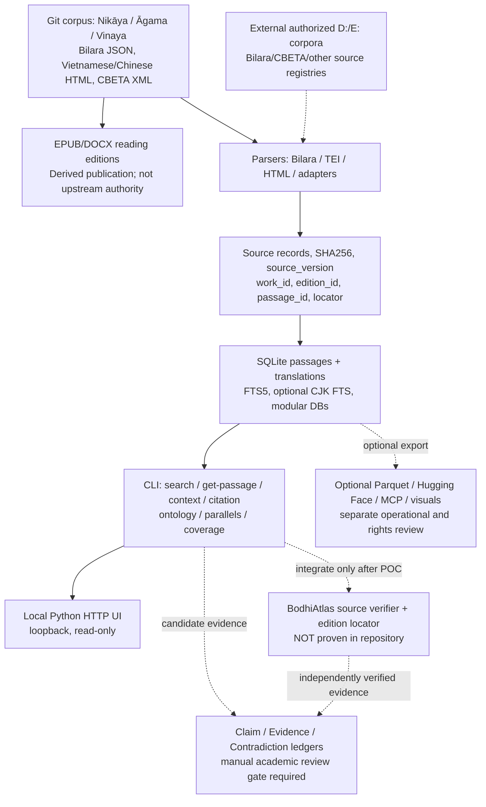

# Technology Assessment — Bang-ha-giac-ngo

**Mã nghiên cứu:** P39 · **Dự án nhận:** BodhiAtlas · **Ngày thẩm định:** 16/11/2026 (Asia/Ho_Chi_Minh)  
**Repository:** [`quoctran-2608/Bang-ha-giac-ngo`](https://github.com/quoctran-2608/Bang-ha-giac-ngo) · **Visibility:** `private`, truy cập **AUTHORIZED** qua GitHub connector được chủ tài khoản cho phép · **Default branch:** `main`  
**Snapshot commit:** [`4345737ae16638b19226ea1b11007e6ffa4faf62`](https://github.com/quoctran-2608/Bang-ha-giac-ngo/commit/4345737ae16638b19226ea1b11007e6ffa4faf62) · **Lần cập nhật cuối quan sát:** 27/09/2026 05:15:18 UTC · **Releases:** danh sách API rỗng tại thời điểm kiểm tra · **Tags:** không xác minh được qua endpoint được phép.  
**Tình trạng thực tế:** Truy cập được metadata, cây Git, các mẫu kinh văn, README/docs và mã nguồn. **Chưa clone/chạy/build/deploy**, chưa mở được database production nằm ngoài Git; một tệp XML lớn có trong cây Git nhưng connector không trả nội dung để đọc.  
**Phân loại dựa trên bằng chứng:** **Tài sản hỗn hợp** gồm **corpus có cấu trúc và ấn phẩm đọc**, **framework lập chỉ mục/tra cứu SQLite FTS5**, **thin local web UI**, **các module mở rộng thử nghiệm** cho MCP/Parquet/ontology/đối chiếu kinh/tri-ledger/visualization. Không thể coi riêng repository clone được là một production platform độc lập đã nghiệm thu.

**Phương pháp và quy ước bằng chứng.** Đã kiểm tra thông tin GitHub bằng quyền được ủy quyền, ghim SHA và kiểm kê toàn cây Git 17.168 mục (16.711 file/blob); đọc README, hướng dẫn, đặc tả, báo cáo sự cố, tài liệu nghiệm thu, dữ liệu ví dụ và trên 15 file Python cốt lõi. Đã đọc nội dung yêu cầu trong [`PRD V1.4`](https://github.com/quoctran-2608/bodhi-atlas/blob/main/docs/PRD.md) và [`ACADEMIC_RISKS_AND_VERIFICATION`](https://github.com/quoctran-2608/bodhi-atlas/blob/main/docs/ACADEMIC_RISKS_AND_VERIFICATION.md). `[CODE]` nghĩa là thấy mã; `[DOC]` là tuyên bố tài liệu; `[ISSUE]` gồm hồ sơ incident nội bộ có thể mở; `[INFERRED]` là suy luận chỉ rõ tiền đề; `[UNKNOWN]` là chưa chứng minh. **Không có kết quả `[TESTED]` mới trong phiên thẩm định này**. Những câu “test pass” có trong repo chỉ được xếp `[DOC]`, không chuyển thành `[TESTED]`.

---

## 1. Executive Decision

**Quyết định: `TRIAL ONLY` — confidence `MED` cho nhận diện năng lực và `LOW` cho mức sẵn sàng dùng làm nền tảng kiểm chứng học thuật trong production.** Repository không hề “không tồn tại”: kết nối GitHub được cấp quyền đã xác nhận nó là repo private và đọc được mã/dữ liệu ở SHA nêu trên. Bản chất nổi bật là kho kinh Nikāya, A-hàm, Vinaya Pāli–Hán–Việt kèm bản xuất EPUB/DOCX; bên cạnh đó có framework Python/SQLite FTS5 cục bộ, giao diện tra cứu, công cụ đối chiếu song hành và sổ cái Claim–Evidence–Contradiction. Đây là tài sản **đáng POC theo vai trò corpus và thành phần**, không phải ứng viên thay thế trọn gói BodhiAtlas.

Giá trị thực tiễn cho V1 Core là **tệp nguyên liệu có định danh theo kinh/đoạn**, parser Bilara/TEI/HTML, schema source–passage–translation, cơ chế hash/locator, index publishing có rollback và UI xem nguồn. Đối với V2/V3 có ontology, parallel lookup và scholarly ledgers, nhưng **nhãn `VERIFIED` của ledger chưa buộc xác thực lại nguồn**, còn `SUPPORTED` được chấp nhận nếu tồn tại evidence không bị `REJECTED`; điều này không đáp ứng cổng kiểm chứng học thuật của BodhiAtlas. Ba rủi ro ưu tiên là: **(1)** quyền khai thác bản dịch/ấn bản chưa được khai báo nhất quán, không có một license toàn kho; **(2)** độ tin cậy locator, tính đầy đủ và exact exhaustiveness chưa qua golden-set độc lập; **(3)** deployment phụ thuộc corpus/index và cấu hình `D:/E:` ngoài Git, trong khi MCP/cloud và phân hạng T1–T5 chưa đủ bảo đảm bảo mật/học thuật. Không tái host hoặc nhập production cho đến khi qua rights gate, source-fidelity gate và sửa ledger gate. Sau POC thành công, có thể đổi quyết định **`USE AS COMPONENT`** cho những phần cụ thể đã vượt cổng, không đổi trạng thái toàn repo một cách tự động.

**Không nên:** `ADOPT` nguyên hệ thống; kết luận `REJECT` từ 404 công khai; dùng số lượng file, ngôi sao GitHub, hoặc tên thư mục làm minh chứng chất lượng học thuật.

## 2. Sources & Evidence Ledger

Quy ước URL `[R]` là permalink tới commit `4345737ae16638b19226ea1b11007e6ffa4faf62` của repo private (chỉ tài khoản có quyền mới mở được). Với chứng cứ Git tree, URL API cũng cần quyền tương ứng.

| claim_id | claim | Type | URL/file + line | Version/SHA | Nhận xét/giới hạn |
|---|---|---|---|---|---|
| E01 | Repository tồn tại, private, `main`, đọc bằng kết nối được ủy quyền | [CODE]¹ | [Git metadata](https://api.github.com/repos/quoctran-2608/Bang-ha-giac-ngo), [branch](https://api.github.com/repos/quoctran-2608/Bang-ha-giac-ngo/branches/main) | `4345737` | ¹ Metadata/API, không phải code; 404 public do quyền không đồng nghĩa repo mất |
| E02 | Cây Git có 17.168 entries, 16.711 blobs, không bị truncate | [CODE]¹ | [Recursive Git tree](https://api.github.com/repos/quoctran-2608/Bang-ha-giac-ngo/git/trees/4345737ae16638b19226ea1b11007e6ffa4faf62?recursive=1) | `4345737` | Số *file Git*, không phải records, tác phẩm độc lập hoặc tỷ lệ coverage |
| E03 | Có 10.083 file dưới Nikāya, 4.171 A-hàm, 2.283 Vinaya | [CODE]¹ | Git tree E02 | `4345737` | Đếm theo đường dẫn file, không xác nhận 1:1 giữa bản gốc và bản dịch |
| E04 | Có corpus Pāli JSON phân đoạn và bản dịch Việt HTML có anchor | [CODE] | [`mn1_root-pli-ms.json`](https://github.com/quoctran-2608/Bang-ha-giac-ngo/blob/4345737ae16638b19226ea1b11007e6ffa4faf62/01_NIKAYA/MN_Trung-Bo/pli_root/mn1_root-pli-ms.json#L1-L18), [`mn1.html`](https://github.com/quoctran-2608/Bang-ha-giac-ngo/blob/4345737ae16638b19226ea1b11007e6ffa4faf62/01_NIKAYA/MN_Trung-Bo/vi/mn1.html#L1-L21) | `4345737` | ID Bilara `mn1:1.1`, anchor `sc1`; tương ứng ở cấp đoạn cần kiểm riêng |
| E05 | Có Hán văn Taishō và Việt dịch A-hàm | [CODE] | [`da1` Hán](https://github.com/quoctran-2608/Bang-ha-giac-ngo/blob/4345737ae16638b19226ea1b11007e6ffa4faf62/02_AGAMA/DA_Truong-A-ham/lzh_root/da1.html#L9-L28), [`da1` Việt](https://github.com/quoctran-2608/Bang-ha-giac-ngo/blob/4345737ae16638b19226ea1b11007e6ffa4faf62/02_AGAMA/DA_Truong-A-ham/vi/da1.html#L5-L20) | `4345737` | Taishō line anchor trên Hán bản; không suy ra mapping page/line của Việt dịch |
| E06 | Tủ sách có 15 EPUB và 55 DOCX tổng cộng | [CODE]¹ | Git tree E02, `SACH_DOC_NGUOI_DUNG/` | `4345737` | 15 DOCX chính + **40** DOCX chia nhỏ; tài liệu dự án nói **41** file chia nhỏ, chưa khớp inventory |
| E07 | Có một tệp CBETA XML trong sử liệu, nhưng bản dịch Việt ở thư mục đó chưa được nạp | [CODE] | [Cây dữ liệu](https://github.com/quoctran-2608/Bang-ha-giac-ngo/tree/4345737ae16638b19226ea1b11007e6ffa4faf62/04_SU-LIEU_KY-SU/Dai-Duong-Tay-Vuc-Ky), [`vi/README`](https://github.com/quoctran-2608/Bang-ha-giac-ngo/blob/4345737ae16638b19226ea1b11007e6ffa4faf62/04_SU-LIEU_KY-SU/Dai-Duong-Tay-Vuc-Ky/vi/README.md#L4-L24) | `4345737` | Tệp XML tồn tại theo Git tree; nội dung không đọc được qua connector trong phiên này |
| E08 | Framework schema giữ source, version, SHA-256, edition, locator, passage/translation tách biệt | [CODE] | [`corpus/common.py#L87-L114`](https://github.com/quoctran-2608/Bang-ha-giac-ngo/blob/4345737ae16638b19226ea1b11007e6ffa4faf62/tools/local_corpus_framework/corpus/common.py#L87-L114) | `4345737` | Có cột metadata không đồng nghĩa trường đã đầy đủ, đúng ấn bản |
| E09 | Bilara parser giữ JSON pointer; TEI parser giữ XPath/page marker khi có | [CODE] | [`adapters.py#L57-L74`](https://github.com/quoctran-2608/Bang-ha-giac-ngo/blob/4345737ae16638b19226ea1b11007e6ffa4faf62/tools/local_corpus_framework/corpus/adapters.py#L57-L74), [`#L152-L201`](https://github.com/quoctran-2608/Bang-ha-giac-ngo/blob/4345737ae16638b19226ea1b11007e6ffa4faf62/tools/local_corpus_framework/corpus/adapters.py#L152-L201) | `4345737` | XML XPath có thể resolve; tính chuẩn từng trang in chưa được chứng minh |
| E10 | `normalized()` của core là `NFC + casefold`, còn FTS tokenizer bỏ một số dấu | [CODE] | [`common.py#L15-L20`](https://github.com/quoctran-2608/Bang-ha-giac-ngo/blob/4345737ae16638b19226ea1b11007e6ffa4faf62/tools/local_corpus_framework/corpus/common.py#L15-L20), [`#L111`](https://github.com/quoctran-2608/Bang-ha-giac-ngo/blob/4345737ae16638b19226ea1b11007e6ffa4faf62/tools/local_corpus_framework/corpus/common.py#L111) | `4345737` | Không nên tự động tuyên bố toàn diện `vo nga → vô ngã`, `đ → d` hay giản/phồn |
| E11 | EXACT dùng `instr` trên text gốc, trả record có phân trang, **không trả mọi vị trí xuất hiện** | [CODE] | [`cli.py#L315-L535`](https://github.com/quoctran-2608/Bang-ha-giac-ngo/blob/4345737ae16638b19226ea1b11007e6ffa4faf62/tools/local_corpus_framework/corpus/cli.py#L315-L535) | `4345737` | Không chứng minh yêu cầu exhaustive EXACT của BodhiAtlas |
| E12 | Có CJK FTS candidate kèm hậu kiểm substring nguồn | [CODE] | [`cli.py#L373-L398`](https://github.com/quoctran-2608/Bang-ha-giac-ngo/blob/4345737ae16638b19226ea1b11007e6ffa4faf62/tools/local_corpus_framework/corpus/cli.py#L373-L398), [`build_cbeta_fts.py`](https://github.com/quoctran-2608/Bang-ha-giac-ngo/blob/4345737ae16638b19226ea1b11007e6ffa4faf62/tools/local_corpus_framework/build_cbeta_fts.py#L1-L31) | `4345737` | Hậu kiểm giảm false positive; chưa đo full recall hoặc khả năng vượt chunk |
| E13 | Có deterministic ontology / cross-language term expansion | [CODE] | [`ontology.py#L37-L155`](https://github.com/quoctran-2608/Bang-ha-giac-ngo/blob/4345737ae16638b19226ea1b11007e6ffa4faf62/tools/local_corpus_framework/corpus/ontology.py#L37-L155), [`ontology.json`](https://github.com/quoctran-2608/Bang-ha-giac-ngo/blob/4345737ae16638b19226ea1b11007e6ffa4faf62/tools/local_corpus_framework/corpus/ontology.json#L1-L35) | `4345737` | Nguồn từ điển nêu ở cấp tập dữ liệu, không xác thực từng sense/quan hệ |
| E14 | QA modular có lấy mẫu, không quét toàn corpus trong đường chạy nhẹ | [CODE] | [`build.py#L71-L169`](https://github.com/quoctran-2608/Bang-ha-giac-ngo/blob/4345737ae16638b19226ea1b11007e6ffa4faf62/tools/local_corpus_framework/corpus/build.py#L71-L169) | `4345737` | Code tự ghi rõ chưa kiểm độc lập toàn bộ số dòng/FTS/locator |
| E15 | Có staging/copy/checksum/atomic pointer/rollback bảo vệ release | [CODE] | [`publication.py#L150-L239`](https://github.com/quoctran-2608/Bang-ha-giac-ngo/blob/4345737ae16638b19226ea1b11007e6ffa4faf62/tools/local_corpus_framework/corpus/publication.py#L150-L239), [`#L247-L273`](https://github.com/quoctran-2608/Bang-ha-giac-ngo/blob/4345737ae16638b19226ea1b11007e6ffa4faf62/tools/local_corpus_framework/corpus/publication.py#L247-L273) | `4345737` | Có cơ chế mã; chưa tự thử rollback ngoài môi trường gốc |
| E16 | Local UI gọi framework qua subprocess `shell=False`, timeout; chỉ host loopback | [CODE] | [`local_corpus_ui/server.py#L33-L105`](https://github.com/quoctran-2608/Bang-ha-giac-ngo/blob/4345737ae16638b19226ea1b11007e6ffa4faf62/tools/local_corpus_ui/server.py#L33-L105), [`#L209-L218`](https://github.com/quoctran-2608/Bang-ha-giac-ngo/blob/4345737ae16638b19226ea1b11007e6ffa4faf62/tools/local_corpus_ui/server.py#L209-L218) | `4345737` | Local UI không cung cấp RBAC/auth cho multi-user |
| E17 | Báo cáo test cũ ghi 6/6 UI và 7/7 framework pass | [DOC] | [`local_corpus_ui/TEST_REPORT.md#L1-L29`](https://github.com/quoctran-2608/Bang-ha-giac-ngo/blob/4345737ae16638b19226ea1b11007e6ffa4faf62/tools/local_corpus_ui/TEST_REPORT.md#L1-L29) | `4345737` | **KHÔNG PHẢI `[TESTED]`** trong phiên P39; có nguy cơ đã cũ so với code mới |
| E18 | `EvidenceRecord.review_state` mặc định `VERIFIED` nhưng validator không buộc source/locator/hash | [CODE] | [`scholarly_ledger.py#L127-L162`](https://github.com/quoctran-2608/Bang-ha-giac-ngo/blob/4345737ae16638b19226ea1b11007e6ffa4faf62/tools/scholarly_ledger.py#L127-L162) | `4345737` | **Blocker G2**: default label dễ được hiểu nhầm là sự kiểm chứng nguồn |
| E19 | `SUPPORTED` được duyệt bằng evidence `supports_claim=1` và `review_state != 'REJECTED'` | [CODE] | [`scholarly_ledger.py#L400-L475`](https://github.com/quoctran-2608/Bang-ha-giac-ngo/blob/4345737ae16638b19226ea1b11007e6ffa4faf62/tools/scholarly_ledger.py#L400-L475) | `4345737` | **Blocker G3**: không buộc `VERIFIED` thực sự, không đánh giá hỗ trợ ngữ nghĩa, có cờ `bypass_evidence_check` |
| E20 | `build_vietnamese_canon` có locator theo **dòng HTML**, nhận diện `<p>` bằng regex và đường dẫn nguồn ghi một owner GitHub khác | [CODE] | [`build_vietnamese_canon.py#L53-L210`](https://github.com/quoctran-2608/Bang-ha-giac-ngo/blob/4345737ae16638b19226ea1b11007e6ffa4faf62/tools/local_corpus_framework/build_vietnamese_canon.py#L53-L210) | `4345737` | Source URL cứng `linhgiangtu1991-cyber`; cần kiểm quyền và permalink sau khi đổi owner/fork; HTML multi-line/ghi chú có nguy cơ mất cấu trúc |
| E21 | Có dịch vụ MCP/REST tách rời, tự tải Parquet nếu thiếu; CORS `*` | [CODE] | [`ebt_mcp_server.py#L53-L113`](https://github.com/quoctran-2608/Bang-ha-giac-ngo/blob/4345737ae16638b19226ea1b11007e6ffa4faf62/tools/ebt_mcp_server.py#L53-L113), [`#L299-L315`](https://github.com/quoctran-2608/Bang-ha-giac-ngo/blob/4345737ae16638b19226ea1b11007e6ffa4faf62/tools/ebt_mcp_server.py#L299-L315) | `4345737` | Không nhầm module EBT Pāli–Anh này với toàn bộ local corpus; chưa đánh giá xác thực ngoài Internet |
| E22 | Một số corpus ngoài có parse lỗi bị cách ly; các tuyên bố QA cũ bị đính chính | [ISSUE] | [`source-quarantine.json`](https://github.com/quoctran-2608/Bang-ha-giac-ngo/blob/4345737ae16638b19226ea1b11007e6ffa4faf62/incidents/2026-09-24-source-quarantine.json#L1-L25), [`TIEN_DO_DU_AN.md#L1-L7`](https://github.com/quoctran-2608/Bang-ha-giac-ngo/blob/4345737ae16638b19226ea1b11007e6ffa4faf62/docs/TIEN_DO_DU_AN.md#L1-L7) | `4345737` | Tự nhận lỗi tốt; không suy số liệu cũ là production state hiện tại |
| E23 | Multi-view generator đang mặc định gắn `T1` cho **mọi** catalog item | [CODE] | [`generate_multiview_app.py#L123-L132`](https://github.com/quoctran-2608/Bang-ha-giac-ngo/blob/4345737ae16638b19226ea1b11007e6ffa4faf62/tools/generate_multiview_app.py#L123-L132) | `4345737` | **Không phải bộ máy xếp hạng chất lượng nguồn đã kiểm chứng** |
| E24 | Không thấy top-level LICENSE trong tree và README nói không có CC0 chung | [DOC] + [CODE]¹ | [`README.md` mục License](https://github.com/quoctran-2608/Bang-ha-giac-ngo/blob/4345737ae16638b19226ea1b11007e6ffa4faf62/README.md), Git tree E02 | `4345737` | Cần rà từng ấn bản/dịch giả, code và nội dung riêng; private **không cấp** quyền tái phát hành |

¹ Trong bảng này `[CODE]` ở các mục API/tree có nghĩa bằng chứng máy đọc từ GitHub, **không phải đã chạy code**. Mức độ nhận thức không được đồng nhất với `[TESTED]`.

**Nhật ký truy cập:** Prompt nguồn ghi URL public từng trả `404`; ngày 16/11/2026 đã xác nhận qua GitHub connector được ủy quyền: repo `visibility=private`, có quyền đọc và `main` head như trên. Đã mở root files, recursive tree và source files. Truy vấn `/releases` nhận `[]`; endpoint `/tags` bị công cụ từ chối với HTTP 400 nên tình trạng tags **UNKNOWN**. Một lần thử đường dẫn Pāli `mn1/mn1_root-pli-ms.json` nhận 404 do **sai path**, sau đó đã mở thành công path thật `pli_root/mn1_root-pli-ms.json`. Tệp TEI lớn `T51n2087.xml` có blob/size trong tree nhưng `fetch_file` không trả bytes; không tuyên bố nội dung XML rỗng. Không truy cập được `D:/ResearchCorpus`, `E:/ResearchCorpus` hoặc `PROVENANCE_REPORT.md` nội bộ từ connector.

## 3. Architecture & Data Flow

Repository là **corpus + công cụ bao quanh**, không phải pipeline chung đã chạy end-to-end trong phiên này. Sơ đồ là các đường code thực sự đọc được, dấu `?` là phụ thuộc/cổng chưa nghiệm thu.



**Luồng dữ liệu hiện hữu:** (i) văn bản JSON/HTML/XML và các corpus ngoài đã đăng ký → (ii) parser trích các record có locator → (iii) metadata source/version/SHA và SQLite bảng `passages` riêng `translations` → (iv) FTS5/substring/CJK candidate index → (v) CLI/UI nhận các **đoạn ứng viên**; parallel lookup/ontology là **quan hệ dẫn xuất**, không phải nguyên văn. Module `scholarly_ledger.py` lưu claim/evidence/counter-evidence và xuất Parquet/graph; graph/visualization là **tri thức suy diễn/hậu kỳ**, không được viết ngược vào văn bản nguồn. EPUB/DOCX là bản *đóng gói để đọc*, không phải bản chứng thực mới. Không thấy code pipeline OCR PDF scan với bbox trong chuỗi công việc đã kiểm.

**Đầu vào/đầu ra và đối tượng phục vụ:** Input chính là bản kinh Pāli, Hán, Việt (và corpus ngoại vi qua manifest), cấu trúc HTML/JSON/TEI; output là tệp sách đọc, các kết quả search có record/locator/citation metadata, bảng so sánh/relations, ledger và web UI cho người học/nghiên cứu/lập trình viên. Clone đơn độc không mang production SQLite database, external raw files, local config và verified rights ledger. Không suy ra rằng service chạy sẵn từ việc thấy `server.py`.

## 4. Feature Fit–Gap Matrix

**Thang trạng thái:** `NATIVE` có code trực tiếp trong repo (không mặc định pass nghiệm thu), `CONFIG` có nhưng cần khai báo/cấu hình; `EXTENSION` cần sửa code hoặc schema, `EXTERNAL` giao cho thành phần khác, `MISSING` chưa thấy năng lực trong phạm vi thẩm định, `UNKNOWN` chưa thể xác minh, `N/A` không phải sứ mệnh của phần tài sản đang xét. Tất cả cổng BodhiAtlas mặc định **chưa pass** nếu không có test độc lập.

| Code | Năng lực | Status | Evidence / giới hạn và tác động | Bổ sung / chi phí tương đối |
|---|---|---|---|---|
| C01 | Multi-format ingest | **EXTENSION** | NATIVE HTML/Bilara JSON/TEI và nhiều adapters ngoại vi; EPUB/DOCX **được xuất**, không chứng minh import; PDF scan chưa có parser V1 trọn vẹn. E04,E07,E09,E20 | Viết adapters PDF/EPUB/DOCX + manifest V1; **cao** so với giữ parser hiện tại |
| C02 | OCR/layout/reading order | **MISSING** | Không thấy OCR PDF page+bbox/layout engine trong code đã đọc; tài liệu đóng góp chỉ quy định tiếp nhận. | Thành phần ngoài + mapping/QA; **cao** |
| C03 | Canonical text + source map | **NATIVE** (có giới hạn) | JSON pointer, XML XPath, line/anchor, source SHA; HTML parser regex theo line dễ không đủ ngữ cảnh; không có PDF bbox. E08,E09,E20 | Thêm immutable raw span map/offsets, source reopen verification; **trung–cao** |
| C04 | Work/Edition/Witness model | **EXTENSION** | Có `work_id`, `edition_id`, `witness_id` trong metadata; chưa thấy mô hình quan hệ Work–Edition–Witness–File hoàn chỉnh. E08,E09 | Chuẩn hoá entity/translation_of/parallel_to/variant_of; **trung** |
| C05 | Exhaustive EXACT | **EXTENSION** | `instr()` tìm record chứa substring, phân trang, không đếm và trả từng vị trí; phrase trên FTS token không bằng exhaustive character phrase. E11 | Occurrence-level scan/index, chunk overlap, golden count; **trung–cao** |
| C06 | Normalized multilingual | **EXTENSION** | FTS5 bỏ một số dấu Latin, ontology 5 ngôn ngữ, CJK candidate; chưa chứng minh `đ/d`, Hán giản–phồn, Wylie đầy đủ. E10–E13 | Mỗi phép normalize tách index, provenance phép biến đổi, language goldens; **trung** |
| C07 | Fuzzy/OCR error retrieval | **MISSING** | Có prefix/ontology, không thấy thuật toán edit distance/trigram có đánh dấu FUZZY thật. | FTS5 trigram hoặc tương đương, false positives; **trung** |
| C08 | Sense-aware lexicon | **EXTENSION** | Static ontology concept → terms; nguồn tham chiếu cấp dataset, chưa thấy word-sense assertion có edition/context và reviewer. E13 | Sense ID, evidence links, linguistic review; **trung–cao** |
| C09 | Semantic/hybrid/RAG | **EXTERNAL** | Không phải core CLI; MCP/Parquet UI không đồng nghĩa semantic. QMD/RAGFlow là lớp tùy chọn sau V1. | Kết nối dưới candidate gate; không cần V1; **tùy chọn** |
| C10 | Verified citation + reopen | **EXTENSION** | Citation có path, SHA, locator, edition; UI chỉ hiển thị hash đã lưu, modular QA lấy mẫu, ledger mặc định `VERIFIED`. E14,E18–E20 | G2 checker bắt buộc on demand; **cao, P0** |
| C11 | Notes/wiki/claim memory | **EXTENSION** | Có claim/evidence/contradiction SQLite + graph. Kiểm chứng claim chưa đủ, không chứng minh human review workflow. E18,E19,E23 | Tách DRAFT/TECH_VERIFIED/ACADEMIC_REVIEWED, người duyệt; **trung–cao** |
| C12 | API/MCP/export | **NATIVE** | Local HTTP JSON, CLI, Parquet export, MCP service riêng. CORS/mô hình nguồn của MCP cần soát. E16,E21 | Chuẩn hoá versioned API, auth, rights filter; **trung** |
| C13 | Coverage + incremental | **NATIVE** (một phần) | File counts, SHA manifests, staging/rollback; status/QA modular lấy mẫu không chứng minh full recall, chưa chứng minh mọi case incremental. E14,E15,E22 | Targeted diff, QA toàn phạm vi thay đổi, publication smoke test; **trung** |
| C14 | Auth/licensing/privacy & backup | **EXTENSION** | Local UI có loopback, source rights nhiều loại; chưa thấy RBAC/cloud rights gate; copy release/rollback ≠ backup hoàn chỉnh. E16,E21,E24 | ACL từng nguồn, export policy, encryption/backup recovery; **cao** |
| C15 | Operational simplicity / independent deploy | **CONFIG** | Core SQLite+Python stdlib tương đối nhẹ; production dữ liệu/index/config ở D/E; optional MCP/HF thêm service và network. | Đóng gói portable config, reproducible build; **trung** |

**Không chấm trượt corpus vì thiếu OCR/AI:** các dòng C02/C09 nêu lỗ hổng **nếu chọn nguyên repo làm V1 platform**; bản thân các tệp kinh vẫn là ứng viên dữ liệu hữu ích. Không có quyền sử dụng là blocker nhập dữ liệu production, dù các năng lực khác đạt.

## 5. Deep Technical Findings

### A. Tư cách, phạm vi và tài sản

**Phân loại:** Corpus + scripts + offline research application + derived scholarly tooling. Evidence: `README.md`, Git tree, `tools/local_corpus_framework/`, `tools/local_corpus_ui/`, `tools/scholarly_ledger.py`, `SACH_DOC_NGUOI_DUNG/`. Mục tiêu được mô tả là kho kinh Phật giáo sơ kỳ Pāli–Hán–Việt, đọc sách và đối chiếu; framework ngoại vi còn lập chỉ mục nguồn cổ điển/đa tôn giáo không thuộc nội dung nguyên bộ Git này. Những tên nhánh “global research platform” ở roadmap là hướng phát triển và code thử nghiệm; **không** mặc nhiên là sản phẩm production.

**Kiểm kê Git snapshot (không phải full logical census):** 16.711 file/blob; 10.600 HTML, 5.941 JSON, 1 XML, 15 EPUB, 55 DOCX, 56 Python, 30 Markdown, 3 Parquet, 1 SQLite ledger, 1 JSON.gz parallel. Các thư mục cốt lõi: `01_NIKAYA/` (10.083 file), `02_AGAMA/` (4.171), `03_VINAYA_LUAT-TANG/` (2.283), `04_SU-LIEU_KY-SU/` (3). `SACH_DOC_NGUOI_DUNG/` có sách xuất PDF? **Không thấy PDF trong tree**; gồm EPUB/DOCX/TXT. Tổng file Git có dữ liệu xuất bản lặp nên không thể dùng để suy tổng số kinh/đoạn duy nhất.

**Kiểm kê quan hệ song ngữ có lệch số tệp:** Trung Bộ `152 Pāli + 152 Việt`, Trường Bộ `34+34`; Tương Ưng `1.819 Pāli + 1.805 Việt`, Tăng Chi `1.408+1.395`; A-hàm `Tạp 1.362 Hán + 1.361 Việt`, `Tăng Nhất 471 Hán + 473 Việt`; Luật Theravāda `422 Pāli + 418 Việt`, Tứ Phần Luật `505 Hán + 507 Việt`. Vì một file gốc có thể chứa dải nhiều đoạn, chênh lệch không tự chứng minh thiếu kinh; **nhưng nó bác bỏ suy luận “1 file ↔ 1 file ở mọi nơi”** và đòi ma trận alignment bằng native ID, không bằng số lượng tên file. `Đại Đường Tây Vực Ký` có Hán XML, nhưng `vi/` mới là hướng dẫn/cấu trúc dự kiến, **không có 12 tệp Việt dịch như ví dụ trong README**.

**Quan hệ với hai repo cùng owner:** `Bang-ha-giac-ngo` là một corpus kèm công cụ tìm kiếm nhiều nguồn; `BuddhismDocuments-for-AI` tự mô tả là repo framework tập trung pin 13 upstream và có bộ workflow Quick/Research A–E, khác mô hình sở hữu raw data; `bodhi-atlas` là đặc tả hệ thống đích. Cùng owner không chứng minh cùng codebase/đã tích hợp. Đã thấy trong `Bang-ha` tham chiếu Bilara, CBETA, HF và đường dẫn một GitHub owner khác `linhgiangtu1991-cyber` ở `build_vietnamese_canon.py`; **chưa đối chiếu diff từng file/commit** giữa ba repo nên mức quan hệ sao chép/kế thừa: `UNKNOWN` ngoài các đường dẫn ghi trong code.

### B. Ingestion, cấu trúc và độ bền

- `parse_bilara` đọc JSON dạng `{segment_id: text}`, lưu JSON pointer `/mn1:...`; role `original` / `translation` và contributor identifier; mặc định `license=None` thay vì suy đoán tác quyền.
- `parse_tei` đọc `teiHeader`, theo `p/ab/l/head/item`, tạo XPath và `page` từ `<pb n=...>` khi có; giữ inline editor text nhưng ghi chú không tự phân biệt mọi variant witness. `build_vietnamese_canon.parse_xml_file` lại dùng regex **theo dòng** và tạo `T2087:pN`; không thay thế XML-native pointer có độ ổn định tương đương XPath. Phải đánh giá thực tế với file XML lớn khi có bytes.
- `parse_html_file` dùng regex `<p>` theo dòng, loại tag `<a class='ref'>`, tạo `art_id:pN`, lưu `line` + `anchor` lấy từ mẫu `id=` đầu tiên. Locator này **không giữ được đầy đủ vùng tham chiếu Taishō nằm giữa đoạn**, không có char offset; HTML nhiều dòng hoặc nested markup có nguy cơ bị phân đoạn sai/mất footnote. Cần diff extractor output với DOM và file gốc.
- `build_vietnamese_canon.process_file` tính `sha256(data)` và `uid(corpus_id, commit, rel_path)`; URL cứng sang `linhgiangtu1991-cyber/Bang-ha-giac-ngo` dù repo hiện đang thẩm định là `quoctran-2608/...`, nên link có thể không mở. **Không tự thay URL trong dữ liệu cũ nếu chưa chứng minh tương đương byte/commit.**
- `corpus/build.py` tính SHA-256 của raw files, tạo manifest `.jsonl`, gắn `acquisition_complete`/coverage/errors; các build mới tạo staging và `publication.py` chỉ activation sau QA, giữ previous pointer để rollback. Tuy nhiên `qa` modular nhanh chỉ sample nguồn/locator, không xác minh toàn bộ hàng triệu bản ghi.
- Script `make_reading_library.py`, `split_for_notebooklm.py` là **đường xuất/đóng gói**; cần lưu metadata raw→derivative và kiểm bản quyền cả nội dung, font, hình/cover. Tệp EPUB/DOCX không tự tương đương ấn bản nhà xuất bản đã xác minh.

### C. Tra cứu, thuật ngữ, limits

`corpus/cli.py` có `search(... phrase/exact/prefix/expand ...)`, FTS5 BM25, `instr` raw for EXACT, CJK post-filter, phân trang `limit/offset`, nguồn/truy vấn/log; `get_parallels` đọc bảng `parallels` hoặc JSON.gz lookup; `ontology.py` mở rộng từ điển tất định. Đây là **retrieval ứng viên**. `EXACT` thực tế có phép thử substring theo record, chưa có `match_start/end`, hit count mọi vị trí, xử lý cụm qua ranh giới đoạn, hay yêu cầu “tất cả occurrences” của PRD. `normalized()` không loại dấu VN; tokenizer SQLite bỏ dấu Latin lúc lập chỉ mục, nên phải kiểm riêng `đ/d`, `ā/a`, Unicode composition, CJK giản/phồn, từ ghép/âm tiết. Ontology dùng nhóm khái niệm liên hệ đa ngữ, không đồng nghĩa mọi biến thể nghĩa đều tương đương. Chưa thấy typo Fuzzy phân loại riêng.

`ebt_mcp_server.py` là **service khác**: Parquet Pāli–Anh, PyArrow filtering substring và accent stripped Pāli, trả `total_matches` theo **segment**, có REST + MCP; không đồng nhất coverage/ngôn ngữ với `local_corpus_framework`. Khi Parquet vắng, service có nhánh tự tải qua Internet: không thích hợp mặc định cho tài liệu hạn chế quyền hoặc cấu hình air-gapped. MCP public exposure phải bổ sung authorization và audit.

### D. Truy nguyên, phê bình nguồn, claim memory

`record()` trong `corpus/cli.py` xuất `source.local_path`, `source_url`, `source_version`, `sha256`, `work_id`, `edition_id`, locator và metadata (translator/witness/edition/...) — đây là **đầu vào tiềm năng** để lập citation card. Nhưng `record()` **không đọc lại file raw và recompute hash cho từng lần xuất**; QA mặc định là lấy mẫu. Một `citation` chứa SHA metadata ≠ `TEXT_AND_LOCATOR_VERIFIED` theo PRD. Các Taishō references trong HTML là thông tin nguồn đáng giữ, không tự biến thành PDF printed page/bbox đã xác minh.

Tri-ledger có schema claim/evidence/contradiction, lưu support/counter evidence và history/revision, xuất Parquet và knowledge graph. **Lỗ hổng trọng yếu phải sửa trước sử dụng:**

1. `EvidenceRecord.review_state='VERIFIED'` mặc định ngay lúc khởi tạo; `EvidenceRecord.validate()` chỉ buộc ID, quotation, evidence_type; không bắt buộc `source_id`, `locator`, edition, `sha256_hash`, kết quả reopen và `reviewer_id`.
2. `_verify_claim_evidence_support()` chỉ đếm evidence `supports_claim=1` với `review_state != 'REJECTED'`; do đó điều kiện SQL tự thân **không buộc source/reviewer/quote pass**. `add_claim(..., bypass_evidence_check=True)` có đường bypass, chưa thấy quyền hạn khóa đường này.
3. `SUPPORTED` trong ví dụ graph là **trạng thái được lưu**, không đồng nghĩa chứng minh nhận định “vô thường và khổ” hoặc chất lượng độc lập của bản dịch. `source_independence='uncertain'` là lưu chuỗi, không thấy logic chống đếm trùng nguồn.
4. Generator multi-view mặc định mọi catalog `source_tier='T1'`, nên mác T1–T5 là UI metadata **không thể dùng thay quality review**. Quyền thẩm định học thuật cần ở người nghiên cứu, không phải chỉ một nhãn mặc định.

### E. Tài sản tái sử dụng và chi phí kế thừa

**Dữ liệu dùng được có điều kiện:** JSON Pāli segment ID, Hán HTML Taishō anchors, Việt HTML + dịch giả, TEI XML, bản đối chiếu SuttaCentral kiểu lookup, EPUB/DOCX cho đọc sau rights review. **Code dùng được có điều kiện:** `adapters.py`, `common.py` schema, `publication.py` staging/rollback, CLI read-only, local UI, tests fixture; tất cả phải có test integration riêng với BodhiAtlas. **Không đưa nguyên trạng vào G2/G3:** `scholarly_ledger.py` và source tier generator. Không kế thừa đường dẫn D/E cố định, shell/batch Windows hoặc assumption cloud public vào hệ thống đa người dùng.

Các nỗ lực nêu ở mục 8 được phân loại **tương đối, chưa ước lượng production**: `low` khi chỉ inventory/readonly POC có đủ nguồn; `medium` khi viết mapping/adapter và tests; `high` khi tái cấu trúc provenance/rights/auth/OCR/QA. Không có benchmark khách quan hay phép đo chi phí máy trong phiên này.

## 6. Source Fidelity & Provenance

**Ma trận phân cấp nguồn đề nghị khi nhập BodhiAtlas:**

| Cấp | Có trong repo? | Điều cần chứng minh trước khi ghi `VERIFIED` |
|---|---|---|
| Work | `work_id`, tên kinh/bộ | Dùng ID thẩm quyền, phân biệt tác phẩm, bộ sưu tập và recension |
| Edition | `edition_id`, `edition`, translator | Kiểm nguồn xuất bản/đơn vị ấn hành và bản số hóa thực tế; file HTML không đủ chứng minh năm in |
| Witness | `witness_id` có trong TEI metadata khi có | Nguồn bản chép và dị bản; không gán witness chỉ vì thư mục tên `root` |
| Source file | `source_path`, `source_url`, `source_version`, SHA-256 | Đúng **bytes**, owner/repo/commit, quyền, bảo tồn raw; URL hardcoded phải kiểm |
| Passage / translation | JSON key, XPath, HTML line/anchor | Resolve và trích đúng từng ký tự, xử lý HTML tag/footnote; không lẫn dịch/gốc |
| Locator printed/PDF/EPUB | JSON pointer, XML XPath, HTML line đã thấy | PDF page+bbox và printed page **UNKNOWN/MISSING** trong luồng đã đọc; EPUB href/CFI **NOT PROVEN** |
| Coverage | Có counters/parser errors/QA samples | File/record/page/đoạn nào đã index; mỗi mục lỗi; tránh suy từ kết quả 0 rằng nguồn không tồn tại |
| Scholarly support | Claim/evidence/link trong ledger | Phải kiểm nguồn và ngữ cảnh; con người quyết định `SUPPORTS/PARTIAL/DISPUTED` |

**Trường hợp học thuật cụ thể:** file `mn1.html` có phần chú thích về khác biệt ở câu cuối giữa các bản dịch; giữ chú thích trong raw không đồng nghĩa parser giữ trọn footnote trong indexed text. Muốn kiểm câu này phải dùng `source_version` và toàn văn ghi chú, không chỉ passage match đứng riêng. Trong Hán `da1.html` có nhiều Taishō line anchors nằm trong một `<p>`, nên việc lưu “line HTML + anchor đầu tiên” không đủ bảo đảm locator chính xác cho một câu trích giữa đoạn.

**Cổng tuyệt đối chưa được chứng minh:** (i) checksum against **upstream** cho từng bản dịch/edition; (ii) thông tin quyền khai thác hết các bản; (iii) 100% exact quotes/locators qua golden sample độc lập; (iv) PDF/printed page/EPUB CFI; (v) canonical text vs source all-span mapping; (vi) tất cả nguồn song hành độc lập; (vii) G2/G3 trong ledger; (viii) license code. Không cho phép một kết quả search có score cao hoặc ẩn dụ “ground truth” trở thành bằng chứng công bố mà thiếu kiểm file/đoạn.

**Cần phương án sửa:** `source_id = hash(namespace, upstream_id, upstream_commit, logical_source_path)`; `edition_id` riêng; `passage_id` ổn định theo native segment+edition, `extraction_id` riêng theo parser version; `source_bytes_sha256` luôn được tính lúc ingest; `quote_verification` lưu hash kiểm lại, timestamp, `verifier_kind`, reviewer khi cần; `match` giữ `EXACT/NORMALIZED/FUZZY/LEXICON/SEMANTIC`, offset sau biến đổi, raw span. Không lưu nội dung LLM vào bảng câu chữ nguồn.

## 7. Multilingual & Retrieval Behavior

| Hệ chữ/ngôn ngữ | Có dữ liệu/công cụ nào | EXACT / NORMALIZED / FUZZY / LEXICON / SEMANTIC | Tình trạng cần kiểm |
|---|---|---|---|
| Việt (`vi`) | Hàng nghìn HTML kinh; SQLite FTS5, search `instr` | EXACT: record substring; NORMALIZED: FTS tokenize dấu Latin; FUZZY: thiếu; LEXICON: ontology; SEMANTIC: external | `đ/d`, `vô ngã/vo nga`, `khổ/kho`, chữ trong footnote, nội dung xuyên `<p>` |
| Pāli (`pli`) | JSON Bilara, preserved diacritics; optional MCP Parquet Pāli–Anh | EXACT raw; NORMALIZED: NFC+casefold/FTS remove_diacritics; LEXICON: ontology; FUZZY/SEMANTIC chưa native | `anatta/anattā`, `dukkha/dukkhā`, `ṃ/m`, token sandhi, original offsets |
| Sanskrit (`sa`) | adapters/corpus ngoại vi và ontology, không thấy root Sanskrit canonical cấp độ Nikāya như Pāli | Mixed/indirect; riêng bản Sanskrit availability `UNKNOWN` | `anātman`, biến thể Latin/Devanagari, phiên bản và liên hệ nghĩa |
| Hán văn (`lzh`, giản/phồn) | A-hàm/Vinaya HTML, CBETA FTS index ngoài | EXACT CJK `instr` + FTS candidate/hậu kiểm; chưa thấy simplified/traditional mapping native đủ | `無我/无我`, biến thể chữ, Taishō anchor từng câu, ký tự trong chú giải |
| Tạng/Wylie | Có `build_tibetan.py`, `parse_openpecha`; root Tibetan không nằm ở bốn thư mục corpus cốt lõi | Chỉ có code adapters, trạng thái corpus thực tế `UNKNOWN`; semantic external | Wylie round-trip, ký tự chồng, witness/folio, bản dịch trung gian |
| English | MCP Parquet và corpus ngoài; ontology | PyArrow match substring, accent-stripped Pāli; local FTS5 nếu đã index | Bản Pāli–Anh là service scope riêng, không suy ra bilingual Việt matching |

**Năm phép thử được yêu cầu:** `anatta`, `anattā`, `anātman`, `無我`, `vô ngã`. Một hệ thống đúng phải báo **loại khớp và lý do**, không gộp 5 chuỗi thành `EXACT`. `anatta ↔ anattā` có thể là NORMALIZED nếu cài phép bỏ dấu đã công khai; `無我 ↔ 无我` phải ghi phép chuyển giản–phồn; `anātman ↔ 無我/vô ngã` chỉ nên là LEXICON có chứng cứ theo *sense* và truyền thống, không coi là cùng một nguyên văn. Query nghiên cứu “ai phân biệt vô thường và khổ” trả ứng viên trước; phân tích lập luận phải qua human/AI downstream và nguồn độc lập.

**Giới hạn định lượng:** index theo **record**, không phải occurrence; FTS5 BM25 xếp hạng gần đúng với `limit`, không có bảo đảm `all hits`; đếm `matched rows` của MCP không tương đương số lần xuất hiện; luồng `search` có thể chia across many modular DB nhưng chưa có golden test exhaustive ở scale production. Không bịa recall, latency hoặc OCR WER; các số trong progress docs là `DOC`, chưa đối chiếu production ngày nghiên cứu.

## 8. Integration Options for BodhiAtlas

| Phương án | Contract & nguồn sự thật | Mapping/đụng code/rollback | Công sức, rủi ro, đề xuất |
|---|---|---|---|
| **1. Intake dữ liệu chọn lọc (ưu tiên POC)** | Input: snapshot raw `{source_url, owner, git_commit, path, sha256, rights, language, work/edition, parser}`; Output: `BodhiAtlasSource`, `Edition`, `Passage`, `Locator`, `ExtractionVersion`. **Raw upstream snapshot/BodhiAtlas immutable file store** là authority; EPUB/DOCX chỉ derivative | Chọn 10–30 file mẫu có rights; bóc HTML/JSON/TEI; mapping `mn1:1.1` và Taishō anchors; `BodhiAtlas ID` stable, `legacy_record_id` làm alias, không làm primary key. Rerun idempotent; rollback bằng snapshot ID và rebuild index, giữ raw | **Trung**. Rủi ro bản quyền, duplicate raw giữa upstream và repo, alignment thiếu. Tốt nhất cho V1 nếu qua rights gate |
| **2. Dùng framework như một module/service candidate (sau POC)** | Input: `search({query,language,corpus,mode,page})` và `verify({source_id,edition,locator,quote})`; Output: `candidate_hits[]`, `coverage`, `source_ref`, `status`; **BodhiAtlas verifier** mới có quyền gắn `TEXT_AND_LOCATOR_VERIFIED` | Có thể wrap read-only CLI/SQLite FTS/`publication.py`, giữ versioned API; đổi path D/E → config portable, hardcoded owner links, tách `candidate_match` khỏi `verified_evidence`. Rollback index release pointer và migration có version | **Trung–cao**. Tránh fork rộng; đòi test Unicode, exact occurrence và permissions. Có thể dùng module xuất CSV/JSONL/Parquet thay chạy service |
| **3. Fork/ghép nguyên nền tảng (`NOT RECOMMENDED` cho V1)** | Input: toàn bộ code, raw dữ liệu, external indexes, HF/MCP/graph, UI. Chưa có authority rõ giữa D/E registry, upstream và derived Parquet | Cần giải quyết license/copyright, secrets/cloud, hệ vận hành Windows, schema V1, ACL, ledger false-verified, migration/backup, automated CI QA và SLA. Có nguy cơ không rollback từng nguồn | **Cao/UNKNOWN**; không có bằng chứng đáng tin để tiếp nhận all-in-one; chỉ xét lại khi có complete reproducible bundle và academic acceptance |

**Contract gợi ý cho bản nhập (JSONL, một đoạn một record; schema dự kiến của BodhiAtlas, KHÔNG phải schema nguyên trạng của repo):**

```json
{
  "import_batch": "p39-sample-2026-11",
  "legacy_source_path": "01_NIKAYA/MN_Trung-Bo/pli_root/mn1_root-pli-ms.json",
  "upstream_commit": "4345737ae16638b19226ea1b11007e6ffa4faf62",
  "source_sha256": "<calculate from downloaded bytes, not guessed>",
  "work_id": "mn1",
  "edition_id": "<verified edition/translator ID>",
  "native_passage_id": "mn1:1.1",
  "locator": {"kind": "json_pointer", "value": "/mn1:1.1"},
  "raw_text": "<exact source segment>",
  "rights_status": "UNKNOWN",
  "verification_status": "CANDIDATE"
}
```

**ID and dedup policy:** Distinguish `Work` vs `Edition` vs `File`; identical source bytes `sha256` may deduplicate physical objects **without merging scholarly witnesses**; translation and original separate; record IDs from external source must live in namespaced aliases; duplicate records only collapse if source identity/edition/native ID proven same. **Sync:** pull explicit pinned commits, avoid moving `main`; produce file-level diff and migration report; do not silently overwrite approved evidence. **Rollback:** retain input batch manifest, raw original, historical extraction version and previous index before publish. **Lock-in:** SQLite/JSON/Parquet portable, but hardcoded Windows roots and HF-specific build scripts increase operational tie-in; strip those assumptions at integration edge.

**V2/V3:** Parallel relations could seed “kinh song hành” only as claims/candidates; ontology could seed lexicon drafts with source-level references to be verified; tri-ledger schema can inspire research memory **after** state machine and human approval are redesigned. Nếu các kiểm định không đạt, vẫn có thể dùng Git corpus như bộ *đối chiếu thủ công* theo quyền cho phép, không nhập tự động.

## 9. Practical POC / Reproduction Plan

**Kết quả thực nghiệm trong phiên P39:** `NOT TESTED` cho **toàn bộ thao tác thực thi** bên dưới. Đã `INSPECTED` source files Git/README, không tính là chạy chương trình. Mục tiêu pilot: snapshot SHA cố định, bản raw được cấp phép, output tạm, test độc lập với database production. Không tải dữ liệu hạn chế quyền lên HF/LLM, không ghi fixture vào production.

| TC | Fixture/input; setup + lệnh/đường chạy dự kiến | Golden / PASS–FAIL | Log / status |
|---|---|---|---|
| **TC01 Access & reproduction** | Clone bằng GitHub user đã được cấp quyền (không gõ token trong chat), `git checkout 4345737...`; `git rev-parse HEAD`, `git ls-files`; kiểm README/requirements/thiếu external config; tạo env cách ly | PASS clone đúng SHA, kiểm kê **16.711 tracked blob** theo Git tree API cùng snapshot (Git worktree có thể khác khi filter); thiết lập test mà không động tới D/E production. FAIL nếu phải lấy source chưa được cấp quyền | Lưu `git-status.txt`, `tree-summary.json`; **NOT TESTED** |
| **TC02 File, metadata, license inventory** | Script local `git ls-files -z` + `sha256sum` 30 mẫu: 5 Pāli, 5 Hán, 5 Việt, 5 EPUB/DOCX, XML, 9 file code; trích license từ metadata/document | PASS file format và bytes khớp manifest, quyền từng nguồn rõ; **UNKNOWN rights không được coi PASS**; log các file thiếu translator/edition/license | `inventory.csv`, `rights-audit.csv`; **NOT TESTED** |
| **TC03 Locator & integrity** | Fixture `mn1_root-pli-ms.json` key `mn1:1.1`; `mn1.html` anchor `sc1`; `da1.html` Taishō anchor `t0001b11`; TEI file nếu tải được | PASS mỗi quote resolve từ **file bytes, đúng edition/ID**, hash so với manifest, giữ chú thích; FAIL nếu locator không mở, mismatch nhưng gắn VERIFIED | `locator-reopen.jsonl`; **NOT TESTED** |
| **TC04 Ingest pilot** | Import 1 JSON Pāli + 1 Việt HTML + 1 Hán HTML + 1 TEI vào `ba_test` theo phương án 1; so raw/parsed DOM/JSON, check đọc lần đầu/cuối | PASS không mất văn bản quan trọng/footnote/anchor; nếu parser line regex bỏ qua block thì phải báo PARTIAL, không tự xóa; golden do người lập từ raw | `coverage-diff.csv`, `mapping.jsonl`; **NOT TESTED** |
| **TC05 Exhaustive EXACT & multilingual** | Synthetic fixture có cùng chuỗi xuất hiện 3 lần trong 1 record và 1 lần qua ranh giới đoạn, kèm `anatta/anattā`, `anātman`, `無我/无我`, `vô ngã/vo nga`; so Python brute-force over approved raw spans | PASS **mọi vị trí** và mọi hit đối chiếu golden; khớp qua transform không gắn EXACT; báo corpus coverage; FAIL nếu chỉ trả một record hoặc không biết offset nhưng tuyên bố exhaustive | `search-golden.tsv`, `recall.json`; **NOT TESTED** (code hiện tại dự đoán **không đạt** occurrence-level) |
| **TC06 Quote/claim challenge — P0** | Trên fixture DB tạm, thêm evidence chỉ có ID và `quotation`, bỏ source_id/sha/locator; thử gắn claim `SUPPORTED`; thêm trạng thái review chưa được duyệt; sửa 1 ký tự ở raw và thử citation | PASS từ chối `VERIFIED` khi thiếu reopen, từ chối `SUPPORTED` khi chưa G2+review G3; mọi mismatch→MISMATCH/UNKNOWN. FAIL nếu default VERIFIED giúp claim pass | `ledger-gate-results.json`; **NOT TESTED** (phân tích tĩnh phát hiện nguy cơ fail ở E18/E19) |
| **TC07 Retrieval vs interpretation + parallels** | 10 câu hỏi Nikāya/A-hàm, gồm `anatta`, “vô thường khác khổ như thế nào”; quan hệ parallel với dị bản cố ý | PASS search trả `candidate` + match method + source; academic conclusion chưa người duyệt không SUPPORTS; `parallel_to` không nhầm `translation_of` | `parallel-review.xlsx/csv`, `claim-audit.md`; **NOT TESTED** |
| **TC08 Incremental & coverage + rollback** | Thêm 1 file, sửa 1 JSON key, xóa một đoạn và gây parser failure trong *sandbox*; chạy `python -B -m unittest -v test_framework` từ `tools/local_corpus_framework/`; thử publication rollback | PASS nguồn lỗi không được publish, active index vẫn đọc được; source ID ổn định khi không đổi; coverage thông báo đúng; rollback phục hồi | `unittest.log`, `release-pointer-before-after.json`; **NOT TESTED** |
| **TC09 API, UI & export** | Dùng SQLite fixture; `python -B -m unittest -v test_ui` từ `tools/local_corpus_ui/`; thử `/api/search` exact + context + citation; export JSONL/Parquet rồi import client thăm dò | PASS transport không làm mất edition/locator/hash; Host/Origin bị chặn; read-only; có full context; không gắn VERIFIED từ hash lưu sẵn | `ui-tests.log`, `roundtrip-diff.json`; **NOT TESTED** |
| **TC10 Rights, security, isolation & backup** | Nguồn fixture được đánh `NO_CLOUD`/`NO_EXPORT`; thử MCP/Parquet/HF path với network disabled; restore index từ snapshot; test auth hoặc chặn multiuser exposure | PASS không gửi data/metadata trái phép, không auto-download ngoài policy, backup restore và log kiểm toán; FAIL nếu CORS wildcard/server public phơi dữ liệu | `egress-audit`, `restore-evidence`, `rights-gate.json`; **NOT TESTED** |

**Hướng dẫn chạy độc lập an toàn:**

```bash
# Chỉ sau khi được cấp quyền repo và đã clone, tại ROOT của repo
# Không chạy build production trên D:/E: khi chưa có explicit sandbox config.
cd tools/local_corpus_framework
python -B -m unittest -v test_framework > /tmp/p39-framework-tests.log 2>&1
cd ../local_corpus_ui
python -B -m unittest -v test_ui > /tmp/p39-ui-tests.log 2>&1
cd ../..
python -B -m unittest -v tools.test_scholarly_ledger > /tmp/p39-ledger-tests.log 2>&1
# Quan trọng: tests của repo có thể PASS dù TC05/TC06 chất lượng học thuật FAIL;
# bổ sung golden fixtures độc lập trước nghiệm thu.
```

Các file test tồn tại: `tools/local_corpus_framework/test_framework.py`, `tools/local_corpus_ui/test_ui.py`, `tools/test_scholarly_ledger.py`. **Lệnh trên là reproduction plan, không phải log đã chạy**. Cần chuẩn bị fixtures không vi phạm license, bộ tiêu chí pass do người khác chuẩn hóa, ghi cả âm tính giả/dương tính giả. Không lấy một test chỉ chạy code path làm bằng chứng sự thật lịch sử/kinh văn.

## 10. Deployment, Security, Legal, Cost

**Vận hành nội bộ:** Core framework Python standard library + `sqlite3 FTS5`, CLI; local thin web UI Python HTTP server và client HTML/JS. `Mo-Tra-Cuu.bat` mặc định Windows; `AGENTS.md` ghi production index ở `E:\ResearchCorpus\indexes\production.sqlite`, framework triển khai ở `D:\ResearchCorpus\framework`, raw nguồn D/E. Những file đó **không tự có khi clone repo**, và đường dẫn linh hoạt cần sửa trước khi đóng gói portable. Tệp code `requirements.txt` chứa FastAPI, Uvicorn, PyArrow, MCP, Starlette, Pydantic cho mở rộng; đây không phải dependencies bắt buộc của core local UI. `ebt_mcp_server.py` khác threat model: tải Parquet khi thiếu, CORS mở; không public host khi chưa thêm auth/rate-limit/allowlist.

**Bảo mật:** local server giới hạn loopback, chặn Host/Origin khác và dùng subprocess args `shell=False`, timeout; đây là điểm cộng code-level. Nhưng local UI thiếu chứng cứ user auth, tenancy, RBAC theo tài liệu; API/export/cloud cần kiểm quyền từng nguồn và audit truy vấn/chia sẻ. File Parquet, ledger SQLite có thể chứa toàn văn/đoạn dẫn chứng nhạy bản quyền; không đẩy cloud để “thử xem có chạy” khi chưa có license và dữ liệu được cho phép. Enforce `NO_EGRESS`, `NO_AI_SHARING`, `NO_REHOST` khi rights unresolved.

**Pháp lý:** `README.md` tuyên bố **không có giấy phép CC0 chung** cho toàn repo. Không thấy top-level `LICENSE` trong Git tree; cần làm rõ **license code** riêng, **license dữ liệu Pāli/Hán**, **license bản dịch Việt**, **quyền xuất EPUB/DOCX**, **quyền đưa AI/NotebookLM**, **quyền tái host hoặc sửa/redistribute**, ảnh/font/cover nếu có. Các `meta.license=None` trong parser là thông tin **chưa biết**, không phải giấy phép cho phép. Một số upstream Bilara có metadata giấy phép riêng; **không chuyển giấy phép upstream sang toàn bộ bản Việt/bản hiệu đính**. Gắn `RIGHTS_UNRESOLVED` mặc định cho mọi source chưa kiểm.

**Tài nguyên & công sức:** Git API cho thấy repo size xấp xỉ 66.321 KiB (metadata GitHub), không phải full footprint khi clone/unpack/deploy; docs cũ ghi production SQLite hàng GiB và nhiều module indexes lớn nằm ngoài Git. **Không thực đo memory, latency hay build time**. Tạm ước tính theo giả định đủ quyền + có máy độc lập: audit metadata/rights mẫu `low–medium`, POC ingest + cited source `medium`, sửa ledger G2/G3 và source-mapping `medium–high`, fork toàn nền tảng + hardening `high/unknown`. Không đưa số ngày/chi phí VND cố định khi chưa có danh mục upstream và phạm vi triển khai đã chốt. Chi phí vận hành local ít phí cloud nhưng tốn disk/backup và người rà nguồn; MCP/HF/cloud thêm chi phí/egress/giấy phép.

**Vận hành an toàn yêu cầu:** Pin SHA+parser version; image/hash các đầu vào; CI test fixture; stage→QA→atomic activate; log ingest coverage; 2 bản backup index+manifest và drill restore; quyền theo source; không tự động promote findings từ RAG/multi-view/ledger thành chứng cứ.

## 11. Comparison & Trade-offs

So sánh **theo vai trò**, không chấm corpus cạnh OCR/embedding engine như cùng sản phẩm.

| Phương án | Vai trò thực tế | Mạnh hơn / yếu hơn Bang-ha-giac-ngo | Hàm ý BodhiAtlas |
|---|---|---|---|
| **Bang-ha-giac-ngo** (repo này) | Bộ dữ liệu Nikāya/A-hàm/Vinaya Pāli–Hán–Việt + ebooks + local corpus toolchain | Có Việt dịch/HTML dễ đọc và các công cụ sẵn. Nhưng licensing phân tán, index ngoài Git, HTML line locator và scholarly gate yếu | **POC corpus + component**, kiểm G2/G3 trước nhập production |
| [`BuddhismDocuments-for-AI`](https://github.com/quoctran-2608/BuddhismDocuments-for-AI) | Repo framework retrieval+source verification, upstream pinned manifest, nghiên cứu Quick/Research | Tập trung source ownership/verification/workflow, nhưng chưa chứng minh trong nghiên cứu P39 rằng mọi thiết kế có thể ghép trực tiếp; không thay thế bộ Việt dịch của Bang-ha | So sánh schema/provenance/resolver và tránh triển khai trùng; đọc code/acceptance repo kia khi chốt module |
| [`SuttaCentral bilara-data`](https://github.com/suttacentral/bilara-data) | **Upstream segmented corpus** / bản gốc/translation, IDs cố định; `published` branch | Định danh nguyên nguồn gần upstream hơn, có publication metadata và version; không chứa toàn bộ bản Việt/ấn phẩm Bang-ha, không cung cấp local scholastic UI cùng kiểu | Ưu tiên nguồn có quyền trực tiếp khi cần đối chiếu Pāli; giữ native `mn1:...` và pin published commit |
| [`CBETA XML P5 chính thức`](https://github.com/cbeta-org/xml-p5) (khác [`P5a dùng nội bộ`](https://github.com/cbeta-git/xml-p5a)) | Hán tạng TEI/XML structured corpus | Mạnh về encoding/structure/ngữ liệu gốc; không giải quyết Việt dịch, BodhiAtlas app, semantic/claim workflow. CBETA nêu P5a là bản làm việc nội bộ và khuyến nghị bản P5 chính thức; cần kiểm quyền theo nguồn | Ingest bản P5 chính thức trực tiếp nếu được phép; xác thực provenance của tệp P5a đã có, map witness/Taishō không qua HTML rút gọn |
| [`QMD`](https://github.com/tobi/qmd), [`RAGFlow`](https://github.com/infiniflow/ragflow) | **Khác tầng**: retrieval hybrid; document parsing/RAG | Có tính năng search/OCR/RAG hữu ích nhưng không phải đối thủ corpus/provenance, không tự bảo đảm trích dẫn scholarly | Nâng cấp C02/C09 *sau* khi raw/locators/rights đạt; không cộng điểm vào source integrity |

**Vì sao không phát triển lại toàn bộ?** Không cần tự tạo lại hệ thống mã kinh/HTML/JSON đã có; tận dụng parser và raw data khi quyền hợp pháp giúp rút ngắn POC. **Vì sao không fork toàn bộ?** Trùng lặp hoạt động truy xuất, lệ thuộc cấu hình cá nhân, chưa rõ chain-of-custody cho từng nguồn, và lỗ hổng G2/G3 khiến “đã xác minh” có thể xuất hiện quá sớm. Có thể xây lớp import/citation verifier nhỏ, reuse dữ liệu đủ quyền, và giữ BodhiAtlas làm source authority.

**Nguồn kiểm chứng comparator:** [Bilara README](https://github.com/suttacentral/bilara), [bilara-data README](https://github.com/suttacentral/bilara-data/blob/published/README.md), [QMD README](https://github.com/tobi/qmd), [RAGFlow README](https://github.com/infiniflow/ragflow/blob/main/README.md). Các mô tả comparator chủ yếu theo tài liệu công khai, không phải benchmark đã chạy trong P39.

## 12. Decision Record for Master Synthesis

| Field | Value | Evidence/assumption |
|---|---|---|
| TARGET | `Bang-ha-giac-ngo` | GitHub repository được xác minh qua connector |
| CLASS | `corpus + component + publication` (hybrid, chưa là production platform đã nghiệm thu) | E02–E09,E16,E21 |
| DATE / VERSION / COMMIT | `2026-11-16 / main / 4345737ae16638b19226ea1b11007e6ffa4faf62` | GitHub metadata/branch |
| ACCESS_STATUS | `AUTHORIZED` | Repo `private`, connector có quyền `pull` |
| PRIMARY_ROLE | `Structured early Buddhist corpus and local scholarly retrieval toolchain` | README + code + inventory |
| BEST_FIT_V1_CORE | `partial` | Parser/source metadata/FTS có ích; OCR, exhaustive EXACT, citation verification còn gap |
| SECONDARY_FIT_V2_V3 | `partial` | Ontology/parallels/ledgers có code, quality gates chưa đủ |
| SOURCE_FIDELITY_GATE | `unknown` | Chưa kiểm full source/edition/locator; HTML parser có rủi ro |
| CODE_ONLY_EXACT_GATE | `fail` **đối với yêu cầu exhaustive occurrence-level** | E11: `instr` chỉ trả record, không vị trí tất cả occurrences; cần TC05 xác nhận độc lập |
| MULTILINGUAL_GATE | `unknown` | E10–E13; Unicode normalization có giới hạn |
| OCR_COVERAGE_GATE | `n/a` **cho corpus; `unknown/not met` nếu coi toàn repo là V1 platform** | Không thấy OCR PDF trong code đã đọc; sứ mệnh chủ yếu đã số hóa |
| RIGHTS_SECURITY_GATE | `unknown` | README không có license chung; quyền theo source; API optional chưa hardened |
| INTEGRATION_COST | `medium` **cho pilot**, `high/unknown` cho fork | Giả định dữ liệu được phép và POC chọn lọc |
| MAINTENANCE_RISK | `medium–high` | Nhiều vai trò, đường dẫn external, docs số liệu cũ, 2026-09-27 commit cuối quan sát |
| RECOMMENDATION | **`TRIAL`** (không production; xem xét `COMPONENT` sau gates) | G2/G3/rights blockers còn mở |
| CONFIDENCE | `medium` (technical finding), `low` (runtime/deploy readiness) | >15 file code đọc; không có runtime tests trong phiên |
| NEXT_POC | `TC02+TC03+TC05+TC06`, sau đó TC04/TC08/TC10 | Rights audit → locators → exhaustive EXACT → scholarly gates |

**Tối đa 5 phát hiện quan trọng:**

1. **Không còn access blocked**: repo private thực tế đọc được qua connector được cấp quyền, SHA đã ghim.
2. **Tài sản đa lớp**: corpus ~16.5k file nguồn JSON/HTML/XML theo tree, thêm 15 EPUB/55 DOCX và framework search; không phải chỉ một bộ bản thảo.
3. **Provenance có thật nhưng còn thiếu**: source hash/locator/citation/schema/rollback có code, song HTML source map và QA modular chưa đủ để gắn verified toàn diện.
4. **EXACT chưa exhaustive occurrences**: `instr` theo record có giới hạn; khác yêu cầu V1 Core.
5. **Scholarly ledger cần sửa gate**: evidence mặc định `VERIFIED`, claim `SUPPORTED` có điều kiện quá lỏng; phân hạng nguồn T1 còn hardcoded.

**Tối đa 5 blockers:** (B1) license/rights toàn corpus và code; (B2) quote/source reopen đủ ấn bản/locator, đặc biệt HTML và TEI; (B3) TC05 exhaustive multilingual exact; (B4) G2/G3 ledger verification + human approval, T1/T5; (B5) có thể dựng hoàn chỉnh từ pinned repo + external config/raw/index theo môi trường mới.

**Tối đa 5 thí nghiệm tiếp theo:** (X1) rights inventory 30 nguồn đại diện; (X2) source–locator round-trip JSON/HTML/TEI; (X3) multilingual exact golden occurrences; (X4) adversarial evidence/claim state gating; (X5) sandbox index publish/rollback + restore/egress security.

**3 quyết định cần chủ dự án chốt:** (D1) nguồn nào có quyền **ingest vào BodhiAtlas** và nguồn nào chỉ link/read-only; (D2) BodhiAtlas có reuse core FTS5/schema hay chỉ intake raw data + viết verifier riêng; (D3) người/nhóm nào có thẩm quyền duyệt câu trích/ấn bản và claim trước khi công bố, cùng tiêu chí G2/G3 không thể bypass.

## 13. Appendix

### A. Repo/snapshot, path và permalink tham chiếu

- Target: [`Bang-ha-giac-ngo`](https://github.com/quoctran-2608/Bang-ha-giac-ngo); [commit snapshot](https://github.com/quoctran-2608/Bang-ha-giac-ngo/commit/4345737ae16638b19226ea1b11007e6ffa4faf62); [recursive tree](https://api.github.com/repos/quoctran-2608/Bang-ha-giac-ngo/git/trees/4345737ae16638b19226ea1b11007e6ffa4faf62?recursive=1). Repo **private**, các link có thể 404 cho người chưa cấp quyền.
- Core: [`README.md`](https://github.com/quoctran-2608/Bang-ha-giac-ngo/blob/4345737ae16638b19226ea1b11007e6ffa4faf62/README.md), [`AGENTS.md`](https://github.com/quoctran-2608/Bang-ha-giac-ngo/blob/4345737ae16638b19226ea1b11007e6ffa4faf62/AGENTS.md), [`SPECIFICATION.md`](https://github.com/quoctran-2608/Bang-ha-giac-ngo/blob/4345737ae16638b19226ea1b11007e6ffa4faf62/SPECIFICATION.md), [`CONTRIBUTING.md`](https://github.com/quoctran-2608/Bang-ha-giac-ngo/blob/4345737ae16638b19226ea1b11007e6ffa4faf62/CONTRIBUTING.md).
- Search/parser: [`adapters.py`](https://github.com/quoctran-2608/Bang-ha-giac-ngo/blob/4345737ae16638b19226ea1b11007e6ffa4faf62/tools/local_corpus_framework/corpus/adapters.py), [`common.py`](https://github.com/quoctran-2608/Bang-ha-giac-ngo/blob/4345737ae16638b19226ea1b11007e6ffa4faf62/tools/local_corpus_framework/corpus/common.py), [`build.py`](https://github.com/quoctran-2608/Bang-ha-giac-ngo/blob/4345737ae16638b19226ea1b11007e6ffa4faf62/tools/local_corpus_framework/corpus/build.py), [`cli.py`](https://github.com/quoctran-2608/Bang-ha-giac-ngo/blob/4345737ae16638b19226ea1b11007e6ffa4faf62/tools/local_corpus_framework/corpus/cli.py), [`publication.py`](https://github.com/quoctran-2608/Bang-ha-giac-ngo/blob/4345737ae16638b19226ea1b11007e6ffa4faf62/tools/local_corpus_framework/corpus/publication.py).
- Vietnamese: [`build_vietnamese_canon.py`](https://github.com/quoctran-2608/Bang-ha-giac-ngo/blob/4345737ae16638b19226ea1b11007e6ffa4faf62/tools/local_corpus_framework/build_vietnamese_canon.py); reading artifacts: [`SACH_DOC_NGUOI_DUNG`](https://github.com/quoctran-2608/Bang-ha-giac-ngo/tree/4345737ae16638b19226ea1b11007e6ffa4faf62/SACH_DOC_NGUOI_DUNG).
- UI: [`server.py`](https://github.com/quoctran-2608/Bang-ha-giac-ngo/blob/4345737ae16638b19226ea1b11007e6ffa4faf62/tools/local_corpus_ui/server.py), [`test_ui.py`](https://github.com/quoctran-2608/Bang-ha-giac-ngo/blob/4345737ae16638b19226ea1b11007e6ffa4faf62/tools/local_corpus_ui/test_ui.py), [`TEST_REPORT.md`](https://github.com/quoctran-2608/Bang-ha-giac-ngo/blob/4345737ae16638b19226ea1b11007e6ffa4faf62/tools/local_corpus_ui/TEST_REPORT.md).
- V2/V3: [`scholarly_ledger.py`](https://github.com/quoctran-2608/Bang-ha-giac-ngo/blob/4345737ae16638b19226ea1b11007e6ffa4faf62/tools/scholarly_ledger.py), [`ontology.json`](https://github.com/quoctran-2608/Bang-ha-giac-ngo/blob/4345737ae16638b19226ea1b11007e6ffa4faf62/tools/local_corpus_framework/corpus/ontology.json), [`ebt_mcp_server.py`](https://github.com/quoctran-2608/Bang-ha-giac-ngo/blob/4345737ae16638b19226ea1b11007e6ffa4faf62/tools/ebt_mcp_server.py), [`generate_multiview_app.py`](https://github.com/quoctran-2608/Bang-ha-giac-ngo/blob/4345737ae16638b19226ea1b11007e6ffa4faf62/tools/generate_multiview_app.py).
- BodhiAtlas: [`PRD V1.4`](https://github.com/quoctran-2608/bodhi-atlas/blob/main/docs/PRD.md), [`Academic Risks`](https://github.com/quoctran-2608/bodhi-atlas/blob/main/docs/ACADEMIC_RISKS_AND_VERIFICATION.md).

### B. Inventory tối giản của snapshot

```text
16,711 Git blob files; Git tree total entries (dirs+files) = 17,168
Root data folders:
  01_NIKAYA:               10,083 blobs
  02_AGAMA:                 4,171 blobs
  03_VINAYA_LUAT-TANG:      2,283 blobs
  04_SU-LIEU_KY-SU:             3 blobs
  SACH_DOC_NGUOI_DUNG:        72 blobs
  tools:                     61 blobs
Extension counts (repository-wide):
  .html 10,600 | .json 5,941 | .xml 1 | .epub 15 | .docx 55
  .py 56 | .md 30 | .parquet 3 | .sqlite 1 | .gz 1
Important external artifacts (not captured as production snapshot):
  D:/ResearchCorpus/framework/config.json
  E:/ResearchCorpus/indexes/production.sqlite
  D:/ResearchCorpus/PROVENANCE_REPORT.md
```

File numbers **không** nói lên tổng số work/edition/đoạn sạch. Binary EPUB/DOCX/Parquet/SQLite không được trích xuất mở nội dung trong phiên này; chỉ có thể xác nhận xuất hiện trong Git tree.

### C. Những giới hạn truy cập, môi trường và pháp lý

1. Connector là GitHub API đọc code/repo, không phải filesystem cá nhân của chủ repo; chưa có quyền truy xuất máy `D:`/`E:` và database production, cấu hình runtime, manifest source thật trên máy.
2. Một số mô-đun dùng external HF datasets, OpenPecha, CBETA hoặc các nguồn khác: chưa tải/đối chiếu checksum với upstream bên ngoài trong P39. Không suy ra đã có 50 triệu indexed records hoạt động hôm nay từ báo cáo tiến độ tháng 9.
3. `T51n2087.xml` được xác nhận Git tree nhưng nội dung không trả về qua `fetch_file`; không xác nhận nội dung XML byte-level hay XPath thực tế của file đó.
4. `LICENSE` code không có ở root Git tree; không có nghĩa mọi file chắc chắn vi phạm bản quyền hoặc mọi file đều public domain. Chỉ kết luận **RIGHTS UNKNOWN** khi chưa có giấy phép gắn nguồn.
5. Có sự không nhất quán trong docs: 41 DOCX NotebookLM được quảng bá, tree có 40; “1:1 all” chưa qua file/segment alignment; nhãn `T1` không phản ánh thẩm định reviewer; `TIEN_DO_DU_AN.md` cũng tự đính chính QA cũ. Cần dùng snapshot thực và QA hiện hành, không brochure.
6. Chưa chạy UI thực trong browser, chưa xác minh endpoint MCP với client, chưa đo test/benchmark/latency và chưa xác minh security qua penetration test. Tất cả kết quả code chỉ là static inspection.

### D. Câu hỏi chờ xác nhận và bằng chứng cần chủ repo cấp theo cách an toàn

- Có thể cung cấp **bản export quyền/nguồn gốc theo từng edition** (không cần token hoặc mật khẩu), gồm nguồn nguyên văn, dịch giả, xuất bản, điều kiện rehost/copy/AI share, và dấu vết tạo EPUB/DOCX không?
- Production index thuộc commit/data version nào, corpus nào `READY/PARTIAL/NOT_INDEXED` theo CLI `status`, coverage JSON, manifests, và logs QA? Có thể cung cấp **bản sao sanitised/metadata-only** hoặc fixture nhỏ thay vì raw cấm chia sẻ không?
- URL `linhgiangtu1991-cyber/...` trong build script là nguồn chính đã chuyển hay một fork? ID đã phát hành có giữ đường dẫn/sha đúng bản nào?
- Ai có thẩm quyền xác thực quote và `SUPPORTED`? Nhãn ledger hiện tại được người duyệt gắn thủ công hay máy gắn mặc định? Có danh sách `reviewer_id`, timestamp và chứng cứ mở lại nguồn nào?
- Các hoạt động phân loại T1–T5, cloud dataset và MCP có quyền chia sẻ với công chúng/AI không? Có mô hình mã hóa/private access, lệnh rollback, thông tin phiên bản và kết quả QA khách quan không?
- Có bản gốc/ấn bản scan để đối chiếu page printed, PDF bboxes và phiên bản EPUB CFI? Cụ thể, có cần mang đây là nguồn V1 Core hay chỉ là corpus reference set?

### E. Điều kiện để nâng từ `TRIAL ONLY` lên `USE AS COMPONENT`

1. Chủ repo cấp quyền dùng **rõ ràng cho từng nguồn** và license code; BodhiAtlas pin raw SHA và ngăn dữ liệu chưa quyền ra cloud/LLM.
2. POC source fidelity đạt độc lập trên JSON/HTML/TEI, lưu raw/edition/witness/locator, báo tất cả lỗi/coverage; có thể mở lại câu trích bằng file+SHA thực.
3. EXACT trả **mọi occurrence** (nếu chọn nó cho C05) và phân biệt NORMALIZED/FUZZY/LEXICON đúng golden, không hợp thức hóa điểm semantic thành chứng cứ.
4. Sửa `EvidenceRecord` mặc định `UNVERIFIED`, kiểm bắt buộc source bytes/locator/hash, trạng thái reviewer không bypass, đánh giá SUPPORTS bởi người; tách tier nguồn khỏi sự thật lịch sử.
5. Đóng gói portable, test CI+rollback trên sandbox, dựng lại toàn bộ từ snapshot+manifest đã ghim; xác nhận backup, privacy, quyền người dùng và mẫu test security âm tính.

**Kết luận khóa cho tổng hợp P01–P38:** `P39 = ACCESS AUTHORIZED; CLASS = corpus+components; RECOMMENDATION = TRIAL; CODE-ONLY EXACT = FAIL against exhaustive requirement; ACADEMIC VERIFIED CLAIM GATE = NOT ACCEPTABLE AS-IS; RIGHTS = UNKNOWN; PRIORITY = rights/source fidelity/ledger P0 before V1 production`.
