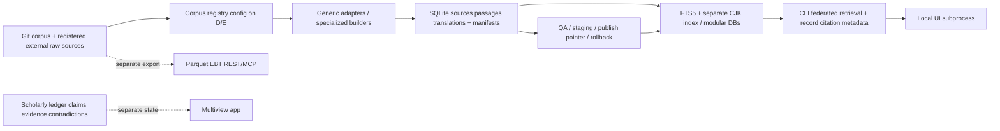
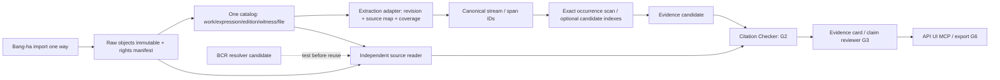

# REPORT 39-R2 — Independent review: Bang-ha-giac-ngo → BodhiAtlas V1 Core

**Ngày kiểm:** 25/11/2026 (Asia/Ho_Chi_Minh). **Trạng thái:** thẩm định mã nguồn có ghim SHA + POC cô lập; chưa nghiệm thu upstream. **Ngôn ngữ:** tiếng Việt. **Không sửa repo hoặc P39 cũ.**

**Phạm vi và định nghĩa bằng chứng:** `[CODE]` đã lấy file từ GitHub và đọc các đoạn liên quan; `[DOC]` tài liệu; `[ISSUE]` incident do dự án ghi nhận; `[PLAN]` chưa chạy; `[INFERRED]` hệ quả suy ra có tiền đề; `[TESTED-ISOLATED]` thực thi SQL/thuật toán rút gọn trong sandbox, không chạy ứng dụng upstream; `[TESTED]` chỉ dành cho thực thi upstream, hiện **0 ca**; `[UNKNOWN]` thiếu chứng cứ. HIGH/MED/LOW là độ tin cậy của nhận định cụ thể, không phải điểm tổng repo. MEASURED chỉ cho phép đo có scope, không dùng count blob làm số kinh. Effort L/M/H/VH là dự báo tương đối, không phải nhân-ngày. Báo cáo này đáp ứng cấu trúc 13 phần và thiết kế TC01–TC22; chưa đáp ứng trọn nghiệm thu runtime, rights, XML/binary và benchmark A/B do giới hạn dữ liệu/môi trường. Các hạn chế được giữ nguyên thay vì suy diễn.

## 1. Executive Decision

**Bang-ha: `USE AS COMPONENT` (có điều kiện; chưa chấp thuận sao chép code hoặc dữ liệu). Kiến trúc ưu tiên: C — Minimal BodhiAtlas Evidence Core**, một authority duy nhất cho source/file/edition/revision/occurrence/evidence; ưu tiên kiểm tái sử dụng BCR source resolver + gate trước khi viết mới, và Bang-ha làm nguồn nhập một chiều khi quyền cho phép. Confidence: **HIGH** về các sai khác contract được chỉ ra tại SHA; **MED** về ưu tiên kiến trúc C; **LOW** về thứ hạng chi phí thực tế trước TC22. Đây là quyết định đầu tư POC, không phải phê duyệt production.

**Tại sao không lấy ngay Bang-ha làm lõi?**

1. Bang-ha không chỉ là corpus: nó có adapter, SQLite/FTS5, CLI, release pointer, QA, UI, MCP và ledger. Tuy nhiên các phần này không cùng một contract chứng cứ độc lập. `sources/passages/translations` giữ SHA và locator, nhưng không biểu diễn đầy đủ file/edition/extraction revision bất biến; `EXACT` trả ID bản ghi có giới hạn, không phải mọi vị trí. [common.py L89–115](https://github.com/quoctran-2608/Bang-ha-giac-ngo/blob/4345737ae16638b19226ea1b11007e6ffa4faf62/tools/local_corpus_framework/corpus/common.py#L89-L115), [cli.py L398–455](https://github.com/quoctran-2608/Bang-ha-giac-ngo/blob/4345737ae16638b19226ea1b11007e6ffa4faf62/tools/local_corpus_framework/corpus/cli.py#L398-L455).
2. Hard blocker G2/G3: `EvidenceRecord.review_state='VERIFIED'`, `supports_claim=True`, hash/locator optional; validator chỉ kiểm ID, quote, loại. `SUPPORTED` đếm bất cứ evidence hỗ trợ nào chưa bị `REJECTED`, còn có `bypass_evidence_check`. Đây là **lỗi hợp đồng tĩnh**, chưa phải số lỗi production đo được. [scholarly_ledger.py L127–160](https://github.com/quoctran-2608/Bang-ha-giac-ngo/blob/4345737ae16638b19226ea1b11007e6ffa4faf62/tools/scholarly_ledger.py#L127-L160), [scholarly_ledger.py L400–475](https://github.com/quoctran-2608/Bang-ha-giac-ngo/blob/4345737ae16638b19226ea1b11007e6ffa4faf62/tools/scholarly_ledger.py#L400-L475). POC cô lập tái hiện predicate cho phép `UNREVIEWED` (TC16).
3. BCR là đối chứng mạnh nhất về cơ chế tin cậy: `evidence_gate` yêu cầu đọc nguồn độc lập do host cung cấp, đối chiếu pinned revision/locator, mặc định không đủ quan sát thì UNVERIFIED. Nhưng retrieval BCR vẫn chọn candidates có LIMIT; model corpus-first, chưa chứng minh ingest sách đa dạng. [verification.py L223–342](https://github.com/quoctran-2608/BuddhismDocuments-for-AI/blob/dfdd3cbb79e3dbfb49a855702fa00e4bad3b3410/tools/corpus_research/verification.py#L223-L342), [verification.py L373–393](https://github.com/quoctran-2608/BuddhismDocuments-for-AI/blob/dfdd3cbb79e3dbfb49a855702fa00e4bad3b3410/tools/corpus_research/verification.py#L373-L393), [retrieval.py L268–347](https://github.com/quoctran-2608/BuddhismDocuments-for-AI/blob/dfdd3cbb79e3dbfb49a855702fa00e4bad3b3410/tools/corpus_research/retrieval.py#L268-L347). Vì vậy **thử BCR gate trước khi quyết định viết gate mới**, không mặc nhiên chọn cả BCR DB.
4. Bang-ha đã có kỹ thuật tốt đáng kế thừa: hash inventory, per-file savepoint, CJK candidate + raw substring check, stage/atomic pointer/rollback. Dùng trực tiếp nếu license/contract/pass gold phù hợp; nếu không, giữ ý tưởng và viết lớp mỏng. Không nhân đôi corpus, không vận hành hai DB writable. [build.py L270–329](https://github.com/quoctran-2608/Bang-ha-giac-ngo/blob/4345737ae16638b19226ea1b11007e6ffa4faf62/tools/local_corpus_framework/corpus/build.py#L270-L329), [publication.py L150–239](https://github.com/quoctran-2608/Bang-ha-giac-ngo/blob/4345737ae16638b19226ea1b11007e6ffa4faf62/tools/local_corpus_framework/corpus/publication.py#L150-L239).
5. Repo có hạn chế production D:/E: được cưỡng chế trong code; config sandbox có nhánh khác nên không kết luận toàn framework không portable. Sửa path có thể rẻ nhưng chưa đủ để sửa identity và verification. [build.py L171–182](https://github.com/quoctran-2608/Bang-ha-giac-ngo/blob/4345737ae16638b19226ea1b11007e6ffa4faf62/tools/local_corpus_framework/corpus/build.py#L171-L182).

**Phản chứng đã đặt trước khi chọn:** A thắng nếu clean bootstrap + golden source/occurrence/gate + fault recovery qua với thay đổi ít tầng hơn C và chi phí quan sát thấp hơn; B thắng nếu source_reader dùng được cho PDF/EPUB bên cạnh corpus, không phải xây lại catalog/search; G thắng nếu tích hợp gate BCR và adapter Bang-ha trong cùng authority thực tế rẻ hơn C độc lập và không duy trì duplicate writable state. C thua nếu tự phát triển lan sang reader, parser engine, plugin runtime hoặc microservices không cần thiết. Không có lợi thế corpus/UI nào bù G2/G3 chưa qua.

**Ba phép thử quyết định đầu tiên:** (i) TC01+TC03 bootstrap và Bilara reopen; (ii) TC06+TC10 exhaustive occurrence và đúng ấn bản; (iii) TC15+TC16 adversarial verification/claim. Chỉ các ứng viên sống sót mới chạy TC14, TC11, TC22. Không chọn cloud, LLM hay knowledge graph trước các thử nghiệm này.

## 2. Sources & Evidence Ledger

### 2.1 Snapshot và quyền

| Repo | Nhánh/SHA | Quyền quan sát, giới hạn |
|---|---|---|
| [Bang-ha chính](https://github.com/quoctran-2608/Bang-ha-giac-ngo/commit/4345737ae16638b19226ea1b11007e6ffa4faf62) | main `4345737ae16638b19226ea1b11007e6ffa4faf62` | private, authorized pull; không public hóa corpus |
| [Bang-ha đối chiếu](https://github.com/quocgempro361/Bang-ha-giac-ngo/commit/4345737ae16638b19226ea1b11007e6ffa4faf62) | main `4345737ae16638b19226ea1b11007e6ffa4faf62` | private, authorized pull; cùng SHA tại thời điểm kiểm, repo ID khác |
| [BodhiAtlas](https://github.com/quoctran-2608/bodhi-atlas/commit/e3a702dd35135a08682cbc0f98f4eeeba21ae6c0) | main `e3a702dd35135a08682cbc0f98f4eeeba21ae6c0` | public, pull; PRD V1.4 và hai tài liệu companion đã lấy ở SHA này |
| [BCR](https://github.com/quoctran-2608/BuddhismDocuments-for-AI/commit/dfdd3cbb79e3dbfb49a855702fa00e4bad3b3410) | main `dfdd3cbb79e3dbfb49a855702fa00e4bad3b3410` | public, pull; đọc năm file trọng tâm, không chạy tests |
| [book-memex](https://github.com/queelius/book-memex/commit/7230f8c06b28966055ebd85abae392e4162ce673) | SHA ghim từ P57 rồi mở mã trực tiếp | ba file mở thành công; không xác nhận đây là HEAD hiện tại; đường `quoctran-2608/book-memex` trả 404, không suy repo không tồn tại |
| Open Notebook/RAGFlow, Docling, FTS5 | đối chứng hạn chế | chỉ P56 đã mở để định vị; không kiểm code Open Notebook/RAGFlow/Docling phiên này; không lấy roadmap hoặc POC cũ làm đo lường |

**MEASURED (Git metadata):** cây đệ quy Bang-ha chính ở SHA trên trả `truncated=false`, 17.168 entries = 16.711 blobs + 457 trees. Không suy số kinh, số sách, số nguồn có license hoặc coverage từ số blob. Hai `main` cùng commit hash (cùng snapshot Git thông thường, không đồng nghĩa remote artifacts D/E hoặc quyền sử dụng đồng nhất); không truy xuất cây mirror lần hai, không đối chiếu độc lập từng blob mirror. Cây BCR có 266 mục (không dùng làm thước đo maturity). Tag/release và dependency locks chưa ghim hoàn chỉnh; đây không phải stable release audit.

**Chuẩn đối chiếu bắt buộc**: [PRD.md L107–119](https://github.com/quoctran-2608/bodhi-atlas/blob/e3a702dd35135a08682cbc0f98f4eeeba21ae6c0/docs/PRD.md#L107-L119) — mọi vị trí, nguyên văn và vị trí nguồn; [PRD.md L342–381](https://github.com/quoctran-2608/bodhi-atlas/blob/e3a702dd35135a08682cbc0f98f4eeeba21ae6c0/docs/PRD.md#L342-L381) — kho tập trung, một catalog/search/API, ưu tiên phần mềm sẵn có, 19 yêu cầu nghiệm thu; [V1_CORE_FOUNDATION.md L96–159](https://github.com/quoctran-2608/bodhi-atlas/blob/e3a702dd35135a08682cbc0f98f4eeeba21ae6c0/docs/V1_CORE_FOUNDATION.md#L96-L159) — data units và code-only deterministic search; [V1_CORE_FOUNDATION.md L202–239](https://github.com/quoctran-2608/bodhi-atlas/blob/e3a702dd35135a08682cbc0f98f4eeeba21ae6c0/docs/V1_CORE_FOUNDATION.md#L202-L239) — phân biệt nhóm trạng thái; [ACADEMIC_RISKS_AND_VERIFICATION.md L154–165](https://github.com/quoctran-2608/bodhi-atlas/blob/e3a702dd35135a08682cbc0f98f4eeeba21ae6c0/docs/ACADEMIC_RISKS_AND_VERIFICATION.md#L154-L165) — G1–G6. Không diễn giải G3 là bài toán tự động hoàn toàn. P39 cũ đã mở ở SHA BodhiAtlas trên để định vị manh mối, nhưng từng luận điểm chính được kiểm lại từ Bang-ha ở SHA hiện hành.

### 2.2 Ledger claim độc lập (permalink commit + dòng)

| ID | Phát hiện / bằng chứng | Mức / phản chứng hoặc phép kiểm còn thiếu |
|---|---|---|

| E01 | [DOC] Cùng commit của hai remote; cây chính không truncated | [commit](https://github.com/quoctran-2608/Bang-ha-giac-ngo/commit/4345737ae16638b19226ea1b11007e6ffa4faf62) — HIGH metadata; remote artifacts ngoài Git UNKNOWN |
| E02 | [CODE] NFC+casefold, SHA256 và git inventory verification | [common.py L15–52](https://github.com/quoctran-2608/Bang-ha-giac-ngo/blob/4345737ae16638b19226ea1b11007e6ffa4faf62/tools/local_corpus_framework/corpus/common.py#L15-L52) — HIGH code; TC02/08 chưa upstream |
| E03 | [CODE] Source path unique trong corpus, passages/translations dùng string work/edition và locator JSON; không thấy extraction revision trong schema này | [common.py L89–115](https://github.com/quoctran-2608/Bang-ha-giac-ngo/blob/4345737ae16638b19226ea1b11007e6ffa4faf62/tools/local_corpus_framework/corpus/common.py#L89-L115) — HIGH scope schema; có thể mở rộng bằng migration, TC10/13 |
| E04 | [CODE] ID nguồn/record dựa corpus/version/path/native/kind; hash unchanged thì skip; parser profile không nằm trong tuple | [build.py L290–324](https://github.com/quoctran-2608/Bang-ha-giac-ngo/blob/4345737ae16638b19226ea1b11007e6ffa4faf62/tools/local_corpus_framework/corpus/build.py#L290-L324) — HIGH code, stale behavior INFERRED; TC13 |
| E05 | [CODE] Production roots bị giới hạn D/E; sandbox role có thể khác | [build.py L171–182](https://github.com/quoctran-2608/Bang-ha-giac-ngo/blob/4345737ae16638b19226ea1b11007e6ffa4faf62/tools/local_corpus_framework/corpus/build.py#L171-L182) — HIGH; TC01 xác định patch portability |
| E06 | [CODE] Bilara JSON pointer + contributor ID; license null | [adapters.py L57–73](https://github.com/quoctran-2608/Bang-ha-giac-ngo/blob/4345737ae16638b19226ea1b11007e6ffa4faf62/tools/local_corpus_framework/corpus/adapters.py#L57-L73) — HIGH; chưa kiểm quyền/roundtrip upstream, TC02/03 |
| E07 | [CODE] TEI XPath, xml:id, page; itertext flatten | [adapters.py L152–201](https://github.com/quoctran-2608/Bang-ha-giac-ngo/blob/4345737ae16638b19226ea1b11007e6ffa4faf62/tools/local_corpus_framework/corpus/adapters.py#L152-L201) — HIGH code; locator namespace/page precision và note roles TC05 |
| E08 | [CODE] Việt/Hán HTML xử lý theo dòng, regex, first id, whitespace collapse | [build_vietnamese_canon.py L93–118](https://github.com/quoctran-2608/Bang-ha-giac-ngo/blob/4345737ae16638b19226ea1b11007e6ffa4faf62/tools/local_corpus_framework/build_vietnamese_canon.py#L93-L118) — HIGH; multi-anchor/multiline và raw map TC04/18 |
| E09 | [CODE] Source URL owner cũ hardcoded; edition hash theo tên edition cấp corpus ở specialized builder | [build_vietnamese_canon.py L181–214](https://github.com/quoctran-2608/Bang-ha-giac-ngo/blob/4345737ae16638b19226ea1b11007e6ffa4faf62/tools/local_corpus_framework/build_vietnamese_canon.py#L181-L214); [build_vietnamese_canon.py L320–336](https://github.com/quoctran-2608/Bang-ha-giac-ngo/blob/4345737ae16638b19226ea1b11007e6ffa4faf62/tools/local_corpus_framework/build_vietnamese_canon.py#L320-L336) — HIGH; URL availability và semantic collision chưa test |
| E10 | [CODE] Source hashes + inventory + savepoint, parse error ghi nhận | [build.py L270–329](https://github.com/quoctran-2608/Bang-ha-giac-ngo/blob/4345737ae16638b19226ea1b11007e6ffa4faf62/tools/local_corpus_framework/corpus/build.py#L270-L329) — HIGH code; TC18 corruption/missing |
| E11 | [CODE] QA full path kiểm relation và chỉ lấy tối đa 3 citation samples/corpus; modular QA 1 sample/corpus | [build.py L71–164](https://github.com/quoctran-2608/Bang-ha-giac-ngo/blob/4345737ae16638b19226ea1b11007e6ffa4faf62/tools/local_corpus_framework/corpus/build.py#L71-L164) — HIGH; count/coverage production UNKNOWN |
| E12 | [CODE] CLI exact substring selects record ID, no per-occurrence offset, LIMIT | [cli.py L398–455](https://github.com/quoctran-2608/Bang-ha-giac-ngo/blob/4345737ae16638b19226ea1b11007e6ffa4faf62/tools/local_corpus_framework/corpus/cli.py#L398-L455) — HIGH static; TC06/09 isolated; upstream TC06 |
| E13 | [CODE] CBETA char FTS + instr raw hậu kiểm trước LIMIT; optimized path có điều kiện | [cli.py L365–407](https://github.com/quoctran-2608/Bang-ha-giac-ngo/blob/4345737ae16638b19226ea1b11007e6ffa4faf62/tools/local_corpus_framework/corpus/cli.py#L365-L407); [build_cbeta_fts.py L28–59](https://github.com/quoctran-2608/Bang-ha-giac-ngo/blob/4345737ae16638b19226ea1b11007e6ffa4faf62/tools/local_corpus_framework/build_cbeta_fts.py#L28-L59) — HIGH logic; TC07 kiểm candidate recall |
| E14 | [CODE] FTS unicode61 remove_diacritics 2; expansion không đồng nghĩa exact | [common.py L111–115](https://github.com/quoctran-2608/Bang-ha-giac-ngo/blob/4345737ae16638b19226ea1b11007e6ffa4faf62/tools/local_corpus_framework/corpus/common.py#L111-L115); [ontology.py L97–155](https://github.com/quoctran-2608/Bang-ha-giac-ngo/blob/4345737ae16638b19226ea1b11007e6ffa4faf62/tools/local_corpus_framework/corpus/ontology.py#L97-L155) — HIGH code; TC08/17 |
| E15 | [CODE] record() gộp source_version, sha256, locator, work/edition metadata vào citation payload | [cli.py L267–294](https://github.com/quoctran-2608/Bang-ha-giac-ngo/blob/4345737ae16638b19226ea1b11007e6ffa4faf62/tools/local_corpus_framework/corpus/cli.py#L267-L294) — HIGH; metadata payload không tự reopen, TC10 |
| E16 | [CODE] release validation/checksum/atomic pointer/lock; validate_sources kiểm đầu/cuối từng source | [publication.py L61–69](https://github.com/quoctran-2608/Bang-ha-giac-ngo/blob/4345737ae16638b19226ea1b11007e6ffa4faf62/tools/local_corpus_framework/corpus/publication.py#L61-L69); [publication.py L116–239](https://github.com/quoctran-2608/Bang-ha-giac-ngo/blob/4345737ae16638b19226ea1b11007e6ffa4faf62/tools/local_corpus_framework/corpus/publication.py#L116-L239); [publication.py L247–273](https://github.com/quoctran-2608/Bang-ha-giac-ngo/blob/4345737ae16638b19226ea1b11007e6ffa4faf62/tools/local_corpus_framework/corpus/publication.py#L247-L273) — HIGH; TC14/20 chưa chạy |
| E17 | [CODE] Ledger EvidenceRecord default VERIFIED, support true; validate không bắt hash/locator | [scholarly_ledger.py L127–160](https://github.com/quoctran-2608/Bang-ha-giac-ngo/blob/4345737ae16638b19226ea1b11007e6ffa4faf62/tools/scholarly_ledger.py#L127-L160); [scholarly_ledger.py L294–333](https://github.com/quoctran-2608/Bang-ha-giac-ngo/blob/4345737ae16638b19226ea1b11007e6ffa4faf62/tools/scholarly_ledger.py#L294-L333) — HIGH, TC15 isolated; upstream adverse test bắt buộc |
| E18 | [CODE] SUPPORTED non-rejected predicate + bypass; link SUPPORTS không chứng minh ngữ nghĩa | [scholarly_ledger.py L400–475](https://github.com/quoctran-2608/Bang-ha-giac-ngo/blob/4345737ae16638b19226ea1b11007e6ffa4faf62/tools/scholarly_ledger.py#L400-L475) — HIGH; TC16 isolated; G3 reviewer vẫn cần |
| E19 | [CODE] Multiview generator gán T1 mặc định cho item lakehouse | [generate_multiview_app.py L120–130](https://github.com/quoctran-2608/Bang-ha-giac-ngo/blob/4345737ae16638b19226ea1b11007e6ffa4faf62/tools/generate_multiview_app.py#L120-L130) — HIGH tại đường generator, không suy tất cả DB/corpus; TC17 |
| E20 | [CODE] Local UI gọi subprocess shell=False có timeout; default D/E config | [server.py L16–81](https://github.com/quoctran-2608/Bang-ha-giac-ngo/blob/4345737ae16638b19226ea1b11007e6ffa4faf62/tools/local_corpus_ui/server.py#L16-L81) — HIGH code; UI tests chưa chạy, auth multi-user UNKNOWN |
| E21 | [CODE] EBT server tự download Parquet, CORS wildcard/credentials, mặc định bind 0.0.0.0 | [ebt_mcp_server.py L38–66](https://github.com/quoctran-2608/Bang-ha-giac-ngo/blob/4345737ae16638b19226ea1b11007e6ffa4faf62/tools/ebt_mcp_server.py#L38-L66); [ebt_mcp_server.py L299–315](https://github.com/quoctran-2608/Bang-ha-giac-ngo/blob/4345737ae16638b19226ea1b11007e6ffa4faf62/tools/ebt_mcp_server.py#L299-L315); [ebt_mcp_server.py L415–424](https://github.com/quoctran-2608/Bang-ha-giac-ngo/blob/4345737ae16638b19226ea1b11007e6ffa4faf62/tools/ebt_mcp_server.py#L415-L424) — HIGH; không coi đã pentest; TC19 |
| E22 | [DOC] README không có license CC0 toàn kho; source rights theo từng nguồn | [README.md L118–121](https://github.com/quoctran-2608/Bang-ha-giac-ngo/blob/4345737ae16638b19226ea1b11007e6ffa4faf62/README.md#L118-L121); [validate_contribution.py L32–51](https://github.com/quoctran-2608/Bang-ha-giac-ngo/blob/4345737ae16638b19226ea1b11007e6ffa4faf62/tools/local_corpus_framework/validate_contribution.py#L32-L51) — HIGH tài liệu; quyền thực tế UNKNOWN |
| E23 | [ISSUE] READY giả, quarantine, publication interruption và OOM là incident lịch sử | [2026-09-24-phase-4-claim-correction.md L7–19](https://github.com/quoctran-2608/Bang-ha-giac-ngo/blob/4345737ae16638b19226ea1b11007e6ffa4faf62/incidents/2026-09-24-phase-4-claim-correction.md#L7-L19); [2026-09-24-safe-index-publication.md L5–22](https://github.com/quoctran-2608/Bang-ha-giac-ngo/blob/4345737ae16638b19226ea1b11007e6ffa4faf62/incidents/2026-09-24-safe-index-publication.md#L5-L22); [2026-09-25-judaism-build-oom-storage-incident.md L10–41](https://github.com/quoctran-2608/Bang-ha-giac-ngo/blob/4345737ae16638b19226ea1b11007e6ffa4faf62/incidents/2026-09-25-judaism-build-oom-storage-incident.md#L10-L41) — HIGH về nội dung report; không đo severity hiện tại |
| E24 | [CODE] Source samples: mn1:1.1, sc anchor, Taishō line anchors và translator meta | [mn1_root-pli-ms.json L1–7](https://github.com/quoctran-2608/Bang-ha-giac-ngo/blob/4345737ae16638b19226ea1b11007e6ffa4faf62/01_NIKAYA/MN_Trung-Bo/pli_root/mn1_root-pli-ms.json#L1-L7); [mn1.html L4–23](https://github.com/quoctran-2608/Bang-ha-giac-ngo/blob/4345737ae16638b19226ea1b11007e6ffa4faf62/01_NIKAYA/MN_Trung-Bo/vi/mn1.html#L4-L23); [da1.html L9–16](https://github.com/quoctran-2608/Bang-ha-giac-ngo/blob/4345737ae16638b19226ea1b11007e6ffa4faf62/02_AGAMA/DA_Truong-A-ham/lzh_root/da1.html#L9-L16) — HIGH cấu trúc; quyền/alignment/precision chưa qua TC03/04 |
| E25 | [CODE] BCR host-wired independent reader, missing required check => UNVERIFIED, fail => REJECTED | [verification.py L223–342](https://github.com/quoctran-2608/BuddhismDocuments-for-AI/blob/dfdd3cbb79e3dbfb49a855702fa00e4bad3b3410/tools/corpus_research/verification.py#L223-L342); [verification.py L373–393](https://github.com/quoctran-2608/BuddhismDocuments-for-AI/blob/dfdd3cbb79e3dbfb49a855702fa00e4bad3b3410/tools/corpus_research/verification.py#L373-L393); [source_resolvers.py L35–76](https://github.com/quoctran-2608/BuddhismDocuments-for-AI/blob/dfdd3cbb79e3dbfb49a855702fa00e4bad3b3410/tools/corpus_research/source_resolvers.py#L35-L76) — HIGH code; fixture upstream và integration PDF/EPUB UNKNOWN |
| E26 | [CODE] BCR model Record giữ source_sha/path, witness, text role; retrieval candidate cap max(limit*5,50) | [model.py L30–77](https://github.com/quoctran-2608/BuddhismDocuments-for-AI/blob/dfdd3cbb79e3dbfb49a855702fa00e4bad3b3410/tools/corpus_research/model.py#L30-L77); [retrieval.py L268–347](https://github.com/quoctran-2608/BuddhismDocuments-for-AI/blob/dfdd3cbb79e3dbfb49a855702fa00e4bad3b3410/tools/corpus_research/retrieval.py#L268-L347) — HIGH code; exhaustive EXACT chưa chứng minh |
| E27 | [CODE] book-memex edition scalar, import indexes primary_file, EPUB chapter root CFI | [models.py L66–115](https://github.com/queelius/book-memex/blob/7230f8c06b28966055ebd85abae392e4162ce673/book_memex/db/models.py#L66-L115); [import_service.py L128–146](https://github.com/queelius/book-memex/blob/7230f8c06b28966055ebd85abae392e4162ce673/book_memex/services/import_service.py#L128-L146); [epub.py L24–59](https://github.com/queelius/book-memex/blob/7230f8c06b28966055ebd85abae392e4162ce673/book_memex/services/content_extraction/epub.py#L24-L59) — HIGH cho đoạn code SHA cũ; multi-file actual UNKNOWN |
| E28 | [DOC/ISSUE] QA progress tự đính chính, test_report là historical | [TIEN_DO_DU_AN.md L1–6](https://github.com/quoctran-2608/Bang-ha-giac-ngo/blob/4345737ae16638b19226ea1b11007e6ffa4faf62/docs/TIEN_DO_DU_AN.md#L1-L6); [TEST_REPORT.md L1–29](https://github.com/quoctran-2608/Bang-ha-giac-ngo/blob/4345737ae16638b19226ea1b11007e6ffa4faf62/tools/local_corpus_ui/TEST_REPORT.md#L1-L29) — HIGH; không dùng pass rate lịch sử làm pass hiện tại |
| E29 | [TESTED-ISOLATED] SQL record filter, Unicode transform, ledger predicate và ID function tái hiện tại sandbox | TC06/07/08/09/13/15/16; script & log §9/§13 — HIGH trong fixture, không phải upstream behavior đã chạy |
**Inventory:** 40 file Bang-ha được lấy nội dung text thành công, gồm code, test, docs/incident và mẫu corpus; các đoạn trọng tâm đã đọc và dẫn ở trên. Toàn bộ blob không được rà line-by-line; việc lấy nội dung không đồng nghĩa đã kiểm mọi hàm. Thêm 14 file yêu cầu/đối chứng. Bốn tệp XML/EPUB/DOCX/SQLite được thử đọc nhưng không kiểm nội dung (xem §13).

## 3. Architecture & Data Flow

### 3.1 Hiện trạng đọc từ source (không phải deployment đã chạy)



Đường D→F có `source_id`, `source_path`, `source_version`, SHA, locator và metadata được trả vào citation; không thấy trong đường đã đọc một transaction độc lập bắt buộc đọc lại raw bytes trước khi ledger chuyển VERIFIED. Các module cùng repo không tự động tạo authority chung. EBT server dùng Parquet riêng, không phải universal API đọc chung SQLite. `README` framework chỉ rõ raw read-only và index/release ngoài Git; `SPEC` mô tả ổ D source-of-record và E derived. Mỗi corpus còn có builder specialized nên migration phải audit từng schema/ID policy. Cần phân biệt staging release của index với G6 phát hành học thuật.

### 3.2 Đề xuất C (kiến trúc, chưa viết/triển khai)



Authority duy nhất: BodhiAtlas catalog, raw object hash, extraction revisions, verification events, claim review events. FTS/BM25/trigram là derived có thể xóa/rebuild. Không dùng lại source ID như ID authoritative nếu ID không scope đúng revision. Import mapping `(upstream_repo, commit, path, native_id, raw_sha)` → `file_id, span_id` giữ được lineage. Không đồng bộ hai chiều ledger Bang-ha hoặc BCR. Corpus Bang-ha giữ upstream immutable; DB Bang-ha có thể chạy read-only trong demo/POC nhưng không bắt buộc production.

**Ba contract hẹp (không general plugin framework):** `Extractor.extract(raw, profile) -> revision, segments, map, coverage`; `SourceReader.open(file_id, hash, locator) -> independently observed source/range`; `CorpusImporter.enumerate(snapshot, rights) -> raw objects + provenance`. Retrieval, verifier policy, release activation, review/audit và rights enforcement thuộc core, không để adapter tự cấp VERIFIED hay quyền. Reader UI có thể thay ngoài core. Cloud ưu tiên theo PRD, nhưng kiểm offline single process trước; sau benchmark mới quyết SQLite local sync hay Postgres shared catalog/object storage. Không xem offline prototype là đích cloud đã nghiệm thu.

## 4. Feature Fit–Gap Matrix C01–C15

NATIVE/CONFIG/EXTENSION/EXTERNAL/MISSING/UNKNOWN nói về phạm vi đã đọc, không phải GATE PASS. `ND` = `NOT DEMONSTRATED` cho upstream; `static blocker` = đã có phản chứng contract từ code; `isolated` = phép thử thành phần tái tạo, không phải `GATE FAIL (measured)` của upstream. Không có GATE PASS hay GATE FAIL (measured) upstream trong phiên này. Effort ước tính phần sửa Bang-ha-led: L nhỏ (wrapper/config), M vừa (module + tests), H lớn (đổi contract nhiều phần), VH nhiều tầng/kiến trúc; không gán LOC hay nhân-ngày.

| C | Năng lực | Fit | Gate | Evidence / rủi ro | Effort ước tính / next test / hành động |
|---|---|---|---|---|---|

| C01 | Universal ingest | EXTENSION | G1 ND | E06–10: corpus parsers, không chứng minh generic PDF/EPUB/DOCX import | H; TC01/11; USE AS COMPONENT |
| C02 | OCR/layout | EXTERNAL | G1/G2 ND | Không thấy đường OCR production trong đường đã đọc; missing page/reading order UNKNOWN | H; TC11/12; TRIAL ONLY engine ngoài |
| C03 | Canonical/source map | EXTENSION | G1/G2 ND | E02–04, E07–09: hash + locator nhưng không revision/span map đảo ngược | H; TC03/04/05/13; USE AS COMPONENT |
| C04 | Work/Expression/Edition/Witness/File | EXTENSION | G2 ND; static blocker | E03/04/09: ID theo corpus/path/edition string; không đủ entity/immutable history | H; TC10/13; REJECT schema as authority |
| C05 | Exhaustive EXACT code-only | EXTENSION | ND; static blocker; isolated | E12/13/29: one row per record, LIMIT, boundary miss in fixture | H; TC06/07/09; REJECT existing EXACT as complete |
| C06 | Multilingual normalized | EXTENSION | G2 ND | E02/13/14: NFC, FTS diacritics; đ/d, Han variants, Wylie, reverse offsets not demonstrated | M/H; TC07/08; USE AS COMPONENT |
| C07 | Fuzzy OCR tolerant | UNKNOWN | ND | FTS prefix/rank and ontology ≠ edit distance; full repo fuzzy coverage unknown | M; TC08/12; TRIAL ONLY |
| C08 | Sense-aware lexicon | EXTENSION | G5 ND | E14/19: term expansion, no audited sense evidence/reviewer | H; TC17; TRIAL ONLY |
| C09 | Semantic/RAG optional | EXTERNAL | ND | Core retrieval deterministic; separate cloud products not established as mandatory; model cost UNKNOWN | L to omit, H if added; TC19/21; REJECT as prerequisite |
| C10 | Verified citation/reopen | EXTENSION | G2 ND; static blocker | E15/17/25: metadata and QA sample vs independent G2; false default | H; TC03/10/12/15; REJECT ledger label as proof |
| C11 | Claims/notes | EXTENSION | G3/G6 ND; static blocker | E17/18: non-rejected predicate + bypass; review required | H; TC16/17; USE AS COMPONENT ideas only |
| C12 | REST/MCP/export | EXTENSION | G2/G4 ND | E20/21: interfaces exist, separate Parquet/CLI, rights/provenance not unified | M/H; TC19; TRIAL ONLY |
| C13 | Coverage/rebuild/QA | NATIVE | G1/G6 ND | E10/11/16/23: staged release, partial state and sample QA; deterministic parser revision/recovery unknown | M; TC13/14/18; USE AS COMPONENT |
| C14 | Rights/security/backup | EXTENSION | G4/G6 ND | E21/22: rights unknown, wildcard/egress, backup raw+ledger untested | H; TC02/19/20; REJECT public default |
| C15 | Operability/TCO | EXTENSION | ND | E05/23: D/E, modular DB, resource incident; costs unmeasured | H; TC01/21/22; TRIAL ONLY |
### Quality gates (nguyên nghĩa từ Academic Risks §5)

| Gate | Điều kiện bắt buộc | Bang-ha hiện tại (không runtime pass) | Điều kiện để mở cổng |
|---|---|---|---|
| G1 Ingest | File xác định, metadata tối thiểu, phạm vi và lỗi/trang thiếu rõ | ND; có coverage/QA và quarantine nhưng sample, personal docs chưa kiểm | TC01/02/05/11/12/18; PARTIAL phải chính xác |
| G2 Citation | Kiểm lại đúng file, ấn bản, câu chữ, locator; OCR rủi ro được rà | ND/static blocker: E03/E17; citation payload không đủ | TC03/04/05/10/12/15; zero false verified, no wrong edition |
| G3 Claim | Ngữ cảnh, loại nhận định, ngoại lệ và chứng cứ trái chiều; người duyệt | ND/static blocker E18; không có số đo upstream | TC16/17; required verified source + review policy, no bypass |
| G4 External | Đã đọc phần liên quan, nguồn/version, access record, rights | ND; E22, manifest ngoài Git unavailable | TC02/19, per-source grant; nguồn chưa đọc chỉ lead |
| G5 Lexicon | Tách sense, chứng cứ, không nhập nhằng từ tương ứng | ND; E14/19 expansion/T1 không đủ | TC17, expert-reviewed sense edges |
| G6 Publish | G2/G3 trọng yếu, nhất quán, chú thích/quyền | ND; release index không đồng nghĩa publish academic | TC14/20 + reviewer checklist/rights export audit |

Không cộng điểm trung bình; C05/G2/G3 có quyền loại ứng viên khỏi `ADOPT` dù NATIVE C13.

## 5. Deep Technical Findings A–G

### A — Corpus, app, framework, hay evidence platform?

Tách bốn sản phẩm: kho kinh điển phiên bản Git; framework tìm kiếm ngữ liệu cục bộ; giao diện CLI/UI và EBT server; prototype ledger/cloud multiview. Corpus có giá trị trực tiếp cho nghiên cứu Phật học, nhưng framework thiết kế quanh nguồn đăng ký, không phải user library bất kỳ. [SPEC.md L3–67](https://github.com/quoctran-2608/Bang-ha-giac-ngo/blob/4345737ae16638b19226ea1b11007e6ffa4faf62/tools/local_corpus_framework/SPEC.md#L3-L67) là phạm vi thiết kế, [build.py L171–182](https://github.com/quoctran-2608/Bang-ha-giac-ngo/blob/4345737ae16638b19226ea1b11007e6ffa4faf62/tools/local_corpus_framework/corpus/build.py#L171-L182) là cưỡng chế thực tế. Đừng nhập bản EPUB xuất từ cùng corpus rồi tính thành witness độc lập. Cloud 2.0 spec/roadmap là DOC/PLAN, không phải hệ thống đã kiểm. Điểm tốt: tách raw read-only, tìm code-only, bảo toàn thông tin văn bản. Điểm chưa đủ: authoritative evidence core và generic ingestion. Phản chứng cho kết luận phân lớp: demo một PDF cá nhân hai ấn bản có raw reopen, full occurrence và gate đúng ở cùng snapshot; nếu pass, xem lại class.

### B — Schema, identity, extraction revision

[common.py L89–115](https://github.com/quoctran-2608/Bang-ha-giac-ngo/blob/4345737ae16638b19226ea1b11007e6ffa4faf62/tools/local_corpus_framework/corpus/common.py#L89-L115): `sources` có unique `(corpus_id,source_path)`; `passages` và `translations` có `work_id`, `edition_id`, `source_native_id`, `sequence`, `locator`, text. `translations.passage_id` nullable FK. Đây là mô hình hữu dụng cho corpus, không tự động tương đương mô hình Work–Expression–Edition–Witness–SourceFile. `edition` chung có thể không cùng work; witness/translator metadata scalar không thiết lập identity. Generic builder `uid(cid,version,name)` cho source, `uid(cid,version,meta.get('edition'),name)` cho edition và `uid(cid,version,name,native,kind)` cho record; specialized builder `uid(corpus_id, meta.get('edition','Standard'))` có scope khác. Một revision parser mới giữ nguyên source bytes/native ID có thể tạo nội dung/locator khác mà cùng record ID; skip `already[0]==h` có thể bỏ qua parser change nếu build resume/cache không đổi. Đây là INFERRED, không khẳng định bug đang xảy ra mọi luồng. Cần thử TC13 và full reparse; source hash không thay thế extraction revision. `record()` trả citation metadata tốt cho reader nhưng cần chứng cứ độc lập và immutable history, không dùng ID hiện hành như citation persistent mặc định.

### C — Ingest, QA, publish, recovery

Điểm mạnh bị bỏ qua nếu tự viết: Git blob verification, đọc raw, SHA256, manifest per-file, rollback savepoint, source-specific parser map, full/partial status, read-only index resolution. `publish_index` kiểm acquisition complete, coverage, `qa_passed`, validation DB, validate_sources, hash copy, baseline revision và atomic pointer; rollback hash/path bounded. Đây là logic thực ở [publication.py L75–133](https://github.com/quoctran-2608/Bang-ha-giac-ngo/blob/4345737ae16638b19226ea1b11007e6ffa4faf62/tools/local_corpus_framework/corpus/publication.py#L75-L133) và [publication.py L150–273](https://github.com/quoctran-2608/Bang-ha-giac-ngo/blob/4345737ae16638b19226ea1b11007e6ffa4faf62/tools/local_corpus_framework/corpus/publication.py#L150-L273), không chỉ roadmap. Tuy vậy validate_sources kiểm first/last record mỗi source; QA modular lấy một mẫu/corpus; đúng hash không chứng minh parser không bỏ đoạn giữa. Không gọi sampled QA là toàn corpus coverage. Cần independent inventory counts, parser emission oracle, missing pages, no silent skip và crash consistency raw+catalog+ledger chứ không chỉ SQLite index. `validate_contribution` có kiểm metadata/license field và locator, trả rights_review_required nếu null; không biến declared license thành grant. [validate_contribution.py L13–51](https://github.com/quoctran-2608/Bang-ha-giac-ngo/blob/4345737ae16638b19226ea1b11007e6ffa4faf62/tools/local_corpus_framework/validate_contribution.py#L13-L51). `docs/TIEN_DO_DU_AN` đính chính QA cũ, incident publication cho thấy có cải thiện code; không kết luận vẫn có lỗi xóa DB cũ. TC14 mới quyết định.

### D — Multilingual retrieval / EXACT

CLI dùng `substring=exact or bool(cjk_chars)`, candidate path CBETA char FTS rồi `instr`, sau đó record select `LIMIT`. `record_id` không cho start/end, context mới gắn record. `federated_search` lấy `target=offset+limit+1` rồi merge/page; không phải occurrence enumeration. Tìm lặp 5 lần trả một record có thể hữu ích UX nhưng không đủ PRD. Bất kỳ chunk split nào cũng đòi canonical-stream semantics; query qua ranh giới không thể tìm nếu chỉ `instr` từng đoạn. CJK special index có ưu điểm hậu kiểm raw trước limit, nhưng candidate index stale/coverage, punctuation, short query và unicode beyond range chưa xác nhận. FTS tokenizer có bỏ dấu nhưng `normalized()` chỉ NFC+casefold; không có source map qua expansion/case folding. Chi tiết test §7.

### E — Locator, verification và scholarly ledger

`parse_bilara` dùng pointer escape `~`/`/`, giữ segment key. `parse_tei` dùng XPath, xml_id, page + itertext; source map cần phạm vi node + version + note roles. HTML builder xử lý line-based regex: bỏ `ref` anchor, thay tag bằng space, unescape, collapse; một dòng có nhiều ID chỉ giữ first ID; nếu một paragraph nhiều dòng, phần nối có thể không được chọn. Đây là nguy cơ từ đường mã và mẫu Hán/Vinaya, không phải đo tỷ lệ mất văn bản toàn corpus. `4345737` còn hardcode URL owner cũ; không gọi URL tồn tại hay quyền đầy đủ nếu chưa mở nó. Citation reopen phải đối chiếu source bytes, đúng edition, locator và text/range; QA sample không cấp verified cho từng hit.

Ledger có ba record types, claim-evidence links, contradictions và revision lineage — hữu ích như concept. Nhưng `EvidenceRecord` tạo mặc định VERIFIED khi chỉ có ID và quotation; `validate` không kiểm `review_state` nguồn/hash/locator. `add_evidence` gọi validate rồi insert/update; `add_claim` cho bypass. Predicate `review_state != 'REJECTED'` nhận UNREVIEWED và chuỗi trạng thái khác nếu support=true, không xét tất cả contradictions. **Không dùng ledger này để cấp nhãn G2/G3.** Cũng không kết luận người nghiên cứu đã phát hành claim sai; audit DB production chưa làm. BCR gate tách trusted contract/capability khỏi candidate, fail/pending explicit, là lựa chọn thử trước. Chú ý BCR contiguous source span limitation: markup/escaped text không flatten; điều đó có thể giảm recall nhưng giữ tính trung thực. Mở rộng resolver bằng proof/precision status, không làm yếu gate để pass. [source_resolvers.py L23–76](https://github.com/quoctran-2608/BuddhismDocuments-for-AI/blob/dfdd3cbb79e3dbfb49a855702fa00e4bad3b3410/tools/corpus_research/source_resolvers.py#L23-L76), [verification.py L319–393](https://github.com/quoctran-2608/BuddhismDocuments-for-AI/blob/dfdd3cbb79e3dbfb49a855702fa00e4bad3b3410/tools/corpus_research/verification.py#L319-L393).

### F — API/UI/MCP/cloud/security

Local UI `server.py` có timeout và shell=False, tests host/origin/allowlist và worker cleanup — có thể học. Chưa xác nhận full route ACL; EBT service là FastAPI/PyArrow Parquet riêng, tự fetch remote khi thiếu và wildcard CORS + credentials, CLI host mặc định `0.0.0.0`. Bind mặc định không chứng minh có public server thực, CORS không phải auth; cloud shared deployment cần host auth, per-source ACL, egress policy, limit bytes/request/time, safe path resolution, audit và no secrets. Không thử exploit production. Multiview generator gán T1 theo nhóm dữ liệu, không phải đánh giá từng nguồn; tách authority tier, textual fidelity, relevance, independence và review. Không dùng UI badge làm scholarly score.

### G — Reuse, maturity, maintenance

Mức maturity quan sát: framework có mã và tests thực, incident correction là dấu hiệu biết xử lý lỗi. Không có evidence về clean restore/benchmark/resource usage phiên này. D/E production constraints là lựa chọn operational có lợi tại host gốc, nhưng đắt khi cloud/universal; sửa thành injected paths, no global config; thử sandbox role có sẵn trước khi port. Đừng xóa toàn bộ corpus metadata, cũng không fork toàn bộ cloud/ledger. BCR source gate có contract tốt hơn, nhưng BCR retrieval vẫn candidate top-K và model corpus-first; `book-memex` có library/reader importer nhưng scalar edition + primary-file indexing/CFI chapter-root gây rủi ro authority. E chưa được kiểm code mới, chỉ xếp trial V2. Chi phí lớn nhất là migration semantics, không phải số dòng parser. TCO cần đo trên cùng slice.

### 5.1 H01–H12: phản biện với điều kiện đảo

| H | Kết quả | Bằng chứng và phản chứng | Điều kiện thay đổi |
|---|---|---|---|
| H01 portable clean clone | PARTIAL | E05; production roots D/E; sandbox config/test fixtures tồn tại, production external data unavailable | TC01 linux + windows; portable config và manifests đầy đủ |
| H02 identity đủ | REFUTED (contract tĩnh) | E03/04/09; no distinct revision and edition scopes differ | TC10/13 + migration, immutable reopen |
| H03 exact exhaustive | REFUTED (contract tĩnh) | E12/29; record IDs, LIMIT, no offsets | TC06/07/09 full oracle 1.0/1.0 |
| H04 locators reopen ổn định | PARTIAL | E06/07/08/15/16; JSON pointer/XPath thật, HTML line/first anchor; no whole-file mapping | TC03/04/05/13 with raw hashes, reopen old revision |
| H05 mapping Pāli–Việt/Hán–Việt verified | UNKNOWN | E24 structural IDs; `translations.passage_id` nullable, không audit edge/edition | TC04/17 reviewed alignment including non-1:1 |
| H06 ontology/parallel scholarly verified | PARTIAL | E14, E19 term rules, lookup file; chưa chứng minh sense provenance | TC17 human-reviewed sense and edges; heuristic labels |
| H07 safe publication | PARTIAL | E16 actual stage/lock/pointer/hash; incident correction E23 | TC14 kill/corrupt/reader + TC20 restore |
| H08 QA chứng minh toàn corpus | REFUTED (scope claim) | E11/28 explicitly sampled; historical READY errors | independent full coverage oracle TC18, no false READY |
| H09 ledger fail-closed VERIFIED/SUPPORTED | REFUTED (contract tĩnh + isolated) | E17/18/29; default verified + non-rejected predicate + bypass | TC15/16 upstream then patched; zero false verified/support |
| H10 T1 do đánh giá từng nguồn | REFUTED (generator path) | E19 line 126 assigns all item T1, does not establish per-source provenance | source-tier audit, no implicit credibility, TC17 |
| H11 public cloud safe | UNKNOWN; static concerns | E20/21 bind/egress/CORS; local tests exist, no ACL pentest | TC19 sandbox, deny unauthorized, offline no egress |
| H12 Bang-ha-led rẻ nhất | UNKNOWN | E03/04/12/17/18 imply multi-layer changes; no measured A/B cost | TC22 comparable gates & observed effort; A can win if lower |

`REFUTED` ở H02/H03/H08/H09/H10 chỉ phản bác mệnh đề cụ thể trong phạm vi đường mã đã đọc, không phải phủ định mọi feature hoặc trạng thái production.

## 6. Source Fidelity & Provenance

### 6.1 Chain-of-custody

| Bước | Bang-ha đã có (E) | Yêu cầu BodhiAtlas / thiết kế đề xuất |
|---|---|---|
| Raw object + rights | E02/10/22 file SHA, git inventory, source metadata; raw external unavailable | immutable bytes in content-addressed storage; SHA256 verify on read; per-source grant with access/redistribution/cloud flags |
| Work/expression/edition/witness/file | E03/04/09 IDs và strings | distinct entities, relation types, external identifier mappings; distinct version for changed bytes |
| ExtractionRevision | parser IDs not bound into record identity E04 | revision_id = file identity + tool version/config/profile/output hash; immutable output/map |
| Canonical text + normalized map | E02/08 normalized fields, HTML flatten | raw-preserving canonical stream, transformations versioned, codepoint ranges and reversible mapping |
| Passage/span/occurrence | E06/07/12/15 locator + record | occurrence `(file_id, revision_id, start,end, mode, scope)`; span locators with precision and source role |
| Independent checker | E11/16 QA samples; E17 lacks required check | host-owned source reader reopens raw file independently; identity/hash/locator/quote checks, OCR review required |
| Claim review / export | E18 support predicate; E19 T1 default | separately versioned reviewer decision, contraindications/counterevidence, G3/G6 approval, rights-filtered evidence cards |

### 6.2 Source examples (không tái xuất bản đoạn corpus)

- Pāli sample [mn1_root-pli-ms.json L1–7](https://github.com/quoctran-2608/Bang-ha-giac-ngo/blob/4345737ae16638b19226ea1b11007e6ffa4faf62/01_NIKAYA/MN_Trung-Bo/pli_root/mn1_root-pli-ms.json#L1-L7) có key `mn1:1.1`, Việt sample [mn1.html L4–23](https://github.com/quoctran-2608/Bang-ha-giac-ngo/blob/4345737ae16638b19226ea1b11007e6ffa4faf62/01_NIKAYA/MN_Trung-Bo/vi/mn1.html#L4-L23) có `sc1` và meta Thích Minh Châu. `mn1:1.1` và `sc1` là hai locator scheme; không khẳng định tương đương 1:1. SN [sn1.1.html L4–17](https://github.com/quoctran-2608/Bang-ha-giac-ngo/blob/4345737ae16638b19226ea1b11007e6ffa4faf62/01_NIKAYA/SN_Tuong-Ung/vi/sn1/sn1.1.html#L4-L17) có anchor `S.i.1`, cho thấy không phải mọi collection cùng scheme.
- Hán DA1 [da1.html L9–16](https://github.com/quoctran-2608/Bang-ha-giac-ngo/blob/4345737ae16638b19226ea1b11007e6ffa4faf62/02_AGAMA/DA_Truong-A-ham/lzh_root/da1.html#L9-L16) có `t0001a01`… nhiều anchor trong một dòng; Việt DA1 [da1.html L4–20](https://github.com/quoctran-2608/Bang-ha-giac-ngo/blob/4345737ae16638b19226ea1b11007e6ffa4faf62/02_AGAMA/DA_Truong-A-ham/vi/da1.html#L4-L20) meta Tuệ Sỹ. `parse_html_file` first-ID + line có thể đủ chỉ đoạn nhưng không đủ chính xác từng Taishō line nếu không map span. Hán Vinaya [lzh-dg-bi-vb-np1.html L9–20](https://github.com/quoctran-2608/Bang-ha-giac-ngo/blob/4345737ae16638b19226ea1b11007e6ffa4faf62/03_VINAYA_LUAT-TANG/Dharmaguptaka_Tu-Phan/lzh_root/lzh-dg-bi-vb/lzh-dg-bi-vb-np/lzh-dg-bi-vb-np1.html#L9-L20) có nhiều anchors `t0727c01`, `sc1`... cùng dòng. Chưa đối chiếu note roles/upstream; gold cần tách chú thích, main text và paragraph boundary.
- `T51n2087.xml` và EPUB/DOCX trong Git tree: metadata có thật nhưng XML API trả content rỗng; EPUB/DOCX lỗi UTF-8. Không đọc được nội dung archive/CFI/word XML trong phiên này. Không suy ra quyền, sự tương ứng hay independently verified text từ blob hash. Kiểm trên bản copy hợp pháp, dùng unzip với path/resource limits và kiểm `document.xml`, EPUB spine/manifest/cfi.

### 6.3 Hai ấn bản giả lập và OCR mất phủ định (gold, không phải kinh văn)

A: `Có hiệu lực.`; B: `Không có hiệu lực.`. Tạo raw A/B UTF-8 riêng, hash khác; cùng work nhưng edition/witness/file khác; hai extraction revisions tách riêng. Query `hiệu lực` trả cả hai occurrence với đúng file/range và context. Nếu quote A gắn locator B chỉ khớp substring do có khác biệt case/negation, không suy luận semantic support; quote đầy đủ A không được VERIFIED ở B. Nếu OCR B bỏ chữ `Không`, extraction text có thể match A, nhưng G2 không cấp verified khi source page chưa được rà. Dùng bbox hoặc page-only status rõ, không phát minh bbox. Với exact quote trùng ở cả hai file, match string không xác định edition: phải check requested `file_id`, hash và resolver output của đúng file. Rights không có mặc định inheritance từ repository.

**Proposal state machine:** `CANDIDATE → TEXT_MATCH → LOCATOR_CHECKED → VERIFIED_TEXT` chỉ khi independent checker quan sát đầy đủ required checks; `UNVERIFIED/REJECTED/PARTIAL` nếu thiếu/sai. `claim_relation` là `SUPPORTS/CONTRADICTS/CONTEXT_ONLY/INSUFFICIENT` được người duyệt riêng, không tự cấp từ verified text. Verification events append-only, gắn actor/tool/profile, source hash, edition, range và timestamp; policy re-evaluate khi export, không overwrite lịch sử. `reviewer` có authority explicit, không model tự cấp quyền. BCR resolver có thể tái dùng với host-owned independent capabilities; test fake opened_source/candidate, stale blob, wrong locator và wrong edition. G6 xuất bản chỉ khi all critical claims pass gate và rights được phép. Không dùng một boolean VERIFIED cho tất cả.

**Identity contract tối thiểu đề xuất:** `work(id)`, `expression(id,work,language,translator)`, `edition(id,expression,publication,version)`, `witness(id,edition,role)`, `source_file(id,witness,sha256,media_type,rights_id,provenance)`, `extraction_revision(id,file_id,profile,tool_version,output_sha,status)`, `span(id,revision,start,end,locator,precision,role)`, `verification_event(id,span,observed_sha,checks,actor,status)`, `claim_review(id,claim_id,evidence_id,relation,reviewer,context,counterevidence,status)`. Có thể giản lược table vật lý khi không mất semantics; không bắt tạo microservice cho mỗi entity. File bytes dedup theo hash nhưng edition/file semantic records không dedup theo title hoặc hash đơn thuần.

## 7. Multilingual & Retrieval Behavior

PRD §4.1 bắt buộc tìm tất cả vị trí trong declared scope; §4.5 tách mode. Canonical stream là chuỗi đã trích xuất có cấu trúc, không giả là raw bytes. Chọn convention rõ: Unicode codepoint offsets nửa mở `[start,end)` trong từng extraction revision; map sang byte offsets, node/paragraph, page/bbox hoặc CFI theo source-specific precision. Không dùng UTF-16 JS index trực tiếp làm Python index; API công bố unit. Query không dấu/whitespace collapse/casefold là NORMALIZED, không EXACT. Query trống reject. Overlap policy đề xuất có overlapping; giữ mọi hit, paginate occurrence với stable cursor `(revision_id,start,end)` chứ không cap silent.

| Mode | Đường đã đọc | Điều kiện nghiệm thu đề xuất |
|---|---|---|
| EXACT | E12 `instr` raw-text record-level; E13 CJK candidate | Oracle scan toàn declared stream; có offsets, quote, context, no silent cap; cross adjacent segments theo boundary policy |
| NORMALIZED | NFC+casefold, FTS unicode61 remove_diacritics 2 | Versioned transformations và source maps, `đ/d` explicit opt-in, diacritics ambiguity; raw quote preserved |
| CJK | character-spaced CBETA FTS + raw instr | 1–2 ký tự và Unicode supplementary chars; no silent exclusion; simplified/traditional as distinct expansion not EXACT |
| Pāli/Sanskrit | NFC, FTS folding; term ontology | `ā/ṭ/ṃ/ṁ`, long vowels vs missing marks; exact spelling retained; normalized retrieval map to raw |
| Tibetan/Wylie | OpenPecha parser in adapters; transliteration search not established | Tibetan Unicode combining marks, Wylie mapping, separate translation/transliteration roles, codepoint map |
| FUZZY | prefix/BM25 not edit distance; unknown implementation | Bounded edit-distance/char ngram candidate; threshold/actual differences, OCR review; never label EXACT |
| LEXICON | ontology lookup/expand | concept/sense-specific reviewed attestation, provenance and language relation; polysemy never global synonym |
| SEMANTIC | optional; not audited on critical path | candidates only, explicit model/version/cost, zero dependency of core mode |

**Exact implementation baseline (proposal):** iterate every eligible immutable stream, optionally use a proven superset candidate index, then verify substring and enumerate all starts (including overlapping if policy allows). For cross-segment matching, store document reading stream plus boundary semantics (natural continuation vs disjoint witness/footnote); never concatenate across unrelated works/editions. Filter prior to enumeration and report included/excluded spans and partial pages. If FTS candidate cannot guarantee superset for query class, fallback to scan; short CJK, punctuation, NFC/NFD and markup cases deserve explicit fallback. FTS ranks are not evidence quality.

**Oracle and metrics:** `gold={(revision_id,start,end)}` computed manually on tiny fixture then validated with simple independent scan; precision=|returned ∩ gold|/|returned|, recall=|returned ∩ gold|/|gold|. On zero-match cases require empty result and explicit scope; avoid dividing zero or hiding errors. TC06 isolated SQL produced one record vs gold five offsets; cannot directly compute upstream occurrence recall because its payload does not enumerate offsets. TC09 isolated returned no record for a permitted cross-boundary phrase present in joined stream. TC07 isolated shows `instr` does find short Han strings, but doesn't establish optimized CBETA FTS recall. TC08 shows NFC+casefold equivalence for decomposed `ā` only in fixture; it does not collapse Pāli accents, Vietnamese diacritics, đ/d or simplified Han in that function. FTS remove_diacritics may change result and must be tested separately. **No claim 100% recall upstream.** Required exact precision/recall both 1.0 in golden indexed scope; production coverage independently reported. For a source not ingested, result “not found in processed scope” rather than “no evidence exists”.

## 8. Integration & Reuse Options

### 8.1 A–G comparable designs

| Option | Authority + actual reuse candidate | Required changes / duplication / lock-in | Gate risk and recommendation |
|---|---|---|---|
| A Bang-ha-led | Adapt framework SQLite/catalog + raw registry; reuse parsers, FTS, publication/UI | Rework identity/revision, universal import/source map, occurrence search, independent verifier, ledger, rights/ACL, release/backup; modular/specialized schema and D/E patches; duplicate derived DB if keep parallel deploy | Strong corpus demo; G2/G3 static blockers; TRIAL ONLY as core pending TC22 |
| B BCR-led | BCR record model/verification + resolvers; Bang-ha raw import | Add library entities + file-level rights, source-map and PDF/EPUB/OCR, exhaustive exact; candidate search caps; no two writable ledgers | Strongest verification challenger; TRIAL AS CORE only if vertical slice measured wins |
| C Minimal core | BodhiAtlas authority; reuse only bounded extraction/reader/gate where proven | New small catalog, raw+revision+span, scan and verification orchestration; risk of DIY bloat; no obligatory legacy DB | Preferred POC; not ADOPT before gates |
| D book-memex-led | Book/file library reader, import and EPUB extraction | Edition scalar, primary file indexing, chapter-root CFI, new proof and occurrence contracts; reader UX benefit vs authority changes | TRIAL ONLY; useful reader component after TC10/11 |
| E Open Notebook/RAGFlow-first | Notebook/RAG workspace (not audited here) | Must demonstrate same source/version/exhaustive exact/independent verifier, model optional, one authority and operations cost; unknown actual schema | TRIAL ONLY V2; ranking low confidence; not core without code evidence |
| F Bang-ha connector | BodhiAtlas authority external to Bang-ha; one-way import read-only | Mapping and rights, raw refs and incremental sync; no legacy writes; cannot alone satisfy core | USE AS COMPONENT under C/B/G, not standalone candidate |
| G Bang-ha corpus + BCR verifier reuse | One BodhiAtlas catalog; import Bang-ha raw, call BCR gate in-process via trusted host adapter | Bridge locator/contract/identity; keep independent read; no two writable DBs or unnecessary services; both code licenses uncertain | Conditional challenger to C; could be cheapest if reuse works, TC03/10/15/22 |

Distinguish C and G: C is a contract-first architecture, no mandatory dependence on a particular repo; G commits to specific corpus/verification modules. C may become G after code reuse and rights checks. F is integration role, not a complete core; cannot compare it as standalone compliant V1. If a quick comparison uses F alongside C, count both integration effort and core effort exactly once.

### 8.2 Selective reuse manifest

| Component | Reuse proposed | Gate before reuse / what not to copy |
|---|---|---|
| Bang-ha `corpus/adapters.py` | Bilara JSON, TEI XPath, OpenPecha/Sefaria parsing patterns | TC03/05/17 and parser dependency/license; do not copy inferred rights or omit source map |
| `common.py` hash/inventory | verify original bytes, UID patterns as external mapping | TC02/13; do not use source/path UID as canonical revision ID |
| `build.py` savepoint/coverage | file failure isolation and manifest/error reporting | TC18; modular sample QA never full gate |
| `publication.py`, `manage_index.py` | immutable stage + atomic pointer + rollback pattern | TC14/20, validate own raw/catalog/evidence bundle; no global D/E paths |
| `cli.py`, `build_cbeta_fts.py` | candidate index, filters, contextual display; CJK fallback pattern | TC06/07/09; never reuse record-only API as exhaustive EXACT contract |
| `ontology.py`, parallels data | seed candidates with explicit provenance and review | TC17, rights; no auto equivalence/support or source-tier inheritance |
| `local_corpus_ui` | read-only UX ideas, worker timeouts | TC19; no second authority; do not fork cloud multiview wholesale |
| `scholarly_ledger.py` | model ideas claim/evidence/contradiction | redesign gate/state/history; no direct trust of default VERIFIED, old data import stays CANDIDATE |
| BCR `verification.py`, `source_resolvers.py` | first priority source gate and parser-specific reopen candidate | TC03/05/10/15/16 plus independent source-reader integration; no weakened checks, code license clearance |
| BCR `retrieval.py`, `model.py` | metadata/provenance and candidate ranking patterns | not exhaustive authority; TC06/08/09; avoid copying legacy DB |
| book-memex EPUB importer/reader | bounded reader and chapter navigation | TC11; exact range CFI and file identity new contract, no primary_file fallback for citation |

**Migration / rollback:** preserve raw sources and license evidence before transformation; generate mapping CSV/JSON with upstream commit/path/native ID/hash and local identity; no raw file writes; ingest to isolated revision and derived index; compare gold counts/coverage then atomically activate. Keep previous release/catalog migration backup and immutable raw bytes; rollback returns old reader view without invalidating old evidence. Old ledger status imported as historical assertion not as verification event. Re-verify before display/export. Avoid running Bang-ha build against production D/E or publishing a release as part of POC.

**No broad plugin framework.** Three small protocols in §3 are enough until a fourth provider exposes actual need. A generic plugin runtime brings registration, versioning, dispatch, dependency isolation, permission management and test matrix complexity without fixing G2. Do not build OCR, EPUB renderer or LLM research engine from scratch; outsource via proven libraries, guard with precision statuses. Only authority policy and tiny orchestration are custom by default.

## 9. Practical POC / Reproduction Plan TC01–TC22

### 9.1 Execution boundary and fixture

GitHub connector returned UTF-8 text, tree, blob and commit metadata; no authenticated full checkout was materialized into sandbox. Production D/E manifests/raw indexes are unavailable. No upstream `python test_framework.py`, ledger tests, UI tests, BCR gate tests, book-memex server or publication build were run. `TESTED-ISOLATED` tests below reproduce selected SQL/algorithms, not official packages or their end-to-end integration. They were executed on self-authored synthetic fixtures in memory, no external API or private raw corpus transfer. Script is embedded in appendix for rerun. Status `PLAN` means no experiment; `EXECUTED-ISOLATED / PLAN upstream` means actual limited test and remaining full test. Severity P0 hard stop, P1 serious but bounded feature, P2 performance/UX.

Gold fixture proposal: generate `A.txt` and `B.txt` with negation difference, a text `x x x x x`, adjacent segments `start tail` and `head end`, `無常無常`, `anattā`, `anatta`, `vô ngã`, `vo nga`, `đ/d`, `a\u0304/ā`, simplified/traditional, Tibetan Unicode/Wylie samples reviewed by researcher. Add synthetic Bilara JSON with escaped pointer key, TEI with pb, xml:id, note, malformed XML, HTML with multiple anchors/paragraph split; PDF text two-column and scan containing negation, known blank/missing page, EPUB 2 chapters/inline markup, DOCX numbered paragraph+footnote. Build manually checked expected offsets/locators/roles, sha256 manifest, rights=fixture-owned. **Only the small SQL/text fixture was generated/executed in this session**; PDF/EPUB/TEI fixture construction is planned. All real corpus access subject to rights.

| TC | Input / procedure | Expected / metric | Actual & status | Severity |
|---|---|---|---|---|

| TC01 | Pinned checkout on clean Linux + Windows, isolated config/registered fixture | No hidden D/E dependency in sandbox; production dependencies explicitly declared; build commands exit 0 | PLAN; Git HEAD/tree checked, no checkout/build | P0 |
| TC02 | Fixture manifest valid/wrong byte hash, wrong license, symlink, missing file | 100% raw SHA correct; unauthorized/mismatch quarantined; no implicit rights | PLAN; E02/10/22 code only | P0 |
| TC03 | Bilara fixture + authorized mn1:1.1, escaped pointer | Reopen exact decoded value at pinned file, correct edition/role; no normalization masquerade | PLAN; real key inspected, adapter not run | P0 |
| TC04 | DA1 Hán/Việt sample, 2 anchors same line and multiline synthetic paragraph | Correct separate file/version and every supported anchor range; no auto alignment | PLAN; source structures inspected | P0 |
| TC05 | TEI with namespace/pb/xml:id/notes + malformed XML | Resolve same node and note role, page precision; malformed PARTIAL/quarantine | PLAN; XML large read failed | P0 |
| TC06 | One record x x x x x; overlap fixture next | 5 exact offsets [0,2,4,6,8], no top-K loss; precision/recall 1.0 | EXECUTED-ISOLATED: one record returned, 5 oracle offsets; upstream PLAN | P0 |
| TC07 | 無常無常; single/two Han, supplementary char and stale index next | All positions across query types, fallback for candidate gap; labeled modes | EXECUTED-ISOLATED: instr found record for 無 and 無常, oracle two positions; CBETA path PLAN | P0 |
| TC08 | Pāli/Vietnamese NFC/NFD, đ/d, Han, Tibetan/Wylie, whitespace | Separate exact/normalized; reversible raw map; no false synonyms | EXECUTED-ISOLATED: NFC+casefold results in log; FTS/maps/Wylie PLAN | P1 |
| TC09 | Adjacent segments start tail / head end, allowed joined stream | tail head at offset 6; no match across unrelated files | EXECUTED-ISOLATED: record query empty, joined oracle [6]; upstream PLAN | P0 |
| TC10 | Same work A/B negation, edition/file mismatches and duplicate quote | wrong_file_or_edition_count=0; read exact hit file, stable old locator | PLAN; code ID review E03/04/09, BM primary_file path | P0 |
| TC11 | Synthetic PDF text/scan/EPUB/DOCX, note and multiple  editions | Universal ingest, locator precision truthful, document-level coverage; no silent missing | PLAN; no binaries decoded; engines not run | P0 |
| TC12 | Scan omits Không, missing page and uncertain OCR | No VERIFIED until raw review; status PARTIAL/OCR_NEEDS_REVIEW; no semantic reversal | PLAN | P0 |
| TC13 | Same bytes/parser A→B, then raw change at same path/version; rebuild | New extraction revision only on changed profile, stable old citation; deterministic or explained | EXECUTED-ISOLATED: identical ID tuple unchanged despite profile absent; raw hash difference shown; rebuild PLAN | P0 |
| TC14 | Kill sandbox publication before copy, mid-copy, pre-pointer/post-pointer; corrupt candidate, old reader | Always valid active snapshot, reject corruption/stale publish, rollback reopen old evidence | PLAN; E16 code exists, no fault injection | P0 |
| TC15 | Missing SHA/locator, fake raw/opened observation, wrong edition | Reject VERIFIED or keep UNVERIFIED; false_verified_count=0 | EXECUTED-ISOLATED: SQL default yields VERIFIED with null SHA/locator; full LedgerEngine/BCR PLAN | P0 |
| TC16 | UNREVIEWED, REJECTED, missing source; supports_claim=true, bypass attempt, counterevidence | No SUPPORTED until G2 and reviewed G3, bypass denied; capture contradictions | EXECUTED-ISOLATED: predicate counts UNREVIEWED=1, REJECTED=0, missing=1; engine bypass/claim update PLAN | P0 |
| TC17 | Different Pāli/Hán/Việt sense, non-1:1 parallel, misleading tier T1 | Relation typed candidate; reviewer and attestation required; no auto SUPPORTS | PLAN; E14/19 static | P0 for scholarly publication |
| TC18 | Missing registered file, malformed XML, multiline HTML, large source excluded | Coverage report shows all errors/exclusions; false READY=0, denominator explicit | PLAN; E11/23 historical issues | P0 |
| TC19 | Loopback sandbox, unauthorized actor, traversal, CORS, block network egress | No raw leak, no auto download in offline mode, auth/ACL and bounded resource usage | PLAN; E20/21 concerns only | P0 cloud |
| TC20 | Backup raw/catalog/revisions/ledger/index/rights; restore on clean host; migrate | 100% old evidence reopens, rights and review history unchanged, restore hash verified | PLAN | P0 |
| TC21 | Same sized licensed subset + fixtures, fixed hardware/config, cold/warm repetitions | Record p50/p95, peak RSS/disk, build/backup time, declared scope and costs | PLAN; no resource measurements of upstream | P1 |
| TC22 | Same vertical slice A/B/C and optional D/G; frozen gold tests/rights | All gates pass; count touched modules, actual diffs, deps/services, debug tokens, repair/rebase time and storage | PLAN; rankings qualitative; no LOC/person-day invented | P0 decision |
### 9.2 Actual log (sandbox) and interpretation

Command executed: `python /tmp/p39_isolated.py`; runtime Python/SQLite versions printed below. Script uses in-memory SQLite and self-authored text only. No upstream install, patch, credentials, network or production DB. Exit code 0 means script ran, not gate passed. Actual output (MEASURED, tiny fixture scope):

```text
ENV 3.13.5 SQLite 3.46.1
TC06 record_hits= [('repeat',)] gold_offsets= [0, 2, 4, 6, 8]
TC07 single= [('cjk',)] two= [('cjk',)] gold= [0, 2]
TC09 record_hits= [] gold_joined= [6]
TC08 [('anattā', 'anatta', False), ('vô ngã', 'vo nga', False), ('đ', 'd', False), ('ā', 'ā', True), ('無常', '无常', False)]
TC15 ('VERIFIED', None, None)
TC16 u 1
TC16 r 0
TC16 missing 1
TC13 same_record_id_for_changed_parser= True raw_sha_diff= True
```

### 9.3 Reproduction commands for upstream (PLAN, not executed)

Run on an authorized local host in a temporary directory. Do not paste tokens into commands or reports. Do not clone corpus to public CI; use locally authenticated Git and private test storage. The following uses Linux shell; Windows needs equivalent path/config. Pin dependency versions after inspecting lock/config; if no lock, record `python -VV`, `pip freeze`, SQLite version and environment. Before any command that writes, check config and fixture paths explicitly; **never run production builder without its sandbox role and isolated paths**.

```sh
# PLAN: checkout (requires already authorized git credentials)
mkdir p39-poc && cd p39-poc
git clone --no-checkout https://github.com/quoctran-2608/Bang-ha-giac-ngo.git bh
git -C bh checkout --detach 4345737ae16638b19226ea1b11007e6ffa4faf62
git -C bh rev-parse HEAD
git -C bh status --porcelain
python -VV
python -c 'import sqlite3; print(sqlite3.sqlite_version)'
# Read fixture setup first; confirm test paths use temporary directories.
cd bh/tools/local_corpus_framework
python -m unittest test_framework -v
# separate terminal/location after checking test fixture paths:
# cd bh/tools/local_corpus_ui ; python -m unittest test_ui -v
# cd bh/tools ; python -m unittest test_scholarly_ledger -v
```

Use existing test fixture pattern in `test_framework.py` L15–58, create a new sandbox config with `database_role` non-production, explicit registry/derived/corpus roots, fixture source version and file manifest; inspect `research_corpus.py --help` before invoking build/search/QA (entrypoint flags not verified here). No promise that commands will pass without installing dependencies. `test_scholarly_ledger.py` may need PyArrow/export dependencies; pin only dependencies actually needed and log installation/failures. For BCR clone SHA, inspect tests and execute the gate with host-owned fake source readers plus real local Git blob reader; verify absence of reader and mismatched blob return UNVERIFIED/REJECTED, not merely a self-declared opened_source. For book-memex use pinned SHA and isolated temp library, import A/B then query hit file/CFI. Don't run code that downloads external corpus/model unless explicit authorized test profile.

**Artifact protocol:** each TC emits `tcNN.json` with repo_sha, dependency versions, fixture_sha, command, stdout/stderr (redacted), expected/actual, duration, pass/fail, scope and exclusions; `gold.jsonl` holds manual oracle. For A/B cost comparison pin the same fixture and rights, set equal hardware/concurrency/timeout and one public API contract. Record before/after file hashes, git diff --stat and `git diff --numstat`, unique changed layers, services, dependency lock differences, AI input/output tokens from actual usage logs (if absent UNKNOWN), human repair time and rebase conflicts. Run three repetitions as a *proposed* minimum for latency/rebuild variation; small fixture is correctness not representative scale benchmark. For TC21 choose actual authorized dataset size and declared denominator; do not extrapolate from historical corpus count. Keep logs private.

**STOP:** TC01 fails because unavailable external data → separate sandbox bootstrap from full restore; if cannot reproduce even legal tiny fixture, do not invest in whole fork. TC06/10/15/16 any violation of occurrence/edition/false verified → block core adoption and measure repair across layers; no UI/RAG/cloud work. After repairing G2/G3, TC14/20 failure blocks deployment. TC18 false READY blocks reporting corpus complete. TC19 leaks/unauthorized egress blocks network deployment. Required thresholds proposed by prompt: exact_occurrence_recall=exact_precision=1.0 on declared golden scope; wrong_file_or_edition_count=0, false_verified_count=0, 100% source hashes, all missing/partial reflected. No claim of meeting these thresholds upstream yet.

## 10. Deployment, Security, Legal & Cost

### 10.1 Deployment profiles and dependency map

| Profile | Required state | Risk/control |
|---|---|---|
| Personal offline POC | one Python process, SQLite, local content-addressed raw store, fixture rights | loopback only, no external downloads, explicit temp root; keep logs private |
| Existing Bang-ha production | registered sources, D:/E: config/manifests/index/releases/normalized data | NOT AVAILABLE; no restore claim; don't patch or build on actual disks |
| Shared cloud V1 (PRD priority) | one catalog/API, object store private ACL, search derived, authorized import/export and backup | authenticated principals, per-source grants and audit, encryption and safe resource caps; SQLite vs Postgres decision after load/concurrency measurement |
| Optional AI research | explicit model provider and task permission | least privilege retrieval, no private corpus egress without grant, token/cost cap, AI suggestions not scholarly approval |

D/E dependency observed in `build.py` production path and `build_cbeta_fts.py` absolute index paths; specialized Vietnamese builder default config D:; `.gitignore` excludes runtime state; README refers external PROVENANCE_REPORT. This does not prove clean fixture impossible. Build disk headroom matters: stage/copy/hash/release retention may coexist; OOM report INC-019 (WSL2/FTS transaction) gives reason to benchmark bounded transactions, not current RSS number. Keep minimum free reserve, monitor peak scratch, old reader sessions and backup. Avoid scanning all corpus in every AI turn; use deterministic tools, small citations, cached review events keyed by immutable revision. CI should run synthetic gold only; no private source upload.

### 10.2 Rights matrix (not legal clearance)

| Asset | Code/data license evidence | Modification / attribution | Cloud processing / redistribution / commercial/public |
|---|---|---|---|
| Bang-ha code | top-level LICENSE/COPYING absent from retrieved tree; individual grants not fully audited | UNKNOWN; request explicit grant before copying or distributing; attribution by grant | UNKNOWN; no assumed reuse permission merely from repo access |
| Pāli Bilara source | README mentions SuttaCentral; parser license null for sample; upstream per-file license not audited | UNKNOWN; keep source contributor IDs and edition | UNKNOWN by version/asset; resolve actual source terms |
| Hán Taishō/CBETA | sample meta/anchors, XML blob; upstream terms not checked in this session | UNKNOWN for digital transcription/markup; attribution separate from underlying ancient text | UNKNOWN; distinguish text, markup, edition, database rights |
| Việt translations | meta names Thích Minh Châu/Tuệ Sỹ; no verified grant | UNKNOWN, preserve translator and source; no automatic permission | UNKNOWN; private/local research not blanket cloud/publish license |
| Derived EPUB/DOCX | Git tree binary; contents not inspected | derivative lineage/format conversion does not reset license | UNKNOWN; no public mirror or AI upload by default |
| BCR code | public repository; top-level license not found in inspected tree by path search, file grants not audited | UNKNOWN; verify license/owner permission before port | UNKNOWN; can assess concept without copying code |
| book-memex / other libraries | P57 reports MIT for code, but license file not reopened here | UNKNOWN until verify pinned license and dependencies | verify library vs imported books rights independently |
| OCR/model/cloud | not selected, provider terms unreviewed | no grant assumed | opt-in source-specific cloud/model permission, no mandatory model for mode 1 |

Rights registry proposal: record source URL, upstream commit/blob, rights statement and evidence link, rightsholder/translator, attribution, access audience, permitted processing/local/cloud/LLM, redistribution, modifications, commercial/public scope, expiry or restrictions, reviewer/date. Default UNKNOWN = deny export/cloud processing until reviewed; don't claim forbidden use when unknown, just withhold approval. Legal permission and technical access are independent. No lengthy corpus copied into this report.

### 10.3 Cost model (ESTIMATED structure, no numerical benchmark)

Total cost = initial integration + maintenance/rebase + correctness QA/review + ingestion/compute/storage/backup + operating services + model/token costs + expected correction cost for provenance mistakes. Track raw bytes, derived text/FTS bytes, concurrent staging/old releases, backups, index refresh cadence; one authoritative DB means fewer state sync failure modes. Shared cloud may need Postgres/object store and auth but do not add vector DB, graph DB, notebook server and plugin host before justified. Mode 1 should consume zero LLM calls for normal search/verification, though optional AI summarization has separate costs. We did not measure AI tokens used in engineering, human hours, LOC delta, CPU/RAM, disk peak, latency, actual cloud prices, legal cost or source coverage; all UNKNOWN.

Security checklist: authenticated API/MCP, explicit user/source authorization before retrieval and export; no `file://`/path supplied by untrusted caller, bounded canonical paths/symlink handling; parameterized SQL, request limits, read-only retrieval sessions; origin validation not auth; disable egress by default offline; redact secrets and private source quotes in logs; backups encrypted and tested; immutable verification/review events; rate-limit expensive exact scan and provide pagination without dropping hits. Test against sandbox only. EBT default wildcard/CORS/remote-download behavior requires profile-specific change; not evidence of real exploitation.

## 11. Comparison & Trade-offs

**QUALITATIVE ESTIMATE, not benchmark.** Same golden scope, same rights and G1–G6. Demo ranking scenario is a read-only corpus search demonstrator with lawful fixture, not trustworthy V1. C/G rank may change substantially with reuse licenses and TC22. D could win if the demo goal is personal ebook reader; E could win if notebook UI is the demo goal. No weighted average compensates hard gates.

### 11.1 Fastest useful demo (conditional)

| Rank | Option | Rationale | Confidence / missing |
|---|---|---|---|
| 1 | A Bang-ha-led | Existing corpus adapters + CLI/UI/SQLite | MED if sandbox boots; external data unknown |
| 2 | B BCR-led | Existing corpus retrieval and independent verification design | MED code, bootstrap not run |
| 3 | D book-memex-led | Library/reader plus EPUB import paths | MED for book demo, lower for canonical corpus demo |
| 4 | G corpus + verifier | Reuse potentially fast, adapter contract integration needed | LOW, not measured |
| 5 | C Minimal core | New catalog + small code-only vertical slice | LOW, scope matters |
| 6 | E Open Notebook/RAGFlow-first | Notebook/RAG may demo quickly, but corpus-source contract unknown | LOW, upstream not audited this session |
| — | F connector alone | Good component demo, not independent core | Not rankable alone |

### 11.2 Lowest total cost/risk to compliant V1 (conditional)

| Rank | Option | Why it may win / lose | Confidence |
|---|---|---|---|
| 1 | C | One narrow authority; avoid legacy ID/ledger mismatch; use bounded libraries; risk of new-code bloat | MED design, LOW measured TCO |
| 2 | G | May save parser/gate work while one authority; must prove rights, adapter fit, no dual writes | MED reasoning, LOW integration cost; can overtake C |
| 3 | B | Better verifier starting point; universal library + exhaustive search still change core; can overtake C if thin adaptation | MED code, LOW cost |
| 4 | A | Corpus/QA/release strengths; multi-layer semantic rewrites and D/E dependency | MED static gap, LOW repair cost |
| 5 | D | Reader/catalog good; edition/file/locator/verification changes may span many layers | MED static code, LOW cost |
| 6 | E | No current evidence of code-only G2/exact authority or low dependency cost; V2 trial only | LOW (not comparative runtime) |
| — | F | Reuse role under C/B/G; one-way import cost included there | HIGH conceptual |

### 11.3 Trade-off accounting (measure, not assume)

| Option | Schema and code churn | Data/service duplication, CPU/RAM/storage | Cloud/offline/model dependencies | Upgrade/token/debug/license |
|---|---|---|---|---|
| A | identity, parser revision, retrieval, ledger, UI/export/security | modular indexes and releases; can be consolidated, current peak UNKNOWN | local paths; EBT separate network; LLM unnecessary core | fork friction if multiple builders, debug token UNKNOWN; code/rights unclear |
| B | source gate less rewrite, library/retrieval likely changes | avoid separate Bang-ha DB; BCR search index derived, sizes UNKNOWN | deterministic reader possible; provider dependencies not measured | resolver contracts/version upgrades, rights unclear |
| C | custom authority/search orchestration only; bounded adapters | one catalog/store/index; temporary versions/backups still required | local POC, cloud later; no LLM in mode 1 | own migrations/tests; risk bespoke creep; reuse grant check |
| D | importer and reader tied to book model; add edition/range/gate | primary-file/content-index duplication risk, measured bytes UNKNOWN | local library/cloud adaptation unknown | fork maintenance/reader dependencies; verify license |
| E | unknown core schemas and verifier feasibility | additional service/model cost possible, not measured | workspace/RAG optional; no assumptions about mandatory models | provider/upgrade lock-in unknown; audit license before adoption |
| F | importer mapping only, no core by itself | no dual-write, source store dedup allowed | read-only snapshot import, optional demo index | sync changes/upstream rights per source |
| G | adapter seam plus gate port; avoid legacy authority rewrite | one authority, no mandatory extra service; measure storage/time | independent source reader offline, no model requirement | both upstream contracts/license, but narrower patch if feasible |

### 11.4 Falsifiable reversal criteria (set before TC22)

1. **A reversal:** on same gold fixtures and environment, A completes TC01/03/06/10/15/16/14/11/20 and relevant G1–G6 checks with 1.0 exact precision/recall, no false verified or wrong edition, rights cleared, and measured repair effort/change surfaces + upkeep no greater than C. Then A → `TRIAL AS CORE`; if sustained regression and restore pass, evaluate ADOPT. If A requires changing 6+ layers and C passes with fewer, stop whole fork (heuristic stop from prompt, not measured outcome). This is not a prohibition on A if measured results better.
2. **B/G reversal:** if BCR source reader/verification gate can be integrated unmodified or with a narrow measured patch and handles Bilara, TEI and personal PDF/EPUB locators without weakening required checks, with one authority and lower measured total effort than C, choose B-led if its catalog/search also passes; otherwise G (reuse gate plus Bang-ha connector). If rights cannot be cleared, do not port code; use independently implemented contract, keep C.
3. **C reversal:** if minimal design needs broad plugin runtime, own OCR/reader, multiple writable stores/services or more code/maintenance than an incumbent that passes identical tests, stop custom expansion. Compare actual diff, number of services/deps, engineer/debug token budget and regression/rebase under a small upstream change. Cost criterion requires observed totals, not made-up estimates. D or E can win too if they prove gates and lower total cost; no arbitrary penalty for existing software.

One-time demo convenience never waives G2/G3; no absolute claim C cheapest until measured. For team adoption, decide after reviewing test results and license clearance, not after counting corpus files.

## 12. Decision Record for Master Synthesis

| Field | Value |
|---|---|
| TARGET | Bang-ha-giac-ngo / P39-R2 |
| CLASS | corpus + local corpus framework + reader/search products + scholarly ledger prototype |
| OWNER | `quoctran-2608` and `quocgempro361` remote owners; rights owner per source UNKNOWN |
| SNAPSHOT | `4345737ae16638b19226ea1b11007e6ffa4faf62` both main; PRD `e3a702dd35135a08682cbc0f98f4eeeba21ae6c0`; BCR `dfdd3cbb79e3dbfb49a855702fa00e4bad3b3410` |
| ACCESS | AUTHORIZED private pull for both Bang-ha; D/E production UNAVAILABLE; binary/XML contents not inspected |
| LICENSE | no top-level LICENSE/COPYING in main tree; code and rights per source UNKNOWN; no copy/publish without clearance |
| PRIMARY_ROLE | source corpus connector / parser & index-release patterns, not authoritative core now |
| BEST_FIT_V1 | candidate component for legal corpus import, stage/rollback and CJK retrieval |
| BEST_FIT_V2 | term/parallel candidates and ledger concept after review gates; cloud UI optional |
| C01-C15 | C01 EXTENSION; C02 EXTERNAL; C03 EXTENSION; C04 EXTENSION; C05 EXTENSION; C06 EXTENSION; C07 UNKNOWN; C08 EXTENSION; C09 EXTERNAL; C10 EXTENSION; C11 EXTENSION; C12 EXTENSION; C13 NATIVE; C14 EXTENSION; C15 EXTENSION |
| G1-G6 | all NOT DEMONSTRATED upstream; G2/G3 static blockers; no runtime pass/fail fabricated |
| SOURCE_FIDELITY | hash/locator present, immutable source revision/map and independent per-hit check not demonstrated |
| EXACT_GATE | record-level substring with LIMIT; not exhaustive occurrence contract; isolated reproduction only |
| MULTILINGUAL | Unicode61/ontology/CJK special index; full mode/offset coverage UNKNOWN |
| QUALITY | sampled QA + release integrity code, incidents acknowledged; production gate metrics UNKNOWN |
| SECURITY | local safeguards and EBT network concerns; cloud auth/ACL/egress untested |
| EFFORT | H for A-led authority changes (ESTIMATED); smaller bounded components L/M/H depending on contract |
| MAINTENANCE_RISK | HIGH if wholesale fork; MED if import/read-only and one authority (QUALITATIVE) |
| RECOMMENDATION | USE AS COMPONENT; C preferred trial; B/G challengers; no production ADOPT |
| CONFIDENCE | HIGH static findings, MED architecture preference, LOW measured cost rank |
| NEXT_POC | TC01/03 → TC06/10 → TC15/16 → TC14/11/20 → TC22 |
| TOP_5_STRENGTHS | multilingual structured corpus; Git/SHA manifest; parser locator support; deterministic FTS/CJK; stage/rollback+QA |
| TOP_5_BLOCKERS | rights UNKNOWN; edition/revision semantics; record-only EXACT; false VERIFIED/SUPPORTED contract; unavailable D/E & untested restore/cloud |
| TOP_5_EXPERIMENTS | portable bootstrap; raw reopen/wrong edition; all occurrences + boundaries; adversarial G2/G3; publication/restore + cost A/B |

```json
{
  "target": "Bang-ha-giac-ngo",
  "snapshot": "4345737ae16638b19226ea1b11007e6ffa4faf62",
  "access": "AUTHORIZED_PRIVATE_PULL",
  "external_production_data": "UNAVAILABLE",
  "license": "UNKNOWN_PER_ASSET",
  "decision": "USE AS COMPONENT",
  "preferred_architecture": "C_MINIMAL_EVIDENCE_CORE",
  "challengers": ["G_SINGLE_AUTHORITY_HYBRID", "B_BCR_LED", "A_BANG_HA_LED"],
  "gates": {"G1":"NOT_DEMONSTRATED","G2":"NOT_DEMONSTRATED_STATIC_BLOCKER","G3":"NOT_DEMONSTRATED_STATIC_BLOCKER","G4":"NOT_DEMONSTRATED","G5":"NOT_DEMONSTRATED","G6":"NOT_DEMONSTRATED"},
  "upstream_tested": 0,
  "isolated_test_cases": ["TC06","TC07","TC08","TC09","TC13","TC15","TC16"],
  "cost_status": "QUALITATIVE_ESTIMATE",
  "adopt_allowed_now": false
}
```

## 13. Appendix

### 13.1 Inventory file-by-file

All links pin commit SHA. Blob SHA is Git object identity, not original content SHA256; line counts are returned text split by newline including trailing empty line, not proof all lines were analyzed. Scope column identifies what was considered; ledger §2 gives line-specific proof. Text files below were fetched through GitHub; selected segments reviewed, not exhaustive line review. Repo-level snapshot identifiers are shown in §2. No binary contents in this appendix.

| # | Repo / file (commit permalink) | Blob SHA | Returned lines | Scope and limit |
|---:|---|---|---:|---|
| 1 | BH [tools/local_corpus_framework/corpus/common.py](https://github.com/quoctran-2608/Bang-ha-giac-ngo/blob/4345737ae16638b19226ea1b11007e6ffa4faf62/tools/local_corpus_framework/corpus/common.py) | `f8e20d461743181eec4f03390fe11b4aaa7c0ef3` | 117 | Schema, hash, path, NFC; chưa test migration |
| 2 | BH [tools/local_corpus_framework/corpus/adapters.py](https://github.com/quoctran-2608/Bang-ha-giac-ngo/blob/4345737ae16638b19226ea1b11007e6ffa4faf62/tools/local_corpus_framework/corpus/adapters.py) | `694549556a6a79580381a41e3edb254be1515ea6` | 454 | Bilara, Sefaria, TEI, OpenPecha; chưa chạy parser toàn bộ |
| 3 | BH [tools/local_corpus_framework/corpus/build.py](https://github.com/quoctran-2608/Bang-ha-giac-ngo/blob/4345737ae16638b19226ea1b11007e6ffa4faf62/tools/local_corpus_framework/corpus/build.py) | `83164fa40f1086f4f56293a23e76ec3abfd9c9bb` | 411 | Locator QA, production paths, file IDs, savepoint; chưa build |
| 4 | BH [tools/local_corpus_framework/corpus/cli.py](https://github.com/quoctran-2608/Bang-ha-giac-ngo/blob/4345737ae16638b19226ea1b11007e6ffa4faf62/tools/local_corpus_framework/corpus/cli.py) | `60a9d02d4ce841f9fab7b99fd12a1e130da9fd25` | 672 | Record, federated search, CJK, exact, FTS; chưa chạy CLI |
| 5 | BH [tools/local_corpus_framework/corpus/publication.py](https://github.com/quoctran-2608/Bang-ha-giac-ngo/blob/4345737ae16638b19226ea1b11007e6ffa4faf62/tools/local_corpus_framework/corpus/publication.py) | `633346c16292ab7400fd5c64dd37a3a920f06e89` | 319 | Validation, pointer, release, rollback; chưa fault injection |
| 6 | BH [tools/local_corpus_framework/corpus/ontology.py](https://github.com/quoctran-2608/Bang-ha-giac-ngo/blob/4345737ae16638b19226ea1b11007e6ffa4faf62/tools/local_corpus_framework/corpus/ontology.py) | `90394e968b96860c21217c176666906eeb7d8535` | 157 | Term normalization, expansion; chưa kiểm từng sense |
| 7 | BH [tools/local_corpus_framework/build_vietnamese_canon.py](https://github.com/quoctran-2608/Bang-ha-giac-ngo/blob/4345737ae16638b19226ea1b11007e6ffa4faf62/tools/local_corpus_framework/build_vietnamese_canon.py) | `84b03ccb3c36a9af4c89c0a342339577001ee42f` | 567 | HTML, source URL, ID, hard-coded config; chưa chạy |
| 8 | BH [tools/local_corpus_framework/build_cbeta_fts.py](https://github.com/quoctran-2608/Bang-ha-giac-ngo/blob/4345737ae16638b19226ea1b11007e6ffa4faf62/tools/local_corpus_framework/build_cbeta_fts.py) | `f7166c4360c763720360081de54d07fdd1017076` | 144 | CJK index, D/E dependency; chưa đo recall |
| 9 | BH [tools/local_corpus_framework/README.md](https://github.com/quoctran-2608/Bang-ha-giac-ngo/blob/4345737ae16638b19226ea1b11007e6ffa4faf62/tools/local_corpus_framework/README.md) | `86ecc8c1ff2c2b83d5c49af3602b06f96e8e5d9e` | 130 | Build/release docs; chưa thực hiện commands |
| 10 | BH [tools/local_corpus_framework/SPEC.md](https://github.com/quoctran-2608/Bang-ha-giac-ngo/blob/4345737ae16638b19226ea1b11007e6ffa4faf62/tools/local_corpus_framework/SPEC.md) | `ae58ed22a0856e5e0f89fb9bdbdd35884f744c74` | 672 | Storage, lifecycle, non-goals; không coi là code |
| 11 | BH [tools/local_corpus_framework/local-framework-reference.md](https://github.com/quoctran-2608/Bang-ha-giac-ngo/blob/4345737ae16638b19226ea1b11007e6ffa4faf62/tools/local_corpus_framework/local-framework-reference.md) | `408132349e06b0cd7794648a6eb09350cb162da4` | 32 | Installation reference; không có ổ nguồn |
| 12 | BH [tools/local_corpus_framework/test_framework.py](https://github.com/quoctran-2608/Bang-ha-giac-ngo/blob/4345737ae16638b19226ea1b11007e6ffa4faf62/tools/local_corpus_framework/test_framework.py) | `abcdaa23b2292c17539b07a69963e88a941670dc` | 807 | Fixture tests, QA, citations; chưa chạy |
| 13 | BH [tools/local_corpus_framework/index_corpus.py](https://github.com/quoctran-2608/Bang-ha-giac-ngo/blob/4345737ae16638b19226ea1b11007e6ffa4faf62/tools/local_corpus_framework/index_corpus.py) | `f1e539edfb449a4ecb1f615caaca2f2bfe31a4c3` | 221 | Index theo corpus; chưa chạy |
| 14 | BH [tools/local_corpus_framework/manage_index.py](https://github.com/quoctran-2608/Bang-ha-giac-ngo/blob/4345737ae16638b19226ea1b11007e6ffa4faf62/tools/local_corpus_framework/manage_index.py) | `eb18f291d3df1f85102be1774bfa7b4b686fd091` | 33 | Inspect/publish/rollback entrypoint; chưa chạy |
| 15 | BH [tools/local_corpus_framework/publish_mvp.py](https://github.com/quoctran-2608/Bang-ha-giac-ngo/blob/4345737ae16638b19226ea1b11007e6ffa4faf62/tools/local_corpus_framework/publish_mvp.py) | `c7f7163854e642b6509712937cf8cae9797212db` | 168 | MVP publication/QA; chưa chạy |
| 16 | BH [tools/local_corpus_framework/validate_contribution.py](https://github.com/quoctran-2608/Bang-ha-giac-ngo/blob/4345737ae16638b19226ea1b11007e6ffa4faf62/tools/local_corpus_framework/validate_contribution.py) | `5086da12463cf5cbc946943c07460166ddfccf0d` | 68 | Hash/locator, rights review; chưa chạy |
| 17 | BH [tools/local_corpus_framework/build_parallels.py](https://github.com/quoctran-2608/Bang-ha-giac-ngo/blob/4345737ae16638b19226ea1b11007e6ffa4faf62/tools/local_corpus_framework/build_parallels.py) | `3457473310dd3bc2f1f735875850c68f52289ba4` | 196 | Entrypoint xây lookup; chưa audit mọi edge |
| 18 | BH [tools/local_corpus_framework/corpus/ontology.json](https://github.com/quoctran-2608/Bang-ha-giac-ngo/blob/4345737ae16638b19226ea1b11007e6ffa4faf62/tools/local_corpus_framework/corpus/ontology.json) | `b0d4519cc17b602eaed044385ff4f3464ef8df21` | 704 | Tệp JSON nhận được; chưa audit nghĩa/edge |
| 19 | BH [README.md](https://github.com/quoctran-2608/Bang-ha-giac-ngo/blob/4345737ae16638b19226ea1b11007e6ffa4faf62/README.md) | `78a28a3878a9384d8fe31d4abd3a5b576d49a089` | 122 | Provenance/license, corpus layout |
| 20 | BH [.gitignore](https://github.com/quoctran-2608/Bang-ha-giac-ngo/blob/4345737ae16638b19226ea1b11007e6ffa4faf62/.gitignore) | `fbc2d47adc008730f612ad62f57d39f40ebb325d` | 28 | Credentials/runtime exclusions; không chứng minh không có secret |
| 21 | BH [tools/scholarly_ledger.py](https://github.com/quoctran-2608/Bang-ha-giac-ngo/blob/4345737ae16638b19226ea1b11007e6ffa4faf62/tools/scholarly_ledger.py) | `4d36d3f620c6d7e20f707b626c039a4140825ede` | 1064 | EvidenceRecord, schema, add_evidence, add_claim; chưa chạy engine |
| 22 | BH [tools/test_scholarly_ledger.py](https://github.com/quoctran-2608/Bang-ha-giac-ngo/blob/4345737ae16638b19226ea1b11007e6ffa4faf62/tools/test_scholarly_ledger.py) | `9461c36c59ffaa32a69a35a81107f5ea1b008ea1` | 174 | Tests claim/evidence/export; chưa chạy |
| 23 | BH [tools/local_corpus_ui/server.py](https://github.com/quoctran-2608/Bang-ha-giac-ngo/blob/4345737ae16638b19226ea1b11007e6ffa4faf62/tools/local_corpus_ui/server.py) | `e7656949132170d471be557e928e90df7292f6d3` | 278 | Subprocess, config, server; chưa pentest |
| 24 | BH [tools/local_corpus_ui/test_ui.py](https://github.com/quoctran-2608/Bang-ha-giac-ngo/blob/4345737ae16638b19226ea1b11007e6ffa4faf62/tools/local_corpus_ui/test_ui.py) | `b9d1617baac6c37f0d4e37f8c9f409e0f1fbdeeb` | 186 | Pagination/host/timeout/read-only tests; chưa chạy |
| 25 | BH [tools/local_corpus_ui/TEST_REPORT.md](https://github.com/quoctran-2608/Bang-ha-giac-ngo/blob/4345737ae16638b19226ea1b11007e6ffa4faf62/tools/local_corpus_ui/TEST_REPORT.md) | `6edac8ec968082ad3bf4868cdcc5988c92760cfb` | 30 | Kết quả lịch sử, không phải test phiên này |
| 26 | BH [tools/ebt_mcp_server.py](https://github.com/quoctran-2608/Bang-ha-giac-ngo/blob/4345737ae16638b19226ea1b11007e6ffa4faf62/tools/ebt_mcp_server.py) | `817bda978ba7c4b240263b3260d5ee5f9a5ea541` | 424 | Network egress, host/CORS; chưa test server |
| 27 | BH [tools/generate_multiview_app.py](https://github.com/quoctran-2608/Bang-ha-giac-ngo/blob/4345737ae16638b19226ea1b11007e6ffa4faf62/tools/generate_multiview_app.py) | `c2c104110b5373fe0f0f269f036dc5134eb925ec` | 1936 | T1 auto assignment/UI; chưa chạy generator |
| 28 | BH [docs/ROADMAP_2.0_OPEN_HERITAGE_CORPUS.md](https://github.com/quoctran-2608/Bang-ha-giac-ngo/blob/4345737ae16638b19226ea1b11007e6ffa4faf62/docs/ROADMAP_2.0_OPEN_HERITAGE_CORPUS.md) | `3c1a805c2e389e13d49b07e248bb82fcceebae05` | 278 | Roadmap 2.1; claim hoàn thành chưa xác nhận runtime |
| 29 | BH [docs/SPECIFICATION_2.0_OPEN_HERITAGE_CORPUS.md](https://github.com/quoctran-2608/Bang-ha-giac-ngo/blob/4345737ae16638b19226ea1b11007e6ffa4faf62/docs/SPECIFICATION_2.0_OPEN_HERITAGE_CORPUS.md) | `8f07963ace6a983af0e4031938225f246d86057b` | 190 | Cloud vision/architecture, không phải nghiệm thu |
| 30 | BH [docs/TIEN_DO_DU_AN.md](https://github.com/quoctran-2608/Bang-ha-giac-ngo/blob/4345737ae16638b19226ea1b11007e6ffa4faf62/docs/TIEN_DO_DU_AN.md) | `2ae1d1463b53335a1ea305162a0445eab2477aac` | 266 | Đính chính QA và tiến độ lịch sử |
| 31 | BH [incidents/2026-09-24-source-quarantine.json](https://github.com/quoctran-2608/Bang-ha-giac-ngo/blob/4345737ae16638b19226ea1b11007e6ffa4faf62/incidents/2026-09-24-source-quarantine.json) | `7b448024ebfbaa42544874ae9d433f8c0fde0f6d` | 87 | Quarantine XML lịch sử |
| 32 | BH [incidents/2026-09-24-phase-4-claim-correction.md](https://github.com/quoctran-2608/Bang-ha-giac-ngo/blob/4345737ae16638b19226ea1b11007e6ffa4faf62/incidents/2026-09-24-phase-4-claim-correction.md) | `84c48bb1daeeddb2a923d177aa101a24263d4822` | 74 | Sai READY, lỗi acquisition lịch sử |
| 33 | BH [incidents/2026-09-24-safe-index-publication.md](https://github.com/quoctran-2608/Bang-ha-giac-ngo/blob/4345737ae16638b19226ea1b11007e6ffa4faf62/incidents/2026-09-24-safe-index-publication.md) | `2e45bb08ac2bec99684e9988b5cf233a3714b7bb` | 68 | Sự cố publication, mô tả khắc phục |
| 34 | BH [incidents/2026-09-25-judaism-build-oom-storage-incident.md](https://github.com/quoctran-2608/Bang-ha-giac-ngo/blob/4345737ae16638b19226ea1b11007e6ffa4faf62/incidents/2026-09-25-judaism-build-oom-storage-incident.md) | `72a5bb5bb91b121dfa3ea350030cdbc63e03fc9e` | 106 | OOM, storage; không benchmark phiên này |
| 35 | BH [01_NIKAYA/MN_Trung-Bo/pli_root/mn1_root-pli-ms.json](https://github.com/quoctran-2608/Bang-ha-giac-ngo/blob/4345737ae16638b19226ea1b11007e6ffa4faf62/01_NIKAYA/MN_Trung-Bo/pli_root/mn1_root-pli-ms.json) | `096c49f188d43174850a5bfebdc3432789cae836` | 336 | Bilara key mn1:1.1; chưa đối chiếu upstream |
| 36 | BH [01_NIKAYA/MN_Trung-Bo/vi/mn1.html](https://github.com/quoctran-2608/Bang-ha-giac-ngo/blob/4345737ae16638b19226ea1b11007e6ffa4faf62/01_NIKAYA/MN_Trung-Bo/vi/mn1.html) | `f7fce4816d10e1db53f44d7c4004d5eaef0d4b84` | 73 | Tác giả/dịch giả meta, sc anchor; chưa alignment |
| 37 | BH [01_NIKAYA/SN_Tuong-Ung/vi/sn1/sn1.1.html](https://github.com/quoctran-2608/Bang-ha-giac-ngo/blob/4345737ae16638b19226ea1b11007e6ffa4faf62/01_NIKAYA/SN_Tuong-Ung/vi/sn1/sn1.1.html) | `d0556b350744ed6f7963d727f28065c6b920f8d8` | 38 | SN meta và anchor S.i.1 |
| 38 | BH [02_AGAMA/DA_Truong-A-ham/lzh_root/da1.html](https://github.com/quoctran-2608/Bang-ha-giac-ngo/blob/4345737ae16638b19226ea1b11007e6ffa4faf62/02_AGAMA/DA_Truong-A-ham/lzh_root/da1.html) | `4bdc868ee6d3c048bc03c2101c7326d5b5ffa6cd` | 647 | Taishō line anchors, nhiều anchor trên một dòng |
| 39 | BH [02_AGAMA/DA_Truong-A-ham/vi/da1.html](https://github.com/quoctran-2608/Bang-ha-giac-ngo/blob/4345737ae16638b19226ea1b11007e6ffa4faf62/02_AGAMA/DA_Truong-A-ham/vi/da1.html) | `a1e94a1e5da0a00522ad5a3042d63354a2cbc3ca` | 1025 | Meta Tuệ Sỹ; không chứng minh correspondence |
| 40 | BH [03_VINAYA_LUAT-TANG/Dharmaguptaka_Tu-Phan/lzh_root/lzh-dg-bi-vb/lzh-dg-bi-vb-np/lzh-dg-bi-vb-np1.html](https://github.com/quoctran-2608/Bang-ha-giac-ngo/blob/4345737ae16638b19226ea1b11007e6ffa4faf62/03_VINAYA_LUAT-TANG/Dharmaguptaka_Tu-Phan/lzh_root/lzh-dg-bi-vb/lzh-dg-bi-vb-np/lzh-dg-bi-vb-np1.html) | `3a91a75dda80e8fcb9518bf3641d7ba2be5756c8` | 25 | Vinaya nhiều anchor cùng dòng; chưa đối chiếu chú thích upstream |
| 41 | BA [docs/PRD.md](https://github.com/quoctran-2608/bodhi-atlas/blob/e3a702dd35135a08682cbc0f98f4eeeba21ae6c0/docs/PRD.md) | `58d967c642d625180c436e1a6e6a75fa2e7070e3` | 398 | V1.4 scope, search, 19 acceptance requirements |
| 42 | BA [docs/V1_CORE_FOUNDATION.md](https://github.com/quoctran-2608/bodhi-atlas/blob/e3a702dd35135a08682cbc0f98f4eeeba21ae6c0/docs/V1_CORE_FOUNDATION.md) | `fb4392d63a0eb5067cadb2a4ca6571791b8411f1` | 249 | Foundation, data units, three states |
| 43 | BA [docs/ACADEMIC_RISKS_AND_VERIFICATION.md](https://github.com/quoctran-2608/bodhi-atlas/blob/e3a702dd35135a08682cbc0f98f4eeeba21ae6c0/docs/ACADEMIC_RISKS_AND_VERIFICATION.md) | `cdb642633f3dc3f7f83cb0e49a96abfebc9f132e` | 239 | Risk register and G1–G6 |
| 44 | BA [research/technology-assessments/REPORT_39_BANG_HA_GIAC_NGO.md](https://github.com/quoctran-2608/bodhi-atlas/blob/e3a702dd35135a08682cbc0f98f4eeeba21ae6c0/research/technology-assessments/REPORT_39_BANG_HA_GIAC_NGO.md) | `236c8b0d000fe17b17302373d42afdc7435310c7` | 383 | Manh mối lịch sử; không dùng thay cho code |
| 45 | BA [research/technology-assessments/REPORT_57_BOOK_MEMEX.md](https://github.com/quoctran-2608/bodhi-atlas/blob/e3a702dd35135a08682cbc0f98f4eeeba21ae6c0/research/technology-assessments/REPORT_57_BOOK_MEMEX.md) | `998fed5ee9990c70bc0e9b730503db1901de04be` | 818 | Tìm upstream snapshot; không kế thừa kết luận |
| 46 | BA [research/technology-assessments/REPORT_56_OPEN_NOTEBOOK.md](https://github.com/quoctran-2608/bodhi-atlas/blob/e3a702dd35135a08682cbc0f98f4eeeba21ae6c0/research/technology-assessments/REPORT_56_OPEN_NOTEBOOK.md) | `2e380aafb3511d512d5a8880d7719a8f104bfe0f` | 947 | Tài liệu đối chứng, chưa đọc upstream lần này |
| 47 | BCR [tools/corpus_research/verification.py](https://github.com/quoctran-2608/BuddhismDocuments-for-AI/blob/dfdd3cbb79e3dbfb49a855702fa00e4bad3b3410/tools/corpus_research/verification.py) | `1ee5dac91aac04d6938b6ca98e92ae2b27dd7d8b` | 442 | Independent source gate and state decision |
| 48 | BCR [tools/corpus_research/source_resolvers.py](https://github.com/quoctran-2608/BuddhismDocuments-for-AI/blob/dfdd3cbb79e3dbfb49a855702fa00e4bad3b3410/tools/corpus_research/source_resolvers.py) | `893bd8f283b920b8e1497a39b2898fe2ca6e31e8` | 274 | Bilara/TEI contiguous source spans |
| 49 | BCR [tools/corpus_research/retrieval.py](https://github.com/quoctran-2608/BuddhismDocuments-for-AI/blob/dfdd3cbb79e3dbfb49a855702fa00e4bad3b3410/tools/corpus_research/retrieval.py) | `d056c0a54b18885b109869bb588e4839efc9573a` | 707 | Candidate search, caps, context, resolve |
| 50 | BCR [tools/corpus_research/model.py](https://github.com/quoctran-2608/BuddhismDocuments-for-AI/blob/dfdd3cbb79e3dbfb49a855702fa00e4bad3b3410/tools/corpus_research/model.py) | `02345283fc24c381f3e1f1b7d6c5899bd3bc2fc8` | 111 | Record/Work structure and normalization |
| 51 | BCR [tools/corpus_research/index.py](https://github.com/quoctran-2608/BuddhismDocuments-for-AI/blob/dfdd3cbb79e3dbfb49a855702fa00e4bad3b3410/tools/corpus_research/index.py) | `7bc792046f09b79a92c537352f7d57ec89558560` | 1560 | Parser/index versions, evidence weighting; chưa đọc toàn DDL |
| 52 | BM [book_memex/db/models.py](https://github.com/queelius/book-memex/blob/7230f8c06b28966055ebd85abae392e4162ce673/book_memex/db/models.py) | `2e24933db5a2d476e87c219a84a829293dcfd01d` | 774 | Book scalar edition; chưa audit full schema |
| 53 | BM [book_memex/services/import_service.py](https://github.com/queelius/book-memex/blob/7230f8c06b28966055ebd85abae392e4162ce673/book_memex/services/import_service.py) | `194b628bcd5e226ad5ce05cd046b9aeffb67ee24` | 460 | Index primary file; chưa test multi-file |
| 54 | BM [book_memex/services/content_extraction/epub.py](https://github.com/queelius/book-memex/blob/7230f8c06b28966055ebd85abae392e4162ce673/book_memex/services/content_extraction/epub.py) | `3c33646400b33e51d45586f65721b10edd59a01e` | 79 | Chapter-root CFI; chưa test reader |
### 13.2 Files present but content blocked / not reviewed

| Path | Git blob SHA / size metadata | Actual access result |
|---|---|---|
| [CBETA XML](https://github.com/quoctran-2608/Bang-ha-giac-ngo/blob/4345737ae16638b19226ea1b11007e6ffa4faf62/04_SU-LIEU_KY-SU/Dai-Duong-Tay-Vuc-Ky/lzh_root/T51n2087.xml) | `d47334b56dd55068fdff1537f9c1921a011e5965`, 1,698,149 bytes | fetch_file first 20 lines returned empty content; NOT INSPECTED |
| [EPUB](https://github.com/quoctran-2608/Bang-ha-giac-ngo/blob/4345737ae16638b19226ea1b11007e6ffa4faf62/SACH_DOC_NGUOI_DUNG/01_EPUB_DOC_DIEN_THOAI_MAY_DOC_SACH/Kinh_Tieu_Bo_Tieu_Tung_Khuddakapatha.epub) | `aedc3d05b7422b237cb8de0fa8ec5a75a96b5a2b`, 14,501 bytes | UTF-8 decode error; archive not opened |
| [DOCX](https://github.com/quoctran-2608/Bang-ha-giac-ngo/blob/4345737ae16638b19226ea1b11007e6ffa4faf62/SACH_DOC_NGUOI_DUNG/02_WORD_DOCX_IN_AN_CHINH_SUA/Kinh_Tang_Chi_Bo_HT_Thich_Minh_Chau.docx) | `2ce72efc49e33524049dfa3907526fdf4c654cfa`, 800,030 bytes | UTF-8 decode error; archive not opened |
| [ledger database](https://github.com/quoctran-2608/Bang-ha-giac-ngo/blob/4345737ae16638b19226ea1b11007e6ffa4faf62/ledgers/scholarly_ledgers.sqlite) | `448e8b66a91d5f53452da8dc0c7c11e7a5426ec4`, 81,920 bytes | UTF-8 decode error; no SQLite copy/query performed |

Other candidate paths `build_tibetan.py`, UI `static/app.js`/`static/index.html` exist in tree but not inspected; do not claim coverage of their full code. `corpus/parallels_lookup.json.gz` exists but binary content not inspected. Top-level LICENSE/COPYING search returned empty (case-insensitive prefix), not exhaustive license audit of nested files. OpenNotebook/RAGFlow/Docling upstream and BCR test suite not opened/run, no comparison claims beyond limited scope. For XML/EPUB/DOCX/SQLite, authorized ZIP/bytes on sandbox would enable proper local parsing; no need to make repo public. Full production config, registry manifests, raw source license proofs, original D/E artifacts, dependency versions and backup bundle needed for clean restore. Request sanitized manifests not credentials or private full corpus unless necessary and legally permitted.

### 13.3 GitHub retrieval/reproduction metadata

Actions executed via authorized GitHub connection: get_repo for both Bang-ha, BodhiAtlas, BCR, attempted `quoctran-2608/book-memex` (404); fetch_commit `main` for four successful repos; GET `https://api.github.com/repos/quoctran-2608/Bang-ha-giac-ngo/git/trees/4345737ae16638b19226ea1b11007e6ffa4faf62?recursive=1` (nontruncated); GET BCR tree at `dfdd3cbb79e3dbfb49a855702fa00e4bad3b3410`; fetch_file by `repository_full_name`, `path`, exact `ref` for inventory rows. No GitHub write. One initial fetch attempt used incorrect argument name, corrected and source documents successfully retrieved. Repeated tree calls for samples/count; no conclusion from failed metadata request alone. Some source reads emitted only selected lines/structural matches to avoid copying private corpus. All listed permalinks accessible only subject to account permissions.

### 13.4 Script (executed isolated; original fixture and reduced predicates)

Copy to `p39_isolated.py` and run `python p39_isolated.py`. This script is a small independent reproduction using synthetic data and SQL predicate semantics; it is **not** upstream source code distribution, does not import upstream, and does not certify an application. `TC13` deliberately reproduces identity tuple without parser profile; it is not an actual rebuild. The script is intentionally minimal, not a replacement for full gold tests.

```python
import sqlite3, unicodedata, sys, json, hashlib, re
from pathlib import Path
from dataclasses import dataclass, field
from typing import Optional, List
from datetime import datetime, timezone
print('ENV',sys.version.split()[0], 'SQLite',sqlite3.sqlite_version)
# SQL shape from cli.py L404-450, reduced to one table; not upstream CLI.
c=sqlite3.connect(':memory:')
c.execute('create table passages(id text, text_original text)')
c.executemany('insert into passages values(?,?)',[('repeat','x x x x x'),('left','start tail'),('right','head end'),('cjk','無常無常'),('A','Có hiệu lực'),('B','Không có hiệu lực')])
def oracle(t,q): return [i for i in range(len(t)) if t.startswith(q,i)]
def hits(q): return c.execute('select id from passages where instr(text_original,?)>0 limit ?', (q,100)).fetchall()
print('TC06', 'record_hits=',hits('x'),'gold_offsets=',oracle('x x x x x','x'))
print('TC07','single=',hits('無'),'two=',hits('無常'),'gold=',oracle('無常無常','無常'))
print('TC09','record_hits=',hits('tail head'),'gold_joined=',oracle('start tail head end','tail head'))
# common.py L18-19 exactly, no offset map
norm=lambda t: unicodedata.normalize('NFC',t).casefold()
print('TC08',[(a,b,norm(a)==norm(b)) for a,b in [('anattā','anatta'),('vô ngã','vo nga'),('đ','d'),('a\u0304','ā'),('無常','无常')]])
# Reproduced default and gate predicate; not upstream LedgerEngine.
c.execute("create table evidence(evidence_id text, quotation text, supports_claim integer not null default 1, sha256_hash text, locator text, review_state text default 'VERIFIED')")
c.execute("insert into evidence(evidence_id,quotation) values('missing','fixture')")
print('TC15',c.execute('select review_state,sha256_hash,locator from evidence').fetchone())
c.executemany('insert into evidence(evidence_id,quotation,review_state) values(?,?,?)',[('u','fixture','UNREVIEWED'),('r','fixture','REJECTED')])
for eid in ['u','r','missing']:
 print('TC16',eid,c.execute("select count(*) from evidence where evidence_id in (?) and supports_claim=1 and review_state != 'REJECTED'",(eid,)).fetchone()[0])
# Reproduce ID construction from build.py L290-318; raw fixture only.
def uid(*v): return hashlib.sha256(json.dumps(v,ensure_ascii=False).encode()).hexdigest()
print('TC13','same_record_id_for_changed_parser=',uid('c','v','a.json','s1','original')==uid('c','v','a.json','s1','original'),'raw_sha_diff=',hashlib.sha256(b'a').hexdigest()!=hashlib.sha256(b'b').hexdigest())
```

### 13.5 Discrepancy with P39 old / independent reasoning

P39 old at current BodhiAtlas snapshot references the same Bang-ha commit SHA; therefore no evidence of newer Bang-ha code change between its pinned snapshot and this audit. Confirmed via current source: record-level `instr`, optional locator/hash and default VERIFIED, non-rejected support predicate and bypass, D/E production restrictions, sampled QA, hardcoded URL and source-tier generator. This confirmation is independent reading of actual files and isolated reproduction of selected semantics, not inheritance of P39 conclusions. New in this audit: same-SHA evidence for both owners; explicit A–G architecture comparison with BCR verification/resolver and book-memex importer/CFI code reopened; quantified tiny occurrence/predicate fixtures; distinction between generic and specialized edition IDs and parser profile omission; concrete cost reversal experiment. No claim that every old issue persists, no inspection of old production DB. Old report had different recommended status nuance; present recommendation `USE AS COMPONENT` is conditional on rights and POC, not unconditional adoption.

### 13.6 Glossary, bibliography and closing decision

- **EXACT:** identical canonical sequence in declared indexed scope, enumerate every occurrence with offsets; raw textual precision separately certified.
- **NORMALIZED:** explicit versioned transform (diacritics/case/whitespace/variants), mapped back to original; never label exact.
- **FUZZY / LEXICON / SEMANTIC:** respectively near-match, sense/term expansion and semantic candidate; not evidence by themselves.
- **VERIFIED_TEXT:** G2, same file/hash/edition + locator + independent source check + appropriate OCR review; not semantic support.
- **SUPPORTS:** reviewed claim relation with context, conditions, counterevidence; G3 not decidable from substring alone.
- **READY:** indexed declared scope with manifest/coverage; not scholarly approval, not completeness outside scope.
- **Precision:** page-only, section-only, node/range, bbox, exact codepoint mapping distinctly labeled.
- **Work / Expression / Edition / Witness / SourceFile / ExtractionRevision / SourceSpan:** distinct scholarly identity layers; a derived book does not create an independent witness by format alone.

Primary bibliography: PRD V1.4, V1 Core Foundation, Academic Risks and Verification at pinned BodhiAtlas SHA (§2); Bang-ha source and incidents at pinned commit (§2, inventory); BCR source gate, source_resolvers and retrieval/model/index at pinned commit; book-memex model/import/EPUB extraction at pinned SHA. P39/P56/P57 reports were contextual leads only. Upstream SuttaCentral/CBETA/TEI/OpenPecha and license evidence not independently fetched in this session; include in TC02/03/04/05/17 before claiming origin, rights or alignment. No P03/P12/P20 runtime result carried into this report. SQLite test log is the only execution evidence and uses the version printed above.

**Kết luận cuối:** Nếu phải xây BodhiAtlas V1 cho nhóm nhỏ với ngân sách token/nhân lực hữu hạn, tôi chọn **tự xây lõi chứng cứ tối thiểu (C), chỉ kế thừa module Bang-ha đủ quyền và đã kiểm; ưu tiên thử gate/resolver BCR trước khi viết verifier mới**. Bang-ha có giá trị corpus, parser, indexing, QA và publication, nhưng schema identity/extraction, record-only exact và ledger default/predicate tạo sai khác hard-gate thực tế ở SHA đã đọc. BCR có kiến trúc kiểm chứng đáng thử hơn, nhưng chưa chứng minh làm universal library core rẻ hơn. Đây chưa phải kết luận chi phí đã đo. Ngưỡng đảo quyết định: A, B hoặc G đạt cùng golden precision/recall 1.0, zero wrong edition/false verified, restore và rights hợp lệ, với ít thay đổi/chi phí bảo trì hơn C đo trong TC22. Ba cụm phép thử đầu: TC01/03 clean checkout + reopen, TC06/10 exhaustive occurrence + edition fidelity, TC15/16 adversarial verification + claim. Khi chưa qua các cổng ấy, không chọn whole fork, không tự nhận VERIFIED, không làm cloud/RAG trước. Nếu C phình thành framework tự phát triển lớn hơn một ứng viên đã qua gate, đảo quyết định ngay ở TC22.

