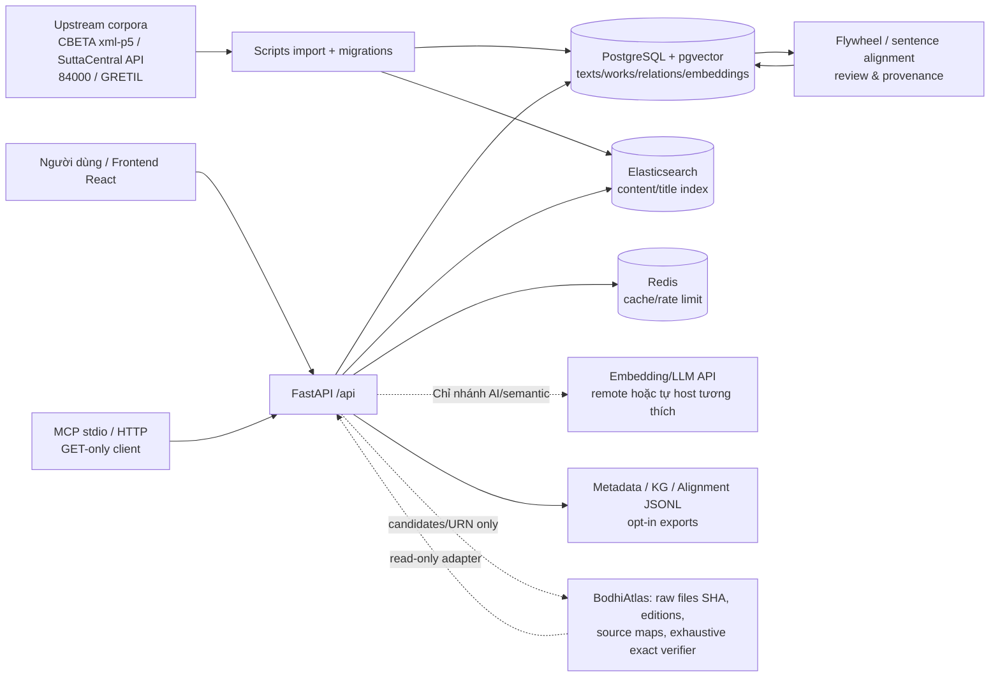
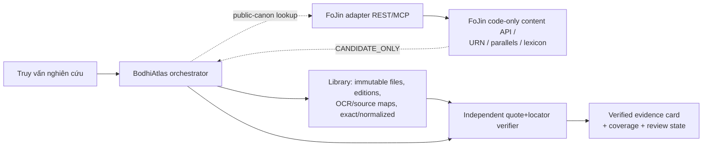

# Technology Assessment — FoJin

> **Mã đánh giá:** P40 · **Dự án đích:** BodhiAtlas · **Ngày khảo sát:** 2026-11-16 (Asia/Ho_Chi_Minh) · **Ưu tiên:** P0  
> **Repository:** https://github.com/xr843/fojin  
> **Snapshot được đọc:** nhánh `master`, commit `e4c89d94df1c2b9935d223b54532ffbc53a023eb` (thời điểm commit 2026-11-15 13:40:26 UTC). [Commit gốc](https://github.com/xr843/fojin/commit/e4c89d94df1c2b9935d223b54532ffbc53a023eb).  
> **Version:** *Không lấy tên release làm version của HEAD*: endpoint releases có các tag `v1.0.0`, `v4.0.0` (tháng 3/2026) theo thứ tự thời gian không tuyến tính; **commit SHA mới là bản khảo sát có thể tái lập**.  
> **Class:** `platform` — ứng dụng web Phật học đa thành phần, backend/API, dữ liệu corpus nhập từ upstream, search, RAG, KG, alignment, MCP.  
> **Người thẩm định/phương pháp:** đánh giá kỹ thuật độc lập bằng đọc tài liệu và mã qua GitHub connector, cây Git, schema, router, services, migration, test và giấy phép; đối chiếu PRD V1.4 và sổ rủi ro BodhiAtlas. **Không** clone/build/chạy FoJin, database, ES, corpus hay HTTP production; mọi POC là `NOT TESTED`.

**Quy tắc đọc:** `[DOC]` = tài liệu công bố, `[CODE]` = mã cấu hình/schema/đường chạy đã trực tiếp đọc, `[TESTED]` = chính cuộc khảo sát này đã thực thi cùng log, `[ISSUE]` = phản ánh issue chưa tái hiện, `[INFERRED]` = suy luận kỹ thuật có nêu tiền đề, `[UNKNOWN]` = thiếu dữ liệu. **File test trong repo không đồng nghĩa `[TESTED]`.** Các số đếm từ README/NOTICE là *số tự công bố*, không phải số liệu đã kiểm kê kho dữ liệu thực tế. Trạng thái hỗ trợ trong ma trận: `NATIVE / CONFIG / EXTENSION / EXTERNAL / MISSING / UNKNOWN / N/A`; `N/A` không tính điểm trừ.

## 1. Executive Decision

**Quyết định: `USE AS COMPONENT` (chỉ ở vai trò ứng viên tích hợp, cần POC/gate trước khi kết nối sản xuất); không `ADOPT` FoJin làm hệ thống lõi V1.** `CONFIDENCE: MED` đối với kết luận kiến trúc và fit–gap dựa trên mã; `LOW` đối với chất lượng, hiệu năng và độ bao phủ corpus đang chạy vì chưa triển khai thực tế.

- **V1 Core:** có thể dùng FoJin **bên cạnh** thư viện BodhiAtlas như dịch vụ tra cứu/đọc kinh điển bên ngoài, tìm tên kinh, URL/URN, bản song hành, từ điển và gợi ý chứng cứ. **BodhiAtlas phải giữ source of truth** cho file gốc, SHA-256, work/edition/witness, extraction revisions, PDF bbox/EPUB locator, EXACT toàn bộ vị trí, kiểm chứng câu chữ và phạm vi OCR. Không chuyển trạng thái `verified` từ FoJin sang chứng thực học thuật nội bộ.
- **V2:** thử adapter MCP/REST read-only cùng cầu nối URN → `external_reference`; khai thác song hành đã có nhưng kiểm lại câu/phiên bản/giấy phép; AI chỉ diễn giải từ tập ứng viên đã định danh.
- **V3:** cân nhắc lấy cấu trúc alignment, works/witnesses, một số mẫu xử lý giám sát nguồn hay pipeline dựa trên code, *không* nhất thiết nhận nguyên khối platform.

**Ba rủi ro lớn, không thể bù bằng tổng điểm:**

1. **Sai cấp chứng thực câu trích (`SOURCE_FIDELITY`, `CODE_ONLY_EXACT`):** API dùng substring trên văn bản **đã chuẩn hóa** (`NFKC`, phồn→giản, bỏ dấu câu) sau shortlist Elasticsearch; tối đa 5 nguồn và không có offset của mọi occurrence, không truy ra SHA file/PDF bbox/EPUB CFI. Trả `bucket="exact"`/`verbatim=true` của FoJin **không phải** `EXACT` nguyên ký tự theo PRD BodhiAtlas. `[CODE]`
2. **Không phải bộ máy nạp thư viện cá nhân (`INGEST`, `OCR`, `QUALITY_COVERAGE`):** `/api/chat/attachments` nhận PDF/TXT/MD/DOCX/CSV/HTML tối đa 10 MiB rồi trích text vào ngữ cảnh chat, cắt ở 80.000 ký tự; không hỗ trợ EPUB tại endpoint đó, không OCR scan, không khẳng định lập chỉ mục lâu dài hay tạo hồ sơ ấn bản/locator. Import corpus TEI chuyên ngành là đường khác. `[CODE]`
3. **Quyền, dữ liệu và tính tái lập:** repo code Apache-2.0 **không** cấp lại quyền văn bản. Kho chữ thực phải nhập; CBETA có NC-SA, 84000 NC-ND với điều kiện riêng, GRETIL/MITRA có chỗ chưa xác minh license. Dùng public MCP/API không phải căn cứ để xuất bản lại hay gửi sách có bản quyền. `[DOC][CODE]`

**Cổng nghiệm thu hôm nay:** `SOURCE_FIDELITY=fail` cho phiếu BodhiAtlas end-to-end nếu chỉ dùng FoJin; `CODE_ONLY_EXACT=fail` cho ALL occurrences nguyên ký tự; `MULTILINGUAL=unknown` do chưa thử toàn bộ bộ chữ; `QUALITY_COVERAGE=fail` với yêu cầu scan/EPUB file riêng; `RIGHTS_SECURITY=unknown` cho triển khai cụ thể; `PORTABILITY=partial/unknown` (URN và một phần metadata/alignment có export, raw assets và toàn bộ provenance chưa được chứng minh). Đây là **kết luận theo hợp đồng yêu cầu và mã đã đọc**, không phải kết quả benchmark chạy thử.

## 2. Sources & Evidence Ledger

**Các nguồn chuẩn đã đọc trực tiếp:** [PRD V1.4](https://github.com/quoctran-2608/bodhi-atlas/blob/main/docs/PRD.md), [ACADEMIC_RISKS_AND_VERIFICATION.md](https://github.com/quoctran-2608/bodhi-atlas/blob/main/docs/ACADEMIC_RISKS_AND_VERIFICATION.md), [BuddhismDocuments-for-AI README](https://github.com/quoctran-2608/BuddhismDocuments-for-AI/blob/main/README.md). PRD tập trung phân biệt EXACT/NORMALIZED/FUZZY/LEXICON tại phần 4.5, file/SHA và locator tại phần 5, code-only tại phần 6.1. Sổ rủi ro nhấn mạnh R01, R03–R05, R07, R09, R14, R17, R20, R24, R27.

**Cố định URL code:** các link bảng bên dưới trỏ vào commit `e4c89d94...` (không trỏ nhánh chuyển động). `—` ở cột version nghĩa là tài liệu dự án khác không có commit đích đã ghim trong cuộc khảo sát.

| claim_id | claim | Evidence type | URL/file+line | version/SHA | note |
|---|---|---|---|---|---|
| F01 | FoJin là web platform FastAPI có router search, verify, works, KG, alignment, research | [CODE] | [backend/app/main.py L528–603](https://github.com/xr843/fojin/blob/e4c89d94df1c2b9935d223b54532ffbc53a023eb/backend/app/main.py#L528-L603) | e4c89d94 | Không chứng minh dịch vụ production đang khỏe |
| F02 | `docker compose up -d` mới chỉ có schema/metadata, **chưa có full text** | [DOC] | [README.md L58–90](https://github.com/xr843/fojin/blob/e4c89d94df1c2b9935d223b54532ffbc53a023eb/README.md#L58-L90) | e4c89d94 | Cần import từ upstream |
| F03 | `GET /api/verify/quote` nhận `q`, `cite`, `juan`, trả `QuoteVerdict` | [CODE] | [api/verification.py L22–45](https://github.com/xr843/fojin/blob/e4c89d94df1c2b9935d223b54532ffbc53a023eb/backend/app/api/verification.py#L22-L45) | e4c89d94 | Mức ứng dụng, không phải source byte |
| F04 | Quote verifier: **ES shortlist → PostgreSQL normalized substring** | [CODE] | [services/quote_lookup.py L1–20](https://github.com/xr843/fojin/blob/e4c89d94df1c2b9935d223b54532ffbc53a023eb/backend/app/services/quote_lookup.py#L1-L20), [L405–415](https://github.com/xr843/fojin/blob/e4c89d94df1c2b9935d223b54532ffbc53a023eb/backend/app/services/quote_lookup.py#L405-L415) | e4c89d94 | Không phải byte-exact của file |
| F05 | Quote verifier giới hạn 5 match, shortlist tối đa 10, 4 ký tự Hán tối thiểu | [CODE] | [services/quote_lookup.py L51–88](https://github.com/xr843/fojin/blob/e4c89d94df1c2b9935d223b54532ffbc53a023eb/backend/app/services/quote_lookup.py#L51-L88) | e4c89d94 | Không exhaustive; `matches_capped` không thay được tổng vị trí |
| F06 | Chỉ kiểm quote `lzh`, chưa gom gaiji và không tra Pāli/Tạng/Sanskrit ở endpoint này | [CODE] | [services/quote_lookup.py L75–79](https://github.com/xr843/fojin/blob/e4c89d94df1c2b9935d223b54532ffbc53a023eb/backend/app/services/quote_lookup.py#L75-L79), [L315–320](https://github.com/xr843/fojin/blob/e4c89d94df1c2b9935d223b54532ffbc53a023eb/backend/app/services/quote_lookup.py#L315-L320) | e4c89d94 | Không suy từ multilingual search sang verify đa ngữ |
| F07 | Response thiếu mọi occurrence offset, edition file checksum, PDF bbox, EPUB CFI | [CODE] | [schemas/verification.py L18–102](https://github.com/xr843/fojin/blob/e4c89d94df1c2b9935d223b54532ffbc53a023eb/backend/app/schemas/verification.py#L18-L102) | e4c89d94 | Kiểm qua schema công khai, không tuyên bố mọi API nội bộ cũng thiếu |
| F08 | Outage Elasticsearch với `strict=False` có thể trả kết quả không có match | [CODE] | [services/quote_lookup.py L335–345](https://github.com/xr843/fojin/blob/e4c89d94df1c2b9935d223b54532ffbc53a023eb/backend/app/services/quote_lookup.py#L335-L345), [L370–382](https://github.com/xr843/fojin/blob/e4c89d94df1c2b9935d223b54532ffbc53a023eb/backend/app/services/quote_lookup.py#L370-L382), [tests/test_verify_quote.py L397–405](https://github.com/xr843/fojin/blob/e4c89d94df1c2b9935d223b54532ffbc53a023eb/backend/tests/test_verify_quote.py#L397-L405) | e4c89d94 | Cần fail-closed adapter; tests được đọc chứ chưa chạy |
| F09 | `search/content` ES keyword/phrase, `search/semantic` pgvector/API embeddings | [CODE] | [api/search.py L182–224](https://github.com/xr843/fojin/blob/e4c89d94df1c2b9935d223b54532ffbc53a023eb/backend/app/api/search.py#L182-L224), [services/search.py L549–615](https://github.com/xr843/fojin/blob/e4c89d94df1c2b9935d223b54532ffbc53a023eb/backend/app/services/search.py#L549-L615) | e4c89d94 | Phrase có candidate cap, không code-only character exhaustive |
| F10 | `TextContent` theo text/juan/lang, apparatus có witnesses, line-anchor CBETA có char offset | [CODE] | [models/text.py L9–124](https://github.com/xr843/fojin/blob/e4c89d94df1c2b9935d223b54532ffbc53a023eb/backend/app/models/text.py#L9-L124) | e4c89d94 | CBETA line-anchor không đồng nghĩa PDF bbox |
| F11 | FRBR `Work`, `WorkWitness` (root/translation/commentary/edition/fragment), `WorkAlias` | [CODE] | [models/work.py L9–85](https://github.com/xr843/fojin/blob/e4c89d94df1c2b9935d223b54532ffbc53a023eb/backend/app/models/work.py#L9-L85) | e4c89d94 | Cần bổ sung file edition+SHA riêng BodhiAtlas |
| F12 | URN được resolve thành URL và `exists`, có anchor tùy chọn | [CODE] | [api/urn.py L23–86](https://github.com/xr843/fojin/blob/e4c89d94df1c2b9935d223b54532ffbc53a023eb/backend/app/api/urn.py#L23-L86) | e4c89d94 | Resolve mục lục/juan không chứng minh câu chữ |
| F13 | Chat attachment PDF/MD/DOCX, không EPUB; ≤10 MiB, ≤80k ký tự trích text | [CODE] | [services/attachment_parser.py L28–35](https://github.com/xr843/fojin/blob/e4c89d94df1c2b9935d223b54532ffbc53a023eb/backend/app/services/attachment_parser.py#L28-L35), [L97–118](https://github.com/xr843/fojin/blob/e4c89d94df1c2b9935d223b54532ffbc53a023eb/backend/app/services/attachment_parser.py#L97-L118), [api/chat.py L145–255](https://github.com/xr843/fojin/blob/e4c89d94df1c2b9935d223b54532ffbc53a023eb/backend/app/api/chat.py#L145-L255) | e4c89d94 | Là tệp đính kèm chat, **không phải** corpus ingest |
| F14 | Import CBETA yêu cầu xml-p5, có `--all`, `--xml-dir`, `--resume`; SuttaCentral qua API | [CODE] | [scripts/import_content.py L1–11](https://github.com/xr843/fojin/blob/e4c89d94df1c2b9935d223b54532ffbc53a023eb/backend/scripts/import_content.py#L1-L11), [L265–274](https://github.com/xr843/fojin/blob/e4c89d94df1c2b9935d223b54532ffbc53a023eb/backend/scripts/import_content.py#L265-L274), [scripts/archive/imports/import_suttacentral.py L1–7](https://github.com/xr843/fojin/blob/e4c89d94df1c2b9935d223b54532ffbc53a023eb/backend/scripts/archive/imports/import_suttacentral.py#L1-L7) | e4c89d94 | Phải pin chính xác upstream + manifest riêng |
| F15 | MCP là thin read-only GET client; có code cho 8 tool gồm `verify_quote`, `commentaries` | [CODE] | [mcp-server/fojin_mcp/server.py L117–207](https://github.com/xr843/fojin/blob/e4c89d94df1c2b9935d223b54532ffbc53a023eb/mcp-server/fojin_mcp/server.py#L117-L207), [client.py L113–239](https://github.com/xr843/fojin/blob/e4c89d94df1c2b9935d223b54532ffbc53a023eb/mcp-server/fojin_mcp/client.py#L113-L239) | e4c89d94 | README MCP còn liệt kê thiếu `commentaries`; đếm theo code |
| F16 | Flywheel candidate `pending` cần human accept mới lên alignment_pairs | [CODE] | [services/alignment_flywheel.py L1–18](https://github.com/xr843/fojin/blob/e4c89d94df1c2b9935d223b54532ffbc53a023eb/backend/app/services/alignment_flywheel.py#L1-L18), [L338–376](https://github.com/xr843/fojin/blob/e4c89d94df1c2b9935d223b54532ffbc53a023eb/backend/app/services/alignment_flywheel.py#L338-L376) | e4c89d94 | `confidence` khi promote là similarity, không xác suất được hiệu chuẩn |
| F17 | Alignment sentence có offset char và `is_verified` reviewer; `TextRelation.confidence` mặc định 1.0 | [CODE] | [models/sentence_alignment.py L37–83](https://github.com/xr843/fojin/blob/e4c89d94df1c2b9935d223b54532ffbc53a023eb/backend/app/models/sentence_alignment.py#L37-L83), [models/relation.py L9–21](https://github.com/xr843/fojin/blob/e4c89d94df1c2b9935d223b54532ffbc53a023eb/backend/app/models/relation.py#L9-L21) | e4c89d94 | Không coi số 1.0 là đã duyệt học thuật |
| F18 | Export metadata/KG/alignment JSONL có license per-side; route export mặc định tắt | [CODE] | [api/exports.py L58–75](https://github.com/xr843/fojin/blob/e4c89d94df1c2b9935d223b54532ffbc53a023eb/backend/app/api/exports.py#L58-L75), [L316–355](https://github.com/xr843/fojin/blob/e4c89d94df1c2b9935d223b54532ffbc53a023eb/backend/app/api/exports.py#L316-L355), [main.py L574–576](https://github.com/xr843/fojin/blob/e4c89d94df1c2b9935d223b54532ffbc53a023eb/backend/app/main.py#L574-L576) | e4c89d94 | Không thấy contract full raw-corpus+file SHA export |
| F19 | FoJin license **code Apache-2.0**, third-party corpus license độc lập | [DOC] | [LICENSE](https://github.com/xr843/fojin/blob/e4c89d94df1c2b9935d223b54532ffbc53a023eb/LICENSE), [NOTICE L1–16](https://github.com/xr843/fojin/blob/e4c89d94df1c2b9935d223b54532ffbc53a023eb/NOTICE#L1-L16) | e4c89d94 | Repo public không có nghĩa bản dịch/ảnh trang public domain |
| F20 | CBETA CC BY-NC-SA 3.0 TW, 84000 NC-ND, GRETIL chưa ghi license, MITRA chưa xác minh | [DOC] | [NOTICE L42–119](https://github.com/xr843/fojin/blob/e4c89d94df1c2b9935d223b54532ffbc53a023eb/NOTICE#L42-L119), [L123–185](https://github.com/xr843/fojin/blob/e4c89d94df1c2b9935d223b54532ffbc53a023eb/NOTICE#L123-L185) | e4c89d94 | Thông tin NOTICE cần đối chiếu trực tiếp rights holder khi thương mại/xuất bản |
| F21 | Deployment gồm Postgres/pgvector, Elasticsearch, Redis, backend, frontend, secrets | [CODE] | [docker-compose.yml L7–180](https://github.com/xr843/fojin/blob/e4c89d94df1c2b9935d223b54532ffbc53a023eb/docker-compose.yml#L7-L180), [.env.example L5–74](https://github.com/xr843/fojin/blob/e4c89d94df1c2b9935d223b54532ffbc53a023eb/.env.example#L5-L74) | e4c89d94 | Có nhiều services, không phải single binary đơn giản |
| F22 | Embeddings gọi endpoint HTTP OpenAI-compatible; có thể trỏ server nội bộ nếu tương thích | [CODE] | [services/embedding.py L18–23](https://github.com/xr843/fojin/blob/e4c89d94df1c2b9935d223b54532ffbc53a023eb/backend/app/services/embedding.py#L18-L23), [L41–76](https://github.com/xr843/fojin/blob/e4c89d94df1c2b9935d223b54532ffbc53a023eb/backend/app/services/embedding.py#L41-L76) | e4c89d94 | Local inference phải tự dựng; chưa có bằng chứng offline end-to-end |
| F23 | `612 sources`, `10,500+ texts`, `39 dictionaries`, alignments… là mô tả README | [DOC] | [README.md L5–11](https://github.com/xr843/fojin/blob/e4c89d94df1c2b9935d223b54532ffbc53a023eb/README.md#L5-L11), [L192–234](https://github.com/xr843/fojin/blob/e4c89d94df1c2b9935d223b54532ffbc53a023eb/README.md#L192-L234) | e4c89d94 | Chưa kiểm kê database/nguồn/license thực tế |
| F24 | Test quote dùng `FakeDB`/`FakeES`; test phrase dùng doubles | [CODE] | [tests/test_verify_quote.py L1–11](https://github.com/xr843/fojin/blob/e4c89d94df1c2b9935d223b54532ffbc53a023eb/backend/tests/test_verify_quote.py#L1-L11), [tests/test_search_content_phrase.py](https://github.com/xr843/fojin/blob/e4c89d94df1c2b9935d223b54532ffbc53a023eb/backend/tests/test_search_content_phrase.py) | e4c89d94 | Không phải benchmark máy của người thẩm định |
| F25 | BodhiAtlas yêu cầu file SHA, locator gốc, phân biệt match mode, không dùng AI để tự chứng thực | [DOC] | [PRD.md](https://github.com/quoctran-2608/bodhi-atlas/blob/main/docs/PRD.md), [risk doc](https://github.com/quoctran-2608/bodhi-atlas/blob/main/docs/ACADEMIC_RISKS_AND_VERIFICATION.md) | PRD blob `58d967c6…` | Chuẩn đánh giá, không phải tính năng FoJin |
| F26 | Asset có 13 upstream pinned + local FTS, 2.0 Quick/Research với giới hạn học thuật ghi rõ | [DOC] | [BuddhismDocuments-for-AI README L9–42](https://github.com/quoctran-2608/BuddhismDocuments-for-AI/blob/main/README.md#L9-L42) | main tại ngày đọc | So sánh không tuyên bố toàn hệ đã nghiệm thu |

**Hạn chế truy cập:** GitHub connector cho phép đọc snapshot/tài liệu/code; môi trường container không lấy được mạng tới GitHub để clone/boot import. Không có PostgreSQL/Elasticsearch/corpus thật, server credential, bản PDF/EPUB có gold locator, log của lần chạy FoJin hoặc giấy phép riêng từng tác phẩm. `NOT TESTED` áp dụng toàn bộ TC01–TC06. Không ghi bất cứ `[TESTED]` nào cho chức năng FoJin.

## 3. Architecture & Data Flow



**Các luồng riêng phải tách:**

1. **Ingest chuyên ngành:** `scripts/import_catalog.py`/`import_content.py` và các `scripts/archive/imports/` → dữ liệu `BuddhistText`, `TextContent`, identifier, ES index. Phải tải upstream và xác nhận giấy phép; mã repo không cung cấp sẵn toàn corpus. Mỗi lần import cần manifest pin và khả năng dựng lại.
2. **Search code-only:** `/api/search/content` (ES, từ khóa/phrase) và `/api/verify/quote` (ES shortlist rồi đọc trường `TextContent.content` từ PostgreSQL), `/api/urn/resolve` và các metadata endpoints; không bắt buộc gọi LLM. **Không có bảo đảm ALL occurrences hoặc raw-file exact.**
3. **Semantic / AI:** `/api/search/semantic` dùng pgvector và HTTP embedding API; RAG `/chat`, alignment mining và AI đánh giá dùng mô hình/embedding theo cấu hình. Cắt hẳn cloud/LLM vẫn để metadata và ES search hoạt động nếu dịch vụ/data nội bộ sẵn sàng; MCP `search_corpus` hiện trỏ *semantic*, không phải code-only text endpoint.
4. **Tệp chat:** `/api/chat/attachments` → file trong upload directory, parsed text có truncation → lời nhắn cho LLM; không đi qua importer, catalog ấn bản, ES như sách của người dùng. Đây là ranh giới kiến trúc quan trọng.
5. **Citation/alignments:** URN, CBETA line references, text/juan/char offsets với một số dữ liệu; chưa tạo được phiếu nguồn BodhiAtlas chỉ từ quote verifier. `alignment_candidates` ≠ `alignment_pairs` ≠ `sentence_alignments` có `is_verified`.

**Schema/key path khảo sát:** `backend/app/main.py`; `app/api/{search,search_unified,verification,urn,alignment,works,exports,chat}.py`; `app/services/{quote_lookup,quote_verifier,search,passage_locator,alignment_flywheel,alignment_export,embedding,attachment_parser}.py`; `app/models/{text,work,source,relation,sentence_alignment,alignment_candidate}.py`; `backend/alembic/versions/{0145_add_works_frbr_spine,0158_add_apparatus_and_line_anchors,0167_add_alignment_candidates,0168_alignment_anchor_foundation,0170_add_sentence_alignments,0190_cbeta_license_metadata_20261111}.py`; `mcp-server/fojin_mcp/{server,client}.py`.

## 4. Feature Fit–Gap Matrix

| ID | BodhiAtlas capability | FoJin status | Bằng chứng/vai trò thực | Gap và cách bù | Công sức sơ bộ |
|---|---|---|---|---|---|
| C01 | Multi-format ingest | **EXTENSION** | `[CODE]` F13–F14: TEI/corpus import; chat upload PDF/MD/DOCX | Chưa có library ingest PDF scan, EPUB, file metadata/SHA/version; xây importer+catalog riêng | **High** |
| C02 | OCR/layout/reading order | **EXTERNAL** | `[CODE]` F13: `pypdf.extract_text`, không OCR scan trong đường chat | Dùng OCR/layout chuyên dụng; giữ ảnh và confidence bbox, kiểm 2 cột/footnote | **High** |
| C03 | Canonical text/source map | **EXTENSION** | `[CODE]` F10: text/juan/char, CBETA line anchors | File original SHA, extraction revisions và PDF page+bbox/EPUB href-CFI chưa có trong contract quote; viết source-map layer | **High** |
| C04 | Works/editions/witnesses | **EXTENSION** | `[CODE]` F11: Work, WorkWitness, alias | Ánh xạ edition/translator/file bytes nhiều witness, quyền và proof; giữ catalog BodhiAtlas | **Medium–High** |
| C05 | Exhaustive character EXACT | **MISSING** | `[CODE]` F04–F07: normalize và cap 5; một nguồn có nhiều lần xuất hiện chỉ xuất hiện 1 hit/juan | Xây FTS trigram/n-gram để lọc + substring raw, enumerate *all* offsets; kiểm chống false verified | **High (P0)** |
| C06 | Normalized multilingual search | **EXTENSION** | `[CODE]` F06, F09: Han variant/gaiji, metadata search zh/pi/sa/bo/en | Tiếng Việt có/không dấu, Pāli/Sanskrit diacritics, Tạng Unicode/Wylie chưa đủ chứng cứ; index phụ có transformation trace | **High** |
| C07 | Fuzzy/near duplicate/OCR errors | **CONFIG** | `[CODE]` F04, F09: ES match, near-miss `SequenceMatcher` | Tách label `FUZZY` khỏi exact, show diff và coverage; calibrate lỗi OCR trên gold | **Medium** |
| C08 | Sense-aware lexicon | **EXTENSION** | `[DOC][CODE]` README dictionary; `DictionaryEntry`, `term_concepts` schema hiện hữu | Sense-specific mappings Việt/Hán/Tạng/Pāli/Sanskrit, scope tradition, citation license, không bắc cầu đồng nghĩa | **High** |
| C09 | Semantic/hybrid/RAG | **NATIVE** | `[CODE]` F09, F22: pgvector, embedding API, chat/RAG | Tùy chọn; quyền gửi AI, self-host embeddings và verify-after-generation | **Medium** |
| C10 | Verified citation card/source reopen | **EXTENSION** | `[CODE]` F03–F07, F10, F12: URN/juan/url có thật | Thiếu original file SHA, exact quote offsets, PDF bbox/EPUB CFI, 3 trạng thái kiểm chứng tách biệt | **High (P0)** |
| C11 | Note/wiki/claim memory | **EXTENSION** | `[CODE]` F01: annotations/research notes, chat sessions | Claim status, independent human review, immutable evidence snapshot, versioned research graph riêng | **Medium–High** |
| C12 | API/MCP/export | **NATIVE** | `[CODE]` F15/F18: REST, 8 MCP code tools, metadata/KG/alignment export | Route export phải bật; thiếu full raw-corpus/provenance/file export; API adapter có circuit breaker | **Medium** |
| C13 | Quality coverage + incremental | **EXTENSION** | `[CODE]` scripts checkpoint/resume; source URL health metadata | Per-page OCR/extraction coverage, not-indexed semantics, per-file incomplete/error manifest | **High** |
| C14 | Auth/licensing/privacy/backup | **EXTENSION** | `[CODE][DOC]` F19–F21: JWT/secrets, rights fields, some public APIs | Permission mỗi file/embedding/send-to-AI, audit, export filtering, backup restore drill, legal review | **High** |
| C15 | Operational simplicity + independent deploy | **CONFIG** | `[CODE]` F21–F22: Docker multi-service, local search code-only nếu có DB/ES | Quản trị PG/ES/Redis, ingest, migration/index, chi phí hạ tầng; không single-process offline | **High** |

**Giải thích về `N/A`:** Không đặt N/A cho C01/C02 vì người dùng đang cân nhắc **FoJin làm nền chính** — lúc đó các gate này là bắt buộc và thiếu. Nếu FoJin *chỉ* làm adapter cho corpus công cộng thì OCR file cá nhân, exhaustive exact và PDF source-map là `N/A` **đối với adapter FoJin**, nhưng **không N/A** đối với yêu cầu của toàn BodhiAtlas (phải có bộ engine riêng).

## 5. Deep Technical Findings

### 5.1. Thành phần thực thi, không chỉ README

- **Backend:** FastAPI `app/main.py` đăng ký router; PostgreSQL/sqlalchemy/alembic quản lý metadata, `text_contents`, works, embeddings và alignments; Elasticsearch lập chỉ mục catalog + content; Redis hỗ trợ limit/caching. Frontend `frontend/src/App.tsx`, `frontend/src/api/client.ts` và các components reader/search/chat; các file hiện hữu không tự chứng minh UX đạt chuẩn PRD.
- **Search:** `app/api/search.py`; `services/search.py` (search title, content, phrase, semantic, cross-language, parallel sentences); `search_unified.py` trộn dictionary/catalog/content/semantic. `phrase=true` dùng lọc đoạn sau shortlist chứ không lập mục lục mọi vị trí ký tự.
- **Quote/URN:** `api/verification.py`, `schemas/verification.py`, `services/quote_lookup.py` và `services/quote_verifier.py` (chat guard khác contract open-world), `api/urn.py`, `services/urn.py`.
- **KG:** `api/knowledge_graph.py`, `models/knowledge_graph.py`; nguồn thực/bao phủ entity và tính hợp lệ inference **UNKNOWN** do không truy DB.
- **Alignments:** `api/alignment.py`, `api/alignment_review.py`, `services/alignment_flywheel.py`, `services/alignment_export.py`, models `alignment_candidate.py`, `sentence_alignment.py`, SQL `alignment_pairs`. `TextRelation` chứa quan hệ cấp text, khác pair cấp chunk/sentence.
- **MCP:** `mcp-server/fojin_mcp/server.py` code có **8 tool** `search_corpus`, `read_passage`, `get_parallels`, `lookup_dictionary`, `lookup_entity`, `resolve_urn`, `verify_quote`, `commentaries`. README của MCP liệt kê ít hơn: lấy **code** làm căn cứ. Client chỉ GET public REST, có `FOJIN_API_BASE_URL` trỏ self-host; chưa có chứng cứ OAuth per-user hay identity passthrough cho kho riêng.

### 5.2. Corpus ở đâu, tải bằng gì, pin thế nào?

- Repo FoJin chứa code, configs, seed/metadata, schema, sample/test fixture; **không kèm nội dung full-text phục vụ production** theo README. `scripts/import_catalog.py` nhập CBETA catalog từ DILA metadata / XML headers; `scripts/import_content.py --all --xml-dir /data/xml-p5` yêu cầu checkout `https://github.com/cbeta-org/xml-p5.git`; `scripts/archive/imports/import_suttacentral.py` gọi API public SuttaCentral; các archive importers phục vụ upstream khác. Không mặc định mọi trang trong “612 sources” đều được tải: `source_governance.py` phân biệt metadata/link-only với local full-text.
- **Bốn nguồn full-text được khai báo trong NOTICE tại thời điểm cập nhật nguồn:** CBETA, 84000, GRETIL, SuttaCentral; nguồn khác có thể chỉ metadata/IIIF/đường link. Phân bố và số ký tự trong NOTICE là **khẳng định của maintainer**, chưa trực tiếp kiểm DB.
- Để tái lập cần pin **FoJin commit + upstream git SHA/tag hoặc immutable data snapshot + source URL/access timestamp + manifest hash/record count + importer args + migration revision + rights review version**. README quickstart không phải manifest corpus bất biến cho BodhiAtlas; không gán version/dataset hash khi chưa đọc được.
- **Token:** core import từ public XML/API có thể không cần LLM key nhưng cần mạng, quyền và hạn mức upstream; embeddings/RAG/LLM theo cấu hình API key hoặc tương thích server nội bộ. Chưa đo tổng thời gian boot, storage hay quota.

### 5.3. `/api/verify/quote` — contract và khoảng cách đến kiểm chứng chuẩn

**Request (theo mã):** `GET /api/verify/quote?q=<1..400 chars>&cite=<CBETA-ID|fojin-URN optional>&juan=<1..999 optional>`. Kiểm tra sau normalize cần ≥4 ký tự, nếu ít hơn trả 422. `cite` là *gợi ý nơi tìm*, không phải file SHA.

**Response nổi bật:** `quote`, `normalised_quote`, `verbatim`, `bucket`, `similarity`, `matches[]` với `text_id/cbeta_id/title_zh/juan_num/urn/reader_url/juan_matched/canon_class`, `matches_capped`, `closest.window_normalised + diff[]`, `cite_resolved`, `cite_matched`, `caveats`, `lang=lzh`. Tài liệu schema minh định chỉ số `closest.diff` tính trên không gian chuẩn hóa, **không ánh xạ lại offset gốc**.

**Quyết định kỹ thuật:** `normalise_for_match(q) in normalise_for_match(TextContent.content)`, trong đó chuẩn hóa có NFKC, phồn→giản, loại dấu câu/khoảng trắng. Do đó `bucket=exact` ở API có nghĩa **normalized exact among examined fascicles**, không phải ký tự tuyệt đối, không bảo đảm *mọi* vị trí, không kiểm PDF. `matches_capped=True` thể hiện đã chạm cap 5 nguồn, không có tổng occurrence. Cả khi `matches_capped=False`, vì shortlist ES/collapse giới hạn, cũng **không được suy ra exhaustive**.

**Caveat cần sửa adapter:** với lỗi ES, `strict=False` (mặc định endpoint `/verify/quote`) có nhánh trả [] thay vì lỗi, nên adapter BodhiAtlas phải phân biệt `SEARCH_UNAVAILABLE` với `ABSENT` bằng healthcheck, fail-closed hoặc triển khai patch `strict=True`; test thực lỗi mạng còn `NOT TESTED`. `cite_matched=True` chỉ đúng vùng text/juan trong index nếu được tìm, không tự chứng minh đúng ấn bản/file gốc.

### 5.4. Phép thử Hán ngắn, Pāli, câu dài và nhiều occurrence

**Kết luận từ mã, chưa chạy POC:** `無` và `無我` sau chuẩn hóa ngắn hơn 4 ký tự → quote verifier từ chối (422). Cụm Hán 4 ký tự (như `色即是空`) được API thiết kế chấp nhận, nhưng *khả năng thống kê đầy đủ* chưa có. `anattā` không nên khẳng định bị chặn bởi độ dài; vấn đề là **verifier chỉ lọc `lang=lzh`**, không kiểm content Pāli. Câu dài 200–300 ký tự có thể truyền vào `/verify/quote` vì giới hạn request 400, nhưng ES shortlist + full-juan string normalize chưa chứng minh chính xác qua nội dung bị chia chunk/juan; câu xuyên **ranh giới juan** không được bảo đảm. Nếu cùng câu xuất hiện 5 lần trong **một** `TextContent.content`, code `_confirm` chỉ `append` một `QuoteMatch` cho *juan*, không trả 5 offsets. Khi truy vấn trên `/search/content` giới hạn `q max_length=200`, câu 300 ký tự phải dùng đường khác hoặc adapter tự xử lý.

### 5.5. Quan hệ song hành lấy từ đâu và confidence là gì?

- Quan hệ `text_relations` có `relation_type=parallel|alt_translation|commentary`, `source`, `note`, `confidence` mặc định 1.0. **Mặc định này không chứng minh con người duyệt.** `WorkWitness.confidence` còn là trạng thái chữ `verified|auto|tentative`, khác điểm cosine.
- Pipeline `alignment_flywheel.py`: embed nearest neighbour + expansion từ anchors → `alignment_candidates(status=pending)` → admin review accept/reject → `alignment_pairs(method=flywheel-verified)` khi accept. Điểm được copy từ `similarity` sang `confidence`; **không có chứng cứ hiệu chuẩn xác suất đúng thực nghiệm**.
- `sentence_alignments` có offsets trong `text_contents.content`, `similarity` và cờ `is_verified` riêng; default `false`. `api/alignment.py` ghi chú Pāli/Tạng trong `text_embeddings.chunk_text` có thể là **bản dịch tiếng Anh**, nguồn nguyên ngữ chỉ ở `original_preview` khi có. Với BodhiAtlas, phải ghi `relation_provenance`, `reviewer_id`, `reviewed_at`, `method`, `raw_source_witness` và trạng thái `candidate/reviewed` khác nhau. README tự công bố hàng nghìn cặp hay precision không thay POC đối chiếu văn bản.

### 5.6. Chế độ không LLM/không cloud

Các hàm `search_content`, `search_texts`, `verify_quote`, `resolve_urn`, read text, dictionary có thể chạy bằng code trên PostgreSQL/ES **khi corpus đã nhập**. Tuy nhiên `mcp.search_corpus` theo `client.py` sử dụng `/api/search/semantic`, nên **MCP search mặc định không phải code-only**; muốn MCP không LLM phải thêm tool REST `/api/search/content` hoặc viết MCP adapter riêng. `generate_embedding()` gọi HTTP API bên ngoài theo default, có thể cấu hình server tương thích chạy local nhưng **chưa chứng minh offline model path**; tắt AI sẽ không dùng được semantic generation mới/nhánh RAG mà thiếu embedding service. Không đồng nhất “search không gọi LLM” với “zero network toàn bộ sản phẩm” (upstream import, registry, map, auth providers có thể dùng mạng).

### 5.7. Nạp sách của người dùng có thật sự hoạt động như thư viện?

**Không ở đường đã thẩm tra.** `POST /api/chat/attachments` chấp nhận PDF/TXT/MD/DOCX/CSV/HTML; lưu file disk và `parsed_text` trên `ChatAttachment`, trích bằng `pypdf`/`python-docx`, cắt 80.000 ký tự, không EPUB, không OCR, không tạo `BuddhistText`/`TextContent` + ES book index hay `work/edition/file/SHA`. Phải phát triển đường nhập riêng. Cả khi tệp raw còn lưu trong upload directory, điều này **không** tạo immutable catalog, trang gốc hoặc checksum tự động theo PRD.

### 5.8. Giấy phép, API/MCP và tư liệu riêng

FoJin code Apache-2.0; CBETA và bản dịch là license riêng; annotation alignment của FoJin tuyên bố CC-BY-SA-4.0 nhưng văn bản nguồn không vì thế đổi license. MCP hosted anonymous GET read-only (không chứng minh có auth per-project); không được chuyển sách riêng lên public endpoint; nếu muốn riêng, self-host API/MCP sau proxy xác thực, lọc scope và log. Model weights, embedding provider terms, quyền gửi dữ liệu ra cloud đều **UNKNOWN** cho lựa chọn triển khai BodhiAtlas cụ thể.

### 5.9. Setup/migrations/tests, tài nguyên offline, export

`docker-compose.yml` có PostgreSQL/pgvector, Elasticsearch, Redis, backend(s), frontend. Các migration Alembic có chuỗi mở rộng work FRBR, CBETA line, source license, sentence alignments, verify review. Container resource limits chỉ là cấu hình, **không phải benchmark yêu cầu tối thiểu**: Postgres `4g`, ES `1536m`, Redis `256m`, backend `1g` mỗi replica; còn frontend, cache, corpus, OS. Unit tests nhìn thấy: `test_verify_quote.py` (fake DB/ES), `test_search_content_phrase.py`, `test_alignment_flywheel.py`, `test_alignment_export.py`, `test_urn.py`, `mcp-server/tests/test_client.py`. Không chạy, không có log throughput. Metadata/KG/alignment JSONL có export khi bật feature flag; chưa xác nhận xuất được tất cả original raw bytes + file hashes + quote offsets + quyền ở mức tác phẩm. Vì vậy `PORTABILITY` **partial/unknown** cho dữ liệu gốc.

### 5.10. Hai kiểu tích hợp và code còn thiếu

**FoJin nền chính** đòi phải xây/thay **ít nhất 7 nhóm module**: (1) ingest multi-format/OCR; (2) immutable file registry+SHA; (3) edition/witness resolver; (4) source maps PDF bbox/EPUB CFI; (5) exhaustive raw EXACT+normalized query traces; (6) scope/coverage+independent verifier; (7) rights/permissions+backup/export. Có thể thêm (8) lexicon theo sense tiếng Việt; (9) human semantic review. Mức **HIGH**; số nhân-ngày **UNKNOWN**, không được gán giả chi phí trước benchmark/thiết kế.

**FoJin dịch vụ chuyên ngành cạnh kho riêng** đòi **ít nhất 4 nhóm adapter/kiểm soát**: (1) REST/MCP typed client + circuit breaker; (2) external source identifier/URN resolver; (3) rights/quality filtering và trạng thái `CANDIDATE_ONLY`; (4) crosscheck một câu vào original evidence BodhiAtlas khi có cùng witness; cộng test contract và cache theo snapshot. Mức **MEDIUM** cho adapter, rủi ro quyền/độ bao phủ vẫn phải duyệt.

## 6. Source Fidelity & Provenance

### 6.1. Đối chiếu những gì FoJin có và những gì BodhiAtlas cần

| Thành phần phiếu truy nguyên | FoJin có bằng chứng | Đủ cho BodhiAtlas? |
|---|---|---|
| Canonical identifier/URN, text_id, juan | `QuoteMatch`, `urn/resolve` `[CODE]` | **Một phần:** URN xác định tác phẩm/juan trong FoJin, không cố định file bản riêng |
| Work, translation/edition/commentary/witness | FRBR `WorkWitness.role` `[CODE]` | **Một phần:** chưa ghi mọi file+SHA và edition metadata cá nhân |
| File original SHA-256 | Không ở quote contract `[CODE]` | **Chưa:** BodhiAtlas tự giữ |
| Nguyên văn đúng ký tự | Chỉ normalized substring trên `TextContent.content` `[CODE]` | **Không:** cần literal exact từ raw/controlled extraction |
| Tất cả occurrences + char offsets | `matches` mỗi juan, cap 5; `ClosestMiss.diff` normalized `[CODE]` | **Không:** cần enumerate từng offset và mapping |
| PDF trang, bbox, trang in có chứng cứ | Không trong `QuoteMatch`; có CBETA line-anchor riêng `[CODE]` | **Không:** cần source-map independent |
| EPUB href/CFI/paragraph locator | Không trong quote API/chat parser `[CODE]` | **Không:** cần EPUB importer và locator |
| OCR/coverage/error states | Source health là trạng thái nguồn URL, không phải trang OCR `[CODE]` | **Không:** cần manifest per page/section |
| Quyền trên từng source/model | `DataSource.license_*`, NOTICE `[CODE][DOC]` | **Một phần:** tác phẩm/bản dịch/file cần rights ACL độc lập |
| Text/locator/meaning verification 3 lớp | `verbatim`, `cite_matched`, alignment flags `[CODE]` | **Không hoàn chỉnh:** cần tách kỹ thuật với đánh giá luận điểm |

**Phiếu dữ liệu mục tiêu cho BodhiAtlas (schema đề xuất, không phải schema FoJin):**

```json
{
  "work_id": "BA-W...",
  "edition_id": "BA-E...",
  "witness_id": "BA-WIT...",
  "file_id": "BA-F...",
  "file_sha256": "<64 hex from original bytes>",
  "original_role": "original|translation|commentary",
  "author": "...",
  "translator": "...",
  "extract_revision": "parser-version + config-hash",
  "quote_raw": "...",
  "match_mode": "EXACT|NORMALIZED|FUZZY|LEXICON|SEMANTIC",
  "query_transforms": [],
  "raw_char_span": {"start": null, "end": null},
  "locator": {"pdf_page_index": null, "pdf_bbox": null, "printed_page_verified": null, "epub_href": null, "epub_cfi": null, "paragraph_id": null},
  "coverage": {"state": "READY|PARTIAL|OCR_UNCERTAIN|NOT_INDEXED|SOURCE_UNAVAILABLE", "scope_id": "..."},
  "verification": {"text": "UNVERIFIED|VERIFIED|MISMATCH", "locator": "UNVERIFIED|VERIFIED", "meaning": "NOT_ASSESSED|SUPPORTS|PARTIAL|CONTRARY|DISPUTED"},
  "external_candidates": [{"system": "fojin", "urn": "fojin:cbeta/T0001.1", "observed_at": "...", "status": "CANDIDATE_ONLY"}]
}
```

`null` hoặc `UNKNOWN` là bắt buộc khi chưa có thông tin. `printed_page_verified` không suy từ PDF page. **Không tự sinh số trang, bbox, ISBN, bản dịch, tác giả hoặc DOI bằng model.** Một FoJin URN là external reference; muốn `TEXT_AND_LOCATOR_VERIFIED`, phải mở lại đúng file/edition/witness do BodhiAtlas quản lý, đối chiếu ngữ cảnh bao gồm phủ định, áp `OCR_NEEDS_REVIEW` khi cần, và xác định vùng index/nguồn thiếu.

**Rủi ro học thuật cụ thể:** Trích dẫn lặp trong chú giải có thể khớp chữ nhưng không là văn bản gốc; alias/canon order chỉ xếp ưu tiên, không chứng minh niên đại hay tính nguyên cấp. Bản Hán giản/phồn có thể khớp normalized nhưng khác witness. Alignment giữa A-hàm và Nikāya là quan hệ `parallel_to`, không mặc định `translation_of` hay cùng nguyên văn. `SOURCE_FIDELITY_GATE=fail` khi sử dụng nguyên FoJin quote response làm phiếu xác minh BodhiAtlas; khi chỉ dùng kết quả làm ứng viên, gate của adapter riêng là `N/A`, vẫn phải có verifier nội bộ.

## 7. Multilingual & Retrieval Behavior

**Bảng năng lực theo *đường chạy đã đọc*, không suy từ nhãn “multilingual”:**

| Phương thức / hệ chữ | Dấu hiệu trong code | Kết luận cho BodhiAtlas |
|---|---|---|
| `EXACT` nguyên ký tự, ALL occurrences | Không có endpoint quote raw exact; normalized và limited | **MISSING** như hợp đồng V1; xây engine độc lập |
| Han phồn ↔ giản (`無常`/`无常`) | `normalise_for_match`, phrase-mode `fast_normalise`, ES analyzer | **NATIVE** cho một số đường `NORMALIZED`, cần gold kiểm chứng; không dán nhãn EXACT |
| Han 1–2 ký tự `無`/`無我` | `MIN_LOOKUP_QUOTE_CHARS=4` ở verify quote | **MISSING** ở quote endpoint; content search có thể trả ứng viên, cần test recall |
| Han gaiji/biến thể | `gaiji` expansion dùng ở content search, quote checker tự cảnh báo chưa fold | **CONFIG/EXTENSION**, không gộp hai API làm một kết luận |
| Pāli `anatta`/`anattā`; `dukkha` | `BuddhistText.lang=pi`, title/search + import SC; quote verify filter lzh | **PARTIAL/UNKNOWN** full text recall; `verify_quote` non-lzh **MISSING** |
| Sanskrit `anātman`/`duḥkha` | Title sa, GRETIL importer/corpus doc | **UNKNOWN** diacritics/substring/all occurrence; cần gold corpus thật |
| Việt `vô ngã`/`vo nga` | Không thấy branch analyzer/lexicon Việt toàn tuyến | **UNKNOWN/MISSING** cho mapping sense-aware native; adapter normalization index riêng |
| Hán `無我` ↔ Pāli/Sanskrit/Việt qua sense | Dictionary, text relations, alignments | **EXTENSION**: không dùng translation synonym trực tiếp như exact |
| Tạng Unicode/Wylie | `lang=bo`, corpus 84000, alignment API | **UNKNOWN** Wylie↔Unicode và literal full-text; không đồng nhất English chunk với Tibetan original |
| Câu 200–300 ký tự | quote q≤400; search content q≤200; ES shortlist | **PARTIAL** nhập quote; **UNKNOWN** cross-juan/full-recall, chunk boundary gold |
| 5 lần xuất hiện cùng file | `QuoteMatch` theo juan, không offsets, cap 5 nguồn | **FAIL** cho ALL occurrences |
| `FUZZY` | ES match + `SequenceMatcher` near-miss | **NATIVE candidate only**, không nâng thành proof |
| `LEXICON` theo từng sense | Dictionary / term concepts | **EXTENSION**, phải thêm provenance per-sense, tradition, context |
| `SEMANTIC` / RAG | pgvector + embedding provider + LLM | **NATIVE tùy chọn**, không bao giờ là trích dẫn gốc |

**Truy vấn luận đề BodhiAtlas** — “Trong các tài liệu tôi có, những tác giả nào phân biệt giữa vô thường và khổ? Họ lập luận như thế nào? Cho tôi vị trí chính xác trong sách.”: code-only chỉ tạo danh sách đoạn ứng viên từ EXACT/NORMALIZED/FUZZY/LEXICON trong **phạm vi file đã lập chỉ mục**, kèm vị trí và coverage. Việc kết luận “tác giả phân biệt như thế nào”, xác định người đang được trích, phản luận/chú giải, cách lập luận và bằng chứng ngược chiều phải qua đọc ngữ cảnh/human review hoặc AI **không có quyền tự xác minh nguồn**. FoJin semantic/MCP `search_corpus` hữu ích mở rộng kinh điển công cộng, không trả mặc định vị trí PDF sách riêng.

**Không được coi `BM25 match_phrase` là exact ký tự.** Ngay cả `phrase=true` còn được chia clause, chuẩn hóa, shortlist; `total_capped` là cờ lower-bound từ candidate pool, không chứng nhận toàn kho đã khảo sát. Cần giữ chỉ mục nguyên văn và chỉ mục biến thể riêng, phép biến đổi có thể audit.

## 8. Integration Options for BodhiAtlas

### Option A — FoJin làm platform chính (không khuyến nghị V1)

**Đầu vào:** file cá nhân PDF/scan/EPUB/DOCX/MD/TEI, corpus upstream có rights. **Đầu ra mong muốn:** catalog chuẩn work→edition→file SHA; exact/all offsets; candidate + verified citation card; OCR coverage + locators; notes/claims. **So với FoJin:** đường TEI/import có sẵn nhưng đường upload chat không phải ingest V1; quote verifier normalized/capped; cần thêm ít nhất 7 module ở mục 5.10.

- **Source of truth:** nếu buộc dùng FoJin core thì vẫn xây `bodhi_sources` giữ immutable bytes/hash và edition/source map *độc lập với* `text_contents`/ES. `buddhist_texts.id`, `chunk_index`, URL reader FoJin không dùng làm stable ID duy nhất.
- **Migration:** map FRBR canonical IDs sang BodhiAtlas IDs, ghim `fojin_commit`, `source_import_manifest_sha256`, `extraction_revision`, `rights_policy_version`; khôi phục bằng replay; re-chunk không được đổi locator claim.
- **Failure/rollback:** ES thiếu, verifier outage, mismatch, rights rejection → hạ về `UNKNOWN`/`PARTIAL`, tắt nhãn verified và fallback BodhiAtlas raw exact; không đổi nguồn chuẩn khi engine chết.
- **Chi phí/độ rủi ro:** HIGH, nhập upstream/ops/license/corpus kéo dài; chỉ mở nếu một POC vượt mọi gate và chứng minh tiết kiệm thực so với engine độc lập.

### Option B — FoJin là specialized read-only corpus service (đề xuất có điều kiện)



**Input adapter:** `{query, mode: "EXTERNAL_CANON_DISCOVERY", language, canon_filter, rights_policy, source_scope, correlation_id}`. Chọn `/api/search/content`, `/api/urn/resolve`, `/api/alignment/...`, dictionary; **không gọi `mcp.search_corpus` trong code-only** vì nó dùng semantic. Với tool gọi hosted, không đưa bất cứ file riêng/raw quote chưa được phép gửi ra ngoài.

**Output adapter (schema đề xuất):** `{external_system:"fojin", fojin_snapshot_sha, canonical_urn, text_id, juan, reader_url, quote_preview, match_type:"CANDIDATE_NORMALIZED", completeness:"UNKNOWN|CAPPED|PARTIAL", rights_status, retrieval_time, raw_response_digest, verification_state:"CANDIDATE_ONLY"}`. Nếu `cite_matched` FoJin true vẫn chỉ là kiểm trong kho FoJin. BodhiAtlas quyết định `VERIFIED` sau `reopen + original hash + offset/bbox + text + contextual review`.

**Stable IDs và export:** dùng composite `(source_system, upstream_canonical_identifier, upstream_data_version, witness_id)` làm khóa mapping; giữ IDs của BodhiAtlas làm canonical local; không tham chiếu chunk IDs như khóa bền. Xuất metadata KG/alignments JSONL khi bật `ENABLE_OPEN_DATA_EXPORTS`, lọc theo license; trường liệu thiếu thì không nội suy. Cảnh báo khi alignments giữ bản dịch tiếng Anh trong chunk.

**Failure handling:** circuit breaker/timeouts; `429`, `503`, incomplete index, zero results vì outage → `SOURCE_UNAVAILABLE` không `ABSENT`; `matches_capped` không cho phép kết luận exhaustive; quyền NC/ND/MITRA chưa rõ → chỉ link/metadata theo policy; không tự trích/copy full text. **Rollback**: tắt feature flag adapter, giữ nguyên catalog/claims BodhiAtlas và cache evidence đã kiểm độc lập, không phá indexes.

**Lợi ích có căn cứ:** tận dụng search/URN, từ điển, reader, quan hệ kinh song hành và KG có sẵn nếu dữ liệu thật/rules cho phép; hạn chế thay đổi kernel V1. Nhược điểm: nguồn ngoài có thể thay đổi, downtime và gánh nặng kiểm rights. **Điều kiện tiên quyết:** TC02, TC03, TC05, TC06 + independent verifier chứng nhận không nâng false positive.

### Option C — Học thiết kế và tái sử dụng module code có chọn lọc

Có thể thử port `WorkWitness`/`WorkAlias` mô hình dữ liệu, URN grammar, thuật toán alignment candidate/review, license-aware JSONL, **không** bê logic `verbatim` normalized làm exact. Cần đánh giá giấy phép dependency; lưu attribution khi sao chép mã. Độ khó `MEDIUM`, nhưng tránh kéo PG/ES/RAG full stack vào V1.

## 9. Practical POC / Reproduction Plan

**Chính cuộc thẩm định này:** `NOT TESTED` cho TC01–TC06. Các lệnh bên dưới là **kế hoạch tái lập**, không phải log đã chạy. Chỉ dùng fixtures được phép; cần ghi OS/CPU/RAM, Docker/PG/ES versions, package lock, FoJin commit, upstream SHA, mọi request-response JSON, SQL counts, thời gian bootstrap, OCR version, quyền dữ liệu, và commit code patch POC.

| Case | Fixture & golden answer cần chuẩn bị trước | Lệnh/steps đề xuất | Chỉ số/gate định trước | Kết quả |
|---|---|---|---|---|
| **TC01** Clone/deploy/import | CBETA TEI public có license kiểm lại; 1 tác phẩm nhỏ đã xác minh CBETA-ID, expected juan count/text checksum; fixture empty compose (0 text) | `git clone https://github.com/xr843/fojin.git && cd fojin && git checkout e4c89d94df1c2b9935d223b54532ffbc53a023eb`; copy `.env.example` thành `.env` (thay secrets); `docker compose up -d`; `docker exec fojin-backend python scripts/import_catalog.py`; `docker exec fojin-backend python scripts/import_content.py --work <CBETA-ID> --xml-dir /data/xml-p5` (sau khi pin/mount upstream) | version pin, DB row count, index completeness, errors, boot/import duration, raw-license check; **không đặt latency giả** | **NOT TESTED** |
| **TC02** Quote/cite/juan/outage | TEI Hán có nguyên văn chuẩn 8–20 chữ, sai 1 ký tự, cite đúng, cite sai juan, cite sai tác phẩm, câu vắng; golden raw string+juan+CBETA line | `curl -G 'http://localhost:8000/api/verify/quote' --data-urlencode 'q=<quote>' --data-urlencode 'cite=<ID>' --data-urlencode 'juan=<N>'`; diff với raw TEI. Ngắt ES để kiểm fail-open/fail-closed | `FALSE_VERIFIED_CITATION=0` mục tiêu, `cite_matched` phải false với sai juan; lỗi ES báo unavailable thay vì absent; đánh dấu normalized-only | **NOT TESTED** |
| **TC03** Han/Pāli/exhaustive/long text | Synthetic public fixture: `無`, `無我`, `無常/无常`, `anatta/anattā/anātman`, `dukkha/duḥkha`, `vô ngã/vo nga`, `ཀ` và Wylie, 1 câu 250 ký tự qua chunk, một câu xuất hiện **5 offsets trong một file**; `gold.jsonl` liệt kê *mỗi* offset, file hash, mode | Query `/api/search/content?phrase=true` và `/api/verify/quote`; song song chạy raw exact verifier reference (e.g. Python `str.find` vòng lặp) trên canonical fixture; disable LLM/embedding config | `EXACT_FULL_RECALL=1.0` và 0 false positive là **ngưỡng nghiệm thu của BodhiAtlas**; FoJin native dự kiến không đáp ứng do code cap/normalize, nhưng **không ghi đo đạc** | **NOT TESTED** |
| **TC04** User import/reopen | 1 PDF text 2 cột, 1 PDF scan 3 trang (có vùng phủ định), 1 EPUB href/CFI, 1 DOCX, 1 Markdown, 2 ấn bản cùng work; golden `(file_sha,page,bbox/CFI,printed_page?)` | `/api/chat/attachments` để chứng minh chỉ chat parser; thử đường importer cá nhân nếu tìm được; chạy reindex; mở lại từng locator, quan sát `PARTIAL` và lỗi OCR | `SOURCE_REOPEN_SUCCESS=1.0` mục tiêu trên corpus khả dụng; thiếu index/OCR không trả kết luận absent; idempotent after reindex | **NOT TESTED** |
| **TC05** Parallel/verification flags | 1 cặp Āgama ↔ Nikāya hoặc Hán ↔ Tạng có 2–3 đoạn chuẩn đã đối chiếu thủ công, 1 candidate sai cố ý; ghi original language vs English translation | Query `/api/alignment/...`, xuất pair, so raw source, xem `method`, `confidence`, human reviewer; stage→reject→accept trong môi trường thử có quyền (không dùng production) | precision/recall@k, agreement human, `verified` riêng similarity; không xem 0.9 = 90% xác suất | **NOT TESTED** |
| **TC06** Export/portability | `work_id`, `edition_id`, `file_sha`, quote 2 vị trí, line/juan, 2 alignment có giấy phép khác; manifest expected JSONL + immutable evidence card | Set `ENABLE_OPEN_DATA_EXPORTS=true`, restart; `curl -fsS http://localhost:8000/api/exports/metadata.csv`; `curl -fsS http://localhost:8000/api/exports/alignments.jsonl?granularity=sentence`; `GET /api/urn/resolve`; thử dựng phiếu BodhiAtlas **không** truy FoJin UI | Tỷ lệ field loss/null, source reopen, rights-preserving export, stable IDs after reindex, restoration drill | **NOT TESTED** |

**Cách tạo golden set:** Người kiểm độc lập chọn văn bản có chứng cứ quyền, lưu `fixture_manifest.json` với upstream SHA, raw SHA-256, canonical text checksum, expected normalization rules, offset begin/end trên raw, relation type, ấn bản và locator; gold answer được duyệt trước khi chạy tool để tránh chọn ca theo kết quả. Với PDF scan: lưu ảnh và gold transcript có sửa tay + vùng bbox, tránh tính OCR đầu ra là chân lý. Tách đo `EXACT_FULL_RECALL`, `FALSE_VERIFIED_CITATION`, `SOURCE_REOPEN_SUCCESS`, CER/WER của OCR, `precision/recall@k` chỉ với retrieval candidate, `coverage_error_rate`, FTS indexing latency, RAM/disk CPU, chi phí API và công sức tích hợp. Không trộn các mẫu số, không nhân benchmark do README công bố thành benchmark tự đo.

**CLI bổ sung đề xuất** (chỉ sau khi tạo fixture, đường dẫn tường minh, không phải lệnh FoJin có sẵn):

```bash
# Kiểm thật thứ tự code/test, không khẳng định đã thực thi trong báo cáo này:
cd backend
python -m pytest tests/test_verify_quote.py tests/test_search_content_phrase.py \
  tests/test_alignment_flywheel.py tests/test_alignment_export.py tests/test_urn.py -q
cd ../mcp-server
python -m pytest tests/test_client.py -q
```

Các test này chủ yếu dựa trên doubles; muốn kết quả e2e phải có DB/ES/fixtures riêng. **Không** đánh đồng passed unit tests với `SOURCE_FIDELITY_GATE=pass`.

## 10. Deployment, Security, Legal, Cost

### Phụ thuộc và độ phức tạp

Theo `docker-compose.yml` và `backend/requirements.txt`: Docker Compose, PostgreSQL 15 với pgvector, Elasticsearch 8.x, Redis 7, Python/FastAPI/SQLAlchemy/Alembic, frontend React, HTTP MCP optional. Ví dụ giới hạn bộ nhớ **trong compose**, không phải dung lượng khuyến nghị/đo thực tế: PostgreSQL 4 GiB, ES 1.5 GiB (JVM 512 MiB), Redis 256 MiB, backend 1 GiB/replica; compose có backend thứ hai. Dung lượng index/text/embedding sau import, disk IOPS, GPU nếu local embedding, latency truy vấn, chi phí cloud/API **UNKNOWN**, cần TC01/TC03 đo. Ứng viên *sidecar REST/MCP hosted* giảm chi phí chạy stack riêng nhưng tăng rủi ro downtime/privacy/terms; self-host tránh chia sẻ truy vấn nhưng phải import corpus hợp lệ và vận hành full stack.

### Security/privacy checklist

- **Secrets/ports:** `.env` có `POSTGRES_PASSWORD`, `JWT_SECRET_KEY`, `API_KEY_ENCRYPTION_KEY`, `ES_PASSWORD`, `REDIS_PASSWORD`, `LLM/EMBEDDING_API_KEY`. Compose bắt buộc một số secret và bind nhiều port loopback; phải xem lại reverse proxy/TLS, firewall, CORS, Redis/ES auth trên thực tế. Không copy `.env.example` nguyên giá trị sang production.
- **Public API/MCP:** MCP client read-only, nhưng hosted endpoint anonymous và rate limit không cấp permission cho tệp người dùng; tránh đẩy truy vấn chứa tác phẩm riêng/copyright tới hosted server nếu chưa được phép; cần tenant isolation và API policy ở BodhiAtlas adapter.
- **Nguồn và AI:** lưu phân biệt `allowed_to_store`, `allowed_to_index`, `allowed_to_embed`, `allowed_to_send_external_ai`, `allowed_to_redistribute`, `allowed_to_quote_image`, `attribution_required`, expiry/reviewed_at. FoJin có `DataSource` flags nền tảng nhưng không chứng minh đúng tới file và use case cụ thể. Kiểm model weights/download terms nếu self-host.
- **Vận hành:** mã hóa backup theo keys riêng, kiểm test restore Postgres+ES+raw corpus+rights catalog+claim cards; quay về dữ liệu gốc từ source manifest nếu index hỏng; audit log quyền truy cập/review, cảnh báo missing OCR/partial corpus, không khóa quyền sở hữu claim trong vector index.

### Quyền cụ thể theo NOTICE (không thay thế ý kiến pháp lý)

| Nguồn | FoJin NOTICE tuyên bố | Hành động thẩm định |
|---|---|---|
| Code FoJin | **Apache-2.0** | Có thể tái sử dụng theo nghĩa vụ LICENSE/NOTICE; không bao hàm corpus |
| CBETA | **CC BY-NC-SA 3.0 Taiwan**; điều kiện phân phối và ghi phiên bản nguồn | Kiểm trực tiếp rights holder + từng text; không dùng nhầm 4.0; áp NC/SA và attribution |
| 84000 | **CC BY-NC-ND 4.0**; NOTICE ghi terms holder có draft và điều kiện trích đoạn/bản dịch | Kiểm bản terms đang hiệu lực và phạm vi trích/xuất bản; không tự suy `ND` cho phép remix |
| SuttaCentral/Bilara | NOTICE ghi **CC0** với một số nguồn trong corpus | Kiểm đúng record/bản dịch holder và tôn trọng yêu cầu cộng đồng khi chọn quy trình AI |
| GRETIL | **NOT STATED** | Không tái phân phối văn bản khi chưa có quyền theo từng text |
| MITRA/Dharmamitra | NOTICE ghi **UNVERIFIED** license | Không xuất bản dataset MITRA derivative khi chưa xác minh upstream |
| FoJin alignment annotations | Trong `alignment_export.py` ghi **CC BY-SA 4.0** cho *annotation*, không phải text | Giữ license nguồn/attribution từng phía; **không** tự “rửa” quyền NC/ND |
| PDF/EPUB/bản dịch/ảnh người dùng | Quyền riêng theo file | ACL theo file và mục đích sử dụng, không gửi cloud/export mặc định |

**Chi phí chưa đo:** công thức tổng chi phí = máy/đĩa/backup/ES+PG ops + import throughput + embedding/reranker/LLM calls + quyền corpus + nhân lực kiểm và POC + bảo trì migrations. Không có số $/tháng, latency, recall hay CER do cuộc khảo sát này đo. Các số của maintainer trong README/NOTICE không dùng dự toán đầu tư khi chưa xác thực mẫu và đơn giá.

## 11. Comparison & Trade-offs

So đúng vai trò, không xếp hạng theo stars. Mục bên dưới đối chiếu phạm vi thiết kế; các công cụ đối chứng **không** được thẩm định code sâu như FoJin trong phiên P40, nên ô “chưa xác minh” không được đọc thành “không có”.

| Giải pháp | Vai trò chính có căn cứ | Mạnh tương đối với BodhiAtlas | Không thay thế/giới hạn phải thử | Khuyến nghị |
|---|---|---|---|---|
| **FoJin** | Buddhist platform + imported canon corpus/search/URN/alignments/KG/MCP/RAG | Reader kinh điển công cộng, song hành và nguồn ứng viên; có verifier normalized và hệ works/line anchors | Không raw file immutable/OCR/EPUB user ingest/all offsets; rights theo corpus; PG+ES+Redis phức tạp | **Specialized component/POC** |
| **BuddhismDocuments-for-AI** | Corpus retrieval/verification assets của dự án, 13 upstream pinned, SQLite/FTS, claim workflow đang phát triển | Có chiến lược source authority, local deterministic, provenance và Quick kiểm từng nguồn | Không suy chức năng PDF OCR/bbox/EPUB từ README; Research chưa được chứng nhận xuất bản; test e2e còn thiếu | **Ưu tiên tái dùng cho nền chứng cứ V1**, thử bổ sung parser/OCR |
| **RAGFlow** | Ingest/document parsing, chunk/vector/RAG workbench đa dạng | Hữu ích nghiên cứu pipeline PDF/DOCX/layout, connectors/UI/search hybrid | Cần kiểm per-page source map/chunk exact, witness/SHA, all occurrences, code-only và rights; RAG không tự kiểm trích dẫn | **Component OCR/ingest candidate**, không source of truth |
| **DharmaNexus** | Hệ sinh thái đối chiếu Phật điển/corpus liên văn bản (đường kế nhiệm BuddhaNexus) | Cross-canon/parallel discovery, nghiên cứu thuật ngữ | Cần kiểm API/license/snapshot/giới hạn nguyên ngữ; ingest sách riêng và code-only exact **UNKNOWN** | **External corpus discovery candidate** |
| **QMD** | Local Markdown/search engine BM25 + embedding (nếu cấu hình), hướng CLI/notes | Lightweight local code-only search gợi ý; đối chứng cho trải nghiệm index/retrieval | Không mặc định OCR PDF, EPUB CFI, scholarly witnesses, original legal source governance | **Tùy chọn note/search component**, không scholarly verifier |

**Nguồn xem thêm:** [RAGFlow repository](https://github.com/infiniflow/ragflow), [QMD repository](https://github.com/tobi/qmd), [DharmaNexus](https://dharmamitra.org/nexus), [BuddhaNexus notice](https://github.com/BuddhaNexus/.github), [BuddhismDocuments-for-AI](https://github.com/quoctran-2608/BuddhismDocuments-for-AI). Với DharmaNexus, cần phân biệt dự án kế nhiệm và repository BuddhaNexus cũ; không suy code/API DharmaNexus chỉ từ tên. Không được dùng tuyên bố “trilingual đầu tiên” của README FoJin làm điểm cộng kỹ thuật.

**Trade study:** nếu mục tiêu *nạp sách cá nhân OCR+exact*, đánh giá dedicated parser/OCR + BodhiAtlas local FTS trước; nếu mục tiêu *tra cứu kinh điển và song hành*, FoJin/DharmaNexus có lợi thế domain; nếu mục tiêu *AI Q&A* thì RAGFlow/FoJin RAG hỗ trợ nhưng chỉ như tầng ứng viên. Kiểm song song TC03 và TC06, ràng buộc quyền, và yêu cầu giữ được file gốc có tính chuyển đổi engine.

## 12. Decision Record for Master Synthesis

### 12.1. Bảng quyết định chuẩn P01–P40

| Field | Value | Evidence/assumption |
|---|---|---|
| TARGET | FoJin | https://github.com/xr843/fojin |
| CLASS | platform | FastAPI/frontend/MCP, scripts+schema/README `[CODE]` |
| DATE / VERSION / COMMIT | 2026-11-16 / HEAD snapshot (không gán semantic version) / `e4c89d94df1c2b9935d223b54532ffbc53a023eb` | Git commit API; release/tag không dùng thay SHA |
| PRIMARY_ROLE | Tra cứu Phật điển chuyên ngành, song hành, URN, KG, từ điển; ứng viên external evidence | F01/F09/F15/F16 |
| BEST_FIT_V1_CORE | partial | Có candidate retrieval nhưng thiếu immutable private library ingest, OCR, raw exact locators |
| SOURCE_FIDELITY_GATE | fail | Không thể dựng phiếu file SHA+original+PDF bbox/EPUB CFI từ quote contract; F07/F10/F13 |
| CODE_ONLY_EXACT_GATE | fail | Normalized substring, 4-char minimum, cap5, no occurrence offsets; F04–F07 |
| MULTILINGUAL_GATE | unknown | Lzh quote only; chưa gold thử Pāli/Sanskrit/Vietnamese/Tibetan/Wylie; F06/F09 |
| OCR_COVERAGE_GATE | fail | Chat PDF `pypdf` no OCR + no page error manifest/EPUB; F13 |
| RIGHTS_SECURITY_GATE | unknown | Licenses khác biệt, API/MCP policy cần deployment-specific audit; F19–F21 |
| INTEGRATION_COST | medium | Chỉ adapter sidecar; nếu làm platform chính **high**, chưa đo nhân-ngày |
| MAINTENANCE_RISK | medium | Sidecar có thể feature-flag; full deploy/migrations/upstream/rights high |
| RECOMMENDATION | COMPONENT | `USE AS COMPONENT` ở mức thử nghiệm theo gate, không lõi V1 |
| CONFIDENCE | medium | Nhiều code paths đã đọc; runtime/gold benchmarks `NOT TESTED` |
| NEXT_POC | TC02 + TC03 với gold Hán/Pāli/5 occurrences/sai juan/outage; TC06 export+license+source reopen; TC04 nếu xét platform core | Mục 9 |

> **Ý nghĩa `fail` và `unknown`:** `fail` ở đây là không đáp ứng đầy đủ *hợp đồng BodhiAtlas nếu dùng nguyên trạng* theo code/schema đã đọc; **không phải** phát biểu mọi tính năng FoJin lỗi. `unknown` là thiếu chứng cứ thực nghiệm, không được tự đổi thành pass/fail. Nếu chỉ dùng FoJin retrieval candidate và có independent verifier, các gate file riêng là `n/a` đối với **scope FoJin adapter** nhưng vẫn bắt buộc ở toàn sản phẩm.

### 12.2. Năm findings quyết định

1. FoJin có backend thực, trình đọc corpus và API/MCP có thể tái sử dụng làm external-canon service. `[CODE]` F01/F15.
2. Quote verifier xác minh normalized text trên PG sau ES shortlist, **không** literal exact/all offsets/source image. `[CODE]` F04–F07.
3. Truy vấn Hán dưới 4 ký tự không dùng được quote verifier; `lang=lzh` chặn quote verification Pāli/Sanskrit/Tạng. `[CODE]` F05–F06.
4. FRBR work/witness, URN, line anchors và review workflow alignments là những cấu trúc domain đáng tham khảo, có giới hạn provenance. `[CODE]` F10–F12/F16–F17.
5. Repository code và corpus có quyền pháp lý khác nhau; corpus production không đi kèm Docker. `[DOC]` F02/F19–F20.

### 12.3. Năm blockers P0/P1

1. **P0:** raw `EXACT_FULL_RECALL`/mọi occurrence + stable file SHA không được đáp ứng khi dùng quote endpoint nguyên trạng.
2. **P0:** thiếu PDF page+bbox/EPUB CFI + OCR error coverage cho sách riêng.
3. **P0:** chưa xác thực quyền trích, lưu/index/đưa AI và phân phối theo từng corpus/text/model; GRETIL/MITRA chưa rõ.
4. **P0:** `strict=False` khi ES lỗi có nguy cơ biểu đạt vắng mặt sai; cần fail-closed ở adapter.
5. **P1:** bản nhập dữ liệu/version/corpus counts, complete backup/export và chi phí triển khai chưa chứng minh bằng gold/runtime.

### 12.4. Năm experiments ưu tiên

1. **E01:** TC02 raw-vs-normalized, wrong witness/juan, outage, false-verified gate.
2. **E02:** TC03 1–2 Hán tự, `anattā`, Pāli/Sanskrit/Tạng/Wylie, Việt không dấu, clause 250 char, 5 occurrences.
3. **E03:** TC04 scan/dual-column/EPUB/personal edition + reindex-stable locator.
4. **E04:** TC05 alignment candidate/verified review, original vs English translation, provenance + precision.
5. **E05:** TC06 legal/license-stamped export, URN resolver, independent BodhiAtlas evidence card, backup/restore.

### 12.5. Ba quyết định cần chủ dự án

1. **Chọn Option B** làm hướng POC mặc định, giữ BodhiAtlas immutable original/verification chính; có chấp thuận chỉ tích hợp FoJin read-only cho nguồn công cộng không?
2. **Chốt phạm vi quyền:** ưu tiên chỉ metadata/URN/link ở V1 hay cho phép tải/lưu CBETA/84000/SuttaCentral theo license, với chính sách không thương mại và quyền AI riêng?
3. **Đặt gate và ngân sách POC:** cung cấp fixture gold quyền hợp lệ và mức resources/mốc chấp nhận; có cần thử Option A như nhánh so sánh kỹ thuật, không triển khai sản xuất trước gate?

## 13. Appendix

### A. Snapshot/entrypoints và cách đối chiếu

- FoJin repo: https://github.com/xr843/fojin ; commit đã xác minh: https://github.com/xr843/fojin/commit/e4c89d94df1c2b9935d223b54532ffbc53a023eb ; cây Git recursive đã xem, không bị truncated.
- `README.md`, `LICENSE`, `NOTICE`, `.env.example`, `docker-compose.yml`, `backend/requirements.txt`, `backend/pyproject.toml`.
- Backend app/router: `backend/app/main.py`, `backend/app/api/search.py`, `backend/app/api/search_unified.py`, `backend/app/api/verification.py`, `backend/app/api/urn.py`, `backend/app/api/works.py`, `backend/app/api/alignment.py`, `backend/app/api/alignment_review.py`, `backend/app/api/exports.py`, `backend/app/api/chat.py`.
- Core logic: `backend/app/services/quote_lookup.py`, `quote_verifier.py`, `passage_locator.py`, `search.py`, `embedding.py`, `alignment_flywheel.py`, `alignment_export.py`, `attachment_parser.py`.
- Models: `backend/app/models/text.py`, `work.py`, `source.py`, `relation.py`, `alignment_candidate.py`, `sentence_alignment.py`.
- Import: `backend/scripts/import_catalog.py`, `import_content.py`, `base_importer.py`, `archive/imports/import_suttacentral.py`, `export_alignment_dataset.py`.
- MCP: `mcp-server/fojin_mcp/server.py`, `client.py`, `README.md`, `tests/test_client.py`. Check actual tool count in code, not outdated README.
- Tests read: `backend/tests/test_verify_quote.py`, `test_search_content_phrase.py`, `test_alignment_flywheel.py`, `test_alignment_export.py`, `test_urn.py`, `mcp-server/tests/test_client.py`; **không chạy**.
- Migrations identified: `backend/alembic/versions/0145_add_works_frbr_spine.py`, `0158_add_apparatus_and_line_anchors.py`, `0167_add_alignment_candidates.py`, `0168_alignment_anchor_foundation.py`, `0170_add_sentence_alignments.py`, `0190_cbeta_license_metadata_20261111.py`. Tên file đã kiểm ở cây Git; không coi mỗi migration là đã áp dụng trên production.
- BodhiAtlas docs: https://github.com/quoctran-2608/bodhi-atlas/blob/main/docs/PRD.md ; https://github.com/quoctran-2608/bodhi-atlas/blob/main/docs/ACADEMIC_RISKS_AND_VERIFICATION.md ; asset https://github.com/quoctran-2608/BuddhismDocuments-for-AI .

### B. Lệnh reproduction và cấu hình mẫu an toàn

```bash
# PROPOSED / NOT TESTED — chỉ chạy trên máy thử có mạng, quyền dữ liệu và secrets riêng
GIT_SNAPSHOT=e4c89d94df1c2b9935d223b54532ffbc53a023eb
git clone https://github.com/xr843/fojin.git
cd fojin
git checkout "$GIT_SNAPSHOT"
cp .env.example .env
# Thay toàn bộ password/JWT/ENCRYPTION_KEY trong .env; kiểm ES/Redis/ports/TLS
# Pin cbeta-org/xml-p5 vào immutable SHA và mount tại ./data/xml-p5 trước import.
docker compose up -d
docker exec fojin-backend python scripts/import_catalog.py
docker exec fojin-backend python scripts/import_content.py --all --xml-dir /data/xml-p5 --resume
# Đọc fixtures; không khẳng định đã nhập thành công / không công bố số liệu từ lệnh này.
```

```bash
# PROPOSED / NOT TESTED — REST quote check
curl -G 'http://127.0.0.1:8000/api/verify/quote' \
  --data-urlencode 'q=諸行無常，是生滅法' \
  --data-urlencode 'cite=T0374' \
  --data-urlencode 'juan=13'
# Chỉ dùng exact câu/bản/juan trên fixture có phép, đối chiếu raw text và line anchors.
```

```bash
# PROPOSED / NOT TESTED — MCP (read-only), trỏ instance do mình kiểm soát
FOJIN_API_BASE_URL=http://127.0.0.1:8000/api uvx fojin-mcp
```

### C. Caveats, giả định, dữ liệu chưa kiểm

1. **Không có run log thật:** không cấp kết quả `[TESTED]` cho boot/corpus/quotes/search/MCP/export, không suy benchmark từ test fixture hay README.
2. **Version/corpus snapshot:** HEAD commit xác minh, nhưng upstream dataset checksum, trạng thái import PostgreSQL/Elasticsearch, model weight license, number of actual works/juan/words, artifact/data index `UNKNOWN`. `README` và `NOTICE` tự công bố số khác nhau; không hòa giải bằng ước đoán.
3. **Quyền:** NOTICE là tài liệu maintainer, chưa thay thế xác minh từng rights holder ngày dùng; CBETA/84000/GRETIL/MITRA có điều kiện khác nhau, nghĩa của “fair quotation” có thể khác theo luật/tình huống. Ghi quyền `UNKNOWN` cho nguồn mới hoặc giấy phép thiếu.
4. **Availability/health:** chưa gọi hosted production FoJin; không kết luận endpoints đang sống, chậm, bảo mật tốt/xấu trên thực tế.
5. **Scope code read:** đã xem README, tree, nhiều file code/services/models/schemas/tests, license/config/importers; không rà soát 3.336 mục Git và không kiểm thử tất cả endpoint, issue/PR. Một số phát hiện là **thiếu trong contract liên quan** chứ không khẳng định tuyệt đối không có ở bất cứ module nào.
6. **Tài liệu chuẩn:** đã đọc PRD V1.4 và risk doc qua GitHub connector tại thời điểm điều tra; bất biến source-of-truth và tầng code-only thuộc BodhiAtlas, không mặc định ứng viên nào thỏa.
7. **Các phép thử hằng số/ngôn ngữ:** nhận định `無我` ngắn hơn floor 4 và response thiếu offsets được suy trực tiếp từ code; vẫn giữ `NOT TESTED` cho hành vi e2e và metrics.
8. **Tính độc lập học thuật:** nguồn văn bản xác minh, vị trí xác minh, ý nghĩa của đoạn và mức thuyết phục đối với luận điểm là 4 loại khẳng định khác nhau; không nâng chứng cứ chỉ vì có URL/URN.

### D. Kết luận để tổng hợp P01–P40

**Nên tái sử dụng:** FoJin dưới dạng **nguồn tra cứu kinh điển chuyên ngành read-only** (REST/MCP có giới hạn), URN/reader deep-link, candidate cross-canon parallels, một phần schema FRBR/sense/rights và mẫu export alignment, sau khi TC02/TC03/TC05/TC06 đạt và có điều kiện quyền.  
**BodhiAtlas tự viết hoặc dùng thành phần khác:** immutable file registry + SHA; ingestion PDF scan/EPUB/DOCX/MD/TEI; OCR/layout/coverage; PDF bbox/EPUB CFI; EXACT ký tự toàn bộ occurrence và normalization trace; independent citation proof; per-edition witness + quyền file; claim review/human semantic evaluation.  
**Chưa đủ chứng cứ để chọn FoJin làm platform chính:** chưa có POC thực runtime/gold, chưa kiểm người giữ quyền văn bản từng nguồn, chưa chứng minh source reopen từ file gốc, backup/export tất cả và vận hành offline cost/quality. `USE AS COMPONENT` là hướng thí nghiệm có thể đảo ngược, **không phải phê duyệt sản xuất**.
