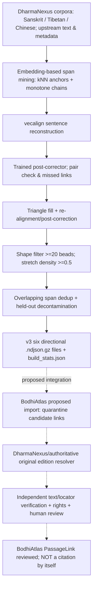

# Technology Assessment — MITRA-parallel

- **Mã:** P42 · **Dự án:** BodhiAtlas · **Ngày khảo sát:** 2026-11-16 (Asia/Ho_Chi_Minh).
- **Đối tượng:** [dharmamitra/mitra-parallel](https://github.com/dharmamitra/mitra-parallel) · **Nhánh:** `main` · **Commit được truy xuất:** [`0a770d98283b826134da0d8ec4d75259350faaa0`](https://github.com/dharmamitra/mitra-parallel/commit/0a770d98283b826134da0d8ec4d75259350faaa0) (commit ngày 2026-10-16 UTC).
- **Bản hiện hành theo README tại snapshot:** **v3, October 2026**; v2 và v1 là bản cũ. **GitHub Releases:** API trả về danh sách trống tại lúc khảo sát; không xem tên thư mục `v3` là GitHub release/tag. **Archived:** `false` theo GitHub repository metadata.
- **Phân loại:** `corpus` — tập dữ liệu căn chỉnh đoạn/song hành trích xuất bằng máy, **không phải** backend OCR, search engine, viewer, hệ thống citation hay sense-aware lexicon.
- **Analyst/phương pháp:** thẩm định độc lập bằng đọc trực tiếp repository qua kết nối GitHub, đọc nguồn chuẩn BodhiAtlas, kiểm tra cây Git/commit/file, đối chiếu nguồn dự án liên quan và web công khai, chạy **POC adapter tổng hợp (synthetic)** cục bộ bằng Python. **Không tải/giải nén được tệp dữ liệu v3 thực**, không gọi API thực, không kiểm chứng ngữ nghĩa bởi học giả. Thống kê corpus bên dưới là **số do nguồn công bố/build_stats ghi lại**, chưa phải thống kê tự đếm từ toàn bộ NDJSON.
- **Quy ước bằng chứng:** `[DOC]` mô tả tài liệu hoặc manifest; `[CODE]` mã đã đọc; `[TESTED]` lệnh thật đã chạy trong phiên này, chỉ tính đúng phạm vi fixture; `[ISSUE]` issue/PR chưa tái hiện; `[INFERRED]` lập luận kỹ thuật; `[UNKNOWN]` không chứng minh. Các số v3 **không** được gắn `[TESTED]`.

## 1. Executive Decision

**Quyết định: `TRIAL ONLY` (chưa đưa thẳng vào nguồn citation chính hoặc triển khai công khai). Confidence: `LOW` cho quyết định chấp nhận dữ liệu; `HIGH` cho việc xác định đúng loại dự án và việc nó không đáp ứng chức năng tìm kiếm/OCR.**

**Có thể tái sử dụng:** những **đường dẫn ứng viên giữa các segment Sanskrit–Tibetan–Chinese** làm dữ liệu bổ trợ cho discovery/PassageLink, có `root_segnr`, `par_segnr`, văn bản hai phía, `src_lang/tgt_lang`, ID bản ghi và `score`. V3 ghi mỗi alignment là một *bead* nối 1..n segment ở mỗi phía; một `score` thuộc **mật độ dải căn chỉnh 0.5–1**, **không phải xác suất đúng của từng câu**. V3 xây bằng span mining, vecalign, mô hình post-corrector, triangle fill và shape filter — điều đó **không tương đương chuyên gia phê duyệt**. [Nguồn v3](https://github.com/dharmamitra/mitra-parallel/blob/0a770d98283b826134da0d8ec4d75259350faaa0/v3/README.md).

**Không thay thế được:** file gốc bất biến, ingest PDF/EPUB/DOCX/TEI, OCR, exact-all-occurrences, Việt/Pāli/Wylie search, bản đồ PDF bbox/EPUB CFI, work–edition–witness verified catalog, thẻ trích dẫn đã xác minh, đánh giá lập luận và phân quyền. BodhiAtlas phải giữ các bộ phận này riêng, theo [PRD V1.4](https://github.com/quoctran-2608/bodhi-atlas/blob/main/docs/PRD.md) và [Academic Risks](https://github.com/quoctran-2608/bodhi-atlas/blob/main/docs/ACADEMIC_RISKS_AND_VERIFICATION.md).

**Lộ trình đề nghị:**

- **V1:** chỉ nhập **optional/staging, tắt mặc định**, dùng làm gợi ý liên hệ đoạn khi có quyền sử dụng và kiểm tra được segment nguồn; không làm dependency của `EXACT/NORMALIZED/FUZZY/LEXICON` hay của verified citation.
- **V2:** nếu POC đạt, tạo adapter import có phiên bản, provenance và crosswalk tới bản văn gốc trong nguồn đã ghim, kèm reviewer workflow; dùng `PassageLink` trạng thái `PROPOSED`.
- **V3 BodhiAtlas:** có thể học từ dữ liệu này để đánh giá cross-lingual candidate retrieval/MT; AI không được phong cấp chứng cứ hoặc suy ra quan hệ học thuật bắc cầu tự động.

**Ba rủi ro P0:** (1) **fidelity:** segment ID DharmaNexus chưa được đối chiếu tới đúng file/ấn bản/witness/page; (2) **semantic correctness:** aligner tự động có false positives, kể cả đoạn chứa phủ định/đổi nghĩa; `score` không đo sự đúng đắn; (3) **rights:** README v1 ghi CC BY-SA 4.0 nhưng không tìm thấy `LICENSE` ở root hoặc `v1/LICENSE`, v3 không có giấy phép độc lập theo từng nguồn, và corpus upstream có điều kiện khác nhau. Chưa đủ chứng cứ để cho phép bulk index/API công khai.

**Cổng:** `SOURCE_FIDELITY=n/a` (dữ liệu ứng viên, verifier ngoài bắt buộc), `CODE_ONLY_EXACT=n/a`, `MULTILINGUAL=unknown` (đã nêu cặp nhưng chưa tự kiểm mẫu v3), `QUALITY_COVERAGE=unknown`, `RIGHTS_SECURITY=unknown`, `PORTABILITY=unknown` cho bản ghi chưa gắn bản văn nguồn ổn định. Không dùng điểm tổng để vượt cổng.

## 2. Sources & Evidence Ledger

**Snapshot ưu tiên:** link với commit chính xác cho MITRA; link `main` của BodhiAtlas và các upstream đã đọc tại ngày khảo sát nhưng SHA của các repo khác **không đồng nghĩa** SHA MITRA. Bảng này nêu kết quả truy xuất file/metadata, không ngụ ý đã chạy pipeline tạo corpus.

| claim_id | claim | Tag | URL/file+line hoặc vị trí | version/SHA | note |
|---|---|---|---|---|---|
| E01 | Nhánh chính ghi `v3/` là bản hiện hành tháng 10/2026 | [DOC] | [root README, phần release](https://github.com/dharmamitra/mitra-parallel/blob/0a770d98283b826134da0d8ec4d75259350faaa0/README.md#L1-L12) | MITRA `0a770d9…` | Web search cache vẫn hiện v2; dùng bản đọc trực tiếp qua GitHub |
| E02 | V3 là trilingual `sa–bo`, `sa–zh`, `bo–zh`, **không Pāli** trong corpus chính | [DOC] | [v3/README, Contents](https://github.com/dharmamitra/mitra-parallel/blob/0a770d98283b826134da0d8ec4d75259350faaa0/v3/README.md#L1-L18) | `0a770d9…` | `pa` có mặt trong **benchmark cũ**, không đồng nghĩa corpus v3 |
| E03 | Số bản ghi v3: sa–bo 625,148; bo–zh 709,769; sa–zh 355,738; tổng 1,690,655 **mỗi cặp đếm một chiều** | [DOC] | [v3 README, table](https://github.com/dharmamitra/mitra-parallel/blob/0a770d98283b826134da0d8ec4d75259350faaa0/v3/README.md#L13-L18) | `0a770d9…` | **Chưa tự đếm gzip** |
| E04 | V3 có file mỗi chiều; hai chiều là cùng cặp đã căn chỉnh, đảo root/par | [DOC] | [v3 README, Contents](https://github.com/dharmamitra/mitra-parallel/blob/0a770d98283b826134da0d8ec4d75259350faaa0/v3/README.md#L8-L11) | `0a770d9…` | Không cộng hai chiều làm quan hệ độc lập |
| E05 | `score` v3 = density của aligned stretch (`0.5..1`), không phải cosine từng cặp hay reliability probability | [DOC] | [v3 README, schema](https://github.com/dharmamitra/mitra-parallel/blob/0a770d98283b826134da0d8ec4d75259350faaa0/v3/README.md#L20-L24) | `0a770d9…` | V2 **khác nghĩa**: mean alignment cosine; cần versioned parser |
| E06 | V3 schema nêu `id`, `root_segnr`, `par_segnr`, `root_segtext`, `par_segtext`, `root_string`, `par_string`, `root_length`, `par_length`, `src_lang`, `tgt_lang`, position fields | [DOC] | [v3 README, schema](https://github.com/dharmamitra/mitra-parallel/blob/0a770d98283b826134da0d8ec4d75259350faaa0/v3/README.md#L20-L24) | `0a770d9…` | Kiểu JSON và tên các position fields **chưa mở record thật** |
| E07 | Span mining → vecalign → trained post-corrector, triangle fill, shape filter, overlap dedup | [DOC] | [v3 README, How built](https://github.com/dharmamitra/mitra-parallel/blob/0a770d98283b826134da0d8ec4d75259350faaa0/v3/README.md#L26-L42) | `0a770d9…` | Quy trình tự động, không có danh sách reviewer từng record |
| E08 | V3 báo decontamination 156 sa–bo, 1,185 sa–zh, 2,254 bo–zh; và loại 576 record từ file Sanskrit trộn dòng Tạng | [DOC] | [v3 README, step 7](https://github.com/dharmamitra/mitra-parallel/blob/0a770d98283b826134da0d8ec4d75259350faaa0/v3/README.md#L39-L44) và [build_stats](https://github.com/dharmamitra/mitra-parallel/blob/0a770d98283b826134da0d8ec4d75259350faaa0/v3/build_stats.json) | `0a770d9…` | Build stats là số công bố, chưa independently reproduced |
| E09 | V2 records 555,558 / 836,559 / 301,613; v2 `score` được tài liệu mô tả là mean alignment cosine | [DOC] | [v2 README](https://github.com/dharmamitra/mitra-parallel/blob/0a770d98283b826134da0d8ec4d75259350faaa0/v2/README.md) | `0a770d9…` | Cùng tên trường nhưng **semantic change** qua version |
| E10 | V1 phát hành TSV theo cặp, có segment IDs; v1 README ghi CC BY-SA 4.0 | [DOC] | [v1 README, Data Structure/License](https://github.com/dharmamitra/mitra-parallel/blob/0a770d98283b826134da0d8ec4d75259350faaa0/v1/README.md) | `0a770d9…` | Đây là **tuyên bố v1**, chưa xác nhận license chain riêng của v3 |
| E11 | Cây Git ở commit có `README.md`, `v1/`, `v2/`, `v3/`; không thấy LICENSE, model weights, pipeline code, unit tests trong repo MITRA | [DOC] | [Git tree](https://github.com/dharmamitra/mitra-parallel/tree/0a770d98283b826134da0d8ec4d75259350faaa0) | `0a770d9…` | Kiểm file root/v3/v2; không khẳng định code pipeline không tồn tại ở repo khác |
| E12 | `v2/evaluation/README.md` có TSV đánh giá 17 hướng, đa nguồn; một số directions không phân phối lại do quyền dịch | [DOC] | [v2 evaluation README, Construction/Attribution](https://github.com/dharmamitra/mitra-parallel/blob/0a770d98283b826134da0d8ec4d75259350faaa0/v2/evaluation/README.md) | `0a770d9…` | Benchmark không phải manual approval cho tất cả alignment v3 |
| E13 | V1 sample TSV mở được, header 4 cột và 5 hàng trong file `GE07hv_apppu_T04n0192.tsv` | [DOC] | [v1 sample](https://github.com/dharmamitra/mitra-parallel/blob/0a770d98283b826134da0d8ec4d75259350faaa0/v1/mitra-parallel/tsv/GE07hv_apppu_T04n0192.tsv) | `0a770d9…` | **Đọc file thật v1**, không suy ra schema v3 |
| E14 | `dharmanexus-sanskrit` nhận nguồn GRETIL, DSBC, Muktabodha, ilx_skt và corpus khác, một số license theo từng văn bản trong raw metadata | [DOC] | [DharmaNexus Sanskrit README](https://github.com/dharmamitra/dharmanexus-sanskrit/blob/master/README.md) | Upstream SHA chưa cố định | Cần kiểm bản ghi upstream trước khi tái phân phối |
| E15 | DharmaNexus public Swagger liệt kê `/matches/`, `/alignment/`, `/utils/segment-links/`, `/utils/raw-metadata/` | [DOC] | [API docs](https://dharmamitra.org/api-db/docs) | API `0.2.1` hiển thị; deployment SHA unknown | **Chưa thử** auth/latency/versioning, không phụ thuộc runtime service |
| E16 | BodhiAtlas PRD đòi exact mọi vị trí, provenance file/SHA và kiểm lại nguồn, tách evidence/meaning | [DOC] | [PRD, §§4–6](https://github.com/quoctran-2608/bodhi-atlas/blob/main/docs/PRD.md) | PRD V1.4, commit chưa chốt | Requirement của BodhiAtlas, không phải MITRA feature |
| E17 | Academic Risks tách `TEXT_AND_LOCATOR_VERIFIED` khỏi `SUPPORTS` và có gate G1–G6 | [DOC] | [Risks, §§3–5](https://github.com/quoctran-2608/bodhi-atlas/blob/main/docs/ACADEMIC_RISKS_AND_VERIFICATION.md) | Snapshot ngày khảo sát | Candidate align không được tự vượt G2/G3 |
| E18 | BuddhismDocuments-for-AI có 13 upstream pins, `parallel_alignment` là evidence class riêng và kiến trúc SQLite/FTS/relations | [DOC] | [manifest](https://github.com/quoctran-2608/BuddhismDocuments-for-AI/blob/main/manifest.json), [mapping](https://github.com/quoctran-2608/BuddhismDocuments-for-AI/blob/main/config/corpus-sources.json), [architecture](https://github.com/quoctran-2608/BuddhismDocuments-for-AI/blob/main/docs/ARCHITECTURE.md) | SHA của các upstream nằm trong manifest | MITRA **không** nằm trong 13 upstream hiện có |
| E19 | sc-data quản lý parallels/structure/metadata; Bilara là nguồn riêng; phân loại full/partial/retelling không đồng nghĩa sentence alignment | [DOC] | [sc-data README](https://github.com/suttacentral/sc-data), [methodology](https://suttacentral.net/methodology?lang=en) | Upstream current, unpinned | So sánh khác granularities |
| E20 | CBETA TEI có header/edition, `pb/lb` và các nhân chứng khảo dị; một file mẫu ghi non-commercial/header intact | [DOC] | [CBETA T45n1887A](https://github.com/cbeta-org/xml-p5/blob/master/T/T45/T45n1887A.xml) | CBETA upstream, unpinned | Không suy từ mẫu ra cùng quyền cho mọi tệp |
| E21 | 3 synthetic v3-shaped fixtures: adapter trả `PROPOSED`=3, verified=0, false positive vẫn unverified, thiếu ID bị từ chối | [TESTED] | [`POC_42_MITRA_PARALLEL.py`](./POC_42_MITRA_PARALLEL.py), log §9 | Python standard library, ngày khảo sát | **Chỉ kiểm logic adapter tổng hợp**, không phải kiểm chất lượng MITRA |
| E22 | Không phát hiện file `LICENSE` tại root hoặc `v1/LICENSE` khi gọi GitHub file API; API trả HTTP 404; GitHub Releases trả `[]` | [DOC] | [repo root](https://github.com/dharmamitra/mitra-parallel/tree/0a770d98283b826134da0d8ec4d75259350faaa0), [v1](https://github.com/dharmamitra/mitra-parallel/tree/0a770d98283b826134da0d8ec4d75259350faaa0/v1) | `0a770d9…` | Đây là **khoảng trống tài liệu cấp phép**, không kết luận corpus không có bản quyền hay không được dùng |
| E23 | PR #2 v3 được merge 2026-10-16; mô tả thêm post-corrected, triangle fill | [ISSUE] | [PR #2](https://github.com/dharmamitra/mitra-parallel/pull/2) | Commit merge `2c2d901…` | PR là thông tin thay đổi, không chứng minh chất lượng từng row |

**Đọc nguồn chuẩn:** PRD và ACADEMIC_RISKS_AND_VERIFICATION đã mở trực tiếp; README, `manifest.json`, `config/corpus-sources.json`, `docs/ARCHITECTURE.md` của BuddhismDocuments-for-AI đã mở. Thiếu: binary v3, raw source licenses **theo từng work**, model/post-corrector training code, reviewer gold cho v3, test logs của nhóm MITRA, và khả năng mở mọi segment DharmaNexus; các vấn đề này giữ `UNKNOWN`.

## 3. Architecture & Data Flow

Đây là **data lineage** do v3 mô tả, không phải giả định có server chạy ngay từ repo:



**Bản v2 khác v3:** v2 dùng ensemble gates và có `score` mean alignment cosine, v3 thay bằng post-correction và density; v2 hai chiều là mappings không bảo đảm byte mirror; v3 hai chiều chứa cùng pairs sau hoán vị phía (theo README). **Không** parse v3 bằng schema ngữ nghĩa v2. [v2 README](https://github.com/dharmamitra/mitra-parallel/blob/0a770d98283b826134da0d8ec4d75259350faaa0/v2/README.md), [v3 README](https://github.com/dharmamitra/mitra-parallel/blob/0a770d98283b826134da0d8ec4d75259350faaa0/v3/README.md).

**Boundary:** MITRA data là `candidate relation input`; DharmaNexus APIs/upstream texts cung cấp **đường mở** khả dĩ (chưa nghiệm thu); BodhiAtlas giữ source-of-truth bằng pinned originals+checksum, source-map và review trail. Embeddings mô tả ở quy trình **tạo dữ liệu**, không phải một engine RAG được repo MITRA cung cấp để BodhiAtlas gọi.

## 4. Feature Fit–Gap Matrix

`N/A` là ngoài vai trò hợp lý của một dataset, **không là điểm trừ**. Công sức `low/medium/high` là định tính cho **phần BodhiAtlas phải tích hợp**, chưa benchmark giờ công. `EXTERNAL` là năng lực do các hệ khác phụ trách; `EXTENSION` là việc viết adapter quanh dữ liệu.

| ID / capability | Status | Bằng chứng và vai trò thực | Gaps / việc cần làm | Công sức |
|---|---|---|---|---|
| C01 Multi-format ingest | `N/A` | E01–E06: chỉ phát hành parallel corpus NDJSON/TSV | BodhiAtlas ingest PDF/EPUB/DOCX/TEI riêng; MITRA có thể ingest **như dữ liệu quan hệ** | `low` cho import, N/A cho core ingest |
| C02 OCR/layout/reading order | `N/A` | E01–E07: không phải OCR engine | OCR, layout, confidence, bbox do pipeline gốc xử lý | `high` ở hệ thống ngoài |
| C03 Canonical text/source map | `EXTERNAL` | E06, E14: segment numbers DharmaNexus; không có PDF page/bbox/EPUB CFI được chứng minh | Resolver bản văn gốc, file SHA, mapping segment → source locator | `high` |
| C04 Works/editions/witnesses | `EXTERNAL` | E06 nêu ID; E14/E20 có metadata upstream, **không chứng minh** mọi record chứa edition/witness | Join ontology, disambiguate duplicate works, store witness evidence | `high` |
| C05 Exhaustive EXACT | `N/A` | E01–E06: dataset alignment, không phải substring engine | SQLite/FTS/exact source verification của BodhiAtlas, kiểm đủ mọi vị trí | `high` ở core ngoài MITRA |
| C06 Normalized multilingual search | `EXTENSION` | E02, E06: passage links ở 3 ngôn ngữ, không có search runtime | Index riêng, reversible normalization, lookup Unicode/Wylie/Hán–Việt | `medium–high` |
| C07 Fuzzy/near-duplicate/OCR errors | `N/A` | E07 là mining/cleaning ở lúc build, không phải truy vấn fuzzy cho sách người dùng | Fuzzy engine + source reopen + OCR flags | `medium–high` ở core |
| C08 Sense-aware lexicon | `N/A` | E06 chứa passage pairs, không chứa sense IDs/reviewed definitions | Từ điển đa nghĩa riêng; chỉ sinh lexicon **ứng viên** | `high` ngoài MITRA |
| C09 Semantic/hybrid/RAG | `EXTERNAL` | E07 có embedding trong quá trình *mining*, nhưng không xuất semantic search API từ repo | Nếu muốn cần retriever/encoder khác, kiểm chất lượng riêng | `medium–high` |
| C10 Verified citation card/source reopen | `EXTERNAL` | E06/E16/E17: chỉ segment IDs và text strings | Resolver đúng witness/edition + checksum + locator + text verification + review | `high` |
| C11 Note/wiki/claim memory | `N/A` | Dataset không quản lý note hoặc claim | BodhiAtlas research store riêng; không nhập nguyên câu như claim đã duyệt | `medium` ngoài MITRA |
| C12 API/MCP/export | `NATIVE` *(batch export)* | E03–E06: NDJSON.gz được công bố; E15 API là **DharmaNexus ngoài repo** | Viết importer/API/MCP có auth, rate-limit, quyền trích đoạn; **không gọi `NATIVE` cho API** | `medium` |
| C13 Quality coverage + incremental | `EXTENSION` | E08 có aggregate build stats; không có per-row human QA hay source coverage của corpus người dùng | Error ledger, inaccessible count, version diff, idempotent incremental import | `high` |
| C14 Auth/licensing/privacy/backup | `EXTERNAL` | E10/E12/E14/E22; repo phân phối dữ liệu công khai, không có auth/storage policy ứng dụng | Rights registry theo file/work, local-only mode, access control, backup+restore | `high` |
| C15 Operational simplicity + independent deploy | `CONFIG` *(offline file import)* | E11: tệp NDJSON.gz, không cần MITRA server để đọc dữ liệu | Streaming import và catalog snapshot dễ hơn chạy alignment pipeline; nguồn resolver/quyền vẫn phức tạp | `medium` |

**Non-negotiable gates:** với chức năng citation/EXACT mà MITRA không làm, giá trị đúng là `N/A` + verifier độc lập, không gán `PASS`. `MULTILINGUAL` chỉ có **claim về 3 language pairs**, chưa có thử Unicode/Wylie/Sanskrit/Chinese thực trên v3 → `UNKNOWN`. `RIGHTS_SECURITY` → `UNKNOWN` đến khi kiểm licensing từng corpus và output policy. `PORTABILITY` → cần giữ original segment IDs, origin version, raw file hash, independent relation DB và migration.

## 5. Deep Technical Findings

### 5.1 Manifest/schema, formats, phân bố và giới hạn số liệu (câu 1)

**V3 snapshot (theo `v3/README.md`, đối chiếu `v3/build_stats.json`, **không tự đếm NDJSON**):**

| Cặp ngôn ngữ (chỉ đếm 1 chiều) | Records công bố | Work pairs công bố | Source segments công bố | Target segments công bố | File đối xứng |
|---|---:|---:|---:|---:|---|
| Sanskrit–Tibetan `sa–bo` | 625,148 | 1,726 | 606,434 `sa` | 884,639 `bo` | `sa-bo` + `bo-sa` |
| Tibetan–Chinese `bo–zh` | 709,769 | 4,259 | 925,776 `bo` | 837,279 `zh` | `bo-zh` + `zh-bo` |
| Sanskrit–Chinese `sa–zh` | 355,738 | 2,101 | 341,605 `sa` | 434,667 `zh` | `sa-zh` + `zh-sa` |
| **Tổng** | **1,690,655** | **8,086** *work-pair relations, không phải unique works* | **không cộng làm unique segments** | **không cộng làm unique segments** | **6 `.ndjson.gz`** |

Nếu đếm **file entries có hai chiều** từ các con số do README khai báo thì số dòng dự kiến là `3,381,310`; đó **không** phải số cặp translation độc lập. Chênh lệch số v3 so v2 theo README: `sa–bo +69,590`, `bo–zh −126,790`, `sa–zh +54,125`, tổng `−3,075`; **không thể** suy ra precision cải thiện hay suy giảm từ khác biệt quy mô. Build stats v3 chỉ lưu số `kept`, `dropped_contaminated`, `dropped_tibetan_in_sanskrit` theo từng chiều; **không** có per-language human QA, false positive rate, CE/WER hay dataset completeness.

**File có thật ở cây Git v3:** `README.md`, `build_stats.json`, `sa-bo_matches.ndjson.gz`, `bo-sa_matches.ndjson.gz`, `sa-zh_matches.ndjson.gz`, `zh-sa_matches.ndjson.gz`, `bo-zh_matches.ndjson.gz`, `zh-bo_matches.ndjson.gz`. GitHub API hiển thị kích thước 6 gzip cộng **412,716,278 bytes (~393.6 MiB)** và 3 hướng không đối xứng cộng **206,431,443 bytes (~196.9 MiB)**; đây là **kích cỡ Git blobs nén**, không phải RAM dùng hay dung lượng index. V3 không có manifest per-work được nhìn thấy trong cây này, data card độc lập, `train/val/test` chia riêng cho v3, hoặc file LICENSE. Benchmark nằm ở `v1/eval/` và `v2/evaluation/`, **không phải** labels verified cho mỗi record v3.

### 5.2 Có gì trong một alignment? (câu 2)

`v3/README.md` liệt kê: `id`, `score`, `root_segnr`, `par_segnr` (DharmaNexus segment numbering), `root_segtext`, `par_segtext`, `root_string`, `par_string`, `root_length`, `par_length`, `src_lang`, `tgt_lang` và *position fields* (không nêu tên cụ thể). Một *bead* nối một hoặc nhiều segment liên tiếp ở mỗi phía. **Những gì chưa có chứng cứ ở mỗi row:** DOI/URI bất biến; original file SHA; ấn bản + witness có thể mở lại; tác giả/dịch giả; bbox/CFI; calibration score; human-review flags; explicit relation-type như quote/comparable; và license của đoạn nguồn. Không được suy từ `root_segnr` rằng row đã biết ấn bản. Kiểu của `root_segnr` (scalar/list), `root_segtext` và position keys vẫn `UNKNOWN` vì chưa lấy mẫu JSON gzip thật.

### 5.3 Dịch song hành ≠ có liên hệ ≠ đồng nghĩa (câu 3)

- **Parallel translation (candidate):** hai chuỗi được pipeline xem là bản dịch song hành, nhưng phải đối chiếu ngữ cảnh và nhân chứng văn bản.
- **Comparable passage:** cùng chủ đề/thuật lại câu chuyện, không nhất thiết tương ứng từng mệnh đề hay cùng văn bản nguồn.
- **Semantic similarity:** gần nghĩa theo embedding, có thể không có liên hệ dịch thuật/nguồn gốc.
- **Distant alignment:** span hoặc unit nối xa, có thể bỏ đoạn, ghép/tách nhiều câu, khác bản dịch/di bản.

**Failure case đề xuất:** nguồn A nói “**không** phải tự ngã”, nguồn B bỏ “không” hoặc diễn đạt phủ định của một nhận định khác; embedding vẫn có thể khớp vì cùng từ. Triangle A↔B và B↔C **không** suy ra A↔C là bản dịch chính xác. Shape filter và density không chứng minh câu chữ/cú pháp/phủ định giống nhau. Đây là **rủi ro suy luận** `[INFERRED]`, không phải lỗi cụ thể đã đo ở MITRA.

### 5.4 Sanskrit→Chinese→bản gốc và ổn định ID (câu 4)

Cần hai lần lookup (gốc Sanskrit, gốc Chinese) bằng `root_segnr/par_segnr` → DharmaNexus metadata/segment → pinned text file/edition/witness → source line/locator. **Chưa đạt** vì chưa có record v3 thực, mapping đầy đủ các source IDs, source file commit+hash, page/folio/chương đã được đối chiếu. API DharmaNexus công khai có endpoint liên quan, nhưng chưa gọi để xác thực và chưa cam kết snapshot ổn định. ID MITRA `id` có thể thay đổi qua mining runs; **không biết** tính ổn định v2→v3; cần thử TC06 và không dùng nó làm ID bất biến của citation.

### 5.5 Human-review, gold/negative và độ chính xác (câu 5)

V3 nói một **trained post-corrector** đánh giá từng cặp và loại/khôi phục liên kết; đây là **model-based QC**, **không** phải tuyên bố “1,690,655 cặp được học giả duyệt thủ công”. `v2/evaluation` cung cấp bộ tham chiếu dịch có nguồn, có phần manually aligned TLB, các hướng khác tùy giấy phép; không thể thay cho gold labels của toàn bộ v3. **UNKNOWN:** precision/recall v3 theo cặp ngôn ngữ, negative samples chuẩn, calibration score, inter-rater agreement, review coverage. Không gán số liệu benchmark paper (nếu có) thành đo trực tiếp của báo cáo này.

### 5.6 Cleaning/normalization và lossiness (câu 6)

V3 ghi decontamination bằng *normalized substring* tương tự v2; v2 chỉ rõ NFC, whitespace và lowercase-normalized; v3 README **không chứng minh** mọi bước cleaning text gốc hoặc bảo toàn từng dị thể/gaiji. V1 mẫu TSV cho thấy Devanāgarī? **Không**: ví dụ v1 là Sanskrit Latin IAST và Chinese, có mark/line references chen trong text. `v2/evaluation/README.md` ghi `bo` Tibetan Unicode (không Wylie), `sa` IAST, `zh` phần lớn chữ Hán phồn thể trừ ghi chú; đây là **benchmark**, không phải cam kết exhaustive v3. Cần kiểm riêng NFC/NFD, nonbreaking spaces, Sanskrit combining marks, chữ Hán dị thể `無常/无常`, Tạng tsheg và Wylie; **không bao giờ ghi đè raw text bằng normalized form**.

### 5.7 Rights / sample / bulk / serving excerpts (câu 7)

- **MITRA:** `v1/README.md` tự công bố **CC BY-SA 4.0** cho “MITRA-parallel dataset”. Tuy nhiên link `LICENSE` tương đối trong v1 README trỏ tới file v1 không tìm thấy (404); root không có LICENSE; `v3/README.md` **không xác nhận rõ** phạm vi license cho v3. Cần tác giả xác nhận bằng văn bản về bản v3, attribution/ShareAlike, extract/index/API.
- **Corpus nguồn:** DharmaNexus Sanskrit gồm GRETIL, DSBC, Muktabodha, ilx_skt... README yêu cầu xét per-text metadata/license; các text nguồn/bản dịch có thể khác quyền dữ liệu căn chỉnh dẫn xuất. Không dùng một nhãn CC BY-SA của collection để bỏ qua source restrictions.
- **Benchmark:** `v2/evaluation/README.md` có hướng được giữ lại do không thể redistributing reference translations; phần Lotsawa House nêu CC BY-NC 4.0 và permission cho bản tham chiếu, không tự động cho phép dùng chúng như sản phẩm thương mại khác. **CBETA** mẫu TEI chính thức có `availability` non-commercial/header intact; **SuttaCentral** công bố phân loại bản quyền khác nhau và có yêu cầu tránh khai thác phục vụ generative AI. Cần xử lý license theo **asset và use case**, không diễn giải mọi lời yêu cầu thành điều khoản pháp luật.
- **Local/cloud/AI:** local private research, lập index nội bộ, trích đoạn trong nội bộ, API/public snippets, model training, chuyển dữ liệu lên cloud **là các quyền dùng khác nhau**; chưa cho phép theo mặc định. Giữ access-control/redistribution flags và ghi attribution. Pháp lý cuối cùng cần người có trách nhiệm phê duyệt.

### 5.8 Passage pairs không phải sense lexicon (câu 8)

`anātman / 無我` có thể xuất hiện trong những bản dịch tương ứng; điều đó **không** chứng minh mọi trường hợp `無我` mang cùng một mục từ sense hoặc hoàn toàn đồng nghĩa với Pāli `anattā`. Cần `Lexeme`, `Sense`, `TermOccurrence`, `TranslationEquivalent` có context, source, confidence/reviewer, truyền thống và trạng thái. Dữ liệu MITRA chỉ có thể tạo **candidate attestations**, không phải dictionary definition. Repo **khác** [dharmamitra-lexicon](https://github.com/dharmamitra/dharmamitra-lexicon) có span-level records, cũng phải thẩm định riêng trước khi dùng.

### 5.9 Đổi sang PassageLink (câu 9)

**Đề xuất contract (không khẳng định là schema MITRA):**

```json
{
  "passage_link_id": "mitra:v3:<sha256_of_revision_and_contents>",
  "origin": {"repo": "dharmamitra/mitra-parallel", "commit": "0a770d98283b826134da0d8ec4d75259350faaa0", "dataset_version": "v3", "file": "sa-zh_matches.ndjson.gz", "upstream_record_id": "<actual-id>"},
  "left": {"language": "sa", "segment_ids": ["<upstream-ID>"], "work_id": null, "edition_id": null, "file_id": null, "file_sha256": null, "locator": null},
  "right": {"language": "zh", "segment_ids": ["<upstream-ID>"], "work_id": null, "edition_id": null, "file_id": null, "file_sha256": null, "locator": null},
  "relation_type": "ALIGNED_TRANSLATION_CANDIDATE",
  "evidence": {"algorithm": "MITRA_v3", "score_kind": "SPAN_DENSITY", "raw_score": null, "raw_text_snapshot_sha256": null},
  "status": "PROPOSED", "text_verification": "NOT_VERIFIED", "locator_verification": "NOT_VERIFIED", "semantic_assessment": "NOT_ASSESSED",
  "reviewer": null, "rights_status": "UNKNOWN", "citation_allowed": false,
  "revision": 1, "supersedes": null
}
```

Khi mở được exact nguồn, thêm file SHA-256 và locator có chứng cứ; nguyên văn giữ riêng trong content-addressed archive. `raw_score` và work/file IDs chỉ được điền sau khi đọc record và resolver thật, **không suy đoán**. Relation type có thể được nâng lên `VERIFIED_TRANSLATION`, `PARTIAL_PARALLEL`, `COMPARABLE`, `REJECTED` **chỉ bằng quy trình review có ghi lý do**, không tự nâng theo density.

### 5.10 Versioning, overlap/dedup và independence (câu 10)

V3 là mining run mới, có thêm/loại spans, triangle fill và thay score semantics; không phải update append-only. Cần import theo composite `(dataset_commit, file_direction, upstream_id, source/target segment IDs, raw text hash)`; kiểm text collision; gộp reversed directions thành **cùng một quan hệ** nhưng vẫn giữ cả nguồn raw links; không lấy `id` v1/v2 làm stable across release. Đối chiếu bilara/sc-data: corpus v3 chỉ 3 cặp sa/bo/zh, trong khi SuttaCentral có Pāli/translation/parallel metadata ở cấp khác; **không cộng các quan hệ từ cùng bản gốc thành chứng cứ độc lập**, nhất là khi Sanskrit–Chinese được suy từ Tibetan pivot. `v3/README.md` ghi triangle fill yêu cầu ít nhất một nửa cặp phù hợp pivot links, đây là lọc thuật toán, không là provenance hai nguồn lịch sử độc lập.

## 6. Source Fidelity & Provenance

**Không thể từ một row căn chỉnh v3 tự tạo “trích dẫn đã xác minh trong sách”.** Thẻ citation của BodhiAtlas phải đi qua các giai đoạn riêng:

1. **Candidate discovery:** MITRA `id`, 2 segment IDs và text snapshots, language-direction, dataset commit, score semantics; `status=PROPOSED`.
2. **Resolve hai nguồn:** tra DharmaNexus → mapping tới original source file/work/edition/witness/translator/author; xác định giấy phép, fetched file SHA-256 và snapshot revision. Không tra được thì `SOURCE_UNAVAILABLE` / `UNVERIFIABLE`.
3. **Technical verification:** mở **đúng raw file**; đối chiếu nguyên văn và ngữ cảnh; locator có chứng cứ (segment/folio/line, PDF page+bbox hoặc EPUB href/CFI khi file tương ứng thực sự có). Nếu chỉ match text mà locator chưa chứng minh: `TEXT_ONLY`. Nếu OCR uncertain: `OCR_NEEDS_REVIEW`. Không tự đặt trang in/PDF/line.
4. **Meaning/claim review:** kiểm phủ định, lệch nghĩa, quotation, relation type, ranh giới từng witness, sự phụ thuộc; `SUPPORTS/PARTIAL/CONTRARY/DISPUTED/INSUFFICIENT/NOT_ASSESSED` phải riêng với text/locator.
5. **Export:** lưu `work_id`, `edition_id`, `witness_id`, `file_id`, `SHA-256`, original excerpt, chapter/segment, page number (nếu thực), PDF bbox/EPUB locator (nếu thực), `EXACT/NORMALIZED/LEXICON/SEMANTIC` path, OCR & coverage, rights, reviewer/time/revision.

**Fidelity adversarial cases:** ngắt đoạn 1:n và ghép sai; mất phủ định; hai bản dịch dựa trên một bản thứ ba; dịch thuật chú giải thay vì lời chính; Chinese punctuation/gaiji biến đổi; Sanskrit diacritics bị mất; Tibetan tsheg/Wylie không hai chiều tuyệt đối; cùng đoạn lặp 5 lần nhưng row chỉ chỉ một segment; file PDF nhiều cột hoặc lệch số trang. Khi upstream bị sửa và source digest khác, **invalidate** verified location/quote, không trỏ ngầm sang phiên mới.

**Coverage:** V3 không báo BodhiAtlas đã index bao nhiêu tài liệu của người dùng hay bản scan nào đọc lỗi; phải công bố phạm vi tra cứu theo pinned imports và danh sách unresolved IDs. Câu “không tìm thấy” chỉ giới hạn trong tập đã lập chỉ mục/được phép, không là khẳng định vắng mặt trong Phật điển.

## 7. Multilingual & Retrieval Behavior

| Năng lực/query | MITRA v3 | Cách làm phù hợp trong BodhiAtlas | Trạng thái kiểm chứng |
|---|---|---|---|
| `EXACT`, câu dài 200–300 ký tự, 5 lần trong một file | `N/A` | Full source scan / deterministic exact matcher, trả *mọi* offsets với cross-chunk checks | MITRA `NOT TESTED` |
| `NORMALIZED`: `anatta/anattā/anātman`, `vô ngã/vo nga` | `N/A` cho Việt/Pāli và normalization search | Immutable originals + normalized index+mapping; dùng lexicon quan hệ được duyệt | Không có corpus v3 Việt/Pāli; `UNKNOWN` mức phủ thuật ngữ sa |
| `無常 ↔ 无常`, Hán dị thể | `N/A` search runtime | Unicode/variant normalization reversible, explicit relation-type | `NOT TESTED` |
| `dukkha/duḥkha` | `N/A` cho Pāli; Sanskrit có thể là context | Tách Pāli và Sanskrit lemma; không gộp nếu chưa có bằng chứng | `NOT TESTED` |
| Tibetan Unicode/Wylie | V3 có Tibetan strings theo mô tả, **không** công bố native Wylie index | Independent transliteration index, preserve original tsheg/combining | `NOT TESTED` |
| `FUZZY`/OCR errors/near duplicate | `N/A` retrieval | Trigram/Levenshtein + word/page-safe verifier; không coi BM25 phrase exact | `NOT TESTED` |
| `LEXICON` theo sense | `N/A` | Curated lexicon + sense-specific links/attestations | `NOT TESTED` |
| Cross-lingual `sa↔zh↔bo` passage discovery | `NATIVE` **data candidate** (không API/search) | Import links, resolver + rights + review; provenance dedup | `NOT TESTED` v3 binary |
| Semantic/hybrid/RAG | `EXTERNAL` | Tùy chọn retriever; không biến vectors thành evidence | `NOT TESTED` |
| Câu hỏi “ai phân biệt vô thường và khổ; lập luận, trích vị trí” | `N/A` suy luận/author attribution | Code retrieval → đối chiếu đúng tác giả/ấn bản/đoạn → người/AI phân tích lập luận và phản chứng | `NOT TESTED`; không thể trả danh sách tác giả chỉ bằng MITRA |

**Không nhầm lẫn corpus với ứng dụng:** việc embedding được dùng để *sản xuất* alignments hoặc DharmaNexus có API không biến tệp MITRA thành search engine. Đồng nghĩa từng từ không suy từ passage-level translation, đặc biệt phải kiểm chiều dịch, văn cảnh, truyền thống.

## 8. Integration Options for BodhiAtlas

### Option A — Offline optional `PassageLinkCandidate` importer (**ưu tiên thử**)

**Đầu vào:** pinned MITRA v3 gzip + SHA-256 file tải về hợp lệ + `build_stats.json` + rights registry; fetch từng hướng *canonical* (sa-bo, sa-zh, bo-zh), lưu identity 6 directions nếu kiểm symmetry. **Processing:** streaming NDJSON → strict validate schema (đọc record thật trước) → raw mirror read-only → normalize **separate columns only** → de-duplicate inversion → match pinned DharmaNexus segment metadata → staging relations `PROPOSED`. **Output:** table `passage_link_candidate` với origin file/dataset commit, content hashes, multiple segments, `score_kind`, unresolved reasons, review status; **không** tạo verified citation hay author claim. **Source of truth:** pinned original corpus của BodhiAtlas, không phải MITRA strings. **Stable IDs:** internal ID keyed revision+segment/text digest, giữ upstream IDs, revision crosswalk. **Failure/rollback:** quyền không rõ, source ID unavailable, schema mismatch hoặc checksum thay đổi → skip/quarantine; transactional import; rollback theo `import_batch_id`, không xóa verified claims.

Ưu điểm: offline, audit được, không cần mô hình tạo sinh trong runtime. Nhược: bridge upstream/giấy phép phức tạp; phần lớn candidates có thể chưa xác minh.

### Option B — Local discovery index độc lập, không dùng làm citation source

**Đầu vào:** subset v3 đã qua rights clearance và schema smoke-test; source segments cùng pinned canonical text. **Processing:** dựng SQLite `passage_text_index` để tìm từ/cụm trong chuỗi hai phía; expand query qua các cặp link; gắn nhãn `SEMANTIC/RELATION_CANDIDATE` **riêng** với `EXACT` trong nguyên bản. `EXACT` từ BodhiAtlas raw source scan **không dựa** vào chunk/bead. **Output:** ranked, deduped candidate links; resolver mở original work. **Source of truth:** BodhiAtlas originals+SourceMap. **Migration:** index dẫn xuất có `schema_version`, `dataset_commit`, source pin; build lại được; no destructive migration. **Failure/rollback:** tắt feature flag nếu precision thấp/license violation, loại index mà vẫn giữ log và historical provenance.

Ưu: hỗ trợ tra cứu ngữ cảnh xuyên ngôn ngữ khi đã có links. Nhược: cần phát triển search/normalization/dedup; search hit không là bằng chứng dịch đúng. Khuyến nghị **không** đồng bộ sang corpus hay index production nếu chưa chứng minh rights và `SOURCE_REOPEN_SUCCESS`.

### Option C — Live DharmaNexus resolution như bước kiểm tra phụ (không ưu tiên làm nền)

Endpoint như `/api-db/matches/` hoặc `/utils/raw-metadata/` có tài liệu public. Dùng chỉ sau khi có permission, rate limits, snapshot/content hash, ứng dụng được phép gọi dịch vụ. Host phải lưu response provenance và fail-closed khi mất mạng/schema drift. **Không** dùng kết quả API đang thay đổi làm source-of-truth hoặc loại bỏ raw snapshot. Việc API có sẵn chưa chứng minh mọi segment v3 có thể resolve; POC bắt buộc.

**Đối chiếu tài sản hiện có:** `BuddhismDocuments-for-AI` đã có `parallel_alignment`, `relations`, `source SHA`, pin và verifier 2.0 chưa nghiệm thu đầy đủ. MITRA nên thêm như **14th candidate import category** qua quyết định có chủ đích, **không tự đổi** manifest 13 sources hoặc thay thế Bilara/CBETA/84000. Hiện không có MITRA trong manifest; integration contract phải khớp schema thực khi code.

## 9. Practical POC / Reproduction Plan

**Trạng thái chung:** **v3 corpus quality `NOT TESTED`**. Không tải được gzip trong môi trường kiểm tra hiện tại; HTTP access từ container thất bại DNS và connector từ chối binary/oversized files. Không mở được source pair trực tiếp, do đó **không** điền bất cứ con số precision, recall, source reopen success hoặc chi phí/latency thực tế nào. **Đã chạy** chỉ là **synthetic adapter safety test**, có file companion và log bên dưới.

| TC | Fixture / bước và command thiết yếu | Gold answer/acceptance | Metrics | Thực trạng |
|---|---|---|---|---|
| TC01 schema/count/encoding | Checkout pinned SHA, mở `v3/{sa-bo,sa-zh,bo-zh}_matches.ndjson.gz` bằng `gzip.open(..., 'rt', encoding='utf-8')`, `json.loads` mọi dòng; xác nhận required fields/types, score, segment cardinality, NFC diagnostics và tính lại counts | `valid_json_lines == actual_lines`; đếm đạt giá trị `build_stats.kept` **nếu manifest phản ánh đúng data**; mọi sai khác in lỗi và sample ID | actual rows vs declared; parse errors; missing/duplicate IDs | `NOT TESTED` binary; README/stats đã đọc |
| TC02 sample reopen | Với mỗi pair direction chọn 20 rows bằng reservoir seed 42; mở cả hai `root_segnr/par_segnr` tại pinned source; ghi filename+SHA, witness, URI, đoạn context; reviewer kiểm 1:n/negation | Không auto xác nhận câu chữ; mỗi cặp có `SOURCE_REOPEN_SUCCESS` hoặc `UNRESOLVED` rõ lý do; gold 60 cặp cần chuyên gia chuẩn bị | 2-side reopen coverage, mismatch rate, review disagreements | `NOT TESTED` |
| TC03 adapter 10 cases | Lấy 10 real rows v3, biến vào PassageLink; preserve upstream IDs/version/reversed directions and content hash; compare with fixture schema | Exactly 10 proposed relations or explicit reject; `citation_allowed=false`; no accidental verified | schema coverage, provenance retention, false verification rate | `NOT TESTED` real; **TESTED 3 synthetic** |
| TC04 terms `anattā/無我` | Cùng dataset indexed check literal + normalized + relation candidates; phân biệt `EXACT/NORMALIZED/LEXICON/RELATION_CANDIDATE` và languages; kiểm cả `無常/无常`, `dukkha/duḥkha` | Exact cần original offsets; sa/bo/zh passage relation không thay thế Pāli/Vietnamese lookup; reviewed gold link IDs manual | `EXACT_FULL_RECALL`, candidate precision@k; unindexed coverage | `NOT TESTED` |
| TC05 injected false positive | Thêm cặp cố ý sai (phủ định hoặc sai nghĩa) cùng `score` rất cao; chạy importer, reviewer rejects; assert never auto VERIFIED | Stays `PROPOSED` pending review, or `REJECTED` when reviewer acts; no published citation | `FALSE_VERIFIED_CITATION` must equal 0 in fixture | **TESTED synthetic**, 1 deliberate wrong pair retained as `PROPOSED`; không chứng minh v3 thật |
| TC06 v2→v3 migration | Import same work/segment IDs from v2 and v3 (with different score semantics), compare ID/text/direction/inversion, build crosswalk and invalidate changed verified locators | Report stable/moved/deleted/changed/ambiguous without inventing identity; old claims open old pinned source | stable-link ratio, changed orphan count, rollback coverage | `NOT TESTED` actual releases; synthetic revision ID-change verified |
| TC07 multi-occurrence/coverage | 1 PDF scan two cột + 1 EPUB + 1 long 250-char phrase repeated 5 times + 1 truncated page; test outside MITRA | 5 locators if source scan covers them; missing pages flagged, not 0 evidence globally | exact-all-recall, OCR coverage | `N/A` to MITRA, `NOT TESTED` BodhiAtlas end-to-end |

**Lệnh tái lập mẫu v3** *(đề xuất, chưa thực thi trong phiên này)*:

```bash
git clone --filter=blob:none --sparse https://github.com/dharmamitra/mitra-parallel.git
cd mitra-parallel
git checkout 0a770d98283b826134da0d8ec4d75259350faaa0
git sparse-checkout set v3
sha256sum v3/*matches.ndjson.gz
python - <<'PY'
import gzip, json, pathlib, collections
for p in sorted(pathlib.Path('v3').glob('*_matches.ndjson.gz')):
    n=0; errors=0; ids=set(); missing=collections.Counter()
    with gzip.open(p, 'rt', encoding='utf-8', errors='strict') as f:
        for i,line in enumerate(f,1):
            try:
                obj=json.loads(line)
                for k in ['id','score','root_segnr','par_segnr','root_string','par_string','src_lang','tgt_lang']:
                    if k not in obj: missing[k]+=1
                if 'id' in obj: ids.add(str(obj['id']))
                n+=1
            except (ValueError,UnicodeError): errors+=1
    print(p.name, 'rows',n,'parse_errors',errors,'distinct_ids',len(ids),'missing',dict(missing))
PY
```

**Golden set cần chuẩn bị:** 20/ngôn ngữ-cặp × 3 = **60 cặp phân tầng** (theo chiều đơn, gồm 1:n và độ dài), 10 cặp bất đồng rõ, 5 cặp có phủ định, 5 cặp có tình huống witness/edition. Đó là **kích cỡ đề xuất**, không là số liệu hệ thống thực. Các nhãn phải do ít nhất một reviewer hiểu ngôn ngữ/đối chiếu nguồn xác nhận; bổ sung spot-check thứ hai và adjudication cho tranh chấp. Báo source openness failure độc lập với false align.

**Lệnh đã chạy (`[TESTED]`, chỉ adapter giả lập):**

```bash
python /mnt/data/POC_42_MITRA_PARALLEL.py
```

**Log thực:**

```text
environment=Python standard library; input=3 SYNTHETIC v3-shaped fixtures
adapter_output=3; proposed=3; verified=0; citation_allowed=0
negative_fixture=retained_as_PROPOSED; missing_ids=REJECTED
id_repeat_same_revision=STABLE; revision_change=NEW_ID_REQUIRES_CROSSWALK
real_v3_data_read=NO; source_reopen=NOT_TESTED; accuracy=NOT_MEASURED
```

**Diễn giải:** test chứng minh hành vi fail-closed của *đoạn code POC cung cấp*, không kiểm chứng đúng schema thực v3, không đo quality dataset, không chứng minh API/nguồn hoạt động. File source cạnh báo cáo: [`POC_42_MITRA_PARALLEL.py`](./POC_42_MITRA_PARALLEL.py).

## 10. Deployment, Security, Legal, Cost

**Phụ thuộc / vận hành:** đọc `.ndjson.gz` không yêu cầu runtime Python package ngoài standard library; POC script đã dùng như vậy. Muốn xây importer thực cần streaming gzip/json, SQLite/Postgres schema riêng, hash, versioning, relation dedup; muốn source verifier cần truy cập pinned DharmaNexus/upstream texts và API được phép (hoặc mirror hợp pháp). **Không thấy** entrypoint/service/requirements/lockfile/tests của pipeline v3 trong repo MITRA; không thể đưa command rebuild alignment pipeline từ mã có sẵn. Model weights của các MITRA model nằm ngoài repo này; **không đánh đồng license model với dataset**.

**Dung lượng được quan sát từ Git tree**: sáu `.gz` v3 ~393.6 MiB theo metadata GitHub; đọc một chiều mỗi cặp ~196.9 MiB nén. Không biết decompressed bytes, RAM peak, SQLite DB, bandwidth, latency, cloud cost hoặc throughput vì chưa chạy tải/index. Số worker/GPU/giá tiền: `UNKNOWN`. Có thể chạy **import streaming trên CPU** về mặt thuật toán; đây là `[INFERRED]`, không chứng minh hiệu năng/fit thiết bị.

**License/rights matrix:**

| Asset | Điều biết được | Điều thiếu / gate |
|---|---|---|
| MITRA v1 dataset | v1 README tuyên bố CC BY-SA 4.0 | Không có referenced LICENSE file; phạm vi ràng buộc đối với v3 `UNKNOWN` |
| MITRA v2/v3 dataset | Public gzip; v3 không có per-work license manifest | Owner confirmation, attribution policy, API/bulk index rights `UNKNOWN` |
| Source Sanskrit (DharmaNexus) | Aggregate GRETIL, DSBC, Muktabodha, ilx_skt và bản số hóa khác | Per-work permissions, edition, source file revision `UNKNOWN` |
| Source Chinese/Tibetan | V3 có segments, nhiều corpora/editions có thể khác quyền | Per-record source ownership, license and redistribution `UNKNOWN` |
| MITRA models/post-corrector | Ngoài data repo | Model license/weights, input terms, training provenance `UNKNOWN` |
| Evaluation translations | v2 eval README liệt kê TLB, Mitrasaṃgraha, 84000, Lotsawa House... và giới hạn redistribute | Không suy quyền benchmark sang training, SaaS, public API |
| BodhiAtlas user's books/PDF scans | Thuộc phạm vi người dùng và từng file | Không chuyển lên cloud/AI/public API khi chưa cho phép |

**Security:** default **local-only, no remote AI**, least-privilege import, untrusted string/data handling (không thực thi chỉ dẫn nằm trong text), SHA-256 pin mỗi gzip/original, export rights filter, bounded decompression and JSON validation (zip-bomb/oversize protection), deny-list unknown rights, logging không chứa trích đoạn nhạy cảm, API auth/quotas nếu bật; backup raw assets và relation DB tách khỏi index, kiểm restore và migration. Remote DharmaNexus API docs hiển thị Swagger, **không có bằng chứng đã test** authentication/rate-limit/service uptime. Public API listing không là giấy phép để copy/distribute.

**Cost:** không bịa giá USD hay tốc độ. Mô hình tổng chi phí cần lấy `storage_raw + source_mirrors + DB + index + backup + source review labor + legal review + API calls` theo số file thực tế, retention và quyền dùng. Quyết định go/no-go trước hết là rights + fidelity; không dùng headline dataset size để đánh giá TCO.

## 11. Comparison & Trade-offs

| Ứng viên | Phân loại/chức năng đúng | Ưu điểm cho BodhiAtlas | Thiếu so với MITRA / rủi ro | Vai trò/đường dùng |
|---|---|---|---|---|
| **MITRA-parallel v3** | Mined cross-lingual **segment alignment** sa–bo, bo–zh, sa–zh, multi-segment beads | Cung cấp discovery candidates xuyên Phạn–Hán–Tạng, data offline NDJSON | Không phải source text authority, no page locator; human review/rights/v3 quality unproven; no Pāli/Việt main corpus | `TRIAL ONLY` candidate PassageLink |
| **SuttaCentral sc-data / bilara-data** | Canonical/source/translation and discourse-parallel metadata, IDs | Nguồn Pāli/bản dịch chia đoạn và quan hệ kinh song hành; đã có trong asset 13 upstream | Parallels ở discourse level không mặc nhiên align sentence; terms/copyright theo asset; không thay thế Sanskrit–Tibetan miner | V1 source/relationship lane; ưu tiên pinned assets |
| **CBETA xml-p5 / BM_u8** | Chinese canonical TEI/P5 + line/page/witness context | Tốt để mở đúng bản Hán và kiểm source locator, apparatus | Không phải trilingual alignments; quyền CBETA có điều kiện non-commercial/header per edition | V1 authoritative Chinese witness/source verifier |
| **DharmaNexus corpora/API** | Original segmented Sanskrit/Chinese/Tibetan & intertextuality lookup | Nguồn logic của MITRA segment IDs, khả năng resolve metadata/API | API version/permissions/stability và mỗi work license cần test; backend không được chứng minh deploy độc lập từ repo MITRA | Thí điểm external resolver, snapshot/pin cần thiết |
| **BuddhismDocuments-for-AI** | Hệ corpus/index/provenance/verification đang có của chủ dự án | 13 pinned upstream, SQLite/FTS, relations, evidence classes, Quick/Research với gate | Không có MITRA v3; không vì có interface mà đã nghiệm thu tất cả source formats | **Tích hợp ở đây** nếu pilot đạt, không xây platform mới |

**Trade-off quyết định:** MITRA cung cấp cặp đoạn mà source authorities khác không có cùng loại ở quy mô công bố, nhưng chỉ là **một lớp dẫn đường**. SuttaCentral cung cấp quan hệ nhiều cấp và văn bản gốc/translation; CBETA hỗ trợ chứng cứ Hán văn; DharmaNexus tạo đường quay lại segment; tài sản đã có lo governance/search. Không chọn một thứ để thay tất cả. **Ba bản dịch từ một nguồn** hay hai hướng file v3 **không** tăng independent evidence count.

## 12. Decision Record for Master Synthesis

**Bảng chuẩn cho máy tổng hợp (giữ nguyên Field names):**

| Field | Value | Evidence/assumption |
|---|---|---|
| TARGET | MITRA-parallel | E01 |
| CLASS | corpus | E01–E06: alignment dataset, không phải platform |
| DATE / VERSION / COMMIT | 2026-11-16 / v3 (Oct 2026) / `0a770d98283b826134da0d8ec4d75259350faaa0` | E01; GitHub commit info |
| PRIMARY_ROLE | Cross-lingual **candidate** passage alignments (sa–bo, bo–zh, sa–zh) | E02–E07 |
| BEST_FIT_V1_CORE | partial | Optional relation enrichment; không làm V1 ingest/EXACT/citation |
| SOURCE_FIDELITY_GATE | n/a | Chỉ retrieval candidate; independent resolver+verifier cần thiết, chưa nghiệm thu |
| CODE_ONLY_EXACT_GATE | n/a | Dataset không làm exact exhaustive |
| MULTILINGUAL_GATE | unknown | V3 mô tả ba pair; chưa tự thử binary/Unicode/witness |
| OCR_COVERAGE_GATE | n/a | Không làm OCR |
| RIGHTS_SECURITY_GATE | unknown | E10, E12, E14, E20, E22; license per-source/v3 thiếu |
| INTEGRATION_COST | high | `[INFERRED]` để tích hợp **đúng mức verified** cần bridge, licensing, reviewer; pilot offline hẹp có thể medium |
| MAINTENANCE_RISK | high | `[INFERRED]` thay mining runs/score semantics, upstream IDs và rights |
| RECOMMENDATION | TRIAL | Chỉ pilot; chưa ADOPT/component production |
| CONFIDENCE | low | Không tải NDJSON thật, không source reopen, không rights clearance |
| NEXT_POC | TC01 + TC02 + rights audit cho v3 và upstream; sau đó TC03/TC05/TC06 | Trình tự có các blocking gates |

**5 findings:**

1. V3 **mới hơn cache tìm kiếm** và đổi phương pháp lẫn score semantics so với v2 (E01/E05/E07/E09).
2. V3 công bố 1,690,655 bead records ở ba cặp sa/bo/zh; hai chiều không độc lập; quy mô chưa tự đếm (E02–E04).
3. V3 là tự động mining + trained post-corrector, không phải bộ quan hệ học thuật đã human-review từng câu (E07/E12).
4. `root_segnr/par_segnr` cho phép thử nối DharmaNexus, nhưng thiếu verified file/edition/witness/locators (E06/E14/E15).
5. BuddhismDocuments-for-AI đã có lớp relation/provenance rõ, nên có vị trí cắm MITRA mà không tạo index/citation authority mới (E18).

**5 blockers:**

1. **B1:** license v3 và per-work/per-translation index/public excerpt chưa được chứng minh (E10/E12/E14/E20/E22).
2. **B2:** chưa inspect sample NDJSON v3 thực và chưa tự đếm từng language pair; types/positions unknown (E03/E06).
3. **B3:** chưa reopen Sanskrit/Chinese/Tibetan ở đúng witness, version, context, source hash (E14/E15).
4. **B4:** không có gold/negative/precision v3 theo ngôn ngữ được tự kiểm (E07/E12).
5. **B5:** version diff v2→v3/ID stability/triangle provenance không được kiểm; thay đổi nghĩa score (E05/E09).

**5 experiments (thứ tự gate):**

1. **X1:** legal + corpus manifest audit, xem chủ sở hữu v3 xác nhận license và attribution; mapping licenses upstream (B1).
2. **X2:** stream read v3 thật + auto schema validator + counts/duplicates/symmetry check (B2).
3. **X3:** 20 pair/cặp ngôn ngữ (60 samples) human two-side source reopen + 1:n, negation, witness review (B3/B4).
4. **X4:** 10 PassageLink candidates + false positive injected + independent citation verifier (B3/B4).
5. **X5:** compare version hashes/segments v2-v3, test idempotent import, rollback and broken citations (B5).

**3 quyết định chờ chủ dự án:**

1. **Phạm vi quyền:** chỉ dùng offline cá nhân, hay cho phép nội bộ/team, public API, redistributions/training? Cần xác định quyền trước khi lấy bulk.
2. **Mức tích hợp V1:** giữ MITRA optional discovery staging đến V2 hay ưu tiên pilot trong V1, với ngân sách review/legal/time?
3. **Thẩm quyền học thuật:** ai duyệt translation relation và sense-aware cross-lingual equivalence, chính sách không auto-verify và threshold/gold acceptance nào được phép cho production?

**Decision condition:** chỉ chuyển `TRIAL` → `COMPONENT` khi đã (a) quyền dùng cụ thể, (b) pin SHA và đếm/schema v3 thực, (c) source reopen và reviewer gold đủ tốt theo ngưỡng chủ dự án đặt trước, (d) no false verified citation trong test âm, (e) rollback + export được chứng minh. Mọi giá trị ngưỡng hiện là `UNKNOWN`, không giả tự đặt ngưỡng học thuật.

## 13. Appendix

### A. Primary source links (đã truy cập)

- MITRA root [README](https://github.com/dharmamitra/mitra-parallel/blob/0a770d98283b826134da0d8ec4d75259350faaa0/README.md), [v3 README](https://github.com/dharmamitra/mitra-parallel/blob/0a770d98283b826134da0d8ec4d75259350faaa0/v3/README.md), [v3 build_stats](https://github.com/dharmamitra/mitra-parallel/blob/0a770d98283b826134da0d8ec4d75259350faaa0/v3/build_stats.json), [v2 README](https://github.com/dharmamitra/mitra-parallel/blob/0a770d98283b826134da0d8ec4d75259350faaa0/v2/README.md), [v2 evaluation README](https://github.com/dharmamitra/mitra-parallel/blob/0a770d98283b826134da0d8ec4d75259350faaa0/v2/evaluation/README.md), [v1 README](https://github.com/dharmamitra/mitra-parallel/blob/0a770d98283b826134da0d8ec4d75259350faaa0/v1/README.md), [v1 sample](https://github.com/dharmamitra/mitra-parallel/blob/0a770d98283b826134da0d8ec4d75259350faaa0/v1/mitra-parallel/tsv/GE07hv_apppu_T04n0192.tsv), [PR #2](https://github.com/dharmamitra/mitra-parallel/pull/2).
- BodhiAtlas [PRD](https://github.com/quoctran-2608/bodhi-atlas/blob/main/docs/PRD.md), [Academic Risks](https://github.com/quoctran-2608/bodhi-atlas/blob/main/docs/ACADEMIC_RISKS_AND_VERIFICATION.md).
- BuddhismDocuments-for-AI [README](https://github.com/quoctran-2608/BuddhismDocuments-for-AI), [manifest](https://github.com/quoctran-2608/BuddhismDocuments-for-AI/blob/main/manifest.json), [corpus mapping](https://github.com/quoctran-2608/BuddhismDocuments-for-AI/blob/main/config/corpus-sources.json), [architecture](https://github.com/quoctran-2608/BuddhismDocuments-for-AI/blob/main/docs/ARCHITECTURE.md).
- Others: [DharmaNexus Sanskrit](https://github.com/dharmamitra/dharmanexus-sanskrit), [DharmaNexus API docs](https://dharmamitra.org/api-db/docs), [SuttaCentral sc-data](https://github.com/suttacentral/sc-data), [methodology](https://suttacentral.net/methodology?lang=en), [licensing](https://suttacentral.net/licensing?lang=en), [CBETA xml-p5](https://github.com/cbeta-org/xml-p5), [CBETA sample TEI availability header](https://github.com/cbeta-org/xml-p5/blob/master/T/T45/T45n1887A.xml).

### B. Repository tree/facts checked

- MITRA top-level at `0a770d9…`: `README.md`, `v1/`, `v2/`, `v3/`; **không thấy** root LICENSE, lockfile/requirements, executable alignment pipeline code, application tests. Git tree `v3/`: README, stats và 6 `.ndjson.gz`. Repo Git metadata `archived=false`, latest commit 2026-10-16. GitHub Releases query returned `[]`. URL `v1/LICENSE` và root `LICENSE` đều trả 404 qua GitHub API.
- `v1/mitra-parallel/tsv/GE07hv_apppu_T04n0192.tsv` thực có header `src_segmentnr`, `src_original`, `tgt_segmentnr`, `tgt_original`, 5 data rows. Ví dụ của **v1**, không xác nhận v3 row typing.
- `v2/evaluation` có files/README, nhiều benchmark directions; không tính là `train/test` của v3 aligner và không suy ra sample v3 đều đã review.
- Không suy rằng việc website `mitra-parallel-html` hiển thị alignments đồng nghĩa nó là giao diện/artefact chính của v3; browser repo/web có thể phản ánh corpus TSV/v1.

### C. Commands, outputs, environment

- **[TESTED]** Python 3 standard library: `python /mnt/data/POC_42_MITRA_PARALLEL.py`; log đầy đủ §9. Fixture synthetic: 3 source-target links, gồm 1 false positive deliberate, trường `score`, `root_segnr`, `par_segnr`, `src_lang/tgt_lang`; không chứa file thật. Rủi ro script: schema v3 chưa quan sát record thật nên cần điều chỉnh list/scalar types, work-id resolver và raw position keys trước khi import.
- **[NOT TESTED]** checkout/download 6 gzip, enumerate NDJSON count, decode sample, source reopen, 60-pair human review, v2→v3 matching; xem command cụ thể tại §9.
- Thử HTTP trực tiếp từ container cho URL raw GitHub thất bại `NameResolutionError`; công cụ kết nối GitHub đọc file text được nhưng binary/oversized v3 chưa đọc. Do đó không điền `SHA-256` của `.gz` hay nói đã tải raw v3.

### D. Limitations & evidence non-equivalence

1. Source-derived: v3 size/count/schema **do README + build_stats cung cấp**, không có independent census. User-facing web cache có thể chưa cập nhật; GitHub connector được dùng để xác định v3.
2. Source-derived: V3 post-corrector và triangle fill là *algorithm description*, chưa có mã thực thi/training config trong repo này để review hoặc rerun. Không chuyển `[DOC]` sang `[CODE]`.
3. Dataset rights scope: dataset license declaration ≠ quyền upstream edition/translation/page images; v1 LICENSE link bị thiếu, v3 quyền chưa chắc chắn; cần confirm trước triển khai.
4. Quality: không có benchmark tự chạy trên v3, không có negative/gold per pair; `score` là density, không được dùng làm độ tin cậy citation.
5. Fidelity: root/par segment IDs chưa đối chiếu đúng witness/file SHA/page; mọi bản trích MITRA đều là `PROPOSED` cho đến khi mở nguồn gốc.
6. Independent evidence: reversed directions, translations cùng gốc và triangle pivot không được cộng như nhiều chứng cứ độc lập.
7. Phạm vi: không dùng MITRA làm câu trả lời tự động cho luận đề “vô thường và khổ”; phải phân biệt code retrieval với người/AI diễn giải dựa trên nguồn đã mở.

**Tóm tắt kết luận có thể hành động:** thử **offline candidate PassageLink import** (không citation), trước hết khóa quyền và pin v3, sau đó inspect NDJSON + reopen 60 cặp + kiểm false positives và migration. **Không thay thế** hạ tầng nguồn gốc/EXACT/verifier của BodhiAtlas; nếu không đạt gate quyền hoặc source fidelity thì **không tích hợp production**, tiếp tục dùng pinned sc-data/CBETA/84000 + các quan hệ đã có.
