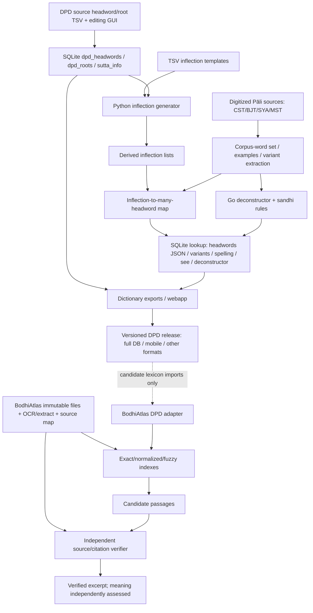

# Technology Assessment — Digital Pāḷi Dictionary (DPD)

- **Mã khảo sát:** P43 · **Ngày khảo sát:** 2026-11-16 (Asia/Ho_Chi_Minh) · **Analyst:** thẩm định kỹ thuật độc lập cho BodhiAtlas.
- **Đích chính thức:** <https://github.com/digitalpalidictionary/dpd-db> (repository công khai, **không archived**, `main`). **Không có chứng cứ repository đã chuyển chỗ.**
- **Snapshot mã đã đọc:** `main` tại commit [`e8b36339b563c56df09605581110abf352c01cc5`](https://github.com/digitalpalidictionary/dpd-db/commit/e8b36339b563c56df09605581110abf352c01cc5), thời điểm commit 2026-11-14 09:00:53 UTC. **Bản phát hành dữ liệu tham chiếu:** `v0.4.20261026`, tag commit [`add2c78d10b9c7de90b09a0e450ef080257c4e54`](https://github.com/digitalpalidictionary/dpd-db/tree/add2c78d10b9c7de90b09a0e450ef080257c4e54), phát hành 2026-10-26. **Lưu ý:** mã `main` và release không đồng nhất; chưa kiểm checksum nội dung SQLite trong máy.
- **Phân loại:** `component` (từ điển/dữ liệu hình thái Pāli kèm pipeline build và webapp riêng); **không** là platform ingest/search/source-map hoàn chỉnh của BodhiAtlas.
- **Phương pháp:** đối chiếu nguồn gốc (README, docs, license, release/asset, GitHub issue, thư mục, ORM schema, pipeline Python/Go, test fixture); đọc trực tiếp cả ba tài liệu dự án; lập fit-gap/gate; đề xuất POC có gold set. **Thực thi DPD và benchmark: NOT TESTED** vì môi trường thực thi không truy cập mạng để lấy repo/DB, không có `dpd.db` gắn kèm. Việc *đọc file test* không phải chạy test.
- **Quy ước:** `[DOC]` tài liệu chính thức; `[CODE]` đã đọc mã/fixture; `[ISSUE]` issue hoặc phát biểu trong issue; `[INFERRED]` suy luận kỹ thuật; `[UNKNOWN]` chưa có chứng cứ; `[TESTED]` chỉ dành cho thực chạy DPD và đo được (không có trong đợt này). `N/A` là ngoài trách nhiệm công cụ, **không phải điểm trừ**.

## 1. Executive Decision

**Quyết định: `TRIAL ONLY`** (ứng viên `USE AS COMPONENT` *sau khi* qua cổng pháp lý và POC). **Confidence: MED** về kiến trúc/sự phù hợp vai trò; **LOW** về hiệu quả trên corpus BodhiAtlas và quyền tích hợp thực tế. **Không** chọn DPD làm engine tìm kiếm, OCR, source of truth hay hệ thống citation V1.

| Giai đoạn | Khuyến nghị | Ranh giới |
|---|---|---|
| V1 Core | **POC tùy chọn**, không chặn nghiệm thu V1 | Tạo bản tra dạng từ → *nhiều* lemma Pāli, ứng viên LEXICON/NORMALIZED; bộ EXACT độc lập bắt buộc. Chỉ đưa dữ liệu DPD vào vận hành sau khi làm rõ quyền. |
| V2 | **Component có điều kiện** | Lexicon provenance, variants, root/compound, kiểm chứng lemma và gắn nghĩa theo corpus; người hiệu đính phê chuẩn các sense trọng yếu. |
| V3 | **Extension có điều kiện** | Công cụ trợ đọc Pāli, học thuật đối chiếu, phân tích compound/sandhi; không tự suy ra diễn giải lịch sử/giáo lý. |

**Ba rủi ro lớn nhất:**

1. **Ràng buộc quyền** `[DOC]`: repo và từ điển công bố **CC BY-NC-SA 4.0**, yêu cầu attribution, giới hạn non-commercial, share-alike; chưa có rà soát quyền riêng cho mọi upstream, ví dụ và corpus. Không tự suy diễn dữ liệu/đồ thị/phần mềm BodhiAtlas được phép phân phối hoặc dùng thương mại. [README/LICENSE](https://github.com/digitalpalidictionary/dpd-db/blob/e8b36339b563c56df09605581110abf352c01cc5/LICENSE), [API licensing](https://digitalpalidictionary.github.io/technical/api_endpoints/).
2. **Mức hoàn thiện/độ nhập nhằng** `[DOC/CODE]`: release 2026-10-26 ghi **89.763 headwords**, trong đó **55.060 hoàn thiện (61,3%)**, **9.078 một phần**, **25.625 chưa hoàn thiện**; một surface có thể ánh xạ nhiều headword và thuật toán deconstruction có ứng viên không chắc chắn. Đây là thống kê *của tác giả*, không phải benchmark BodhiAtlas. [Release](https://github.com/digitalpalidictionary/dpd-db/releases/tag/v0.4.20261026).
3. **Fidelity/đơn vị nghĩa** `[CODE/INFERRED]`: headword có vài trường nghĩa và ví dụ nhưng schema chưa có bảng `sense`/`sense_id` độc lập; source/sutta code không bằng chứng `file_sha256 + PDF bbox/EPUB locator` của sách người dùng. Cần verifier và sense-layer do BodhiAtlas quản lý. [models.py](https://github.com/digitalpalidictionary/dpd-db/blob/e8b36339b563c56df09605581110abf352c01cc5/db/models.py#L1132-L1220).

**Tóm tắt ranh giới:** Có thể tái sử dụng **mục từ, gốc từ, template biến tố, lookup nhiều ứng viên, variant và gợi ý tách hợp từ**. BodhiAtlas vẫn phải viết **ingest/OCR/source-map, exhaustive exact, normalized/fuzzy cho các ngôn ngữ khác, sense-aware cross-lingual graph, citation verifier, quality coverage, quyền truy cập, backup**. Chưa đạt cổng triển khai: chứng cứ sử dụng dữ liệu + phép đo tích hợp + nguồn dẫn truy nguyên.

## 2. Sources & Evidence Ledger

**Phiên bản dẫn nguồn:** `M=e8b36339b563c56df09605581110abf352c01cc5` (đọc `main`), `R=v0.4.20261026` (release), `B=main` của các repo BodhiAtlas tại ngày khảo sát (không chốt SHA của B). Link tới mã `M` là permalink; số dòng chỉ ghi khi thực sự quan sát được. Tài liệu web có thể được cập nhật độc lập với M/R.

| claim_id | claim | Level | URL/file+line | version/SHA | note |
|---|---|---|---|---|---|
| E01 | Repo công khai, không archived, default `main`; có mã Python, Go, SQLAlchemy, exporter và tests | `[DOC]` | [Repo](https://github.com/digitalpalidictionary/dpd-db), [tree](https://github.com/digitalpalidictionary/dpd-db/tree/e8b36339b563c56df09605581110abf352c01cc5) | M | Không chỉ là web-service. |
| E02 | Tác giả nêu phạm vi non-commercial, CC BY-NC-SA 4.0 | `[DOC]` | [LICENSE](https://github.com/digitalpalidictionary/dpd-db/blob/e8b36339b563c56df09605581110abf352c01cc5/LICENSE), [license docs](https://digitalpalidictionary.github.io/license/) | M | Chưa kiểm từng quyền upstream. |
| E03 | Release có asset `dpd.db.tar.xz`, digest SHA-256 và bản mobile SQLite | `[DOC]` | [Release 2026-10-26](https://github.com/digitalpalidictionary/dpd-db/releases/tag/v0.4.20261026) | R | `dpd.db.tar.xz`: **169.921.740 bytes** compressed; SHA-256 `62a3f55d285ae27f5e1d15492cd7bfa92e9e66a0b6bfed9ea97b58a28e346f49` *do GitHub release công bố, chưa tự đối chiếu*. |
| E04 | Release báo 89.763 headwords, 1.500.798 dạng biến tố độc nhất | `[DOC]` | [Release](https://github.com/digitalpalidictionary/dpd-db/releases/tag/v0.4.20261026), [changelog](https://docs.dpdict.net/changelog/) | R | Chỉ là thông số upstream; bản docs có chênh nhỏ về đếm compounds/cells, không hợp nhất tùy tiện. |
| E05 | `DpdHeadword.id` PK; `lemma_1` unique, `meaning_1/meaning_lit/meaning_2`, `source_1/sutta_1/example_1`... | `[CODE]` | [db/models.py L1132–1220](https://github.com/digitalpalidictionary/dpd-db/blob/e8b36339b563c56df09605581110abf352c01cc5/db/models.py#L1132-L1220) | M | Phân biệt headword/sense. |
| E06 | `Lookup.lookup_key` PK, `headwords` packed JSON list, `roots/deconstructor/variant/see/spelling` tách cột | `[CODE]` | [db/models.py L213–305](https://github.com/digitalpalidictionary/dpd-db/blob/e8b36339b563c56df09605581110abf352c01cc5/db/models.py#L213-L305) | M | Không gộp các loại mở rộng. |
| E07 | `inflection_to_headwords` tích lũy **list of IDs** theo surface form, không ghi đè nếu nhiều lemma | `[CODE]` | [db/inflections/inflections_to_headwords.py](https://github.com/digitalpalidictionary/dpd-db/blob/e8b36339b563c56df09605581110abf352c01cc5/db/inflections/inflections_to_headwords.py) | M | Chỉ giữ những form thuộc tập từ được dựng ở build. |
| E08 | Fixture có `abhidhammo → [1,2]`, dùng kiểm nhánh đa phân tích và lọc form | `[CODE]` | [test](https://github.com/digitalpalidictionary/dpd-db/blob/e8b36339b563c56df09605581110abf352c01cc5/tests/db/inflections/test_inflections_to_headwords.py), [fixture](https://github.com/digitalpalidictionary/dpd-db/blob/e8b36339b563c56df09605581110abf352c01cc5/tests/db/inflections/test_inflections_to_headwords_fixtures.json) | M | **Fixture tổng hợp**, không chứng minh bản release có đúng hai record ấy; test **NOT TESTED**. |
| E09 | Inflections dựa trên `stem + pattern` và TSV templates → `inflections`, HTML; build có các bước tái sinh | `[CODE]` | [generate_inflection_tables.py](https://github.com/digitalpalidictionary/dpd-db/blob/e8b36339b563c56df09605581110abf352c01cc5/db/inflections/generate_inflection_tables.py), [README](https://github.com/digitalpalidictionary/dpd-db/blob/e8b36339b563c56df09605581110abf352c01cc5/db/inflections/README.md) | M | Template không bảo đảm corpus đầy đủ. |
| E10 | Sandhi/compound là bộ giải cấu trúc Go dùng splitter và sandhi rule, không phải parser xác suất đúng 100% | `[CODE]` | [main.go](https://github.com/digitalpalidictionary/dpd-db/blob/e8b36339b563c56df09605581110abf352c01cc5/go_modules/deconstructor/main.go), [split_2words.go](https://github.com/digitalpalidictionary/dpd-db/blob/e8b36339b563c56df09605581110abf352c01cc5/go_modules/deconstructor/splitters/split_2words.go) | M | Cần gold annotated compounds. |
| E11 | `see` aliases, spelling corrections, chữ Sinhala/Devanagari/Thai có pipeline riêng | `[CODE]` | [see.py](https://github.com/digitalpalidictionary/dpd-db/blob/e8b36339b563c56df09605581110abf352c01cc5/db/lookup/see.py), [transliterate_lookup_table.py](https://github.com/digitalpalidictionary/dpd-db/blob/e8b36339b563c56df09605581110abf352c01cc5/db/lookup/transliterate_lookup_table.py) | M | Đây là biểu diễn **Pāli** ở các script, không phải tiếng Hán/Tạng. |
| E12 | Sutta metadata có `cst_*`, `sc_*` links/code, không có cột file_sha256/bbox cho sách nhập vào | `[CODE]` | [db/models.py L625+](https://github.com/digitalpalidictionary/dpd-db/blob/e8b36339b563c56df09605581110abf352c01cc5/db/models.py#L625-L665) | M | Khác provenance sách riêng. |
| E13 | Tài liệu liệt kê upstream Pāli: CST, BJT, SYA, MST | `[DOC]` | [Tipiṭaka Source Files](https://digitalpalidictionary.github.io/technical/tipitaka_source_files/) | Docs | Không suy rộng sang mọi kinh/ấn bản. |
| E14 | `dpd_headwords` có Sanskrit cognate dạng chuỗi, không tạo công cụ phân tích Sanskrit | `[CODE]` | [db/models.py L1152–1156](https://github.com/digitalpalidictionary/dpd-db/blob/e8b36339b563c56df09605581110abf352c01cc5/db/models.py#L1152-L1156), [headwords docs](https://digitalpalidictionary.github.io/technical/dpd_headwords_table/) | M | Không đồng nghĩa đa ngữ. |
| E15 | `/search_json` trả HTML-fragments + license metadata, không phải endpoint batch lemma/sense typed | `[DOC]` | [API endpoints](https://digitalpalidictionary.github.io/technical/api_endpoints/) | Docs | Có API tra từ; không giả thiết SLA/bulk indexing. |
| E16 | ID headword được docs công bố không tái sử dụng, permalink `/{headword_id}` | `[DOC]` | [API endpoints, Citation Permalink](https://digitalpalidictionary.github.io/technical/api_endpoints/) | Docs | Lưu ID **kèm version**, không coi ID là định danh sense. |
| E17 | Dự án lưu TSV headword/roots trong Git và `major_change_meaning_history.tsv` | `[CODE]` | [db/backup_tsv/README](https://github.com/digitalpalidictionary/dpd-db/blob/e8b36339b563c56df09605581110abf352c01cc5/db/backup_tsv/README.md), [history file](https://github.com/digitalpalidictionary/dpd-db/blob/e8b36339b563c56df09605581110abf352c01cc5/shared_data/major_change_meaning_history.tsv) | M | Chưa đủ làm changelog từng sense; history file ít dòng. |
| E18 | Khuyến nghị lấy full database từ release; issue #228 trả lời vào tháng 4 nhưng link `.tar.bz2` **đã không khớp tên asset `.tar.xz` hiện hành** | `[ISSUE/DOC]` | [#228](https://github.com/digitalpalidictionary/dpd-db/issues/228), [release](https://github.com/digitalpalidictionary/dpd-db/releases/tag/v0.4.20261026) | R | Dùng release asset có thật, không copy URL cũ. |
| E19 | BodhiAtlas đòi EXACT exhaustive, source locator, ấn bản/witness, lexicon sense-aware, không sửa file gốc | `[DOC]` | [PRD V1.4](https://github.com/quoctran-2608/bodhi-atlas/blob/main/docs/PRD.md) | B | Là yêu cầu, **không** là tính năng DPD. |
| E20 | R07/R09/R19/R24/R27 là các rủi ro chuẩn hóa, nghĩa, quyền, backup liên quan trực tiếp | `[DOC]` | [ACADEMIC_RISKS_AND_VERIFICATION.md](https://github.com/quoctran-2608/bodhi-atlas/blob/main/docs/ACADEMIC_RISKS_AND_VERIFICATION.md) | B | Đã đọc nguồn, không suy diễn từ prompt. |
| E21 | BuddhismDocuments-for-AI có upstream pins, corpus map, SQLite/FTS local và resolver; 2.0 chưa nghiệm thu semantic approval | `[DOC]` | [README](https://github.com/quoctran-2608/BuddhismDocuments-for-AI), [manifest](https://github.com/quoctran-2608/BuddhismDocuments-for-AI/blob/main/manifest.json) | B | Tài sản cần tích hợp/kiểm, không thay thế tùy tiện. |
| E22 | Không có `sense` table độc lập trong danh sách các ORM model đã đọc; các trường meaning là text | `[INFERRED]` | [db/models.py](https://github.com/digitalpalidictionary/dpd-db/blob/e8b36339b563c56df09605581110abf352c01cc5/db/models.py) | M | Khẳng định về **schema này**, không phủ nhận mọi metadata downstream. |
| E23 | Không có xác nhận `anatta` → `anattā` thực tế trong release | `[UNKNOWN]` | [release](https://github.com/digitalpalidictionary/dpd-db/releases/tag/v0.4.20261026) và schema | R | Phải thử query DB trước khi gán loại khớp. |

**Độ tiếp cận/giới hạn chứng cứ:** Đã đọc `README.md`, `LICENSE`, `.gitmodules`, `pyproject.toml`, `uv.lock` theo dấu vết repository (chỉ xác nhận sự hiện diện của lockfile), ORM `db/models.py`, `db/inflections/{README,generate_inflection_tables,inflections_to_headwords}.py`, `db/lookup/{README,see,transliterate_lookup_table}.py`, `tools/lookup_sync.py`, Go deconstructor `main.go`, `split_2words.go`, tests/fixtures, `db/backup_tsv/README.md`, bảng TSV roots (đọc header/sample); đã đọc docs build/use DB/source/API. **Chưa đọc hết mọi dòng trong 4.153 mục tree**, chưa giải nén/dump full `dpd.db`, chưa đọc trọn ba TSV headwords vì dữ liệu lớn và không có file thực thi local. Không có quyền truy cập đánh giá nội bộ/permission thương mại của tác giả.

## 3. Architecture & Data Flow



**Phân biệt ba tầng dữ liệu:** (1) headwords/roots và lexicography biên tập; (2) derived `inflections` + `lookup`/sandhi; (3) ví dụ/chỉ dấu nguồn Pāli. Đây **không** phải chu trình OCR và trang sách của người dùng. `dpd.db` có thể chạy local; UI/WebApp/exports là tiện ích của DPD, không cần được kéo nguyên vào BodhiAtlas. Nếu tích hợp, snapshot DPD phải là **nguồn phụ được version hóa**, còn file BodhiAtlas và source-map vẫn là nguồn chính.

## 4. Feature Fit–Gap Matrix

Trạng thái là mức có thể *tái dùng trong đúng trách nhiệm DPD*, không phải tuyên bố toàn hệ thống đã đạt. Effort: `L/M/H` = ước tính tương đối tích hợp, **không phải số giờ đo được**.

| ID, capability | DPD status | Bằng chứng/vai trò | Gap với BodhiAtlas và cách bù | Effort |
|---|---|---|---|---|
| C01 Multi-format ingest | `N/A` | E01/E05: dictionary pipeline, không nhận bộ PDF/EPUB/DOCX của người dùng | Viết/import qua Docling/ingest riêng; không đánh trượt DPD | H (ngoài DPD) |
| C02 OCR/layout/reading order | `N/A` | E01/E13: dữ liệu đã số hóa | OCR + manifest trang/vùng và human review ngoài DPD | H (ngoài DPD) |
| C03 Canonical text/source map | `N/A` | E12/E19: nguồn kinh Pāli metadata ≠ bbox/CFI sách | Source-map nhiều định dạng độc lập; không ghi locator từ DPD | H |
| C04 Works/editions/witnesses | `EXTENSION` | E12/E13: sutta cross-reference + variant sources, có manh mối edition | Mapping edition/witness riêng; không dùng sutta code làm file ID | H |
| C05 Exhaustive EXACT | `N/A` | E06: lookup từ đơn ≠ tất cả vị trí chuỗi | Scanner/index exact độc lập có counts/offset và reopen | H (ngoài DPD) |
| C06 Normalized multilingual search | `EXTENSION` | E06/E07/E11: Pāli inflections/alias/scripts | Adapter Pāli; OpenCC cho Hán, pyewts cho Tạng, Unicode/Việt riêng; giữ ambiguity | M–H |
| C07 FUZZY/near-duplicate/OCR errors | `EXTENSION` | E11: curated misspelling, variant; không phải corpus-level fuzzy | Trigram/edit distance/aligner độc lập; báo diff & OCR flags | M–H |
| C08 Sense-aware lexicon | `EXTENSION` | E05/E22: headword-level text meanings, roots, examples | Sense IDs, sense–evidence link, reviewers, confidence, tradition/context | H |
| C09 Semantic/hybrid/RAG | `N/A` | E01/E15: không phải trách nhiệm dictionary | Tầng tùy chọn, truy nguồn thật qua verifier | M–H (ngoài DPD) |
| C10 Verified citation card/source reopen | `N/A` | E12: sutta/source strings, thiếu file+hash+bbox | Card/locator verifier của BodhiAtlas; R01–R04/R20 | H |
| C11 Note/wiki/claim memory | `N/A` | E01: dictionary project | Tái dùng claim/research store của BodhiAtlas; không lấy DPD làm claim DB | M (ngoài DPD) |
| C12 API/MCP/export | `NATIVE` (DB/export/API), `MISSING` (MCP) | E03/E15: SQLite offline, `/search_json`, exporter; không thấy giao thức MCP chuẩn | Dùng SQLite read-only adapter; tạo API nội bộ nếu cần; kiểm phân quyền | L–M |
| C13 Quality coverage + incremental | `EXTENSION` | E04/E09/E17: completion field, history, incremental build | Coverage theo trang/corpus + import diff/version + các record thiếu; tránh false negative | M–H |
| C14 Auth/licensing/privacy/backup | `EXTERNAL` | E02/E15/E17: license notice, TSV backup; không chứng minh auth dùng dữ liệu riêng | Legal gate, ACL, local-only cho tài liệu riêng, backup/restore riêng | H |
| C15 Independent deploy & simplicity | `CONFIG` | E03/E15: SQLite đọc local dễ; full build Go/Node/uv/submodules phức tạp | Ưu tiên import release snapshot; không deploy toàn webapp; đo upgrades | M |

**Gate kết luận tại thời điểm này:** `SOURCE_FIDELITY=N/A`, `CODE_ONLY_EXACT=N/A`, `MULTILINGUAL=UNKNOWN` (Pāli subset có bằng chứng, toàn scope không), `OCR_COVERAGE=N/A`, `RIGHTS_SECURITY=UNKNOWN`, `PORTABILITY=UNKNOWN` đến khi chạy thử export/migration/reopen. `N/A` *không* tương đương PASS hay FAIL.

## 5. Deep Technical Findings

### 5.1. Dữ liệu lõi, schema, export và phiên bản

`db/models.py` định nghĩa: `DpdHeadword` (`id`, `lemma_1`, `lemma_2`, `pos`, `grammar`, `derived_from`, `root_key`, `meaning_1`, `meaning_lit`, `meaning_2`, `source_{1,2}`, `sutta_{1,2}`, `example_{1,2}`, `family_*`, `construction`, `compound_*`, `var_phonetic`, `var_text`, `stem`, `pattern`, `inflections`, `updated_at`); `DpdRoot`; `InflectionTemplates` (`pattern`, `like`, `data` JSON); `Lookup` (`lookup_key` PK, packed `headwords`, `roots`, `deconstructor`, `variant`, `see`, `spelling`, `grammar`, `sinhala`, `devanagari`, `thai`, ...); `SuttaInfo`; `FamilyRoot/Word/Compound/Set/Idiom`, `BoldDefinition`, `DbInfo`. **Không thấy separate `Sense` ORM table trong file đã đọc.** [M schema](https://github.com/digitalpalidictionary/dpd-db/blob/e8b36339b563c56df09605581110abf352c01cc5/db/models.py), [column guide](https://digitalpalidictionary.github.io/technical/dpd_headwords_table/).

Phân phối: Git có TSV headwords/roots để theo dõi thay đổi; full `dpd.db.tar.xz` là SQLite tải về (không phải chỉ JSON); tài liệu mô tả cả plain text, StarDict/GoldenDict và các exporter. JSON xuất hiện **bên trong nhiều cột** (`Lookup.headwords`, `InflectionTemplates.data`) và trả API HTML-fragment JSON; **chưa xác minh có official bulk JSON/TSV endpoint tương đương full DB ở version này**. Xem E03, E06, E17. Metadata `pyproject.toml` khai `version = v0.2` nhưng *release tag* là `v0.4.20261026`: phải pin bằng release tag + digest, **không** suy version dữ liệu từ pyproject.

### 5.2. Inflection → lemma, homographs, compound/sandhi, không dấu

`inflection_to_headwords()` duyệt `inflections_list_all`, lọc theo `all_words_set` hợp nhất từ Tipiṭaka, words trong deconstruction và clean headwords; cùng một inflection được append nhiều `DpdHeadword.id` nếu khác ID. Đích `Lookup.headwords` lưu JSON array. **Quan hệ là nhiều-ứng-viên, không đảm bảo 1:1**, đúng cho homograph. Unit test fixture `abhidhammo → [1,2]` chứng minh logic nhánh của code; không đại diện thống kê thực tế. Tách sandhi/compounds bằng Go deconstructor và rules có thể đưa nhiều kết quả; cần thứ hạng, flag `candidate` và chuyên gia chọn. [E07–E10](https://github.com/digitalpalidictionary/dpd-db/blob/e8b36339b563c56df09605581110abf352c01cc5/db/inflections/inflections_to_headwords.py).

Chữ không dấu: **phải xây key phụ có lưu bản gốc**, ví dụ một `normalized_key` từ Unicode NFD loại combining diacritics cho *Pāli Latin*, không ghi đè `lookup_key`. Chỉ tự động quy từ dạng surface sang lemma khi DPD thực có `lookup.headwords` tương ứng; không dùng một quy tắc bỏ dấu để tuyên bố inflection hay synonym. Giữ mọi ambiguity.

### 5.3. `anatta` / `anattā`: ba hành động khác nhau

- **EXACT** `anatta` chỉ trúng ký tự `anatta` trong corpus đúng chế độ.
- **NORMALIZED** có thể đưa `anatta` thành ứng viên cho chuỗi `anattā` sau bỏ dấu trường âm; ghi rõ `transform=strip_pali_diacritics` và đối chiếu văn bản gốc. Đây **không** tự thân là lemmatization.
- **LEXICON/INFLECTION** chỉ được bật khi bản DPD **thực có** lookup `anatta`, `anattā` và ID headwords tương ứng; query SQL + inspect headword/grammar để xác định là biến tố, chính tả, hoặc hai lemma. **Chưa chạy → UNKNOWN cho chính cặp này**. `anātman` là Sanskrit cognate/quan hệ thuật ngữ riêng, `vô ngã`, `無我` là mapping song ngữ có chứng cứ riêng; không tự động ghép thành tất cả đồng nghĩa.

### 5.4. Nghĩa và khả năng sense-aware

`meaning_1` (nghĩa ngữ cảnh tiếng Anh), `meaning_lit`, `meaning_2` (nghĩa nguồn Buddhadatta) là thuộc tính **mục từ**; `example_1/2`, `sutta_1/2`, `source_1/2` cùng record, không chứng minh mỗi sense có ID/chuỗi căn cứ riêng. Có `synonym/antonym`, `commentary`, `notes`, nhưng không thay thế sense ontology. **Kết luận: có nền lexicon headword-aware; *chưa* có sense-aware theo chuẩn PRD V1.4.** Tạo `ba_sense_id`, scope truyền thống/văn cảnh, liên kết evidence và trạng thái `PROPOSED/REVIEWED`, không tự gán nghĩa đúng cho mọi occurrence. [E05/E22](https://github.com/digitalpalidictionary/dpd-db/blob/e8b36339b563c56df09605581110abf352c01cc5/db/models.py#L1148-L1193).

### 5.5. Biên giới ngôn ngữ và văn bản

DPD là **Pāli–English**; có script Sinhala/Thai/Devanagari cho dữ liệu Pāli và `sanskrit` cognate dạng văn bản, một số nguồn Pāli CST/BJT/SYA/MST. **Không suy ra** hỗ trợ lemmatization Sanskrit, Unicode/Wylie Tibetan, Hán phồn/giản hay Việt không dấu. Tham chiếu từ CST hoặc SuttaCentral giúp tìm **ứng viên**; chưa tự chứng minh phù hợp mọi bản kinh/ấn bản hoặc toàn bộ corpus BodhiAtlas. [Sources](https://digitalpalidictionary.github.io/technical/tipitaka_source_files/), [DPD docs](https://digitalpalidictionary.github.io/), [E11/E14](https://github.com/digitalpalidictionary/dpd-db/blob/e8b36339b563c56df09605581110abf352c01cc5/db/models.py).

### 5.6. Giấy phép code/database/examples/export

`LICENSE` tại root nêu **SPDX CC-BY-NC-SA-4.0**; docs API nêu trực tiếp **dictionary data** cũng CC BY-NC-SA 4.0. **Không thấy license code riêng cho toàn bộ repo**, nên *không* tuyên bố mã là MIT/Apache chỉ vì có mã công khai. Export nội bộ/offline là kỹ thuật khả thi, **không** xóa yêu cầu attribution, NC và SA. `Tipiṭaka translations`, bold definitions, audio và upstream khác được docs cảnh báo **licensed separately**; ảnh trang/tài liệu riêng của người dùng càng phải quản quyền khác. Việc gắn dữ liệu DPD vào chỉ mục/redistribution/AI training và ý nghĩa share-alike trên dữ liệu phái sinh cần chuyên gia pháp lý xem theo use case. API `Link: rel=license` không phải giấy phép miễn trừ thương mại. [LICENSE](https://github.com/digitalpalidictionary/dpd-db/blob/e8b36339b563c56df09605581110abf352c01cc5/LICENSE), [API docs](https://digitalpalidictionary.github.io/technical/api_endpoints/).

### 5.7. Lookup/API/CLI: local hay online?

Full DB dùng **offline** qua SQLite, SQLAlchemy (`get_db_session`, `DpdHeadword`, `Lookup`) hoặc raw SQL. Có WebApp FastAPI với `/search_json?q=...`, `/search_html`, `/gd?search=...` và các endpoint khác; `/search_json` trả `summary_html`, `dpd_html`, `license` — **không phải** typed morphological batch API, không phải MCP chính thức. Theo docs, web endpoint có queue/rate/busy-response HTTP 503; không phụ thuộc vào web cho V1 code-only search. [Use DB](https://digitalpalidictionary.github.io/technical/use_db/), [API](https://digitalpalidictionary.github.io/technical/api_endpoints/).

Hai cách index: **(A) query SQLite attached read-only** khi user tra, ít bước import nhưng cần local DB và tương thích schema; **(B) ETL bảng `dpd_surface_lemma` chuẩn hóa, snapshot pinned**, ít phụ thuộc runtime, nhanh index/search corpus, đổi lại chi phí sync, quyền và drift cần quản trị. **Không** export toàn bộ examples hoặc HTML vào sản phẩm trước khi có quyết định quyền.

### 5.8. Versioning, IDs và không sửa nguyên văn

DPD docs khẳng định `headword_id` **không tái sử dụng**; dùng `dpd_ref=(release_tag, headword_id)`, `lemma_1` để diff. Tạo `import_run`, `upstream_digest`, snapshot `valid_from`, `valid_to`, `mapping_status`. `updated_at` giúp chỉ báo thay đổi nhưng chưa đủ lịch sử per-sense; so TSV/release **trước** khi merge, record deleted/renamed và giữ human approvals tách khỏi upstream. **Không** rewrite extraction/canonical text của BodhiAtlas; rebuild derived index, giữ `raw_file_sha256`. `major_change_meaning_history.tsv` có tồn tại, nhưng không chứng minh đầy đủ mọi biến động sense. [API IDs](https://digitalpalidictionary.github.io/technical/api_endpoints/), [TSV backup](https://github.com/digitalpalidictionary/dpd-db/blob/e8b36339b563c56df09605581110abf352c01cc5/db/backup_tsv/README.md).

### 5.9. Ví dụ/citation và độ tin cậy locator

`source_1/sutta_1/example_1` và cột số 2 có thể đưa tới tên nguồn/sutta; `SuttaInfo` có `cst_code`, `cst_paranum`, `cst_{m,v,p,t}_page`, `sc_code/sc_file_path`, ... Có thể xây resolver từ source code tới **một corpus đã pin**, nhưng phải đối chiếu (1) sutta ID/corpus edition, (2) chuỗi ví dụ thực sự xuất hiện, (3) locator có mở được trong snapshot, (4) điều kiện ngữ cảnh. **Không** lấy số CST/PTS trong DPD để bịa PDF page/printed page của một ấn bản do người dùng nhập. Khi thiếu canonical match để `citation_technical_status=UNVERIFIABLE` hoặc `TEXT_ONLY`. [Models SuttaInfo](https://github.com/digitalpalidictionary/dpd-db/blob/e8b36339b563c56df09605581110abf352c01cc5/db/models.py#L625-L665).

### 5.10. So với tự viết analyzer hình thái Pāli từ đầu

DPD cung cấp **đầu vào tái sử dụng thực chất**: nhiều headwords đã biên tập, morphology patterns, surface-to-many-ID lookup, root/family, sandhi, spelling/variant. Xây parser từ đầu phải tự tạo corpus, các paradigm và xử lý đồng hình, tốn công chuyên gia. **Chưa có số công sức giảm bao nhiêu phần trăm**, vì chưa thử coverage/false positive trên tập BodhiAtlas. Các khoảng trống cần chuyên gia: data incompleteness, split-candidate chất lượng, sense disambiguation, cross-lingual equivalence, edition variant, gold lexical annotation, quyền bản quyền. Không chọn dựa trên con số headwords marketing.

## 6. Source Fidelity & Provenance

**Source of truth:** file/snapshot corpus BodhiAtlas, không phải DPD. Phiếu citation đề xuất:

```json
{
  "work_id": "<BodhiAtlas work>",
  "edition_id": "<verified edition>",
  "witness_id": "<optional>",
  "file_id": "<immutable>",
  "file_sha256": "<real file digest>",
  "role": "original|translation|commentary|secondary",
  "author": "<catalogued>", "translator": "<catalogued or null>",
  "quote_exact": "<copied from indexed original/extraction>",
  "document_locator": {
    "pdf_page_index": null, "printed_page_verified": null,
    "bbox": null, "epub_href": null, "epub_cfi": null,
    "tei_id": null, "paragraph_id": null
  },
  "match_type": "EXACT|NORMALIZED|FUZZY|LEXICON|SEMANTIC",
  "dpd": {"release": "v0.4.20261026", "headword_ids": [], "mapping_type": "inflection_candidate"},
  "source_state": "READY|PARTIAL|OCR_UNCERTAIN|NOT_INDEXED|SOURCE_UNAVAILABLE",
  "text_verification": "UNVERIFIED|VERIFIED|MISMATCH",
  "locator_verification": "UNVERIFIED|VERIFIED|MISMATCH",
  "meaning_assessment": "NOT_ASSESSED|PROPOSED|REVIEWED",
  "search_scope": "<corpus/edition/language/index coverage>"
}
```

Đây là **contract thiết kế**, không phải record đã sản xuất. Nguyên văn lưu ở corpus; normalizer trả token/offset mapping về nguyên văn, không thay text. Đánh dấu OCR vùng mờ, mất phủ định, khác cột/trang, printed page chưa xác định, fragment kết thúc giữa câu. Giữ `text_verification`, `locator_verification`, `meaning_assessment` **độc lập**. `VERIFIED` từ việc khớp chuỗi/vị trí không chứng minh luận điểm lịch sử hay giáo lý; việc tìm DPD lemma chỉ là lớp evidence candidate.

**Các gate test cần độc lập:** `SOURCE_REOPEN_SUCCESS` chỉ tăng khi mở được đúng snapshot; `FALSE_VERIFIED_CITATION = 0` trên golden set là điều kiện nghiệm thu theo thiết kế (chưa đo); `EXACT_FULL_RECALL` kiểm tất cả span trong phạm vi corpus đã index. Không biến coverage chưa có thành “không thấy trong kinh”.

## 7. Multilingual & Retrieval Behavior

| Truy vấn / loại | DPD native/extension? | Hành vi hợp lệ trong BodhiAtlas |
|---|---|---|
| `anatta`/`anattā` Pāli Latin | `NATIVE` lookup hình thái khi có record; `EXTENSION` bỏ dấu | EXACT từng surface, NORMALIZED qua quy tắc đảo kiểm, LEXICON nếu DPD mapping được xác nhận; chưa có kết quả release → `UNKNOWN` trường hợp cụ thể. |
| `anicca`, `dukkha`, 10 biến tố Pāli | `NATIVE` về schema | Query direct `lookup`, giữ list headwords, có POS/grammar, human gold kiểm từng form. |
| `anātman`, `duḥkha` Sanskrit | `EXTENSION` tối đa cognate hints | Không coi `sanskrit` text là full Sanskrit morphological analyzer; quan hệ qua sense approved. |
| `vô ngã` ↔ `vo nga`; `vô thường` | `N/A` | Vietnamese diacritic-folded side index, ambiguity-preserving, citation exact check sau khi retrieve. |
| `無我`, `無常` ↔ `无常` | `N/A` | OpenCC Chinese trad/simpl + thuật ngữ có nguồn; không tự coi bản dịch/ngữ nghĩa là 1:1. |
| Tạng Unicode ↔ Wylie | `N/A` | pyewts hay công cụ chuyển tự tương đương + Unicode normalization có reverse-offset; test script/segmentation. |
| Chữ Pāli Sinhala/Devanagari/Thai | `NATIVE` cho lookup derivations | Đó là Pāli khác chữ; chỉ bật sau kiểm đúng transliteration, không nhầm thành từ vựng Sinhala/Hindi/Thai. |
| FUZZY đoạn 200–300 ký tự, 5 lần cùng file | `N/A` | Scanner exact exhaustive độc lập, sau đó normalization/fuzzy tách nhánh; DPD không tham gia phrase matching. |
| “Ai phân biệt vô thường và khổ, lập luận?” | `EXTENSION` chỉ gợi Pāli terms | Code dựng query candidate theo từ/cặp đã duyệt; AI/người đọc ngữ cảnh/đối lập/phủ định mới tổng hợp lập luận và verified citations. |
| SEMANTIC embeddings/RAG | `N/A` | Chế độ riêng, đánh nhãn `SEMANTIC`, không sinh citation từ model. |

**Thứ tự ưu tiên:** `EXACT` chạy trên nguyên văn → `NORMALIZED` có tên phép biến đổi → `FUZZY` kèm diff → `LEXICON` qua từng relation/sense/version → `SEMANTIC` tùy bật. Không đổi nhãn `LEXICON` thành `EXACT` khi một lemma giống bề mặt từ, không tự mở rộng xuyên ngôn ngữ vô hạn. Với tiếng Việt bỏ dấu/chữ Hán chuyển đổi, kết quả phải cho biết đường biến đổi và khả năng đa nghĩa. Các ngôn ngữ chưa có gold set: **UNKNOWN về tỷ lệ recall**.

## 8. Integration Options for BodhiAtlas

### Option A — Read-only SQLite reference adapter (POC trước)

- **Input contract:** `query: str`, `language='pi'`, `mode in {'lookup','inflection','variant'}`, `dpd_release_tag`, optional `limit`.
- **Process:** mở `dpd.db` **read-only** (`file:...?...mode=ro`), query `Lookup.lookup_key`, `headwords_unpack` JSON (không bỏ candidate), join `DpdHeadword.id`; **không write** vào upstream DB; chỉ trả record thuộc đúng DPD release.
- **Output contract:** `[{surface, headword_id, lemma_1, pos, match_subtype, confidence_label='candidate', dpd_release, attribution}]`; `source_file/page/bbox = null` cho tới khi index BodhiAtlas tìm được occurrence.
- **Source of truth:** DPD cho metadata lexical; BodhiAtlas raw file/extraction cho câu trích và locator. **Stable ID:** `(dpd_version, dpd_headword_id)`; `ba_sense_id` độc lập.
- **Ưu:** giữ lại khả năng cao, ít ETL, offline, schema có thể kiểm trực tiếp. **Nhược:** lớn hơn, phụ thuộc schema DPD, nâng phiên bản cần migration. **Rollback:** đổi con trỏ read-only tới release trước, không thay file gốc, chỉ invalidate lexical cache.

### Option B — Materialized lexical sidecar (mục tiêu nếu POC đạt)

- **Input contract:** `release_url + published_SHA256 + verified_local_SHA256`, `source_schema_version`, `license_approval_id`, feature allowlist (`headwords, inflections, roots, variants, examples` tùy quyền).
- **ETL:** `lookup.headwords` JSON array → `dpd_surface_lemma(surface, id, grammar, relation_type, version)`, `dpd_headword(id, lemma_1, meaning fields, source version)`, `ba_term_relation(source_lang, target_lang, relation, review_state, evidence)`; thêm bảng folded key **không phá raw text**. Thống kê empty fields, collisions, many-to-many, IDs changed/missing.
- **Output contract:** `CandidateTermLink {source_token_offsets, surface, dpd_ref, relation_type, ambiguity_count, edition_scope, rights_tag}`; index chỉ `LEXICON/NORMALIZED`, không ghi trực tiếp vào vị trí câu trích.
- **Ưu:** có batch retrieval, switch search-engine dễ, version pin, tách vận hành. **Nhược:** ETL/version/rollback + license share-alike nếu tạo tài liệu phái sinh/redistribute. **Rollback:** atomic switch `active_lexicon_version`, rebuild side-index, giữ nguyên passage/citations.

### Option C — Remote web lookup (không khuyến nghị cho V1 core)

`/search_json` phù hợp *hiển thị dictionary* hơn là batch morphology vì trả HTML fragments, có 503/busy và khó kiểm types/senses; gửi term ra ngoài có rủi ro privacy và phụ thuộc mạng. Chỉ xem như tùy chọn tra cứu thủ công, có disclosure và cache/rate policy. [API docs](https://digitalpalidictionary.github.io/technical/api_endpoints/).

**Migration/failure modes chung:** thiếu DPD row → fallback EXACT + UNRESOLVED; nhiều lemma → trả danh sách; source DPD mới đổi meaning → đánh dấu REVIEW_REQUIRED; failed checksum → reject import; code lỗi/mất quyền → disable DPD adapter, nguyên văn/index EXACT vẫn chạy; không cho phép adapter cấp `VERIFIED` citation. Liên kết với [BuddhismDocuments-for-AI](https://github.com/quoctran-2608/BuddhismDocuments-for-AI) thông qua corpus manifest và resolver, **không** nhân bản/hợp nhất witness mù quáng.

## 9. Practical POC / Reproduction Plan

**Trạng thái tất cả TC01–TC06: `NOT TESTED`.** Không có log chạy code/SQLite hoặc số đo trong đánh giá này. Lệnh dưới đây là **kịch bản tái lập**, chỉ chạy sau khi người dùng xác minh license/phạm vi và tải DB. Dùng release cố định; tránh `latest` trong phép đo. Các gold answers phải khóa riêng cùng fixture trước khi đo, có human reviewer cho ambiguous cases.

### Khởi tạo snapshot và kiểm checksum (dự kiến)

```bash
set -euo pipefail
TAG=v0.4.20261026
curl -fL "https://github.com/digitalpalidictionary/dpd-db/releases/download/${TAG}/dpd.db.tar.xz" -o dpd.db.tar.xz
printf '%s  %s\n' '62a3f55d285ae27f5e1d15492cd7bfa92e9e66a0b6bfed9ea97b58a28e346f49' dpd.db.tar.xz | sha256sum -c -
# Chỉ giải nén archive đã xác minh và trong thư mục tách biệt; kiểm danh sách entry trước.
tar -tJf dpd.db.tar.xz | head
mkdir -p dpd-snapshot
tar -xJf dpd.db.tar.xz -C dpd-snapshot
find dpd-snapshot -name 'dpd.db' -type f
```

Bảo vệ archive extraction trước path traversal/symlink và tuyệt đối không ghi đè database sản xuất; lệnh shell là thiết kế cần kiểm trước khi áp dụng. Nếu asset đổi tên/checksum → dừng để điều tra, không tự dùng latest thay.

| TC | Fixture/gold định nghĩa trước | Steps/commands gợi ý | Expected output/metric; tiêu chí và giới hạn | Result |
|---|---|---|---|---|
| TC01 Import/schema | `dpd.db` pinned, schema manifest phiên bản, số bảng/hàng/indices | `sqlite3 dpd.db '.tables'`; `PRAGMA table_info('dpd_headwords')`, `PRAGMA table_info('lookup')`; `SELECT COUNT(*)...` | Schema khớp E05/E06, phát hiện mọi thiếu field; ghi counts đo **không mượn** release marketing; đo import secs, storage | `NOT TESTED` |
| TC02 Exact/inflection/variant | `anatta`, `anattā`, `anicca`, `dukkha`, **10 forms** chuyên gia trích từ DB/corpus, mỗi form annotate lemma ID/POS | `SELECT lookup_key,headwords,variant,see,spelling FROM lookup WHERE lookup_key IN (...)`; decode JSON; inspect headwords | Ghi từng candidate và subtype, không coi unaccented match là inflection nếu không có link; precision against gold | `NOT TESTED` |
| TC03 Ambiguous ASCII | Chọn **3 input thật sự collision trong release** bằng nhóm folded forms; annotate toàn bộ gold alternatives, không áp đặt 3 ví dụ đoán trước | Export `lemma_1`/surface, fold Unicode, `GROUP BY folded HAVING COUNT(DISTINCT surface)>1`, query both | Candidate recall toàn bộ + số false merges; không auto chọn một nghĩa | `NOT TESTED` |
| TC04 Example→passage | 10 headwords có `source_1/sutta_1/example_1` khác rỗng; source corpus CST/SC **đã pin + rights**; locators thật | Resolve source code/edition, search nguyên chuỗi trên nguyên văn; human review context | `SOURCE_REOPEN_SUCCESS`, `FALSE_VERIFIED_CITATION` và 3 trạng thái text/location/meaning; không có locator thì `UNVERIFIABLE` | `NOT TESTED` |
| TC05 100-word expansion | Golden 100 từ Pāli đa POS/homograph/compounds, 1 corpus nhỏ có file_hash+offset, oracle substring exact thủ công/độc lập | Chạy exact-only, sau đó `NORMALIZED`, sau đó `LEXICON` DPD; so hit-level ID+offset; log false positives | Report `EXACT_FULL_RECALL` cho baseline; `precision/recall@k` DPD candidates; không so tổng hit như đúng nghĩa | `NOT TESTED` |
| TC06 Offline/cost/incremental | Snapshot full DB và 1 subset, cold/warm lookups, 1.000 queries reproducible, update release R→R+1 khi có | Disable network; SQLite readonly queries; `time`, RAM/CPU/storage; delta import + rollback switch | log p50/p95, bytes/RAM, failures, diff ID, restore; **không bịa số** | `NOT TESTED` |
| TC07 Source-quote invariants | PDF 2-cột OCR lỗi/mất `không`, EPUB href, TEI paragraph; 200–300 ký tự lặp 5 lần trong file | Scanner exact/source-map độc lập chạy khi bật/tắt DPD; kiểm mọi occurrence | DPD không đổi span/đếm, 5 hits độc lập + locator đúng; nếu OCR `PARTIAL`, không khẳng định exhaustive toàn file | `NOT TESTED` |
| TC08 Cross-script negative control | `無常`/`无常`, Tibetan/Wylie, `duḥkha`, `vô ngã`/`vo nga`, `anātman` | Query DPD-only vs adapters OpenCC/pyewts/Việt/term graph có source | DPD-only không nhận công lao của adapters, mọi transformed match có provenance; cross-lingual false equivalence = 0 trong gold | `NOT TESTED` |

**Ví dụ SQL kiểm schema và quan hệ (chạy trên bản DB đã xác minh):**

```sql
SELECT name, type FROM sqlite_master WHERE type IN ('table','index') ORDER BY type,name;
PRAGMA table_info('dpd_headwords');
PRAGMA table_info('lookup');
SELECT lookup_key, headwords, variant, see, spelling
FROM lookup WHERE lookup_key IN ('anatta','anattā','anicca','dukkha');
SELECT id, lemma_1, pos, grammar, meaning_1, meaning_lit, meaning_2,
       source_1, sutta_1, example_1
FROM dpd_headwords WHERE id IN (SELECT value FROM json_each(
   (SELECT headwords FROM lookup WHERE lookup_key='anattā')));
```

`json_each` cần SQLite JSON1; nếu lookup row null hoặc cột rỗng, nhánh `SELECT` phải báo `NO_CANDIDATE`, **không** phải thiếu thuật ngữ trong mọi văn bản. Nếu cột/schema khác release, cập nhật adapter có migration và chứng cứ.

**Chỉ số theo scope:** `EXACT_FULL_RECALL = verified_exact_spans_returned / all_gold_exact_spans_in_indexed_scope` (không làm tròn 100% nếu chưa đủ mẫu); `FALSE_VERIFIED_CITATION = number_verified_cards_with_wrong_text_or_locator`; `SOURCE_REOPEN_SUCCESS = reopened_valid_cards / eligible_cards`; `P/R@k` cho retrieval candidates, gold được human annotate; `error_coverage = tagged_known_failures / all_known_failures`, latency, RAM, ETL minutes. CER/WER **chỉ** đo ở pipeline OCR, không được gán cho DPD.

## 10. Deployment, Security, Legal, Cost

- **Runtime tối thiểu cho reuse:** SQLite read-only + ETL/adapter (có thể Python/SQLAlchemy), **không buộc** chạy DPD WebApp hay tải mọi exporter. `pyproject.toml` xác nhận Python `>=3.13,<3.14` cho dự án full, SQLAlchemy/FastAPI/uvicorn/aksharamukha...; `uv.lock` có trong repo. Build-from-scratch theo docs cần `uv`, Node.js, Go, submodules, tác giả khuyên ~20 GB RAM hữu ích và first build có thể lâu; **đó là khuyến nghị tài liệu, không phải số đo thử**. [build docs](https://digitalpalidictionary.github.io/technical/build_db/), [pyproject](https://github.com/digitalpalidictionary/dpd-db/blob/e8b36339b563c56df09605581110abf352c01cc5/pyproject.toml).
- **Tài nguyên kiểm được:** asset full SQLite nén công bố **169.921.740 B** (~162 MiB); `dpd-mobile-db.zip` **213.363.114 B**. *Kích thước uncompressed SQLite/RAM/IO/latency: UNKNOWN*, đòi đo. Không tự tính chi phí cloud/doanh thu.
- **Bảo mật:** ưu tiên local/offline, mount readonly, hash asset, scan archive, dependency audit, secret isolation, license label trên mỗi lexical record. Web API DPD là dịch vụ bên ngoài, docs ghi busy/503, **chưa xác minh auth/quota phục vụ multi-tenant**, không gửi nội dung sách riêng tư tới API công khai. Adapter nội bộ phải áp ACL của catalog, không cho `lookup` tự mở file khác quyền.
- **Quyền:** tách **mã DPD**, **dictionary data**, **upstream digital Pāli texts**, **third-party dictionaries**, **examples/translations**, **ảnh PDF của sách**, **AI model weights** (N/A, không cần model). CC BY-NC-SA 4.0 nêu ở root và data API nhưng không là chứng thư quyền tất cả upstream. Không assume SuttaCentral/BJT/CST hay bản dịch cùng license. Nếu mục tiêu có xuất bản thương mại, sản phẩm trả phí, phân phối bộ từ điển phái sinh, cần **chấp thuận bằng văn bản/ý kiến pháp lý** trước.
- **Backup:** raw corpus SHA-256, catalog, lexical snapshot + digest, mapping state/sense approvals, migration scripts và golden oracle sao lưu tách biệt; test restore/rebuild. Lexical index có thể bỏ/rebuild; citations verified không phụ thuộc DPD row mutable.
- **Chi phí:** license fee upstream công bố? **UNKNOWN**; phát triển ETL/review/legal/time-to-reindex là chi phí thực nhưng **chưa đo**. Kịch bản local read-only giảm server cost so với web service nhưng không xác lập TCO. Đặt ngân sách sau TC01/TC06 và legal gate.

## 11. Comparison & Trade-offs

**Không coi bốn sản phẩm sau thay thế nhau:** Chúng giải quyết **lớp chức năng khác nhau**; ma trận so trong ngữ cảnh mục tiêu P43.

| Ứng viên | Năng lực có nguồn | Khác DPD | Fit trong BodhiAtlas | Gap/quyền chính |
|---|---|---|---|---|
| **DPD** | Pāli-English headwords, morphology/roots, inflection candidates, sandhi, variants; SQLite | Cung cấp lexical analysis Pāli thực thụ | `LEXICON`, Pāli `NORMALIZED` có điều kiện | CC BY-NC-SA 4.0; sense IDs, corpus locators, gold/coverage |
| **OpenCC** | Hán phồn↔giản, variant/phrases; Python CLI/lib; Apache-2.0 [repo](https://github.com/BYVoid/OpenCC) | **Không** phân tích Pāli/lemma | `NORMALIZED` chữ Hán với reversible candidate map | Không chứng minh thuật ngữ đồng nghĩa/sense, collision và character differences |
| **pyewts** | Chuyển Wylie/EWTS ↔ Tibetan Unicode, Apache-2.0 [PyPI](https://pypi.org/project/pyewts/) | **Không** là từ điển Pāli và không sinh nghĩa Tạng | Normalize/transliteration Tạng | Không có lexical graph, context hoặc witness; cần fixture Tibetan |
| **SuttaCentral bilara-data** | JSON root/translation/variant theo immutable **segment IDs** [README](https://github.com/suttacentral/bilara-data), [LICENSE](https://github.com/suttacentral/bilara-data/blob/published/LICENSE.md) | Corpus + aligned translations, **không** headword analyzer | Candidate source/citation với segment locator, corpus multilingual | Rights theo từng loại content; segment ID ≠ PDF bbox; bản dịch không mặc nhiên tương đương |
| **BuddhismDocuments-for-AI** | Corpus manifest/pins, SQLite FTS index, resolver/provenance, nhiều upstream [README](https://github.com/quoctran-2608/BuddhismDocuments-for-AI) | Đã là tài sản retrieval/source-verification, không đồng nhất DPD dictionary | Tận dụng index/claims/resolvers, gắn DPD sidecar | Độ hoàn thiện 2.0 và semantic approval có giới hạn công bố; cần QA tích hợp |

**Trade study:** DPD giảm đáng kể *hạng mục cần tự biên tập* Pāli khi so với analyzer viết tay, nhưng mức giảm công sức **UNKNOWN**. OpenCC và pyewts là adjunct theo ngôn ngữ, không phải ứng viên tranh một vị trí. bilara-data hữu ích cho evidence/witness nhưng không đủ morphological lemma mapping. **Không chọn một platform chung chỉ vì DPD có webapp hoặc stars**; giữ assembly theo hợp đồng nhỏ: DPD lexical suggestions + independent exact/index/source map/verification. [OpenCC](https://github.com/BYVoid/OpenCC), [bilara-data](https://github.com/suttacentral/bilara-data).

## 12. Decision Record for Master Synthesis

| Field | Value | Evidence/assumption |
|---|---|---|
| TARGET | Digital Pāḷi Dictionary (DPD) | E01 |
| CLASS | component | Dictionary dataset + build/export/webapp, E01–E06 |
| DATE / VERSION / COMMIT | 2026-11-16 / release `v0.4.20261026` (`add2c78d...`) / inspected main `e8b36339...` | E03 + GitHub ref; **release ≠ main** |
| PRIMARY_ROLE | Pāli headword/inflection/root/variant candidate lexicon | E05–E11 |
| BEST_FIT_V1_CORE | partial | Chỉ Pāli NORMALIZED/LEXICON, không thay ingest/citation |
| SOURCE_FIDELITY_GATE | n/a | Dictionary is candidate source; independent verifier cần có |
| CODE_ONLY_EXACT_GATE | n/a | Không phải corpus phrase scanner; E06 |
| MULTILINGUAL_GATE | unknown | Pāli+scripts có chứng cứ, full Việt/Hán/Tạng/Sanskrit không; TC08 chưa chạy |
| OCR_COVERAGE_GATE | n/a | OCR nằm ngoài DPD |
| RIGHTS_SECURITY_GATE | unknown | CC BY-NC-SA 4.0 + upstream/legal chưa duyệt, E02/E15 |
| INTEGRATION_COST | medium | Giả định SQLite read-only; sense-aware/full corpus integration = high |
| MAINTENANCE_RISK | medium | Monthly updates, schema, license, incomplete records; chưa đo drift |
| RECOMMENDATION | TRIAL | Trial-only trước khi legal + POC; conditional future component |
| CONFIDENCE | medium | Cao về schema, thấp về runtime/corpus/rights |
| NEXT_POC | TC01–TC04, TC05/TC06 và legal review | Release pinned digest + human gold, `NOT TESTED` |

**5 findings cho tổng hợp:**

1. `lookup.headwords` nhận **nhiều ID**, tránh mất homograph [E06–E08].
2. Có **SQLite offline release** kèm digest, phù hợp local-first [E03/E15].
3. Có **inflection template + Go sandhi** nhưng chỉ đưa ứng viên, cần gold [E09/E10].
4. Có **metadata nguồn Pāli/SuttaInfo**, không có locator user-file [E12/E13].
5. **Meaning fields không có sense ID độc lập** theo model đang đọc [E05/E22].

**5 blockers:** (i) quyền NC/SA + upstream permissions; (ii) chưa thực ingest release DB; (iii) `anatta`/`anattā` classification và coverage chưa kiểm; (iv) lack sense-aware provenance; (v) lack source locator+verified citation trên corpus người dùng.

**5 experiments:** TC01 schema/digest; TC02 morphology+10 forms; TC03 no-diacritic ambiguity; TC04 example→verified passage; TC05/06 100-query retrieval và offline performance/rollback. TC07/08 là negative/invariant gates bổ sung.

**3 quyết định cần chủ dự án:**

1. DPD chỉ dùng nghiên cứu **phi thương mại** hay sản phẩm có khả năng thương mại? Quyết định này chặn cách phân phối/integration.
2. V1 có thực sự cần tích hợp DPD, hay chỉ để adapter POC không nằm critical path EXACT/source-map?
3. Phạm vi sense governance: ưu tiên headword Pāli-only hay xây sense-ID đa ngữ có người duyệt từ đầu V2?

**Go/No-go:** chỉ nâng từ `TRIAL` lên `COMPONENT` khi (a) chấp thuận license theo use case; (b) TC01 import + reproducible digest; (c) TC02/TC03 multi-lemma correct trên gold; (d) TC04 source reopen có trạng thái failure minh bạch; (e) TC05/TC06 đạt ngưỡng chủ dự án đặt **trước** đo; (f) exact unaffected. **Không đánh đổi gate bằng weighted score.**

## 13. Appendix

### A. Primary links và snapshot

- DPD repo: <https://github.com/digitalpalidictionary/dpd-db>
- Source commit đã đọc: <https://github.com/digitalpalidictionary/dpd-db/tree/e8b36339b563c56df09605581110abf352c01cc5>
- Release `v0.4.20261026`: <https://github.com/digitalpalidictionary/dpd-db/releases/tag/v0.4.20261026>, tag commit `add2c78d10b9c7de90b09a0e450ef080257c4e54`.
- Source model: `db/models.py`; `db/inflections/inflections_to_headwords.py`; `db/inflections/generate_inflection_tables.py`; `db/lookup/see.py`; `db/lookup/transliterate_lookup_table.py`; `tools/lookup_sync.py`; `go_modules/deconstructor/{main.go,splitters/split_2words.go}`; `tests/db/inflections/test_inflections_to_headwords*.{py,json}`; `db/backup_tsv/`; `shared_data/major_change_meaning_history.tsv`; `resources` submodules.
- DPD docs: <https://digitalpalidictionary.github.io/technical/use_db/>, <https://digitalpalidictionary.github.io/technical/dpd_headwords_table/>, <https://digitalpalidictionary.github.io/technical/tipitaka_source_files/>, <https://digitalpalidictionary.github.io/technical/api_endpoints/>, <https://digitalpalidictionary.github.io/technical/build_db/>.
- DPD issue clarification: <https://github.com/digitalpalidictionary/dpd-db/issues/228> — comment nhắc `.tar.bz2`, **không** dùng link cũ như bằng chứng asset đợt 2026-10-26 (đợt này có `.tar.xz`).
- BodhiAtlas PRD V1.4: <https://github.com/quoctran-2608/bodhi-atlas/blob/main/docs/PRD.md>.
- Academic risks: <https://github.com/quoctran-2608/bodhi-atlas/blob/main/docs/ACADEMIC_RISKS_AND_VERIFICATION.md>.
- Asset hiện có: <https://github.com/quoctran-2608/BuddhismDocuments-for-AI>.

### B. Lệnh tái lập riêng cho maintainers (chưa chạy)

```bash
# Để inspect source code đúng commit main đã khảo sát:
git clone https://github.com/digitalpalidictionary/dpd-db.git
cd dpd-db
git checkout e8b36339b563c56df09605581110abf352c01cc5
# Chỉ khi được phép và có tài nguyên: tạo environment theo docs
uv sync
# Không thay database release bằng DB build main không kiểm soát version.
# Chạy selected unit test source nếu deps đã cài, sẽ đo độc lập với full SQLite:
uv run pytest tests/db/inflections/test_inflections_to_headwords.py -q
```

### C. Những gì chưa xác minh / hạn chế tiếp cận

- **NOT TESTED:** không clone/cài deps, không tải/giải nén SQLite, không query live DB, không chạy pytest hoặc Go, không đo recall/latency/RAM/cost/CER/WER; không tạo false `[TESTED]`.
- **Env:** lệnh `git ls-remote https://github.com/digitalpalidictionary/dpd-db.git HEAD` trong runtime trả `Could not resolve host: github.com`. Đọc được mã qua GitHub/web, **không** đồng nghĩa đã chạy mã.
- **UNKNOWN:** schema bảng thực ở SQLite release có khác với code main?; record cụ thể `anatta/anattā`; 10 inflected forms gold; 3 no-diacritic collisions; tỷ lệ split/meaning chính xác; stable ID semantics xuyên nhiều release ngoài tuyên bố docs; chất lượng source locator cho từng ví dụ; output uncompressed DB; giấy phép/attribution từng upstream, thương mại/AI training/redistribution; auth/SLAs cho DPD hosted API.
- Đã đọc **trực tiếp** nội dung PRD.md, ACADEMIC_RISKS_AND_VERIFICATION.md, README của BuddhismDocuments-for-AI; các điểm đó được diễn giải thành requirement và integration target, **không** giả repo hiện đã hoàn thành mọi yêu cầu PRD.
- Các so sánh và kiến trúc tích hợp là **đề xuất của analyst**, không phải claim công bố bởi tác giả DPD. Không sử dụng GitHub stars làm tiêu chí.

**Kết luận cuối:** DPD **đáng thử như thành phần từ điển/hình thái Pāli có nguồn**, không đủ bằng chứng để thay thế toàn bộ `NORMALIZED/LEXICON` đa ngữ của BodhiAtlas, và chắc chắn **không thay** raw-file provenance, exhaustive EXACT hoặc verified citations. Chỉ tích hợp chính thức sau khi quyền sử dụng, snapshot DB, gold morphology và source-reopen được kiểm chứng bằng lệnh/log thật.
