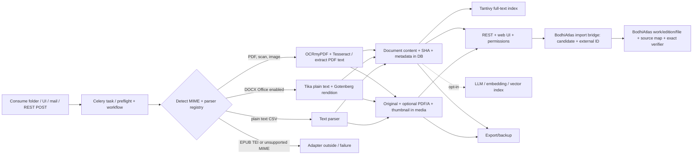

# Technology Assessment — Paperless-ngx

**Mã thẩm định:** P44 · **Ngày khảo sát:** 2026-11-16 (Asia/Ho_Chi_Minh) · **Đơn vị đánh giá:** trợ lý phân tích mã nguồn độc lập cho BodhiAtlas · **Loại:** `platform` (document management system, OCR, full-text search, web UI; không phải hệ ấn bản học thuật).  
**Repository chính thức:** https://github.com/paperless-ngx/paperless-ngx · **Trạng thái:** public, không archived tại thời điểm kiểm tra qua GitHub API.  
**Bản phát hành ghim để phân tích:** `v3.4.2`, phát hành 2026-11-03, **commit** `d939d873e11dd14896d1bfe23f65b1baa6513ba7` (annotated tag `a65d8c8db28c59368b5fb5cc9c7ade9b37f990e8`). `pyproject.toml` tại tag ghi `version = "3.4.2"`. **Nhánh `dev` khi khảo sát:** `4610171a94e5932e85a80e480032e397cdb6f309` (2026-11-14); không trộn kết quả nhánh dev với release.  
**Cách làm:** đọc trực tiếp README, docs, `LICENSE`, dependencies, mô hình Django, pipeline consumer, OCR/parser registry, chỉ mục Tantivy, REST API, bộ test và các issue/PR công khai; so với PRD V1.4, sổ rủi ro, tài sản corpus hiện có. **Không triển khai Docker, không chạy OCR hay benchmark thực nghiệm**: mọi TC được gắn `NOT TESTED`. Chú thích bằng chứng: `[DOC]`, `[CODE]`, `[ISSUE]`, `[INFERRED]`, `[UNKNOWN]`; `[TESTED]` **không có** trong báo cáo này.

## 1. Executive Decision

**Quyết định: `TRIAL ONLY` (chỉ POC có kiểm soát), không chọn làm hệ thống nền tảng/source of truth của BodhiAtlas V1.** Paperless-ngx **đáng thử như một DMS upstream tùy chọn** cho nhập liệu PDF, OCR, duyệt/lọc tài liệu, tags, permissions, API, quản trị sao lưu. Không nên mặc nhiên nhập toàn bộ corpus vào nó: repo `BuddhismDocuments-for-AI` đã có upstream pins, provenance, SQLite/FTS và công cụ xác minh nguồn riêng. Lợi ích ròng phải được đo, kể cả chi phí đồng bộ song trùng.

- **V1 Core:** ứng viên phụ trợ cho PDF scan/born-digital và Office; BodhiAtlas phải sở hữu `Work/Edition/Witness/File/Passage`, manifest/sha256 bất biến, source map page+bbox/EPUB href/CFI, kiểm EXACT tất cả occurrences, quality coverage và phiếu chứng cứ. **Không** giao quyền cấp nhãn verified citation cho Paperless.
- **V2:** giữ khả năng dùng UI/workflow/permission upstream nếu đo được tiết kiệm công; AI/embeddings bên Paperless chỉ là lớp tùy chọn hỗ trợ tìm ứng viên, **không** thay evidence verifier/claim review của BodhiAtlas.
- **V3:** xem xét DMS cho người biên tập đa người và tích hợp hệ quản trị khi có nhu cầu thực; không có lý do fork sâu để biến Paperless thành edition/TEI/citation engine.
- **Confidence:** `MED` cho hiểu biết năng lực qua code/docs tại commit đã ghim; `LOW` cho lợi ích triển khai, hiệu quả OCR/tìm đa ngữ và quyền bảo mật thực tế do `NOT TESTED`.

**Ba rủi ro lớn nhất:** (1) chứng cứ giả do search hit cấp document bị hiểu lầm thành exact quote/page/bbox; (2) nhầm `file version` với ấn bản học thuật, từ đó lẫn metadata và mất khả năng tìm các ấn bản cũ trong default search; (3) sai/thiếu OCR đa ngữ, nguồn có bản quyền bị lộ qua các tích hợp AI/webhook hoặc phân quyền cấu hình sai. [CODE][DOC] Xem E03–E14 và mục 6–7.

**Cổng nghiệm thu V1:** `SOURCE_FIDELITY = fail` nếu dùng Paperless **độc lập** để cấp citation verified; `CODE_ONLY_EXACT = fail` nếu dùng search Paperless thay matcher exhaustively; `MULTILINGUAL = unknown`; `QUALITY_COVERAGE = fail` với yêu cầu status trang/vùng; `RIGHTS_SECURITY = unknown` cho triển khai thực tế; `PORTABILITY = partial` nhờ original/export nhưng ID/metadata riêng cần mapper. Các `fail` này là **không phù hợp với yêu cầu BodhiAtlas khi đứng độc lập**, không phủ định giá trị DMS của sản phẩm.

## 2. Sources & Evidence Ledger

**Quy tắc:** link mã nguồn đều ghim tại commit release `d939d873e11dd14896d1bfe23f65b1baa6513ba7` (viết tắt `d939d87`). Số dòng là dòng file ở tag kiểm tra, không phải kết quả chạy chương trình; tài liệu web có thể thay đổi về sau. Link `[ISSUE]` phản ánh báo cáo/trao đổi upstream, **không** là bug đã tái hiện trong môi trường này.

| claim_id | claim | Mức | URL/file+line | Version/SHA | note |
|---|---|---|---|---|---|
| E01 | Dự án DMS, code GPL v3; dependencies Django/Celery/OCRmyPDF/Tantivy | [CODE] | [`pyproject.toml` L1–82](https://github.com/paperless-ngx/paperless-ngx/blob/d939d873e11dd14896d1bfe23f65b1baa6513ba7/pyproject.toml#L1-L82), [`LICENSE`](https://github.com/paperless-ngx/paperless-ngx/blob/d939d873e11dd14896d1bfe23f65b1baa6513ba7/LICENSE) | v3.4.2/d939d87 | Tách giấy phép code với file sách, OCR language data, model weights. |
| E02 | Consume tạo bản làm việc tạm, dò MIME, chọn parser; không hỗ trợ thì lỗi | [CODE] | [`consumer.py` L405–503](https://github.com/paperless-ngx/paperless-ngx/blob/d939d873e11dd14896d1bfe23f65b1baa6513ba7/src/documents/consumer.py#L405-L503) | d939d87 | Không tự đồng nhất Tika có thể đọc một MIME với Paperless nhận MIME đó. |
| E03 | Model `Document` có `content` text, `checksum`, `archive_checksum`, `page_count`, filename, tags | [CODE] | [`models.py` L158–296](https://github.com/paperless-ngx/paperless-ngx/blob/d939d873e11dd14896d1bfe23f65b1baa6513ba7/src/documents/models.py#L158-L296) | d939d87 | Không thấy page-wise bbox hay bibliographic witness ở mô hình cơ sở đã xem. |
| E04 | Hash dùng để so duplicate; `CONSUMER_DELETE_DUPLICATES` điều khiển hành vi từ chối/xóa ở consume | [CODE] | [`consumer.py` L1056–1107](https://github.com/paperless-ngx/paperless-ngx/blob/d939d873e11dd14896d1bfe23f65b1baa6513ba7/src/documents/consumer.py#L1056-L1107) | d939d87 | SHA-256 chỉ xác nhận trùng bytes, không gộp witness/edition. |
| E05 | OCR/PDF và scan qua `RasterisedDocumentParser`, `ocrmypdf` với sidecar text hoặc extract từ PDF | [CODE] | [`tesseract.py` L70–90](https://github.com/paperless-ngx/paperless-ngx/blob/d939d873e11dd14896d1bfe23f65b1baa6513ba7/src/paperless/parsers/tesseract.py#L70-L90), [L228–256](https://github.com/paperless-ngx/paperless-ngx/blob/d939d873e11dd14896d1bfe23f65b1baa6513ba7/src/paperless/parsers/tesseract.py#L228-L256) | d939d87 | Plain text sau xử lý, không chứng minh tọa độ từng token. |
| E06 | Tika parser chấp nhận danh sách MIME Office (có DOCX), gọi Tika text, Gotenberg PDF | [CODE] | [`tika.py` L42–65](https://github.com/paperless-ngx/paperless-ngx/blob/d939d873e11dd14896d1bfe23f65b1baa6513ba7/src/paperless/parsers/tika.py#L42-L65), [L244–276](https://github.com/paperless-ngx/paperless-ngx/blob/d939d873e11dd14896d1bfe23f65b1baa6513ba7/src/paperless/parsers/tika.py#L244-L276) | d939d87 | Danh sách MIME **không có EPUB**. |
| E07 | Text parser mặc định chỉ khai báo plain text/CSV; không riêng `text/markdown` | [CODE] | [`text.py` L35–47](https://github.com/paperless-ngx/paperless-ngx/blob/d939d873e11dd14896d1bfe23f65b1baa6513ba7/src/paperless/parsers/text.py#L35-L47) | d939d87 | File `.md` có thể được phát hiện `text/plain` trên từng host: phải thử, không gọi là hỗ trợ MD native chính thức. |
| E08 | Parser registry có entrypoint `paperless_ngx.parsers` cho plugin thứ ba | [CODE] | [`registry.py` L20–27](https://github.com/paperless-ngx/paperless-ngx/blob/d939d873e11dd14896d1bfe23f65b1baa6513ba7/src/paperless/parsers/registry.py#L20-L27), [L192–210](https://github.com/paperless-ngx/paperless-ngx/blob/d939d873e11dd14896d1bfe23f65b1baa6513ba7/src/paperless/parsers/registry.py#L192-L210) | d939d87 | Adapter/plugin khả thi nhưng cần xác minh API, ưu tiên không fork. |
| E09 | File versions là `root_document`/`version_index` trên Document; latest effective text | [CODE] | [`models.py` L317–356](https://github.com/paperless-ngx/paperless-ngx/blob/d939d873e11dd14896d1bfe23f65b1baa6513ba7/src/documents/models.py#L317-L356), [L381–434](https://github.com/paperless-ngx/paperless-ngx/blob/d939d873e11dd14896d1bfe23f65b1baa6513ba7/src/documents/models.py#L381-L434) | d939d87 | Không dùng file version làm `Edition`. |
| E10 | Metadata giữ trên root, search mặc định latest; merge versions không hoàn tác được trong UI | [DOC] | [`docs/usage.md` L92–105](https://github.com/paperless-ngx/paperless-ngx/blob/d939d873e11dd14896d1bfe23f65b1baa6513ba7/docs/usage.md#L92-L105) | d939d87 | Cực kỳ quan trọng đối với học thuật nhiều ấn bản. |
| E11 | Custom fields hỗ trợ text/url/date/boolean/int/float/money/doclink/select/longtext | [CODE] | [`models.py` L1252–1303](https://github.com/paperless-ngx/paperless-ngx/blob/d939d873e11dd14896d1bfe23f65b1baa6513ba7/src/documents/models.py#L1252-L1303) | d939d87 | Có thể mirror `work_id`/`edition_id`, không bảo đảm ràng buộc thư mục học thuật. |
| E12 | Full text dùng Tantivy với analyzer `lowercase`, `ascii_fold`, stemmer tùy ngôn ngữ; CJK 2-gram | [CODE] | [`_tokenizer.py` L83–101](https://github.com/paperless-ngx/paperless-ngx/blob/d939d873e11dd14896d1bfe23f65b1baa6513ba7/src/documents/search/_tokenizer.py#L83-L101), [L162–170](https://github.com/paperless-ngx/paperless-ngx/blob/d939d873e11dd14896d1bfe23f65b1baa6513ba7/src/documents/search/_tokenizer.py#L162-L170) | d939d87 | Không phải match ký tự raw. |
| E13 | Query áp NFC, CJK Han/Kana/Hangul; bigram 1 ký tự có thể bị bỏ qua | [CODE] | [`_query.py` L40–72](https://github.com/paperless-ngx/paperless-ngx/blob/d939d873e11dd14896d1bfe23f65b1baa6513ba7/src/documents/search/_query.py#L40-L72), [L277–331](https://github.com/paperless-ngx/paperless-ngx/blob/d939d873e11dd14896d1bfe23f65b1baa6513ba7/src/documents/search/_query.py#L277-L331) | d939d87 | Phải test 1–2 chữ Hán, Tạng Unicode/Wylie. |
| E14 | API search trả score/rank/highlight document, không liệt kê mọi offset/page/bbox | [DOC] | [`docs/api.md` L63–118](https://github.com/paperless-ngx/paperless-ngx/blob/d939d873e11dd14896d1bfe23f65b1baa6513ba7/docs/api.md#L63-L118) | d939d87 | “Exact phrase” token/position ≠ nguyên văn 200–300 ký tự. |
| E15 | API post tạo task async; task endpoint kiểm thành công; versions API có `?version=` | [DOC] | [`docs/api.md` L192–243](https://github.com/paperless-ngx/paperless-ngx/blob/d939d873e11dd14896d1bfe23f65b1baa6513ba7/docs/api.md#L192-L243) | d939d87 | Đồng bộ phải idempotent, chờ task hoàn thành trước khi ánh xạ ID. |
| E16 | Celery pipeline có các plugin preflight, ASN, barcode, workflow, consumer; search write retry | [CODE] | [`tasks.py` L92–143](https://github.com/paperless-ngx/paperless-ngx/blob/d939d873e11dd14896d1bfe23f65b1baa6513ba7/src/documents/tasks.py#L92-L143), [L182–265](https://github.com/paperless-ngx/paperless-ngx/blob/d939d873e11dd14896d1bfe23f65b1baa6513ba7/src/documents/tasks.py#L182-L265) | d939d87 | Task/status không đồng nghĩa manifest coverage per page. |
| E17 | Object owner/permissions theo Django Guardian; version thừa quyền root | [CODE] | [`permissions.py` L65–89](https://github.com/paperless-ngx/paperless-ngx/blob/d939d873e11dd14896d1bfe23f65b1baa6513ba7/src/documents/permissions.py#L65-L89), [L315–369](https://github.com/paperless-ngx/paperless-ngx/blob/d939d873e11dd14896d1bfe23f65b1baa6513ba7/src/documents/permissions.py#L315-L369) | d939d87 | Tài liệu không owner có thể lộ trong một số luồng; cấu hình least privilege, test cross-account. |
| E18 | Export/import gồm tài liệu, thumbnails, metadata, DB; token không export; hạn chế khác version | [DOC] | [`docs/administration.md` L3–57](https://github.com/paperless-ngx/paperless-ngx/blob/d939d873e11dd14896d1bfe23f65b1baa6513ba7/docs/administration.md#L3-L57), [L277–352](https://github.com/paperless-ngx/paperless-ngx/blob/d939d873e11dd14896d1bfe23f65b1baa6513ba7/docs/administration.md#L277-L352) | d939d87 | Cần restore cùng version + xác minh hash/ID thực tế. |
| E19 | Docker SQLite+Valkey+Tika+Gotenberg; sample dùng `:latest` | [CODE] | [`docker-compose.sqlite-tika.yml` L1–74](https://github.com/paperless-ngx/paperless-ngx/blob/d939d873e11dd14896d1bfe23f65b1baa6513ba7/docker/compose/docker-compose.sqlite-tika.yml#L1-L74) | d939d87 | POC **phải pin** image v3.4.2 thay `latest`. |
| E20 | AI/embeddings tồn tại, tùy chọn bật; có vector store SQLite/llama-index | [CODE][DOC] | [`configuration.md` L2130–2155](https://github.com/paperless-ngx/paperless-ngx/blob/d939d873e11dd14896d1bfe23f65b1baa6513ba7/docs/configuration.md#L2130-L2155), [`paperless_ai/indexing.py` L77–85](https://github.com/paperless-ngx/paperless-ngx/blob/d939d873e11dd14896d1bfe23f65b1baa6513ba7/src/paperless_ai/indexing.py#L77-L85) | d939d87 | Tắt mặc định, không cấp quyền chia sẻ copyrighted fulltext. |
| E21 | Issue CJK sau chuyển Tantivy v3.0; đã đóng và có PR sửa | [ISSUE] | [#12860](https://github.com/paperless-ngx/paperless-ngx/issues/12860), [PR #12862](https://github.com/paperless-ngx/paperless-ngx/pull/12862) | 3.0; 2026-05-29 | Không suy ra bug vẫn tồn tại trên 3.4.2; testcase hồi quy là bắt buộc. |
| E22 | Issue OCR phân loại nhầm PDF scan ở cấu hình tự động v3.0; đã đóng | [ISSUE] | [#13349](https://github.com/paperless-ngx/paperless-ngx/issues/13349), [#13351](https://github.com/paperless-ngx/paperless-ngx/pull/13351) | 3.0; 2026-07 | Thêm fixture scan có cấu trúc PDF đánh lừa “born-digital”. |
| E23 | Unit/integration test source có CJK/versions/permissions, **chưa chạy tại đây** | [CODE] | [`test_cjk_clause.py` L70–96](https://github.com/paperless-ngx/paperless-ngx/blob/d939d873e11dd14896d1bfe23f65b1baa6513ba7/src/documents/tests/search/test_cjk_clause.py#L70-L96), [`test_api_document_versions.py` L36–90](https://github.com/paperless-ngx/paperless-ngx/blob/d939d873e11dd14896d1bfe23f65b1baa6513ba7/src/documents/tests/test_api_document_versions.py#L36-L90) | d939d87 | Có test code không phải `[TESTED]`. |
| E24 | BodhiAtlas yêu cầu file bất biến, đa lớp citation checks, coverage; corpus đã có pins/index/code | [DOC] | [PRD V1.4](https://github.com/quoctran-2608/bodhi-atlas/blob/5f9e6ad605b3beb1a0a5ebf7d8cde0476c890ff2/docs/PRD.md), [Risks](https://github.com/quoctran-2608/bodhi-atlas/blob/5f9e6ad605b3beb1a0a5ebf7d8cde0476c890ff2/docs/ACADEMIC_RISKS_AND_VERIFICATION.md), [Corpus README](https://github.com/quoctran-2608/BuddhismDocuments-for-AI/blob/dfdd3cbb79e3dbfb49a855702fa00e4bad3b3410/README.md) | PRD 5f9e6ad; corpus dfdd3cb | Cần tránh lập hai source truth. |

**Đọc và kiểm giới hạn:** đã kiểm cây repo, config Compose, `pyproject.toml`, bản quyền, mã/schema/query và ít nhất các test nêu trên. Không tải binary corpus sách hay kiểm các file ở thời điểm phát hành khác; không chạy test suite. Sự vắng mặt của field trong các file đã xem là chứng cứ về **mô hình mặc định**, không phải chứng minh không thể phát triển plugin. Các issue #12860/#13349 là lịch sử hồi quy, không được báo là lỗi hiện hành.

## 3. Architecture & Data Flow



**Các điểm an toàn:** `consume` là vùng chờ, **không** là kho file gốc; source copy đã ghi vào `media/originals`. `Document.content` (và version effective content) là chuỗi text đã parse/OCR; `Tantivy` là chỉ mục phái sinh. Render PDF/A có thể khác byte gốc. Nội dung chỉnh sửa hoặc version update là hành vi có chủ đích nên **tính bất biến phải bảo đảm tại kho gốc do BodhiAtlas kiểm soát**, không chỉ dựa trên UI Paperless. Với Office, Tika và Gotenberg là dịch vụ khác; không gọi là tích hợp không phụ thuộc bên ngoài. [E02–E06,E09,E16,E19]

**Lỗi/retry:** preflight kiểm file & SHA, parser failure báo task fail, mã `consume_file` đi qua plugin, DB transaction và các bước copy file; ghi index có cơ chế retry lỗi lock (Celery, `SearchIndexLockError`). API POST trả task UUID trước khi OCR hoàn tất; phải truy vấn `/api/tasks/?task_id=` và chỉ đồng bộ sau khi thành công. Khi reload/reindex không được coi file thiếu trong index là tài liệu không tồn tại. [E04,E15,E16]

## 4. Feature Fit–Gap Matrix

**Cách đọc status:** `NATIVE` có trong DMS mặc định; `CONFIG` phải bật/cấu hình; `EXTENSION` cần plugin/custom code trong môi trường Paperless; `EXTERNAL` nằm ở BodhiAtlas/dịch vụ khác; `MISSING` không thấy trong giao diện/contract gốc tại release; `UNKNOWN` chưa đủ chứng cứ; `N/A` ngoài vai trò của công cụ. Dòng có nhiều format/nhánh ghi rõ hỗn hợp, status là khả năng chính có ích nhất **không** hàm ý mọi phần đã đạt.

| ID | Tiêu chí | Status | Bằng chứng / phân vai | Gaps, việc tích hợp | Công sức |
|---|---|---|---|---|---|
| C01 | Multi-format ingest | **CONFIG** | PDF/image/text native; DOCX Tika+Gotenberg [E02,E05–E08] | EPUB, TEI/XML, Markdown MIME chuẩn cần converter/adapter có theo dõi nguồn; EPUB original+href/CFI giữ ngoài | HIGH |
| C02 | OCR/layout/reading order | **CONFIG** | OCRmyPDF/Tesseract và OCR settings [E05,E22] | OCR hai cột, Hán/Tạng/Pāli, line order, confidence từng vùng/chương chưa được chứng minh; external Docling/layout pipeline nếu cần | HIGH |
| C03 | Canonical text/source map | **MISSING** | Model text cấp document và page_count [E03,E05] | Tự tạo per-page spans, bbox, EPUB href/CFI, extraction version; checksum của original | HIGH |
| C04 | Works/editions/witnesses | **EXTENSION** | Custom fields/doclinks, version file history [E09–E11] | Xây schema quan hệ chuẩn tại BodhiAtlas, không merge editions thành versions | HIGH |
| C05 | Exhaustive EXACT | **MISSING** | Tantivy score/document highlights, tokenizer [E12–E14] | Matcher raw text/offset độc lập, quét mọi vị trí trong phạm vi index | MED–HIGH |
| C06 | Normalized multilingual search | **CONFIG** | NFC, ASCII fold, stemmer, CJK 2-gram [E12,E13,E21] | Script mapping `無常↔无常`, Tạng/Wylie, Pāli/Sanskrit/VN phải có chỉ mục phụ, đo riêng | HIGH |
| C07 | Fuzzy/near-duplicate/OCR errors | **CONFIG** | fuzzy word, more-like, CLI rapidfuzz document fuzzy [E01,E14] | Hiệu quả OCR/noise, match tại đoạn và diff chưa chứng minh; gọi là candidate | MED–HIGH |
| C08 | Sense-aware lexicon | **MISSING** | Metadata/search DMS, không thấy schema nghĩa [E03,E11] | Lexeme/sense/relation với provenance, không mở rộng tự động xuyên nghĩa | HIGH |
| C09 | Semantic/hybrid/RAG | **CONFIG** | AI/vector là opt-in [E20] | Không làm nguồn trích dẫn; cô lập AI, nguồn có bản quyền, hạn mức chi phí | MED |
| C10 | Verified citation card/source reopen | **EXTERNAL** | Original download/API, nhưng không có bbox/CFI [E03,E14,E15] | BodhiAtlas verifier và phiếu chữ/vị trí/nghĩa riêng | HIGH |
| C11 | Note/wiki/claim memory | **EXTENSION** | Notes + document history [E10,E14] | Academic claim graph, phản chứng, review workflow không phải mặc định | HIGH |
| C12 | API/MCP/export | **NATIVE** | REST upload/download/tasks/search, exporter/importer [E15,E18] | MCP: UNKNOWN/adapter riêng; stable ID mapping, auth, migration | MED |
| C13 | Quality coverage + incremental | **CONFIG** | Task states, workflow, search reindex [E15,E16] | Không có manifest từng trang `PARTIAL`, `OCR_UNCERTAIN`, missing witness; build monitoring | HIGH |
| C14 | Auth/licensing/privacy/backup | **CONFIG** | Django Guardian, audit, export/import [E01,E17,E18,E20] | Validate tenant isolation, superuser exposure, AI/webhook, encryption/backups, rights per document | MED–HIGH |
| C15 | Operational simplicity + independent deploy | **NATIVE** | Docker SQLite+Valkey, optional Tika/Gotenberg [E19] | Vận hành thêm worker/index/service/volumes; POC so với ingestion hiện có | MED |

**Gate coverage:** `SOURCE_FIDELITY` **fail as standalone** (C03/C10); `CODE_ONLY_EXACT` **fail as standalone** (C05); `MULTILINGUAL` **unknown** (C06 chưa benchmark); `QUALITY_COVERAGE` **fail as standalone** (C13); `RIGHTS_SECURITY` **unknown** cho cấu hình thật (C14); `PORTABILITY` **partial** (C12 + BodhiAtlas identifiers). `N/A` không gán bừa cho các tính năng quan trọng của DMS; những chức năng không thuộc mục tiêu DMS (sense-aware lexicon, học thuật) được đánh giá `MISSING/EXTERNAL` **chỉ theo câu hỏi V1**, không phải lỗi thiết kế Paperless.

## 5. Deep Technical Findings

### 5.1. Từ inbox đến original/OCR/DB/UI/search; lỗi và incremental (Q1)

1. File vào thư mục `consume`, email, hoặc `/api/documents/post_document/`; consumer preflight kiểm tồn tại và trùng checksum. Sơ đồ `tasks.consume_file()` cho thấy plugin theo thứ tự: `ConsumerPreflightPlugin` → `AsnCheckPlugin` → `CollatePlugin` → `BarcodePlugin` → `AsnCheckPlugin` → `WorkflowTriggerPlugin` → `ConsumerPlugin`. Với upload **new version**, tập plugin khác, không xử lý một số bước như barcode split. [E04,E15,E16]
2. `ConsumerPlugin.run()` chép bản làm việc vào thư mục tạm, phát hiện MIME bằng libmagic, chọn parser registry, parse + thumbnail + text + date + page count, lưu bản ghi `Document`, original và archive rendition khi có. Tags/correspondent/document type/storage path có thể được tự gán bằng workflow/matching; metadata được lưu trong DB. Thumbnail ở file storage; text trong trường `Document.content`, full-text trong Tantivy. [E02,E03,E05,E06]
3. `Document` có `checksum` của original và `archive_checksum` của bản chuyển đổi; file vừa consume được chép vào `ORIGINALS_DIR`. `AUDIT_LOG_ENABLED` có audit trail cho thay đổi và version add (không đồng nghĩa WORM). Search index ghi theo cập nhật document, khi contention có retry index task; `document_index` cho reindex. [E03,E04,E16]
4. **Đường lỗi:** MIME không hỗ trợ → fail; OCR/Tika/Gotenberg exception → fail; file trùng SHA → kiểm cấu hình consumer duplicate; task ID phải được polling. **Chưa chứng minh** requeue/retry đầy đủ cho mọi loại parser failure hoặc atomicity file+DB trong trường hợp power loss: cần POC kill process/restart. Incremental import dựa task/index, không phải ingestion journal được đảm bảo end-to-end giữa hai hệ thống. [E02,E04,E15,E16]
5. **Không để DMS trực tiếp tải sách bản quyền qua workflow email/webhook/remote OCR khi chưa cấu hình quyền.** `POST_CONSUME_SCRIPT`/workflow là ranh giới thực thi có quyền; phải audit thay đổi script/config, giữ secrets ngoài manifest.

### 5.2. PDF text, scan, original, page/box và in số trang (Q2)

`RasterisedDocumentParser` dùng OCRmyPDF/Tesseract; parser có thể lấy text từ sidecar OCR hoặc từ PDF sau xử lý. `Document.content` chỉ lưu toàn chuỗi text; `page_count` là tổng số trang. Không phát hiện schema lưu hàng `page_index, bbox, text_span, OCR_confidence` hoặc ánh xạ từ offset đến PDF page trong mô hình/API đã kiểm. PDF/A archive có selectable text không chứng minh đoạn trích đã đối chiếu đúng tọa độ. **PDF page index** phải được dựng từ parser riêng (ví dụ PyMuPDF/pdfplumber tùy loại file) và xác thực trên ảnh gốc; **printed page** chỉ lấy qua kiểm tra pagination/metadata đã xác nhận. OCR hai cột, cước chú, ngoại lệ và phủ định cần fixtures/đánh giá thủ công. [E03,E05,E22]

Original được giữ khi consume bình thường, không ghi đè trong luồng ingest mặc định theo docs; nhưng ứng dụng có chức năng chỉnh content, update file version, archive/regenerate. Vì thế kho BodhiAtlas phải giữ **bản byte immutable tại storage độc lập**, URI + SHA-256 riêng, có audit append-only. Nên lưu `paperless_original_checksum` như **bằng chứng so sánh**, không thay cho quyền bảo toàn source của dự án.

### 5.3. EPUB, DOCX, Markdown, TEI/XML (Q3)

- **PDF và ảnh:** parser built-in OCR; PDF born-digital có chiến lược auto/no archive; scan bị nhận nhầm born-digital là ca hồi quy [ISSUE] từng xuất hiện, phải test lại v3.4.2. [E05,E22]
- **DOCX/Office:** `TikaDocumentParser._SUPPORTED_MIME_TYPES` gồm DOCX, DOC, ODT, bảng tính, slideshow, RTF; **phải** bật `PAPERLESS_TIKA_ENABLED` và cung cấp Tika+Gotenberg. Tika lấy text, Gotenberg chuyển PDF (preview). Text và PDF rendition có thể khác cấu trúc DOCX; muốn bảo toàn đoạn/chú thích cần pipeline khác. [E06,E19]
- **EPUB:** không có `application/epub+zip` ở MIME list Tika/Text/parser built-in đã xem. Kết luận **MISSING native ở v3.4.2** (có thể làm `EXTENSION` bằng parser entrypoint, hoặc **EXTERNAL** chuyển PDF/TXT); chuyển EPUB→PDF mất href/CFI, nên canonical EPUB parser của BodhiAtlas phải đọc EPUB gốc trực tiếp.
- **Markdown:** parser text chỉ khai báo `text/plain`/CSV, không khai báo `text/markdown`. `.md` có khả năng bị libmagic phân loại `text/plain` theo hệ thống nhưng **UNKNOWN** cho mọi biến thể, không khẳng định native. Giải pháp ổn định: adapter khai báo MIME + lưu newline/heading offsets hoặc nhập bản `.txt` dẫn xuất **đồng thời giữ `.md` gốc**.
- **TEI/XML:** không có TEI-aware witness/paragraph IDs. Nếu convert thành TXT/PDF để DMS tra cứu, BodhiAtlas vẫn phải đọc TEI và giữ `xml:id`, đường dẫn element, witness metadata độc lập. Không bao giờ dùng PDF rendition làm bản gốc của TEI.

### 5.4. Work, Edition, Witness, Passage, nguồn dẫn gián tiếp (Q4)

`Document` là đơn vị quản trị file; `correspondent`/`document_type`/tags/title và custom fields cho metadata phẳng; `documentlink` có thể tạo link giữa các document, nhưng không có quan hệ khoa học `translation_of`, `variant_of`, `parallel_to`, `commentary_on`, `quotes_via` với provenance/ràng buộc nghĩa. Đặc biệt `root_document` là quan hệ **lịch sử file**, không phải quan hệ `work → edition → witness`. Dùng custom fields để mirror vài ID hoặc hiển thị nhãn có thể hữu ích, nhưng **schema chuẩn phải ở BodhiAtlas**, có foreign keys và reference integrity, phân biệt các nguồn phụ thuộc/gián tiếp. [E03,E09–E11,E24]

### 5.5. Search: mọi occurrence/phrase/Unicode/Hán/Pāli (Q5)

Search chính là Tantivy. `docs/usage.md` nói dấu ngoặc kép tìm phrase theo thứ tự từ, nhưng code áp `lowercase → ascii_fold → stemmer` (khi có); query còn NFC, CJK bigram. API nhận `/api/documents/?text=...`, `?query=...`, `?more_like_id=...`, trả danh sách **document hit**, snippet `highlights`/score/rank, **không phải toàn bộ vị trí byte/character trong từng file**. Vì thế:

- `EXACT` nguyên văn **mọi** vị trí (5 occurrences/file) và câu dài 200–300 ký tự: **MISSING** trong contract search; phải export content và dùng matcher trên raw canonical text, bảo toàn positional map. Trích trên hai cột/trang phải dùng text ordering đã xác nhận.
- `anatta/anattā`: ASCII fold có thể giúp ứng viên; nhưng hai dạng là **NORMALIZED**, không phải EXACT. `vo nga/vô ngã`: bỏ dấu có nguy cơ nhập nhằng, phải báo match type; không bảo đảm nhận dạng mọi dạng token. `anātman` và `duḥkha` cần quy tắc hoặc lexicon có căn cứ, không có auto-translation sang Pāli/VN/Hán.
- `無常/无常`: CJK bigram có thể tìm run 2+ ký tự cùng hệ chữ, **không chứng minh** giản–phồn tự động; cần map có nguồn. Một ký tự Hán nằm trong run có thể không tạo bigram; code `_cjk_alternative()` ghi rõ trường hợp 1-character run bị phân tích mất. [E12,E13]
- Chữ Tạng Unicode và chuyển tự Wylie: regex CJK không có Tibetan; Wylie ký tự Latin có thể được token hóa, nhưng **không** có map chữ Tạng↔Wylie mặc định. Phải thử cả hai hệ riêng.
- Fuzzy/near-duplicate: có công cụ `document_fuzzy_match` (`rapidfuzz` trên nội dung documents), AI more-like, và match fuzzy trong search/classifier; **không** tương đương tìm trích đoạn sai OCR với vị trí đáng tin. Gắn nhãn `FUZZY_CANDIDATE`.

### 5.6. REST, webhook, export, đồng bộ Zotero (Q6)

REST API có upload async (`POST /api/documents/post_document/`), get document/text/metadata, tải original/archive, tìm document, lọc custom fields, xử lý versions (`?version=`), task tracking. Workflows có post-consume script và webhook (docs/usage). Exporter/importer xuất metadata và file; **không nên** coi exporter manifest là open academic interchange schema. [E15,E18]

**Contract cầu nối khuyến nghị:** `paperless_instance_id + root_id + explicit version_id + checksum + task_id` chỉ là **foreign reference**. `file_id` BodhiAtlas phải tạo ổn định từ manifest riêng (trong trường hợp cùng bytes nhưng khác edition, file association vẫn không bị đồng nhất). Đồng bộ một chiều cho nội dung source: BodhiAtlas owns canonical metadata/verification; Paperless được chỉnh tags/UI metadata vận hành, ánh xạ có whitelist. Với Zotero, đồng bộ bibliographic item ID/DOI/ISBN bằng adapter riêng, không tự biến correspondent Paperless thành `author`/`translator` học thuật. Chỉ báo Zotero integration là **CUSTOM/UNKNOWN** khi chưa kiểm trực tiếp. Tương tự MCP là **EXTERNAL**, không xác nhận native MCP endpoint.

### 5.7. Auth, quyền bản quyền, AI, multi-tenancy (Q7)

Django/Guardian hỗ trợ owner, user/group và object permissions; task/API được bảo vệ theo quyền. `PaperlessObjectPermissions.has_object_permission()` xét owner/superuser và object grants; code `permitted_document_ids` có nhánh unowned, parent versions lấy quyền root. Cần phép thử user A/B để chắc tài liệu `restricted` không lộ qua search, snippets, autocomplete, thumbnails, bulk export, share links, API `?version=` và webhook. [E17,E23]

**Isolated tenants** (một máy nhiều tổ chức với isolation chặt, DB-level row isolation): **UNKNOWN**; không thấy mô hình tenancy chuyên biệt đủ để tuyên bố bảo đảm. Với dữ liệu có quyền khác nhau, ưu tiên deployment/instance và DB tách biệt nếu cần. AI/remote OCR có cấu hình endpoint và các thành phần bên ngoài; `PAPERLESS_AI_ENABLED` mặc định false ở docs cấu hình. Không bật AI/remote OCR/webhook outbound cho nội dung chưa được phép tiết lộ. Kiểm tra quyền gửi toàn văn/chunk đến API/model/model host, lưu log, retention, backup và API token scope riêng. [E17,E20]

### 5.8. Triển khai, backup/restore, phiên bản (Q8)

Compose SQLite+Tika cho thấy các service `webserver`, `broker` (Valkey), `tika`, `gotenberg`; DB SQLite ở volume `data`, file ở `media`, thư mục `consume/export` bind-mount. Có biến thể PostgreSQL/MariaDB. OCRmyPDF/Tesseract dùng tài nguyên CPU/RAM và language packs; yêu cầu phần cứng chính xác **UNKNOWN** khi chưa benchmark fixture. [E01,E19]

`document_exporter` có thể xuất metadata/DB/thumbnails/originals/archives; tài liệu yêu cầu restore đúng phiên bản do schema DB, token API không được export. Backup vận hành phải cùng lúc chụp DB, `media`, `data`, custom env/secrets (lưu riêng an toàn), manifest, và kiểm lại SHA sau import; test thảm họa phải xác minh ID/root/version/permission/notes, không chỉ đếm file. Nâng cấp ghim tag, backup trước, đọc migration v3 (Whoosh→Tantivy reindex) và rollback bằng bản sao đủ thành phần. [E18,E19]

### 5.9. Fork hay upstream DMS? (Q9)

**Không fork** để thêm scholarly schema/page source map vào Paperless. Fork sẽ kéo theo schema migrations, phiên bản root/version, format MIME, Tantivy/DRF/API, frontend, security fixes và cập nhật upstream; rủi ro bảo trì **HIGH** so với giá trị DMS. Hai đường ranh giới ít rủi ro hơn: (A) Paperless làm UI/ingest upstream tùy chọn, bridge một chiều sang BodhiAtlas; (B) **không dùng Paperless**, giữ ingestion/OCR hiện hữu hoặc làm adapter nhỏ chuyên cho PDF và dùng BodhiAtlas là canonical. `paperless_ngx.parsers` entrypoint hoặc hooks là lựa chọn extension nhẹ khi thực sự cần. [E08,E24]

### 5.10. Hai ấn bản cùng tác phẩm, một bản OCR lỗi (Q10)

Nếu import **hai document riêng** cùng tên/tác phẩm nhưng khác bytes, hash khác, Paperless giữ hai item; metadata edition học thuật phải đặt riêng qua BodhiAtlas/custom field. Nếu thao tác **Merge as versions**, chỉ root giữ metadata, user search mặc định dựa latest extracted text; ấn bản cũ có thể không còn xuất hiện trong search chính, tạo nhầm lẫn nghiêm trọng. `root_document` được dùng cho version chứ không biểu diễn witness; UI không hoàn tác merge versions đơn giản. **Chưa chạy TC thực tế**; đây là hành vi có căn cứ từ code/docs, cần POC kiểm API và bản ghi sau merge. [E04,E09,E10]

**Kết luận kỹ thuật mục 5:** đúng vai trò **DMS nhập liệu/tra cứu cấp tài liệu**; không phải edition-aware academic evidence engine. DMS có thể giảm công OCR/thumbnail/permissions/UI nhưng không thay toàn bộ parsing fidelity, provenance hay citation verifier.

## 6. Source Fidelity & Provenance

**Đối tượng nguồn chuẩn đề nghị:**

```text
Work(id, title, tradition, authorship_assertions)
  └─ Edition(id, work_id, year, publisher, language, translator, rights)
       └─ Witness(id, edition_id, kind, transcription_or_translation, lineage)
            └─ SourceFile(file_id, witness_id, original_sha256, original_uri, mime, bytes)
                 └─ Extraction(extraction_id, file_id, engine, version, config_hash,
                               status, coverage_manifest, confidence_provenance)
                      └─ Passage(passage_id, extraction_id, raw_text, offsets,
                                 pdf_page_index, bbox_or_polygon, printed_page_evidence,
                                 epub_href_or_cfi_or_stable_paragraph, structure_role)
```

Đây là **schema đề xuất cho BodhiAtlas**, không phải schema Paperless. `paperless_ref(instance, root_document_id, version_id, original_checksum)` là foreign locator có thể null. Các trạng thái riêng: `ingestion_status` (`READY/PARTIAL/NOT_INDEXED/OCR_UNCERTAIN/SOURCE_UNAVAILABLE`), `text_check`, `locator_check`, `meaning_review` (`NOT_ASSESSED/...`). **Không** gộp `TEXT_AND_LOCATOR_VERIFIED` với `SUPPORTS` luận điểm.

**Phiếu trích dẫn** phải chứa `work_id`, `edition_id`, `witness_id`, `file_id` + SHA-256, edition/translator, nhãn original/translation/commentary/secondary citation, nguyên văn không chuẩn hóa và ít nhất vùng ngữ cảnh, chapter/paragraph, PDF page index + printed page nếu đã kiểm, bbox/EPUB href-CFI, `match_type` (`EXACT/NORMALIZED/FUZZY/LEXICON/SEMANTIC`), parser/OCR version + confidence/coverage, ba trạng thái verify chữ/vị trí/ý nghĩa, scope của corpus và phần thiếu. Khi thiếu bbox hay CFI, trả `LOCATOR_UNKNOWN/TEXT_ONLY`, **không tự tạo trang in hoặc gán “verified”**. [E03,E12–E15,E24]

**Quy trình xác minh độc lập:** nhận candidate → resolve exact original SHA → lấy extraction được phê duyệt (không dùng text/LLM do UI nhập tay như nguồn gốc) → `find all` trên canonical text (hoặc OCR với cảnh báo) → map offset sang page/bbox/CFI → mở ảnh/PDF/EPUB bản gốc và đối chiếu → đánh dấu người kiểm khi OCR rủi ro → xem ngữ cảnh/phủ định → đánh giá nghĩa bởi người/AI riêng. **Không được** lấy highlight/snippet của Paperless như bằng chứng cuối cùng.

**Coverage:** ghi trang OCR thành công, OCR thiếu, trang scan rỗng, lỗi đọc cột, trang không có text, file chưa đọc; báo “không có trong phạm vi đã index” thay vì “không có trong toàn bộ Phật điển”. Mọi trường không có căn cứ để `UNKNOWN`, tuân thủ PRD và risk register R01–R07/R17/R20/R27. [E24]

## 7. Multilingual & Retrieval Behavior

| Nhóm/kiểu | Đánh giá Paperless v3.4.2 | Yêu cầu bổ sung ở BodhiAtlas | Tình trạng đo |
|---|---|---|---|
| `EXACT` raw literal | **Không đáp ứng exhaustive all-occurrences** qua Tantivy API; phrase query là token-based [E12,E14] | Raw matcher + offsets + structure, exact 200–300 ký tự & 5 lần/file | NOT TESTED |
| `NORMALIZED` Pāli/VN | `ascii_fold`, lowercase, NFC [E12,E13]; kết quả candidate | Separate normalization index; audit phép biến đổi `anattā`/`anatta`, `vô ngã`/`vo nga` | NOT TESTED |
| `FUZZY` OCR/error | Fuzzy word/near-duplicate retrieval; không xác minh passage | edit distance/align context + human review | NOT TESTED |
| `LEXICON` Pāli–Sanskrit–Hán–Việt | **MISSING** sense-aware | Sense IDs, scoped cross-language translations, sourced dictionary | NOT TESTED |
| `SEMANTIC`/RAG | CONFIG opt-in [E20]; không là bằng chứng | Candidate only, code verify back to raw source | NOT TESTED |
| Hán giản/phồn (`無常`/`无常`) | CJK 2-gram giúp tìm text cùng script; **không** có bảo đảm giản-phồn conversion; single Han 1 ký tự nguy cơ [E13,E21] | Unicode variant mapping không phá nguyên văn + test single glyph | NOT TESTED |
| `dukkha`/`duḥkha`/`anātman` | ASCII folding có thể gần cho Latin dấu phụ, **không** tự liên kết Pāli/Sanskrit forms/senses | Lexicon cạnh có nguồn và theo nghĩa | NOT TESTED |
| Tạng Unicode/Wylie | **UNKNOWN** real OCR/retrieval; không thấy Tibetan trong CJK regex [E13] | OCR model/fonts, script converter + từng truy vấn golden | NOT TESTED |
| Câu hỏi về *vô thường và khổ* | Keywords/fuzzy/semantic có thể tìm **ứng viên**, không xác nhận ai lập luận thế nào | Code candidate retrieval → đọc đầy đủ ngữ cảnh → AI/người phân tích → verifier về đúng citation | NOT TESTED |

**Chú ý fidelity:** `ascii_fold`/stemming đôi khi làm search nhiều hơn nhưng không mang ý nghĩa “đúng nguyên văn”; ngay cả token phrase match cũng có thể không biết dấu câu/xuống hàng/bbox/giọng tác giả. Quy tắc tách lớp không đánh đổi để tăng recall: `EXACT` → `NORMALIZED` → `FUZZY` → `LEXICON` → `SEMANTIC` không là các mức chứng thực tăng dần. Ngữ nghĩa của từ xuyên hệ chữ, đặc biệt cùng một chữ Hán ở nhiều nghĩa, **không** được suy ra theo chuyển tự tuyến tính.

## 8. Integration Options for BodhiAtlas

### Option A — Paperless như DMS intake *upstream*, chỉ bật cho phân nhóm scan/Office

**Luồng:** scanner/nhà nghiên cứu → Paperless consume/OCR/tags/permissions → task success → API/after-consume hook → Bridge (pull originals + text + MIME + SHA + metadata) → BodhiAtlas `SourceFile`/extraction → parser source-map/exact index/verifier. Paperless là **system of record cho trạng thái vận hành DMS**, BodhiAtlas là **source of truth cho original SHA, bibliographic edition/witness, canonical text, claims và verified citations**.

**Input contract:** user-uploaded `file bytes`, declared `edition_id` optional, rights, owner, expected SHA. Bridge có `paperless_instance_id`, `root_document_id`, **explicit `version_id`** hoặc null, task UUID, original checksum. **Output contract:** `import_event_id`, `file_id`, `work/edition/witness FK`, `sha256`, `raw_uri`, `paperless_ref`, `ingest_status`, `extraction_status`, `rights_policy`, `errors`, timestamp và scope. Upsert theo `(instance, paperless document/version, checksum)` kèm watermark/crawl reconciliation; **không** upsert theo title. Mọi đoạn có source map sinh ở BodhiAtlas; text từ Paperless chỉ là candidate/transcription OCR có quality flag.

**Failure/rollback:** task fail không tạo READY; checksum mismatch đưa quarantine; update version không ghi đè edition; nếu API/webhook trễ, reconcile bằng API phân trang. Tắt bridge là rollback không làm mất originals/canonical index; backups Paperless và BodhiAtlas độc lập. Không dùng DMS làm single point of failure cho verified citation. **Lợi ích cần đo:** tăng tốc nạp scan, OCR UI, phân quyền/editor; **chi phí phải đo:** song trùng storage + state sync + host.

### Option B — Chỉ tận dụng parser/OCR output, không triển khai DMS lâu dài

**Luồng:** BodhiAtlas ingest hồ sơ có quyền + raw originals → pipeline OCRmyPDF/Tesseract (hoặc parser khác) → canonical extraction + source map riêng → existing SQLite/FTS và verifier. Paperless chỉ dùng ở POC để benchmark giao diện/OCR, sau đó tắt nếu không có lợi ích riêng biệt; Calibre/Zotero giữ đúng vai trò của chúng. **BodhiAtlas** sở hữu file IDs, hashes, metadata và index; không cần mirror Paperless document/version IDs. Rollback chỉ xóa các artifact derived, không đụng raw corpus.

**Trade-off:** ít vận hành và tránh hai bộ catalog; phải tự xây/gắn một số chức năng consumption queue, thumbnail và UI permission nếu V1 thực sự cần. Trong dự án đang có `BuddhismDocuments-for-AI` (13 upstream pins, tools search/resolve/evidence), đây là **baseline bắt buộc** để so lợi ích ròng. [E24]

### Option C — DMS browse-only dành cho biên tập (V2/V3, cân nhắc)

BodhiAtlas đẩy **bản phân phối được phép** và safe metadata sang instance DMS biệt lập để người biên tập duyệt tài liệu, không gửi private originals nếu không được phép. ID canonical + link quay về verifier BodhiAtlas. Đồng bộ metadata từ BodhiAtlas sang Paperless một chiều; mọi thay đổi trích dẫn vẫn thực hiện ở BodhiAtlas. POC quyền xem và leak qua AI/sharelink/API trước khi mở đa người.

**Không chọn:** fork Paperless thành native scholarly document repository hoặc chuyển giấy phép/rights bằng tags không có enforcement ở app chính.

## 9. Practical POC / Reproduction Plan

**Trạng thái tất cả TC01–TC07: `NOT TESTED`.** Trong môi trường lập báo cáo, không có executable Docker, corpus fixture/hạ tầng host để chạy stack; đã xác minh bằng `command -v docker` cho kết quả trống. Không có log OCR thực tế, metric đo hoặc bằng chứng kiểm thử runtime. Các lệnh dưới đây là **kịch bản tái lập**, không phải lệnh đã chạy thành công. Không sử dụng dữ liệu có bản quyền chưa được cấp quyền cho benchmark công khai.

### 9.1. Environment và fixture/golden manifest bắt buộc

**Khoá phiên bản**: repo tại `v3.4.2`/`d939d873…`, các image Tika/Gotenberg/Valkey theo Compose bản tag, image webserver đổi từ `latest` sang `ghcr.io/paperless-ngx/paperless-ngx:3.4.2`; ghi lại image digests sau `pull`, OS/CPU/RAM, Tesseract `--version` và installed language packs. Dùng **hai môi trường**: minimal SQLite+Valkey+Paperless và Office-enabled SQLite+Valkey+Tika+Gotenberg; chỉ thêm remote OCR/AI trong instance thí nghiệm riêng. Đừng chạy trên thư viện thật.

```bash
# CHƯA CHẠY: lệnh mẫu cho host Linux có Git, Docker Compose v2, jq và sha256sum.
git clone https://github.com/paperless-ngx/paperless-ngx.git
cd paperless-ngx
git checkout v3.4.2
git rev-parse HEAD  # phải là d939d873e11dd14896d1bfe23f65b1baa6513ba7
mkdir -p poc44/{consume,export,fixtures,results}
cp docker/compose/docker-compose.sqlite-tika.yml poc44/docker-compose.yml
cp docker/compose/docker-compose.env poc44/docker-compose.env
cp docker/compose/.env poc44/.env
# Sửa trong poc44/docker-compose.yml: webserver image tag 'latest' -> '3.4.2'
# Kiểm secrets, PAPERLESS_SECRET_KEY, credentials, Tika/OCR, paths trước khi chạy.
cd poc44
docker compose config > results/effective-compose.yaml
docker compose pull
docker compose up -d
docker compose ps > results/compose-ps.txt
docker compose logs --no-color > results/compose-startup.log
```

`docs/administration.md` và Compose file là hướng dẫn nguồn; không khẳng định các lệnh mẫu sẽ hoạt động trên mọi OS/volume permission. Khi app lên, tạo user/token thử nghiệm bằng UI/management command theo docs ở đúng version. **Không** đưa secret/token vào logs hoặc báo cáo.

**Manifest fixture chuẩn:** các file hợp pháp/synthetic, mô tả tại `fixtures/gold.jsonl`: `fixture_id`, format, original_SHA256, declared work/edition/witness, page count, text canonical từng page, known bbox (nếu làm manually), exact query, `gold_char_offsets`/all occurrences, `gold_page_indices`, OCR ground truth, đoạn sai có phủ định, expected permissions. Một nhóm gợi ý:

- `F01_born_digital_two_column.pdf`: PDF 2–3 trang, hai cột, có heading/footnote, một dòng mang `không phải vô thường` nhằm test mất từ phủ định; text canonical xác minh bằng người, đánh dấu trang và bbox.
- `F02_scanned_two_column.pdf`: raster-only của bản F01, gồm trang lệch/nghiêng, trang có Hán `無常`, `无常`, ký tự Tạng và Pāli `anattā`; có một trang purposely low-quality. Ground truth là **transcription độc lập** từ thiết kế fixture.
- `F03_multi_edition_A.pdf`, `F04_multi_edition_B_bad_ocr.pdf`: một work, hai edition/witness IDs khác, bản B có thay đổi câu và lỗi OCR chủ ý. Cần 2 SHA riêng.
- `F05_lexical.docx`, `F06_ebook.epub`, `F07_notes.md`, `F08_tei.xml`: mỗi định dạng có heading, paragraph ID, tác giả/dịch giả rõ; EPUB chứa `href` và CFI/paragraph anchor chuẩn, TEI có `xml:id`.
- `F09_exact_five.pdf`: born-digital PDF với **đúng 5** lần literal Unicode NFC `anattā` ở các vị trí phân tán (ít nhất hai lần trong cùng trang), cùng hai từ khác (`anatta`, `anātman`), một câu nguyên văn dài 250 ký tự xuất hiện một lần. `gold_char_offsets` tính từ **transcription canonical** bằng `re.finditer(re.escape(query), canonical_text)`, không lấy từ kết quả Paperless. `F10_language.txt` chứa tối thiểu `無常`, `无常`, `無`, `dukkha`, `duḥkha`, `vô ngã`, `vo nga`, một chuỗi Wylie và chuỗi Tạng Unicode.

**Gold outputs (định nghĩa trước thử):** F09 `EXACT(anattā)` có **5 offsets**, `EXACT(anatta)` **không** được đếm 5 dạng có dấu (trừ các vị trí literal riêng), long quote có 1 occurrence; F10 mỗi dạng khác script/literal là mục separate EXACT; F03/F04 là **hai SourceFile và hai Edition**, dù cùng Work. `bbox` và page dùng từ gold manifest của PDF gốc, **không suy diễn** từ offset trên bản OCR. Nếu fixture sinh ra không đúng các điều kiện này, sửa fixture và commit gold trước khi chạy; không sửa gold theo kết quả dự đoán của sản phẩm.

### 9.2. Các ca kiểm chứng

| TC | Steps/command tiêu biểu | Gold/expected result & acceptance (đặt trước, không phải số đo) | Metrics/artifacts | Kết quả |
|---|---|---|---|---|
| **TC01** Original/OCR/layout | `sha256sum fixtures/F01*.pdf fixtures/F02*.pdf`; `curl -H "Authorization: Token $TOKEN" -F "document=@fixtures/F01_born_digital_two_column.pdf" "$URL/api/documents/post_document/"`; lặp F02, poll `/api/tasks/?task_id=...`, download original và tính SHA | 2 documents ingest thành công; hash source trước/sau trùng; chỉ báo archive/OCR rõ; đánh giá reading order/bbox từ F02 độc lập. Không gán verified passage nếu không có map | hash diff, ingestion success, CER/WER, reading-order errors | **NOT TESTED** |
| **TC02** Format | POST F05 DOCX khi Tika+Gotenberg bật; POST F06 EPUB, F07 MD, F08 TEI; ghi HTTP, task reason, `mime_type`, original SHA; thử adapter riêng nếu fail | DOCX có content/preview; EPUB/MD/TEI ghi rõ native accepted/rejected, đường chuyển đổi và mất mát locator; không đánh đồng accept file với giữ semantics | format support matrix, extraction coverage, preservation of href/xml:id | **NOT TESTED** |
| **TC03** Multi-lingual/EXACT | Query `?text=` và `?query=` trên F09/F10 (`anattā`, `anatta`, `無常`, `無`, `duḥkha`, câu 250 chars); export text rồi chạy độc lập `re.finditer` trên canonical | Gold F09 5 exact occurrences `anattā`, 1 long quote; tiêu chí `EXACT_FULL_RECALL=1` chỉ với matcher của BodhiAtlas, không kỳ vọng native Paperless đạt; không nhầm normalized thành exact | recall per exact type, false positive, diacritic/script cases | **NOT TESTED** |
| **TC04** Citation/source reopen API | GET `/api/documents/{id}/`, `/api/documents/{id}/metadata/`, `/api/documents/{id}/download/`; tạo citation card từ chỉ dữ liệu API, liệt kê null fields; thử external parser bboxes và reopen raw PDF | Paperless-only card **không tự điền** page-bbox/printed page; external verifier phải mở được original hash đúng và locator nếu có | `SOURCE_REOPEN_SUCCESS`, `FALSE_VERIFIED_CITATION` (=0 cho nhãn VERIFIED), null/unknown coverage | **NOT TESTED** |
| **TC05** Editions + permissions | Import F03/F04 thành 2 document; dùng `update_version`/merge ở **bản sao** để quan sát latest; tạo user A, user B, group public/restricted; query/download/preview/bulk/export/search with tokens | 2 editions không bị gộp trong BodhiAtlas; user B nhận forbidden/không lộ snippet cho document restricted; merge versions không được dùng làm representation edition | edition integrity, `LEAK_COUNT=0`, version search visibility | **NOT TESTED** |
| **TC06** Backup/restore + incremental | `docker compose exec -T webserver document_exporter ../export`; backup volumes/DB; tạo instance **trống đúng version** rồi `document_importer ../export`; đối chiếu manifest SHA/ID/metadata; ingest thêm file và export incremental | Restore original checksum, IDs (nếu cơ chế import duy trì), owner/rights/custom-fields, versions, tags, notes; rollback an toàn. Không mặc định ID giữ nguyên cho tới khi đo | checksum matches, import success, missing refs, `RESTORE_RPO`, ingest runtime (measured) | **NOT TESTED** |
| **TC07** Fault/retry/privacy | Tắt Tika giữa consume, chặn Redis ngắn hạn, restart worker, upload duplicate original, bật AI/remote OCR **chỉ trên synthetic data**, audit network egress | Task fail có lý do, không có hai canonical records, có thể retry có kiểm soát; không phát tán original khi tắt AI/remote; hash canonical không đổi | task convergence, retries, duplicate count, unauthorized network destinations | **NOT TESTED** |

**Chuẩn thu thập:** lưu `commands.sh` (không secrets), effective Compose/image digests, input SHA, parser config, API HTTP status/response redacted, task event logs, gold manifest, computed metrics + error cases, screenshot đối chiếu trang/bbox. **Không** dùng “OCR may fail” làm excuse bỏ lỗi khó; phải báo coverage từng page và sample bad OCR.

**Các metric định nghĩa:** `EXACT_FULL_RECALL = matched_gold_offsets / all_gold_offsets` trên **vùng canonical đã được xác nhận và đã index**; `FALSE_VERIFIED_CITATION = count(cards marked VERIFIED despite raw text/locator mismatch)` (acceptance=0); `SOURCE_REOPEN_SUCCESS = opened_correct_file_and_locator / attempted_verified_opens`; `CER`/`WER` so OCR với transcription gold và ghi policy Unicode; `candidate_precision/recall@k` chỉ cho retrieval; `ERROR_COVERAGE = known_failed_pages_explicitly_reported / known_failed_pages`. Mọi latency/throughput/chi phí OCR phải đo bằng số thực trên host nêu rõ cấu hình, không tự điền.

## 10. Deployment, Security, Legal, Cost

**Dependency chính:** Python/Django REST API, Celery task queue, Valkey/Redis broker/cache, DB SQLite hoặc PostgreSQL/MariaDB, Tantivy search index, OCRmyPDF/Tesseract language data, Ghostscript/Gotenberg render khi cần, Apache Tika cho Office, volumes original/archive/thumb/data/export. Có thể chạy self-host không LLM; bật AI mới tăng model/network/GPU/resource dependency. [E01,E05,E06,E19,E20]

**Đề xuất môi trường:** local-first, network-segmented, pin image digest/tag, chỉ mở port UI qua reverse proxy+TLS/VPN, backup versioned, quyền read-only cho source BodhiAtlas và write-limited cho Paperless, tách service account API khỏi superuser. Có thể bắt đầu SQLite trên host POC, nhưng chọn DB production sau khi thử concurrency/restore. Hardware “đủ” không suy từ số lượng PDF; ghi CPU, RAM, disk, OCR language models, số trang, concurrency, throughput thực. **Chi phí vận hành `UNKNOWN` cho tới POC**.

**Phân quyền/bảo mật:** object permissions + groups/owner và audit log có giá trị nhưng không suy ra tenant isolation; phải negative-test trên API list/search/preview/download/sharelinks/bulk exports và tác vụ nền. Không để tài liệu restricted/unknown rights đi qua AI suggestions, cloud OCR, outgoing webhook, SMTP, Tika host lạ. Xác minh mặc định OCR remote, API key rotation, audit retention, backup encryption và kiểm secret logs. Đặc biệt file gốc, bản dịch, ảnh sách và OCR derivative **mỗi loại có rights riêng**. GPL v3 cấp quyền đối với **mã ứng dụng**, **không cấp** quyền đối với các bản kinh/bản dịch/ảnh trang được ingest. Language packs, model weights, font, libraries phụ thuộc có license riêng cần lập manifest; **UNKNOWN** cho mọi file tài liệu cụ thể chưa được cấp quyền. [E01,E17,E18,E20]

**Backup:** exporter/importer cùng version, kèm DB, originals/media, indexes dựng lại được, config/secrets được lưu trong kho riêng; tự kiểm số file, hash, metadata, source ID và archived/notes/permission. API tokens không có trong exporter; phát hành lại tokens sau restore. Không upgrade blind từ tag `latest`, đọc migration v3 và thử restore staging. [E18,E19]

**Mô hình tổng chi phí (không gán số giả):**

```text
TCO_12mo = engineer_hours_setup*rate + engineer_hours_adapter*rate
         + engineer_hours_maintenance*rate + host_monthly*12
         + backup_storage_gb_month*price_gb_month + electricity
         + OCR_compute_hours*price_hour + optional_AI_tokens*unit_price
         + licensing/operations review effort
Net_saving = avoided_custom_DMS_build_hours*rate - incremental_TCO_12mo
```

**Phải báo ba tình huống:** (A) chỉ PDF OCR/scan trên host local; (B) PDF+DOCX/Tika/Gotenberg với quyền biên tập nhóm; (C) corpus lớn PDF+EPUB+TEI với hai bộ catalog và nguồn private. Nếu saving của A/B không vượt chi phí bridge, **không adopt**. Không ước lượng số trang/giây, CER, recall, RAM, $/tháng khi chưa đo.

## 11. Comparison & Trade-offs

So sánh theo **đúng vai trò**, không coi việc thiếu RAG/academic witness là điểm trừ đối với các công cụ không nhằm làm việc đó. Tham chiếu: [Zotero PDF/EPUB indexing](https://www.zotero.org/support/preferences/search), [calibre supported conversions](https://manual.calibre-ebook.com/faq.html#what-formats-does-calibre-support-conversion-to-from), [Omeka S items/metadata relations](https://omeka.org/s/docs/user-manual/content/items/), [Islandora repository](https://islandora.github.io/documentation/), [RAGFlow quickstart](https://ragflow.io/docs). Đây là **desk comparison**, chưa benchmark các đối thủ trong chat này.

| Ứng viên | Vai trò thật / điểm mạnh so với Paperless | Điểm không thay được ở BodhiAtlas | Kết luận trade-off |
|---|---|---|---|
| **Paperless-ngx v3.4.2** | DMS mạnh cho scan→OCR→PDF/A, consumer, tags, permissions, UI, API, backups; DOCX cần Tika/Gotenberg | Edition/witness, EPUB href/CFI, exact all-occurrences, bbox, cited claim verifier | **TRIAL** upstream DMS cho scan/Office; không làm canonical source |
| **Zotero** | Quản lý thư mục học thuật/DOI/ISBN, citations, collections, annotations; PDF/EPUB/HTML text index theo docs | Không mặc định cung cấp per-page bbox + exhaustive exact verifier + hệ witness; DOCX fulltext không index theo docs | **Complementary**, Zotero giữ reference manager; đồng bộ bibliographic IDs chứ không thay DMS OCR |
| **Calibre** | Đọc, quản trị, chuyển đổi EPUB/DOCX/PDF và nhiều ebook formats; tiện cho ingest EPUB | Conversion thay đổi locator, OCR scan không là thế mạnh chính; không academic proof engine | **Better EPUB adapter/tool**, giữ raw EPUB và locator gốc; đừng chuyển PDF rồi nhận số trang tạo ra là trang in |
| **Omeka S** | Resource templates, vocabulary, linked items và web publishing/curation theo metadata | Không tự là OCR/exact locator verifier; nghiên cứu cần workflow riêng | **V2/V3** nếu ưu tiên mô hình curator/exhibition; phức tạp hơn cho V1 nhỏ |
| **RAGFlow** | DeepDoc parsing/knowledge base, AI/RAG retrieval, chunk citations; hữu dụng tìm ứng viên ngữ nghĩa | Citation chunk không đồng nghĩa verified original+bbox; hạ tầng LLM/index và rights cost tăng | **Optional V2 candidate engine**, không source of truth; tránh trùng AI stack |

**Islandora (tham chiếu thêm, không vào 4 ứng viên so chính):** Drupal-based digital asset repository, tích hợp Fedora/binary/RDF metadata theo docs. Có thể thích hợp preservation/digital-library V3 nhưng complexity cao đối với POC OCR local V1; vẫn cần external scholarly verification. Không ra quyết định adoption khi chưa thử. [Nguồn](https://islandora.github.io/documentation/).

**Khung chấm quyết định không cộng điểm bù gate:** việc có UI tốt không thể bù `SOURCE_FIDELITY=fail` hay `CODE_ONLY_EXACT=fail`. Nếu BodhiAtlas chỉ cần OCR pipeline, đường B (không DMS) có thể rẻ và ít rủi ro hơn. Nếu cần permission/editor và tự động consumption với SLA, Paperless có lợi thế thực — chỉ khi POC chứng minh.

## 12. Decision Record for Master Synthesis

| Field | Value | Evidence/assumption |
|---|---|---|
| TARGET | Paperless-ngx | Official repository, E01 |
| CLASS | platform | DMS web + OCR + fulltext, E01,E19 |
| DATE / VERSION / COMMIT | 2026-11-16 / v3.4.2 / d939d873e11dd14896d1bfe23f65b1baa6513ba7 | Release tag + `pyproject.toml`, E01 |
| PRIMARY_ROLE | Optional upstream DMS/OCR/operations/UI; **not** academic canonical evidence store | E02–E06,E09–E14 |
| BEST_FIT_V1_CORE | partial | PDF ingest/OCR/UI benefit; EPUB/edition/locator/exact gaps, C01–C15 |
| SOURCE_FIDELITY_GATE | fail | Standalone cannot verify per-page bbox/EPUB CFI, E03,E14; BodhiAtlas external verifier required |
| CODE_ONLY_EXACT_GATE | fail | Tantivy scores document hits; not exhaustive raw-string offsets, E12–E14 |
| MULTILINGUAL_GATE | unknown | CJK 2-gram + fold exist; full Việt/Hán/Tạng/Pāli test missing, E12,E13,E21 |
| OCR_COVERAGE_GATE | unknown | OCR native but no measured multi-column CER/WER/coverage; E05,E22 |
| RIGHTS_SECURITY_GATE | unknown | Permissions exist, deployment exposure and rights negative tests unrun, E17,E20 |
| INTEGRATION_COST | high | Bridge plus canonical source map/edition schema and 2 source/catalog representations |
| MAINTENANCE_RISK | medium | Upstream active/release, but version/schema/query churn and extra service; fork would be high |
| RECOMMENDATION | TRIAL | Limited intake POC only; decide COMPONENT if passes narrowly scoped gates |
| CONFIDENCE | medium | Source-code/docs verified; runtime fit confidence low because NOT TESTED |
| NEXT_POC | TC01–TC06 plus TC07; compare net saving with direct OCR pipeline baseline | Section 9 |

**5 findings có chứng cứ:**

1. Paperless giữ original/checksum và cung cấp consume/OCR/UI; hữu ích cho DMS nhưng source byte bất biến tuyệt đối vẫn do BodhiAtlas bảo đảm [E02–E05].
2. DOCX hỗ trợ qua dịch vụ Tika+Gotenberg; EPUB/TEI không có scholarly-native adapter; Markdown MIME không chắc [E06–E08].
3. Fulltext Tantivy accent fold + CJK ngram, trả scored document hits, **không** exhaustive literal+page+bbox [E12–E14].
4. Version file history chia metadata root và default latest, nguy cơ lẫn edition/witness [E09,E10].
5. REST/export/permissions/AI opt-in hỗ trợ vận hành, nhưng cần security review và version-pinned restore [E15–E20].

**5 blockers trước khi nâng `TRIAL` thành `COMPONENT`:**

1. Chưa có fixture/PDF source-map verified, nên không được cho Paperless tạo citation card verified.
2. Chưa xác minh EPUB/MD/TEI ingest giữ locator; không dùng conversion làm canonical.
3. Chưa đo tìm đa ngữ (đặc biệt 1 Hán, giản/phồn, Pāli dấu phụ, Tạng/Wylie), long quote, mọi occurrences.
4. Chưa qua cross-account auth/rights, remote AI/OCR egress và restore metadata/versions/permissions.
5. Chưa chứng minh lợi ích ròng so với corpus/index và OCR pipelines có sẵn, tránh hai nguồn sự thật.

**5 experiments ưu tiên:** (a) TC01 text/scan 2 cột + SHA/reading order; (b) TC02 DOCX/EPUB/MD + preservation; (c) TC03 EXACT all-occurrences/multilingual; (d) TC04 citation card + TC05 editions/rights; (e) TC06 disaster restore + TC07 failure/retry. Kết quả từng test `NOT TESTED`.

**3 quyết định chờ chủ dự án:**

1. V1 có cần nhiều người cùng dùng UI DMS và workflow scan không, hay giữ ingestion CLI/corpus là đủ?
2. Quyền nguồn nào được phép nhập vào Paperless, dùng remote OCR/AI, giữ bản scan/ảnh trang, chia sẻ nội bộ? Ai là người duyệt rights/permissions?
3. Có chấp nhận **một** phiên POC giới hạn (ví dụ 10–30 tài liệu có quyền, nhiều loại format/ngôn ngữ) để đo chi phí bridge/quality, rồi **bỏ Paperless** nếu không thắng baseline không?

**Decision trigger:** chỉ đổi `RECOMMENDATION=COMPONENT` khi TC01–TC06 đạt yêu cầu khai báo, rights test sạch, source fidelity vẫn do BodhiAtlas độc lập, và lợi ích UI/OCR rõ ràng so với pipeline trực tiếp. Không đổi thành `ADOPT` làm core ngay cả khi DMS POC tốt nếu C03/C05/C10 chưa được giải quyết ngoài DMS.

## 13. Appendix

### A. Pinned source links

- Upstream: [paperless-ngx/paperless-ngx](https://github.com/paperless-ngx/paperless-ngx); release [v3.4.2](https://github.com/paperless-ngx/paperless-ngx/releases/tag/v3.4.2); code commit [`d939d87`](https://github.com/paperless-ngx/paperless-ngx/commit/d939d873e11dd14896d1bfe23f65b1baa6513ba7).
- Main files: `src/documents/{consumer.py,tasks.py,models.py,serialisers.py,views.py,permissions.py}`, `src/documents/search/{_backend.py,_tokenizer.py,_query.py,_schema.py}`, `src/paperless/parsers/{registry.py,tesseract.py,tika.py,text.py,remote.py}`, `src/paperless_ai/indexing.py`, `docs/{usage.md,api.md,administration.md,configuration.md}`, `docker/compose/docker-compose.sqlite-tika.yml`, `pyproject.toml`, `uv.lock`, `LICENSE`.
- Tests inspected: `src/documents/tests/test_api_document_versions.py`, `src/documents/tests/test_api_permissions.py`, `src/documents/tests/search/test_cjk_clause.py`; tests available nhưng chưa run.
- Repo source context: [BodhiAtlas PRD v1.4](https://github.com/quoctran-2608/bodhi-atlas/blob/5f9e6ad605b3beb1a0a5ebf7d8cde0476c890ff2/docs/PRD.md), [Academic Risks](https://github.com/quoctran-2608/bodhi-atlas/blob/5f9e6ad605b3beb1a0a5ebf7d8cde0476c890ff2/docs/ACADEMIC_RISKS_AND_VERIFICATION.md), [BuddhismDocuments-for-AI README](https://github.com/quoctran-2608/BuddhismDocuments-for-AI/blob/dfdd3cbb79e3dbfb49a855702fa00e4bad3b3410/README.md).
- Migration caution: [v3 guide (Whoosh → Tantivy)](https://docs.paperless-ngx.com/migration-v3/); historical [CJK issue #12860](https://github.com/paperless-ngx/paperless-ngx/issues/12860), [OCR #13349](https://github.com/paperless-ngx/paperless-ngx/issues/13349).

### B. API examples (redact token before storing)

```bash
# NOT TESTED. Base URL is a placeholder for the private POC stack.
export URL='http://127.0.0.1:8000'
read -sr TOKEN  # do not echo/log
curl -fsS -H "Authorization: Token $TOKEN" "$URL/api/documents/?page_size=10"
curl -fsS -H "Authorization: Token $TOKEN" -F 'document=@fixtures/F09_exact_five.pdf' \
  "$URL/api/documents/post_document/"
# Extract UUID from actual POST response, then poll:
curl -fsS -H "Authorization: Token $TOKEN" "$URL/api/tasks/?task_id=<UUID_FROM_POST>"
# Once task supplies actual document id:
curl -fsS -H "Authorization: Token $TOKEN" "$URL/api/documents/<ID>/"
curl -fsS -H "Authorization: Token $TOKEN" "$URL/api/documents/<ID>/download/" -o results/original.pdf
sha256sum results/original.pdf fixtures/F09_exact_five.pdf
# Search is document-level candidate, NOT occurrences:
curl -G -fsS -H "Authorization: Token $TOKEN" --data-urlencode 'query=anattā' \
  "$URL/api/documents/"
# Export after stopping intake activity:
docker compose exec -T webserver document_exporter ../export
```

### C. Limitations and integrity notes

- **Những gì đã làm:** kiểm GitHub repository metadata/tag, cây thư mục, đọc source docs/code/tests, truy cập PRD/risk/corpus repo, rà tài liệu so sánh; xem một số upstream issues đã đóng.
- **Những gì không làm:** không clone/build/run Paperless, không cài Docker, không dùng corpus cá nhân chưa cấp quyền, không kiểm permission real accounts, không chạy benchmark; không xác minh cấu hình production, model weights/license packs hay chi phí thực tế.
- **Nội dung không suy diễn:** không đưa số stars, tải xuống, page/s, CER/recall/latency, giá cloud; không khẳng định lỗi từng ghi trong issue còn tồn tại trên v3.4.2; không đồng nhất AI quote with verified citation; không gọi có đủ schema học thuật chỉ vì tồn tại custom fields.
- **Tính tái lập:** lấy URL line-anchored tại `d939d87`, ghi kết quả `NOT TESTED` và gold source bên ngoài; bất kỳ nâng cấp lên release khác phải làm lại checks đặc biệt parser MIME, version semantic, search analyzer và quyền API.
- **Sửa đánh giá khi có bằng chứng mới:** nếu POC chứng minh native parser/plugin giữ page source map chuẩn hoặc exact exhaustive API, cập nhật E-code và gate theo dữ liệu thực; nếu POC fail trên tài liệu học thuật, giữ Paperless ở mức DMS tùy chọn hoặc loại khỏi V1. Không hạ gate chỉ vì UI tiện dụng.

---

**Kết luận cuối:** Paperless-ngx có thể tái sử dụng **ingest PDF/scan, OCR thông dụng, thumbnail/PDF rendition, UI tags/permission, workflow/API và export**; BodhiAtlas vẫn phải tự sở hữu **file gốc + source IDs/edition/witness + canonical multilingual extraction/source map + exact all-occurrences + lexicon theo nghĩa + coverage/error status + citation verification + claim review**. Quyết định hiện tại là **`TRIAL ONLY`** với POC tối thiểu TC01–TC06 và negative security test, **không** adopt platform cho evidence core trước khi có kiểm chứng runtime và đánh giá lợi ích ròng.
