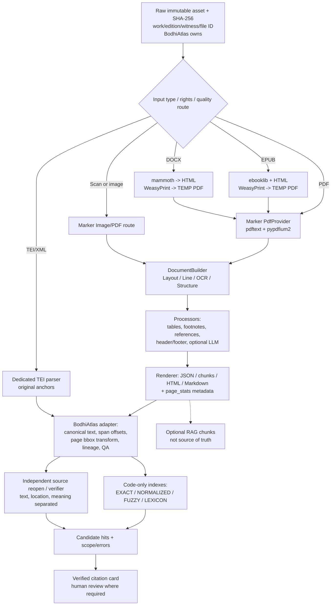

# Technology Assessment — Marker (datalab-to/marker)

- **Mã khảo sát:** P46 · **Ưu tiên:** P0 · **Ngày khảo sát:** 2026-11-16 (Asia/Ho_Chi_Minh).
- **Repository:** https://github.com/datalab-to/marker · **Loại:** `component` (document conversion / OCR / layout extraction), **không phải** search engine, corpus hoặc scholarly verification platform.
- **Snapshot code dùng để phân tích:** nhánh `master`, commit `d580b63874d9c8510fa54494975b9df1e8b527d0` (commit có thời gian 2026-11-14T04:32:15Z); `pyproject.toml` tại commit này khai báo `marker-pdf==2.2.1`. **Bản GitHub Release mới nhất được xác nhận qua API tại lúc khảo sát:** `v2.2.0` (phát hành 2026-11-12). **Không đồng nhất** mã `master` 2.2.1 với gói release v2.2.0. GitHub repo công khai, `archived=false` tại lúc truy vấn.
- **Analyst / phương pháp:** thẩm định kỹ thuật độc lập cho BodhiAtlas; đọc 3 nguồn chuẩn của dự án, các file code/serializer/test/license/issue và tài liệu đối thủ; đối chiếu contract source fidelity; **không chạy Marker, OCR, benchmark hay POC**. Nhãn `[CODE]` là mã đã đọc, không phải `[TESTED]`.
- **Khóa phạm vi:** mọi nhận định gắn commit ở trên trừ khi ghi rõ “latest docs của đối thủ” hoặc “issue báo cáo upstream”. Các URL dạng `blob/<SHA>/path#Lx-Ly` là permalink mã. Ký hiệu trạng thái: `NATIVE / CONFIG / EXTENSION / EXTERNAL / MISSING / UNKNOWN / N/A`.

## 1. Executive Decision

**Quyết định: `USE AS COMPONENT` (giá trị bảng tổng hợp: `COMPONENT`), chỉ cho triển khai POC có điều kiện; không `ADOPT` làm lõi trích dẫn/tra cứu. Confidence: `MED` đối với ranh giới tính năng/kiến trúc được đọc từ code; `LOW` đối với hiệu năng, chất lượng đa ngôn ngữ, quyền khai thác thương mại cụ thể và độ chính xác locator vì `NOT TESTED`.**

- **V1 Core:** đặt Marker vào nhánh ingest **PDF** (layout, OCR, tables, JSON/HTML) với file gốc bất biến; đầu ra phải qua BodhiAtlas canonicalization + per-page QA + independent source verifier. Với **PDF có text layer tốt**, so thẳng `no_ocr`/`fast` với trích xuất ký tự riêng; không cho OCR đè chứng cứ gốc. Với **EPUB/DOCX**, ưu tiên parser trực tiếp giữ locator nguồn; Marker chỉ là đường dự phòng lấy nội dung hoặc bản đọc tiện dụng, vì nhà cung cấp chuyển qua PDF trung gian. TEI/XML đi qua pipeline TEI có ngữ nghĩa riêng.
- **V2:** tùy chọn Marker `balanced`/`vllm` cho scan, bảng, công thức, Hán/Tạng hay layout khó **sau POC**; tạo dashboard per-page coverage và review queue. Không trộn OCR/model-generated text với bản gốc đã kiểm.
- **V3:** có thể dùng chunk/HTML làm dữ liệu phụ cho RAG hoặc research assistant, nhưng chunk IDs, vector index và model output không được thành định danh trích dẫn.

**Ba rủi ro lớn nhất:** (1) JSON chỉ có polygon/bbox ở cấp block, trong khi char offsets và liên kết từng span nguồn **không thuộc contract JSON**; `keep_chars` chỉ hữu ích cho nhánh PDF text và chưa phải exporter source map; (2) giấy phép code Apache-2.0 **khác** `MODEL_LICENSE` OpenRAIL-M sửa đổi, có giới hạn tài chính, cạnh tranh và nghĩa vụ đối với output; (3) omission âm thầm do cấu trúc bảng, footnote, đa cột, OCR hoặc batch; có issue upstream liên quan nhưng tình trạng trên commit ghim phải đo lại.

**Ngưỡng quyết định:** nếu `SOURCE_REOPEN_SUCCESS`, `EXACT_FULL_RECALL` và `FALSE_VERIFIED_CITATION` không đạt tiêu chí P0 do chủ dự án ký duyệt, Marker vẫn chỉ tạo **candidate text** và nhánh đó không được xuất phiếu dẫn chứng `VERIFIED`. Không đánh đổi gate bằng điểm benchmark toàn cục.

## 2. Sources & Evidence Ledger

**Quy ước:** `[DOC]` tài liệu/README; `[CODE]` mã đã đọc; `[ISSUE]` báo cáo upstream chưa tự tái hiện; `[INFERRED]` kết luận có giải thích; `[UNKNOWN]` thiếu dữ liệu; `[TESTED]`: **không có** trong khảo sát này. Các dòng sau là claim độc lập, không phải tính điểm bằng số lượng nguồn.

| claim_id | claim | evidence | URL/file+line | version/SHA | note |
|---|---|---|---|---|---|
| B01 | PRD V1.4 ưu tiên tìm nguyên văn và vị trí gốc, không cần LLM | [DOC] | [PRD.md](https://github.com/quoctran-2608/bodhi-atlas/blob/main/docs/PRD.md) §1, §3–4 | file blob `58d967c` | Nguồn chủ dự án, đọc trực tiếp qua GitHub |
| B02 | Quy tắc P0: giữ nguồn bất biến; câu chữ ≠ vị trí ≠ ý nghĩa; báo thiếu/OCR hỏng | [DOC] | [ACADEMIC_RISKS_AND_VERIFICATION.md](https://github.com/quoctran-2608/bodhi-atlas/blob/main/docs/ACADEMIC_RISKS_AND_VERIFICATION.md) §1–2, R01–R11 | blob `cdb6426` | Nguồn chủ dự án |
| B03 | Corpus hiện hữu có 13 upstream pin, local SQLite/FTS, witness/provenance; không có nghĩa được thay index sẵn | [DOC] | [BuddhismDocuments-for-AI/README.md](https://github.com/quoctran-2608/BuddhismDocuments-for-AI/blob/main/README.md) | blob `fd237c1` | Không nhập/chạy corpus; trạng thái nghiệm thu V2 do README tự công bố |
| M01 | `marker-pdf` khai báo 2.2.1; requirements Python >=3.10, Indra/Surya/pdftext và extras Office/EPUB | [CODE] | [pyproject.toml](https://github.com/datalab-to/marker/blob/d580b63874d9c8510fa54494975b9df1e8b527d0/pyproject.toml#L1-L57) | `d580b638` | Source snapshot, không phải khẳng định wheel v2.2.1 đã phát hành |
| M02 | `PdfConverter` có `no_ocr`, `fast`, `balanced`, `vllm`, GPU/CPU default và `force_ocr` | [CODE] | [converters/pdf.py](https://github.com/datalab-to/marker/blob/d580b63874d9c8510fa54494975b9df1e8b527d0/marker/converters/pdf.py#L59-L145) | `d580b638` | Chế độ khác nhau có đường tạo chữ khác nhau |
| M03 | `PdfProvider` dùng `pdftext`, lưu char index/bbox nội bộ khi `keep_chars`; đồng thời gọi `fix_text`/chuẩn hóa space | [CODE] | [providers/pdf.py](https://github.com/datalab-to/marker/blob/d580b63874d9c8510fa54494975b9df1e8b527d0/marker/providers/pdf.py#L202-L306) | `d580b638` | Không được coi output là byte-identical PDF layer |
| M04 | `LineBuilder` phân biệt lỗi text, script non-Latin và OCR routing; `keep_chars` không áp dụng cho OCR pages | [CODE] | [builders/line.py](https://github.com/datalab-to/marker/blob/d580b63874d9c8510fa54494975b9df1e8b527d0/marker/builders/line.py#L25-L105) và [#L155-L182](https://github.com/datalab-to/marker/blob/d580b63874d9c8510fa54494975b9df1e8b527d0/marker/builders/line.py#L155-L182) | `d580b638` | Hỗ trợ routing ≠ chứng minh OCR Hán/Tạng đúng |
| M05 | JSON Pydantic output công khai `id/block_type/html/polygon/bbox/children/section_hierarchy/images`, **không có** char offsets/witness | [CODE] | [renderers/json.py](https://github.com/datalab-to/marker/blob/d580b63874d9c8510fa54494975b9df1e8b527d0/marker/renderers/json.py#L12-L89) | `d580b638` | Bằng chứng trực tiếp từ schema exporter |
| M06 | Chunks lấy top-level block, page, bbox và HTML đã ghép; không phải locator đã xác minh | [CODE] | [renderers/chunk.py](https://github.com/datalab-to/marker/blob/d580b63874d9c8510fa54494975b9df1e8b527d0/marker/renderers/chunk.py#L10-L113) | `d580b638` | Bản flattened chịu rủi ro nối sai phạm vi |
| M07 | EPUB dùng `ebooklib` → gom HTML → `WeasyPrint.write_pdf` thành PDF tạm, không xuất spine href/CFI | [CODE] | [providers/epub.py](https://github.com/datalab-to/marker/blob/d580b63874d9c8510fa54494975b9df1e8b527d0/marker/providers/epub.py#L43-L125) | `d580b638` | PDF tạm có pagination nhân tạo |
| M08 | DOCX dùng `mammoth.convert_to_html` → WeasyPrint PDF tạm, không có paragraph anchor DOCX gốc trong JSON | [CODE] | [providers/document.py](https://github.com/datalab-to/marker/blob/d580b63874d9c8510fa54494975b9df1e8b527d0/marker/providers/document.py#L53-L97) | `d580b638` | Cần source locator riêng |
| M09 | CLI có batch parallel/skip_existing; cấp file trả `ok/error/skipped`, chưa phải QA đủ trang | [CODE] | [scripts/convert.py](https://github.com/datalab-to/marker/blob/d580b63874d9c8510fa54494975b9df1e8b527d0/marker/scripts/convert.py#L119-L174) và [#L391-L435](https://github.com/datalab-to/marker/blob/d580b63874d9c8510fa54494975b9df1e8b527d0/marker/scripts/convert.py#L391-L435) | `d580b638` | Cần riêng job manifest và retry policy |
| M10 | `page_stats`: page_id, method, block counts, metadata processor; không có bảng `unreadable_reason` / `coverage_verified` chính thức | [CODE] | [renderers/__init__.py](https://github.com/datalab-to/marker/blob/d580b63874d9c8510fa54494975b9df1e8b527d0/marker/renderers/__init__.py#L103-L128) | `d580b638` | `UNKNOWN` chất lượng từng trang nếu thiếu QA độc lập |
| M11 | Renderer lưu output cùng file `_meta.json`; JSON không tự ghi hash nguồn/work/edition | [CODE] | [output.py](https://github.com/datalab-to/marker/blob/d580b63874d9c8510fa54494975b9df1e8b527d0/marker/output.py#L45-L103) | `d580b638` | Xây manifest trong BodhiAtlas |
| M12 | Code Apache-2.0 nhưng weights có `MODEL_LICENSE` OpenRAIL-M modified và restriction | [CODE] | [LICENSE](https://github.com/datalab-to/marker/blob/d580b63874d9c8510fa54494975b9df1e8b527d0/LICENSE), [MODEL_LICENSE](https://github.com/datalab-to/marker/blob/d580b63874d9c8510fa54494975b9df1e8b527d0/MODEL_LICENSE#L23-L59) | `d580b638` | Legal review bắt buộc; xem §10 |
| M13 | Internal API có upload/filepath endpoint, validate allowed dir và upload limit; không thấy lớp auth tích hợp trong file server | [CODE] | [scripts/server.py](https://github.com/datalab-to/marker/blob/d580b63874d9c8510fa54494975b9df1e8b527d0/marker/scripts/server.py#L42-L100) và [#L300-L375](https://github.com/datalab-to/marker/blob/d580b63874d9c8510fa54494975b9df1e8b527d0/marker/scripts/server.py#L300-L375) | `d580b638` | Không expose Internet trực tiếp |
| M14 | Có test kiểm fast/clean digital dự kiến dùng pdftext, JSON page block; **chưa chạy test trong chat này** | [CODE] | [tests/converters/test_modes.py](https://github.com/datalab-to/marker/blob/d580b63874d9c8510fa54494975b9df1e8b527d0/tests/converters/test_modes.py), [tests/renderers/test_json_renderer.py](https://github.com/datalab-to/marker/blob/d580b63874d9c8510fa54494975b9df1e8b527d0/tests/renderers/test_json_renderer.py) | `d580b638` | Test source ≠ `[TESTED]` |
| M15 | Issue báo mất chữ ở bảng khi fallback không ra HTML | [ISSUE] | [#1124](https://github.com/datalab-to/marker/issues/1124) | Báo cáo 2026-10-19; Marker 2.0.0 | Không xác nhận còn tái hiện trên `d580b638` |
| M16 | Issue báo chia shard từ danh sách không ổn định có thể trùng/bỏ file | [ISSUE] | [#1121](https://github.com/datalab-to/marker/issues/1121) | Báo cáo 2026-10-14 | Kiểm lại trên commit đích; không gán là bug đã tái hiện |
| M17 | `MODEL_LICENSE` có điều khoản hạn chế >5 triệu USD doanh thu/funding và cạnh tranh với licensor | [DOC] | [MODEL_LICENSE, Attachment A](https://github.com/datalab-to/marker/blob/d580b63874d9c8510fa54494975b9df1e8b527d0/MODEL_LICENSE#L49-L59) | `d580b638` | Thẩm định pháp lý áp dụng theo tổ chức/ca sử dụng |
| X01 | Docling có định dạng PDF/DOCX/EPUB, cấu trúc DoclingDocument và export JSON | [DOC] | [Docling supported formats](https://docling-project.github.io/docling/usage/supported_formats/) | Tra 2026-11-16 | Chưa so chất lượng thực tế |
| X02 | MinerU có `MiddleJson`/`ModelJson` versioned và PDF layout extension | [DOC] | [MinerU output files](https://github.com/opendatalab/MinerU/blob/master/docs/en/reference/output_files.md) | Docs hiện hành 2026-11-16 | Khác schema với các bản 3.x |
| X03 | PyMuPDF `rawdict` có `chars[].c` và `bbox` thực | [DOC] | [PyMuPDF rawdict](https://github.com/pymupdf/PyMuPDF/blob/main/docs/app1.rst) | Docs hiện hành | Chưa đo đọc thứ tự / OCR |
| X04 | GROBID tạo TEI và PDF coords cho paragraph/reference/footnote | [DOC] | [GROBID PDF coordinates](https://github.com/grobidOrg/grobid/blob/master/doc/Coordinates-in-PDF.md) | Docs hiện hành | Mạnh trên tài liệu học thuật, không phải OCR đa định dạng phổ quát |

### Kiểm tra snapshot và phạm vi truy cập

1. GitHub API repo cho `archived=false`, `default_branch=master`, `public`; API `/commits/master` cho SHA 40 ký tự và ngày commit; file `pyproject.toml` ghim theo SHA. API `/releases/latest` trỏ `v2.2.0`, không coi đó là mã 2.2.1.
2. Đã đọc: README, `LICENSE`, `MODEL_LICENSE`, `pyproject.toml`, API/CLI, converters, provider registry, PDF/EPUB/DOCX provider, OCR/layout/line builders, schema, renderers JSON/chunks, output, tests và 2 issue chuyên biệt. Không tự nhận đã kiểm toàn bộ lịch sử PR hoặc tài liệu model weight trên Hugging Face.
3. Truy cập được cả **ba** nguồn chuẩn bắt buộc (`PRD.md`, `ACADEMIC_RISKS_AND_VERIFICATION.md`, `BuddhismDocuments-for-AI/README.md`). Không thấy/hay chạy các file PDF/EPUB/DOCX corpus thực của chủ dự án; **corpus fixture/gold chưa được cấp**, `NOT TESTED`.

## 3. Architecture & Data Flow



**Mã căn cứ:** [`PdfConverter.build_document()`](https://github.com/datalab-to/marker/blob/d580b63874d9c8510fa54494975b9df1e8b527d0/marker/converters/pdf.py#L204-L227) gọi `provider_from_filepath` → `DocumentBuilder` → `StructureBuilder` → processor → renderer. [`provider registry`](https://github.com/datalab-to/marker/blob/d580b63874d9c8510fa54494975b9df1e8b527d0/marker/providers/registry.py#L1-L84) đăng ký PDF, image, EPUB, DOCX, HTML, PPTX, XLSX. Route TEI/XML là đề xuất BodhiAtlas, **không** tuyên bố Marker có parser TEI ngữ nghĩa.

## 4. Feature Fit–Gap Matrix

Mức công sức **ước lượng định tính** cho một adapter trong BodhiAtlas (`L/M/H`), không phải số giờ, không phải benchmark. `N/A` nghĩa ngoài vai trò ingest, **không phải điểm trừ**. Status dùng đúng một trong bảy giá trị của đề bài.

| Code | Năng lực / trạng thái | Bằng chứng và phạm vi **thực** | Gap / thành phần bù / công sức |
|---|---|---|---|
| C01 | Multi-format ingest — `CONFIG` | [provider registry](https://github.com/datalab-to/marker/blob/d580b63874d9c8510fa54494975b9df1e8b527d0/marker/providers/registry.py), PDF/image và extras `marker-pdf[full]`; EPUB/DOCX qua PDF tạm | Native source locator của EPUB/DOCX, TEI parser riêng — **H** |
| C02 | OCR/layout/reading order — `NATIVE` | [PdfConverter modes](https://github.com/datalab-to/marker/blob/d580b63874d9c8510fa54494975b9df1e8b527d0/marker/converters/pdf.py#L75-L83), [OcrBuilder](https://github.com/datalab-to/marker/blob/d580b63874d9c8510fa54494975b9df1e8b527d0/marker/builders/ocr.py), [LayoutBuilder](https://github.com/datalab-to/marker/blob/d580b63874d9c8510fa54494975b9df1e8b527d0/marker/builders/layout.py) | Không có gold Hán/Tạng/Pāli, multi-column/footnote; QA/routing — **H** |
| C03 | Canonical text/source map — `EXTENSION` | [JSON renderer](https://github.com/datalab-to/marker/blob/d580b63874d9c8510fa54494975b9df1e8b527d0/marker/renderers/json.py#L12-L89) có page/block polygon/bbox, thiếu char offset | Source-mapped canonical span, reflow/stable locator, anchor re-verification — **H** |
| C04 | Works/editions/witnesses — `EXTERNAL` | [Document schema](https://github.com/datalab-to/marker/blob/d580b63874d9c8510fa54494975b9df1e8b527d0/marker/schema/document.py#L22-L34) giữ filepath/pages; không phải thư mục học thuật | BodhiAtlas IDs và edition/translation graph — **M/H** |
| C05 | Exhaustive `EXACT` — `N/A` | Marker là converter, không có contract exhaustive search trong [README](https://github.com/datalab-to/marker/blob/d580b63874d9c8510fa54494975b9df1e8b527d0/README.md) | BodhiAtlas code-only index, kiểm mọi occurrence — **H (external)** |
| C06 | Multilingual normalized search — `N/A` | Không có query engine; OCR đa chữ ở [LineBuilder](https://github.com/datalab-to/marker/blob/d580b63874d9c8510fa54494975b9df1e8b527d0/marker/builders/line.py#L85-L105) **không** là normalizer truy vấn | Auxiliary indexes Unicode/Hán/Wylie/Việt — **H (external)** |
| C07 | Fuzzy/near-duplicate/OCR errors — `N/A` | `rapidfuzz` dependency không thành search API ([pyproject](https://github.com/datalab-to/marker/blob/d580b63874d9c8510fa54494975b9df1e8b527d0/pyproject.toml)) | Fuzzy candidate retrieval + diff + confidence — **M/H (external)** |
| C08 | Sense-aware lexicon — `N/A` | Không phải dictionary engine | BodhiAtlas sense graph với source chứng minh — **H (external)** |
| C09 | Semantic/hybrid/RAG — `EXTERNAL` | [ChunkRenderer](https://github.com/datalab-to/marker/blob/d580b63874d9c8510fa54494975b9df1e8b527d0/marker/renderers/chunk.py) xuất chunks, **không** index hoặc sinh kết luận | RAG/embedding riêng, không dùng chunk làm citation anchor — **M** |
| C10 | Verified citation/reopen — `EXTERNAL` | [JSON bbox](https://github.com/datalab-to/marker/blob/d580b63874d9c8510fa54494975b9df1e8b527d0/marker/renderers/json.py#L12-L25) là *candidate region* | Reopen raw, xác minh chữ/vị trí/nghĩa độc lập — **H** |
| C11 | Note/wiki/claim memory — `N/A` | Ngoài sứ mệnh converter | Giữ module notes/claim của BodhiAtlas/corpus — **N/A** |
| C12 | API/MCP/export — `CONFIG` | CLI/Python/server [server.py](https://github.com/datalab-to/marker/blob/d580b63874d9c8510fa54494975b9df1e8b527d0/marker/scripts/server.py), export JSON/HTML/chunks; **không thấy MCP native** | Wrapper service/MCP nếu cần, schema version pin — **M** |
| C13 | Quality coverage/incremental — `EXTENSION` | [`page_stats`](https://github.com/datalab-to/marker/blob/d580b63874d9c8510fa54494975b9df1e8b527d0/marker/renderers/__init__.py#L103-L128), `--skip_existing` trong batch | Per-page status/coverage/retry và SHA-aware caching — **H** |
| C14 | Auth/licensing/privacy/backup — `EXTERNAL` | [MODEL_LICENSE](https://github.com/datalab-to/marker/blob/d580b63874d9c8510fa54494975b9df1e8b527d0/MODEL_LICENSE); [server.py](https://github.com/datalab-to/marker/blob/d580b63874d9c8510fa54494975b9df1e8b527d0/marker/scripts/server.py#L80-L100) có path guard, không đủ IAM | Secret manager, RBAC, encryption, rights flags, backup/export, legal review — **H** |
| C15 | Operational simplicity/independent deploy — `CONFIG` | [README installation](https://github.com/datalab-to/marker/blob/d580b63874d9c8510fa54494975b9df1e8b527d0/README.md), [batch workers](https://github.com/datalab-to/marker/blob/d580b63874d9c8510fa54494975b9df1e8b527d0/marker/scripts/convert.py) | CPU fast/no_ocr dễ hơn; VLM server/hardware/model pin/observability — **M/H** |

**Gates P0:** `SOURCE_FIDELITY=UNKNOWN` (bbox block chứng minh được, reopen và span-level chưa); `CODE_ONLY_EXACT=N/A` cho Marker, phải PASS ở BodhiAtlas; `MULTILINGUAL=UNKNOWN`; `QUALITY_COVERAGE=UNKNOWN`; `RIGHTS_SECURITY=UNKNOWN` cho tình huống vận hành; `PORTABILITY=conditional` nếu thực hiện adapter + raw/SHA/metadata ngoài engine. **Không có gate nào được ghi PASS bằng README/benchmark chưa chạy.**

## 5. Deep Technical Findings

### 5.1. Parser, OCR, converter, output và mô hình phụ thuộc

- `PdfConverter` điều phối provider → DocumentBuilder (layout/lines/OCR) → StructureBuilder → processors → renderer; khả năng chọn `processor_list`, `renderer`, `llm_service` giúp viết adapter mà không fork toàn repo ([code](https://github.com/datalab-to/marker/blob/d580b63874d9c8510fa54494975b9df1e8b527d0/marker/converters/pdf.py#L117-L227)).
- `LayoutBuilder`: `no_ocr`/`fast` dùng Indra ONNX layout/order, `balanced` có route VLM cho vùng/phần khó; `OcrBuilder` sử dụng Indra hoặc Surya VLM và có fallback block-level khi full page thất bại ([layout](https://github.com/datalab-to/marker/blob/d580b63874d9c8510fa54494975b9df1e8b527d0/marker/builders/layout.py#L20-L119), [ocr](https://github.com/datalab-to/marker/blob/d580b63874d9c8510fa54494975b9df1e8b527d0/marker/builders/ocr.py#L35-L100)). **Cấu hình OCR là lựa chọn chất lượng, không phải chứng chỉ nguyên văn.**
- Output `markdown`, `html`, `json`, `chunks` từ renderer tương ứng ([config parser](https://github.com/datalab-to/marker/blob/d580b63874d9c8510fa54494975b9df1e8b527d0/marker/config/parser.py#L24-L41), [renderer](https://github.com/datalab-to/marker/blob/d580b63874d9c8510fa54494975b9df1e8b527d0/marker/renderers/chunk.py)). Markdown thuận đọc; JSON thuận block metadata; chunks thuận downstream RAG. Không đánh đồng ba loại với bản canonical đã đối chiếu.
- `--use_llm` là **tùy chọn**; service mặc định trong code `GoogleGeminiService` nếu bật và không cấu hình provider khác. Danh sách processor có LLM table/footnote-related postprocessing nhưng những xử lý phụ thuộc flag/service; phải ghi `llm_enabled`, provider, endpoint, prompt/model trong manifest ([code](https://github.com/datalab-to/marker/blob/d580b63874d9c8510fa54494975b9df1e8b527d0/marker/converters/pdf.py#L71-L115), [#L158-L176](https://github.com/datalab-to/marker/blob/d580b63874d9c8510fa54494975b9df1e8b527d0/marker/converters/pdf.py#L158-L176)). Không nhầm Surya VLM nội bộ với **LLM cải tiến sau OCR**: cả hai đều model-inferred, nhưng khác đường dữ liệu và rủi ro gửi cloud.

### 5.2. Schema JSON và giới hạn provenance

`JSONBlockOutput` khai báo đúng các trường: `id`, `block_type`, `html`, `polygon`, `bbox`, `children`, `section_hierarchy`, `images`; `JSONOutput` gồm `children`, `block_type`, `metadata` ([json.py L12–25](https://github.com/datalab-to/marker/blob/d580b63874d9c8510fa54494975b9df1e8b527d0/marker/renderers/json.py#L12-L25)). `ChunkRenderer.FlatBlockOutput` thêm `page`, không thêm `char_offsets` ([chunk.py L11–28](https://github.com/datalab-to/marker/blob/d580b63874d9c8510fa54494975b9df1e8b527d0/marker/renderers/chunk.py#L11-L28)). Marker block ID dạng `/page/<index>/<BlockType>/<block_index>` ([blocks/base.py L47–55](https://github.com/datalab-to/marker/blob/d580b63874d9c8510fa54494975b9df1e8b527d0/marker/schema/blocks/base.py#L47-L55)); ID là cấu trúc của **lần phân tích**, **không cam kết stable qua model/update/reflow**.

Nội bộ `PdfProvider` có `Span.minimum_position`/`maximum_position` và khi bật `keep_chars` có ký tự kèm `idx`, `polygon` cho digital PDF; tuy nhiên nguồn text qua `fix_text()` và `normalize_spaces()`; exporter JSON nêu trên **không serialize các thông tin ký tự này thành contract** ([pdf.py L214–301](https://github.com/datalab-to/marker/blob/d580b63874d9c8510fa54494975b9df1e8b527d0/marker/providers/pdf.py#L214-L301)). OCR/VLM blocks không có char polygon ([pdf.py L83–87](https://github.com/datalab-to/marker/blob/d580b63874d9c8510fa54494975b9df1e8b527d0/marker/providers/pdf.py#L83-L87)). **Kết luận [CODE]: bbox region-level có, char-level mapping ở JSON mặc định không có.** Không suy diễn khả năng exact 250 ký tự hoặc source reopen từ việc JSON có bbox.

### 5.3. EPUB/DOCX và locator gốc

- **EPUB:** `EpubProvider(PdfProvider)` đọc nội dung EPUB bằng `ebooklib`, nối document HTML, dùng WeasyPrint render ra PDF tạm rồi chạy PdfProvider. Luồng này không lưu trong JSON các `spine`, `href`, EPUB CFI gốc; page number là của bản PDF tạm có CSS A4 ([epub.py](https://github.com/datalab-to/marker/blob/d580b63874d9c8510fa54494975b9df1e8b527d0/marker/providers/epub.py)). **Nếu sách EPUB reflow, locator PDF tạm không đủ tái mở sách nguyên bản.**
- **DOCX:** `DocumentProvider` dùng `mammoth` → HTML → WeasyPrint PDF tạm; không công bố bookmark/paragraph run ID như locator output JSON ([document.py](https://github.com/datalab-to/marker/blob/d580b63874d9c8510fa54494975b9df1e8b527d0/marker/providers/document.py#L53-L97)). **Phải có parser cấu trúc DOCX riêng** để giữ anchor kiểu body paragraph/table cell và kiểm sau sửa/tái xuất.
- **TEI/XML:** không thấy provider riêng giữ `xml:id`, `@n`, `milestone`, `pb/lb` trong [provider registry](https://github.com/datalab-to/marker/blob/d580b63874d9c8510fa54494975b9df1e8b527d0/marker/providers/registry.py#L1-L84). Có thể fallback dạng HTML cho file có tag, nhưng **không được** xem là TEI-aware ingest. Dùng parser TEI của corpus hiện hữu.

### 5.4. `no_ocr` / `fast` / `balanced` / `vllm` / `force_ocr`

| Mode | Xử lý theo code | Lợi ích dự kiến | Rủi ro phải test |
|---|---|---|---|
| `no_ocr` (`--disable_ocr`) | pdftext + Indra layout/order, không OCR | Giữ được phần lớn text layer sạch, chi phí máy thấp | Text layer sai Unicode/ligature, bảng rơi chữ, thiếu scan |
| `fast` (`indra`) | Indra ONNX layout + OCR cho vùng/trang bị đánh dấu | CPU/MPS độc lập VLM server | Chữ Hán/Tạng và dấu nhỏ; sửa OCR theo vùng có thể đổi ký tự |
| `balanced` | PDF text/Indra cho vùng tốt, route bảng/math/non-Latin/scan qua Surya VLM | Hỗn hợp born-digital và scan | Heterogeneous text lineage cùng file/trang; VLM output cần kiểm |
| `vllm` (`surya`,`accurate`) | `force_ocr=True` và full-page Surya VLM OCR, bỏ pdftext | Ảnh mờ/complex region đáng thử | Re-recognize cả text sạch; sai phủ định/trích dẫn và bounding box |
| `--force_ocr` | Buộc đường OCR (tùy mode/cấu hình); không đồng nghĩa chính xác hơn | Chữa text layer lỗi | Mất fidelity đối với digital clean |

Căn cứ [`PdfConverter`](https://github.com/datalab-to/marker/blob/d580b63874d9c8510fa54494975b9df1e8b527d0/marker/converters/pdf.py#L75-L145), [`LineBuilder`](https://github.com/datalab-to/marker/blob/d580b63874d9c8510fa54494975b9df1e8b527d0/marker/builders/line.py), [`README`](https://github.com/datalab-to/marker/blob/d580b63874d9c8510fa54494975b9df1e8b527d0/README.md). Tuyên bố benchmark trên README/release **chỉ là `[DOC]`, không là đo của BodhiAtlas**; kết quả vendor thay đổi theo benchmark và revision, cần POC đồng bộ dữ liệu.

### 5.5. Hán cổ, Pāli dấu phụ, chữ Tạng và scan

`LineBuilder.has_non_latin_script()` kiểm tỷ lệ non-Latin/CJK để route `balanced` qua VLM; phát hiện script **không** chứng minh nhận diện chuẩn từng ngữ cảnh, chữ cổ, dấu phụ hay Wylie. Bộ phát hiện garbled text có `score_text_garble()` nhưng chưa cho biết CER/WER trên tài liệu Phật học ([line.py L25–105](https://github.com/datalab-to/marker/blob/d580b63874d9c8510fa54494975b9df1e8b527d0/marker/builders/line.py#L25-L105)). Kiểm từng cặp **ảnh trang + nguyên văn đã soạn gold**, gồm `anatta/anattā/anātman`, `dukkha/duḥkha`, `無我`, `無常/无常`, tiếng Việt dấu, chữ Tạng Unicode/Wylie. Chữ Hán được route sang VLM cũng có thể bị hiện đại hóa hoặc nối cột sai; **NOT TESTED**.

### 5.6. Footnote, header/footer, 2 cột, bảng, rotated text

- Marker có processor `FootnoteProcessor`, `ReferenceProcessor`, `PageHeaderProcessor`, `TableProcessor`, `LineMergeProcessor`, `StructureBuilder`. Chúng cung cấp **cơ hội** nhận diện cấu trúc, không bảo đảm không đảo tác giả–người chú giải, xóa tiêu đề đầu trang hoặc gộp sai dòng ([converter processor list](https://github.com/datalab-to/marker/blob/d580b63874d9c8510fa54494975b9df1e8b527d0/marker/converters/pdf.py#L84-L114)).
- Renderer cho phép `keep_pageheader_in_output`, `keep_pagefooter_in_output`; chế độ mặc định có thể bỏ furniture, cần so raw/page image trước khi coi là coverage hoàn chỉnh ([BaseRenderer](https://github.com/datalab-to/marker/blob/d580b63874d9c8510fa54494975b9df1e8b527d0/marker/renderers/__init__.py#L20-L39)).
- **Issue upstream #1124** mô tả bảng mất toàn bộ chữ khi không tạo được HTML fallback; đó là issue 2.0.0 và **chưa tự kiểm version 2.2.1**. Đây là lý do test coverage-by-page và table-to-text fallback, không là căn cứ khẳng định commit hiện tại lỗi.
- **Rotated text:** cần fixture 90°/180° và overlay bbox. Đã thấy polygon output nhưng **chưa thấy bằng chứng test thành công cho BodhiAtlas**, `UNKNOWN`.

### 5.7. Batch/parallel/retry/error coverage

`marker` batch hỗ trợ nhiều worker và `--skip_existing`, chia shards, có đếm file thành công/thất bại; worker catch exception và trả `(0,"error")`, không trả sơ đồ lỗi theo trang, nguyên nhân OCR kèm vị trí hay retry idempotent ([convert.py](https://github.com/datalab-to/marker/blob/d580b63874d9c8510fa54494975b9df1e8b527d0/marker/scripts/convert.py#L119-L174)). `--skip_existing` kiểm tồn tại `.md/.html/.json` chứ không kiểm input SHA/engine SHA/cấu hình hoặc mọi page đã hoàn chỉnh ([output.py](https://github.com/datalab-to/marker/blob/d580b63874d9c8510fa54494975b9df1e8b527d0/marker/output.py#L45-L61)). Issue [#1121](https://github.com/datalab-to/marker/issues/1121) mô tả thiếu/trùng shard khi thứ tự directory không nhất quán; phải thử lại commit ghim. **Adapter BodhiAtlas:** deterministic queue theo `(SHA, engine version, config hash, page_range)`; per-page checkpoints, timeout/oom class, retry bounded, final manifest `COMPLETE/PARTIAL/FAILED/NOT_INDEXED`.

### 5.8. Luật, API, triển khai và phạm vi bảo mật

- Code Apache-2.0 ([LICENSE](https://github.com/datalab-to/marker/blob/d580b63874d9c8510fa54494975b9df1e8b527d0/LICENSE)); model weights **modified OpenRAIL-M**, với các hạn chế Attachment A. `MODEL_LICENSE` có điều khoản attribution và `Share-a-Like` đối với model/output — cần luật sư xác định xung đột tiềm tàng với tài liệu/bản dịch có bản quyền và sản phẩm trích dẫn ([MODEL_LICENSE L23–59](https://github.com/datalab-to/marker/blob/d580b63874d9c8510fa54494975b9df1e8b527d0/MODEL_LICENSE#L23-L59)). **Không kết luận mọi output buộc open source** khi chưa có tư vấn pháp lý về áp dụng.
- `marker_server` có UI/API, giới hạn upload và allowed-directory nhưng không tìm thấy cơ chế authentication/authorization tích hợp ở lớp endpoint đã đọc ([server.py](https://github.com/datalab-to/marker/blob/d580b63874d9c8510fa54494975b9df1e8b527d0/marker/scripts/server.py)); không nên expose trực tiếp. `--use_llm` có thể dùng cloud providers: chỉ dùng trên tài liệu được phép upload, mặc định local no-LLM cho corpus bản quyền.
- Batch đa worker không đồng nghĩa orchestration đảm bảo idempotence; GPU/VLM cần service/VRAM và resource guard; chưa có đo CPU/RAM/latency của hệ thống đích.

### 5.9. Adapter JSON → canonical source-mapped text

Đề xuất **BodhiAtlas sở hữu** `ingestion_runs`, `source_segments`, `source_anchors`, `page_quality`, `evidence_checks`:

```json
{
  "file_id": "<stable-id>",
  "raw_sha256": "<64-hex-from-raw-file>",
  "work_id": "<work>", "edition_id": "<edition>", "witness_id": "<witness-or-null>",
  "extraction_id": "sha256(file_hash+engine_sha+config_hash+route)",
  "engine": {"name": "marker", "commit": "d580b63874d9c8510fa54494975b9df1e8b527d0", "mode": "<mode>", "llm_enabled": false},
  "segment_id": "<BodhiAtlas-stable-identity>", "text_original_extracted": "...",
  "text_canonical": "...", "start_cp": 0, "end_cp": 0,
  "source": {"type": "pdf", "pdf_page_index_0": 0, "pdf_page_display_1": 1, "printed_page": null,
             "bbox": [0,0,0,0], "coord_system": "PDF-point-or-explicit-transform", "marker_block_id": "/page/0/Text/1"},
  "ocr": {"method": "pdftext|indra|surya|unknown", "status": "UNVERIFIED", "quality": "UNKNOWN"},
  "checks": {"text": "UNVERIFIED", "location": "UNVERIFIED", "meaning": "UNREVIEWED"},
  "rights": {"can_store": null, "can_send_cloud": false, "can_export": null},
  "coverage": {"state": "PARTIAL|COMPLETE|FAILED", "reason": null}
}
```

**Đây là schema *đề xuất*, không phải schema Marker.** `start_cp/end_cp` là offset codepoint vào canonical text do adapter dựng; giữ thêm grapheme boundaries và **alignment map** từ canonical offsets về các token/block/char của nguồn, không xóa câu chữ sau Unicode normalization. `bbox` chỉ dùng khi loại tọa độ và phép biến đổi đã được đo; không gán pixel là PDF point. Với OCR, block bbox chỉ là vùng ứng viên: `verify_span_against_image` phải duyệt trước khi nâng trạng thái `VERIFIED`. Với EPUB, source phải là `href + EPUB CFI` hoặc locator DOM gốc, **không** thay bằng trang PDF tạm. Với PDF, printed page là `null` tới khi đọc được page label/số in có chứng cứ.

### 5.10. So với đối thủ: quy tắc route sơ bộ

Chỉ xét cùng fixture: PDF digital + scan + PDF 2 cột; DOCX/EPUB giữ nguyên raw. Dùng Marker nếu (i) layout/table/OCR làm tăng coverage mà (ii) JSON bbox reopen thành công và (iii) chữ chính xác không giảm vượt ngưỡng. Dùng **Docling** cho đối chứng document model đa định dạng, **MinerU** cho đối chứng parser đa chế độ và JSON versioned, **PyMuPDF/pdftext** cho đối chứng text/char PDF born-digital, **GROBID** cho bài báo khoa học/references→TEI. Không route bằng số sao, tuyên bố tốc độ hoặc tên model. Mọi lựa chọn hiện là `[INFERRED]`, chờ TC01–TC06.

## 6. Source Fidelity & Provenance

### 6.1. Nguyên tắc bất biến và câu trích

**Nguồn sự thật của BodhiAtlas = bytes của raw asset có SHA-256, liên hệ work/edition/witness + bản lưu có quyền.** Marker JSON/Markdown, LLM sửa bảng, OCR model và FTS đều là **derivative layers**. Những metadata mà Marker tạo (page index, polygon, estimated reading order) chỉ là *candidate evidence* cho tới khi độc lập mở lại đúng file và thấy đúng span. Chỉ mục normalized/fuzzy không bao giờ được thay bản original.

| Thành phần phiếu | Nguồn | Marker hỗ trợ gì? | Cổng trước khi công bố |
|---|---|---|---|
| `work_id/edition_id/witness_id/file_id` | BodhiAtlas catalog | Không tự cung cấp theo nghĩa học thuật | Đảm bảo quan hệ đúng tác phẩm/bản dịch/ấn bản; không gộp bản gần giống |
| `raw_sha256` và access rights | File immutable store | Không nằm trong JSON renderer | Kiểm hash lại khi mở nguồn, quyền lưu/đọc/xuất |
| `extracted_quote` / `text_original` | Raw text layer hoặc OCR derivative | Có `html`/Markdown, nhưng có `fix_text`, sửa space, processor và OCR | Đối chiếu source token/ảnh, giữ raw extraction và diff |
| `pdf_page_index` + `bbox` | PDF provider + JSON | Có page/block polygon/bbox, `page_id` zero-based | Thử overlay trên raw PDF đúng crop/rotate; không đổi page ID |
| `printed_page` | Nội dung trang hoặc page label có chứng cứ | `UNKNOWN`: không thấy exporter khẳng định số trang in đã kiểm | Để `null` trừ khi lấy được label/số in chứng cứ |
| `epub_href/cfi/paragraph` | EPUB spine/DOM nguồn | Không có ở output EPUB→PDF tạm | Native EPUB parser giữ href/CFI; reflow/reopen test |
| `docx_paragraph_anchor` | OOXML paragraph/run/table row | Không có ở output DOCX→PDF tạm | Native OOXML parser + anchor map |
| `char/source offsets` | PDF `pdftext` internal char data hoặc parser native | `keep_chars` trong PDF provider; **không** có trong JSONBlockOutput | Xây span alignment + validate mọi occurrence |
| `match_type` / verified states | Search/verifier riêng | N/A | `EXACT/NORMALIZED/FUZZY/LEXICON/SEMANTIC`, text/location/meaning kiểm độc lập |
| `coverage` | Work/job-page manifest | Có `page_stats`, method, counts | So tổng trang với extracted, blank/error/partial, nguyên nhân và phạm vi |

**Định nghĩa 3 trạng thái chứng cứ:** `TEXT_VERIFIED` khi đối chiếu chữ từ raw PDF text layer/ảnh gold; `LOCATION_VERIFIED` khi overlay/raw reopen xác nhận đúng trang và bbox/locator; `MEANING_REVIEWED` khi đọc ngữ cảnh, xác định ai nói, phủ định và trạng thái luận điểm. `TEXT_VERIFIED` và `LOCATION_VERIFIED` **không kéo theo** `MEANING_REVIEWED`.

### 6.2. Bẫy phải chặn

1. **Không lấy Markdown đẹp làm chính xác chữ:** renderer có thể đổi dấu cách, gộp chữ qua line/page, bỏ header/footer, sửa bảng và escape HTML. Nếu `anattā` bị biến thành `anatta`, có thể trả candidate nhưng không gọi là EXACT nguyên văn.
2. **Không lấy page bbox làm location của 250 ký tự:** một quote nhiều block/trang phải giữ danh sách `source_anchors[]` có thứ tự, không gom vào bbox lớn có thể che đoạn không liên quan.
3. **Không coi các lần xuất hiện lặp là một:** 5 occurrence cùng PDF phải ra 5 phiếu vị trí riêng nếu trong indexed scope; dedup by block không được làm mất occurrence.
4. **Không lấy PDF page = printed page:** tài liệu có bìa, trang La Mã, trang mục lục, mặt trước; chỉ lưu printed page khi có chứng cứ.
5. **Không lấy `NOT FOUND` = không có trong kho:** khi thiếu trang, parser lỗi, font sai hay nguồn chưa được phép truy cập, câu trả lời phải nói rõ scope/quality.
6. **Không trộn witnesses:** hai bản dịch cùng tác phẩm là 2 nguồn trích văn bản khác nhau; ghi `translation_of`, `parallel_to` nhưng không tự gán tương đương nguyên văn.
7. **Không để model tự cấp trang/trích:** output Markdown/HTML/LLM, retrieval candidate và xác minh human là ba miền trạng thái khác nhau.

### 6.3. Contract cho phiếu trích đã kiểm

Mỗi `citation_card` phải có ít nhất: `{work_id, edition_id, file_id, sha256, author, translator, source_role, original_quote, chapter/section, pdf_page_index, printed_page_if_supported, bbox/CFI/href/anchor, match_type, OCR_status, text_check, location_check, meaning_check, index_scope, incomplete_sources, verified_at, verifier_method}`. Nếu thiếu `file_id`/SHA/bằng chứng vị trí, chỉ xuất `CANDIDATE`, **không** xuất `VERIFIED`. Nếu file bị sửa, đưa citation về `STALE` thay vì giữ locator giả ổn định.

## 7. Multilingual & Retrieval Behavior

Marker là **ingestion engine**, không phải query API của BodhiAtlas. Đánh giá năng lực tạo candidate text phải tách khỏi truy vấn và biện luận học thuật.

| Query / hiện tượng | Ingest risk của Marker | Truy vấn bắt buộc do BodhiAtlas thực hiện | Trạng thái hiện tại |
|---|---|---|---|
| `anatta` / `anattā` | Nhầm dấu dài trong scan; `fix_text` có thể đổi Unicode | `EXACT` giữ dấu; `NORMALIZED` phụ index nối biến thể kèm diff | Marker OCR `UNKNOWN`, search `N/A` |
| `anātman` ↔ `vô ngã` / `vo nga` / `無我` | Các script không Latin có route VLM nhưng độ đúng riêng chưa thử | `LEXICON` theo từng sense + quy tắc Việt/Hán/Sanskrit có nguồn; không bắc cầu vô hạn | Marker search `N/A` |
| `無常` ↔ `无常` | OCR CJK, phồn/giản và dị thể | `EXACT` từng chữ riêng; `NORMALIZED` mapping phụ index có version | Marker search `N/A` |
| `dukkha` / `duḥkha` | Phân biệt âm Pāli/Sanskrit, dấu ḥ | `NORMALIZED`/lexicon có điều kiện, trình bày chữ gốc và loại match | OCR `UNKNOWN` |
| Unicode Tibetan / Wylie | Font, syllable boundary, Unicode combining và transliteration | Index Unicode + Wylie converter đã kiểm; tránh tự khẳng định đồng nghĩa | OCR `UNKNOWN`; search `N/A` |
| Việt dấu / không dấu (`vo nga`) | OCR dấu; normalization xóa khác biệt | Return multiple candidates, tránh một nghĩa mặc định | Search `N/A` |
| 200–300 ký tự + 5 occurrences/file | Split block/columns, mất chữ phủ định | code-only sequential/substring/rolling search trên canonical verified spans, kiểm tất cả vị trí | `NOT TESTED` |
| Luận đề “ai phân biệt vô thường với khổ?” | OCR và index chỉ cấp đoạn ứng viên | Code tìm đoạn/thuật ngữ; người/AI có trách nhiệm tóm lập luận, đối chiếu nguồn và phản chứng | Marker argument analysis `N/A` |

**Đề xuất thuật toán:** giữ `raw_extracted_text` và `canonical_text` bất biến theo `extraction_id`; tạo *auxiliary* NFC/NFKC/trad–simp/diacritic/transliteration index có transformation ledger riêng. Với EXACT, dùng thao tác tìm substring code-only trên text phiên bản ghi rõ (raw text layer và/hoặc extracted canonical), đếm toàn bộ offset (kể cả overlap theo cấu hình), then map về `source_anchors`. Với normalized/fuzzy/lexicon, trả **ứng viên**, hiển thị phép chuẩn hóa, original quote, edit distance và `match_type`; rerank không được nâng thành trích dẫn xác minh.

Chỉ số phải báo **trên indexed scope**: `EXACT_FULL_RECALL` = số location đúng đã trả / tổng location gold trong scope; `FALSE_VERIFIED_CITATION` = số citation được ghi VERIFIED nhưng sai nguồn/chữ/vị trí; `SOURCE_REOPEN_SUCCESS` = số anchors mở đúng raw và vùng / tổng anchors kiểm; CER/WER tách theo language/script, scan/digital và vùng tài liệu. Với câu luận đề, recall@k candidate không thay cho xác nhận lập luận hay đánh giá semantic.

## 8. Integration Options for BodhiAtlas

### Option A — PDF-first, dual-path, source verification độc lập (**ưu tiên POC V1**)

- **Input contract:** `raw_file_uri`, `sha256`, `file_id`, `work_id`, `edition_id`, `witness_id`, `source_role`, `rights_policy`, `language_hints`, `page_scope`, `engine_config_hash`.
- **Pipeline:** (1) lưu raw+SHA bất biến; (2) PDF digital → `pdftext`/char extraction native làm baseline; (3) Marker `no_ocr`/`fast` tạo layout, footnotes, tables; (4) scan/vùng lỗi → `balanced`/`vllm` có gate; (5) adapter gắn page/box, text/char anchors; (6) independent verifier khớp original source; (7) index code-only ngoài Marker.
- **Output contract:** `ingestion_run.json`, `marker_output.json`, `marker_meta.json`, `canonical_spans.jsonl`, `page_quality.jsonl`, `source_anchors.jsonl` và `coverage_manifest.json`; mỗi file dẫn `raw_sha256` + version/hash config.
- **Source of truth:** raw PDF byte + BodhiAtlas manifest; không phải Marker JSON. **Stable IDs:** work/edition/file độc lập; segment refs chứa file sha + `extraction_id` + anchor rebasing data, không dùng chỉ `/page/N/Text/M` vĩnh viễn.
- **Failure/rollback:** nếu parser crash, page missing hoặc OCR low confidence: đánh `PARTIAL`, đưa trang vào retry/review; chạy lại engine trước từ raw byte và giữ cả hai extraction versions. Rollback chỉ đổi `active_extraction_id`, **không sửa raw, không xoá verified claims**; citation phải revalidate nếu trỏ bản derivation đã đổi.
- **Ưu:** lấy giá trị Marker trên PDF mà không đặt nghĩa vụ tìm kiếm và chứng cứ vào model. **Nhược:** cần tự viết source alignment/QA/rights.

### Option B — Conditional fallback engine trong parser-router đa định dạng (**phù hợp V1.5/V2**)

- **Input contract:** như A, cộng `detected_format`, `preferred_native_locator`, `max_latency_class`, `privacy_mode=local_only|cloud_allowed`.
- **Route:** EPUB → parser EPUB-native giữ `href/spine/CFI`; DOCX → OOXML-native giữ paragraph/tables; TEI/XML → canonical TEI parser giữ `xml:id/pb/lb`; PDF → baseline text+layout; scan/pdf tricky → Marker; nếu Marker fail thì Docling/MinerU theo fixture gold và quyền sử dụng.
- **Output:** canonical document contract chung, `engine_attempts[]` (time, error, version, rights), đối chiếu diff các engine theo page/anchor, lựa chọn bản được review. JSON của từng engine lưu thô để audit.
- **Migration:** `engine` là biến của `extraction_run`, schema nội bộ BodhiAtlas giữ ổn định; reindex phải tái tạo mọi secondary index từ canonical + source refs, không phụ thuộc chunk vector ID. Quy tắc migration `source_anchor` kiểm lại raw sau thay engine.
- **Failure/rollback:** không âm thầm thay text có confidence thấp bằng output engine khác. Giữ parallel candidates, nhất là phủ định/footnote, yêu cầu resolve conflict. Gate fail thì chỉ index metadata + cảnh báo chưa có toàn văn.
- **Ưu:** bảo toàn native locator đa định dạng. **Nhược:** phức tạp quản lý nhiều engine và benchmark.

### Option C — Optional offline research chunks (**không là citation engine**)

- **Input:** verified canonical segments + rights cho phép nghiên cứu; **không** lấy raw Marker chunks làm duy nhất.
- **Output:** tokens/chunks/embeddings phụ được tính lại khi canonical thay; RAG candidate link ngược `source_segment_id` và `source_anchor`. **Không cấp citation VERIFIED từ chunk text**. RAG không cần xuất hiện ở V1.

**Không chọn phương án “Marker trả Markdown → lập index trực tiếp → UI hiển thị trang theo suy đoán”.** Phương án đó phá contract của PRD về exact toàn vị trí và witness provenance.

## 9. Practical POC / Reproduction Plan

**Tình trạng thực hiện trong khảo sát:** `NOT TESTED` cho toàn bộ TC01–TC08. Không có PDF/EPUB/DOCX fixture gold trên môi trường khảo sát và không cài/khởi chạy trọng lượng OCR/model. Các lệnh sau là **kế hoạch tái lập, chưa có logs/measurements**. Trước khi chạy, chủ dự án xác nhận quyền tải model, quyền dùng file, license và network policy; pin binary image, Python, package hashes, dependencies từ lockfile. Không tự động lấy corpus chưa được cấp quyền.

### 9.1. Chuẩn bị fixture + gold

Một manifest (đề xuất `fixtures/manifest.jsonl`) ghi `fixture_id`, đường dẫn raw, SHA-256, ngôn ngữ, loại quyền, số trang PDF (nếu có), loại trang digital/scan, số cột, vùng `gold_quotes` từ bản đã kiểm, `gold_locations` gồm polygon/CFI/paragraph IDs, `expected_ocr_state`, `expected_missing_pages`. Tập **tối thiểu**:

- `F01_pdf_digital.pdf`: text Unicode sạch, trang bìa + số in không trùng PDF, 5 occurrences của từ/cụm trong cùng file.
- `F02_pdf_scan.pdf`: cùng nội dung F01 đã rasterize, nhiều mức DPI, blur và skew. Gold **lấy F01 đã kiểm**, không lấy OCR làm gold.
- `F03_pdf_multiscript.pdf`: Pāli `ā, ī, ṃ, ṭ, ḍ`, Sanskrit `ḥ`, tiếng Việt dấu, Hán phồn/giản, Tibetan Unicode có dòng Wylie đối chiếu; cả font tốt/bị lỗi.
- `F04_pdf_layout.pdf`: 2 cột, footnote, header/footer, bảng có ô ghép, chữ xoay 90°, đoạn nối trang và câu có từ phủ định.
- `F05_epub.epub`: EPUB spine có 2 chapters và internal links, text giữ nguyên qua thay đổi CSS/reflow; gold `(href, CFI, paragraph)`.
- `F06_docx.docx`: đoạn, chú thích, bảng, heading, bookmark; gold `(OOXML part, paragraph/table cell anchor, quote)`.
- `F07_corrupt_or_incomplete.pdf`: 1 trang ảnh trắng, 1 trang password/không đọc được hoặc file lỗi **được phép**, page manifest gold.
- `F08_longbook.pdf`: sách dài, kiểm OOM/timeout/batch/sharding/skip-existing/incremental có SHA thay đổi.

**Không phát hành các fixture có bản quyền vào public repo.** SHA và gold tự chọn/được quyền dùng phải được ghi vào protocol trước khi so engine. Bật golden review độc lập cho câu phủ định và trích học thuật.

### 9.2. Lệnh/steps tham khảo (chưa thực thi)

```bash
# Trong môi trường riêng đã chuẩn bị; ghim version = commit d580b638...
python -m venv .venv
. .venv/bin/activate
# Cần mirror/cache nội bộ khi POC offline; không tự download nếu chưa được phép.
python -m pip install 'marker-pdf[full]==2.2.1'   # CHỈ nếu wheel 2.2.1 tồn tại; nếu không, install từ checkout commit ghim
marker_single --help                            # Xác thực CLI và option thực tế

# TC01/TC03: từng mode và định dạng, xuất JSON + metadata
marker_single fixtures/F01_pdf_digital.pdf --mode no_ocr --output_format json --output_dir out/marker_no_ocr
marker_single fixtures/F01_pdf_digital.pdf --mode fast   --output_format json --output_dir out/marker_fast
marker_single fixtures/F02_pdf_scan.pdf    --mode balanced --output_format json --output_dir out/marker_balanced
marker_single fixtures/F03_pdf_multiscript.pdf --mode vllm --output_format json --output_dir out/marker_vllm

# TC02: từ định dạng gốc; chú ý Marker sinh PDF tạm (KHÔNG phải locator EPUB/DOCX)
marker_single fixtures/F05_epub.epub --mode fast --output_format json --output_dir out/marker_epub
marker_single fixtures/F06_docx.docx --mode fast --output_format json --output_dir out/marker_docx

# TC01 đối chứng cùng input, môi trường/pipeline ghi riêng
# Lệnh Docling tương ứng theo CLI reference hiện hành, xác thực --help ở môi trường pin
docling convert fixtures/F01_pdf_digital.pdf --to json

docling convert fixtures/F02_pdf_scan.pdf --to json

# TC05/TC06: CPU no-OCR/fast, then GPU balanced/vllm trên host được ghi specs
/usr/bin/time -v marker_single fixtures/F08_longbook.pdf --mode fast --output_format json --output_dir out/marker_long_cpu
# Batch, retry/skip_existing: ghi chính xác job manifests và hash config trước/sau
marker fixtures/ --output_format json --mode fast --output_dir out/batch --workers 1
```

**Lưu ý**: phiên `marker-pdf 2.2.1` nhìn thấy trong `pyproject.toml` của `master` không chứng minh đã có wheel PyPI tại thời điểm khảo sát; câu lệnh pip là **bước kiểm điều kiện**; cách chắc hơn là clone commit đã ghim, cài editable vào venv có dependencies đã pin; **không tự động chạy lên dữ liệu riêng**. `docling convert --to json` dựa trên [CLI reference hiện hành](https://docling-project.github.io/docling/reference/cli/), version phải ghi khi chạy. `--keep_chars` cần thử cùng Python API/CLI và kiểm nội bộ hay JSON có thật sự emit char-data hay không; không coi flag một mình là đã có source map.

### 9.3. Test cases và nghiệm thu

| TC | Fixture & bước | Gold/expected output | Metrics và failure gate | Kết quả |
|---|---|---|---|---|
| TC01 | F01/F02: Marker 4 modes vs Docling; trích text, compare ký tự và overlay locator | Gold nguyên văn theo từng trang, page number, bbox; diff chữ kể cả phủ định | CER/WER, `SOURCE_REOPEN_SUCCESS`, `FALSE_VERIFIED_CITATION`; fail nếu sai nguồn mà VERIFIED | **NOT TESTED** |
| TC02 | F05 EPUB/F06 DOCX: convert, thay CSS/reflow, mở lại đoạn theo locator | Gold `epub href/CFI` và OOXML paragraph/table IDs; open đúng raw | `SOURCE_REOPEN_SUCCESS` sau reflow; fail nếu chỉ có page PDF tạm | **NOT TESTED** |
| TC03 | F03/F04: Pāli/Hán/Tạng/Việt, 2 cột, footnote, bảng, chữ xoay | Gold có character-level text + đọc thứ tự + loại block, bao gồm dấu phụ | CER/script, reading-order accuracy, loss by region, footnote association, edit diff; fail sai phủ định | **NOT TESTED** |
| TC04 | F01/F04: quote dài 250 ký tự qua block/page, 5 occurrences | Gold 5 anchors riêng, quote đầy đủ, không nối nhầm cột/trang | `EXACT_FULL_RECALL`, exact substring positions, anchors contiguous/noncontiguous đúng; fail thiếu occurrence | **NOT TESTED** |
| TC05 | F08: CPU offline `no_ocr`/`fast` và GPU `balanced`/`vllm` có giới hạn network | Gold số trang, environment log (CPU/GPU/VRAM/RAM/Python/packages), stdout, checksum | wall time, peak RSS/VRAM, pages/s, failures/OOM; **không có số đo trước POC** | **NOT TESTED** |
| TC06 | F07/F08: lỗi trang, file thiếu, timeout, retry và manifest PARTIAL | Gold page state: PROCESSED/UNREADABLE/BLANK/FAILED/NOT_INDEXED + `reason` | error coverage, missing-page accounting; fail nếu chỉ `converted=ok` nhưng thiếu trang | **NOT TESTED** |
| TC07 | F08: batch multi-worker/multi-node; thay raw giữ tên; `--skip_existing` | Không thiếu/trùng file, SHA đổi thì reprocess, output reproducible versioned | file coverage, shard disjointness, idempotency, stale index invalidation; kiểm issue #1121 | **NOT TESTED** |
| TC08 | Corpus subset được quyền: truy vấn Buddhist lexicon + “vô thường và khổ” | Gold từ reviewer độc lập: nguồn ứng viên + phạm vi + lời giải thích có kiểm ngữ cảnh | query recall@k, `FALSE_VERIFIED_CITATION=0`, người/AI không tự invent trang | **NOT TESTED** |

**Gold answer không được chế từ output parser.** Một reviewer soạn đáp án từ raw file/scan và một reviewer thứ hai kiểm phủ định, note, edition label. **Fail-fast P0:** bất kỳ `FALSE_VERIFIED_CITATION > 0` trong gold suite → không triển khai auto-VERIFIED; bất kỳ trang bị bỏ nhưng report `COMPLETE` → gate QUALITY_COVERAGE fail. Các ngưỡng recall/latency/CER cụ thể do chủ dự án ký trước thí nghiệm; không bịa ngưỡng như số liệu thực nghiệm. Xuất artifacts sau POC: `env.txt`, `commands.sh`, input SHA manifest, `outputs/`, `gold.jsonl`, `comparison.csv`, `page_errors.jsonl`, overlay images, `run.log`, `failures.md`.

## 10. Deployment, Security, Legal, Cost

### 10.1. Deployment và dependencies

- **Runtime**: Python `>=3.10,<4`; repo có `pyproject.toml`/`uv.lock` (để tái lập phải pin commit, Python minor và resolves); dependencies từ source v2.2.1: `surya-ocr>=0.24,<0.25`, `indra-ocr>=1.1.2,<2`, `pdftext>=0.7,<0.8`, Pydantic, click, Pillow, `rapidfuzz`, `psutil`, các client LLM. Extras `marker-pdf[full]`: Mammoth, EbookLib, WeasyPrint, openpyxl, python-pptx ([pyproject](https://github.com/datalab-to/marker/blob/d580b63874d9c8510fa54494975b9df1e8b527d0/pyproject.toml)).
- **CPU local**: theo code/README, `no_ocr`/`fast` dùng Indra ONNX local. **GPU/VLM**: `balanced`/`vllm` sử dụng Surya service, có yêu cầu backend `vLLM`/`llama.cpp` và models/cache; dùng `SURYA_INFERENCE_URL`/backend config khi cần. Đây là dependency architecture, **không có measured VRAM/RAM** của POC.
- **Batch**: workers multiprocess, `num_chunks`, `skip_existing` là tính năng tiện dụng; production queue cần retry/timeouts/durable manifest riêng. Source metadata `page_stats` không thay audit.
- **Network**: mặc định local-only/air-gapped cho tài liệu có bản quyền khi có đủ dependency đã cài và model được phép dùng; khóa egress, không bật `--use_llm`, không chọn cloud API khi chưa có `can_send_cloud=true`. VLM local vẫn là xử lý bởi model, không phải xác minh học thuật.
- **Storage**: `raw` immutable, `model cache`, `extraction_runs`/JSON, `page images/overlays`, canonical/index và logs khác nhau; backup raw/checksum/citation metadata, kiểm phục hồi định kỳ. Mọi export phải lưu quyền trích/copy riêng theo tài liệu.

### 10.2. Phân lớp quyền, bí mật và API

| Tầng | Phát hiện/điều kiện | Quyết định vận hành |
|---|---|---|
| Code repo | Apache 2.0 của Marker | Có thể dùng/sửa code theo license; giữ notices |
| Marker/Surya/Indra weights | Marker `MODEL_LICENSE` Modified OpenRAIL-M; có giới hạn thương mại, cạnh tranh | **Legal review riêng** cho từng checkpoint/phiên bản, không áp Apache 2 cho weights |
| Model-generated output | `MODEL_LICENSE` có attribution/share-alike words ảnh hưởng khả năng xuất nội dung | Không phân phối rộng output/citation derivative đến khi rà quyền và đánh giá pháp lý |
| Corpus/bản dịch/ảnh trang | Public repo không làm nội dung hết bản quyền; permissions tùy tác phẩm | `rights_policy`, `can_store`, `can_display`, `can_export`, `can_send_cloud`, retention |
| Hosted Datalab API | README có quảng bá quota/free tier, nhưng API khác OSS Marker và có terms | Mặc định **không dùng** cho tư liệu riêng; đánh giá lại TOS/pricing/data retention trước nếu được phép |
| Local Marker API/viewer | Filepath restriction và upload max trong server.py nhưng không nhận thấy auth/RBAC tích hợp ở endpoint được đọc | Bind loopback / reverse proxy RBAC/TLS, rate limiting, audit, antivirus/zip bombs, request size, secret manager |
| LLM optional | Gemini/Claude/OpenAI/Azure/Ollama qua service | Chỉ endpoint được phép; không upload raw/paragraph riêng khi chưa có consent |
| MCP/export | Không thấy MCP server natively trong phiên này | Tạo wrapper có allowlist và ACL theo `file_id`, không cấp broad file read |

**Điểm pháp lý cần chú ý:** Attachment A trong `MODEL_LICENSE` không chỉ giới hạn trên **5 triệu USD** doanh thu *hoặc* funding trong tình huống quy định mà còn có điều khoản trường hợp dịch vụ cạnh tranh với licensor; tài liệu cũng có điều khoản về output. Vì phạm vi áp dụng có thể phức tạp, đây **không phải tư vấn pháp lý** và không thể ghi `RIGHTS_SECURITY_GATE=PASS` chỉ nhờ repo Apache-2.0. Xem [license đầy đủ](https://github.com/datalab-to/marker/blob/d580b63874d9c8510fa54494975b9df1e8b527d0/MODEL_LICENSE).

### 10.3. Cost model không bịa giá

Chi phí triển khai **chưa định lượng** vì thiếu tài liệu thực tế, số trang/tháng, phần digital/scan, model bundle đã được cấp phép, giá điện/GPU/cloud và thời gian QA. Đề xuất công thức ước tính:

`TCO_month = compute_CPU_hours * unit_CPU + compute_GPU_hours * unit_GPU + storage_GB_month * unit_storage + reviewer_hours * rate_reviewer + egress/API_legal_cost + maintenance/backup`.

`cost_per_verified_page = TCO_month / verified_pages` (**không** chia cho pages chỉ `converted=ok`). Đo riêng `no_ocr/fast/balanced/vllm`, ngôn ngữ/script, PDF số trang, page failure, retry. Nếu quyền model dùng thương mại cần trả phí, đó là biến riêng; giá tính theo Datalab API **không đồng nhất** với chi phí tự host OSS.

## 11. Comparison & Trade-offs

**So sánh cùng lớp parser/ingestion, chỉ là thiết kế đối chứng chưa có POC**, không là bảng xếp hạng tuyệt đối. Các điểm mạnh/yếu phát biểu từ docs/code, không từ tự đo.

| Ứng viên | Vai trò thực | Fidelity/source locator | Định dạng & trade-off | Quyền / route nên thử |
|---|---|---|---|---|
| **Marker** ([repo](https://github.com/datalab-to/marker)) | PDF layout/OCR+Markdown/JSON/chunks, Indra/Surya | page/block bbox; `keep_chars` nội bộ PDF digital, JSON không xuất char alignment/witness | PDF mạnh; EPUB/DOCX qua PDF tạm; 4 modes; cần QA source | Apache-2 code + modified OpenRAIL-M weights. Route scan/layout khó nếu POC pass |
| **Docling** ([formats](https://docling-project.github.io/docling/usage/supported_formats/), [CLI](https://docling-project.github.io/docling/reference/cli/)) | Multi-format parser với `DoclingDocument` và JSON | Có provenance cấu trúc cấp item trong document model; **chưa chứng minh** CFI/reopen gốc theo test | PDF/DOCX/EPUB được liệt kê; mô hình thống nhất tiện làm adapter, nhưng cần xác minh native source anchors | MIT code, model licenses riêng ([README](https://github.com/docling-project/docling)). Đối chứng chính cho PDF và multi-format |
| **MinerU** ([output contract](https://github.com/opendatalab/MinerU/blob/master/docs/en/reference/output_files.md)) | Parser các định dạng & pipeline OCR/VLM, structured JSON/versioning | `MiddleJson` pages/blocks, `docvortex_layout` PDF page dimensions; chưa xác nhận char-source truth | Mạnh về cấu trúc JSON/parse modes nhưng schema thay đổi theo version, cần ghim | Custom MinerU Open Source License (Apache-based + điều kiện), model license cần đọc. Đối chứng scan/table |
| **PyMuPDF** ([rawdict](https://github.com/pymupdf/PyMuPDF/blob/main/docs/app1.rst)) | Baseline deterministic PDF text/geometry | `rawdict` xuất char + origin/bbox; rất hợp kiểm tra text-layer locator PDF | Không tự xử lý OCR/layout phức tạp như VLM; không đảm bảo logical reading order | AGPL hoặc thương mại ([licensing](https://pymupdf.io/licensing)). Candidate PDF digital verifier nếu quyền phù hợp |
| **Surya** ([repo](https://github.com/datalab-to/surya)) | OCR/layout model dependency, không độc lập catalog/search | Model output không tự xác minh câu chữ; cấp bbox/recognition pipeline | Marker đã phụ thuộc Surya; so trực tiếp khi cần phân tích nguyên nhân lỗi OCR, **không** coi competitor end-to-end độc lập | Model license phải kiểm; N/A với search/claims |
| **GROBID** ([repo](https://github.com/grobidOrg/grobid), [coords](https://github.com/grobidOrg/grobid/blob/master/doc/Coordinates-in-PDF.md)) | Extract metadata/references/article full text thành TEI | TEI `@coords` cho paragraph, note, reference, tài liệu học thuật; scope theo PDF | Phù hợp paper/bibliography, không thay toàn bộ EPUB/scan Phật học | Apache-2 code; route paper scholarly với citation parsing |

**Trade study công bằng:** Docling có model dữ liệu nguồn phong phú nhưng cũng phải qua source reopen POC; MinerU có JSON schema versioned nhưng không tự chứng minh exact; PyMuPDF có char geometry rõ trên PDF sạch nhưng khó layout/scan; GROBID chuyên scholarly TEI không thay OCR đa định dạng; Marker có nhiều mode nhưng source-map strict là công việc ngoài. **Các công cụ không tạo code-only EXACT/lexicon/claim memory V1 một cách đầy đủ.**

**Hướng chọn theo tình huống:**

1. PDF digital sạch, locator ký tự cực quan trọng → baseline `pdftext`/PyMuPDF hoặc native PDF layer; cân nhắc Marker `no_ocr` chỉ cho cấu trúc và bảng nếu không làm sai text.
2. PDF scan/2 cột/bảng/form khó → Marker `balanced/vllm` **vs MinerU/Docling**, kiểm bằng gold và page overlays; human verification cho trích dẫn quan trọng.
3. EPUB/DOCX → ưu tiên parser giữ node/href/paragraph; không cho Marker PDF tạm trở thành final citation source.
4. Paper scholarly nhiều reference → GROBID TEI/coords + kiểm lại, có thể kết hợp OCR parser khác nếu scan kém.
5. TEI/XML corpus → giữ nguyên TEI ID và per-witness provenance của corpus, Marker `N/A` cho semantics nguồn.

## 12. Decision Record for Master Synthesis

| Field | Value | Evidence/assumption |
|---|---|---|
| TARGET | Marker (datalab-to/marker) | [Repository](https://github.com/datalab-to/marker) |
| CLASS | component | Converter/renderer, không phải platform library/retrieval |
| DATE / VERSION / COMMIT | 2026-11-16 / master declares 2.2.1 / `d580b63874d9c8510fa54494975b9df1e8b527d0` | API commit, [pyproject](https://github.com/datalab-to/marker/blob/d580b63874d9c8510fa54494975b9df1e8b527d0/pyproject.toml); latest GitHub release xác nhận v2.2.0 |
| PRIMARY_ROLE | PDF ingest, OCR/layout → JSON/HTML/Markdown/chunks, source-region candidate | [`PdfConverter`](https://github.com/datalab-to/marker/blob/d580b63874d9c8510fa54494975b9df1e8b527d0/marker/converters/pdf.py), [renderers](https://github.com/datalab-to/marker/blob/d580b63874d9c8510fa54494975b9df1e8b527d0/marker/renderers/json.py) |
| BEST_FIT_V1_CORE | partial | Có PDF/layout/OCR, thiếu canonical strict/EPUB-DOCX source locators |
| SOURCE_FIDELITY_GATE | unknown | Bbox block có, exact span reopen chưa POC, multi-format fallback chưa đủ |
| CODE_ONLY_EXACT_GATE | n/a | Marker không phải search engine; BodhiAtlas phải nghiệm thu độc lập |
| MULTILINGUAL_GATE | unknown | OCR routing có, Pāli/Hán/Tạng/Việt chưa gold |
| OCR_COVERAGE_GATE | unknown | Có page_stats, thiếu tested per-page error coverage |
| RIGHTS_SECURITY_GATE | unknown | Apache-2 code, modified OpenRAIL-M model & rights context unresolved |
| INTEGRATION_COST | high | Adapter, verifier, multi-format native locators, QA và manifests |
| MAINTENANCE_RISK | medium | Version/mode/model drift, service dependencies; [issue #1121](https://github.com/datalab-to/marker/issues/1121)/[#1124](https://github.com/datalab-to/marker/issues/1124) chưa confirm current |
| RECOMMENDATION | COMPONENT | Dùng có điều kiện, POC trước production V1 |
| CONFIDENCE | medium | Code-based architecture HIGH, suitability full pipeline chưa TESTED |
| NEXT_POC | TC01+TC02+TC03+TC04+TC06 (sau đó TC05/07/08) | Ưu tiên text fidelity, source reopen, script, coverage |

### 5 findings có ảnh hưởng thiết kế

1. **[CODE]** Marker output JSON có page/block `bbox` và `polygon`, không có contract char source offsets (`JSONBlockOutput`), nên không đủ làm source-mapped canonical text nguyên vẹn.
2. **[CODE]** EPUB/DOCX qua PDF tạm khiến việc giữ native locator không được bảo đảm; cần parser khác hoặc source-map trước chuyển đổi.
3. **[CODE]** `no_ocr/fast/balanced/vllm` không tương đương nhau về tính nguyên văn; thiết kế ingestion phải lưu mode và method theo trang, cấm OCR override silent.
4. **[CODE]** Batch summary và page_stats chưa đủ đáp ứng báo thiếu/không đọc được theo R05; cần coverage manifest riêng.
5. **[CODE/DOC]** Code Apache-2 khác model weights OpenRAIL-M modified; quyền dùng phải được xác nhận trước triển khai.

### 5 blockers trước nghiệm thu V1

1. `BLOCKER-P0-01`: không có chứng cứ span-level source reopen/250 chars/5 occurrences.
2. `BLOCKER-P0-02`: chưa có gold OCR Phật học đa hệ chữ, scan chất lượng thấp, phủ định/footnotes.
3. `BLOCKER-P0-03`: native EPUB href/CFI và DOCX paragraph locators chưa được Marker bảo toàn.
4. `BLOCKER-P0-04`: rights clearance model/output + cơ chế hạn chế cloud/upload chưa phê duyệt.
5. `BLOCKER-P0-05`: chưa có audited per-page failure/coverage + retry/idempotency của ingest end-to-end.

### 5 experiments ưu tiên

1. E1: differential char/text+locator giữa `no_ocr`/`fast`/PyMuPDF/Docling trên born-digital PDF sạch.
2. E2: Pāli diacritics, Hán phồn/giản, Tibetan Unicode/Wylie scan với ảnh–text gold và negative words.
3. E3: EPUB/DOCX native anchor after reflow; so Marker temp-PDF locator và Docling/native parser.
4. E4: `F04` 2-column/footnote/rotated/table QA; test issue #1124 trên `d580b638` mà không assume còn lỗi.
5. E5: batch corruption/missing pages/sharding/skip-existing SHA-change; test issue #1121 và recovery/rollback.

### 3 quyết định chờ chủ dự án

1. **Quyền và mức tự động hóa:** có cho sử dụng modified OpenRAIL-M weights trên corpus/luồng sản phẩm dự kiến không, và có yêu cầu `local-only` tuyệt đối cho nhóm nguồn nào?
2. **Lựa chọn adapter V1:** chấp nhận Option A (Marker chỉ PDF) hay đầu tư Option B (native-EPUB/DOCX/TEI parser router) ngay từ V1?
3. **Gate threshold & gold ownership:** ai duyệt golden fixtures và ngưỡng `SOURCE_REOPEN_SUCCESS`, `EXACT_FULL_RECALL`, CER/script, `FALSE_VERIFIED_CITATION=0` trước khi nâng auto-generated citation thành verified?

## 13. Appendix

### A. Các permalink mã/bằng chứng chính

- Marker repo snapshot: `https://github.com/datalab-to/marker/tree/d580b63874d9c8510fa54494975b9df1e8b527d0`
- Release `v2.2.0`: https://github.com/datalab-to/marker/releases/tag/v2.2.0 ; GitHub API `https://api.github.com/repos/datalab-to/marker/releases/latest` (kiểm thời điểm 2026-11-16).
- Entrypoints: `marker/scripts/convert.py`, `convert_single.py`, `server.py`; pipeline `marker/converters/pdf.py`; provider registry `marker/providers/registry.py`; `marker/providers/{pdf,epub,document}.py`; builders `marker/builders/{layout,line,ocr}.py`.
- Output: `marker/renderers/{json,chunk}.py`, `marker/output.py`, `marker/schema/blocks/base.py`, `marker/schema/document.py`.
- Test source: `tests/converters/test_modes.py`, `tests/renderers/test_json_renderer.py`, `tests/security/test_security_hardening.py`; **đọc được các file test source đầu tiên, thấy danh sách security tests nhưng chưa đọc toàn bộ nội dung**.
- Repro/issue: https://github.com/datalab-to/marker/issues/1124 (table text omission), https://github.com/datalab-to/marker/issues/1121 (shard duplicate/omission); **upstream issues**, chưa chạy lại.
- Model license: https://github.com/datalab-to/marker/blob/d580b63874d9c8510fa54494975b9df1e8b527d0/MODEL_LICENSE ; Surya model license tại https://github.com/datalab-to/surya/blob/master/MODEL_LICENSE (đã tra tệp, nhưng không chứng minh tất cả weights/dependencies có cùng version terms).
- BodhiAtlas PRD V1.4: https://github.com/quoctran-2608/bodhi-atlas/blob/main/docs/PRD.md ; risks: https://github.com/quoctran-2608/bodhi-atlas/blob/main/docs/ACADEMIC_RISKS_AND_VERIFICATION.md ; corpus: https://github.com/quoctran-2608/BuddhismDocuments-for-AI .
- Comparators: https://github.com/docling-project/docling ; https://github.com/opendatalab/MinerU ; https://github.com/pymupdf/PyMuPDF ; https://github.com/grobidOrg/grobid ; https://github.com/datalab-to/surya .

### B. Quy ước config và kiểm chứng phiên bản

```bash
# Các lệnh chỉ dùng khi đã được phép thiết lập môi trường riêng; chưa thực thi.
git clone https://github.com/datalab-to/marker.git
cd marker
git checkout d580b63874d9c8510fa54494975b9df1e8b527d0
git rev-parse HEAD
python -m pip install -e '.[full]'
marker_single --help
# Kiểm sha256 của raw fixture trước/sau, ghi env + package versions + model checkpoint hashes.
sha256sum /secure/fixtures/*.pdf
```

**Cảnh báo tái lập:** không chạy install tự động trên corpus cá nhân, không tải model nếu chưa được phép. Muốn offline tuyệt đối phải pin wheel/model/checkpoints, verify artifact hashes và kiểm server inference không egress. CLI flags có thể drift theo release; gọi `--help` từ checkout ghim và lưu logs.

### C. Hạn chế khảo sát và `UNKNOWN`

1. **Không có `[TESTED]`:** không cài Marker, Surya, Indra, Docling, MinerU, PyMuPDF hoặc GROBID trong môi trường đánh giá này; không chuyển đổi một trang PDF thật, không benchmark CER/latency/RAM/VRAM/chi phí; không có log hoặc measured output.
2. **Không có corpus sample fixture/gold:** chưa được cấp bộ ảnh gốc/scan và witness text gold của BodhiAtlas; không thể kết luận các chữ Hán cổ, Pāli dấu phụ, Tibetan/Wylie đã đạt yêu cầu học thuật.
3. **Source access:** đọc được 3 chuẩn bắt buộc và các file repo Marker ghi trong ledger; chưa kiểm độc lập toàn bộ nguồn upstream dataset, tất cả issues/PR, tất cả checkpoint/model cards, lịch sử bất biến của mọi release, hay quyền toàn văn của từng sách.
4. **Phiên bản:** `master` chứa `pyproject` 2.2.1 nhưng API Releases xác nhận latest v2.2.0; pin SHA luôn. Nội dung benchmark README và release có thể khác do version/fixture; **không coi bất kỳ benchmark upstream nào là POC**.
5. **Giấy phép:** phân tích license là nhận diện rủi ro, **không phải tư vấn pháp lý**; mã nguồn Apache-2 không quyết định quyền weights, nội dung Phật học, bản dịch, ảnh trang và cloud provider.
6. **Gate tình trạng:** `UNKNOWN` nghĩa không đủ chứng cứ, không phải `PASS`; `N/A` nghĩa nhiệm vụ nằm ngoài role của Marker, không chấm trừ; `EXTERNAL` nghĩa BodhiAtlas hoặc công cụ khác phải làm.

### D. Kết luận có thể tổng hợp máy

```yaml
assessment_id: P46
project: BodhiAtlas
technology: datalab-to/marker
snapshot_date: '2026-11-16'
repo_commit: d580b63874d9c8510fa54494975b9df1e8b527d0
source_declared_version: '2.2.1'
latest_confirmed_github_release: 'v2.2.0'
class: component
recommendation: COMPONENT
confidence: medium
tested: false
best_fit_v1_core: partial
source_fidelity_gate: unknown
code_only_exact_gate: n/a
multilingual_gate: unknown
ocr_coverage_gate: unknown
rights_security_gate: unknown
integration_cost: high
maintenance_risk: medium
primary_role: pdf_layout_ocr_to_json_candidate
blocking_gates:
  - source_reopen_span
  - multilingual_gold
  - rights_model_output
  - per_page_coverage
  - native_epub_docx_locator
next_poc:
  - TC01
  - TC02
  - TC03
  - TC04
  - TC06
```

**Tóm quyết định:** Tái sử dụng **parser/layout/OCR/JSON/chunks** của Marker cho ingest, nhất là PDF phức tạp. BodhiAtlas phải tự sở hữu **raw+SHA/work–edition–witness, canonical text có offset, source map bền vững, native EPUB/DOCX/TEI locators, code-only search, per-page quality/rights và independent evidence verification**. Chưa thể `ADOPT` làm lõi V1 trước POC text/locator/coverage và legal clearance.
