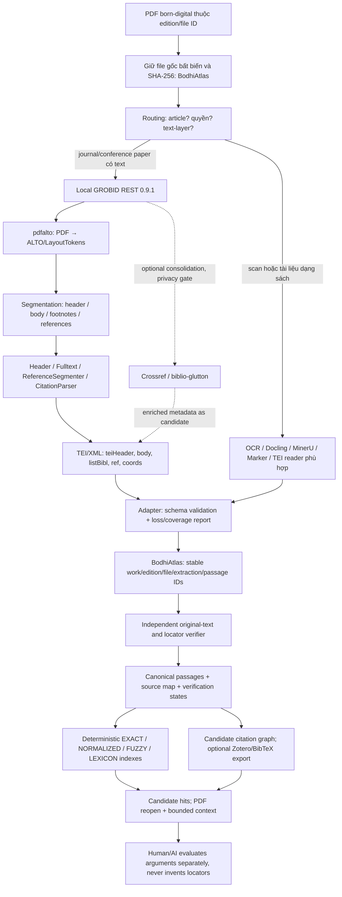

# Technology Assessment — GROBID

> **Mã thẩm định:** P47 · **Dự án áp dụng:** BodhiAtlas · **Ngày khảo sát:** 2026-11-16 (Asia/Ho_Chi_Minh)  
> **Target:** https://github.com/grobidOrg/grobid  
> **Loại:** `component` — bộ phân tích cấu trúc PDF học thuật và xuất TEI/XML, không phải hệ quản trị thư viện/tra cứu toàn diện.  
> **Snapshot kiểm tra:** release/tag `0.9.1` (2026-08-04); tag object `fe833002c929cd18f2de686a478bb0cd0af9536d` → commit `523bb8e97f357e93682dc4eaa6d22faa8b5b93de` (**G91**). Repo public, `archived=false` vào ngày khảo sát (**G01**).  
> **Phương pháp:** đọc trực tiếp tài liệu chính thức, README, LICENSE, release, cây thư mục, cấu hình, nhiều đoạn Java, tests và issue; đối chiếu PRD/risk BodhiAtlas và một số công cụ thay thế; không chạy GROBID, không tạo benchmark giả.  
> **Đánh dấu bằng chứng:** `[DOC]`, `[CODE]`, `[ISSUE]`, `[INFERRED]`, `[UNKNOWN]`; `[TESTED]` chỉ dành cho phép thực chạy có logs, ở thẩm định này **không có `[TESTED]` cho GROBID**.  
> **Phạm vi của kết luận:** năng lực theo tài liệu/mã nguồn tại snapshot trên; **không** phải xác nhận parser đã đạt quality gate trên corpus Phật học.

## 1. Executive Decision

**Quyết định: `USE AS COMPONENT` (Decision Record: `COMPONENT`), confidence `MEDIUM`.**

1. **V1 Core — dùng có điều kiện:** GROBID chỉ là *specialized parser* cho PDF **bài báo học thuật born-digital** khi routing và benchmark phân tầng xác nhận. Lấy header, cấu trúc section/paragraph, footnote candidate, danh mục references, citation callouts, DOI candidates và PDF coordinates. BodhiAtlas vẫn sở hữu file gốc, SHA-256, work/edition/witness, extraction versions, độc lập xác minh nguyên văn/vị trí và các chỉ mục tìm kiếm. Không đưa TEI parser output lên trạng thái VERIFIED tự động. `[DOC][CODE]` **G02–G13**.
2. **V2:** có thể thử liên kết thư mục/citation context, xuất BibTeX sang Zotero, hỗ trợ tra cứu luận điểm qua *candidate graph*. Cần giữ citation link và metadata enrichment ở trạng thái **đề xuất**, không thay chứng cứ nội dung. `[DOC][INFERRED]` **G04–G06, G15**.
3. **V3 / research-specific:** thử fine-tuning cho tài liệu chú giải hoặc footnote kiểu nhân văn học *chỉ khi* lợi ích trên gold set vượt chi phí annotating/model/maintenance; không dự kiến huấn luyện mặc định ở V1. `[ISSUE][INFERRED]` **G16–G18**.

**Ba rủi ro lớn:**
- **P0 — Source fidelity:** TEI biểu diễn cấu trúc suy đoán; thiếu text layer, sai thứ tự đọc, dấu phủ định, footnote hoặc coordinates sai sẽ dẫn đến trích dẫn không kiểm chứng được. `@coords` **không** tự xác nhận chữ; `xml:id` GROBID có thể sinh ngẫu nhiên, không phải BodhiAtlas stable ID. `[CODE][DOC]` **G08–G12**.
- **P0 — Sai domain và ngôn ngữ:** các model chủ yếu học trên bài báo tiếng Anh; chú giải Hán/Pāli, sách kinh nhiều chương, Tạng, Sanskrit, bản in nhiều lớp, footnote-reference nằm ngoài phân bố huấn luyện phổ biến. `[DOC][ISSUE]` **G14, G16–G18**.
- **P0 — Quyền, leakage, độ phức tạp:** `consolidate*` có thể gửi thông tin tham khảo ra Crossref; local server không phải sẵn auth; model/binary đi kèm và tác phẩm có quyền cần đánh giá riêng; full Docker image lớn và dùng nhiều RAM. `[DOC][CODE]` **G15, G19–G22**.

**Gate tại thời điểm báo cáo:** `SOURCE_FIDELITY=unknown` (phải thử), `CODE_ONLY_EXACT=n/a` (ngoài vai trò GROBID), `MULTILINGUAL=unknown`, `OCR_COVERAGE=n/a` (GROBID không đảm nhiệm OCR; kiểm ở router tổng), `RIGHTS_SECURITY=unknown` (chưa audit triển khai cụ thể), `PORTABILITY=unknown` ở cấp tích hợp (phải chứng minh export/rebuild). Không có gate nào được coi là PASS chỉ vì tài liệu có API hoặc TEI.

**Tại sao không `ADOPT` làm universal parser?** Chính GROBID định vị là scholarly article parser; FAQ nêu sách rất dài có thể không tin cậy; PDF không text cần OCR ngoài. Phạm vi V1 yêu cầu PDF scan/EPUB/DOCX/Markdown/TEI và exact code-only nên không thể áp một parser lên mọi loại tài liệu. `[DOC]` **G02, G14**.

## 2. Sources & Evidence Ledger

**Quy ước:** URL code được **pin theo commit G91**; link docs công khai có thể đổi theo nhánh `latest` nên ghi `[DOC/latest]` và sử dụng snapshot version ở phần đánh giá, không đồng nhất mọi docs `latest` với tag 0.9.1. `blob SHA` được kiểm qua GitHub Contents API; số dòng trong permalink là vị trí khảo sát. Issue là báo cáo tình huống của người dùng, **không** được coi là tái hiện độc lập.

| claim_id | claim | evidence | URL/file+line | version/SHA | note |
|---|---|---|---|---|---|
| G01 | Repository public, không archived; tag 0.9.1 có commit cụ thể | `[CODE]` (GitHub metadata) | [repo](https://github.com/grobidOrg/grobid), [tag ref](https://github.com/grobidOrg/grobid/releases/tag/0.9.1), [commit](https://github.com/grobidOrg/grobid/commit/523bb8e97f357e93682dc4eaa6d22faa8b5b93de) | G91 | API xác nhận `archived=false`; không suy đoán release mới hơn |
| G02 | GROBID tập trung trích PDF học thuật thành TEI; parsing header, body, references, contexts | `[DOC]` | [Readme.md](https://github.com/grobidOrg/grobid/blob/523bb8e97f357e93682dc4eaa6d22faa8b5b93de/Readme.md) | G91 | Benchmark trong README là số liệu của dự án, không phải P47 chạy |
| G03 | REST đường dẫn `processHeaderDocument`, `processFulltextDocument`, `processReferences` | `[CODE]` | [GrobidPaths.java L46–L66, L121–L131](https://github.com/grobidOrg/grobid/blob/523bb8e97f357e93682dc4eaa6d22faa8b5b93de/grobid-service/src/main/java/org/grobid/service/GrobidPaths.java#L46-L66) | G91 | Kiểm cả process/REST API |
| G04 | Fulltext endpoint nhận PDF form input và tùy chọn consolidation, raw citation, coordinates, sentence segmentation | `[CODE]` | [GrobidRestService.java L383–L450](https://github.com/grobidOrg/grobid/blob/523bb8e97f357e93682dc4eaa6d22faa8b5b93de/grobid-service/src/main/java/org/grobid/service/GrobidRestService.java#L383-L450) | G91 | Dùng tham số `consolidate*=0` để hạn chế gửi thông tin nguồn |
| G05 | `Engine.processReferences` gọi CitationParser + ReferenceSegmenterParser; đầu ra dữ liệu thư mục | `[CODE]` | [Engine.java L254–L285](https://github.com/grobidOrg/grobid/blob/523bb8e97f357e93682dc4eaa6d22faa8b5b93de/grobid-core/src/main/java/org/grobid/core/engines/Engine.java#L254-L285) | G91 | Không suy ra độ đúng của nội dung citation |
| G06 | Fulltext chạy segmentation → header → tiếp tục các khối cấu trúc | `[CODE]` | [FullTextParser.java L96–L167](https://github.com/grobidOrg/grobid/blob/523bb8e97f357e93682dc4eaa6d22faa8b5b93de/grobid-core/src/main/java/org/grobid/core/engines/FullTextParser.java#L96-L167) | G91 | Mã xác minh cascade, không xác minh chất lượng output |
| G07 | Chuyển PDF sang ALTO/layout qua `pdfalto` external; code OCR flag bị comment | `[CODE]` | [DocumentSource.java L125–L203](https://github.com/grobidOrg/grobid/blob/523bb8e97f357e93682dc4eaa6d22faa8b5b93de/grobid-core/src/main/java/org/grobid/core/document/DocumentSource.java#L125-L203) | G91 | `// pdfToXml.append(" -ocr ")`; không phải native OCR vận hành |
| G08 | TEI formatter có `@coords` và nếu bật `generateTeiIds` tạo mã bằng `KeyGen.getKey()` | `[CODE]` | [TEIFormatter.java L136–L190](https://github.com/grobidOrg/grobid/blob/523bb8e97f357e93682dc4eaa6d22faa8b5b93de/grobid-core/src/main/java/org/grobid/core/document/TEIFormatter.java#L136-L190) | G91 | Không dùng GROBID-generated `xml:id` làm ID ổn định |
| G09 | Coordinates có `ref`, `biblStruct`, `head`, `p`, `s`, `note`...; TEI `@coords`, `<facsimile>` | `[DOC]` | [Coordinates docs](https://grobid.readthedocs.io/en/latest/Coordinates-in-PDF/) | latest, truy cập 2026-11-16 | Page PDF bắt đầu 1; tọa độ top-left/CropBox; chưa thử trên file mục tiêu |
| G10 | GROBID không sinh page in đáng tin từ TEI; không giữ nguyên visual formatting/whitespace | `[DOC]` | [FAQ: output & layout](https://grobid.readthedocs.io/en/latest/Frequently-asked-questions/) | latest | Logical structure ≠ raw source; mapping cần đối chiếu |
| G11 | `NO_BLOCKS` khi PDF không có text, docs yêu cầu OCR trước | `[DOC]` | [FAQ: BAD_INPUT_DATA/NO_BLOCKS](https://grobid.readthedocs.io/en/latest/Frequently-asked-questions/) | latest | Bản scan image-only phải route OCR ngoài |
| G12 | GROBID có TEI schema tùy chỉnh; XML well-formed không đảm bảo semantic accuracy / mọi TEI valid | `[DOC]` | [doc/TEI-encoding-of-results.md](https://github.com/grobidOrg/grobid/blob/523bb8e97f357e93682dc4eaa6d22faa8b5b93de/doc/TEI-encoding-of-results.md) | G91 | Schema validation và source fidelity hai việc khác nhau |
| G13 | Config giới hạn PDF tokens/blocks, timeout, bộ nhớ, concurrency và network Crossref | `[CODE]` | [grobid.yaml L1–L76](https://github.com/grobidOrg/grobid/blob/523bb8e97f357e93682dc4eaa6d22faa8b5b93de/grobid-home/config/grobid.yaml#L1-L76) | G91 | Sample tag: `tokensMax: 1000000`, `concurrency: 10`, CORS `*` — phải harden |
| G14 | Dành cho papers; sách nhiều chương có thể xử lý chia trang; model chủ yếu tiếng Anh, ít Pháp/Đức | `[DOC]` | [FAQ: Scope & Compatibility](https://grobid.readthedocs.io/en/latest/Frequently-asked-questions/) | latest | Không suy ra Pāli/Hán/Tạng từ việc PDF text có Unicode |
| G15 | Consolidation Crossref/biblio-glutton có thể bơm DOI/metadata ngoài PDF | `[DOC]` | [FAQ: API & Usage](https://grobid.readthedocs.io/en/latest/Frequently-asked-questions/), [Consolidation](https://grobid.readthedocs.io/en/latest/Consolidation/) | latest | Có thể khác edition/preprint; cần provenance nguồn enrichment |
| G16 | Footnote references có báo cáo thất bại trên PDF dài | `[ISSUE]` | [issue #929](https://github.com/grobidOrg/grobid/issues/929) | issue mở khi khảo sát | Báo cáo người dùng, không phải measured benchmark P47 |
| G17 | Ancient references trong footnotes/abstracts khác cấu trúc references chuẩn | `[ISSUE]` | [issue #960](https://github.com/grobidOrg/grobid/issues/960) | issue mở khi khảo sát | Tình huống lịch sử học tương tự nhu cầu Phật học, chưa thử |
| G18 | Có issue trích rất ít nội dung PDF Nhật/Hán | `[ISSUE]` | [issue #1049](https://github.com/grobidOrg/grobid/issues/1049) | issue đóng 2023 | Issue đã đóng **không có nghĩa** đã benchmark pass phiên 0.9.1 |
| G19 | License code Apache 2.0; docs CC0; annotated training data CC-BY | `[DOC][CODE]` | [LICENSE](https://github.com/grobidOrg/grobid/blob/523bb8e97f357e93682dc4eaa6d22faa8b5b93de/LICENSE), [doc/License.md](https://github.com/grobidOrg/grobid/blob/523bb8e97f357e93682dc4eaa6d22faa8b5b93de/doc/License.md) | G91 | Không cấp quyền sử dụng PDF người dùng/corpus của họ |
| G20 | GROBID gọi `pdfalto` binary GPL độc lập | `[DOC][CODE]` | [FAQ: licensing pdfalto](https://grobid.readthedocs.io/en/latest/Frequently-asked-questions/), [DocumentSource](https://github.com/grobidOrg/grobid/blob/523bb8e97f357e93682dc4eaa6d22faa8b5b93de/grobid-core/src/main/java/org/grobid/core/document/DocumentSource.java) | G91 | FAQ trình bày quan điểm pháp lý dự án; phân phối lại cần review riêng |
| G21 | Docker 0.9.1 gồm CRF-only/full DL; docs đề nghị RAM 4GB cho fulltext, full image cỡ 8GB | `[DOC]` | [Docker docs](https://grobid.readthedocs.io/en/latest/Grobid-docker/) | latest | Ước lượng vendor, không phải đo tài nguyên tại BodhiAtlas |
| G22 | REST có thể trả HTTP 204/400/500/503; pool có giới hạn | `[DOC]` | [REST docs](https://grobid.readthedocs.io/en/latest/Grobid-service/) | latest | Orchestrator cần retry và per-file failure record |
| G23 | Có `MonographParser` theo nghĩa phân đoạn mức cao của sách, song không chứng minh universal fulltext book support | `[CODE]` | [MonographParser.java L44–L158](https://github.com/grobidOrg/grobid/blob/523bb8e97f357e93682dc4eaa6d22faa8b5b93de/grobid-core/src/main/java/org/grobid/core/engines/MonographParser.java#L44-L158) | G91 | Quan trọng: *không* nói repo hoàn toàn không có mã sách |
| G24 | Có unit tests về engine và segmentation; hiện diện tests ≠ P47 đã chạy | `[CODE]` | [EngineTest.java](https://github.com/grobidOrg/grobid/blob/523bb8e97f357e93682dc4eaa6d22faa8b5b93de/grobid-core/src/test/java/org/grobid/core/engines/EngineTest.java), [ReferenceSegmenterParserTest.java](https://github.com/grobidOrg/grobid/blob/523bb8e97f357e93682dc4eaa6d22faa8b5b93de/grobid-core/src/test/java/org/grobid/core/engines/ReferenceSegmenterParserTest.java) | G91 | Không chạy unit suite, không có test result ở đây |
| G25 | PRD V1.4 buộc source locator, code-only exact và phân biệt citation/claim | `[DOC]` | [BodhiAtlas PRD](https://github.com/quoctran-2608/bodhi-atlas/blob/main/docs/PRD.md) | main truy cập 2026-11-16; blob `58d967c642d625180c436e1a6e6a75fa2e7070e3` | Đọc nội dung trực tiếp; main có thể đổi |
| G26 | Rủi ro dự án tách tài liệu/index; verified text/locator; đánh giá luận điểm độc lập | `[DOC]` | [ACADEMIC_RISKS_AND_VERIFICATION](https://github.com/quoctran-2608/bodhi-atlas/blob/main/docs/ACADEMIC_RISKS_AND_VERIFICATION.md) | main truy cập 2026-11-16 | Không gộp `TEXT_AND_LOCATOR_VERIFIED` với `SUPPORTS` |
| G27 | Corpus sẵn có: 13 upstream pinned theo README, SQLite/FTS derived và các resolver cụ thể | `[DOC]` | [BuddhismDocuments-for-AI README](https://github.com/quoctran-2608/BuddhismDocuments-for-AI/blob/main/README.md) | main truy cập 2026-11-16; blob `fd237c107445bc2a4f6f5999c8b66a8380335cfe` | Mới kiểm README, **chưa** tự audit đủ 13 upstream/pins |
| G28 | DOI/ISBN metadata không tương đương verified quote content; cần kiểm nguyên văn và edition | `[INFERRED]` | Từ **G05, G09–G10, G15, G25–G26** | P47 | Nguyên tắc nghiệm thu riêng của BodhiAtlas |
| G29 | Chất lượng trên Pāli/Hán/Tạng/kinh chú giải là `UNKNOWN` | `[UNKNOWN]` | Không có golden-set BodhiAtlas hoặc benchmark P47; xem **G14, G18** | P47 | Không chuyển thành `fail` hoặc `pass` trước đo |
| G30 | TEI-to-verified-citation, exhaustive search, EPUB CFI, Zotero CSL export không phải chức năng verified native | `[INFERRED]` | Các endpoint/đầu ra đã đọc **G03–G10**, [Zotero import docs](https://www.zotero.org/support/kb/importing_standardized_formats) | P47 | Cần adapter/verifier/FTS bên ngoài |

**Nguồn đối chiếu:** [Docling](https://github.com/docling-project/docling), [MinerU](https://github.com/opendatalab/MinerU), [Marker](https://github.com/datalab-to/marker), [Zotero import formats](https://www.zotero.org/support/kb/importing_standardized_formats). Những repo này chỉ được đọc tài liệu gốc/giấy phép ở mức *trade study nhanh*, **không** có kiểm thử đối đầu P47.

## 3. Architecture & Data Flow



**Quy trình được code xác nhận:** `GrobidRestService` → `GrobidRestProcessFiles` → `Engine.fullTextToTEIDoc` → `FullTextParser.processing` → `DocumentSource.fromPdf`/`pdfalto` → `Segmentation` và các parser tiếp nối → `TEIFormatter`. Các entrypoint và file được ghi ở **G03–G08**. `[CODE]`

**Không phải nội bộ GROBID:** file checksum SHA-256 do BodhiAtlas quản, page-image OCR upstream, XML-to-passage stable IDs, multi-edition graph, FTS5, source-reopen verifier, claim approval, permissions của thư viện, Zotero sync và RAG. `[INFERRED]` theo PRD và API đã xác minh.

**Cây repo chính đã kiểm:** `grobid-core/`, `grobid-service/`, `grobid-trainer/`, `grobid-home/`, `config/`, `doc/`, `monitoring/`; build `build.gradle`, `settings.gradle`, `gradlew`, Dockerfiles `Dockerfile.crf`/`Dockerfile.delft`; model resources trong `grobid-home/models/`. Các file này có mặt tại tag 0.9.1. `[CODE]`

## 4. Feature Fit–Gap Matrix

**Trạng thái chỉ dùng:** `NATIVE`, `CONFIG`, `EXTENSION`, `EXTERNAL`, `MISSING`, `UNKNOWN`, `N/A`. Một trạng thái mô tả **vai trò đối với tiêu chí hoàn chỉnh của BodhiAtlas**; khi có một phần native được nêu trong cột chi tiết. `N/A` không phải điểm trừ.

| Code | Feature | Status | Evidence / native scope | Gap, cách bù và mức tích hợp |
|---|---|---|---|---|
| C01 | Multi-format ingest | `EXTERNAL` | GROBID native PDF + raw citation strings; **G02–G04** | EPUB/DOCX/Markdown/TEI/XML ingest qua BodhiAtlas/other parsers; **medium** |
| C02 | OCR/layout/reading order | `EXTERNAL` | Có layout tokens/segmentation PDF có text; **G06–G07** | Không OCR image-only; cần OCR với trang+bbox, gold reading order; **high** cho scan Hán–Pāli |
| C03 | Canonical text/source map | `EXTENSION` | `@coords` cho một số nodes và `<facsimile>`; **G08–G10** | Không bảo đảm nguyên văn/offset đầy đủ; bridge XPath/token→bbox, gold verifier, file hash; **high** |
| C04 | Works/editions/witnesses | `EXTERNAL` | TEI bibliographic metadata candidate; **G02, G05** | Catalog độc lập: work/version/translation/witness + relations; **medium** |
| C05 | Exhaustive EXACT | `N/A` | Parser, không phải engine tìm toàn bộ occurrence; **G03–G06** | SQLite FTS/substring verification/quét phạm vi đã index của BodhiAtlas; **external** |
| C06 | Normalized multilingual search | `N/A` | Không có search normalization API đúng yêu cầu; **G03, G14** | Unicode, script variants, transliteration, query expansion có truy nguyên; **external** |
| C07 | Fuzzy/near-duplicate/OCR errors | `N/A` | Không phải chức năng parser; **G02** | Search index + OCR quality states của BodhiAtlas; **external** |
| C08 | Sense-aware lexicon | `N/A` | Không phải từ điển sense-aware; **G02, G25** | BodhiAtlas lexicon theo ngữ cảnh/truyền thống; **external** |
| C09 | Semantic/hybrid/RAG | `N/A` | GROBID không cần cho logic AI/RAG; **G02** | Plugin retrieval riêng, không dùng làm chứng cứ; **external** |
| C10 | Verified citation card/source reopen | `EXTENSION` | Coordinates và citation callouts native; **G08–G10** | Bắt buộc PDF viewer + independent quote/locator verifier + states; **high** |
| C11 | Note/wiki/claim memory | `N/A` | Ngoài vai trò parser; **G25–G27** | BodhiAtlas research layer; **external** |
| C12 | API/MCP/export | `EXTENSION` | REST TEI, BibTeX endpoints native; **G03–G04, G22** | MCP/CSL-JSON/Zotero mapping, provenance envelope phải viết; **medium** |
| C13 | Quality coverage + incremental | `EXTENSION` | Response/errors/TEI schema, config limits native; **G12–G13, G22** | Per-page coverage, immutable extraction versions, checkpoint/incremental queues; **medium-high** |
| C14 | Auth/licensing/privacy/backup | `EXTERNAL` | Apache2 code và local Docker; CORS `*`, Crossref optional; **G13, G15, G19–G21** | Reverse proxy/auth/network ACL, rights ledger, encryption/backup/export; **medium-high** |
| C15 | Operational simplicity + independent deploy | `CONFIG` | Docker CRF/full, Java21, configurable pool; **G13, G21** | CPU/GPU & RAM tuning, version pin, offline model audit, monitoring; **medium** |

**Gate reasoning:** `SOURCE_FIDELITY` phụ thuộc C03+C10 và POC; `CODE_ONLY_EXACT` = `N/A` riêng cho GROBID, còn hệ BodhiAtlas phải PASS; `MULTILINGUAL` = unknown; `QUALITY_COVERAGE` = chưa nghiệm thu tích hợp; `RIGHTS_SECURITY` = chưa nghiệm thu vận hành; `PORTABILITY` = thiết kế có thể bảo đảm bằng file gốc và export độc lập nhưng **chưa test restore**.

## 5. Deep Technical Findings

### 5.1. Service/process, header, fulltext, references, citation context, TEI

- **Header:** `POST /api/processHeaderDocument` trích title/author/affiliation/abstract/keywords dưới TEI hoặc BibTeX bằng Accept header. Cần phân biệt metadata trích từ PDF và metadata đã consolidate. [REST docs](https://grobid.readthedocs.io/en/latest/Grobid-service/), [GrobidRestService.java](https://github.com/grobidOrg/grobid/blob/523bb8e97f357e93682dc4eaa6d22faa8b5b93de/grobid-service/src/main/java/org/grobid/service/GrobidRestService.java).
- **Fulltext:** `POST /api/processFulltextDocument` trả `teiHeader`, `text/body`, `back/listBibl`, cấu trúc đoạn/mục/figure/table/footnote theo model; `GrobidAnalysisConfig` mang `consolidateHeader`, `consolidateCitations`, `includeRawCitations`, `teiCoordinates`, `generateIDs`, `segmentSentences`, `start/end`; các tham số phải lưu cùng version parser. [GrobidAnalysisConfig.java](https://github.com/grobidOrg/grobid/blob/523bb8e97f357e93682dc4eaa6d22faa8b5b93de/grobid-core/src/main/java/org/grobid/core/engines/config/GrobidAnalysisConfig.java).
- **References:** `POST /api/processReferences` trích bibliography list; `/api/processCitation` và `/api/processCitationList` parse chuỗi trích dẫn đã có. `Accept: application/x-bibtex` có ở API thư mục; không cần tự bịa endpoint Zotero. `CitationParser`, `ReferenceSegmenterParser`, `Engine.processReferences` là code đã xem; `[CODE]` **G05**.
- **Citation context:** nhận diện markers trong body và liên kết tới mục `biblStruct`/reference trong TEI. Tuy nhiên F1 của README (0.76–0.91 tùy collection) chỉ là benchmark *được công bố* và không chứng minh tài liệu Pāli/Hán/footnote. Trường hợp liên kết sai, TEI parser output không mặc nhiên có `UNCERTAIN` theo taxonomy BodhiAtlas: adapter phải gắn `CANDIDATE`, giữ raw marker và kiểm độc lập.
- **Coordinates:** bật lặp `--form teiCoordinates=p --form teiCoordinates=ref --form teiCoordinates=biblStruct --form teiCoordinates=head --form teiCoordinates=note` khi cần; `s` cần `segmentSentences=1`. `[DOC]` **G09**. Khả năng chi tiết phụ thuộc kiểu node và thực nghiệm; bbox node lớn không bảo đảm offset của câu ngắn.

### 5.2. Bibliographic citation khác verified original quote

`doi`, `title`, `author` trong parsed bibliography chỉ hỗ trợ **nhận diện ấn phẩm có thể được dẫn**, không chứng minh tác giả của PDF thực sự trích *đúng câu* của ấn phẩm đó; càng không chứng minh đoạn ấy hỗ trợ luận điểm. GROBID có thể match một reference sang Crossref sai edition/preprint (FAQ nêu khả năng metadata thay đổi); hợp đồng adapter bắt buộc lưu:

`raw_reference` + `parsed_reference` + `consolidation_source` + `consolidation_enabled` + `candidate_doi` + `candidate_target_work_id` + `match_confidence/unknown` + `verification_status`.

Chỉ cho `TEXT_AND_LOCATOR_VERIFIED` khi đối chiếu nguyên văn và locator với **file gốc đúng edition**; chỉ cho `SUPPORTS` sau một bước đánh giá luận điểm riêng. `[DOC][INFERRED]` **G15, G25–G28**.

### 5.3. Section, paragraph, footnote, figures, bibliography, book chapters

Mô hình segmentation nhận các vùng bài báo; fulltext parser có nhãn `head`, `p`, footnote callout, references, figure/table và mục bibliography. Bộ `MonographParser` **có thật** và phân loại cover, title, TOC, preface, chapter units, glossary, appendix..., nhưng class này là *high-level segmentation* cho monograph, **không** chứng minh một endpoint full book TEI giàu passage đã đạt yêu cầu và không có benchmark sách BodhiAtlas. FAQ khẳng định GROBID thiết kế cho scholarly articles; tài liệu dài cần chia `start/end` và có thể suy giảm chất lượng. `[CODE][DOC]` **G02, G06, G14, G23**.

Footnote-reference đặc biệt rủi ro: issue #929 báo thất bại, issue #960 mô tả ancient-reference citation khác thông lệ khoa học; chỉ coi là `[ISSUE]`, không suy ra tỉ lệ lỗi hiện nay. `section hierarchy`, `visual whitespace` và superscript TEI đều không được FAQ bảo đảm. `[DOC][ISSUE]` **G10, G16–G17**.

### 5.4. Mô hình huấn luyện và các hệ chữ

GROBID dùng *cascade of sequence labeling* (CRF/Wapiti hoặc DL/DeLFT theo config), thao tác trên `LayoutToken` có Unicode text + font/layout/bbox. PDF text extraction tương đối không khóa ngôn ngữ nhưng model structure được huấn luyện phần lớn từ bài báo tiếng Anh, có bổ sung Pháp/Đức; detector 53 ngôn ngữ không đồng nghĩa bảo đảm extraction cho 53 ngôn ngữ. Điều này đặc biệt quan trọng với bố cục Hán/Pāli và song ngữ nhiều cột, chữ Tạng, Sanskrit dấu tổ hợp, chú giải xen tầng. `[DOC][CODE]` **G07, G14, G18**. Chất lượng từng script: **UNKNOWN/NOT TESTED**.

### 5.5. Scanned PDFs, OCR và PDF byte provenance

Luồng source đọc `pdfalto` từ PDF sang layout; `DocumentSource.java` có tùy chọn `-ocr` chỉ trong dòng comment. FAQ chính thức nêu `NO_BLOCKS` = không có text, cần OCR trước. Vì vậy **không khẳng định GROBID OCR image-only PDF trực tiếp**. Với scan, giữ `original_scan_sha256`, ảnh page và OCR output riêng, OCR engine/version, recognized text, confidence, aligned bbox; có thể tạo searchable PDF làm đầu vào GROBID *nhưng* phải tách bản OCR derivative khỏi file scan gốc. `[CODE][DOC]` **G07, G11**.

**Chiều provenance:** (a) `file_sha256` xác định PDF bytes, (b) `tei_sha256` xác định artifact TEI, (c) `@coords`/`<facsimile>` cho PDF page và vùng nhìn, (d) overlay PDF.js + text-checker cho verified candidate. `@coords` không phải cryptographic proof và không lưu link tới PDF bytes nếu thiếu envelope của BodhiAtlas. Trang in không suy từ PDF ordinal. `[DOC][INFERRED]` **G08–G10**.

### 5.6. Linking citation ↔ bibliography và uncertainty

`ref/@target` (khi được parser lập) và mục `biblStruct/@xml:id` là **đề xuất cấu trúc** cần validate tham chiếu XML nội bộ, phát hiện dangling target, multiple match, single-reference omitted, cross-page split và nhầm footnote. GROBID không có *BodhiAtlas academic verification state* mặc định. Cần gắn riêng `link_state=PROPOSED|MATCHED_INTERNAL|REVIEWED|REJECTED|UNRESOLVED` (đề xuất schema, không phải enum native). Ghi `indirect_source=true/unknown` khi paper dẫn gián tiếp mà chưa mở nguồn gốc. `[INFERRED]` dựa **G04–G06, G16–G17, G25–G26**.

### 5.7. License, resource và solo researcher

- GROBID core Apache 2.0, docs CC0, annotation data CC-BY theo `doc/License.md`. Code **không** cấp quyền với PDF, bản dịch, ảnh trang, trích dẫn dài hoặc corpus downstream. `[DOC]` **G19**.
- `pdfalto` được maintainer mô tả là GPL và gọi như process ngoài; đây là *quan điểm của dự án*, không phải phán quyết tương thích cho mọi cách đóng gói/phân phối. Kiểm từng binary, notices, JEP/DeLFT/Python/model weights theo image cụ thể. License của **tất cả** model weight được ship ở đúng tag/image chưa được audit: `UNKNOWN`. `[DOC]` **G20**.
- Có Docker `0.9.1-crf` và `0.9.1-full`, FAQ yêu cầu OpenJDK 21. Docs nêu bản full ~8GB và memory guideline fulltext 4GB, citation 3GB, batch nhiều hơn; full DL có lợi cho bibliography nhưng nặng hơn, GPU Linux khuyến nghị. **Không** coi các thông số này là chi phí đo thực tế. `[DOC]` **G21**.
- Người nghiên cứu đơn lẻ có thể bắt đầu CRF CPU với vài paper born-digital; không nên mở dịch vụ public hay bật Crossref mặc định với tài liệu nhạy cảm. POC đo quyết định có nâng lên full DL hay không.

### 5.8. Vì sao dùng parser riêng cho paper thay universal

Trên journal papers, GROBID có **đầu ra TEI về citation graph** chuyên biệt mà một parser tổng quát có thể không đạt cùng mức metadata/callout linkage; đây là lý do thử riêng. Trên sách/kinh, một parser tổng quát + deterministic TEI/EPUB reader thường phù hợp hơn về định dạng và layering — nhưng lựa chọn cuối vẫn dựa POC chung, không mặc định Docling thắng. Nếu GROBID không cải thiện gold citation/fidelity sau chi phí route/adapter, loại bỏ nhánh GROBID vẫn giữ nguyên `source of truth`. `[INFERRED]` từ **G02, G14** và comparison sources.

### 5.9. Zotero/CSL và edition

GROBID có đường xuất BibTeX theo `Accept: application/x-bibtex`, Zotero nhập BibTeX, RIS hoặc CSL JSON. Vì vậy `GROBID → BibTeX → Zotero` là tuyến **có thể dùng**; còn TEI→CSL JSON là adapter phải viết (không tuyên bố GROBID có native CSL). Tách `paper_internal_bibl_id` khỏi `zotero_item_key`; không tự merge doi giống nhau khi ấn bản, dịch giả hoặc edition khác. Trong Zotero record cần giữ provenance/edition qua metadata + notes/extra field và raw source link theo policy; test round-trip mất trường. `[DOC][INFERRED]` **G03–G05, G30**; [Zotero import](https://www.zotero.org/support/kb/importing_standardized_formats).

### 5.10. Document-type routing policy (đề xuất, chưa benchmark)

| Input nhận diện | Default | GROBID branch | Điều kiện và fallback |
|---|---|---|---|
| Journal/conference paper, born-digital, bibliography rõ | GROBID candidate + generic parser đối chiếu khi cần | `TRIAL` → `CONFIG` nếu đạt gates | Source-map validation, citation gold, per-page coverage; lỗi → generic route |
| Bài có footnote dense/ancient references | generic + targeted GROBID shadow run | `TRIAL ONLY` | 15 gold footnote/citation links; không verified tự động |
| Sách dài, chuyên khảo, luận án, nhiều chương | Docling/Marker/MinerU hoặc splitter phù hợp | N/A mặc định; thử chapter slices | Giữ chapter/page continuity, in-page note; GROBID nếu gold chứng minh tăng chất lượng |
| PDF scan, hai cột, Hán–Pāli | OCR/layout first | GROBID chỉ *sau* OCR nếu cần paper metadata | OCR confidence, script-aware QA, vùng mất chữ phải có state |
| EPUB/DOCX/Markdown | Native parser/generic converter | Không route GROBID | href/CFI/paragraph anchors + edition mapping |
| Existing TEI/XML scripture / corpus | TEI reader preserving native witness | Không route GROBID | Không chuyển ngược qua PDF parser làm mất cấu trúc gốc |

## 6. Source Fidelity & Provenance

### 6.1. Mẫu chuẩn nên lưu cho một hit

```yaml
work_id: "work:<BodhiAtlas-stable-id>"
edition_id: "edition:<BodhiAtlas-stable-id>"
witness_id: "witness:<id-or-null>"
file_id: "file:<stable-id>"
file_sha256: "<64-hex-of-original-bytes>"
file_format: "application/pdf"
author_or_attribution: "<verified-metadata-or-unknown>"
translator: "<verified-metadata-or-null>"
source_role: "original|translation|commentary|secondary|unknown"
extraction:
  engine: "GROBID"
  version: "0.9.1"
  commit: "523bb8e97f357e93682dc4eaa6d22faa8b5b93de"
  configuration_sha256: "<hash-of-resolved-config-and-request>"
  tei_sha256: "<hash-of-raw-TEI-output>"
  raw_tei_uri: "derived://<file>/<run>/output.tei.xml"
  coverage_status: "PARTIAL|READY|OCR_UNCERTAIN|NOT_INDEXED|SOURCE_UNAVAILABLE"
text:
  raw_span: "<exact-output-from-parser-not-verified-original>"
  normalized_span: "<search-only-normalization>"
  tei_xpath: "<namespaced-XPath-or-TEI-node-pointer>"
  section_label: "<parser-value-and-confidence-state>"
locator:
  pdf_page_1_based: null
  printed_page: null
  printed_page_basis: null
  coords: []  # [{page: 1, x: 0.0, y: 0.0, width: 0.0, height: 0.0}]
  box_coordinate_system: "grobid-top-left-PDF-unit-CropBox"
  locator_validation: "UNVERIFIABLE|TEXT_ONLY|OCR_NEEDS_REVIEW|TEXT_AND_LOCATOR_VERIFIED|MISMATCH"
match:
  mode: "EXACT|NORMALIZED|FUZZY|LEXICON|SEMANTIC_CANDIDATE"
  normalization_rule_id: null
review:
  quote_text_verified: false
  quote_locator_verified: false
  meaning_status: "NOT_ASSESSED" # SUPPORTS|PARTIAL|CONTRARY|DISPUTED|INSUFFICIENT
  reviewer: null
  reviewed_at: null
scope:
  indexed_pages: []
  missing_pages: []
  known_errors: []
  source_access_level: "original|partial|metadata-only|indirect|unverified"
```

Đây là **contract BodhiAtlas đề xuất**, **không** phải schema native GROBID, và không ngụ ý bất kỳ giá trị placeholder nào đã được xác minh.

### 6.2. Những bảo đảm phải tách biệt

1. **Byte identity:** SHA-256 file gốc do BodhiAtlas tính, lưu read-only. GROBID có thể có internal MD5 trong service nhưng **không** thay được SHA-256 required. `[CODE]` `GrobidRestProcessFiles.java` đoạn processStatelessHeaderDocument có tính MD5; `DocumentSource` có `md5Str`.
2. **Passage identity:** BodhiAtlas cấp stable ID; không phụ thuộc `xml:id` tạo ngẫu nhiên hoặc thứ tự chunk. On reparse giữ cả old/new extraction versions, lập bảng align/review, không ghi đè verified claim.
3. **PDF position:** giữ page PDF 1-based, bbox GROBID có thể nhiều vùng; validate với PDF `CropBox`/`MediaBox`, rotation, page dimensions, text overlay. Nếu nguồn là OCR derivative phải đánh dấu khác file gốc. `[DOC]` **G09**.
4. **Printed page:** chỉ ghi khi có chứng cứ số trang in tại đúng edition; không lấy `page=12` PDF làm page in 12. `UNKNOWN/null` hợp lệ.
5. **Quote:** lưu verbatim và context lân cận; so đúng dấu phủ định và Unicode; `@coords` khớp vùng không có nghĩa text khớp. Nếu mismatch hoặc chỉ match normalized, không phát hành `TEXT_AND_LOCATOR_VERIFIED`.
6. **Coverage:** mỗi file có page count, indexed range, blank/scan/failed pages, number of characters/tokens, warnings, OCR confidence và errors per page. Chưa index nghĩa là **chưa biết**, không phải phủ định sự xuất hiện của thuật ngữ.
7. **Two independent reviews:** technical quote locator vs scholarly meaning; `TEXT_AND_LOCATOR_VERIFIED` không kéo theo `SUPPORTS`. `[DOC]` **G25–G26**.

**Acceptance:** 100% các item được gắn `TEXT_AND_LOCATOR_VERIFIED` trong golden set phải mở lại được file đúng hash/edition và đối chiếu đúng chữ, vị trí; mọi candidate fail được hạ trạng thái. Đây là **mục tiêu nghiệm thu đề xuất**, không phải measured result.

## 7. Multilingual & Retrieval Behavior

**GROBID là parser, không là search index.** Mọi kết quả truy vấn dưới đây là thiết kế BodhiAtlas/FTS-verifier sau ingest, không gắn nhãn `NATIVE GROBID`.

| Nhóm | GROBID | BodhiAtlas phải làm / risk |
|---|---|---|
| `anatta`, `anattā`, `anātman`, `vô ngã`, `vo nga`, `無我` | Unicode token có thể đi qua PDF extraction; **quality unknown** | `EXACT` từng spelling độc lập; `NORMALIZED` có rule nhận diện macron/Unicode; cross-language nối qua lexicon có nghĩa và nguồn; không auto-synonym tuyệt đối |
| `無常` ↔ `无常` | Không có canonical semantic/search mapping | Search normalization variant-id `HANT_HANS` chỉ khi cấu hình; vẫn giữ text gốc và match type |
| `dukkha` / `duḥkha` | Không đảm nhiệm transliteration/sense | Gợi ý candidate theo lexicon Pāli/Sanskrit có điều kiện; trả source anchors riêng |
| Tiếng Việt có/không dấu | Không có engine search | Giữ `EXACT` dấu; normalized search mới bỏ dấu, ghi rule; tránh đồng nhất nghĩa sai |
| Tạng Unicode ↔ Wylie | Không có chứng cứ reliable structural extraction hay transliteration | **UNKNOWN** tới gold; dùng converter độc lập đã kiểm với input/script, không đoán từ byte/token noise |
| Câu dài 200–300 ký tự | Không có exhaustive phrase API | Canonical text index + deterministic exact substring scan (NFC-aware khi user chọn); xử lý qua chunk/page boundary, kiểm mọi vị trí |
| 5 lần xuất hiện trong cùng file | Không có API hồi đáp mọi occurrence | Output 5 distinct `(file_id, offset, locator)` nếu gold có 5; không dedup mất vị trí |
| Fuzzy và OCR errors | Không phải search | Trả candidate với edit-distance/phonetic scoring; **không** biến `FUZZY` thành exact quote |
| Sense-aware lexicon | N/A | Mỗi sense gắn tradition/context/evidence; không suy bắc cầu từ đồng nghĩa |
| Semantic/hybrid/RAG | N/A | Tìm ứng viên và phân tích luận điểm là hai bước; người/AI diễn giải phải dựa source kiểm được |

**Ví dụ câu hỏi nghiên cứu bắt buộc:** *“Trong các tài liệu tôi có, những tác giả nào phân biệt giữa vô thường và khổ? Họ lập luận như thế nào? Cho tôi vị trí chính xác trong sách.”*

- **Bằng code:** qua EX-/NORMALIZED/LEXICON tra candidate passages liên quan đến `vô thường`, `khổ`, `anicca`, `dukkha`, `無常`, `苦`, gom theo author/work/edition và coverage; chỉ trả passages tồn tại, hash và locator; không tự khẳng định lập luận.
- **Bằng kiểm chứng source:** mở từng passage, xét phủ định, câu phản đề, tác giả thật/nhân danh/ghi lời, có dẫn gián tiếp, so đúng edition và bản dịch, gắn technical state.
- **Bằng người/AI có kiểm soát:** diễn giải sự phân biệt, phản chứng, scope và mức hỗ trợ; không dựng số trang hoặc gán lập luận cho tác giả khi chỉ có metadata/abstract.

**Thử nghiệm đa ngữ cần đặt trên cả PDF born-digital lẫn scan:** NFC/NFD, combining marks, chữ Hán giản/phồn, Pāli romanized, Sanskrit, Việt có dấu, Tibetan Unicode + Wylie, mixed vertical/2-column, super/subscripts, footnote flow. Outcome P47 hiện là `NOT TESTED` cho tất cả các tổ hợp này.

## 8. Integration Options for BodhiAtlas

### Option A — Recommended trial: GROBID sidecar cho journal PDF

**Input contract:** `{file_id, file_sha256, edition_id, source_role, permissions, mime=application/pdf, detected_text_layer, processing_profile, parser_tag=0.9.1}`. GROBID nhận bytes PDF qua local REST, không được tự quyết quyền ingestion lâu dài.

**Output contract:** `{file_id, extraction_run_id, engine_commit, raw_tei_bytes, tei_sha256, request_params, pdf_page_range, status/errors, mapping_warnings, parser_candidates: [teiHeader, biblStruct, ref targets, sections, paragraphs, notes, coords]}`. Không tự `verified=true`.

**Source of truth:** file gốc + source registry của BodhiAtlas; TEI là derivative có phiên bản. **Stable IDs** cho work/edition/file/passage sinh độc lập; `tei_xpath + coords` là locator ứng viên, không phải key vĩnh viễn. **Migration:** giữ schema-neutral passage text + source map, có thể rebuild bằng parser khác và compare checksum/anchors. **Failure/rollback:** nếu 204/500/503, no-text, schema fail, missing page/target, độ tin cậy thấp: `PARTIAL`/`OCR_UNCERTAIN`, lưu log, enqueue fallback Docling/other; không overwrite cũ.

**Ưu:** tận dụng GROBID chuyên metadata + bibliography + citation callouts; giữ ingestion corpus khác độc lập. **Nhược:** thêm Java/Docker service, TEI adapter, maintenance/bbox QA. **Rủi ro:** footnote/nested commentary domain shift.

### Option B — Candidate bibliography-only enrichment

**Input:** PDF paper hoặc chuỗi citation từ corpus đã trích bằng parser khác. **Process:** `/api/processReferences`, `/api/processCitationList`, mặc định `consolidateCitations=0`; nếu user cấp quyền thì cho enrichment Crossref. **Output:** raw/parsed TEI hoặc BibTeX, target candidate, metadata provenance, source edition unresolved.

**Source of truth:** không phải DOI GROBID trả về; catalog của BodhiAtlas và tài liệu đã đọc; reference candidate liên kết dạng `PROPOSED`. **IDs/migration:** bibliography candidate UID riêng, canonical work mapping qua reviewer; export BibTeX/Zotero có provenance. **Failure/rollback:** bỏ enrichment hoặc đảo mapping sai không đụng verified passages. **Ưu:** ít động chạm source map hơn; có thể thử sớm trên 15 citations. **Nhược:** không giải quyết PDF exact/source reopen hay unknown bibliography trong chú thích dài.

### Option C — Generic parser primary + GROBID shadow comparison (POC only)

Với 2 papers/1 book, chạy cả generic parser và GROBID trên tài liệu cùng hash, đối chiếu reading order, headers, footnotes, citations và source bbox. Chỉ chuyển ưu tiên GROBID khi có gain *gold-verified* trên nhóm article. Nếu GROBID không đạt, giữ generic route và bỏ sidecar; contract chung giúp rollback không mất dữ liệu nghiên cứu.

**Đề xuất kiến trúc:** `parser_registry(type, eligibility, approved_profile, fallback)`, `extractor_output` bất biến; `canonicalizer` chỉ nhận output có đủ locator và errors. Không đưa việc ingest/lifecycle các **13 upstream** đã pin sang GROBID; tái sử dụng resolver/source authority của corpus sẵn có theo README. `[DOC][INFERRED]` **G25–G27**.

## 9. Practical POC / Reproduction Plan

**Trạng thái chung:** `NOT TESTED`. Không có GROBID service/docker, corpus fixture PDF hoặc bộ câu trả lời gold trong môi trường thẩm định. Đã kiểm môi trường cục bộ bằng `command -v docker; command -v java; java -version`: **Java 21 có sẵn**, **Docker executable không có**; đây chỉ là kiểm khả dụng runtime, **không** phải kiểm thử GROBID. Không tải model hay PDF có bản quyền. Các lệnh bên dưới là **kế hoạch tái lập**, chưa được chạy.

**Những gì phải pin trước khi chạy:** image digest (ngoài tag), GROBID tag G91, CPU/GPU/RAM/OS, config hash, CLI/adapter commit, input file SHA-256, licence/permissions, manual gold answer SHA-256 và ngày run. Chọn 2 scholarly PDFs hợp pháp, 1 cuốn sách nhiều chương có footnote; 1 PDF scan hai cột Hán–Pāli hợp pháp; 15 citations được annotator đánh dấu; 5 câu có phủ định được xác nhận từ ảnh/page; và 6 đa ngữ queries. Khi không có quyền fixture, dùng tài liệu tự tạo nhưng đánh dấu không đại diện production.

### Setup lệnh gợi ý (chưa chạy)

```bash
# Ví dụ chạy trên máy CÓ Docker sau khi duyệt quyền hình ảnh/model:
docker pull grobid/grobid:0.9.1-crf
docker run --rm --init --ulimit core=0 -p 127.0.0.1:8070:8070 grobid/grobid:0.9.1-crf
# Máy khác / terminal khác:
sha256sum fixtures/paper_01.pdf fixtures/paper_02.pdf fixtures/book_01.pdf
mkdir -p outputs
curl -fsS -X POST http://127.0.0.1:8070/api/processFulltextDocument \
  -F 'input=@fixtures/paper_01.pdf' \
  -F 'consolidateHeader=0' -F 'consolidateCitations=0' \
  -F 'includeRawCitations=1' -F 'teiCoordinates=p' \
  -F 'teiCoordinates=ref' -F 'teiCoordinates=biblStruct' \
  -F 'teiCoordinates=note' -F 'teiCoordinates=head' \
  -o outputs/paper_01.tei.xml
# Compare CRF vs 0.9.1-full chỉ sau khi đủ tài nguyên và licence.
```

`-fsS` có thể trả code lỗi; wrapper production cần capture HTTP status, stderr, retry **có giới hạn** cho 503, timeout có log và không lặp vô hạn. Để test sentence coordinates, thêm `segmentSentences=1` + `teiCoordinates=s`. Không bật `generateIDs` để làm định danh dài hạn.

| Test | Input/fixture và thao tác | Gold answer cần chuẩn bị | Metrics / output dự kiến | Status |
|---|---|---|---|---|
| TC01 | `paper_01`, `paper_02`, `book_01`; fulltext TEI + visual annotate 20–30 sections/paper và 2+ chapters/book | Manual TEI/structural spans + original PDF page/bbox | Section/paragraph exact-boundary F1, missing/extra sections, hierarchy errors, TEI validation; **không đoán tỷ lệ** | `NOT TESTED` |
| TC02 | 15 citations trải body, reference list và footnote; `/processReferences` vs `/processFulltextDocument` | 15 marker spans, reference IDs, trường hợp ambiguous, indirect source | Link precision/recall, wrong/missing/duplicate counts; inspect `ref/@target`; raw vs consolidated metadata | `NOT TESTED` |
| TC03 | 1 scan hai cột có Hán + Pāli, footnotes; chạy raw vs OCR-derivative rồi parse | Gold reading-order từng cột, từng glyph, note anchors, PDF page | OCR CER/WER khi OCR engine có output; GROBID section/reading order errors; mark `NO_BLOCKS`/partial; không gọi lỗi scan là quote verified | `NOT TESTED` |
| TC04 | 5 quotes có `không`/`not`/Pāli negation; verify TEI→PDF reopen | Gold verbatim 5 quotes, edition/page/bbox, `negation=true` spans | `SOURCE_REOPEN_SUCCESS`, wrong page/box, `FALSE_VERIFIED_CITATION`; expected zero false VERIFIED | `NOT TESTED` |
| TC05 | Batch 10–30 PDFs theo giấy phép và profile CRF/full; warm/cold, 1/2/4 workers, failure inject | Input size/page counts, expected successful files/errors, host hardware | Wall time, CPU, peak RSS/GPU VRAM, 503/retries, temp disk/cleanup, energy or cost by explicit rate; không bịa latency | `NOT TESTED` |
| TC06 | 2 article TEIs → BodhiAtlas passage records + 10 refs → BibTeX/Zotero | Gold work/edition/translator/witness IDs và Zotero item mapping | Edition-cross-contamination=0, missing-field count, round-trip referential integrity, stable passage IDs after reparse | `NOT TESTED` |
| TC07 | Queries `anatta/anattā/anātman/vô ngã/vo nga/無我`, `無常/无常`, `dukkha/duḥkha`, Tạng/Wylie | Annotated occurrences and sense distinctions for indexed/uncertain pages | `EXACT_FULL_RECALL` vs `NORMALIZED` distinct, false positives, query-rule provenance | `NOT TESTED` |
| TC08 | 200–300-character quote xuất hiện 5 lần, có split qua page/chunk | 5 `(file_id, offset, page, bbox)` anchors đã xác minh | Exhaustive occurrence recall; **đánh giá BodhiAtlas index**, GROBID `N/A` | `NOT TESTED` |
| TC09 | Hai ấn bản cùng tác phẩm lệch trang in, một đoạn tương tự nhưng có `không` khác | Edition/file SHA-256, printed page có chứng cứ, exact text | No cross-edition merge, error state cho wrong witness, distinct citation cards | `NOT TESTED` |

**Các công thức đánh giá:**

- `EXACT_FULL_RECALL = số occurrence exact đúng tìm được / số occurrence exact gold trong phần đã index và truy cập được`; báo mẫu số và pages không index. Đây là chỉ số của indexing+verifier, **không của GROBID**.
- `FALSE_VERIFIED_CITATION = số citation cards mang nhãn VERIFIED nhưng sai nguyên văn, file, edition hoặc locator`; nghiệm thu đòi `0` trong gold fixture, không khẳng định sản xuất không bao giờ lỗi.
- `SOURCE_REOPEN_SUCCESS = số candidates kiểm lại đúng original file + page + bbox + verbatim / số candidates được yêu cầu verify` (báo cả abstention và OCR uncertain).
- `precision = TP/(TP+FP)`, `recall = TP/(TP+FN)` cho citation links/reference extraction; có `UNKNOWN` nếu gold thiếu.
- `CER/WER` chỉ đo với gold transcription + OCR output, không suy từ structured TEI.
- `ERROR_COVERAGE = số lỗi/phạm vi mất dữ liệu đã được log đúng / tổng số lỗi/phạm vi mất dữ liệu xác nhận trong gold`; đếm `MISSING`, `NO_TEXT`, `LOW_OCR_CONF`, `BAD_BBOX`, `UNRESOLVED_REF`, `PARSER_ERROR` riêng.

**Acceptance decision sau POC:** (a) không có false verified; (b) mọi candidate được nâng trạng thái verified phải reopen được nguyên văn/vị trí; (c) exact exhaustive ở BodhiAtlas phải trả mọi vị trí gold trong scope; (d) tài liệu ngoài phân bố có errors/coverage rõ thay vì silent omission; (e) GROBID mang cải thiện có ý nghĩa so với generic parser trên paper citations. Nếu không đạt, chỉ giữ `TRIAL ONLY` hoặc bỏ nhánh GROBID, không đổi luật kiểm chứng của BodhiAtlas.

## 10. Deployment, Security, Legal, Cost

**Runtime và packaging** (`[DOC][CODE]`, G13, G19–G22):

- Java/OpenJDK 21; Gradle multi-module; native libraries (Wapiti CRF, `pdfalto`) qua `grobid-home`; full DL dùng DeLFT + Python/JEP + TensorFlow/PyTorch theo image. Cần kiểm digest/tag và dependency SBOM riêng ở môi trường thực.
- Docker `grobid/grobid:0.9.1-crf` làm baseline CPU, `grobid/grobid:0.9.1-full` khi cần tăng bibliography recognition; benchmark không dựa vào RAM/GPU vendor alone. CRF image chạy local; full nặng ~8GB download, docs đề xuất 4GB RAM cho fulltext và 6–8GB khi batch; **chưa đo P47**.
- `grobid-home/config/grobid.yaml` có `pdfalto.memoryLimitMb`, `timeoutSec`, `blocksMax`, `tokensMax`, `concurrency`, `poolMaxWait`. Snapshot code `memoryLimitMb=6096`, `timeoutSec=120`, `blocksMax=200000`, `tokensMax=1000000`, `concurrency=10`, `poolMaxWait=1`; đây là **giá trị config tag**, không phải khuyến nghị an toàn cho máy 4GB RAM. Tuning bắt buộc.
- GROBID service **không thay reverse proxy auth**. Chỉ bind `127.0.0.1`, không expose Internet public; network policy allowlist nếu bật Crossref, disable khi nguồn confidential; protect temp directory, logs/raw PDF, upload limits, TLS nếu remote. `corsAllowedOrigins: "*"` trong config được đọc phải thu hẹp khi có browser client. Backup config/image digest và TEI derivative không thay backup file gốc + catalog verified.

**Permissions và quyền**:

1. **Code:** GROBID Apache 2.0 theo LICENSE và `doc/License.md`; chú ý notices. **pdfalto:** GPL dependency theo FAQ; xem nghĩa vụ phân phối/bundling theo luật sư hoặc license review. **Weights:** `UNKNOWN` cho từng model weight/version cụ thể nếu chưa inspect full inventory + license; không gộp mọi asset vào Apache. **Annotated data:** CC-BY; **docs:** CC0. `[DOC]` **G19–G20**.
2. **Nguồn trích:** bản dịch, ebook, PDF/scan, ảnh trang, corpus Buddhist upstream có quyền riêng, không suy ra public domain từ việc code repo public. Với mỗi asset lưu `copyright_owner`, `license`, `permission_ingest`, `permission_local_ocr`, `permission_cloud`, `permission_ai`, `permission_export`, `citation_length_limit` (khi có), audit trail.
3. **Network:** mặc định `consolidateHeader=0`, `consolidateCitations=0`, `consolidateFunders=0`; chỉ bật Crossref/biblio-glutton nếu hiểu rõ outgoing metadata và có quyền; lưu enrichment provenance. Biblio consolidation có thể thay metadata preprint bằng bản xuất bản theo FAQ.
4. **Isolation:** không gửi PDF nhạy cảm cho demo server; local process qua least-privilege, pinned image, resource quotas, offline capabilities, secrets không đưa vào logs. Authentication API/MCP do host quyết định; có logs nhưng không lưu nội dung có bản quyền vượt policy.
5. **Backup/portability:** thử restore trên máy sạch của `raw_assets/`, checksum index, canonical catalog và verified claims, metadata/edit history, replay extraction. RAG/vector DB không phải authoritative storage.

**Cost model (không có giá trị đo giả):** tổng chi phí = `số trang cần xử lý × thời gian đo được / hiệu suất máy × đơn giá điện/compute` + `storage raw/derived` + `human gold labeling/review` + `maintenance upgrades` + `optional external API charges`. Từng thành phần phải khai báo đơn vị và giá khi có. `Dollar cost/page`, `pages/sec`, `CER`, `RAM peak` cho máy BodhiAtlas: **UNKNOWN/NOT TESTED**. Với solo researcher, phí review thủ công và quản lý nhiều parser có thể lớn hơn phí CPU; cần đo effort giờ/người POC.

## 11. Comparison & Trade-offs

**Lưu ý thời điểm:** đây là so sánh *phạm vi chức năng theo docs/repo 16-11-2026*, không phải benchmark chạy cùng fixture. Tránh so GitHub stars hoặc dùng số marketing làm kết luận.

| Công cụ | Vai trò hợp lý | Điểm mạnh dựa docs | Rủi ro/gap so BodhiAtlas | Route khuyến nghị |
|---|---|---|---|---|
| **GROBID 0.9.1** | PDF *scholarly article metadata + bibliography + callout + TEI* | Native citation-context/structured bibliography, coordinate options, self-hosted CRF/full | Không OCR scan trực tiếp; ngoài domain paper/English bất định; không exact search/verified citation; full DL nặng; code Apache 2.0 nhưng review assets | **Sidecar POC cho journal PDF; candidate-only** |
| **Docling** | Parser **đa định dạng** và biểu diễn `DoclingDocument` | Repo chính thức nêu PDF/OCR workflow, DOCX/EPUB/HTML và nhiều định dạng, layout/table/reading order, JSON lossless; code MIT | Cần xác minh footnote/ancient references, PDF bbox reopen và long quote; không thay academic verifier | **Generic baseline** cho book/multiformat; POC song song |
| **MinerU** | Layout/OCR document conversion đa định dạng | Repo nêu scan OCR, multi-column, CJK và Markdown/JSON, VLM/hybrid pipelines; có run local | Models/download/compute và hallucination/normalization cần thử; license **MinerU Open Source License** là custom dựa Apache với điều kiện thêm, không gọi thuần Apache | **Thử trên scan khó** khi rights/hardware cho phép |
| **Marker (datalab-to/marker)** | PDF và các định dạng khác → markdown/JSON/chunks/HTML | Repo hiện nêu OCR modes (`no_ocr`, `fast`, `balanced`, `vllm`), CPU/GPU, support CJK/scripts | Cần giữ JSON coordinates/provenance thay vì chỉ Markdown; model weights có **modified AI Pubs Open Rail-M** riêng, code **Apache 2.0** theo repo hiện tại; license dùng commercial cần review | **Một baseline OCR/layout khác** trên samples khó |
| **Zotero** | Quản lý thư mục, attachment/citation item | Có import BibTeX, RIS, CSL JSON; hệ citation/research library; source code chủ yếu AGPLv3 | **Không** là PDF parser/verified quote engine; metadata import không bảo đảm edition/quote verification | **Sink cho bibliography**, không thay GROBID |

**Nguồn công khai:** [Docling README](https://github.com/docling-project/docling#readme), [Docling formats](https://github.com/docling-project/docling/blob/main/docs/usage/supported_formats.md), [MinerU README](https://github.com/opendatalab/MinerU#readme), [MinerU LICENSE](https://github.com/opendatalab/MinerU/blob/master/LICENSE.md), [Marker README](https://github.com/datalab-to/marker#readme), [Marker MODEL_LICENSE](https://github.com/datalab-to/marker/blob/master/MODEL_LICENSE), [Zotero import](https://www.zotero.org/support/kb/importing_standardized_formats), [Zotero licensing](https://www.zotero.org/support/licensing). Khi có conflict giữa các nguồn cũ/mirror và repo canonical hiện tại của Marker, ưu tiên canonical `datalab-to/marker` — không dùng thông tin GPL/CC-BY-NC-SA cũ từ bản mirror để kết luận license bản hiện nay.

**Trade study không có winner tuyệt đối:** GROBID có chuyên sâu citation là lý do POC, Docling/MinerU/Marker là baseline multi-format/OCR, Zotero là hậu xử lý bibliography. Quyết định route theo **gold PDF + work/edition fidelity + rights + effort**, không theo claim F1/throughput của nhà phát triển.

## 12. Decision Record for Master Synthesis

| Field | Value | Evidence/assumption |
|---|---|---|
| TARGET | GROBID | Repo canonical **G01** |
| CLASS | component | Pipeline parser/TEI **G02–G08** |
| DATE / VERSION / COMMIT | 2026-11-16 / 0.9.1 / `523bb8e97f357e93682dc4eaa6d22faa8b5b93de` | G91, **G01** |
| PRIMARY_ROLE | Specialized born-digital scholarly PDF parser: header, fulltext, bibliography/citation-context candidates, TEI+coords | **G02–G09** |
| BEST_FIT_V1_CORE | partial | Chỉ nhánh journal PDF; multi-format/verification/search external **G25** |
| SOURCE_FIDELITY_GATE | unknown | Coordinates có, verifier và gold chưa test **G08–G10** |
| CODE_ONLY_EXACT_GATE | n/a | Parser không đảm nhiệm exhaustive search **G03–G06** |
| MULTILINGUAL_GATE | unknown | Model chủ yếu scholarly English, Pāli/Hán/Tạng NOT TESTED **G14/G18** |
| OCR_COVERAGE_GATE | n/a | Không phải OCR engine; scan phải external **G07/G11** |
| RIGHTS_SECURITY_GATE | unknown | Apache code; dependencies/weights/permissions/API deployment chưa audit toàn diện **G19–G22** |
| INTEGRATION_COST | medium | REST/TEI thuận lợi nhưng cần router/adapter/source-map verifier; effort chưa đo |
| MAINTENANCE_RISK | medium | Java/Docker/CRF/DL, version pin, config/migration và multi-parser branch; chưa đo |
| RECOMMENDATION | COMPONENT | Sidecar POC, fail-closed citation verification |
| CONFIDENCE | medium | Nhiều nguồn DOC+CODE; **không** có TESTED BodhiAtlas |
| NEXT_POC | TC01 + TC02 + TC04 trên 2 papers + TC03 scan và TC06 edition/Zotero; sau đó so với generic baseline | Đòi gold set/rights/fixture hashes, ghi đầy đủ logs |

### 5 findings quan trọng

1. GROBID có **REST + TEI + rich bibliographic/citation output**, nhưng chỉ là extraction candidates; code path được xác minh.
2. Có **tọa độ PDF** cho nhiều loại element, tuy nhiên phải map lại đúng original PDF hash/edition, kiểm chữ và page.
3. **OCR không native cho scan image-only**; `NO_BLOCKS` là failure được docs công nhận.
4. **Journal article bias** và footnote/ancient reference issue là rủi ro trọng yếu cho corpus Phật học; không khẳng định tỉ lệ lỗi khi chưa đo.
5. **MonographParser tồn tại** nhưng không giải quyết tự động sách kinh nhiều chương/ấn bản/vi dị; routing theo loại tài liệu vẫn hợp lý.

### 5 blockers trước production

1. Thiếu gold PDF hợp pháp đủ các kiểu: paper + book + scan bilingual + ancient footnote.
2. Chưa có independent passage/quote source-map verifier và ảnh PDF reopen với tests.
3. Chưa audit hết license model weights/binary/schemas/corpus quyền cho image được deploy.
4. Chưa có quality coverage và state-machine fail-closed khi parser bỏ trang/nhầm citation.
5. Chưa có measured memory/latency/integration hours và compare cùng fixture với Docling/MinerU/Marker.

### 5 experiments tiếp theo

1. Fulltext TEI + structure gold trên 2 paper/1 book (TC01).
2. 15 footnote/reference links với indirect-source cases (TC02).
3. Scan hai cột Hán–Pāli, OCR trước rồi parse, check missing text (TC03).
4. Năm trích dẫn dấu phủ định, source re-open và `FALSE_VERIFIED_CITATION` (TC04).
5. Round-trip TEI→stable passages/BibTeX→Zotero với hai ấn bản (TC06, bổ sung TC05 performance).

### 3 quyết định chờ chủ dự án

1. **Cho phép tập fixture nào** để benchmark (public-domain/tự tạo/tư liệu có quyền nội bộ) và mức chia sẻ được phép?
2. **Chạy POC trên máy nào** (CPU/RAM/GPU/Linux/WSL) và có cho phép tải image/model GROBID + baseline parsers sau khi license review không?
3. **Phạm vi V1:** chấp nhận GROBID chỉ làm extraction candidates cho journal PDF, còn universal book/scan ingest và citation verification độc lập là hạng mục riêng chứ không chờ GROBID?

**Điều kiện đảo quyết định:** nếu TC02/TC04 cho thấy citation errors khó phát hiện, hoặc nhu cầu bảo trì sidecar cao hơn mức tăng giá trị so với generic parser, chuyển từ `COMPONENT` sang `TRIAL` hoặc `REJECT` **cho nhánh paper parsing**; vẫn giữ hệ thống verification/ID/search theo PRD.

## 13. Appendix

### A. Primary sources / snapshot

- Canonical: https://github.com/grobidOrg/grobid
- Release 0.9.1: https://github.com/grobidOrg/grobid/releases/tag/0.9.1 ; [CHANGELOG](https://github.com/grobidOrg/grobid/blob/523bb8e97f357e93682dc4eaa6d22faa8b5b93de/CHANGELOG.md) ngày 2026-08-04.
- Pinned 0.9.1 commit: https://github.com/grobidOrg/grobid/tree/523bb8e97f357e93682dc4eaa6d22faa8b5b93de
- REST: https://grobid.readthedocs.io/en/latest/Grobid-service/
- Coordinates: https://grobid.readthedocs.io/en/latest/Coordinates-in-PDF/
- TEI: https://grobid.readthedocs.io/en/latest/TEI-encoding-of-results/
- Docker: https://grobid.readthedocs.io/en/latest/Grobid-docker/
- FAQ: https://grobid.readthedocs.io/en/latest/Frequently-asked-questions/
- Code licence: https://github.com/grobidOrg/grobid/blob/0.9.1/LICENSE
- Issues: https://github.com/grobidOrg/grobid/issues/929 ; https://github.com/grobidOrg/grobid/issues/960 ; https://github.com/grobidOrg/grobid/issues/1049
- BodhiAtlas PRD: https://github.com/quoctran-2608/bodhi-atlas/blob/main/docs/PRD.md
- BodhiAtlas academic verification: https://github.com/quoctran-2608/bodhi-atlas/blob/main/docs/ACADEMIC_RISKS_AND_VERIFICATION.md
- Existing corpus: https://github.com/quoctran-2608/BuddhismDocuments-for-AI

### B. 7+ mã nguồn đã đọc trực tiếp và chức năng kiểm

| File ở tag 0.9.1 | Nội dung được đọc |
|---|---|
| `grobid-service/src/main/java/org/grobid/service/GrobidPaths.java` | REST constants/path entrypoints |
| `grobid-service/src/main/java/org/grobid/service/GrobidRestService.java` | Service `@Path`, multipart flags, coordinate collection |
| `grobid-service/src/main/java/org/grobid/service/process/GrobidRestProcessFiles.java` | stateless file processing, MD5, temp cleanup, engine pool |
| `grobid-core/src/main/java/org/grobid/core/engines/Engine.java` | reference processing, fullTextToTEIDoc wrapper |
| `grobid-core/src/main/java/org/grobid/core/engines/FullTextParser.java` | segmentation/header/fulltext cascade |
| `grobid-core/src/main/java/org/grobid/core/engines/ReferenceSegmenterParser.java` | reference zone extraction |
| `grobid-core/src/main/java/org/grobid/core/engines/MonographParser.java` | high-level book segmentation (not universal parsing proof) |
| `grobid-core/src/main/java/org/grobid/core/document/DocumentSource.java` | pdfalto CLI and XML intermediary, OCR flag commented |
| `grobid-core/src/main/java/org/grobid/core/document/TEIFormatter.java` | TEI serialization, coordinates, IDs |
| `grobid-core/src/main/java/org/grobid/core/engines/config/GrobidAnalysisConfig.java` | options for consolidate, start/end, coords, IDs |
| `grobid-home/config/grobid.yaml` | PDF circuit-breakers, model selection, Crossref, concurrency, CORS |
| `build.gradle` | build/dependency graph entrypoint, Gradle modules |
| `grobid-core/src/test/java/org/grobid/core/engines/EngineTest.java` | tests exist; NOT TESTED in this report |
| `grobid-core/src/test/java/org/grobid/core/engines/ReferenceSegmenterParserTest.java` | tests exist; NOT TESTED in this report |

Các GitHub blob links theo commit trong mục 2 là nguồn nguyên cấp cho các dòng quan trọng. Chưa đọc toàn bộ module, model binaries hay toàn bộ unit tests; không tuyên bố code audit hoàn chỉnh.

### C. Những lệnh/đầu ra không chạy và ràng buộc

```bash
# Đã thực hiện trong môi trường tạo báo cáo: chỉ kiểm runtime.
command -v docker   # không có output
command -v java     # /usr/bin/java
java -version       # openjdk 21.0.12.1 (2026-08-18)
# Chưa thực hiện:
# docker pull, docker run, curl tới /api, ./gradlew test,
# benchmark PDF, kiểm license model binaries, OCR, Zotero integration.
```

**Điểm không xác minh được / giới hạn truy cập:**
- Chưa chạy GROBID image, chưa xem hay tính SHA-256 của fixture PDF dùng cho benchmark, chưa có golden TEI/citation/manual labels, chưa đo hiệu năng/chi phí thực tế.
- Chưa xác minh digest Docker image `0.9.1-crf`/`0.9.1-full`, checksum model weights, từng licence dependency, độ tin cậy sang Pāli/Hán/Tạng.
- Không có physical PDF body để mở lại; không thể chứng nhận `SOURCE_REOPEN_SUCCESS`, số trang in, bbox fidelity hay chất lượng OCR.
- Nguồn BodhiAtlas đã **đọc trực tiếp** 2 file yêu cầu và README corpus nhưng chưa kiểm manifest/13 upstream. Chưa kiểm bản copy cố định của tài liệu main; chúng có thể thay sau khảo sát.
- Không có kết quả so cùng fixtures với Docling/MinerU/Marker; mọi ưu/nhược so sánh chỉ ở mức scope/implementation claims công khai và thiết kế kỹ thuật.
- GROBID `MonographParser` và khả năng research training **không bị bỏ qua**, nhưng đầu ra/success của nhánh này chưa kiểm bằng service/fixtures.
- GitHub issue #929/#960/#1049 là evidence về rủi ro được báo cáo, **không phải tỷ lệ lỗi P47 đo**.

### D. Phân biệt nhãn nghiêm ngặt

- `[DOC]`: lời mô tả/FAQ upstream, không phải P47 đo.
- `[CODE]`: mã nguồn/metadata được đọc, không tự có nghĩa chức năng đã chạy đúng.
- `[ISSUE]`: trường hợp lỗi do người khác báo, không phải reproduction.
- `[INFERRED]`: lựa chọn kiến trúc và phương pháp có lý do.
- `[UNKNOWN]`: không có chứng cứ đủ.
- `NOT TESTED`: không chạy target experiment trong thẩm định này.
- `N/A`: ngoài chức năng cốt lõi của GROBID; gate tương ứng phải được hệ BodhiAtlas/engine khác đảm nhiệm.

**Tổng kết để nhập master synthesis:** **Tái sử dụng** GROBID cho scholarly PDF headers, references, citation callouts, TEI section/paragraph và `@coords` *dưới dạng candidates*. **BodhiAtlas phải tự xây hoặc tích hợp** raw asset/edition/witness authority, OCR multiformat router, stable passage IDs, deterministic exhaustive multilingual search, coverage/error states, independent exact quote+locator verifier, Zotero/CSL mapping và scholarly claim review. **Còn thiếu trước quyết định production:** benchmark phân tầng với fixtures và gold, source-reopen proof, licence/model/security review, measured runtime, same-fixture comparison.
