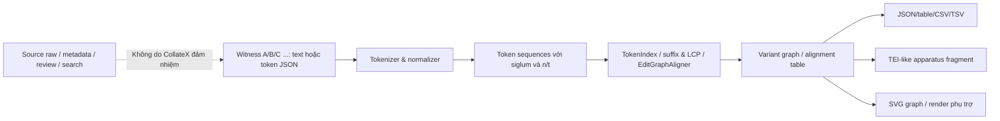
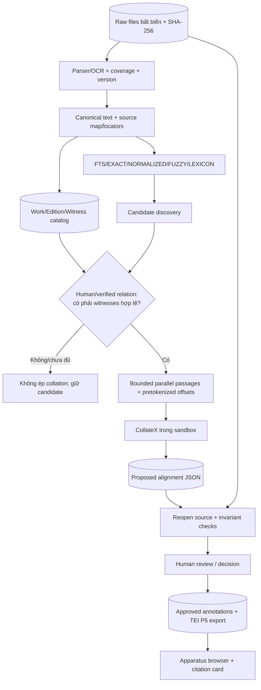

# Technology Assessment — CollateX

> **Mã hồ sơ:** P48 · **Ngày khảo sát:** 2026-11-16 (Asia/Ho_Chi_Minh) · **Đối tượng:** [interedition/collatex](https://github.com/interedition/collatex) · **Phân loại sau khảo sát:** `component` (engine collation nhiều nhân chứng văn bản, **không** phải nền tảng thư viện/search).  
> **Snapshot đã kiểm qua GitHub API:** nhánh mặc định `master`, commit `fc1917b5287c2354a1a8725608ad6ffe40fa1b90` (commit tại đầu nhánh, 2024-03-12), repository `archived=false` tại thời điểm truy vấn; **không** đồng nhất `pushed_at` của repo với ngày commit đầu nhánh.  
> **Version cần phân biệt:** Python `collatex 2.3` (trong `collatex-pythonport/setup.py`, PyPI phát hành 2023-09-08); Java tools **1.7.1** (GitHub release 2015-12-17). README và website chính mô tả cả hệ sinh thái; tính năng Java **không tự động là tính năng của Python**.  
> **Analyst/phương pháp:** thẩm định độc lập bằng đọc yêu cầu BodhiAtlas, GitHub repository metadata/tree, tài liệu chính thức, mã Python, test source, vấn đề mở, so sánh đối chứng và phân tích thiết kế POC. **Không cài/chạy engine CollateX trong phiên khảo sát**; kết quả engine gắn `NOT TESTED`. Không sử dụng benchmark của nhà cung cấp như benchmark tự chạy.

**Quy ước bằng chứng:** `[DOC]` tài liệu hoặc metadata upstream; `[CODE]` dòng mã đã kiểm; `[ISSUE]` báo lỗi chưa tái hiện độc lập; `[INFERRED]` suy luận thiết kế; `[UNKNOWN]` thiếu chứng cứ; `[TESTED]` chỉ được dùng khi có lệnh, môi trường và kết quả chạy thực tế. `N/A` nghĩa là **ngoài vai trò**, không phải lỗi.

## 1. Executive Decision

**Quyết định: `TRIAL ONLY`** (chỉ cho phép POC hạn chế; nếu qua cổng POC mới cân nhắc `USE AS COMPONENT` ở tầng nghiên cứu dị bản). **Confidence: MED** cho giới hạn kiến trúc; **LOW** cho khả năng vận hành trên tài liệu Hán/Tạng quy mô lớn vì chưa chạy engine. Không chọn CollateX làm hệ thống tìm kiếm/định vị trích dẫn.

- **V1 Core:** không nằm trên đường ingest → OCR → source map → EXACT/NORMALIZED/FUZZY/LEXICON. Chỉ thử trên **đoạn tương ứng đã được xác định độc lập**, tối đa như công cụ hậu kiểm phụ trợ; không tạo phụ thuộc bắt buộc.
- **V2:** hợp lý để đề xuất alignment và bảng sai khác giữa nhiều witness **cùng đơn vị văn bản đã được xác nhận**; giữ bản gốc, tọa độ và phê duyệt học thuật ở BodhiAtlas.
- **V3:** có thể hỗ trợ biên tập apparatus TEI và đồ thị dị bản với lớp biên tập/review ngoài; không được tự gán nhãn tương đương giáo lý, quan hệ phụ thuộc lịch sử hoặc nguồn chuẩn.

**Ba rủi ro P0/P1 lớn nhất:**

1. **Phê bình dị bản sai vì alignment không đồng nghĩa tương đương ngữ nghĩa.** Token trùng/near-match có thể bị ép vào cột sai, nhất là văn bản lặp, Hán không phân từ, Tạng có dấu kết hợp, phủ định và các bản dịch khác ngôn ngữ. Chỉ được xuất `PROPOSED` trước duyệt. [DOC][INFERRED]
2. **Chất lượng nhánh Python/transposition:** code khởi tạo `added_witness`/`omitted_base`, nhưng `TranspositionDetection.detect()` tham chiếu `self.aligner.additions`/`omissions`; vấn đề #87 báo `AttributeError` và #94 báo mất token. Tồn tại đường mã đáng ngại; **chưa chạy để xác định mọi cấu hình đều lỗi**. [CODE][ISSUE]
3. **Mất provenance khi xuất apparatus:** JSON pre-tokenized có thể giữ các trường token tùy biến, nhưng TEI export gộp/strip text và không mang sẵn work/edition/file hash, page/bbox/CFI hay trạng thái duyệt; nếu bỏ source map bên ngoài có thể không mở lại nguồn. [CODE][INFERRED]

**Điều kiện chấp thuận sau POC:** toàn vẹn token theo witness, mọi reading mở lại đúng bản nguồn, giữ `t` gốc khác `n` chuẩn hóa, phát hiện/đánh dấu alignment nghi vấn, TEI round-trip theo contract riêng, bộ thử multilingual và 10 witness hoàn tất, rà GPLv3. **Không đổi cổng bằng điểm tổng.**

## 2. Sources & Evidence Ledger

### 2.1. Nguồn chuẩn BodhiAtlas đã đọc

- **PRD V1.4:** [docs/PRD.md](https://github.com/quoctran-2608/bodhi-atlas/blob/main/docs/PRD.md), blob SHA `58d967c642d625180c436e1a6e6a75fa2e7070e3`; đã đọc mục quản lý work/edition/witness, ingest, search, provenance, 2 chế độ nghiên cứu. Yêu cầu tách match chữ, vị trí, ngữ cảnh và luận điểm.
- **Risk/verification:** [docs/ACADEMIC_RISKS_AND_VERIFICATION.md](https://github.com/quoctran-2608/bodhi-atlas/blob/main/docs/ACADEMIC_RISKS_AND_VERIFICATION.md), blob SHA `cdb642633f3dc3f7f83cb0e49a96abfebc9f132e`; đã đọc R01–R24, các nguyên tắc nguồn bất biến/phân tầng kết luận và cổng G1–G6. Đặc biệt R03/R04/R07/R09/R14/R16/R17/R20/R24.
- **Tài sản hiện hữu:** [BuddhismDocuments-for-AI README](https://github.com/quoctran-2608/BuddhismDocuments-for-AI/blob/main/README.md), blob `fd237c107445bc2a4f6f5999c8b66a8380335cfe`; [manifest.json](https://github.com/quoctran-2608/BuddhismDocuments-for-AI/blob/main/manifest.json), blob `5c44e5cd420afa8ae6089881c6dca55d15cfa20c`; [config/corpus-sources.json](https://github.com/quoctran-2608/BuddhismDocuments-for-AI/blob/main/config/corpus-sources.json), blob `b2a75edcfb5a03ca11803b9c3578898aeb43bd2c`; [ARCHITECTURE.md](https://github.com/quoctran-2608/BuddhismDocuments-for-AI/blob/main/docs/ARCHITECTURE.md), blob `d5da84bf9290de5c6fcb898910213a4ab3441fc1`. README công bố 13 upstream và retrieval/local SQLite FTS; cấu hình phân biệt `canonical_root`, `authoritative_structured`, `parallel_alignment`, `metadata_relationship`. **Đây là tuyên bố/thiết kế của repo tài sản; không kiểm thực trạng các checkout hoặc toàn bộ 13 nguồn trong máy của BodhiAtlas.**

### 2.2. Ledger phát hiện (đường dẫn code permalink cố định tại commit khảo sát)

| claim_id | claim | evidence | URL/file+line | version/SHA | note |
|---|---|---|---|---|---|
| CX-01 | Repo upstream gốc là `interedition/collatex`, nhánh `master`, không archived | `[DOC]` | [Repo/API metadata](https://api.github.com/repos/interedition/collatex) | `fc1917b…` | Snapshot API 2026-11-16; không suy ra tần suất bảo trì |
| CX-02 | Thuộc loại alignment từ ≥2 witnesses, tách khỏi đánh giá học thuật | `[DOC]` | [README L1–13](https://github.com/interedition/collatex/blob/fc1917b5287c2354a1a8725608ad6ffe40fa1b90/README.md#L1-L13) | `fc1917b…` | Nhiệm vụ: tokenization → alignment → representation |
| CX-03 | Python là phiên bản 2.3, phụ thuộc khai báo `networkx`, `prettytable` | `[CODE]` | [setup.py L8–31](https://github.com/interedition/collatex/blob/fc1917b5287c2354a1a8725608ad6ffe40fa1b90/collatex-pythonport/setup.py#L8-L31) | `fc1917b…` | `requirements.txt` có pin cũ khác setup |
| CX-04 | `requirements.txt` pin `networkx==1.11`, `wheel==0.38.1`, nêu `python-levenshtein` | `[CODE]` | [requirements.txt L1–5](https://github.com/interedition/collatex/blob/fc1917b5287c2354a1a8725608ad6ffe40fa1b90/collatex-pythonport/requirements.txt#L1-L5) | `fc1917b…` | Chưa xác minh ma trận tương thích Python/NetworkX hiện đại |
| CX-05 | Python nhận `content` hoặc danh sách `tokens`; token chuẩn hóa ở `n`, hiển thị ở `t` | `[CODE]` | [core_classes.py L157–200](https://github.com/interedition/collatex/blob/fc1917b5287c2354a1a8725608ad6ffe40fa1b90/collatex-pythonport/collatex/core_classes.py#L157-L200) | `fc1917b…` | Có thể nạp metadata token tự tạo |
| CX-06 | Default tokenizer dùng regex `\w+\s*|\W+`; không có segmentation Hán/Tạng chuyên biệt | `[CODE]` | [core_classes.py L157–165](https://github.com/interedition/collatex/blob/fc1917b5287c2354a1a8725608ad6ffe40fa1b90/collatex-pythonport/collatex/core_classes.py#L157-L165) | `fc1917b…` | Không suy đoán chất lượng đa ngữ khi chưa chạy |
| CX-07 | Python `collate()` chọn edit-graph aligner, flags `near_match`, `segmentation`, `detect_transpositions` | `[CODE]` | [core_functions.py L33–90](https://github.com/interedition/collatex/blob/fc1917b5287c2354a1a8725608ad6ffe40fa1b90/collatex-pythonport/collatex/core_functions.py#L33-L90) | `fc1917b…` | `near_match` đòi `segmentation=False` |
| CX-08 | JSON output đưa `token_data` vào alignment table, ở layout horizontal/vertical | `[CODE]` | [core_functions.py L92–123](https://github.com/interedition/collatex/blob/fc1917b5287c2354a1a8725608ad6ffe40fa1b90/collatex-pythonport/collatex/core_functions.py#L92-L123) | `fc1917b…` | Empty cell Python là `null`, Java là `[]` theo PR #92 |
| CX-09 | Tests chứa ví dụ truyền `ref`, `id`, `adj`, `n` qua JSON | `[CODE]` | [test_tokenized_json.py L1–75](https://github.com/interedition/collatex/blob/fc1917b5287c2354a1a8725608ad6ffe40fa1b90/collatex-pythonport/tests/test_tokenized_json.py#L1-L75) | `fc1917b…` | Đã **đọc test**, không gắn `[TESTED]` |
| CX-10 | TEI output tạo fragment `<cx:apparatus>` + `<app>/<rdg wit>`, `.strip()` reading và không chứa file/page | `[CODE]` | [core_functions.py L140–187](https://github.com/interedition/collatex/blob/fc1917b5287c2354a1a8725608ad6ffe40fa1b90/collatex-pythonport/collatex/core_functions.py#L140-L187) | `fc1917b…` | Cần TEI wrapper/validation và ngoài-band provenance |
| CX-11 | Java tools hỗ trợ CLI + REST, JSON/TEI/GraphML/DOT/SVG; JRE ≥8 | `[DOC]` | [Java download](https://collatex.net/download/), [Java docs](https://collatex.net/doc/) | Java `1.7.1` | Phân biệt khả năng với Python |
| CX-12 | Python near-match dùng Levenshtein cho đặt lại vị trí token và **không đảm bảo sửa mọi misalignment** | `[DOC][CODE]` | [Python docs, near_match](https://github.com/interedition/collatex/blob/fc1917b5287c2354a1a8725608ad6ffe40fa1b90/docs/pythonport.md); [near_matching.py](https://github.com/interedition/collatex/blob/fc1917b5287c2354a1a8725608ad6ffe40fa1b90/collatex-pythonport/collatex/near_matching.py) | `fc1917b…` | Không tương đương fuzzy search trên corpus |
| CX-13 | `TokenIndex` tạo suffix/LCP/block cho tập tokens và đánh `_token_array_position` | `[CODE]` | [tokenindex.py L14–83](https://github.com/interedition/collatex/blob/fc1917b5287c2354a1a8725608ad6ffe40fa1b90/collatex-pythonport/collatex/tokenindex.py#L14-L83) | `fc1917b…` | Vị trí token array **không phải** PDF bbox/CFI |
| CX-14 | Nhánh transpositions tham chiếu thuộc tính không thấy được khởi tạo trên aligner | `[CODE]` | [edit_graph_aligner.py L181–188, L244–261](https://github.com/interedition/collatex/blob/fc1917b5287c2354a1a8725608ad6ffe40fa1b90/collatex-pythonport/collatex/edit_graph_aligner.py#L181-L261); [transposition_handling.py L12–48](https://github.com/interedition/collatex/blob/fc1917b5287c2354a1a8725608ad6ffe40fa1b90/collatex-pythonport/collatex/transposition_handling.py#L12-L48) | `fc1917b…` | Bằng chứng tĩnh; chưa chạy đường lỗi |
| CX-15 | Issue #87 báo `detect_transpositions` lỗi `AttributeError` | `[ISSUE]` | [#87](https://github.com/interedition/collatex/issues/87) | mở 2023-08-25, còn open lúc xem | Đồng hướng CX-14, không tự gọi `[TESTED]` |
| CX-16 | Issue #94 báo mất token với HTR và near-match; #95 báo JSON vertical layout | `[ISSUE]` | [#94](https://github.com/interedition/collatex/issues/94), [#95](https://github.com/interedition/collatex/issues/95) | mở lúc xem | Báo cáo người dùng; cần tái hiện trên pinned ref |
| CX-17 | PR #92 đã merge 2024-03-12 thêm xuất JSON vertical | `[DOC]` | [PR #92](https://github.com/interedition/collatex/pull/92), [core_functions.py L92–107](https://github.com/interedition/collatex/blob/fc1917b5287c2354a1a8725608ad6ffe40fa1b90/collatex-pythonport/collatex/core_functions.py#L92-L107) | `fc1917b…` | Issue #95 cho thấy chưa thể chốt khả năng bằng README |
| CX-18 | Java site mô tả transposition chưa được biểu diễn tường minh trong JSON table | `[DOC]` | [CollateX docs, Output](https://collatex.net/doc/) | Java 1.7.1 docs | Cần lưu graph/link hay annotation ngoài |
| CX-19 | GPL-3.0 áp cho mã; không đi kèm quyền dùng corpus/bản dịch/ảnh trang | `[DOC][CODE]` | [LICENSE.txt](https://github.com/interedition/collatex/blob/fc1917b5287c2354a1a8725608ad6ffe40fa1b90/LICENSE.txt), [Python LICENSE](https://github.com/interedition/collatex/blob/fc1917b5287c2354a1a8725608ad6ffe40fa1b90/collatex-pythonport/LICENSE), [download](https://collatex.net/download/) | GPLv3 | Cần review pháp lý ở phương án phân phối/tích hợp |
| CX-20 | TEI P5 phân biệt apparatus markup và phương pháp liên kết; `parallel segmentation` không xử lý gọn variants chồng lấn | `[DOC]` | [TEI P5 §13, 4.12.0](https://tei-c.org/release/doc/tei-p5-doc/en/html/TC.html) | 2026-07-28 | Chuẩn trao đổi, không phải aligner |
| CX-21 | Repo tài sản BodhiAtlas đã có phân biệt pinned upstream, variants và relations | `[DOC]` | [Corpus ARCHITECTURE](https://github.com/quoctran-2608/BuddhismDocuments-for-AI/blob/main/docs/ARCHITECTURE.md), [corpus sources](https://github.com/quoctran-2608/BuddhismDocuments-for-AI/blob/main/config/corpus-sources.json) | blob nêu §2.1 | Tái dùng ID, không tạo witness mới từ model |
| CX-22 | Passim tập trung **phát hiện** các passage tương tự quy mô corpus, không là TEI apparatus generator mặc định | `[DOC]` | [dasmiq/passim README](https://github.com/dasmiq/passim) | khảo sát 2026-11-16 | Ứng viên upstream discovery, không thay CollateX hoàn toàn |
| CX-23 | DharmaNexus là hệ dữ liệu/khám phá intertextuality; backend có endpoints parallels/alignment | `[DOC]` | [DharmaNexus](https://dharmamitra.org/nexus), [OpenAPI docs](https://dharmamitra.org/api-db/docs) | API hiển thị 0.2.1 | Candidate nguồn quan hệ, không gắn nhãn dị bản tự động |

**Giới hạn ledger:** chưa đọc toàn bộ Java source tree, toàn bộ issues, không tái chạy upstream tests và không xác minh số commit/release mới ngoài API đã gọi. Chỉ đánh giá Python code cụ thể tại SHA trên. Không suy diễn `collatex 2.3` đồng nghĩa đầy đủ với mọi tính năng có trong tài liệu Java.

## 3. Architecture & Data Flow

### 3.1. Kiến trúc thực tế của CollateX (thành phần, không phải RAG/backend library)



**Python implementation:** `Collation.add_witness`/`add_plain_witness` → `Witness`/`Token` → `collate` → `EditGraphAligner` + `TokenIndex` → `VariantGraph`/`AlignmentTable` → serializers. `near_match` là hậu xử lý điều chỉnh near-edge/rank ở variant graph; `segmentation=True` nối các segment liền kề, có thể làm giảm độ chi tiết cho offset-audit. **`TokenIndex` không phải index truy xuất toàn corpus**.

**Java toolchain riêng:** CLI hoặc REST `/collate`, hỗ trợ các thuật toán được docs nêu `dekker`, `medite`, `needleman-wunsch` và nhiều định dạng xuất; không nên áp tùy chọn CLI này vào Python API vốn có tập tham số khác.

### 3.2. Vị trí đề xuất trong BodhiAtlas



**Source of truth:** `raw file + checksum + pinned upstream + canonical text version + reviewed relationship`. JSON alignment chỉ là **dẫn xuất có thể xóa/tính lại**. Chỉ mục FTS hiện hữu của corpus repo phục vụ candidate discovery; CollateX nhận **những span đã chọn**, không tìm tài liệu trong toàn thư viện.

## 4. Feature Fit–Gap Matrix

Đọc `status` đúng ngữ nghĩa: `NATIVE` tự có; `CONFIG` chỉnh cấu hình/đầu vào; `EXTENSION` phải viết mở rộng; `EXTERNAL` thành phần khác thực hiện; `MISSING` không có; `UNKNOWN` chưa đủ chứng cứ; `N/A` ngoài chức năng. **N/A không bị trừ điểm.** Effort là ước lượng triển khai, *không* phải số đo.

| ID / Năng lực | Status | Chứng cứ & ranh giới chức năng | Gap / việc BodhiAtlas phải làm | Effort |
|---|---|---|---|---|
| **C01 Multi-format ingest** | `EXTERNAL` | CX-05 chỉ nhận text/pretokenized JSON; Java có XML tokenization nhưng không phải PDF/EPUB/DOCX pipeline | Dùng ingester riêng, xác thực work/file/edition trước collation | Medium |
| **C02 OCR/layout/reading order** | `N/A` | CX-02, docs mô tả collation, không OCR | OCR/layout engine và lỗi/coverage nằm upstream | N/A (ngoài scope) |
| **C03 Canonical text/source map** | `EXTERNAL` | CX-08/CX-09 cho phép truyền trường token tùy biến, không giải quyết PDF bbox/CFI | Tạo source map bất biến có phiên bản; kiểm offsets sau export | High |
| **C04 Works/editions/witnesses** | `EXTERNAL` | CX-05 hỗ trợ witness `id`, nhưng không catalog học thuật | Reuse catalog, phân cấp work→edition→witness→file; duyệt relation | Medium |
| **C05 Exhaustive EXACT** | `N/A` | CX-02: align predefined witnesses, không enumerate mọi hit | SQLite FTS và exact-character verifier riêng | N/A |
| **C06 Normalized multilingual search** | `N/A` | `n` normalization là cho token equality, **không** query index | Search index/rules riêng Hán/Viet/Tạng/Wylie | N/A |
| **C07 Fuzzy/near-duplicate/OCR errors** | `CONFIG` | CX-12 near matching trong nhóm witnesses; không corpus-wide fuzzy retrieval | Dùng search/passim để tìm candidate; review false alignment | High |
| **C08 Sense-aware lexicon** | `N/A` | Không có lexicon/sense model trong CX-05–CX-08 | Sense IDs + citation + relation provenance khác lớp | N/A |
| **C09 Semantic/hybrid/RAG** | `N/A` | Ngoài workflow của engine CX-02 | Để riêng, không làm citation authority | N/A |
| **C10 Verified citation/source reopen** | `EXTERNAL` | CX-08 giữ metadata JSON có thể truyền nhưng không có hash reopen API | Independent source resolver, 3 tầng verification, review states | High |
| **C11 Note/wiki/claim memory** | `N/A` | Không thấy hệ quản lý ghi chú/lập luận trong phạm vi code/docs | Các hệ nghiên cứu bên ngoài | N/A |
| **C12 API/MCP/export** | `NATIVE` | CX-07/08/10 Python function/JSON/TEI; CX-11 Java CLI/REST; **không thấy MCP native** | Wrapper service/CLI, bản contract versioned, TEI conformance validator | Medium |
| **C13 Quality coverage + incremental** | `EXTERNAL` | Không thấy trạng thái OCR/index coverage hoặc incremental corpus scheduler trong code đã đọc | Jobs queue, hash/version cache, retry & differential checks | Medium |
| **C14 Auth/licensing/privacy/backup** | `EXTERNAL` | CX-19 GPLv3; Java REST demo không phải bảo mật production | Auth, permission, egress restriction, dữ liệu riêng tư, backup, license audit | High |
| **C15 Operational simplicity/deploy** | `CONFIG` | CX-03/04: Python lib cài qua pip nhưng deps cũ; CX-11: Java JRE ≥8 & CLI | Pin môi trường, local worker không network, regression suite | Medium |

**Kết luận feature fit:** hỗ trợ hữu ích **C04-witness siglum (một phần), C07 nội bộ, C12 export**; các cổng sống còn **C03, C05, C10, C14** phải dựa vào thành phần khác. Không đưa CollateX vào điểm P0 tìm kiếm của V1.

## 5. Deep Technical Findings

### 5.1. Mô hình dữ liệu, tokenizer, thuật toán, kiểu đầu ra

- **Input:** `{"witnesses":[{"id":"A","content":"..."},{"id":"B","tokens":[{"t":"...","n":"..."}]}]}`; `id` là siglum duy nhất trong một lần collation, **không** là work/edition/file identity. `t` mang ký tự đọc được, `n` dùng so khớp; nội dung raw cần lưu độc lập. `[CODE]` CX-05.
- **Default tokenizer Python:** `re.findall(r'\w+\s*|\W+', contents)`; việc gắn khoảng trắng vào token trước và tách nonword thành chunk có hệ quả đối với Unicode tổ hợp, punctuation, Hán/Tạng; nên **bỏ default cho sản phẩm học thuật**. `[CODE][INFERRED]` CX-06.
- **Alignment:** edit-graph progressive multiple witnesses, first witness được merge trước, sau đó từng witness vào đồ thị (`EditGraphAligner.collate`). `TokenIndex` tạo suffix array/LCP và block matches, sau đó sắp cột. Không chứng minh tính tối ưu toàn cục hoặc độc lập thứ tự nhập; nên dùng test đảo thứ tự witnesses. `[CODE]` CX-07/CX-13.
- **Ba biểu diễn không đồng nhất:** `simple diff` cho hai chuỗi; **alignment** là ghép cột/graph của các token đa witness; **critical apparatus** là sản phẩm biên tập có lựa chọn lemma/reading, nhận dạng witness và luận cứ. CollateX tạo alignment và *fragment* apparatus gợi ý; **không** tự cấp tư cách ấn bản phê bình có người duyệt. `[DOC][INFERRED]` CX-02, CX-10, CX-20.

### 5.2. Insertions / omissions / substitution / transpositions / normalization

| Hiện tượng | Bằng chứng | Đánh giá chặt chẽ |
|---|---|---|
| Addition/omission | CX-08 và Java docs: các cell rỗng/`null` hoặc `[]` | Có khả năng biểu diễn gaps; cần kiểm không mất token, tránh đọc một omission là thiếu bản scan |
| Substitution | CX-09/CX-10 cùng cột nhiều readings | Có dạng alignment; việc gọi một thay từ/khác chữ là quyết định ngữ văn ngoài engine |
| Transposition | Java docs nêu xử lý; Python flag ở CX-07, CX-14; issue #87 | **Python chưa được chấp nhận**: đường code có mismatch; JSON table không biểu diễn transposition links tường minh theo Java docs. POC bắt buộc |
| Near-match | CX-12, `Levenshtein.ratio`; cần `segmentation=False` | Là quyết định alignment cục bộ, không tự sửa OCR hoặc tìm full corpus |
| Normalization | `Token('n')`/`Token('t')`, CX-05 | Có thể so theo `n` mà hiển thị `t`; mapping many-to-one và ký tự gốc phải quản lý ở tiền xử lý |
| Sequence length | `TokenIndex` + dynamic tables CX-13, code edit graph | **UNKNOWN** giới hạn cứng và RAM/độ trễ; không có benchmark riêng được chạy; chunking cần thiết ở quy mô sách |

**Đường lỗi transposition Python cụ thể:** `EditGraphAligner.__init__` đặt `self.added_witness=[]`, `self.omitted_base=[]`, nhưng `TranspositionDetection.detect()` đọc `self.aligner.additions` và `self.aligner.omissions`; `collate` gọi detector khi flag bật. Đây là một **mismatch có thể kiểm chứng bằng đọc code**, đồng thời có issue #87. Không gọi lỗi runtime đã được nhóm tự tái hiện. Kiểm trên đúng SHA trước khi sửa; nếu sửa, fork/patch và test lại.

### 5.3. Chữ Hán/Tạng/Pāli và false alignment

- **Hán không khoảng trắng:** default có thể gom nhiều chữ Hán thành token lớn. Phải thử (a) Unicode code point/character với bảng equivalence hạn chế, (b) word segmentation có version, (c) đoạn đã có line ID của CBETA. Character-only dễ căn sai giữa các chuỗi lặp như `無常`/`無我`; word segmentation lại phụ thuộc từ điển, không có segmentation “đúng tuyệt đối”. **Trước POC không kết luận hỗ trợ.**
- **Tạng:** cần tokenization theo syllable (`tsheg` U+0F0B, dấu câu và Unicode combining marks được bảo toàn) và theo cụm đã biên tập, so riêng hai cách. Không phân theo `\w` tùy tiện khi vắng dấu tách từ. Unicode vs Wylie cần một bảng chuyển tự có chiều, kiểm checksum chữ gốc; **CollateX không tự cung cấp phiên tự Wylie được xác minh**.
- **Pāli/Sanskrit:** thử NFC/NFD, long vowels/dấu phụ `anattā`↔`anatta`, `dukkha`↔`duḥkha`; chỉ coi là khớp khi rule thích hợp và lưu `norm_rule_id`; không tự biến đổi thành cùng nghĩa. Việt `vô ngã`/`vo nga`, Hán `無我` phải đi qua lexicon/translation relation có nguồn, không ép cùng một chuỗi dị bản.
- **Chữ phủ định, công thức lặp:** thêm fixtures chứa `không`, `不`, `མི་` và các từ đứng sát nhau. Nếu normalized score cao nhưng sai hướng phủ định thì review fail. **Không suy ra học thuyết từ kết quả xếp cột**.

### 5.4. Offset, token provenance, TEI và round trip

- Tiền xử lý tạo token `{t,n,token_id,raw_start_cp,raw_end_cp,segment_id,source_locator,norm_rule_id}`. Ký tự gốc phải được kiểm `canonical_text[start:end] == t` (trừ khi token `t` mang khoảng trắng thuộc chính khoảng đó). Gắn `file_id + sha256 + extraction_version`, không đánh đồng offset code point với byte offset/PDF pixels/TEI XML offsets.
- `token_data` đi vào **JSON alignment** (`CX-08/09`) ⇒ phù hợp làm phương tiện mang ID/offset qua engine *khi không mất token*. Do `TokenIndex` còn thêm khóa nội bộ `_sigil`, `_token_array_position`, adapter phải namespace/filter các khóa và không dùng chúng làm stable IDs.
- Exporter **TEI fragment** CX-10 `.strip()` readings, chèn đơn giản khoảng trắng và gộp bằng chuỗi hiển thị; mất metadata token (và có thể không bảo toàn whitespace chính xác khi tái dựng). **Không** coi output này là bản TEI P5 hoàn chỉnh hoặc raw transcript. Bọc `<TEI><teiHeader>…<text>…` và khai báo `<listWit>`/`<variantEncoding>` nếu xuất ấn bản TEI; validate bằng RNG/Schematron đã chốt phiên bản. Các `<rdg wit>` phải resolve tới witness IDs và source spans đã duyệt.
- Reimport TEI **không thấy là API native**; round-trip phải dùng exporter/importer **do BodhiAtlas viết**, đối sánh per-witness reconstruction từ raw token JSON, không chỉ XML parse thành công. Điều kiện thành công: ID/chuỗi/token sequence và provenance không đổi; nếu không, giữ JSON canonical và xem TEI là view/export.

### 5.5. Work vs witness; relation discovery vs collation

- Một work có nhiều edition/translation; một witness có một hoặc nhiều file/manifest và người biên tập. `CollateX witness id` là **local execution siglum** cho một instance của collation; mapping qua `witness_id` ổn định do BodhiAtlas quản lý.
- Quan hệ `parallel_to`/`variant_of`/`translation_of`/`commentary_on` có điều kiện riêng, người xác nhận và nguồn. **Không** dùng việc CollateX align được làm bằng chứng hai đoạn thực sự là dị bản của cùng truyền thống. Các tài sản SuttaCentral Bilara segment IDs, CBETA line IDs, 84000 passage IDs và parallel alignment sẵn có cần được kiểm làm bước phát hiện đoạn ứng viên trước.
- Nếu chỉ tương tự chủ đề, giữ `RELATED_TOPIC_CANDIDATE`, **không** tự nâng lên `WITNESS_VARIANT`.

### 5.6. Sách dài, 10 witnesses, bảo trì, triển khai

- Progressive alignment có rủi ro tích lũy lỗi theo thứ tự witness; sách dài còn gặp đồng âm/đồng văn lặp, lệch đoạn, ảnh thiếu, dịch lại. Đề xuất chia theo **đơn vị tham chiếu học thuật đã kiểm** (sutta/paragraph/verse/CBETA line/84000 passage), có overlap hai đầu, `boundary_token_id`, merge validation; **không** chunk cơ học 1.000 tokens rồi coi liên kết mượt.
- Không tìm thấy benchmark thực tế do phiên nghiên cứu chạy cho 10 witnesses × sách dài; `latency`, RAM peak, ceiling theo token số = `UNKNOWN / NOT TESTED`. Dùng scaling test TC05.
- Branch `master` tại `fc1917b…`; Python `2.3`, Java 1.7.1. Có merge PR 2024 và issue/PR mở 2025–2026 nhưng **không** coi điều đó chứng minh SLA/bảo trì tích cực. Các pin `networkx==1.11` trong `requirements.txt`, phụ thuộc `Levenshtein`, lịch sử sửa Python 3.10+ là rủi ro packaging. Đóng băng container lock riêng, SBOM và regression CI.

## 6. Source Fidelity & Provenance

**Nguyên tắc:** CollateX tạo quan hệ alignment **giữa các token được cấp**, không có thẩm quyền chứng thực chúng đọc đúng trên trang hay có nghĩa giống nhau. BodhiAtlas giữ chuẩn trích dẫn và review.

### 6.1. Contract tối thiểu cho một đề xuất dị bản

```json
{
  "alignment_id": "sha256:<canonical-input+engine+options>",
  "status": "PROPOSED",
  "work_id": "work:...",
  "relation_id": "relation:...",
  "witnesses": [
    {
      "witness_id": "wit:A",
      "edition_id": "ed:A",
      "file_id": "file:A",
      "file_sha256": "<real SHA-256 from catalog>",
      "extraction_version": "extract:...",
      "source_language": "pi",
      "role": "original",
      "author_or_attribution": null,
      "translator": null
    }
  ],
  "readings": [
    {
      "witness_id": "wit:A",
      "token_ids": ["tok:A:..."],
      "raw_text": "<verbatim from source map>",
      "normalized_text": "<derived only>",
      "locator": {
        "kind": "tei_xml_id_or_pdf_page_bbox_or_epub_href_cfi",
        "value": "<grounded locator only>"
      },
      "pdf_page_index": null,
      "printed_page": null,
      "ocr_state": "UNKNOWN",
      "text_verified": false,
      "locator_verified": false,
      "meaning_review": "NOT_ASSESSED"
    }
  ],
  "method": {
    "engine": "collatex-python",
    "version": "2.3",
    "commit": "fc1917b5287c2354a1a8725608ad6ffe40fa1b90",
    "tokenizer_version": "bodhi-tokenizer:<pinned>",
    "options": {"segmentation": false, "near_match": false}
  },
  "coverage": {"eligible_witnesses": 3, "collated_witnesses": 3, "excluded": []},
  "review": {"reviewer": null, "approved_at": null, "reason": null}
}
```

*Các giá trị `...`, `<...>` ở trên là **placeholder schema**, không phải tài liệu/tọa độ đã tra được.* Trong production, chuẩn hóa riêng `work`, `edition`, `translation`, `file`, `witness`, `passage`, `source_span`; không ghi hash placeholder vào dữ liệu thật.

### 6.2. Ba cổng kiểm chứng độc lập

1. **Text fidelity:** token IDs từ CollateX phải là tập/chuỗi đúng với input của *mỗi* witness, số lượng không mất/trùng, `t` phải đúng slice của canonical extraction. Nếu nguồn OCR chưa xác minh, `OCR_NEEDS_REVIEW`, **không** `TEXT_VERIFIED` chỉ vì khớp text OCR.
2. **Locator fidelity:** gọi resolver mở lại đúng file SHA, chapter/line và page/bbox hoặc EPUB href/CFI; printed page chỉ khi có bản đồ trang chứng minh. `SOURCE_REOPEN_SUCCESS` đo trên từng reading, phải phân loại `TEXT_ONLY` nếu locator chưa đạt.
3. **Semantic/academic review:** reviewer phân biệt typo/orthography, omission, substitution, transposition, annotation, translation, textual borrowing và **diễn giải giáo lý**. Chỉ approve quan hệ dị bản/tính chất hỗ trợ luận điểm theo chứng cứ; `TEXT_AND_LOCATOR_VERIFIED` không suy ra `SUPPORTS`.

**Nhãn đề xuất:** tài liệu `READY/PARTIAL/OCR_UNCERTAIN/NOT_INDEXED/SOURCE_UNAVAILABLE`; citation `TEXT_AND_LOCATOR_VERIFIED/TEXT_ONLY/OCR_NEEDS_REVIEW/MISMATCH/UNVERIFIABLE`; luận điểm `SUPPORTS/PARTIAL/CONTRARY/DISPUTED/INSUFFICIENT/NOT_ASSESSED`. Đây là **contract BodhiAtlas**, không phải labels native CollateX.

**Coverage:** log witness bị loại vì thiếu giấy phép, scan lỗi, không cùng ấn bản, không cùng segment, không đọc được. Câu “chưa có dị bản” chỉ đúng **trong những witness/đoạn đã kiểm**, không phải toàn bộ kinh điển.

## 7. Multilingual & Retrieval Behavior

| Chế độ / ngôn ngữ | CollateX có gì trong phạm vi collation | BodhiAtlas phải làm; verdict |
|---|---|---|
| `EXACT` toàn thư viện | **N/A**; so token của witnesses có sẵn, không trả mọi vị trí khớp query 200–300 ký tự | FTS5 + literal verifier sau tra; kiểm 5 lần xuất hiện cùng file, chunk/page boundaries, chưa indexed |
| `NORMALIZED` toàn thư viện | **N/A**; `n` làm token equivalence chứ không lập retrieval index | Separate normalized index, preserve raw and norm trace |
| `FUZZY` toàn thư viện | **N/A**; `near_match=True` chỉ alignment cục bộ, không corpus discovery | Search passim/trigram candidates + verifier; scorer không phải độ tin cậy học thuật |
| `LEXICON` theo nghĩa | **N/A** | Sense-aware multilingual dictionary, provenance, manual approval |
| `SEMANTIC` / hybrid / RAG | **N/A** | Optional AI/embedding stage, không làm nguồn dẫn |
| Pāli/Sanskrit `anattā/anatta`, `dukkha/duḥkha` | `CONFIG` pre-tokenized normalized tokens | Rule version; không đồng nhất nghĩa hay biến thể phát âm do gần ký tự |
| Việt `vô ngã/vo nga` | `CONFIG` ở token của cùng witness khi do tiền xử lý cung cấp | Không phải search xuyên ngữ tự động; xử lý mất dấu và nhập nhằng riêng |
| Hán `無常/无常`, `無我` | `CONFIG` với tokenizer Hán và bảng giản/phồn ngoài | Nhiều-to-một + grapheme/lexical context, không sửa text gốc |
| Tạng Unicode / Wylie | `CONFIG` qua tokenization/transliteration ngoài; **chưa kiểm** | Test syllable boundaries + combining mark + syllabic segmentation, source reopen |
| Câu hỏi “ai phân biệt vô thường và khổ, lập luận thế nào?” | **N/A** cho trích xuất luận điểm | Code tìm ứng viên qua search/lexicon, trả nguyên văn/vị trí; người/AI đánh giá lập luận và phản chứng |

**Một lưu ý quyết định:** tiếng Pāli, Hán, Tạng hoặc Việt có thể thuộc các bản dịch/các truyền bản song hành nhưng **không nên cưỡng ép token-level collation xuyên ngữ**. Xác nhận passage correspondences trước, sau đó dùng alignment phù hợp từng ngôn ngữ/đoạn; translingual equivalence phải từ dữ liệu có nguồn.

## 8. Integration Options for BodhiAtlas

### Option A — Python batch worker, JSON-first (đề xuất thử đầu tiên)

**Contract in:** `AlignmentRequest v1` gồm `{work_id, relation_id, witness_ids, source_span_ids, input_sha256, tokenizer_version, normalization_policy, algo_options}`; mỗi witness có pretokenized `{t,n,token_id,start,end,source_locator}` từ canonical source map. Gate đầu vào xác nhận relation đủ căn cứ (không thuộc `RELATED_TOPIC_CANDIDATE`).

**Xử lý:** Python worker cô lập chạy `collate(..., output='json', segmentation=False, near_match=False)` trước; bật near-match riêng khi dữ liệu/suite cho phép. Tạm **không bật `detect_transpositions`** trên upstream chưa vá/kiểm thử. Quét token conservation per witness và kiểm vị trí của mọi `t`.

**Contract out:** `AlignmentProposal v1`: columns/readings/omission/variant + input hash + engine/version/options + token IDs + source spans + quality warnings. Không tự xuất verified citation; reviewer duyệt. TEI xuất sau review từ source map.

**Source of truth:** raw files, pinned corpus refs và catalog/verification store hiện hữu. **Migration:** mọi đề xuất được lưu schema version và có thể tính lại bằng engine khác. **Failure:** exception/timeout/token loss/ambiguous normalization → `FAILED_ALIGNMENT`, giữ nguyên source và proposal cũ không được thăng cấp; rollback bằng tắt feature flag, không sửa index V1.

**Pros:** tích hợp Python nội bộ thuận tiện, JSON giữ metadata token; local/offline worker. **Cons:** dependencies cũ, near/transposition lỗi tiềm năng, cần engineer viết serializer/validator. **Effort:** medium→high (ước lượng).

### Option B — Java CollateX CLI/REST như tiến trình con

**Contract in:** validated JSON witness text/token data theo Java docs, UTF-8, do adapter tạo; mã hóa input/output/algorithm version cố định. Chỉ dùng local process hoặc REST bind `127.0.0.1` sau auth proxy; không phơi `/collate` ra Internet.

**Contract out:** Java JSON/TEI/GraphML/DOT; normalize differences (Java empty cell `[]`, Python `null`; thay đổi format, transposition links không luôn explicit) sang `AlignmentProposal v1`; source map vẫn do BodhiAtlas join bằng stable token IDs/locator.

**Source of truth/migration/rollback:** giống Option A; container/Java JRE 8+ với artifact JAR checksum riêng. **Failure:** nonzero exit, token loss, output không parse được, TEI invalid, mismatch witness count → fail-closed. **Pros:** Java docs có CLI/REST và thuật toán nêu rõ; **Cons:** nhánh Java 1.7.1 phát hành 2015, yêu cầu kiểm dependency/security, khác biệt export, bridge metadata. **Effort:** medium→high.

### Option C — Không tích hợp ở V1; chỉ manual comparison/export

BodhiAtlas cho người nghiên cứu chọn hai hoặc ba `source_span_id`; xuất đối chiếu line-by-line giản đơn do code riêng để đọc nguyên văn, **không** tự gọi là apparatus TEI có chứng thực. Chỉ bật engine CollateX khi POC qua gates. **Ưu điểm:** giữ đơn giản, không rủi ro ảnh hưởng V1. **Nhược:** ít tự động hóa phê bình dị bản. **Phù hợp mặc định hiện nay**.

**Shared design contract:** `source_span_id` sống ngoài index/chunk/vector; `alignment_id = digest(input_sha, ordered witness IDs, tokenizer/normalizer version, engine build/options)`; relation/lemma/review records phải export được JSON/TEI sau validation; không gắn vào kiểu khóa riêng CollateX.

## 9. Practical POC / Reproduction Plan

**Trạng thái kiểm thử CollateX:** `NOT TESTED` cho **TC01–TC06**. Trong phiên khảo sát, kiểm môi trường bằng Python: `importlib.util.find_spec('collatex') → None`, `prettytable → None`, `Levenshtein → None`; Python có `networkx 3.6.1`, `java` có trong PATH. Network sandbox không truy cập được package/source để cài. Đó chỉ là **kiểm môi trường**, **không** phải chạy thử engine. Không có log thời gian/recall/bộ nhớ để báo cáo. Không sử dụng output mẫu của docs làm output tự chạy.

**Môi trường tái lập đề nghị:** Python 3.10/3.11 trong venv/container được pin package hashes; thử `collatex==2.3` với ma trận NetworkX/PrettyTable/Levenshtein; hoặc checkout upstream đúng `fc1917b...` và cài từ `collatex-pythonport/`. Trong máy có Internet và quyền cài package; ghi `python --version`, `pip freeze`, `uname`, RAM, CPU, SHA nguồn, full stdout/stderr và exit code. Đừng cài bằng `pip install -U` không pin trong bench chính.

**Mẫu code/command tối thiểu chưa chạy:**

```bash
# Chạy trong máy POC được phép truy cập package upstream, không phải log đã chạy
python3 -m venv .venv && . .venv/bin/activate
python -m pip install 'collatex==2.3' 'python-Levenshtein'
python - <<'PY'
from collatex import collate
w = {"witnesses":[
 {"id":"A","tokens":[{"t":"one","n":"one","token_id":"A:1"},{"t":"two","n":"two","token_id":"A:2"}]},
 {"id":"B","tokens":[{"t":"one","n":"one","token_id":"B:1"},{"t":"too","n":"too","token_id":"B:2"}]}
]}
print(collate(w, output="json", segmentation=False, near_match=False))
PY
```

**Test fixture/gold phải do người nghiên cứu phê duyệt trước khi so engine.** Dữ liệu giả dưới đây dùng từ trung tính, không được coi là dị bản kinh thực.

| TC | Input fixture & steps | Gold / expected *để kiểm* | Metric / gate | Trạng thái |
|---|---|---|---|---|
| **TC01** 3 witness variant | A=`one two three four five six`; B=`one two four five six`; C=`one two three five four seven`. Tiền xử lý tokens, chạy JSON/TEI; chạy cặp tùy chọn `detect_transpositions` trong môi trường cô lập | B bỏ `three`; C đảo `four/five`; C `six→seven`; không được mất token; transposition có thể cần manual annotation nếu engine không xuất link | `TOKEN_CONSERVATION=100%`, omission/substitution/transposition annotated đúng gold; flags khác nhau được ghi | `NOT TESTED` |
| **TC02** Multiscript | 3 nhóm riêng: Hán `無常苦`/`无常苦`, Tạng `མི་རྟག་པ་`/biến thể đã được chú thích, Pāli `anattā/anatta`; tokenizer character/word, Tibetan syllable; thử normalization on/off | Gold là sequence & boundary do reviewer duyệt; raw phải không đổi, false alignment đặc biệt ở chuỗi lặp/combining marks được đếm | `FALSE_ALIGNMENT_RATE`, unmatched tokens, normalized rules; **chưa có threshold định lượng**, chốt trước chạy | `NOT TESTED` |
| **TC03** Source offsets | 10 readings giả có `raw_start_cp/end_cp` + `token_id`, Unicode NFC/NFD, punctuation, phủ định, chia trang; serialize JSON và gọi source resolver | 10/10 tokens trỏ về đúng **raw slice** và `file SHA`; locator/bbox/CFI chỉ xác minh với dữ liệu nguồn thật, không giả tạo | `SOURCE_REOPEN_SUCCESS`, wrong text/locator counts; yêu cầu **0 false verified citations** | `NOT TESTED` |
| **TC04** JSON → TEI → reimport | Export `json` và `tei`; tự viết importer/validator; parse XML theo TEI P5 version 4.12.0; tái dựng raw từ token JSON | Preserve witness IDs, order, presence/absence; đánh dấu **loss** nếu TEI strip whitespace hay bỏ metadata; JSON vẫn là canonical | `WITNESS_ID_PRESERVATION`, raw sequence round-trip, TEI schema validation | `NOT TESTED` |
| **TC05** Scale | 10 witnesses × 1k/5k/20k tokens từ corpus công khai được phép (hoặc synthetic seeded, không dùng dữ liệu có bản quyền); đảo witness order; so bounded chunk vs whole | Không biết expected performance; gold nhỏ kiểm chính xác, large đo latency/RSS/peak/error; chunk reconciliation phải không mất/bịa đoạn | wallclock, RAM peak, failures, alignment disagreement, boundary losses; **không bịa ms/GB** | `NOT TESTED` |
| **TC06** False relation / negative | Hai văn bản chỉ liên quan chủ đề có vài từ phổ biến chung, `relation_status=UNVERIFIED`; thêm gần giống nhưng khác chữ phủ định | Pre-collation relation gate **không** đưa vào engine như `variant_of`; nếu thử exploratory thì giữ candidate, không auto approve | `FALSE_VARIANT_PROMOTION=0` và review/audit trail | `NOT TESTED` |

**Các test phụ bắt buộc trong cùng run:** hoán đổi thứ tự witnesses; dấu câu và xuống trang; chữ phủ định; token lặp >5 lần; 1 trang OCR thiếu/mất cột; `near_match=True, segmentation=False`; `detect_transpositions=True` để kiểm issue #87; replay #94 (khi có quyền tải fixture); issue #95 cho JSON vertical; kiểm Java-vs-Python (`null` vs `[]`) và full TEI document conformance. Chạy tối thiểu 3 lần mỗi cấu hình để phân biệt lỗi ngẫu nhiên; **không tự nhận đã qua** khi chưa có logs.

**Lệnh gợi ý thử chế độ transposition (chỉ trên isolated POC):**

```python
from collatex import collate
# `w` là input 3-witness từ TC01, có stable token IDs
candidate = collate(w, output="json", segmentation=False,
                    near_match=False, detect_transpositions=True)
# Lưu exception/traceback nguyên vẹn; không tự sửa dữ liệu để làm test xanh
```

**Acceptance không đánh đổi:** toàn vẹn token/ID; 0 trích dẫn gắn `VERIFIED` sai; mọi reading có `reopen` đúng hoặc `UNVERIFIABLE`; không nâng `relation_status` tự động; quyền dữ liệu hợp lệ; có thể xoá/rebuild proposals từ raw sources; hiệu năng trong SLO *chủ dự án chốt trước POC*.

## 10. Deployment, Security, Legal, Cost

| Hạng mục | Đánh giá có bằng chứng | Hành động/bỏ ngỏ |
|---|---|---|
| Runtime Python | `collatex 2.3`, `networkx`, `prettytable`; gần khớp cần `python-Levenshtein`, Graphviz tùy output; `requirements.txt` pin cũ (CX-03/CX-04) | Container lock riêng + vulnerability scan + test Python 3.10/3.11; **chưa có SBOM hiện hành được xác nhận** |
| Runtime Java | JRE ≥8 theo upstream; JAR 1.7.1 phát hành 2015 (CX-11) | Pin checksum JAR/JRE, scan transitive deps; giữ process offline, hạn chế REST |
| Hardware | Không cần GPU theo kiến trúc thuật toán đã đọc; CPU/RAM chủ yếu phụ thuộc token length/n witnesses/graph | **Không ước lượng cấu hình tối thiểu hay cost/GB** khi chưa có benchmark TC05 |
| Storage | Input pretokenized + variant graph/JSON/TEI derivations | Lưu raw riêng, proposals có retention, backup ID/version/review; dựng lại từ raw vẫn được |
| License code | GPLv3 từ root LICENSE/Python LICENSE/site (CX-19) | Luật sư/maintainer duyệt nghĩa vụ phát hành source khi phân phối, phân tách tiến trình và công bố network service; **không tự kết luận pháp lý** |
| Model weights | **N/A** engine truyền thống không đòi model weights | Nếu thêm tokenizer ML/OCR/MT, rà license riêng |
| Input data & translation | **Không** được cấp quyền chỉ nhờ repo code public | Giữ ACL per file/witness, quyền sao chép/đào tạo/công bố và licence từng corpus |
| Image/page scan | Quyền có thể khác text/metadata | Xác thực quyền hiển thị ảnh/bbox trong citation viewer; không xuất raw page khi không phép |
| Security | Python library không tự là API auth; Java REST demo không mặc định production-ready | Network deny-by-default, per-user authorization, size limits, timeouts, temp encryption, audit, do not log copyrighted/private text thô |
| Backup/export | CollateX không quản lý backup catalog | Backup raw+hash, catalog, reviewer annotations; versioned JSON/TEI; restore drill định kỳ |
| Chi phí | Software GPLv3 không thu phí bản quyền theo upstream; **chi phí vận hành chưa đo** | Công thức ngân sách: `CPU-hours × đơn giá máy + storage/backup + engineer-days + reviewer-hours + legal/security audit`; tất cả đơn giá/giờ là giả định phải được chủ dự án cấp |

**Không cho phép truyền corpus riêng/bản quyền lên REST bên thứ ba hoặc AI cloud chỉ vì thuận tiện.** Ưu tiên local worker và log chỉ ID/hash/metrics; nếu cần cloud, quyền gửi data phải được cấp minh thị.

## 11. Comparison & Trade-offs

| Giải pháp | Vai trò thực | Điểm mạnh có nguồn | Không đáp ứng / rủi ro | Cách ghép với BodhiAtlas |
|---|---|---|---|---|
| **CollateX** | Collation token/variant graph cho ≥2 witnesses **đã biết** | Python/Java, input normalized tokens, alignment JSON, TEI-like output [CX-02/05/07/10] | Không discovery/search toàn corpus; source fidelity và human approval ngoài; transposition Python đáng ngại | Dùng sau `parallel/variant relation` gate, làm proposal |
| **passim** | Text reuse detection / candidate passage alignment trong bộ sưu tập lớn | Query/all-pairs, character n-gram, offsets `begin/end`, Spark pipeline; [README](https://github.com/dasmiq/passim) | Không tự sinh phê bình dị bản TEI, compute infra nặng với quy mô lớn, không xác lập relation ngữ văn | Upstream phát hiện song hành/đoạn lặp; chỉ đưa candidate qua review gate |
| **TEI P5 Critical Apparatus** | **Chuẩn biểu diễn**, không phải executable collation engine | `<app>`, `<rdg>`, `@wit`, `listWit`, loc/anchor, parallel segmentation/ double end-point; [TEI §13](https://tei-c.org/release/doc/tei-p5-doc/en/html/TC.html) | Không OCR, không tính alignment, không thiết kế viewer/citation verifier sẵn | Canonical export/reference model + validation và human editorial workflow |
| **DharmaNexus** | Khám phá intertextuality/parallels trong corpus Phật học | Portal Pāli/Tạng/Sanskrit/Hán; backend endpoints parallels/alignment, [site](https://dharmamitra.org/nexus), [API](https://dharmamitra.org/api-db/docs) | Không chứng minh có thể tự host/collate tùy ý *witness file* của BodhiAtlas; quyền/provenance từng record cần kiểm | Candidate upstream/reference pairs; import chỉ những records có provenance/permission |

**Không phải cùng một hàng đấu loại trừ:** `passim` giúp **tìm** passage tương tự; `DharmaNexus` cung cấp/khám phá quan hệ corpus; `CollateX` **so chi tiết** witnesses được chọn; `TEI P5` **mã hóa** readings đã biên tập. Một pipeline có thể dùng cả bốn nhưng không được tự nâng candidate thành kết luận học thuật. Nếu cần V1 tối giản, **không dùng CollateX** vẫn đáp ứng phần tìm kiếm PRD vì đó không phải chức năng của nó.

**Gates theo vai trò:** `SOURCE_FIDELITY=N/A native` (bắt buộc independent verifier bên ngoài); `CODE_ONLY_EXACT=N/A`; `MULTILINGUAL=UNKNOWN` chưa chạy; `QUALITY_COVERAGE=N/A native` với trách nhiệm BodhiAtlas; `RIGHTS_SECURITY=UNKNOWN` ở mức hệ thống; `PORTABILITY=PARTIAL design` nếu giữ bản nguồn và proposal versioned, **chưa verified**. Không có “điểm tổng” nào thay các gate này.

## 12. Decision Record for Master Synthesis

### 12.1. Bảng quyết định chuẩn

| Field | Value | Evidence/assumption |
|---|---|---|
| TARGET | CollateX | [interedition/collatex](https://github.com/interedition/collatex) |
| CLASS | component | Alignment/variant graph engine; CX-02 |
| DATE / VERSION / COMMIT | 2026-11-16 / Python 2.3 (PyPI 2023-09-08); Java 1.7.1 (2015-12-17) / `fc1917b5287c2354a1a8725608ad6ffe40fa1b90` | Repo API, `setup.py`, release list; **không đồng nhất Java/Python** |
| PRIMARY_ROLE | Collation của witnesses đã định danh; export proposed alignment/apparatus | CX-02/05/07/10 |
| BEST_FIT_V1_CORE | no | V1 yêu cầu ingest+source map+EXACT search; CollateX không sở hữu các chức năng này |
| SOURCE_FIDELITY_GATE | n/a | Engine nhận token chứ không xác minh raw file/locator; independent verifier bắt buộc |
| CODE_ONLY_EXACT_GATE | n/a | Không phải full-corpus exhaustive exact query engine |
| MULTILINGUAL_GATE | unknown | Tokenizer configurable nhưng không có POC Hán/Tạng/Pāli/Viet/Sanskrit |
| OCR_COVERAGE_GATE | n/a | Ngoài vai trò; upstream phải biểu thị OCR status/coverage |
| RIGHTS_SECURITY_GATE | unknown | GPLv3 đã xác minh; end-to-end ACL/right to export và REST hardening chưa thử |
| INTEGRATION_COST | medium | Ước lượng cho Python JSON bounded POC; provenance/TEI review có thể lên high |
| MAINTENANCE_RISK | high | Java release cũ, pin dependency Python cũ, issue #87/#94/#95 mở; không có runtime validation |
| RECOMMENDATION | TRIAL | Chỉ POC cô lập; không ship V1 critical path; `USE AS COMPONENT` sau gates |
| CONFIDENCE | medium | HIGH về phạm vi tool, MED về code fit, LOW về runtime multilingual/scale |
| NEXT_POC | TC01–TC06 + transposition #87, token-loss #94, JSON layout #95; 10-witness scale; verified source reopen | Không POC nào được nhận đã hoàn thành |

### 12.2. Năm findings cho master synthesis

1. CollateX đúng lớp **collation sau khi có witness IDs**, không phải search engine.
2. Python nhận custom `tokens` + `n`/`t` và JSON có thể mang metadata gốc, thích hợp cho wrapper provenance.
3. Python transposition flag có mismatch tĩnh + issue tương ứng; **blocker POC**, không được mặc nhiên tin Java marketing.
4. TEI fragment là output hỗ trợ biên tập, **không phải** full TEI critical edition có source map/approval; TEI P5 standard độc lập.
5. BodhiAtlas đã có pinned upstream/corpus relations/variants/FTS; có thể reuse thay vì làm engine search/corpus mới.

### 12.3. Năm blockers/gaps

1. Chưa chạy chính CollateX với Python/dependencies pinned trên môi trường khảo sát.
2. Nguy cơ mất token và lỗi transposition (#94/#87) chưa đóng qua test; JSON layout #95 cần kiểm.
3. Thiếu adapter/tokenizer đa ngôn ngữ có offsets bền vững, nhất là Hán/Tạng.
4. Thiếu verifier nguồn, mô hình approval và TEI round-trip/versioned adapter.
5. Chưa có quyền dữ liệu mẫu thật, kết quả latency/RAM 10 witnesses, và sign-off GPLv3/security.

### 12.4. Năm experiments nên làm theo thứ tự

1. Reproduce #87 bằng `detect_transpositions=True`, ghi stack trace/patch regression.
2. TC01 + #94 token conservation ở `near_match` và `segmentation` khác nhau.
3. TC02/03 Hán/Tạng/Pāli + raw Unicode offsets/source reopen + phủ định.
4. TC04 TEI validity/JSON round trip và witness ID fidelity, thử reorder input.
5. TC05 10-witness load test trên bounded segments, đối chiếu Java/Python, kiểm TC06 negative relation gate.

### 12.5. Ba quyết định chờ chủ dự án

1. **Phạm vi:** khóa CollateX khỏi V1 critical path và chỉ tài trợ POC V2? (đề xuất **có**).
2. **Kiến trúc thử:** ưu tiên Python JSON-first (Option A) hay Java CLI (Option B), và có chấp nhận fork vá lỗi với GPLv3 không?
3. **Dữ liệu/tiêu chuẩn:** phê duyệt 10–20 đoạn đa ngữ có quyền kiểm thử, reviewer học thuật, budget/latency/SLO và chính sách xuất bản TEI.

## 13. Appendix

### A. Primary links và permalink paths

- CollateX repository: https://github.com/interedition/collatex ; snapshot commit: https://github.com/interedition/collatex/tree/fc1917b5287c2354a1a8725608ad6ffe40fa1b90
- Java docs: https://collatex.net/doc/ ; download/license: https://collatex.net/download/
- Python docs: https://github.com/interedition/collatex/blob/fc1917b5287c2354a1a8725608ad6ffe40fa1b90/docs/pythonport.md
- Python code: `collatex-pythonport/collatex/core_classes.py`, `core_functions.py`, `edit_graph_aligner.py`, `tokenindex.py`, `near_matching.py`, `transposition_handling.py`, `experimental_astar_aligner.py`; `setup.py`, `requirements.txt`.
- Tests examined: `collatex-pythonport/tests/test_tokenized_json.py`, `test_export_alignment_table_as_tei.py`, `test_collatex_dekker_algorithm.py`. **Phân loại `[CODE]` chứ không `[TESTED]`.**
- Issues: https://github.com/interedition/collatex/issues/87 ; https://github.com/interedition/collatex/issues/94 ; https://github.com/interedition/collatex/issues/95 ; PR https://github.com/interedition/collatex/pull/92
- TEI current release: https://tei-c.org/release/doc/tei-p5-doc/en/html/TC.html (P5 4.12.0, 2026-07-28).
- passim: https://github.com/dasmiq/passim ; DharmaNexus https://dharmamitra.org/nexus ; backend https://dharmamitra.org/api-db/docs
- BodhiAtlas standards: https://github.com/quoctran-2608/bodhi-atlas/blob/main/docs/PRD.md ; https://github.com/quoctran-2608/bodhi-atlas/blob/main/docs/ACADEMIC_RISKS_AND_VERIFICATION.md
- Current corpus assets: https://github.com/quoctran-2608/BuddhismDocuments-for-AI ; manifest/config/architecture đã nêu §2.1.

### B. Snapshot, commands và environment

```text
Survey date: 2026-11-16
Repository full_name: interedition/collatex
Default branch: master
HEAD SHA (API): fc1917b5287c2354a1a8725608ad6ffe40fa1b90
HEAD commit date: 2024-03-12T14:43:30Z
Archived: false (on survey)
Java published release checked: collatex-1.7.1 / 2015-12-17
Python setup.py: version='2.3'; PyPI history: 2023-09-08

Current local environment precheck (not an engine run):
  collatex          NOT INSTALLED
  prettytable       NOT INSTALLED
  Levenshtein       NOT INSTALLED
  networkx          3.6.1
  java              found at /usr/bin/java
  external downloads/package install blocked by sandbox DNS
```

**Gợi ý lệnh full reproduction trong máy có quyền truy cập:**

```bash
git clone https://github.com/interedition/collatex.git
cd collatex
git checkout fc1917b5287c2354a1a8725608ad6ffe40fa1b90
cd collatex-pythonport
python -m pip install .
python -m pip install python-Levenshtein
python -m pytest tests/test_tokenized_json.py tests/test_export_alignment_table_as_tei.py -q
# Ghi exit code, stdout/stderr, pip freeze; nếu dependency fail: gắn BLOCKED, không coi fail thành test result.
```

**Không đẩy test outputs vào production** khi chưa có gold audit. Tùy Python/NetworkX, lệnh cài/test có thể lỗi; đó chính là một kết quả POC cần ghi.

### C. Limitations/UNKNOWN/NOT TESTED register

- `NOT TESTED`: mọi TC01–TC06, Java JAR, Python engine, normalized false-alignment, TEI full schema, export→reimport, load test và resolver reopen của dữ liệu thật.
- `UNKNOWN`: performance/maximum practical length, độ đúng Hán/Tạng/Pāli, source-locator round-trip, auth/backup khi tự triển khai, license specifics của từng corpus, hiệu quả việc vá transpositions.
- **Không kiểm:** mọi commits/PR sau `fc1917b…` trên nhánh khác; toàn bộ Java internals; tất cả issue comments; upstream file contents của 13 corpus trong manifest; sample records có bản quyền; user-supplied scan thật; deployment production.
- **Không được suy từ repo code:** `GPL` áp cho code **không** chứng minh quyền trích/công bố văn bản kinh, bản dịch, HTR/OCR output hay ảnh trang.
- **Ngăn overclaim:** nguồn các thử nghiệm nằm trong GitHub test suite/README chỉ là `[CODE]/[DOC]`; issues là `[ISSUE]`; mục tiêu metric chưa có log là POC **plan**, không phải achieved metric.

**Kết luận đóng hồ sơ P48:** **Tái sử dụng có điều kiện** lõi token-based multi-witness alignment, JSON graph/table và TEI-related export của CollateX trong một worker riêng sau bước xác định witness. **BodhiAtlas phải tự giữ** raw+SHA256, catalog work/edition/witness, source locator, OCR coverage, full-corpus search, cross-script lexicon, reviewer approval, API rights và TEI validation/round-trip. **Thiếu trước quyết định nhận thành phần:** chạy TC01–TC06 với fixture/gold độc lập, tái hiện/sửa #87/#94/#95, đo 10 witnesses và kiểm pháp lý. Trong lúc đó khuyến nghị vẫn là **`TRIAL ONLY`**.
