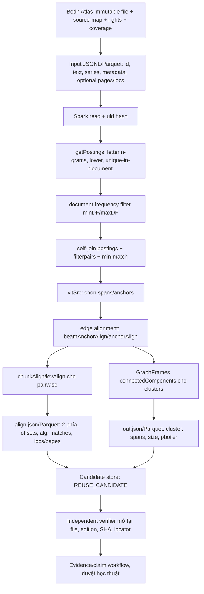

# Technology Assessment — passim

**Mã báo cáo:** P49 · **Ngày khảo sát:** 2026-11-16 (Asia/Ho_Chi_Minh) · **Đối tượng:** [dasmiq/passim](https://github.com/dasmiq/passim) · **Loại:** `component` (công cụ xử lý lô để phát hiện và căn chỉnh *text reuse*, không phải corpus/platform tìm kiếm).  
**Snapshot code:** nhánh `main`, commit [`878ccb3c396e814cf5110d1575ab823c21fa74c9`](https://github.com/dasmiq/passim/commit/878ccb3c396e814cf5110d1575ab823c21fa74c9) (GitHub API trả về; không phải tự clone); repository public và `archived=false` tại thời điểm đọc. **Bản phát hành công bố mới nhất xác minh từ danh sách Releases:** [`v2.0.1`](https://github.com/dasmiq/passim/releases/tag/v2.0.1), phát hành 2024-02-07; `setup.py` trên `main` cũng ghi `2.0.1`. *Commit main năm 2026 không đồng nghĩa phát hành phiên bản mới.*  
**Analyst/phương pháp:** thẩm định độc lập, đọc trực tiếp README, cây repository, sáu tệp mã/entrypoint, GitHub issues, release metadata, hai tài liệu chuẩn BodhiAtlas và kiến trúc corpus hiện hữu; đối chiếu tài liệu chính thức đối thủ. Không dùng GitHub stars làm tiêu chí. **Trạng thái chạy:** `NOT TESTED` đối với toàn bộ thuật toán/passim end-to-end; môi trường có Java 21 nhưng thiếu `pyspark`, mạng container không resolve được `github.com`. Do đó **không có số đo recall, độ trễ, RAM, CER hay tỉ lệ false positive thực nghiệm**.

**Nguồn chuẩn đã đọc:**

- [BodhiAtlas PRD V1.4](https://github.com/quoctran-2608/bodhi-atlas/blob/d1627ff3e079059e402355bf838a897bd5c1c88b/docs/PRD.md), bản đọc `main` ngày khảo sát, blob SHA `58d967c642d625180c436e1a6e6a75fa2e7070e3`.
- [ACADEMIC_RISKS_AND_VERIFICATION](https://github.com/quoctran-2608/bodhi-atlas/blob/d1627ff3e079059e402355bf838a897bd5c1c88b/docs/ACADEMIC_RISKS_AND_VERIFICATION.md), blob SHA `cdb642633f3dc3f7f83cb0e49a96abfebc9f132e`.
- [BuddhismDocuments-for-AI](https://github.com/quoctran-2608/BuddhismDocuments-for-AI/tree/dfdd3cbb79e3dbfb49a855702fa00e4bad3b3410), `README.md`, `docs/ARCHITECTURE.md`, `docs/PROJECT_SPEC.md`, `docs/CLI.md`, `manifest.json`, `schema/corpus-index.sql` (đường dẫn schema xác minh qua cây/tài liệu nhưng **chưa đọc toàn văn schema**).

**Quy tắc đọc chứng cứ:** `[DOC]` là lời tài liệu, `[CODE]` là logic đã xem, `[ISSUE]` là báo cáo của người khác không tái hiện tại đây, `[INFERRED]` là suy luận có cơ sở, `[TESTED]` chỉ lệnh thực chạy tại khảo sát này và `[UNKNOWN]` là chưa xác minh. Không dùng `[CODE]` như bằng chứng kiểm thử thành công. Các nhận định thiết kế BodhiAtlas bên dưới là *đề xuất*, không phải tính năng đã được triển khai.

## 1. Executive Decision

**Quyết định: `TRIAL ONLY`** (tương ứng trường tổng hợp `RECOMMENDATION=TRIAL`). **Độ tin cậy: `MED`** cho giới hạn chức năng theo code/README, `LOW` cho fitness thực tế với corpus Phật học vì chưa chạy POC. **Giả thuyết ban đầu đúng một phần:** passim có bộ lọc n-gram + căn chỉnh ký tự, phát hiện cặp đoạn tái sử dụng tương tự; không cung cấp *citation verifier*, exact exhaustive search hay semantic/cross-lingual matching mặc định. Điểm cần thận trọng hơn giả thuyết: mặc định có cơ chế bỏ n-gram lặp trong cùng document và lọc cùng `series`, có thể bỏ sót các ca BodhiAtlas quan tâm.

**Vai trò khuyến nghị:**

- **V1 Core:** **không làm dependency bắt buộc**; giữ pipeline ingest, `EXACT`/`NORMALIZED`/`LEXICON`, locator, kiểm nguồn độc lập và xử lý coverage ở BodhiAtlas/BuddhismDocuments-for-AI. Chỉ bật passim tùy chọn cho `FUZZY` đoạn dài sau khi có POC đạt gate.
- **V2:** phù hợp nhất với job *offline* dò tương đồng giữa những văn bản/ấn bản/witness đã xác định; trả `REUSE_CANDIDATE` với hai đầu và độ phủ, không trả `VERIFIED_CITATION`.
- **V3:** có thể phục vụ đồ thị phụ thuộc/truyền dẫn văn bản **sau** khi kiểm provenance, niên đại và quan hệ bản dịch; `src` trong passim không chứng minh hướng truyền dẫn lịch sử.

**3 rủi ro lớn nhất:**

1. **Recall/false negatives không lượng hóa:** `getPostings()` chỉ dùng `isalpha()`, lấy n-gram phân biệt, mặc định điểm bắt đầu từ biên từ, và bỏ n-gram xuất hiện nhiều lần trong một document; `--maxDF=100` loại công thức phổ biến; có nguy cơ lớn trên Hán liên tục, văn kinh lặp và OCR lỗi. [CODE: E04–E07]
2. **Sai nhãn “đã xác minh”:** `begin/end`, `pages/regions/locs` có ích, nhưng phụ thuộc input/segment map; `matches` không phải độ chắc chắn học thuật; không xác nhận file gốc, hash, ấn bản, trang in hay ngữ cảnh phủ định. [CODE: E09–E12; PRD R01–R04, R16–R17]
3. **Chi phí/độ an toàn vận hành:** phụ thuộc Spark + GraphFrames/Scala, batch nhiều stage/cache; không có cơ chế incremental an toàn có chứng cứ, không thấy thư mục tests/CI trong cây snapshot; nguy cơ stale output nếu tái sử dụng cùng output directory. [CODE: E02, E14–E15]

**Gate cấm vượt:** chưa được nâng `SOURCE_FIDELITY`, `CODE_ONLY_EXACT`, `MULTILINGUAL`, `QUALITY_COVERAGE`, `RIGHTS_SECURITY`, `PORTABILITY` thành `pass` chỉ bằng benchmark hoặc độ giống văn bản. Với hai gate đầu: passim **không đảm nhận vai trò đó (`N/A`)**, BodhiAtlas phải có bộ kiểm độc lập.

## 2. Sources & Evidence Ledger

Permalink mã cố định tại commit `878ccb3c396e814cf5110d1575ab823c21fa74c9` (viết tắt `P49-SHA` trong các bảng). Repo upstream BodhiAtlas/corpus pin theo metadata ở đầu báo cáo. Các dòng mã dưới đây là line numbers đọc từ GitHub connector; `#Lx-Ly` là liên kết kiểm tra được. Đối với README, liên kết đến file và tiêu đề mục thay vì ngụy tạo số dòng.

| claim_id | claim | Evidence tag | URL/file+line | version/SHA | note |
|---|---|---|---|---|---|
| E01 | Hai chế độ query/reference và all-pairs; output cluster và pairwise | `[DOC]` | [README — overview, output](https://github.com/dasmiq/passim/blob/878ccb3c396e814cf5110d1575ab823c21fa74c9/README.md) | P49-SHA | Hướng dẫn, không phải đã chạy |
| E02 | Python 3.9+, `pyspark==4.0.1`, `graphframes-py==0.9.3`, `intervaltree`; gói tự ghi 2.0.1 | `[CODE]` | [`setup.py` L1–24](https://github.com/dasmiq/passim/blob/878ccb3c396e814cf5110d1575ab823c21fa74c9/setup.py#L1-L24) | P49-SHA | Spark/Java và JVM package riêng ở launcher |
| E03 | Shell `seriatim` chạy `spark-submit` cùng `io.graphframes:graphframes-spark4_2.13:0.9.3` | `[CODE]` | [`bin/seriatim` L1–23](https://github.com/dasmiq/passim/blob/878ccb3c396e814cf5110d1575ab823c21fa74c9/bin/seriatim#L1-L23) | P49-SHA | Phải kiểm tương thích runtime |
| E04 | `getPostings` dùng `str.isalpha()` và `.lower()`, **không phải** `isalnum()` như README mô tả | `[CODE]` | [`passim/seriatim.py` L22–38](https://github.com/dasmiq/passim/blob/878ccb3c396e814cf5110d1575ab823c21fa74c9/passim/seriatim.py#L22-L38) | P49-SHA | Không tự động sửa mâu thuẫn DOC/CODE |
| E05 | Chỉ giữ n-gram có tần số **đúng 1 trong document** (`tf[key]==1`) | `[CODE]` | [`getPostings` L22–38](https://github.com/dasmiq/passim/blob/878ccb3c396e814cf5110d1575ab823c21fa74c9/passim/seriatim.py#L22-L38) | P49-SHA | Không thể suy ra recall đầy đủ khi lặp trong cùng file |
| E06 | Default `n=25`, `minDF=2`, `maxDF=100`, `min-match=5`, `min-align=50`, `gap=600`, `beam=20`, `pcopy=0.8` | `[CODE]` | [`main` L769–793](https://github.com/dasmiq/passim/blob/878ccb3c396e814cf5110d1575ab823c21fa74c9/passim/seriatim.py#L769-L793) | P49-SHA | `pcopy` là tham số căn chỉnh, không phải xác suất đúng trích dẫn |
| E07 | N-gram index được lọc theo document frequency rồi self-join cặp postings, lọc `min-match` | `[CODE]` | [`main` L834–919](https://github.com/dasmiq/passim/blob/878ccb3c396e814cf5110d1575ab823c21fa74c9/passim/seriatim.py#L834-L919) | P49-SHA | Recall–cost phụ thuộc tham số và phân đoạn |
| E08 | `bin/passim` thực chất gọi `seriatim --all-pairs --fields xxhash64(series) as gid --filterpairs gid < gid2` | `[CODE]` | [`bin/passim` L1–5](https://github.com/dasmiq/passim/blob/878ccb3c396e814cf5110d1575ab823c21fa74c9/bin/passim#L1-L5) | P49-SHA | Loại cùng series theo wrapper; input tối thiểu `id,text` trong README có thể **không đủ cho wrapper**, phải POC |
| E09 | `levAlign`, `beamAnchorAlign`, `chunkAlign` căn chỉnh ký tự, chèn/xóa/thay thế và `matches` là số ký tự khớp theo logic nội bộ | `[CODE]` | [`passim/seriatim.py` L205–284, L343–470](https://github.com/dasmiq/passim/blob/878ccb3c396e814cf5110d1575ab823c21fa74c9/passim/seriatim.py#L205-L470) | P49-SHA | Không có output xác suất đồng tác giả/cùng nghĩa |
| E10 | Pairwise có `uid`, `uid2`, `begin/end`, `begin2/end2`, `alg.s1/s2`, `matches` và trường metadata được chọn | `[CODE]` | [`main` L1055–1108](https://github.com/dasmiq/passim/blob/878ccb3c396e814cf5110d1575ab823c21fa74c9/passim/seriatim.py#L1055-L1108) | P49-SHA | Field names cụ thể phải kiểm file output thực tế |
| E11 | Có `locs` và `pages.regions.coords`; output `passLocs/passRegions` tạo locator/hộp bao từ input | `[DOC]` + `[CODE]` | [README — Marking Locations](https://github.com/dasmiq/passim/blob/878ccb3c396e814cf5110d1575ab823c21fa74c9/README.md), [`L599–662`](https://github.com/dasmiq/passim/blob/878ccb3c396e814cf5110d1575ab823c21fa74c9/passim/seriatim.py#L599-L662) | P49-SHA | Bbox cần region upstream đáng tin; không tự sinh từ PDF |
| E12 | Cluster dựa GraphFrame connected components, `size` đếm distinct `uid`, `pboiler` liên quan `gid`/cùng series | `[CODE]` | [`L664–757`](https://github.com/dasmiq/passim/blob/878ccb3c396e814cf5110d1575ab823c21fa74c9/passim/seriatim.py#L664-L757) | P49-SHA | Số document trong cluster ≠ số chứng cứ độc lập |
| E13 | Đầu vào JSON Lines (`id`, `text`, optional `series` + metadata), Parquet; đầu ra Spark `out.json/part-*`, `align.json` khi `--pairwise` | `[DOC]` | [README — Structuring/Running](https://github.com/dasmiq/passim/blob/878ccb3c396e814cf5110d1575ab823c21fa74c9/README.md) | P49-SHA | `series` **không nên** mặc định optional nếu dùng `bin/passim` |
| E14 | Tạm tạo nhiều `tmp/*.parquet`; nếu path tồn tại thì bỏ viết (`os.path.exists`, `mode('ignore')`) | `[CODE]` | [`L827–906`, `L922–1039`](https://github.com/dasmiq/passim/blob/878ccb3c396e814cf5110d1575ab823c21fa74c9/passim/seriatim.py#L827-L1039) | P49-SHA | Không thấy so input SHA trước khi reuse cache → rủi ro stale |
| E15 | Không thấy `tests/`, `LICENSE`, lockfile, CI config trong cây `main` trả về | `[CODE]` (kiểm kê cây) | [repo root](https://github.com/dasmiq/passim/tree/878ccb3c396e814cf5110d1575ab823c21fa74c9) | P49-SHA | Không suy ra dự án chưa từng được kiểm thử nơi khác |
| E16 | README tuyên bố MIT; `setup.py` dùng classifier MIT; không có LICENSE file độc lập ở tree đã xem | `[DOC]` + `[CODE]` | [README — License](https://github.com/dasmiq/passim/blob/878ccb3c396e814cf5110d1575ab823c21fa74c9/README.md), [`setup.py`](https://github.com/dasmiq/passim/blob/878ccb3c396e814cf5110d1575ab823c21fa74c9/setup.py) | P49-SHA | Cần rà legal trước phân phối lại; không bao gồm quyền corpus |
| E17 | Issue về trùng map key khi đổi `-n`/`min-match`; Windows/Scala classpath; đảo thứ tự đoạn | `[ISSUE]` | [#15](https://github.com/dasmiq/passim/issues/15), [#13](https://github.com/dasmiq/passim/issues/13), [#9](https://github.com/dasmiq/passim/issues/9) | Nhiều phiên bản, một số cũ | **Không** coi tái hiện trong main hiện tại |
| E18 | PRD V1.4 đòi EXACT/NORMALIZED/FUZZY/LEXICON, kiểm câu chữ + locator + edition + SHA và coverage | `[DOC]` | [PRD](https://github.com/quoctran-2608/bodhi-atlas/blob/d1627ff3e079059e402355bf838a897bd5c1c88b/docs/PRD.md), mục tra cứu/kiểm nguồn/nghiệm thu | BodhiAtlas SHA ở trên | Chuẩn gate, không phải năng lực passim |
| E19 | Bộ rủi ro R01–R05/R07–R11/R16/R17/R24/R27 tách nguồn, OCR, term, dependency, quyền | `[DOC]` | [Academic risks](https://github.com/quoctran-2608/bodhi-atlas/blob/d1627ff3e079059e402355bf838a897bd5c1c88b/docs/ACADEMIC_RISKS_AND_VERIFICATION.md) | BodhiAtlas SHA | Không đủ chỉ nhìn match score |
| E20 | Corpus hiện có 13 upstream pinned, SQLite/FTS (kể cả CJK trigram), search/context/resolve/variants/provenance, kiểm nguồn A; index chỉ là dẫn xuất | `[DOC]` | [Corpus README](https://github.com/quoctran-2608/BuddhismDocuments-for-AI/blob/dfdd3cbb79e3dbfb49a855702fa00e4bad3b3410/README.md), [ARCHITECTURE](https://github.com/quoctran-2608/BuddhismDocuments-for-AI/blob/dfdd3cbb79e3dbfb49a855702fa00e4bad3b3410/docs/ARCHITECTURE.md) | Corpus SHA ở trên | Không tạo search/verifier trùng lặp |
| E21 | `SOURCE_FIDELITY` & `CODE_ONLY_EXACT` **không** được passim nhận là nhiệm vụ riêng | `[INFERRED]` | E04–E13 + E18–E20 | P49-SHA | `N/A` theo phạm vi, không gán `fail` cho ngoài vai trò |
| E22 | Recall Hán 2–3 chữ, Tạng Unicode/Wylie, OCR/Pāli decomposition chưa có benchmark chứng minh | `[UNKNOWN]` | [Code](https://github.com/dasmiq/passim/blob/878ccb3c396e814cf5110d1575ab823c21fa74c9/passim/seriatim.py#L22-L38), E17 | P49-SHA | Các tác động bên dưới là dự đoán dựa thuật toán, phải POC |

**Lưu ý nguồn/độ phủ:** Không tải được repo vào sandbox do DNS, chỉ đọc code GitHub qua connector và web; quickstart notebook được xác minh tồn tại nhưng chưa chạy/kiểm tra đầy đủ; danh sách issues xem qua GitHub search, trạng thái giải quyết hiện tại của từng issue không được xác minh. `LICENSE` không thấy trong snapshot tree; không khẳng định pháp lý cuối cùng chỉ bằng classifier. Không có số đo nào được dẫn từ nguồn marketing thành `[TESTED]`.

## 3. Architecture & Data Flow

**Đúng loại công cụ:** passim là chương trình CLI trên Spark, dùng JSON Lines/Parquet làm văn bản đã trích xuất; không nạp PDF/OCR, không có web application hay cơ sở tri thức tác phẩm tích hợp.



**Ranh giới quyền lực dữ liệu:** A là bản *dẫn xuất* từ BodhiAtlas; J/K chỉ là candidate graph và batch cache. L mới là nguồn thẩm quyền câu chữ/file. N phải tra đúng canonical text + hình trang/TEI/EPUB locator đã được lưu, ghi riêng `text_verification`, `locator_verification`, `meaning_assessment`. O không tự được chứng nhận từ J/K. `src`, `cluster` và `pboiler` mô tả cấu trúc thuật toán, **không** là tuyên bố tác giả/niên đại/sự thật lịch sử.

**Đặc điểm triển khai:** CLI `bin/passim` là wrapper của `bin/seriatim` (`--all-pairs`, `--fields 'xxhash64(series) as gid'`, `--filterpairs 'gid < gid2'`), tức mặc định **chỉ xét khác series**. Dùng `seriatim --all-pairs --filterpairs 'uid < uid2' ...` hoặc điều kiện riêng nếu cần đối chiếu *cùng* tác phẩm/series. Bất kỳ thay đổi nào phải chạy POC với output thực tế trước khi đưa vào production.

## 4. Feature Fit–Gap Matrix

`N/A` = ngoài nhiệm vụ, **không trừ điểm**. Các cột status chỉ xét năng lực repo tự cung cấp; thêm từ BodhiAtlas được thể hiện dưới `Gap / phương án bù`. `CONFIG` = có sẵn với dữ liệu/cờ phù hợp; `EXTENSION` = phải viết code; `EXTERNAL` = hệ khác đảm nhận; `UNKNOWN` = chưa có bằng chứng đủ. Công sức là ước lượng tương đối, không phải thời gian đo.

| ID | Capability | Status | Chứng cứ/vai trò | Gap, cách bù | Công sức |
|---|---|---|---|---|---|
| C01 | Multi-format ingest | `EXTERNAL` | E01, E13: JSONL/Parquet đã chuẩn hóa | Parser/OCR PDF, EPUB, DOCX, Markdown, TEI/XML thuộc pipeline hiện có; converter `canonical segment → JSONL` | medium |
| C02 | OCR/layout/reading order | `N/A` | E01, E11: chỉ nhận `text`, `pages` | OCR/layout, confidence, cột/bảng/footnote và coverage ở extractor | high (bên ngoài) |
| C03 | Canonical text/source map | `CONFIG` | E10–E11: offsets hai đầu, locs, pages | Phải cấp input regions/locs; lưu extraction version, mapping, remap normalized offset; QA bbox | high |
| C04 | Works/editions/witnesses | `EXTERNAL` | E13: metadata tùy ý, `series` không phải edition model | Join metadata công trình–ấn bản–witness trong catalog hiện có; không gộp ấn bản theo `cluster` | medium |
| C05 | Exhaustive EXACT | `N/A` | E04–E08: lọc candidates, bỏ n-gram lặp | EXACT tất cả offset bằng scan/hash/FTS + kiểm ký tự qua canonical text | medium (bên ngoài) |
| C06 | Normalized multilingual search | `EXTENSION` | E04, E22: lower-only; có `--floating-ngrams` | Index normalization riêng, offset remap, lexicon/transliteration; script/language-specific POC | high |
| C07 | Fuzzy/near-duplicate/OCR errors | `NATIVE` | E04–E10: seed + beam/Levenshtein alignment, pairwise | Tối ưu threshold theo ngôn ngữ và golden set; kiểm false positive/negative | medium–high |
| C08 | Sense-aware lexicon | `N/A` | E04, E22: không có sense model | Dùng lexicon có evidence + scope; không suy diễn từ match n-gram | medium (bên ngoài) |
| C09 | Semantic/hybrid/RAG | `N/A` | E01, E09: ký tự, không semantic | Optional LLM/embeddings riêng; không là nguồn trích dẫn | medium (bên ngoài) |
| C10 | Verified citation card/source reopen | `EXTERNAL` | E10–E12 cung cấp spans chứ không verify file | Independent verifier của BodhiAtlas/BCR; hash/file/edition/OCR/context | high |
| C11 | Note/wiki/claim memory | `N/A` | E01: batch analysis | Dùng Evidence/claim workflow hiện có, không đặt trong GraphFrame | low (bên ngoài) |
| C12 | API/MCP/export | `CONFIG` | E10, E13: JSON/Parquet/CLI; không thấy API/MCP | Adapter ingest/export candidate và quyền truy cập qua API riêng | medium |
| C13 | Quality coverage + incremental | `EXTENSION` | E14: cache bỏ qua path tồn tại; không thấy ingest incremental đảm bảo | Manifest per file, versioned runs, invalidation, checksum, coverage/error status | high |
| C14 | Auth/licensing/privacy/backup | `EXTERNAL` | E02–E03, E16: MIT công bố; không có auth service | ACL từ BodhiAtlas, quyền từng bản dịch, encryption/retention/log, backup raw+metadata | high |
| C15 | Operational simplicity + independent deploy | `CONFIG` | E02–E03: PySpark/GraphFrames batch local/cluster | Tách thành job riêng, pin Spark/Scala/JVM, local profile; không coi là lightweight | medium–high |

**Cổng P49:** `SOURCE_FIDELITY=N/A` (verifier ngoài); `CODE_ONLY_EXACT=N/A` (exact engine ngoài); `MULTILINGUAL=UNKNOWN` (chưa đo đúng script); `QUALITY_COVERAGE=UNKNOWN` (job phải xuất coverage); `RIGHTS_SECURITY=UNKNOWN` (chưa audit end-to-end); `PORTABILITY=UNKNOWN` đến khi thử rebuild chỉ từ catalog/raw/candidate schema ổn định. Không lấy điểm tổng để thay gate.

## 5. Deep Technical Findings

### 5.1. Thuật toán thực tế: n-gram → cặp document → anchor → alignment/cluster

[CODE E04–E10] `getPostings(text, n, floating_ngrams)` duyệt **ký tự Unicode Python** bằng `enumerate` rồi chỉ giữ `c.isalpha()`, chuyển `lower()`, index chuỗi n chữ cái và vị trí gốc; loại mọi n-gram có `tf[key] != 1` trong document. **Không phát hiện MinHash trong code path này**; `xxhash64` dùng để hash doc ID và n-gram nhằm join/phân vùng, **không phải MinHash locality-sensitive hashing**. Spark tính document frequency trong `[minDF,maxDF]`, self-join các postings, lọc `filterpairs`, đòi `min-match` anchor rồi `vitSrc()` chọn spans; tiếp tục `beamAnchorAlign()`/`anchorAlign()` và khi `--pairwise` có `chunkAlign()` gọi `levAlign()` chèn/xóa/thay thế ký tự (dạng aligned strings có hyphen). GraphFrames clustering cho output theo nhóm; `seriatim` chọn nguồn tốt nhất theo mô hình riêng, trong khi `--all-pairs` xử lý cặp.

**Thông số mặc định đã xác minh trong code** (`passim/seriatim.py:769–820`):

| Cờ | Mặc định | Ý nghĩa và rủi ro |
|---|---:|---|
| `-n`/`--n` | 25 | 25 chữ cái liên tiếp trong n-gram; đoạn Hán 2–3 chữ không thể tạo đủ |
| `--minDF`, `--maxDF` | 2, 100 | Chỉ lấy n-gram hiện diện trong ít nhất 2 và nhiều nhất 100 document; công thức phổ biến >100 nguồn bị loại |
| `--min-match` | 5 | Ít nhất 5 seed matches trong nhóm cặp xét; giảm nhiễu, giảm recall |
| `--min-align` | 50 | Bỏ alignments ngắn; không đáp ứng đoạn 2–3 chữ |
| `--gap` | 600 | Khoảng cách ghép/tách spans |
| `--floating-ngrams` | false | Nếu bật, seed cũng có thể bắt đầu giữa chuỗi chữ; quan trọng cho Hán không dấu cách |
| `--beam` | 20 | Giới hạn beam search; nhanh hơn nhưng không bảo đảm tối ưu toàn cục |
| `--pcopy` | 0.8 | Tham số xác suất giả định trong scoring căn chỉnh, **không phải confidence trích dẫn** |
| `--src-overlap`, `--dst-overlap` | 0.9, 0.5 | Gộp/cluster spans theo overlap |
| `--filterpairs` | `uid < uid2` trong engine | Nhưng **wrapper** `passim` ghi đè thành `gid < gid2` (khác series) |
| `--shards` | 1 | Điều khiển phân mảnh index, không phải chứng nhận scale |

**Mâu thuẫn DOC/CODE đáng lưu:** README diễn tả các n-gram dùng `isalnum` nhưng code `isalpha`. Chữ số trong bản kinh số thứ tự có thể bị bỏ ở bước seed. Mọi normalizer cần chứng minh trên code ở SHA này chứ không dựa tuyên bố marketing.

### 5.2. Output, offsets cả hai phía, document path, score

[CODE E10–E13] Với `--pairwise`, pipeline chọn các trường metadata đơn giản từ input, kết hợp `uid/uid2`, cặp `begin/end` và `begin2/end2`, phần căn chỉnh `s1/s2` và `matches` (số ký tự khớp theo `countMatches`). `id`, `id2`, `src_path`, `src_path2` **có thể** đi theo nếu cung cấp thuộc tính tương ứng, nhưng phải xác nhận schema JSON output thật trong POC; không có một chuẩn URL/filepath bất biến tích hợp. `out.json` clusters có `cluster`, `size`, `begin`, `end`, `uid`, `src`, `pboiler`, `pages/regions/locs` nếu cung cấp. `size` là số doc (`countDistinct(uid)`), **không phải** số bản độc lập.

**Điểm similarity:** Không tìm thấy field output pairwise tên `similarity_probability`. Có `matches` (đếm ký tự tương hợp), aligned strings và các scoring nội bộ. Nếu tự sinh `similarity_ratio = matches / aligned_length`, phải đặt tên **derived score** cùng version định nghĩa; không diễn giải là xác suất cùng nguồn/cùng tác giả/cùng nghĩa. `--link-model` có pipeline `RFormula`/`LogisticRegression` dùng feature metadata để điều chỉnh *source priors*, **không chứng minh** quan hệ văn bản lịch sử và không dùng nếu chưa có nhãn gold [CODE `L955–989`].

### 5.3. OCR, xuống dòng, đảo trật tự, dấu phụ và Unicode

[CODE] Bước seed bỏ punctuation/space khi dựng n-gram nhưng giữ offset nguyên bản; điều này giúp qua một số biến đổi xuống dòng. `beamAnchorAlign/levAlign` cho phép chèn/xóa/thay ký tự, nhưng không tự chữa OCR và **không** có thông tin độ tin cậy OCR. `getPostings` chuyển lowercase; **không** có NFC/NFD, bỏ dấu Việt, Pāli/Sanskrit diacritics, Hán giản–phồn, Wylie hoặc dịch xuyên ngôn ngữ mặc định. `isalpha` bỏ các dấu kết hợp Unicode nếu bản decomposed; tương quan giữa 2 bản mã hóa có thể lệch seed/offset. `--floating-ngrams` cải thiện cơ hội anchor qua chuỗi Hán không có khoảng trắng, đánh đổi candidate explosion. Khi paragraph đảo thứ tự, Viterbi/anchor có ràng buộc thứ tự theo các chặng; issue [#9](https://github.com/dasmiq/passim/issues/9) ghi trường hợp phiên bản cũ bỏ đoạn đảo chỗ — **chưa tái hiện ở snapshot 2026**. Không được gọi near match là hỗ trợ biến thể nghĩa/phủ định.

### 5.4. Recall đoạn dài, candidate explosion, latency

[CODE E04–E08] Cơ chế tiết kiệm là `minDF/maxDF`, unique n-grams, số seed tối thiểu, `filterpairs`, sharding Spark, `gap`, `min-align` và beam. Bật floating n-gram, hạ `n` hoặc hạ `min-match` có thể tăng recall nhưng cũng đẩy số postings/join pair/false positives. `--fields` và `--filterpairs` có thể giới hạn theo ngôn ngữ/nhánh catalog/niên đại/quyền truy cập, nhưng giới hạn quá sớm làm mất các cặp thực sự có quan hệ. **Không có bằng chứng recall bảo đảm hoặc đường cong latency theo corpus**. POC cần log `candidate_pairs`, số postings sau DF filter, stages, duration, peak memory, số spans và false positives theo `n`, DF, chunking, `floating`.

**Hai điểm dễ bỏ sót nghiêm trọng:** (i) n-gram bị **loại nếu lặp trong cùng một document**, nên một đoạn lặp 5 lần trong file có thể không tạo đủ seed; (ii) chữ Hán liên tục không ranh giới từ khiến ở chế độ không-floating chỉ rất ít seed hợp lệ trong một run `isalpha` dài. Đây là **suy luận từ code**, chưa phải số liệu lỗi đo.

### 5.5. Công thức phổ biến, bản phụ thuộc, đoạn ngắn

[CODE E06–E08/E12] `--maxDF` có thể hạn chế formulaic boilerplate, `series/gid` và `pboiler` giúp phân loại tác phẩm thuộc cùng nhóm, nhưng không phải phân tích phả hệ văn bản hay chống đếm đôi về học thuật. Ví dụ một câu kinh phổ biến trong 20 bản sao cùng nguồn: có thể là một cluster và nhiều `uid`, nhưng BodhiAtlas phải giữ một `dependency_group`/quan hệ `derived_from`, đánh giá độc lập sau. Đoạn quá ngắn: mặc định `n=25` và `min-align=50` vốn không cho đáp ứng Hán 2–3 ký tự. Giảm `n` xuống 2–3 dễ tạo rất nhiều phổ biến/ngẫu nhiên; **không** đặt passim thành search chính cho đoạn ngắn.

### 5.6. Hán 2–3 ký tự, phân đoạn, chữ Tạng

[CODE + INFERRED] Chữ Hán được Python `isalpha` nhận với phần lớn ideographs, nhưng không đồng nghĩa được tách từ: không thấy tokenizer/segmenter Hán riêng trong code path. 2–3 ký tự không qua threshold mặc định. Hán dài, để đo phải bật `--floating-ngrams` và thử `n` riêng, hoặc xây các `segment_id` đã tách theo câu. Tạng có Unicode alphabetics xen dấu nguyên âm/ký tự kết hợp; `isalpha()` không bảo đảm giữ đúng chuỗi grapheme, cần test cặp NFC/NFD, tsheg, Wylie, phép mã hóa. **Quyết định kỹ thuật hiện tại: chỉ thử passim cho đoạn dài gần giống cùng hệ chữ; dùng EXACT/LEXICON/external bridge cho cụm ngắn và khác ngữ hệ.**

### 5.7. Tài nguyên, batch, incremental, vận hành

[CODE E02, E03, E14] `spark-submit` cần Java, Spark 4.0.1 PySpark, GraphFrames Python/JVM và `intervaltree`; `bin/seriatim` pin artifact GraphFrames cho Spark 4 / Scala 2.13. Có local và cluster Spark theo README. Ví dụ README `local[10]`/`200G` **chỉ là cấu hình minh họa, không phải yêu cầu phần cứng hay đo thực tế**. Code tạo nhiều Parquet intermediate trong `output/tmp` và dùng `os.path.exists`/`mode('ignore')`; không có kiểm input SHA trước khi tái sử dụng. Không phát hiện API incremental ingest/update theo file đã thay; **không kết luận không thể incremental bằng bất kỳ extension nào**, nhưng hỗ trợ incremental native có bảo đảm hiện là `UNKNOWN/không chứng minh`. Thiết kế an toàn: mỗi run có content-addressed `run_id`; thay version corpus/normalizer/param thì output directory mới, rồi atomic promote; cache cũ chỉ được reuse sau manifest validation.

### 5.8. Ý nghĩa điểm và hướng sao chép

[CODE + INFERRED] `matches`/độ dài align là **đặc trưng của cặp chuỗi**, không phải xác suất tác giả giống nhau, cùng ý nghĩa hay hai lời chứng độc lập. `seriatim` hướng target tới nguồn có alignment tối ưu theo mô hình, không xác minh nguồn lịch sử; `src` trong cluster cũng không chứng nhận niên đại. Bản dịch giống chữ vì dùng cùng công thức, sao chép qua trung gian, bản scan OCR của cùng ấn bản, hoặc chính văn trích trong chú giải đều đòi `source_role`, `witness`, `dependency_group` và review người.

### 5.9. Pipeline phối hợp đề nghị

1. **Candidate stage 0 — code-only exact:** giữ canonical text bất biến + offset/locator; dùng SQLite/FTS/scan literal để liệt kê **tất cả** lần xuất hiện trong scope, xác minh từng substring. NORMALIZED chạy trên chỉ mục phụ, có normalization trace.
2. **Candidate stage 1 — passim:** chạy offline riêng trên đoạn đủ dài theo language/script/edition filters có chủ đích; xuất `REUSE_CANDIDATE`, `left/right stable segment IDs`, offsets, alignment, score dẫn xuất có phiên bản. Không trộn nhãn với EXACT.
3. **Verifier stage 2:** mở đúng raw file/hash, re-extract hoặc tra canonical version được ghi, map offsets tới bbox/page/TEI node/EPUB href+CFI nếu có, kiểm nguyên văn/đoạn bao quanh/phủ định, OCR confidence và trạng thái quyền.
4. **Claim/edition stage 3:** dùng quan hệ work–witness–translation–commentary để phân biệt trích dẫn, công thức và chứng cứ độc lập; sense/meaning do người/AI duyệt riêng. Chỉ stage 2 có thể phát nhãn kỹ thuật `TEXT_AND_LOCATOR_VERIFIED` khi đủ bằng chứng; stage 3 là đánh giá luận điểm.

### 5.10. Passim so với CollateX/QMD theo nhiệm vụ

[DOC] **CollateX** cần đầu vào các witnesses đã biết, tokenization/variant graph để collation nhiều phiên bản; không nhằm lọc hàng loạt cặp đoạn trong corpus thô. **QMD** là local general retrieval BM25/vector/rerank cho docs, tìm câu trả lời ứng viên; không phải chuyên dụng tìm span reuse đối ứng giữa hai nguồn. Vì vậy không lấy chất lượng alignment passim để kết luận thay thế search/QMD hoặc lấy chất lượng BM25 để kết luận thay thế CollateX. Xem mục 11.

## 6. Source Fidelity & Provenance

### 6.1. Điều passim thực sự giữ được

- `begin/end` và `begin2/end2`: vị trí ký tự trong `text` input hai document, với caveat document chunking/normalization. `uid` là `xxhash64(id)` nội bộ; **không** làm canonical file identifier.
- `locs`: mỗi `{loc,start,length}` do upstream cấp, có thể overlap với span; `pages`: `id`, `seq`, `width/height`, `regions[{start,length,coords{x,y,w,h,...}}]` theo README. Code `passRegions` kết hợp các vùng bao; **hộp bao gộp không phải polygon/khẳng định tất cả glyph đúng**. Một số phép join chỉ nhận region nằm trọn trong span; cần kiểm biên giao.
- Metadata đơn giản input có thể qua output; việc đặt `path`, `edition`, `work`, `file_sha256` do adapter quyết định, không bảo đảm bằng chính passim.

### 6.2. Phiếu truy nguyên BodhiAtlas phải viết/thêm (schema đề xuất)

```json
{
  "candidate_id": "stable content-derived id",
  "kind": "REUSE_CANDIDATE",
  "engine": {"name":"passim", "commit":"878ccb3c396e814cf5110d1575ab823c21fa74c9", "config_sha256":"..."},
  "left": {
    "work_id":"...", "edition_id":"...", "witness_id":"...", "file_id":"...", "file_sha256":"...",
    "extraction_version":"...", "segment_id":"...", "begin":0, "end":0,
    "source_path":"...", "source_type":"original|translation|commentary",
    "pdf_page_index":null, "printed_page_verified":null,
    "bbox":null, "epub_href":null, "epub_cfi":null, "tei_locator":null,
    "ocr_state":"UNKNOWN", "coverage_state":"UNKNOWN"
  },
  "right": {"work_id":"...", "edition_id":"...", "witness_id":"...", "file_id":"...", "file_sha256":"...", "extraction_version":"...", "segment_id":"...", "begin":0, "end":0},
  "alignment": {"aligned_left":"...", "aligned_right":"...", "matches":0, "derived_score":null},
  "verification": {"text":"NOT_VERIFIED", "locator":"NOT_VERIFIED", "meaning":"NOT_ASSESSED"},
  "scope": {"included_segments":[], "excluded_or_failed":[], "run_id":"..."},
  "rights": {"access_policy_id":"...", "export_policy_id":"..."}
}
```

Đây là **contract đề xuất, không phải JSON passim xuất nguyên dạng**; `...` là placeholder, `null` nghĩa chưa biết, **không** là thông tin nguồn thật. `pdf_page_index` không tự biến thành trang in; trang in chỉ khi OCR/metadata đã chứng thực. Phải lưu nguyên văn theo bytes/text version và `offset_unit` rõ ràng (Python Unicode code-point theo `enumerate` trong seed; cần thử thống nhất với Spark và renderer, đặc biệt non-BMP). Khi normalizer đổi ký tự, `normalized_begin/end` phải có bảng quay lại raw span (offset mapping), không lấy normalized offset làm bbox. Nếu match span trùm nhiều trang/cột, đánh dấu `PARTIAL_LOCATOR` thay vì hợp nhất một bbox mơ hồ.

### 6.3. Các tình huống P0 bắt buộc

1. OCR xóa từ **không** hoặc biến `無` thành chữ khác: candidate vẫn chưa được coi đúng câu/ý.
2. Hai ấn bản cùng chữ khác phân trang: không gộp edition ID.
3. Trích câu cắt khỏi lời người đối thoại/chú giải: không suy “tác giả khẳng định”.
4. Năm bản chép của cùng nguồn: không đếm thành năm chứng cứ độc lập.
5. PDF cũ thay bytes, cùng tên file: SHA khác → invalidate toàn bộ candidate/locator dùng hash cũ; không ghi đè silently.
6. File scan mất trang/OCR lỗi: kết quả `NOT_FOUND` chỉ giới hạn phạm vi index, trình bày coverage ở UI.

## 7. Multilingual & Retrieval Behavior

**Thang:** `NATIVE` chỉ có code chứng minh năng lực đó; `CUSTOM` cần tiền xử lý/mapping riêng; `EXTERNAL` hệ khác đảm nhận; `UNKNOWN` khi chưa POC.

| Hệ truy vấn/corpus | EXACT (mọi offset) | NORMALIZED / LEXICON | Passim near-reuse | Diễn giải/gate |
|---|---|---|---|---|
| Latin `anatta` / `anattā`, `dukkha` / `duḥkha` | `EXTERNAL` | `CUSTOM` NFC/NFD + dấu + lexicon sense | `NATIVE` cho đoạn dài có seed trùng; coverage `UNKNOWN` | Khác dấu có thể mất seed; không tự coi từ khác chữ là cùng nghĩa |
| Việt `vô ngã` / `vo nga` | `EXTERNAL` | `CUSTOM` bảng bỏ dấu có audit, không ghi EXACT | `UNKNOWN` đoạn dài | Diacritics/sentence boundaries, dấu phủ định phải bảo toàn |
| Hán `無我`, `無常` ↔ `无常` | `EXTERNAL` scan/bigram cho 2 ký tự | `CUSTOM` mapping giản–phồn theo provenance, lexicon | Mặc định **không phù hợp** 2–3 ký tự; longer passages cần floating + benchmark | `isalpha` ≠ segmentation, mapping giản/phồn có thể nhập nhằng |
| Tạng Unicode/Wylie | `EXTERNAL` | `CUSTOM` grapheme segmentation / transliteration map có nguồn | `UNKNOWN` | Dấu kết hợp, tsheg, Unicode normalization cần fixture |
| Sanskrit/Pāli long text | `EXTERNAL` | `CUSTOM` mã hóa/diacritics, từ điển nghĩa | `NATIVE` character reuse cùng hệ chữ, `UNKNOWN` recall | `anātman` khác `anatta` không phải một near match ký tự thông thường |
| Dịch qua Anh/Việt/Hán/Tạng | `EXTERNAL` | `EXTERNAL` sense-aware lexicon + parallel alignment | **Không native** | Similarity chuỗi không giải thích equivalence của bản dịch |
| Câu 200–300 ký tự | `EXTERNAL` exhaustive exact | `CUSTOM` normalized index | Có mục tiêu POC hợp lý | Phải đo deletion/OCR/order sensitivity và locate hai đầu |
| 5 lần cùng file | `EXTERNAL` enumeration | `EXTERNAL` | **Không bảo đảm** vì unique-n-gram; wrapper có thể loại cùng series | Bắt buộc exhaustive literal offset ngoài passim |

**Truy vấn luận đề mẫu:** “Trong các tài liệu tôi có, những tác giả nào phân biệt giữa vô thường và khổ? Họ lập luận như thế nào? Cho tôi vị trí chính xác trong sách.” Pipeline code-only sẽ lọc `vô thường`, `khổ`, `無常`, `苦`, `anicca`, `dukkha` và quan hệ lexicon có nghĩa; passim có thể tìm *đoạn diễn đạt được dùng lại* giữa các sách **sau khi** corpus trích xuất. Mệnh đề *tác giả nào*, *đang phân biệt hay phản đối*, và *lập luận thế nào* cần xem đoạn đủ ngữ cảnh, phân biệt bản dịch/chú giải, đối chiếu mặt chứng cứ và/hoặc AI + người nghiên cứu. Không suy “các tác giả” từ số hit, không tự tạo trang sách.

**Điểm cần so với hạ tầng hiện có:** `BuddhismDocuments-for-AI` đã có `records_cjk_fts` trigram local cho Hán và cơ chế search/context/provenance; [CLI](https://github.com/quoctran-2608/BuddhismDocuments-for-AI/blob/dfdd3cbb79e3dbfb49a855702fa00e4bad3b3410/docs/CLI.md) ghi yêu cầu ít nhất ba ký tự hữu dụng trên CJK trigram. Vì thế Hán 2 ký tự cần thêm scan/bigram path **ngay cả ngoài passim**, nhưng đây là nhiệm vụ search hiện có chứ không phải lý do chọn passim. Với FTS5 trigram official, substring dưới 3 ký tự không match bằng full-text query; LIKE/GLOB không có trigram thích hợp có thể fallback scan.

## 8. Integration Options for BodhiAtlas

### Option A — Offline reuse discovery sidecar (ưu tiên thử)

**Mục đích:** passim chỉ lập đồ thị ứng viên đoạn văn gần giống giữa những edition/witness/chapter đã có trong catalog; `FUZZY` và source cards vẫn do BCR/BodhiAtlas đứng tên. Không sửa upstream pinned corpus.

**Input contract** (JSONL do adapter viết, 1 document mỗi *đoạn ổn định* hoặc cửa sổ có overlap, không chọn whole book theo thói quen):

```json
{"id":"segment:sha256...:v1", "series":"work:W001", "text":"...", "work_id":"W001", "edition_id":"E01", "file_id":"F01", "file_sha256":"...", "segment_id":"S01", "extraction_version":"v1", "src_path":"...", "language":"pli", "locs":[], "pages":[]}
```

**Output contract:** `run_id`, `input_manifest_sha`, `engine_commit`, config, cặp `segment_id`, cặp `begin/end`, `s1/s2`, `matches`, inherited locators, candidate kind, cảnh báo coverage. `run_id` không là bằng chứng, `candidate_id` do BodhiAtlas tạo từ stable IDs + offsets + extraction versions + engine config; lưu mapping nội bộ `uid ↔ segment_id` vì `uid` là hash runtime. **Source of truth** là immutable raw files/pinned upstream, catalog, extracted canonical text + source map và verified records. **Migration:** bảng candidate có schema riêng, JSONL/Parquet export; rebuild từ raw và manifest khi đổi engine; không lưu verified claims chỉ ở Spark index. **Failure/rollback:** worker fail → giữ bản candidate trước đã được xác định version hoặc tắt feature; source/exact search không bị ảnh hưởng; invalidate khi source hash khác.

**Tiền điều kiện POC:** loại target same-series phải được quyết định theo bài toán, không dùng mặc định `passim` wrapper nếu cần so trong cùng work; đặt max runtime/capacity, scope quyền truy cập; không gửi văn bản restricted sang cluster ngoài quyền.

### Option B — Witness-pair collation assist (hẹp hơn)

**Mục đích:** người nghiên cứu đã biết 2 witness/bản OCR, dùng `seriatim --all-pairs --pairwise --docwise/--linewise` (các cờ phải thử riêng) để gợi ý đoạn có thể đối chiếu; CollateX hoặc comparator chuyên khảo dị tiếp quản việc biểu diễn dị bản. Phù hợp khi muốn nhìn ký tự thay đổi hoặc sửa OCR có giám sát, không dùng phát hiện tổng corpus.

**Input contract:** mỗi `id` tương ứng một witness/page/section, có thứ tự câu, `edition_id`, `witness_id`, `locs`, `pages.regions` nếu có; cặp cần cho phép lọc rõ (tránh `gid < gid2` sai trường hợp). **Output:** pairwise alignments với offsets + edit strings; người dùng xác nhận equivalence và source locator; không auto-correct OCR gốc, chỉ sinh `proposed_correction`. **Source of truth:** luôn nguyên ảnh/file và transcript versioned; nhật ký sửa độc lập. **Migration/rollback:** kết quả là dẫn xuất rebuildable; revert về transcript gốc nếu alignment lỗi hoặc source-map mismatch.

### Option C — Không thêm passim (control arm)

Tiếp tục chỉ dùng BCR SQLite/FTS + exact verifier và một comparator edit-distance Python phạm vi nhỏ (hoặc CollateX khi có witness cố định). Đây là baseline bắt buộc cho POC về recall, false positives, integration cost. Không có mặc định *phải* thêm Spark.

**Kiến trúc tích hợp tối thiểu không xâm phạm BCR:** `bcr.search/resolve → candidate exporter → isolated Spark job → candidate importer → bcr source verifier → evidence/claim workflow`. Export chỉ những bản có quyền xử lý; phân biệt `corpus SHA`, `index build SHA`, `normalized view SHA`, `passim commit/config SHA`; không đưa passim làm tầng lưu claims của A–E đã có.

## 9. Practical POC / Reproduction Plan

**Trạng thái tất cả TC01–TC06: `NOT TESTED` cho passim.** Không tự báo benchmark. Kiểm môi trường thật tại cuộc khảo sát:

```text
$ java -version
openjdk version "21.0.12.1" ...
$ python -c 'import pyspark'
ModuleNotFoundError: No module named 'pyspark'
$ git ls-remote https://github.com/dasmiq/passim.git HEAD
fatal: unable to access 'https://github.com/dasmiq/passim.git/': Could not resolve host: github.com
```

Đây là **lệnh kiểm môi trường đã thực hiện**, không phải passim algorithm smoke test. Không có data corpus được tải/benchmark trong phiên này.

### 9.1. Setup POC tái lập (chỉ là kế hoạch)

```bash
# Trên máy được phép tải dependency, trong venv mới; pin commit nghiên cứu
python3 -m venv .venv && . .venv/bin/activate
python -m pip install 'git+https://github.com/dasmiq/passim.git@878ccb3c396e814cf5110d1575ab823c21fa74c9'
java -version; python -c 'import pyspark, graphframes; print(pyspark.__version__)'
# verify version, package JVM và licensing trước khi dùng:
seriatim --help
# nên dùng seriatim thay wrapper passim khi cần same-series
mkdir -p poc-output
seriatim --all-pairs --pairwise --filterpairs 'uid < uid2' \
  --n 25 --min-match 5 --min-align 50 --maxDF 100 \
  fixtures/documents.jsonl poc-output/long-baseline
```

Đầu vào gồm JSON Lines từng dòng hợp lệ, `id/text/series`, metadata. Không reuse directory output giữa hai run/config; dùng đường dẫn output mới. Các lệnh CLI trên suy ra từ `README`, `setup.py`, `bin/seriatim`, `main()` và **chưa xác minh thành công bằng chạy thật**. `graphframes` Java package có thể yêu cầu internet/Maven hoặc chuẩn bị artifact trong image; ghi log `spark-submit --version`, Python, OS, JVM, Scala, GraphFrames checksum. Chạy baseline cả `--floating-ngrams` và không bật. Lưu stdout/stderr, parquet/json `out`, `align`, manifest và SHA256 tất cả fixtures. POC đầu tiên phải kiểm output schema không crash với metadata/`pages/locs`.

**Fixture generator tối thiểu có thể dùng để khởi động (văn bản tự tạo; không phải benchmark hoàn chỉnh):**

```python
# poc/make_smoke.py — run offline, không dùng text kinh có bản quyền
import json, pathlib
p = pathlib.Path('fixtures'); p.mkdir(exist_ok=True)
base = ('The quiet archive records each page with a stable identifier and keeps the '
        'original text unchanged while researchers compare several editions. ')*4
items = [
    {'id':'a','series':'book-A','text':base,'language':'en'},
    {'id':'b','series':'book-B','text':base[:220]+'X'+base[221:],'language':'en'},
    {'id':'c','series':'book-C','text':'Unrelated catalogue entry with no common long passage.','language':'en'},
]
with (p/'documents.jsonl').open('w', encoding='utf8') as f:
    for item in items: f.write(json.dumps(item, ensure_ascii=False)+'\n')
```

**Cảnh báo fixture:** vì `base` lặp 4 lần, `getPostings()` có thể bỏ seed lặp và **không có pair nào**; đó là một canary thiết kế, không được bớt dữ liệu để hợp thức hóa kết quả. Thêm control riêng với một đoạn không lặp để phân biệt tình huống và ghi hai kết quả.

| Test | Fixture/gold chuẩn cần dựng | Lệnh/steps | Metrics & điều kiện nghiệm thu | Expected output theo oracle, **không phải observed** | Status |
|---|---|---|---|---|---|
| **TC01** 4 biến thể | 1 đoạn tự viết 200–300 ký tự, bốn bản xóa đúng 10% vị trí đã biết; OCR thay 5 glyph; đổi chỗ 2 clauses; NFD/diacritics. Gold span offsets cho từng bản do script tạo + người kiểm | Chạy `seriatim --all-pairs --pairwise` với grid `n/min-match/floating`; so `align` | Recall gold-pairs, boundary error, OCR edit tolerance, false positives; không đặt target số trước khảo sát | Cặp có đủ seed đúng thì ra 2 spans; khi vắng ghi FN và config, không đòi tất cả pass | `NOT TESTED` |
| **TC02** ngắn/dài + repeated | Câu Hán 2/3/10 ký tự; đoạn 200 ký tự; một câu lặp chính xác **5 lần trong cùng file**; gold positions tất cả 5 | `--n 25` rồi grid 3/5/10; floating on/off; đồng thời scan EXACT thu 5 offsets | `EXACT_FULL_RECALL=5/5` **ở exact engine**; passim candidate recall/FP riêng | Passim mặc định có thể bỏ đoạn ngắn/lặp; không báo đạt exact bằng passim | `NOT TESTED` |
| **TC03** 1.000 passages | 1.000 đoạn tự viết/open-license xác minh, gold positive pairs (single edit, multi-edit, none), common formulas, negatives hard; seed và quyền đầy đủ | Chạy clean batch local, 3 configs, control FTS/difflib; log Spark stage | precision@k, recall@k, candidate pairs, wall time, peak RSS/heap, index+alignment time, bytes disk, error cases | Output từng pair kèm điểm/offset; đo actual không nội suy | `NOT TESTED` |
| **TC04** cross-PDF locator | 2 PDF test tự tạo, khác chunk/line/page/cột; manual gold bbox của hai phía; chứa một chữ phủ định OCR lỗi | OCR/parse upstream → JSONL `pages/locs` → passim `--pairwise` → source verifier | `SOURCE_REOPEN_SUCCESS`, lệch span/bbox, `FALSE_VERIFIED_CITATION` (mục tiêu 0), coverage missing | Candidate định vị 2 phía nếu map đủ; verifier phải từ chối verified khi thiếu map/OCR | `NOT TESTED` |
| **TC05** common formula dependency | 5 bản chép đoạn giống nhau nhưng cùng upstream; thêm 2 nguồn thật độc lập, lineage do người gắn | Compare cluster/`size`/`pboiler` → dependency grouping/reviewer | Số clusters, precision độc lập sau review, false independence rate | Không đếm `size=5` là 5 chứng cứ độc lập; flag `dependent` | `NOT TESTED` |
| **TC06** Hán/Tạng + Sanskrit/Pāli | 2–3 Hán chữ, Hán 200 ký tự liền, giản/phồn, Wylie/Unicode Tạng, NFC/NFD Pāli, negation pairs | Script/tokenizer matrix; `--floating-ngrams`, config theo script; exact/lexicon control | recall@k per script, postings count, offset remap correctness, time, unsupported coverage | Hán 2 chữ cần external exact; longer CJK/Tạng chỉ chấp nhận nếu benchmark thực đạt | `NOT TESTED` |
| **TC07** cache/incremental | Input same path nhưng file text/hash changed; output directory giữ nguyên vs mới; docs có checksum | Run 1 → sửa input → Run 2 same `outputPath` → Run 3 new dir; diff outputs | Stale candidate detection, input manifest reproducibility, rebuild integrity | Nếu same-path stale, pipeline phải cấm reuse; new dir đúng version | `NOT TESTED` |
| **TC08** permissions/rollback | 1 nguồn public, 1 bản dịch restricted, 1 source unavailable, 1 malformed JSONL | Scope policy → export → run → fail injection → audit rollback | data leakage = 0, candidate exposure policy, incomplete status, backup reopen | Restricted không rời allowed boundary; failure không đổi verified DB | `NOT TESTED` |

**Cách tính metrics (đề nghị, không phải báo cáo số đo):** `recall@k = retrieved_gold_pairs_in_top_k / total_gold_pairs_in_index_scope`; `precision@k = correct_pairs_in_top_k / k` hoặc theo số hit thực khi ít hơn k, công bố denominator; `EXACT_FULL_RECALL = count_offsets_verified / count_offsets_gold_in_complete_index_scope`; `FALSE_VERIFIED_CITATION = số candidate bị gắn VERIFIED nhưng text/locator sai` (gate bằng 0, không thay bằng precision tổng); `SOURCE_REOPEN_SUCCESS = opens_verified / requested_opens` tách missing permissions/malformed; `error_coverage = số đơn vị input được khai lỗi / số đơn vị input thực sự lỗi`. Phải báo riêng theo loại tài liệu/script/OCR, ngưỡng hardware và phạm vi đã index. Chưa đặt SLA latency/recall tự tiện; chủ dự án phê duyệt threshold trước pilot.

## 10. Deployment, Security, Legal, Cost

**Runtime thực:** Python >=3.9; `pyspark==4.0.1`, `graphframes-py==0.9.3`, `intervaltree` từ `setup.py`; launcher `spark-submit --packages io.graphframes:graphframes-spark4_2.13:0.9.3`; JVM Java. Đòi tương thích Spark/PySpark/Scala/JVM/GraphFrames. JSONL/Parquet input/out trên filesystem hoặc Spark-accessible storage; Parquet intermediate/caches under `output/tmp`. Không xác minh chạy trên Windows/WSL/Docker cụ thể, không suy từ issue đời cũ rằng 2026 main lỗi hoặc đã sửa. Không thấy REST API/MCP/auth tự thân trong repo đã kiểm; phương án triển khai *local isolated batch* dễ kiểm quyền hơn multi-tenant Spark service.

**Quyền:** README công bố code MIT và `setup.py` classifier MIT; snapshot **không thấy file LICENSE độc lập**, nên rà phân phối/notice trước đóng gói. Không có weights LLM được kê trong dependency; `--link-model` là ML Spark fit dựa vào data, nếu sử dụng cần quản lý artifact/model training/licensing riêng. Văn bản gốc, ảnh trang, OCR output, translation, bản chú giải, TEI, quyền trích và export thuộc chủ nguồn; public GitHub/metadata không mặc nhiên public domain. Đối với nguồn Buddhist Corpus Research, phải dựa `manifest.json` và quyền từng upstream: 13 pinned repositories không đồng nghĩa cùng một license. **Chưa audit đầy đủ giấy phép từng upstream trong báo cáo này (`UNKNOWN`)**.

**An ninh:** không đưa tài liệu restricted vào managed Spark cluster ngoài quyền; giới hạn bucket/FS và IAM; không log plaintext snippets khi không cần; mã hóa lưu trữ/truyền, process isolation, nguồn config trusted; không tự thi hành lệnh từ nội dung corpus; kiểm SQL expression cho `--filterpairs`, `--fields`, `--link-features` (Spark SQL biểu thức do người quản trị tin cậy cấu hình, không nhận từ user/AI không lọc). API/MCP lớp trên cần authz per file/edition, redaction/export permission, audit trail, permission local–cloud–AI riêng; UI không trả nội dung restricted chỉ vì candidate của passim chứa text. Backup raw immutable, corpus pins, catalog, extraction/source maps, verification records và candidate manifests; chạy restore test; Spark output là rebuildable cache.

**Cost model chưa đo:**

- **Storage:** raw + extracted text + JSONL/Parquet input + `tmp` postings/pairs/extents + pairwise alignment output; hệ số phụ thuộc DF/cặp/spans, **UNKNOWN**. Đo `du -sh` theo 1k/10k/... passages và threshold.
- **CPU/RAM/JVM:** scale bởi số postings, shuffled joins, beam alignment, connected components; **UNKNOWN**. Đo wall/CPU/peak memory và Spark metrics cùng cấu hình `local[cores]`, driver/executor memory.
- **Ops:** thêm Java/Spark/GraphFrames, image/pin, CI, release/job manifest, reprocessing on source changes; ước lượng tương đối **medium–high/high**, chưa có ngày công thực.
- **Cloud:** mặc định khuyến nghị zero cloud/external API cho restricted corpus; nếu muốn cluster cloud phải có authority/license và bảng giá do người phụ trách bổ sung, **không bịa USD/token/GB**.

**Rủi ro bảo trì:** project main có commit mới năm 2026 và archived=false, nhưng release mới nhất đã xác minh là v2.0.1 năm 2024, code tập trung trong `seriatim.py` >1.100 dòng, không thấy suite test/CI ở tree; cộng với dependency exact pin và issues cũ → **risk `medium` (ước lượng, chưa audit bảo mật dependencies)**. Nên vendor-pin SHA và tự viết tests regression quanh adapter, không kéo `main` tự động.

## 11. Comparison & Trade-offs

Không coi bốn lựa chọn là sản phẩm tương đương toàn phần; so trên *nhiệm vụ thật* và bộ gate. Tất cả nhận định đối thủ ở đây dựa tài liệu/docs public, **chưa benchmark đối đầu**.

| Công nghệ | Vai trò phù hợp | Điểm mạnh so với passim | Hạn chế so với passim / gate | Fit trong BodhiAtlas | Công sức tương đối |
|---|---|---|---|---|---|
| **passim** | Tìm spans tái sử dụng xấp xỉ trên corpus lô; alignment cặp và cluster | N-gram candidate pruning + character align + offsets 2 phía/locs | Không exhaustive exact, không semantic cross-language, Spark, chưa chứng minh Hán/Tạng/recall | Sidecar `FUZZY` longer passages sau POC; V2 ưu tiên | high |
| **[CollateX](https://collatex.net/doc/)** | Collation các witness/versions **đã biết** và variant graph | Tokenization/comparator có thể tùy chỉnh; trực quan chuỗi dị bản và multiple witness progressive alignment | Không phải discovery trên toàn corpus theo mặc định; cần cung cấp witness/metadata, source mapping vẫn ở BodhiAtlas | So dị bản/học thuật khi đã có cặp tương ứng | medium–high |
| **[QMD](https://github.com/tobi/qmd)** | General local document retrieval (BM25 + embedding/vector + rerank theo README) | Truy vấn knowledge base/notes linh hoạt; có semantic candidate | Không bảo đảm exhaustive literal offsets hay 2-sided reuse alignment; ranking ≠ citation verifier, có model dependencies | Tùy chọn tìm tài liệu/gợi ý; không thay passim collation | medium |
| **[SQLite FTS5 trigram](https://www.sqlite.org/fts5.html)** | Local substring candidate retrieval; gần code-only | Đơn giản, portable, đã có trong BCR; hữu ích Hán ≥3 chữ, can use LIKE/GLOB conditions | `MATCH` dưới 3 Unicode chars không tìm; không tự sinh alignment gần giống cặp văn bản, không tự validate printed pages | **V1 ưu tiên tiếp tục dùng** cho search, thêm exact literal scan/offset verifier | low–medium vì đã có |
| **[OpenSearch](https://docs.opensearch.org/latest/analyzers/tokenizers/ngram/)** | Search service lớn hơn, analyzers/ngram, fields/filter/ACL integration | Query/index tùy biến, tìm ứng viên nhiều trường; vận hành search platform | Thêm service/ops, `match_phrase` dựa analyzed tokens (không đồng nghĩa exact ký tự/mọi vị trí), không có pairwise span collation native | Chỉ xem xét nếu SQLite không đáp ứng scale/ops sau đo | high |

Tài liệu: [CollateX Gothenburg/variant graph](https://collatex.net/doc/) nói rõ progressive multiple-witness collation; [QMD README](https://github.com/tobi/qmd) nói BM25 + vector/re-ranking; [SQLite FTS5 official](https://www.sqlite.org/fts5.html) nêu trigram minimum 3 Unicode characters và fallback scan; [OpenSearch ngram tokenizer](https://docs.opensearch.org/latest/analyzers/tokenizers/ngram/) và [`match_phrase`](https://docs.opensearch.org/latest/query-dsl/full-text/match-phrase/) mô tả analyzer-based search. Không chuyển nguồn marketing thành số đo. Kết luận trade study: **FTS5/exact verifier là nền V1**, passim và CollateX là hai loại *alignment* khác bối cảnh, QMD/OpenSearch là search/retrieval; lựa chọn không loại trừ nhau.

## 12. Decision Record for Master Synthesis

Giữ **đúng tên field** theo yêu cầu P01–P39; `n/a` không nghĩa thất bại mà là ngoài scope.

| Field | Value | Evidence/assumption |
|---|---|---|
| TARGET | passim | E01, repo `dasmiq/passim` |
| CLASS | component | CLI batch Spark for text-reuse alignment, E01–E03 |
| DATE / VERSION / COMMIT | 2026-11-16 / package 2.0.1, latest verified release v2.0.1 (2024-02-07) / `878ccb3c396e814cf5110d1575ab823c21fa74c9` | GitHub main commit, setup.py, release metadata |
| PRIMARY_ROLE | offline discovery + pairwise character alignment for substantial same-script reused passages | E04–E13, cần POC |
| BEST_FIT_V1_CORE | partial | Chỉ optional `FUZZY`; search/verifier/ingest phải ở hệ chính |
| SOURCE_FIDELITY_GATE | n/a | Candidate-only; phải có independent source verifier, E10–E11, E18–E20 |
| CODE_ONLY_EXACT_GATE | n/a | Không exhaustive exact; n-gram được loại, E04–E08 |
| MULTILINGUAL_GATE | unknown | Chưa đo Hán/Tạng/Pāli/Sanskrit/Việt; E04, E22 |
| OCR_COVERAGE_GATE | n/a | Không OCR; kiểm chất lượng OCR thuộc upstream |
| RIGHTS_SECURITY_GATE | unknown | Code MIT tuyên bố; quyền từng tài liệu, ACL/cluster chưa audit E16/E19 |
| INTEGRATION_COST | high | Cần adapters, source maps, Spark runtime, gold tests, manifests |
| MAINTENANCE_RISK | medium | Pin dependencies; no observed tests tree, code tập trung, issues lịch sử; ước lượng |
| RECOMMENDATION | TRIAL | Trial-only; promotion dựa POC, không mặc định adopt |
| CONFIDENCE | medium | Code/architecture high local evidence, quality claims low vì NOT TESTED |
| NEXT_POC | TC01/TC02/TC04 trước; nếu đủ mới TC03/TC06/TC07/TC08 và control-arm FTS5/CollateX | Ưu tiên recall + source reopen + rights |

### 12.1. Năm findings có thể tổng hợp

1. **F01** [CODE]: current `getPostings` dùng `isalpha`, không như README `isalnum`; chỉ giữ n-gram xuất hiện đúng một lần trong document. E04/E05.
2. **F02** [CODE]: `bin/passim` filter `gid < gid2` → bỏ cùng `series`; phải xét `seriatim` với filter riêng theo witness. E08.
3. **F03** [CODE]: offsets hai phía + metadata + locs/pages được hỗ trợ nếu cung cấp đầu vào đúng, nhưng không verify nguồn. E10/E11.
4. **F04** [DOC+CODE]: Spark batch, nhiều Parquet checkpoint; không chứng minh incremental invalidation an toàn. E02/E03/E14.
5. **F05** [DOC]: BCR hiện có search/FTS/provenance/verification; dùng passim như extension không là source of truth. E18–E20.

### 12.2. Năm blockers cần xử lý trước production

1. **B01:** chưa chứng minh recall cho câu lặp 5 lần, Hán ngắn/lâu, OCR lỗi, Tạng combining marks (`MULTILINGUAL=UNKNOWN`).
2. **B02:** chưa test source map PDF bbox/EPUB locator hai phía qua chunk khác nhau và re-open (`SOURCE_REOPEN_SUCCESS`).
3. **B03:** chưa chứng minh không lưu stale output khi input thay và output path không đổi.
4. **B04:** chưa chốt quyền corpus/bản dịch khi Spark xuất bản văn candidate và storage backups.
5. **B05:** chưa có Spark/PySpark/GraphFrames runnable POC trên môi trường này; không có benchmark performance/accuracy thực nghiệm.

### 12.3. Năm experiments đáng ưu tiên

1. **X01:** TC02 unique-n-gram 5 repeats + Hán 2/3 chữ, control exact đủ mọi offsets.
2. **X02:** TC01 OCR/deletion/transpose/NFD sensitivity grid, đo precision/recall và offsets.
3. **X03:** TC04 PDF bbox/print page/href/TEI across versioned extraction, fail-closed verifier.
4. **X04:** TC03 1.000 gold segments với `floating`, `n`, min-match/DF grid; FTS5/CollateX control và Spark resource accounting.
5. **X05:** TC07 + TC08 stale cache + restricted-rights audit, rollback/promote atomic.

### 12.4. Ba quyết định chờ chủ dự án

1. **D01 — Phạm vi:** có cần dò *tái sử dụng đoạn dài* giữa các witness/bản dịch cụ thể trong V1 hay chỉ thử ở V2? Nếu V1 chưa có nhu cầu, để optional.
2. **D02 — Corpus, quyền và gold:** chọn tối thiểu ba bộ legal/open-source fixtures cho Việt/Pāli, Hán, Tạng và xác lập nguồn gold + người chấm độc lập; không trộn restricted translation lên môi trường thử không được cấp phép.
3. **D03 — Ngưỡng thăng cấp:** phê duyệt recall@k/precision@k, chi phí local, `SOURCE_REOPEN_SUCCESS`, tỉ lệ `FALSE_VERIFIED_CITATION=0`, tài liệu coverage và chính sách fail/rollback; không dùng điểm tổng thay hard gates.

**Quyết định cần ghi vào master synthesis:** **Tái sử dụng:** thuật toán seed n-gram, pairwise character alignment, JSONL/Parquet batch, clustering candidate và adapter locs/pages. **BodhiAtlas phải viết/giữ:** ingest/OCR, catalog edition/witness, immutable SHA + source map, exhaustive exact/multilingual lexicon, verifier, permissions, coverage, candidate dedup/dependency, claim memory và API/MCP. **Thiếu trước khi chọn:** POC có gold thật, runtime tương thích, kiểm Hán/Tạng/OCR/repetition, map hai đầu, quota/backup và security/license audit.

## 13. Appendix

### 13.1. Snapshot links (reproducibility)

- **Passim repo:** https://github.com/dasmiq/passim
- **Main commit:** https://github.com/dasmiq/passim/commit/878ccb3c396e814cf5110d1575ab823c21fa74c9
- **Main tree:** https://github.com/dasmiq/passim/tree/878ccb3c396e814cf5110d1575ab823c21fa74c9
- **README:** https://github.com/dasmiq/passim/blob/878ccb3c396e814cf5110d1575ab823c21fa74c9/README.md
- **Primary algorithm:** https://github.com/dasmiq/passim/blob/878ccb3c396e814cf5110d1575ab823c21fa74c9/passim/seriatim.py
- **CLI wrapper:** https://github.com/dasmiq/passim/blob/878ccb3c396e814cf5110d1575ab823c21fa74c9/bin/passim
- **Spark launch:** https://github.com/dasmiq/passim/blob/878ccb3c396e814cf5110d1575ab823c21fa74c9/bin/seriatim
- **Dependencies:** https://github.com/dasmiq/passim/blob/878ccb3c396e814cf5110d1575ab823c21fa74c9/setup.py
- **JSON/Parquet converter:** https://github.com/dasmiq/passim/blob/878ccb3c396e814cf5110d1575ab823c21fa74c9/scripts/dfconvert.py
- **Wrapped spark source:** https://github.com/dasmiq/passim/blob/878ccb3c396e814cf5110d1575ab823c21fa74c9/share/submit-seriatim.py
- **Notebook present (not executed):** https://github.com/dasmiq/passim/blob/878ccb3c396e814cf5110d1575ab823c21fa74c9/docs/passim_quickstart.ipynb
- **Latest release (verified list):** https://github.com/dasmiq/passim/releases/tag/v2.0.1
- **Selected issues:** https://github.com/dasmiq/passim/issues/15 ; https://github.com/dasmiq/passim/issues/13 ; https://github.com/dasmiq/passim/issues/9 ; https://github.com/dasmiq/passim/issues/10 . Issues không phải kết quả tái hiện.
- **BodhiAtlas PRD:** https://github.com/quoctran-2608/bodhi-atlas/blob/d1627ff3e079059e402355bf838a897bd5c1c88b/docs/PRD.md
- **BodhiAtlas risks:** https://github.com/quoctran-2608/bodhi-atlas/blob/d1627ff3e079059e402355bf838a897bd5c1c88b/docs/ACADEMIC_RISKS_AND_VERIFICATION.md
- **Corpus README:** https://github.com/quoctran-2608/BuddhismDocuments-for-AI/blob/dfdd3cbb79e3dbfb49a855702fa00e4bad3b3410/README.md
- **Corpus architecture:** https://github.com/quoctran-2608/BuddhismDocuments-for-AI/blob/dfdd3cbb79e3dbfb49a855702fa00e4bad3b3410/docs/ARCHITECTURE.md
- **Corpus pinned upstream manifest:** https://github.com/quoctran-2608/BuddhismDocuments-for-AI/blob/dfdd3cbb79e3dbfb49a855702fa00e4bad3b3410/manifest.json
- **Comparison docs:** https://collatex.net/doc/ ; https://github.com/tobi/qmd ; https://www.sqlite.org/fts5.html ; https://docs.opensearch.org/latest/analyzers/tokenizers/ngram/ .

### 13.2. File inventory/passim code paths actually inspected

`README.md`, `setup.py`, `passim/seriatim.py` (1157 lines), `bin/passim`, `bin/seriatim`, `bin/dfconvert`, `scripts/dfconvert.py`, `share/submit-seriatim.py`, `passim/__init__.py`; root/recursive Git tree, Releases, selected issues. **3–8 tệp code chính** được xem trực tiếp, trọng tâm mã `getPostings`, `vitSrc`, `beamAnchorAlign`, `levAlign`, `chunkAlign`, `passLocs`, `passRegions`, `clusterExtents`, `clusterJoin`, `main`. Không thấy `tests/` hoặc `.github/workflows` trong snapshot đã liệt kê. Quickstart notebook **không** được thực thi/đọc toàn bộ, vẫn là giới hạn.

### 13.3. Config/run manifest đề xuất

```yaml
run_id: <content-addressed-id>
passim_commit: 878ccb3c396e814cf5110d1575ab823c21fa74c9
input_manifest_sha256: <sha256>
source_snapshot: <raw-and-extraction-pin>
normalizer_version: <nfc/nfd/diacritic/script-specific-version>
offset_map_version: <version>
rights_policy_version: <version>
document_unit: stable-segment-with-overlap
pair_policy: explicitly-whitelisted-series-or-witnesses
flags:
  n: 25
  minDF: 2
  maxDF: 100
  min_match: 5
  min_align: 50
  floating_ngrams: false
  beam: 20
  pcopy: 0.8
status: NOT_TESTED
outputs:
  candidates: <versioned-output-path>
  coverage: <coverage-manifest>
  logs: <stdout-stderr-spark-metrics>
```

Không copy `--filterpairs` của wrapper mà chưa kiểm mục tiêu cùng-series; không dùng `run_id`/`cluster` như source IDs. Lưu `sha256sum fixtures/*.jsonl`, `python --version`, `java -version`, `spark-submit --version`, `pip freeze`, Spark UI event logs, số lượng source hợp pháp và số source bị loại do quyền/parse.

### 13.4. Phạm vi không xác minh và cách đọc kết quả

- **NOT TESTED:** thuật toán chạy, golden benchmarks, PDF/source-map đầu-cuối, recall/precision/latency/resource, Windows compatibility, Spark runtime deployment, vulnerability scan, license compliance của 13 upstream.
- **Đã đọc nhưng không chạy:** Python code, README, packaging, một số issues; sự tồn tại của một test file (nếu có ở nơi khác) cũng không phải `[TESTED]`.
- **[UNKNOWN]:** phiên bản Scala/Java hoạt động trên máy đích, các trường hợp `passRegions` offset/partial token, Hán/Tạng coverage, catalog pipeline adapter production, quyết định pháp lý với tài liệu có bản quyền, expected performance/operating cost.
- **Bộ nguồn chính** PRD, risks, corpus README/ARCHITECTURE/PROJECT_SPEC/CLI/manifest đều truy cập được; **không thiếu các URL bắt buộc**. Tuy vậy chưa đọc từng sample record của 13 upstream, schema SQL đầy đủ hoặc dữ liệu có bản quyền; không dùng việc đọc README làm bằng chứng đã kiểm từng tài liệu Phật học.
- **Chưa thực hiện mutation repo/corpus:** không thêm file vào GitHub, không sửa upstream pinned sources, không gọi AI external cho văn bản restricted.

**Kết luận sau cùng:** passim là **ứng viên thành phần kỹ thuật có giá trị để thử dò trùng/tái sử dụng đoạn dài**, với tính năng quan trọng là hai phía alignment và output có thể nối locator. Nó **không** thay thế máy tìm nguyên văn exhaustive, lexicon đa ngữ, source verifier hoặc hệ thống provenance hiện có. Dù source code chứng minh cơ chế candidate alignment, các đặc tính mặc định (n-gram duy nhất, biên từ, DF pruning, filter khác series) đặt rủi ro recall cụ thể cho kinh văn và corpus đa hệ chữ. **Giữ `TRIAL ONLY` cho đến khi POC đáp ứng gate và thực sự mở lại đúng file/ấn bản/vị trí.**
