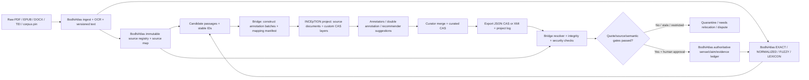

# Technology Assessment — INCEpTION

> **ID:** P50 · **Ngày khảo sát:** 2026-11-16 (Asia/Ho_Chi_Minh) · **Đối tượng:** [Eclipse INCEpTION](https://github.com/eclipse-inception/inception) · **Loại:** `platform` (web-based, collaborative scholarly/text annotation) · **Analyst:** thẩm định kỹ thuật độc lập cho BodhiAtlas, tra cứu tài liệu chính thức + đọc mã nguồn qua GitHub, **không triển khai ứng dụng**.
>
> **Mốc ổn định để đánh giá tính năng:** INCEpTION **42.3**, phát hành **2026-11-10** theo [website chính thức](https://eclipse-inception.github.io/) và [downloads](https://eclipse-inception.github.io/downloads/). **Snapshot mã `main` (để đọc code):** `3979a1a78f6a5006f6489f3e5f8c6974050e23d3`, commit ngày **2026-11-15 08:27:05 UTC** theo GitHub; `pom.xml` tại `main` ghi `43.0-SNAPSHOT`, **không phải** bản phát hành ổn định 43.0. Hai snapshot không đồng nhất, nên nhận xét `[CODE]` ở HEAD không mặc nhiên chứng minh hoạt động của gói nhị phân 42.3.
>
> **Tuyên bố phạm vi:** `NOT TESTED` đối với TC01–TC06 và mọi đo đạc hiệu năng/độ đúng thực thi; không có dữ liệu để công bố CER, latency, recall hoặc chi phí thực tế. `[DOC]` = tài liệu nhà phát triển, `[CODE]` = đã đọc code trong kho, `[ISSUE]` = báo cáo/đề nghị từ issue, `[INFERRED]` = kết luận kỹ thuật dựa trên bằng chứng, `[UNKNOWN]` = chưa đủ bằng chứng. **Không có nhãn `[TESTED]` nào cho INCEpTION** trong báo cáo này.

## 1. Executive Decision

**Quyết định: `TRIAL ONLY`** (mục tiêu sau khi qua POC: `USE AS COMPONENT` cho **V2 human-in-the-loop curation**, không dùng làm lõi BodhiAtlas V1). **Confidence: `MED`** cho kết luận phân vai; `LOW` cho mức độ phù hợp cụ thể của bridge và chất lượng vận hành cho Pāli/Hán/Tạng vì chưa chạy POC.

**Có thể tái sử dụng:** giao diện highlight span, relation có giới hạn, tagsets/custom layers, phân công người gắn nhãn, double annotation, đối chiếu bất đồng, curator merge, agreement, knowledge-base linking, export CAS JSON/XMI, một phần API điều phối. Bằng chứng: [User Guide 42.3](https://eclipse-inception.github.io/releases/42.3/docs/user-guide.html), [README](https://github.com/eclipse-inception/inception/blob/3979a1a78f6a5006f6489f3e5f8c6974050e23d3/README.md).

**BodhiAtlas vẫn phải sở hữu:** `work/edition/witness/file` và hash gốc; canonical text cùng version OCR, các source-map PDF bbox/EPUB CFI; exact exhaustive search và code verifier; typed sense/claim/evidence graph xuyên tài liệu; audit bất biến của semantic approval, rights, rollback và source coverage; registry IDs và bridge hai chiều. Chỉ có thể nhập quyết định curator vào kho chính khi *re-verification* câu chữ, vị trí, quyền và nghĩa đã qua gate.

**Vai trò theo phiên bản:**

| Lớp BodhiAtlas | Quyết định | Lý do |
|---|---|---|
| **V1 Core** | **Không thay thế** | V1 đòi OCR, source map không mất nguồn, 4 chế độ tìm bằng code và mọi occurrence; INCEpTION tập trung gắn nhãn. PRD §3–6 đặt các năng lực này vào lõi. |
| **V2 curation** | **Thử dưới dạng thành phần** | Các thao tác span/relation, curation, role, agreement phù hợp công việc gắn nhãn có người duyệt; cần POC fidelity, exported IDs và schema. |
| **V3 AI assistance** | **Tùy chọn recommender** | Machine suggestions chỉ tạo ứng viên nhãn; không tự cấp thẩm quyền xác minh câu trích hoặc luận điểm. |

**Ba rủi ro lớn, theo thứ tự:**

1. **Fidelity/identity:** CAS offsets và ID có thể thay đổi khi tái OCR, sửa segmentation, export/import. Issue [#4960](https://github.com/eclipse-inception/inception/issues/4960) phản ánh xuất RDF thiếu ID ổn định; [#5879](https://github.com/eclipse-inception/inception/issues/5879) từng phản ánh mất PDF structure khi xuất JSON CAS ở 39.5. Chưa chứng minh vấn đề còn tồn tại ở 42.3, nhưng không thể bỏ qua.
2. **Sai mô hình học thuật:** gắn nhãn `supports`/`refutes` không đồng nghĩa đã xác minh nguồn và lập luận; relation UI thường nối annotation trong một document, trong khi sense–claim–evidence của BodhiAtlas phải liên kết nhiều nguồn/ấn bản và quản lý phản chứng.
3. **Chi phí vận hành/khóa quy trình:** deployment Java/DB/API, mapping CAS schema, quyền với trích đoạn có bản quyền, đào tạo curator và bảo trì migration; khả năng export tốt không tự động đồng nghĩa portable stable IDs hay audit approvals.

**Gate quyết định thử nghiệm:** Cấm gắn nhãn `VERIFIED` vào claim chính chỉ nhờ thao tác curation trong INCEpTION; chỉ bật bridge production sau TC03, TC04, TC05 và independent verifier cùng đạt.

## 2. Sources & Evidence Ledger

**Nguồn chuẩn BodhiAtlas thực sự đã đọc:** [PRD V1.4](https://github.com/quoctran-2608/bodhi-atlas/blob/main/docs/PRD.md) (đặc biệt §§2–6), [ACADEMIC_RISKS_AND_VERIFICATION](https://github.com/quoctran-2608/bodhi-atlas/blob/main/docs/ACADEMIC_RISKS_AND_VERIFICATION.md) (đặc biệt R09/R11/R16/R20/R24, G2–G4, T13), [BuddhismDocuments-for-AI README](https://github.com/quoctran-2608/BuddhismDocuments-for-AI/blob/main/README.md) (manifest 13 upstream; local derived SQLite/FTS; code 1.0/2.0, semantic approval 2.0 chưa nghiệm thu). Đây là *tuyên bố của repository*, không phải kết quả tự chạy lại corpus. Quy tắc của BodhiAtlas về hai chế độ tra cứu/diễn giải được giữ nguyên.

**Định danh ledger:** cột `version/SHA` là **bản tài liệu 42.3** hoặc **HEAD pin** tương ứng, không gom chung làm một bằng chứng nhị phân.

| claim_id | claim | evidence class | URL/file+line | version/SHA | note |
|---|---|---|---|---|---|
| E01 | Dự án public, chưa archived, nhánh mặc định `main`, mã nguồn tồn tại | `[CODE]` | [Repository](https://github.com/eclipse-inception/inception) + GitHub repository metadata | HEAD 3979a1a | Không dùng stars để chốt |
| E02 | Release ổn định công bố 42.3 ngày 2026-11-10 | `[DOC]` | [Official homepage](https://eclipse-inception.github.io/) / [Downloads](https://eclipse-inception.github.io/downloads/) | 42.3 | `pom.xml` HEAD vẫn `43.0-SNAPSHOT` |
| E03 | License code Apache-2.0 | `[CODE]` | [LICENSE.txt L1–203](https://github.com/eclipse-inception/inception/blob/3979a1a78f6a5006f6489f3e5f8c6974050e23d3/LICENSE.txt) + [pom.xml L33–41](https://github.com/eclipse-inception/inception/blob/3979a1a78f6a5006f6489f3e5f8c6974050e23d3/pom.xml#L33-L41) | HEAD 3979a1a | Không trao quyền sử dụng tài liệu nhập |
| E04 | Annotation custom layer, span/relation, curator, recommender hỗ trợ theo thiết kế | `[DOC]` | [User Guide: Creating annotations; Curation; Projects](https://eclipse-inception.github.io/releases/42.3/docs/user-guide.html) | 42.3 | Không phải semantic-verification engine |
| E05 | `AnnotationLayer` lưu `name`, `type`, `project`, `attachType/attachFeature`, overlap/anchoring | `[CODE]` | [AnnotationLayer.java L43–124](https://github.com/eclipse-inception/inception/blob/3979a1a78f6a5006f6489f3e5f8c6974050e23d3/inception/inception-model/src/main/java/de/tudarmstadt/ukp/clarin/webanno/model/AnnotationLayer.java#L43-L124) | HEAD 3979a1a | Có schema thực; không phải model riêng work/edition |
| E06 | Relations nối hai span annotation; tối đa một relation layer nối vào một span layer (theo tài liệu UI) | `[DOC]` | [User Guide: Relations](https://eclipse-inception.github.io/releases/42.3/docs/user-guide.html) | 42.3 | Cần schema POC cho nhiều predicate |
| E07 | Curation CAS riêng; có thao tác read/write/reset và trạng thái tài liệu | `[CODE]` | [CurationDocumentServiceImpl.java L98–180](https://github.com/eclipse-inception/inception/blob/3979a1a78f6a5006f6489f3e5f8c6974050e23d3/inception/inception-curation/src/main/java/de/tudarmstadt/ukp/inception/curation/service/CurationDocumentServiceImpl.java#L98-L180) | HEAD 3979a1a | `resetCuration` xóa curation CAS: không phải rollback versioned |
| E08 | Repo chứa unit/integration tests cho logic curatable, states, annotator data | `[CODE]` | [CurationDocumentServiceImplTest.java L125–310](https://github.com/eclipse-inception/inception/blob/3979a1a78f6a5006f6489f3e5f8c6974050e23d3/inception/inception-curation/src/test/java/de/tudarmstadt/ukp/inception/curation/service/CurationDocumentServiceImplTest.java#L125-L310) | HEAD 3979a1a | **Đã đọc test**, chưa chạy (`NOT TESTED`) |
| E09 | Agreement có cho span/relation, theo feature; kết quả không chứng nhận truth | `[DOC]` | [User Guide: Agreement](https://eclipse-inception.github.io/releases/42.3/docs/user-guide.html) | 42.3 | Không suy ra semantic accuracy từ IAA |
| E10 | `jsoncas` import/export được, custom layers; `jsoncas-struct` chỉ export | `[DOC]` | [User Guide: Appendix C, UIMA CAS JSON](https://eclipse-inception.github.io/releases/42.3/docs/user-guide.html) | 42.3 | `jsoncas` không đồng nghĩa đầy đủ PDF geometry |
| E11 | `UimaJsonCasFormatSupport` khai `ID=jsoncas`, read/write true, import upgrade type system | `[CODE]` | [UimaJsonCasFormatSupport.java L44–123](https://github.com/eclipse-inception/inception/blob/3979a1a78f6a5006f6489f3e5f8c6974050e23d3/inception/inception-io-json/src/main/java/de/tudarmstadt/ukp/inception/io/jsoncas/UimaJsonCasFormatSupport.java#L44-L123) | HEAD 3979a1a | Import upgrade ≠ chứng minh byte-identical roundtrip |
| E12 | PDF searchable có editor; scan image-only phải OCR trước | `[DOC]` | [User Guide: Appendix C, PDF Format](https://eclipse-inception.github.io/releases/42.3/docs/user-guide.html) | 42.3 | Không có bằng chứng OCR native |
| E13 | PDF adapter dùng VisualPdfReader/Writer và `prepareAnnotationCas` gọi `removePdfLayout` | `[CODE]` | [PdfFormatSupport.java L57–114](https://github.com/eclipse-inception/inception/blob/3979a1a78f6a5006f6489f3e5f8c6974050e23d3/inception/inception-io-pdf/src/main/java/de/tudarmstadt/ukp/inception/io/pdf/PdfFormatSupport.java#L57-L114) | HEAD 3979a1a | Cần thử geometry với `*-struct` |
| E14 | TEI P5 mới hỗ trợ import/no export custom layers, experimental; TEI old hạn chế | `[DOC]` | [User Guide: TEI P5 XML](https://eclipse-inception.github.io/releases/42.3/docs/user-guide.html) | 42.3 | Không dùng TEI như lossless export mặc định |
| E15 | WebAnno TSV 3.x là legacy và có thể bỏ metadata unsupported | `[DOC]` | [User Guide: WebAnno TSV 3.x](https://eclipse-inception.github.io/releases/42.3/docs/user-guide.html) | 42.3 | Đừng xem TSV là canonical export |
| E16 | API AERO `/api/aero/v1` disabled mặc định; `ROLE_REMOTE`; Swagger; Basic/OAuth2 | `[DOC]` | [Admin Guide: Remote API](https://eclipse-inception.github.io/releases/42.3/docs/admin-guide.html) | 42.3 | Không mặc định API có RBAC đủ cho BodhiAtlas |
| E17 | Controller cung cấp endpoint thay đổi annotation state và kiểm `MANAGER` | `[CODE]` | [AnnotationController.java L57–112](https://github.com/eclipse-inception/inception/blob/3979a1a78f6a5006f6489f3e5f8c6974050e23d3/inception/inception-remote/src/main/java/de/tudarmstadt/ukp/inception/remoteapi/next/AnnotationController.java#L57-L112) | HEAD 3979a1a | Kiểm state API, không thay role-specific semantic approval |
| E18 | Stable IDs của xuất CAS RDF được đề nghị; numbers thay đổi khi sửa annotation theo người báo | `[ISSUE]` | [Issue #4960](https://github.com/eclipse-inception/inception/issues/4960) | open khi khảo sát | Chưa test/tổng quát hóa sang CAS JSON |
| E19 | Người báo gặp PDF page/chunk thiếu trong `jsoncas` ở 39.5 | `[ISSUE]` | [Issue #5879](https://github.com/eclipse-inception/inception/issues/5879) | reported 39.5; closed | Đóng issue không tự chứng minh POC 42.3 |
| E20 | Tạo INITIAL_CAS đã gắn nhãn từ PDF qua API là nhu cầu còn mở | `[ISSUE]` | [Issue #4003](https://github.com/eclipse-inception/inception/issues/4003) | open khi khảo sát | Rủi ro ingest pre-annotations |
| E21 | Import XML+CAS rồi khôi phục source XML để editor phù hợp là feature request | `[ISSUE]` | [Issue #5970](https://github.com/eclipse-inception/inception/issues/5970) | open khi khảo sát | Roundtrip document format có giới hạn |
| E22 | Apache/UIMA + Spring/Boot/Wicket + Maven; dependencies tại HEAD | `[CODE]` | [pom.xml L1–140](https://github.com/eclipse-inception/inception/blob/3979a1a78f6a5006f6489f3e5f8c6974050e23d3/pom.xml#L1-L140) | HEAD/43.0-SNAPSHOT | Không suy phiên bản dependencies HEAD sang 42.3 |
| E23 | Mã nguồn PRD V1.4 bắt source fidelity và code-only retrieval | `[DOC]` | [BodhiAtlas PRD §3–6](https://github.com/quoctran-2608/bodhi-atlas/blob/main/docs/PRD.md) | bản đọc 2026-11-16 | Tiêu chuẩn nghiệm thu riêng của BodhiAtlas |
| E24 | Corpus hiện có là 13 upstream pinned, derived search index; V2 semantic approval chưa hoàn tất | `[DOC]` | [BuddhismDocuments-for-AI README](https://github.com/quoctran-2608/BuddhismDocuments-for-AI/blob/main/README.md) | bản đọc 2026-11-16 | Tận dụng source of truth cũ, không tạo corpus mới trong INCEpTION |
| E25 | Rủi ro nhầm sense/false proof/copyright/annotation drift được quản lý theo gate | `[DOC]` | [ACADEMIC_RISKS_AND_VERIFICATION §2, §5–6](https://github.com/quoctran-2608/bodhi-atlas/blob/main/docs/ACADEMIC_RISKS_AND_VERIFICATION.md) | bản đọc 2026-11-16 | Gate G2/G3/G4 không thể cấp chỉ bằng UI |
| E26 | Client-side BreakIterator và khả năng pretokenize bằng XMI/TSV/CoNLL; không xác minh đủ từng hệ chữ | `[DOC]` | [User Guide: FAQ, tokenization](https://eclipse-inception.github.io/releases/42.3/docs/user-guide.html) | 42.3 | Hán/Tạng cần fixture thực |
| E27 | Đã từng yêu cầu sửa license/NOTICE bên thứ ba | `[ISSUE]` | [Issue #6380](https://github.com/eclipse-inception/inception/issues/6380) + [commit HEAD](https://github.com/eclipse-inception/inception/commit/3979a1a78f6a5006f6489f3e5f8c6974050e23d3) | 2026-11-15 | Đánh giá NOTICE/embedded assets khi đóng gói |
| E28 | Production DB khuyến nghị MariaDB, embedded HSQLDB chỉ thử nghiệm; Java ≥21 | `[DOC]` | [Admin Guide: System Requirements/Database](https://eclipse-inception.github.io/releases/42.3/docs/admin-guide.html) | 42.3 | Không suy ra cấu hình máy đủ cho corpus BodhiAtlas |

**Đọc code theo đường thực thi (không chỉ README):** `inception-documents/DocumentServiceImpl.java` (quản lý source/annotation documents/CAS), `inception-schema/AnnotationSchemaServiceImpl.java` (type system/upgrade CAS), `inception-model/AnnotationLayer.java` (persistent layer schema), `inception-curation/CurationDocumentServiceImpl.java` (curation CAS/state/reset), `inception-remote/.../next/AnnotationController.java` (AERO state endpoint), `inception-io-pdf/PdfFormatSupport.java` (reader/writer/layout), `inception-io-json/UimaJsonCasFormatSupport.java` (JSON CAS I/O), và `CurationDocumentServiceImplTest.java`. **Không đọc đủ toàn bộ dependency tree/codebase ồ ạt**; không khẳng định mọi API endpoint hay hành vi importer đều được review. GitHub issue phản ánh báo cáo hiện tại/chưa xác nhận; issue đóng/open không thay POC.

## 3. Architecture & Data Flow

**Kiến trúc dự kiến, không phải INCEpTION đã tích hợp với BodhiAtlas.** Dòng `BodhiAtlas authoritative` là hệ thống yêu cầu/hiện có; dòng `INCEpTION` dựa vào code/documentation.



**Ranh giới lưu trữ:** source document và CAS của INCEpTION là **bản làm việc phục vụ annotation**, không thay thế file gốc và chứng cứ đã được BodhiAtlas định danh. UIMA CAS có offset theo *Sofa text*; bridge không dùng offset đơn độc làm persistent citation. PDF visual editor, các lớp `PdfPage/PdfChunk` và `jsoncas-struct/xmi-struct` cần được xác nhận cụ thể vì `prepareAnnotationCas()` có xử lý layout (E13) và issue E19.

**Cây thư mục/module quan sát được (tóm tắt):** root `pom.xml` Maven; `inception/` gồm `inception-documents`, `inception-schema`, `inception-curation`, `inception-remote`, `inception-io-pdf`, `inception-io-json`, `inception-model`; `inception/…/src/test/` chứa tests; `inception-doc` chứa docs; `.mvn/` và `pom.xml` điều khiển build. Không thấy bằng chứng có schema BodhiAtlas (works/editions/witnesses) trong những mô-đun này. **Entry-point vận hành**: executable JAR hoặc Docker Compose từ gói chính thức 42.3, không lấy `pom.xml` ở HEAD làm yêu cầu runtime bản 42.3.

## 4. Feature Fit–Gap Matrix

**Quy ước:** `NATIVE` = có trong vai trò annotation; `CONFIG` = cấu hình layer/format/role; `EXTENSION` = cần thêm code INCEpTION; `EXTERNAL` = BodhiAtlas/tool khác phải đảm nhiệm; `MISSING` = không có năng lực cần thiết qua bằng chứng đã khảo sát; `UNKNOWN` = cần POC/code review; `N/A` = ngoài nhiệm vụ và không bị trừ điểm. Cột trạng thái ghi *chủ thể đáp ứng* thay vì điểm số duy nhất. `S/M/L` = công sức tích hợp **định tính**, không phải ngày công đã đo.

| ID / năng lực | Status cho INCEpTION | Bằng chứng | Công sức | Gap và cách bù/owner |
|---|---|---|---|---|
| C01 Multi-format ingest | `CONFIG + EXTERNAL` | E10, E12, E14–E15 | M | Text/PDF/HTML/TEI có mức hỗ trợ khác nhau, EPUB/DOCX ingest đầy đủ `UNKNOWN`; BodhiAtlas chuẩn hóa đầu vào và giữ nguyên file. |
| C02 OCR/layout/reading order | `EXTERNAL` | E12–E13 | M–L | OCR scan không native; PDF text order cấu hình không thay quality verifier; dùng OCR/layout extractor riêng và score/coverage. |
| C03 Canonical text/source map | `EXTERNAL + UNKNOWN` | E13, E19, E23 | L | CAS offsets và PDF renderer không chứng minh bbox/CFI ổn định; BodhiAtlas giữ `source_map_version` và passage anchors. |
| C04 Works/editions/witnesses | `EXTERNAL` | E05, E23–E24 | M | INCEpTION model project/document/annotation; BodhiAtlas giữ ontology tác phẩm/ấn bản/witness, không gộp. |
| C05 Exhaustive EXACT | `N/A` | E04, E23 | 0 (ngoài vai trò) | Không giao exhaustive exact cho annotation search; BodhiAtlas code-only search + verifier độc lập. |
| C06 Normalized multilingual search | `N/A` | E26, E23 | 0 (ngoài vai trò) | Annotation/search sidebar không đủ bằng chứng cho bỏ dấu, Hán giản/phồn, Tạng–Wylie; BodhiAtlas index riêng. |
| C07 Fuzzy/near-duplicate/OCR errors | `N/A` | E12, E23 | 0 (ngoài vai trò) | Bộ fuzzy + error-coverage ở BodhiAtlas, không xem suggestions là chứng cứ. |
| C08 Sense-aware lexicon | `CONFIG + EXTERNAL` | E04–E06 | M–L | Tagsets/KB hỗ trợ việc chọn sense, nhưng sense provenance/cross-witness equivalence ở BodhiAtlas graph. |
| C09 Semantic/hybrid/RAG | `N/A` (recommender `CONFIG`) | E04, E23 | S–M tùy chọn | Recommendation là gợi ý nhãn; semantic retrieval/RAG nếu cần là ngoài lõi, không xác minh luận điểm. |
| C10 Verified citation/source reopen | `EXTERNAL` | E13, E18–E19, E23 | L | Citation card theo file hash + bbox/CFI + text/location/meaning verification phải do BodhiAtlas. |
| C11 Note/wiki/claim memory | `EXTERNAL` | E05, E24 | M | CAS annotation không thay durable claim history/notes; dùng BodhiAtlas claim ledger, có thể đồng bộ note reference. |
| C12 API/MCP/export | `NATIVE + CONFIG` cho AERO/CAS; MCP `UNKNOWN` | E10–E11, E16–E17 | M | AERO bật thủ công, versioned mapping; MCP không thấy bằng chứng native; tự xây adapter. |
| C13 Quality coverage + incremental | `EXTERNAL` | E12, E23–E25 | M–L | INCEpTION có workflow trạng thái; BodhiAtlas phải thống kê OCR failures, version diffs, indexing scope và orphans. |
| C14 Auth/licensing/privacy/backup | `CONFIG + UNKNOWN` | E03, E16, E28 | M–L | Roles/auth có sẵn; kiểm project isolation, API privileges, quyền trích đoạn, database/asset backup + restore. |
| C15 Operational simplicity + independent deploy | `NATIVE + CONFIG` | E02, E22, E28 | M | Có JAR/Docker self-host; Java/DB/upgrade/cross-version CAS khiến vận hành nhiều hơn custom form nhỏ. |

**Không cộng điểm để vượt gate.** `N/A` ở C05–C07/C09 được xem là **phân vai hợp lý**, không phải thất bại. Nếu định dùng INCEpTION thay V1 thì các năng lực đó sẽ lập tức là `MISSING` ở thiết kế tổng thể, khiến đề xuất thay lõi **không đạt**.

## 5. Deep Technical Findings

### 5.1. Import → layer → annotation → curator và version metadata

- `[DOC]` Project manager tạo project, nạp document (text, searchable PDF, HTML, TEI tùy format), cấu hình layers/tagsets/KB; annotators thao tác trên mỗi source document; curation kết hợp nhiều annotators và đánh dấu finished. Span có thể chồng lấp, vượt câu tùy anchoring, relation nối span; [User Guide: annotation](https://eclipse-inception.github.io/releases/42.3/docs/user-guide.html).
- `[CODE]` `AnnotationLayer` là persistence entity có `type`, `name`, `attachType`, `attachFeature`, `project`, anchoring/overlap; `DocumentServiceImpl` quản lý annotation document và CAS; `CurationDocumentServiceImpl` có CAS dành cho curator và reset. Các lớp type system do `AnnotationSchemaServiceImpl` xử lý (E05/E07).
- **Metadata:** document-level annotation có thể thiết kế; guide lưu ý import/export document metadata đầy đủ chỉ với XMI/JSON CAS. **Revision history:** có timestamps, log xuất dự án, CAS storage backups nhưng **chưa chứng minh** append-only per-edit provenance (ai sửa feature nào, trước/sau, lý do, chữ ký duyệt) hay lịch sử rollback tùy ý. `resetCuration()` có tính phá hủy; không coi đó là undo an toàn. Project export chứa `annotation`, `curation`, `source`, `log` theo tài liệu 42.3, cần POC restore từng artifact.

### 5.2. Biểu diễn sense, quote, author-claim, supporting/opposing evidence

**Thiết kế đề xuất, không phải schema native hoàn chỉnh:**

| Object BodhiAtlas | Phần có thể đặt trong CAS | Phần bắt buộc để ngoài CAS |
|---|---|---|
| Sense (`sense_id`) | span `TermOccurrence`, feature `candidate_sense_id` (string/tag/KB reference), `context_role` | registry thuật ngữ/đa nghĩa + truyền thống + etymology + approved equivalents |
| Quote (`evidence_id`) | span `EvidenceSpan`, `evidence_role` `FOR/AGAINST/QUALIFIES/MENTIONS`, feature `passage_id` | SHA, immutable source map, independent verification, license, edition |
| Author claim (`claim_id`) | document metadata hoặc span `ClaimMention` nếu câu hiện trong cùng text | canonical proposition, attribution, quan hệ xuyên văn bản, scope, logic conditions |
| Claim↔evidence | relation khi **hai annotation ở cùng CAS/document**, hoặc feature chứa reference ngoài | graph edge `claim_id`, `evidence_id`, reviewer decision và counter-evidence độc lập |
| Approval | curator CAS `curated`/finished + feature status cho dự thảo | `semantic_approval` event với reviewer, timestamp, evidence hashes, policy version, immutable audit |

**Schema constraints:** relation layer gắn với một span layer (guide ghi chỉ một relation layer có thể nối vào một span layer); features/slots có thể dùng thay thế nhưng cần kiểm cardinality, label overlap và liên kết chéo tài liệu. Annotation ID nội tại không là business ID. Với `TermOccurrence` cần support nhiều sense cạnh tranh, **không ép một sense bởi hình thức từ**. `supports` không có nghĩa tác giả tán thành nguồn được trích và `contradicts` không có nghĩa phủ định tuyệt đối.

### 5.3. External IDs / page bbox / EPUB locator / OCR re-run

- `[DOC/CODE]` PDF editor dựa trên PDF.js, PDF importer có tùy chọn text order; `PdfFormatSupport.prepareAnnotationCas` gọi `PdfVModelUtils.removePdfLayout` và tồn tại biến thể `jsoncas-struct`/`xmi-struct`. **Không tìm được chứng cứ rằng mọi annotation CAS luôn mang nguyên gốc PDF page+bbox/EPUB href/CFI**.
- `[INFERRED]` Cách tích hợp ít phá vỡ: đính `passage_id`, `text_version_id`, `source_locator_id`, `quote_sha256` vào feature/manifest; source-map authoritative đặt ngoài CAS. Nếu feature không hỗ trợ trọn dữ liệu thì chỉ lưu khóa và join trong database BodhiAtlas.
- Khi OCR mới: **không import đè** lên source document cũ. Freeze snapshot CAS, xuất archive, tạo `text_version_id` mới và remap bằng `(work, edition, witness, file_sha256, nearby text/context hashes, structural anchor)`. Đánh dấu `RELOCATED_REVIEW_REQUIRED` hoặc `ORPHAN` nếu không tìm được duy nhất. Chỉ duyệt lại sau khi mở đúng nguồn; tuyệt đối không ánh xạ theo offset cũ trong im lặng. Issue [#4960](https://github.com/eclipse-inception/inception/issues/4960), [#5879](https://github.com/eclipse-inception/inception/issues/5879), [#5970](https://github.com/eclipse-inception/inception/issues/5970) khiến POC TC03/04 là gate chặn.

### 5.4. Hán/Tạng/Pāli, Unicode, tokenization, custom layers/search

`[DOC]` Hệ thống nhận UTF-8 text và custom layers; FAQ cho biết tokenization dùng Java `BreakIterator`; có thể cung cấp tokenization từ ngoài bằng XMI/TSV/CoNLL. Với annotation, có **character-level granularity** để bôi chính xác chữ Hán hay ký tự không phân tách bằng khoảng trắng. **Nhưng không có bằng chứng chạy thử** token boundaries của `無我`, `無常/无常`, Tạng Unicode, Wylie hay các tổ hợp dấu Pāli; không được suy từ chữ “multilingual” rằng đây là retriever có ngữ nghĩa tương đương. Tách conversion/normalization dictionary bên BodhiAtlas và truyền sense ID vào project.

### 5.5. Export/import formats và loss profile theo **42.3**

| Format (ID) | Import | Export | Bảo toàn annotation | Cảnh báo |
|---|---|---|---|---|
| UIMA CAS JSON 0.4.0 `jsoncas` | Có | Có | All built-in/custom layers theo guide | `jsoncas` mặc định chưa chắc kèm PDF/XML structure; tự kiểm ID/feature/offset roundtrip |
| UIMA CAS JSON + structure `jsoncas-struct` | Không | Có | All layers, có mục tiêu bổ sung structure | **Export-only**; không là vòng roundtrip độc lập |
| UIMA CAS XMI `xmi`, `xmi-xml1.1` | Có | Có | All built-in/custom layers | Kiểm Unicode XML variant và type system |
| UIMA CAS XMI + structure `xmi-struct` | Không | Có | All layers/structure | **Export-only** |
| WebAnno TSV 3 `ctsv3` | Có | Có | Phụ thuộc feature cũ | **Legacy**, có thể bỏ/sai multi-value; không dùng canonical |
| CoNLL-U `conllu` | Theo format guide | Theo format guide | Không đảm bảo custom scholarly layers | Dùng khi trao đổi linguistic tokens, không cho audit claims |
| PDF `pdf2` | Có | Có | Import không có user annotations PDF, export span as PDF annotations | Scan image-only cần OCR; PDF annotations không phải CAS native |
| PDF+CAS `pdf2JsonCas`, `pdf2XmiCas` | Không | Có | Embedded CAS, experimental | Export-only; liên hệ version/layout POC |
| TEI P5 mới `tei-xml-document` | Có (experimental) | Không | Không xuất custom layers | Bật `format.tei.enabled=true`; không thay TEI archival |
| TEI P5 cũ `dkpro-core-tei` | Có | Có | Một số built-in linguistic layers | Legacy; có thể mất cấu trúc XML và annotation khác |
| Text `text` | Có | Có | **None** | File UTF-8 text export không đồng nghĩa annotation export |

Nguồn: [User Guide 42.3 Appendix C](https://eclipse-inception.github.io/releases/42.3/docs/user-guide.html); đối chiếu `[CODE]` `UimaJsonCasFormatSupport` (`isReadable/isWritable=true`, import có type-system upgrade). Quy tắc contract: **bản gốc/TEI của BodhiAtlas là authoritative; export CAS là sản phẩm dẫn xuất**. Nếu yêu cầu bàn giao TEI P5 cho nghiên cứu, cần converter CAS→TEI stand-off do nhóm tích hợp viết và test bảo toàn quan hệ/IDs.

### 5.6. Role, double annotation, agreement, provenance và rollback

- `[DOC]` project permissions có manager/curator/annotator; hỗ trợ nhiều annotators và curation merge. Curation có lựa chọn re-merge với option **discard already curated annotations**; thao tác này có thể xóa curated results. Agreement chỉ dùng được với span/relation, theo feature; không đo degree-of-truth về luận điểm.
- `[CODE]` CurationDocumentServiceImpl quản lý CAS `CURATION_SET`, `writeCurationCasSilently`, `readCurationCas`, `resetCuration`, states; tests mô tả dữ liệu từ annotator đã bỏ role vẫn có thể vào curation, và documents không có dữ liệu bị chặn (E07/E08). Không tự khẳng định audit log đầy đủ cho thay đổi từng trường.
- **Thiết kế bắt buộc:** audit của BodhiAtlas ghi append-only `action`, `old/new hash`, `reviewer`, `role`, `timestamp`, `decision_policy_version`, `source_locator_version`, `curation_export_hash`; revoke/undo là **event mới**, không sửa hay xóa lịch sử. Tính năng backup nội bộ không thay tính bền vững của audit.

### 5.7. API, self-host, upgrade

`[DOC]` AERO REST-like API tại `/api/aero/v1`, opt-in `remote-api.enabled=true`, `ROLE_REMOTE` và project permissions; Swagger UI tại `/swagger-ui.html`; HTTP Basic có thể bật và OAuth2 JWT có lựa chọn cấu hình. API legacy `/api/v1` **deprecated**, ở 42.x còn phải bật `remote-api.legacy.enabled=true`, không dùng làm bridge mới. `[CODE]` `AnnotationController.updateState` xác minh role `MANAGER` rồi cập nhật annotation state. **Chưa chứng minh** API duy trì ổn định per-annotation permanent ID, revision event/webhook toàn bộ, CAS writer roundtrip, hay direct import preannotated PDF INITIAL_CAS: issue #4003 còn mở.

Self-host: bản 42.3 có desktop, executable JAR (Java 21+), Docker Compose. Server production ưu tiên MariaDB ≥10.11 hoặc MySQL ≥8.4; PostgreSQL ≥16/MS SQL 2022 ghi experimental ở guide; HSQLDB embedded dùng thử nghiệm. Cần staging restore và cross-version migration trước bất kỳ update major. **Không trộn phiên bản HEAD `43.0-SNAPSHOT` với runtime 42.3**.

### 5.8. Ai thực sự quyết định một claim được chứng minh?

**Annotator:** phân loại mention/claim/evidence; **curator:** hợp nhất hoặc bác nhãn thành curated corpus; **BodhiAtlas code verifier:** xác minh câu chữ và locator trong đúng source; **scholarly reviewer được ủy quyền trong BodhiAtlas:** duyệt đánh giá bằng chứng có/không hỗ trợ claim và mức độ chắc chắn theo chuẩn PRD. INCEpTION curator **không mặc nhiên** là reviewer đủ thẩm quyền cho semantic approval; consensus của 3 annotators cũng không là logic proof. Chế độ AI/recommender chỉ **PROPOSED**, không tự chuyển sang `VERIFIED`/`PUBLISHED`. Điều này đặc biệt quan trọng vì repo BuddhismDocuments-for-AI công bố V2 chưa có semantic approval đã được nghiệm thu.

### 5.9. Bridge passages → annotations → passages

**Forward:** xuất snapshot `passage_id` cùng `text_version_id`, file SHA, roles, permissions và raw normalized **text nguyên vẹn** → tạo source document/manifest; đưa từng highlight candidate kèm `external_annotation_id` UUIDv7 (nếu hỗ trợ feature) hoặc ở bảng mapping. **Backward:** export `jsoncas` cùng metadata project/annotator/curator; giải mã CAS offsets (sofa; kiểm Unicode), so bản trích span với đúng version text, nối mapping theo UUID/external ID + hash/context; dùng independent verifier mở source; ghi `review_event` bất biến. Mapping **không dùng** `CAS xmi:id`/position là ID nghiệp vụ; chuyển `orphan` nếu không resolve duy nhất. Chi tiết contract ở mục 8.

### 5.10. Chi phí cấu hình/đào tạo so với custom UI

INCEpTION giảm công xây *multi-annotator corpus tool*, tagsets và curator UI, nhưng có đường cong học annotation layers/UIMA/CAS/AERO, vận hành Java/DB và import/export; custom UI chỉ có 1–3 form (`claim`, `sense`, `evidence`) có thể đơn giản hơn nếu số curator ít và mọi nguồn phải quay về PDF/EPUB locators của BodhiAtlas. Không có dữ liệu chấm thời gian thực. **Trial hai nhánh trên cùng fixture**; so tổng giờ config + onboarding + thao tác 100 passages + migration/rollback + vận hành, không chỉ tốc độ click.

## 6. Source Fidelity & Provenance

**Các bất biến từ PRD/Risks:** raw asset bất biến, checksum SHA-256; phân biệt work/edition/file/witness; text/OCR có version và confidence; exact vị trí là chứng cứ; printed page chỉ khi có mapping đáng tin; kiểm câu chữ, vị trí, ngữ cảnh/ý nghĩa và trạng thái nguồn khác nhau; báo rõ unindexed/low-quality/failed access. CAS tự nó không bảo đảm từng trường này.

**Khung authoritative citation card đề xuất** (field names của BodhiAtlas, **không giả có sẵn trong INCEpTION**):

```json
{
  "work_id": "<id>",
  "edition_id": "<id>",
  "witness_id": "<id-or-null>",
  "file_id": "<id>",
  "file_sha256": "<64-hex-from-source>",
  "author_id": "<id-or-null>",
  "translator_id": "<id-or-null>",
  "text_role": "ORIGINAL|TRANSLATION|COMMENTARY|INDIRECT",
  "text_version_id": "<ocr-or-extract-version>",
  "passage_id": "<stable-id>",
  "quote_verbatim": "<from-source-not-LLM>",
  "locator": {"kind": "PDF|EPUB|TEI|TEXT", "pdf_page": null,
    "bbox": null, "printed_page": null, "printed_page_evidence": null,
    "epub_href": null, "epub_cfi": null, "tei_xml_id": null},
  "match_type": "EXACT|NORMALIZED|FUZZY|LEXICON|SEMANTIC",
  "ocr_state": "GOOD|UNCERTAIN|FAILED|NOT_APPLICABLE",
  "verification": {"text": "PENDING", "location": "PENDING", "meaning": "PENDING"},
  "coverage_scope_id": "<snapshot-id>",
  "rights_policy_id": "<id>",
  "curation_reference": {"project_slug": "<slug>", "export_sha256": "<64-hex>"}
}
```

**Verifier độc lập tối thiểu:** (1) xác định đúng raw file + sha; (2) đối chiếu nguyên văn với text version và số lần xuất hiện, **không** dừng tại first hit; (3) xác nhận start/end UTF-16/codepoint map nếu CAS offsets cần chuyển; (4) resolve source map, mở đúng trang/bbox hoặc EPUB locator; (5) đối chiếu vùng lân cận/nguồn phủ định/chú giải; (6) chỉ reviewer duyệt interpretation. Với 5 occurrences cùng file, 5 `occurrence_id` riêng; không nhập bừa một ID cho 5 span. Khi scan chưa đọc được, trả `SOURCE_UNVERIFIABLE` hoặc `OCR_LOW_CONFIDENCE`; khi index thiếu, trả `COVERAGE_INCOMPLETE`. **Không đưa ra số trang/bbox nào trong báo cáo vì chưa có fixture nguồn tương ứng.**

**Gate:** `SOURCE_FIDELITY=UNKNOWN` cho bridge (chưa roundtrip); nếu dùng INCEpTION *độc lập làm citation engine*, `FAIL` về khả năng chứng minh đầy đủ theo PRD hiện có. `PORTABILITY=UNKNOWN` đến khi export/import khôi phục stable Bodhi IDs, labels, scope, curation decisions và audit. Đừng chuyển `UNKNOWN` thành `PASS` chỉ vì định dạng ghi “all custom layers”.

## 7. Multilingual & Retrieval Behavior

**Bảng này phân biệt nhãn văn bản (`annotation`) với tra cứu toàn bộ thư viện (`retrieval`).** Các status truy vấn từ vựng là **chức năng BodhiAtlas phải thiết kế/test**, không phải kết quả thực nghiệm INCEpTION.

| Ca truy vấn | Annotation trong INCEpTION | Retrieval yêu cầu ở BodhiAtlas | Trạng thái kiểm chứng |
|---|---|---|---|
| `anatta`, `anattā`, `anātman`, `vô ngã`, `vo nga`, `無我` | Có thể annotate span, lựa chọn `sense_id` bằng custom feature/KB (`CONFIG`); không tự suy tương đương | EXACT riêng; NORMALIZED có quy tắc dấu; LEXICON theo từng nghĩa/truyền thống (`EXTERNAL`) | `NOT TESTED`, không gộp Pāli/Sanskrit/Hán theo hình thức |
| `無常` ↔ `无常` | Unicode spans, granularity character | Chinese traditional/simplified index + source-preserving mapping | `NOT TESTED`; không suy từ tokenization |
| `dukkha` / `duḥkha` / `khổ` | Tag riêng nhiều sense, relation evidence/translation | Transliterations/lexicon có provenance, giải quyết polysemy | `NOT TESTED` |
| Tạng Unicode ↔ Wylie | Có thể bôi ký tự, tokenizer khả nghi cần kiểm | Unicode normalization + Wylie transliteration + lexical verification | `UNKNOWN / NOT TESTED` |
| Câu dài 200–300 ký tự và 5 lần xuất hiện trong 1 file | Có thể annotate các span tìm thấy | EXACT phải tìm **đủ 5 vị trí** cả across chunk/page boundaries trong indexed scope | INCEpTION exhaustive exact `N/A`; BodhiAtlas `NOT TESTED` trong POC này |
| “Tác giả nào phân biệt vô thường và khổ, lập luận thế nào?” | Người gắn `ClaimMention`, `EvidenceSpan`, qualifier/rebuttal | Code tìm candidates, metadata lọc tác giả; người/AI diễn giải **trên bản trích được kiểm** | Không cho auto-verified claim |

**Hành vi cần chứng minh với fixture:** giữ raw Unicode NFC/NFD; `vô ngã` không biến thành `vo nga` trong trích dẫn; `無常` và `无常` không hợp nhất trong raw; `anatta` không tự coi `anātman` đồng nghĩa trong mọi ngữ cảnh; Tạng không bị mất `tsheg`/stacked glyph; tách chữ Hán không cần whitespace; ngoặc, phủ định, chú thích, bảng/cột vẫn nằm trong coverage. Tìm ứng viên bằng code ≠ đọc và đánh giá lập luận. Recommender confidence ≠ độ xác thực của quote.

**Phân loại trách nhiệm:** `EXACT` = `EXTERNAL` (BodhiAtlas), `NORMALIZED` = `EXTERNAL`, `FUZZY` = `EXTERNAL`, `LEXICON` = `CONFIG` cho label nhưng retrieval `EXTERNAL`, `SEMANTIC` = `N/A` với V1, chỉ recommender annotation `CONFIG` tại INCEpTION, semantic candidate retrieval tùy chọn từ engine khác.

## 8. Integration Options for BodhiAtlas

### 8.1. Phương án A — INCEpTION là *curation workbench* tách biệt (ưu tiên thử nghiệm)

**Vai trò:** V1 của BodhiAtlas vẫn tự quản file bất biến, metadata, source map, extraction, search, citation verifier; INCEpTION chỉ quản giao diện gắn nhãn đa người, annotation schema và curation set cho V2. Không đưa PDF scan thẳng vào INCEpTION rồi mặc nhiên coi text đó có fidelity học thuật.

**Contract đầu vào, phiên bản thử nghiệm `ba-annotation-v0`:**

```json
{
  "contract_version": "ba-annotation-v0",
  "project_key": "bodhi-curation-pilot",
  "document_external_id": "ba:passage-bundle:001",
  "source": {
    "work_id": "W001", "edition_id": "E001", "file_id": "F001",
    "file_sha256": "<checksum-from-BodhiAtlas>",
    "text_version_id": "T001", "rights_policy_id": "RP001"
  },
  "passages": [
    {
      "passage_id": "P001", "text_sha256": "<checksum-of-exact-passage-text>",
      "verbatim": "<canonical-extracted-text>",
      "locator_ref": "L001", "coverage_ref": "C001",
      "offset_unit": "Unicode-code-point", "offset_start": 0, "offset_end": 0
    }
  ]
}
```

Các ID ở trên chỉ là **fixture và schema đề xuất**, không phải ID thật. Chương trình bridge tạo text document và **manifest riêng** nối `inception_project_id`, `inception_source_document_id`, `document_external_id`, `passage_id`, `text_version_id`, `text_sha256`, ánh xạ Unicode code point ↔ offsets CAS; giữ manifest ngoài INCEpTION trong bảng của BodhiAtlas. Có thể dùng tính năng external ID/custom feature trong layer, nhưng **không giả định** mọi ID custom được REST/format tự bảo toàn; POC kiểm bằng raw export.

**Schema tối thiểu để cấu hình:**

| Layer/feature | Kiểu/giá trị đề xuất | Quan hệ nguồn dữ liệu và bất biến |
|---|---|---|
| `TermMention` | span; `lemma_id`, `sense_id`, `language`, `script`, `surface_form` | `sense_id` phải là tham chiếu BodhiAtlas, không đoán từ cách viết |
| `QuoteSpan` | span; `passage_id`, `occurrence_id`, `text_version_id`, `quote_sha256` | Raw bytes và source locator do BodhiAtlas quyết định |
| `ClaimMention` | span hoặc document label; `claim_id`, `speaker`, `modality`, `scope`, `negation` | Không biến trích lời người khác thành quan điểm tác giả |
| `EvidenceLink` | relation hoặc external relation table; `claim_id`, `passage_id`, `stance` (`FOR/AGAINST/QUALIFIES/MENTIONS`), `evidence_id` | Cross-document edges và cardinality chưa chứng minh native; cho phép bảng ngoài |
| `ReviewDecision` | external audit table; `reviewer_id`, `decision`, `reason`, `timestamp`, `schema_version`, `export_checksum` | **BodhiAtlas** mới lưu phê duyệt học thuật có thẩm quyền |

**Contract đầu ra:** job định kỳ hoặc thao tác curator xuất project/annotation CAS XMI/JSON (nếu API hỗ trợ đúng đường đi; không bịa endpoint), convert qua adapter thành `annotation_event` chứa: `annotation_external_id` (tạo/ổn định bởi bridge), `passage_id`, `text_version_id`, offset range, `layer`, `features`, `annotator_id`, `curation_stage`, `export_sha256`, `source_verified_status`, `reviewer_decision_ref`. Không chấp nhận ID CAS tạm của export làm khóa ngoại chính. Việc tạo `annotation_external_id` phải idempotent dựa trên registry + xác nhận match; không dùng hash(text+offset) đơn thuần vì hai annotation trùng vị trí/khác ý nghĩa có thể cùng tồn tại.

**Gating hai chiều:**

1. `BodhiAtlas → INCEpTION`: chỉ tài liệu có quyền và `text_version_id` đã đóng băng; hash file/passage manifest được tính và lưu trước import. Không sửa gốc.
2. `INCEpTION → staging`: chấp nhận draft/candidate, không tự cập nhật `verified_claims`.
3. `staging → source verifier`: kiểm `text_sha256`, occurrence/offset, original source map và permission; nêu lỗi cụ thể.
4. `staging → reviewer`: người duyệt ngữ cảnh và stance; chỉ khi *cả* verification và authority đạt thì mới phát hành `APPROVED`.
5. `approved → BodhiAtlas`: lưu `approval_event_id` bất biến cùng provenance, có chính sách revoke/supersede; không coi xóa CAS là xóa lịch sử quyết định.

**Migration và rollback:** mỗi batch có `bridge_version`, `schema_version`, `source_snapshot_id`, `export_hash` và transaction ID; `dry-run` đối chiếu trước; nếu offset/text/schema sai, chuyển `QUARANTINED` và giữ bản xuất cũ; revert pointer tới snapshot tốt cuối cùng, không làm mất audit event. Re-index chỉ đổi artifact phái sinh; nếu OCR mới làm text thay đổi, tạo version + explicit annotation relocation review; tuyệt đối không âm thầm cập nhật xác minh.

**Gate để chọn A:** TC01–TC06 đạt và người dùng hoàn tất 100 passages với workload chấp nhận được; hồi phục được source locator và được phép trên dữ liệu có bản quyền; API đủ ổn định. Hiện trạng `TRIAL ONLY`.

### 8.2. Phương án B — BodhiAtlas tự viết *minimal curation UI* (baseline bắt buộc)

**Vai trò:** một giao diện web có các màn `passage detail`, `sense picker`, `claim ↔ evidence`, `review queue`, `source reopen`, `audit history`; sử dụng trực tiếp DB, auth, verifier và source-map đã có của BodhiAtlas. Contract vào là `passage_id`, `source_locator_id`, `text_version_id`, role; contract ra là event immutable `propose/approve/reject/revoke` và schema typed relation như phương án A.

**Ưu:** không cần đồng bộ offsets/CAS, dễ kiểm quyền theo từng nguồn, giảm chi phí đào tạo với 1–2 reviewer, tạo xác minh câu chữ/vị trí ngay cạnh viewer. **Nhược:** tự viết UX annotation span, quan hệ, phân công, double annotation, agreement, conflict resolution, import/export, bảo trì và kiểm thử quyền. Không gắn nhãn "nhẹ hơn" khi chưa đo giờ công; cần đặt cạnh A trong cùng bài POC và cùng người dùng.

**Failure/rollback:** mọi thay đổi đi vào append-only audit log, `review_decision` có predecessor; khôi phục UI bằng deployment rollback, dữ liệu qua migration reversible và không đổi raw citation. Quyền là ACL BodhiAtlas hiện hành; cần test negative permission TC05.

### 8.3. Phương án C — TEI P5/stand-off làm interchange/archive, không phải hệ thống xét duyệt

Nếu corpus đã có TEI/XML/witness ID, có thể xuất `standOff`/`spanGrp`/`linkGrp` trỏ `xml:id`, passage/version và `@target` theo thiết kế; xác minh từ [TEI P5 Guidelines](https://www.tei-c.org/release/doc/tei-p5-doc/en/html/SA.html). **TEI là chuẩn biểu diễn, không tự cung cấp curator UI, auth hay approval.** Cần adapter chuyển CAS → TEI với việc bảo toàn nghĩa, provenance và relation; không tự nhận `TEI roundtrip PASS` khi chưa thử. Với evidence vượt nhiều tài liệu, để bảng quan hệ ngoài, lưu URI bất biến tới từng witness.

### 8.4. Chiến lược quyết định giữa các phương án

Thử A và B trên chính 100 passages của TC06; so **tổng giờ** (`setup + schema + training + curation + export+verifier + recovery + upgrade`) với chất lượng duyệt, chứ không chỉ thời gian thao tác annotation. Chỉ dùng A nếu chức năng đa người thực sự tiết kiệm công đủ để bù bridge. C có thể dùng kèm cả A/B ở lớp dữ liệu, nhưng không thay verifier/DB nguyên bản.

## 9. Practical POC / Reproduction Plan

**Trạng thái chung: `NOT TESTED`.** Báo cáo có đọc docs/code/tests/issues qua GitHub và web, **không dựng server INCEpTION, không chạy corpus hay tạo annotation thật, không đo latency/recall/cost**. Lệnh dưới là hướng tái lập, không phải command đã thực thi. Khóa phiên bản image/JAR thực tế theo hash lúc tải; tách kiểm thử `42.3 stable` khỏi kiểm tra mã nguồn `main 3979a1…`.

### 9.1. Môi trường, fixtures và oracle

- **Environment đề xuất:** Linux hoặc WSL2, Docker/Compose hoặc JDK đáp ứng release notes, MariaDB cấu hình persistent volume, SSL/reverse proxy khi multi-user; pin INCEpTION `42.3` theo official download. Ghi CPU/RAM/disk, DB version, git commit bridge, local timezone, Java version, image digest, schema project export và checksum fixture.
- **Fixture corpus quyền rõ:** `F-PLI-01` Pāli `anattā` vs `anatta`; `F-SKT-02` Sanskrit `anātman`/`duḥkha`; `F-VI-03` có dấu và không dấu; `F-ZH-04` `無常`/`无常` không khoảng trắng; `F-TIB-05` Unicode Tibetan/Wylie; `F-PDF-06` born-digital PDF có 2 cột, phủ định và offset/locator; `F-OCR-07` hai phiên bản OCR có mất/chèn ký tự; `F-EPUB-08` EPUB href/CFI để thử bridge (nếu không import native thì dùng text+external manifest). Nếu không có quyền trích dữ liệu thật, tạo passages *tự viết* và tệp PDF test; **không tuyên bố đây là corpus Phật học đại diện**.
- **Golden answers:** hai sense ID riêng biệt cho cùng một surface; một luận điểm có 2 hỗ trợ + 1 phản chứng; 5 occurrences trong cùng text; ít nhất một `not supported` do từ khóa giống nhưng sai ngữ cảnh; một `orphan` sau thay OCR; một requester trái quyền phải 403/404 hoặc cơ chế không làm lộ text. `printed_page` chỉ khi fixture có trang in đối chiếu riêng, tuyệt đối không điền từ PDF ordinal.
- **Phân công oracle:** người A và B gắn nhãn độc lập, người C làm reviewer và ghi lý do; kỹ sư xác nhận source bytes/hash/locator. Reviewer **không** duyệt được nếu verifier báo invalid. Giữ gold JSON, image/PDF render có locator kiểm độc lập, export nguyên bản và log command.

### 9.2. Test matrix có thể tái lập

| Test | Steps/command minh họa | Gold answer / expected output | Metrics & gate | Kết quả |
|---|---|---|---|---|
| **TC01**: 3 annotators/1 reviewer, 2 nghĩa/3 evidence | Tạo project, 4 users và phân quyền; import 3 passages, cấu hình `TermMention`, `ClaimMention`, `EvidenceLink`; ba annotators independently label, curator reconcile | 2 `sense_id` không gộp; 3 evidence phân biệt FOR/AGAINST/QUALIFIES; curator quyết định có author/reason; suggestion không tự APPROVED | 100% gold relation IDs, lưu được reviewer provenance; theo dõi click/time | `NOT TESTED` |
| **TC02**: spans Việt/Hán/Pāli/Tạng | Import Unicode NFC/NFD, đoạn `vô thường`/`khổ`, `無常`, Tibetan Unicode; chọn character mode; gắn span + relation, reject một suggestion | Spans đúng byte/text/offset và polarity; text xuất vẫn đúng NFC/NFD theo contract; reject không thành accepted | `span_exact_match`, broken grapheme, false accepted label=0 | `NOT TESTED` |
| **TC03**: export–roundtrip | Export `xmi`,`jsoncas` và thử `tei-xml-document` nếu UI hiện hỗ trợ; reimport vào clone project; kiểm schema/offset/relation/scope/IDs | Custom fields/relations không mất trong XMI/JSON; `document_external_id` & `passage_id` qua registry giữ nguyên; TEI export `N/A` nếu không hỗ trợ; missing metadata = fail | % field/edge retained, exact span match, orphan count, stable-ID checks | `NOT TESTED` |
| **TC04**: OCR/segmentation drift | Import text v1, gắn 6 spans; tạo v2 OCR đổi dấu/chèn từ/chia đoạn; reimport thành **new** text version; chạy alignment (external) và review remap | Annotation không tự nhảy sang câu sai; suspect mismatch/quarantine; v1 vẫn mở được; remap phải có confirmation + audit | incorrect silent relocation=0, orphan detections, reopen success | `NOT TESTED` |
| **TC05**: permissions/rights | 2 projects public/private; account ngoài, annotator, curator, manager; dùng browser + REST calls sau khi bật API và ROLE_REMOTE đúng quyền | Không đọc/download/export được text hay CAS private khi chưa có permission; logs không rò raw content; admin exception được ghi | unauthorized successful reads=0, leakage count=0, 401/403 expected as configured | `NOT TESTED` |
| **TC06**: API + 100 passages | Import 100 canonical passages/manifest theo API documented trên Swagger; multi-user annotate/curate; export/staging/verify; chạy cùng workflow B custom UI | 100/100 passages có stable ID đối chiếu; mỗi annotation nhập không mất provenance, lỗi mơ hồ quarantine; kết quả thời gian/công sức thực | p50/p95 thao tác, labor hours, retry errors, export recovery, infrastructure usage; không đặt latency số giả | `NOT TESTED` |

**Bổ sung gate bắt buộc BodhiAtlas ngoài 6 TC:**

- `G-EXACT`: chạy V1 code search trên câu 200–300 ký tự xuất hiện **5 lần trong một file**, có ít nhất 1 occurrence ở ranh giới chunk; gold đủ năm `file+offset+locator`; exact full recall = số hit gold tìm được / 5. Đây **không phải** bài test INCEpTION.
- `G-CITATION`: 20 citation candidates gồm đúng, sai edition, OCR mất chữ, hallucinated page, phủ định, sách chưa index; `FALSE_VERIFIED_CITATION=0` là gate đặc biệt quan trọng, không thay bằng điểm tổng.
- `G-MULTILINGUAL`: đối chiếu `anatta/anattā/anātman/vô ngã/vo nga/無我`, `無常/无常`, `dukkha/duḥkha`, Tibetan/Wylie; report riêng exact vs normalized vs lexicon; mọi mapping cross-language phải gắn `sense_id`/authority.
- `G-PORTABILITY`: phá môi trường INCEpTION sau khi có snapshot, restore từ CAS exports + bridge registry + Bodhi raw metadata; mọi verified claim phải mở lại được, nếu không = fail.

### 9.3. Commands/steps khởi động tham khảo — **không phải run log**

```bash
# Lựa chọn 1: dùng Docker Compose deployment theo Admin Guide 42.3,
# pin tag 42.3 và image digest thực tế, tạo secrets và persistent volumes.
# Chỉ chạy sau khi review file compose chính thức của bản 42.3:
docker compose config
docker compose up -d
docker compose ps

# Lựa chọn 2: nếu sử dụng standalone JAR đã tải từ release 42.3;
# TÊN FILE là placeholder, không giả là tên artifact phát hành:
java -version
java -jar "$INCEPTION_JAR"   # biến trỏ tới file JAR 42.3 thực tế đã tải

# REST: bật `remote-api.enabled=true` theo admin guide;
# xác nhận endpoint thực trên Swagger UI của instance (/swagger-ui.html).
# Sau đó dùng curl trong script riêng và ghi status/response được redacted;
# KHÔNG đặt bearer/basic password vào command history/log lưu công khai.

# Hash fixtures và exports:
sha256sum fixtures/* exports/*
```

**Lệnh đo retrieval/verifier chỉ là interface dự kiến**, phải triển khai/adapt vào `BuddhismDocuments-for-AI`/BodhiAtlas theo CLI thực tế. Ví dụ lệnh CLI **có thật trong README** để kiểm baseline (khi upstream pins và index đã đủ): `bin/buddhist-corpus status`, `bin/buddhist-corpus search 'sutaṃ' --language pli --context 2 --with-provenance`. Không tuyên bố hai lệnh ấy đã chạy trong cuộc thẩm định này.

### 9.4. Nhật ký kết quả chuẩn bắt buộc khi chạy lại

Mỗi run lưu `{run_id, UTC_timestamp, app_version, git_sha, docker_digest, db_version, fixtures_sha256, source_sha256, bridge_sha, schema_sha256, executed_commands, stdout_stderr_redacted, request_response_redacted, test_case_id, gold_fixture_id, observed_output, pass_fail, failure_reason, operator, reviewer}`. Định lượng `EXACT_FULL_RECALL`, `FALSE_VERIFIED_CITATION`, `SOURCE_REOPEN_SUCCESS`, `annotation_roundtrip_fidelity`, `permission_leaks`, `reviewer_minutes`, setup/training hours và load-time/latency. OCR CER/WER chỉ đo khi fixture có gold transcription độc lập; không đo OCR của INCEpTION khi OCR là upstream external.

## 10. Deployment, Security, Legal, Cost

### 10.1. Ứng dụng, dependencies và triển khai

- **[DOC/CODE]** INCEpTION là Java/Spring Boot/UIMA/Wicket; `pom.xml` tại `main 3979a1…` liệt kê dependencies (Spring Boot `4.1.2`, UIMA `3.7.0`, MariaDB/PostgreSQL/JPA, Hibernate, PDFBox, Lucene…) nhưng **đó là mã main 43.0-SNAPSHOT**; không được gọi là dependency chắc chắn của bản 42.3 nếu chưa đọc 42.3 POM.
- **[DOC]** Admin Guide chính thức hướng dẫn chạy standalone hoặc server/Docker và quản trị users, storage, database. Triển khai production phải dùng persistent storage, backup database **và** thư mục repository/CAS; test consistency khi restore. Môi trường DB embedded hoặc cấu hình dev không mặc nhiên phù hợp production. Chọn DB được phiên bản 42.3 hỗ trợ theo [Admin Guide](https://eclipse-inception.github.io/releases/42.3/docs/admin-guide.html); không nhận định chắc cấu hình tương thích khi chưa test driver/migration.
- **[UNKNOWN]** RAM/CPU, dung lượng 100 passages/corpus lớn, tốc độ import/export, thời gian nâng cấp, downgrade path cho 42.3 chưa được đo. Không đưa số tối thiểu tự đoán; đo POC với file size thật, CAS/project counts và số curator đồng thời.
- **[INFERRED]** Docker Compose + MariaDB có thể giảm công server setup nhưng tăng mặt bảo trì ở Java/DB, version migration, token/role API; so với custom Python/SQLite curation UI nếu nhóm nhỏ.

### 10.2. Quyền hạn và bảo vệ dữ liệu

**[DOC/CODE]** API AERO là tùy chọn (`remote-api.enabled=true`), quản lý quyền và token/role; update state API trong `AnnotationController` yêu cầu `MANAGER` ở code main (không suy mọi route đều yêu cầu như vậy). Test với user `ROLE_REMOTE` theo Admin Guide và per-project ACL; chạy TC05 cho API và UI, không chỉ UI. Không cho broad manager token trong automation không cần thiết.

**Threat model cụ thể:** tài liệu private được copy vào instance annotation; project-level access không tự đồng nghĩa per-passage embargo; export backup chứa toàn văn; annotation/quote có thể tiết lộ bản dịch có bản quyền; OAuth/basic secret và logs có thể lộ; cloud models/recommenders có thể egress dữ liệu. Mặc định self-host, TLS, secret store, firewall, audit, least privilege, disable external recommender/knowledge base cho private project trừ khi được phép, tách môi trường public/private và xác thực quyền xuất full source. **Không coi repo public đồng nghĩa corpus/bản dịch public domain.**

**Provenance của approval:** curation-set workflow không thay được ledger `who approved what and why`; append-only review event bên BodhiAtlas phải ghi reviewer identity, time, source snapshot, evidence IDs, rationale, previous/superseding state, explicit consent/authority và policy. Backup phải chứa CAS XMI/JSON, project layer settings, users/roles snapshot **không kèm plaintext secrets**, bridge registry và review journal. Thử restore định kỳ.

### 10.3. Giấy phép, bản quyền, phát hành

| Loại | Kết luận theo chứng cứ | Việc phải làm |
|---|---|---|
| Code INCEpTION | **Apache License 2.0** trong [`LICENSE.txt`](https://github.com/eclipse-inception/inception/blob/3979a1a78f6a5006f6489f3e5f8c6974050e23d3/LICENSE.txt) và POM | Giữ attribution/NOTICE cần thiết, kiểm embedded third-party assets; xem issue [#6380](https://github.com/eclipse-inception/inception/issues/6380) |
| Model/recommender weights | `UNKNOWN`; phụ thuộc model tải/cấu hình riêng | Inventory từng model, license, inference provider, training rights, opt-in; POC không cần model |
| Dataset/corpus upstream | Tách biệt code; 13 pinned upstream có nhiều nguồn và policy | Kiểm manifest, nguồn bất biến, license từng witness/translation/image trước import/export |
| Trích dẫn/ảnh PDF, bản dịch, TEI/EPUB | Không suy từ license của INCEpTION | Chính sách xuất bản, số trang hình ảnh, nhân bản backup, phạm vi curator và quyền tái sử dụng |
| Dịch vụ cloud/AI | Không bắt buộc | Không upload private docs vào dịch vụ ngoài khi không có permission rõ |

### 10.4. Cost model — **chỉ công thức, không phải báo giá/benchmark**

`TCO_12m = setup_engineer_hours × rate + schema_and_bridge_hours × rate + curator_training_hours × rate + review_hours × rate + hosting/DB/storage/backup/TLS + upgrades/security_patch_hours × rate + rights_compliance_cost`.

So với custom UI bằng cùng horizon và cùng fixtures: `ΔTCO = TCO_INCEpTION_bridge − TCO_minimal_UI`. Nhập số thực sau TC06: số curator, phiên làm việc, trang/đoạn/tháng, tài liệu private, lượng CAS export, tần suất OCR changes, số đường duyệt. Nếu nhiều annotators & agreement needed, lợi ích INCEpTION tăng; nếu nhóm 1–2 người và source re-open là chính, chi phí bridge/đào tạo có thể chiếm ưu thế. **Không có chứng cứ cho giá tiền, latency, CER hay giờ công cụ thể** ở lần khảo sát này.

## 11. Comparison & Trade-offs

Phạm vi so sánh là **lớp quản lý annotation và scholarly review**, không lấy FTS/OCR để đánh bại một công cụ không có sứ mệnh đó. `N/A` ở đây là khác vai trò, không phải lỗi thiết kế.

| Ứng viên | Tài sản tái sử dụng tốt nhất | Sense/claim/evidence workflow | Source fidelity nguyên bản/locator | API/export/portability | Công sức/risks cho BodhiAtlas | Đánh giá |
|---|---|---|---|---|---|---|
| **INCEpTION** (platform) | Editor spans/relations/custom layers; double annotation, curator, agreement, recommender tùy chọn | **CONFIG + EXTENSION**: schema gắn nhãn có; approval semantics và cross-doc evidence cần bridge | **EXTERNAL/UNKNOWN**: PDF/TEI import có nhưng checksum/locator canonical/ocr-version phải được BodhiAtlas giữ; PDF export caveat | UIMA CAS XMI/JSON + REST; stable external IDs và losslessness **UNKNOWN** trước TC03 | `medium–high`; đào tạo curator, Java/DB, API sync, orphan handling | **TRIAL ONLY**, ứng viên mạnh cho V2 multi-curator |
| **Custom curation UI** (component do BodhiAtlas tự viết) | Direct passage/source viewer, sense picker, claim-evidence ledger đúng PRD | **NATIVE sau khi viết**; semantic approval chính xác contract, nhưng phải tự làm UX/conflict | **NATIVE nếu triển khai đúng**, dùng raw/source-map hiện có | REST/JSON schema do mình làm, portability cao nếu IDs và migrations tốt | `medium–high` kỹ thuật ban đầu; operation có thể gọn cho nhóm nhỏ | **Baseline POC**, đặc biệt nếu 1–2 reviewer |
| **Omeka S** (platform) | Metadata/resource relationships, item/media collection, public scholarly exhibits | **EXTENSION** cho claim-review pipeline và span annotations | **EXTERNAL** cho byte-/bbox-verified quote; provenance metadata khá phù hợp | REST/JSON-LD, module ecosystem; need export semantics test | `medium–high` nếu ép làm text annotation; có ích khi làm catalog/exhibit | **N/A** cho annotation editor thay thế; bổ trợ catalog khi cần |
| **Zotero** (reference manager) | Bibliography/works/attachments, PDF notes, groups, citations | **EXTENSION/EXTERNAL** cho adjudication multi-user claim-sense evidence | PDF annotations/note là hữu ích, nhưng thiếu verifier source SHA+OCR/bbox chain theo PRD (**EXTERNAL**) | Citation formats/API hữu dụng; typed claim graph không phải core | `low–medium` cho reference workflow, `high` nếu ép multi-layer curation | **COMPONENT** cho thư mục, không thay annotation adjudication |
| **TEI P5** (standard) | Expressive encoding, stand-off markup, witness/variant/links, archive | Schema **CONFIG** và validators tự viết; **N/A** runtime reviewer UI | Có thể biểu đạt locator/witness bằng XML IDs/URI nếu governance đúng; không tự xác minh nguồn | Chuẩn văn bản, dễ migrate với XSLT/validators nhưng cần mapping CAS | `medium–high` mapping/QA; không có UI/auth | **STANDARD** bổ sung interchange, không phải product replacement |

**Nguồn đối chiếu:** [INCEpTION docs 42.3](https://eclipse-inception.github.io/releases/42.3/docs/user-guide.html); [Omeka S manual](https://omeka.org/s/docs/user-manual/), [Omeka S REST API](https://omeka.org/s/docs/developer/api/rest_api/); [Zotero groups](https://www.zotero.org/support/groups), [Zotero PDF reader](https://www.zotero.org/support/pdf_reader); [TEI P5 stand-off](https://www.tei-c.org/release/doc/tei-p5-doc/en/html/SA.html). Đây là **desk research**, không phải comparative benchmark đã chạy.

**Trade-offs và gates:**

- **Không đủ điều kiện thay BodhiAtlas V1 core:** INCEpTION thiếu chứng cứ cho exhaustive code-only EXACT, multilingual normalization đúng sense, coverage OCR, canonical source map và independent citation verifier.
- **Không áp dụng "điểm trung bình" để bỏ qua rủi ro:** một false-verified citation, quyền đọc private bị hở hoặc silent re-anchor sang sai edition là blocker dù UI curation tốt.
- **INCEpTION đáng thử nhất khi:** ít nhất vài annotators, workflow curator và conflict resolution thực sự tốn công nếu tự viết; tài liệu đã có source-map và quyền hợp lệ; phục hồi annotation và context được chứng minh.
- **Custom UI có thể hơn khi:** reviewer ít, schema nghiệp vụ rất đặc thù, người dùng cần click source locator và audit có thẩm quyền trong cùng màn; connector CAS/offset quá tốn kém.
- **TEI và Zotero có thể đồng tồn tại:** TEI là chuẩn lưu/di chuyển scholarly annotations, Zotero quản bibliography, INCEpTION/custom làm curator, BodhiAtlas giữ source of truth.

## 12. Decision Record for Master Synthesis

**Bảng field names giữ nguyên chuẩn P01–P39. `Gate` đánh giá vai trò đề xuất trong BodhiAtlas, không đánh đồng với toàn bộ tính năng upstream.**

| Field | Value | Evidence/assumption |
|---|---|---|
| TARGET | INCEpTION | Repo chính thức `eclipse-inception/inception` |
| CLASS | platform | App multi-annotator multi-layer, Java/UIMA/Spring, docs + code |
| DATE / VERSION / COMMIT | 2026-11-16; 42.3 stable (2026-11-10); inspected `main` `3979a1a78f6a5006f6489f3e5f8c6974050e23d3` (43.0-SNAPSHOT) | Stable docs vs unpinned main code **phân biệt rõ** |
| PRIMARY_ROLE | V2 scholarly text annotation, human review/adjudication *component* | [DOC/CODE]; does not replace search+verifier |
| BEST_FIT_V1_CORE | no | V1 exact, source map, OCR coverage and lexicon are BodhiAtlas native/external |
| SOURCE_FIDELITY_GATE | unknown | Need CAS/offset/locator/ocr-version/source reopening test, PDF export issue #5879 |
| CODE_ONLY_EXACT_GATE | n/a | Retrieval is not INCEpTION's assigned role; BodhiAtlas must implement and pass |
| MULTILINGUAL_GATE | unknown | Unicode annotation possible [DOC], Chinese/Tibetan/Pāli expected behavior not tested |
| OCR_COVERAGE_GATE | n/a | Scanned PDF OCR delegated to ingestion/OCR component; cannot infer coverage |
| RIGHTS_SECURITY_GATE | unknown | Role/API model documented, but negative ACL/REST/export/backup test not performed |
| INTEGRATION_COST | high | **INFERRED**: schema + stable registry + migration + auth + source map verifier + training; compare custom in TC06 |
| MAINTENANCE_RISK | medium | **INFERRED**: active maintained platform but Java/DB upgrades, API/format drift and bridge; unknown quantified effort |
| RECOMMENDATION | TRIAL | No production approval, POC A vs B needed; `TRIAL` corresponds `TRIAL ONLY` in Executive Decision |
| CONFIDENCE | medium | Many docs/code and issues read, no actual POC; caution on release/main difference |
| NEXT_POC | TC01–TC06 on pinned 42.3, prioritize TC03/04/05 and compare 100 passages with custom UI | Hard blockers: stable source IDs, no silent relocation, permission leakage, independent verifier |

### 12.1. Five findings (factual/decision-relevant)

1. **[DOC/CODE]** INCEpTION có web UI, project layers, span/relation model và curator CAS; có thể dùng cho human-in-the-loop labeling mà không cần tự viết toàn bộ annotation editor (E03–E09).
2. **[DOC]** UIMA CAS XMI/JSON hỗ trợ giữ custom layers; import/export ở những format khác (TEI/TSV/PDF) không tương đương về metadata. Interchange contract phải chọn đúng phiên bản và route (E10–E14).
3. **[CODE/ISSUE]** PDF support có layout transformation, vấn đề PDF structure export từng được phản ánh ở 39.5; trace PDF page/bbox không thể mặc nhiên suy ra từ annotation span (E12/E21).
4. **[ISSUE]** Người dùng đã nêu việc CAS RDF feature IDs thay đổi (#4960); phải có registry `BodhiAtlas annotation_external_id`, không dùng feature ID làm primary key cross-system (E20).
5. **[DOC/CODE]** Corpus hiện có giữ 13 upstream pinned và CLI verification; INCEpTION nên là consumer/producer of *curation events*, không thay source of truth và không tự semantic-approve (E24–E28).

### 12.2. Five blockers trước production

1. **B01 Fidelity:** chưa test source reopen đúng file/edition/witness + SHA-256 + PDF bbox/EPUB locator sau roundtrip.
2. **B02 Stable identity:** chưa chứng minh annotation/sense/claim IDs survive re-export, reimport, duplicates, schema migration, project update.
3. **B03 OCR drift:** chưa có bản đồ offset/version hoặc cơ chế chống silently moving annotation khi OCR/segmentation đổi.
4. **B04 Rights/security:** chưa test negative project API access, export backup, external model egress; nội dung private phải được bảo vệ.
5. **B05 Economic fit:** không có giờ công và metric trên 100 passages, chưa biết bridge+training có rẻ hơn custom mini UI.

### 12.3. Five highest-value experiments

1. **X01:** TC03 roundtrip `XMI`/`JSON CAS` giữ 2 senses, relation cardinality, multi-value features và stable external IDs; so delta từng field.
2. **X02:** TC04 adversarial OCR v1→v2 với shifted offsets, 2 cột, phủ định, câu gần lặp; zero silent false relocation.
3. **X03:** TC05 black-box permission (browser+REST+export) với user lạ, revoked role, backup leakage, restricted document.
4. **X04:** TC01/02 curation 3 annotators/1 reviewer trên Pāli/Vietnamese/Hán/Tạng, kiểm agreement và reviewer approval provenance.
5. **X05:** TC06 100 passages trial A vs B, đo end-to-end TCO/labor/quality; chạy 20 falsified citations qua BodhiAtlas verifier.

### 12.4. Three decisions for project owner (chưa được tự quyết)

1. **Số người vận hành và phạm vi V2:** có thật sự cần multi-annotator/adjudication và agreement metrics, hay UI curator 1–2 người?
2. **Policy quyền tài liệu:** những nguồn/bản dịch/witness nào được phép copy vào INCEpTION, xuất CAS, backup và dùng recommender/cloud?
3. **Nguồn thẩm quyền cuối:** đồng ý để BodhiAtlas lưu `verified_claim`/approval events và INCEpTION chỉ sản xuất proposals/curation candidate; chọn pass/fail threshold, owner migration and rollback.

**Decision:** `TRIAL ONLY / USE AS COMPONENT candidate in V2`; **không ADOPT toàn nền tảng**, **không REJECT** vì những năng lực multi-curator là thực và cần POC đối chứng; **không cho ra production verified citations** trước khi B01–B04 được đóng.

## 13. Appendix

### 13.1. Primary source links (đã đọc/kiểm)

- [INCEpTION repo (current location)](https://github.com/eclipse-inception/inception), [README on inspected commit](https://github.com/eclipse-inception/inception/blob/3979a1a78f6a5006f6489f3e5f8c6974050e23d3/README.md), [POM on inspected commit](https://github.com/eclipse-inception/inception/blob/3979a1a78f6a5006f6489f3e5f8c6974050e23d3/pom.xml), [Apache-2.0 LICENSE](https://github.com/eclipse-inception/inception/blob/3979a1a78f6a5006f6489f3e5f8c6974050e23d3/LICENSE.txt).
- [Official project](https://eclipse-inception.github.io/), [Official downloads](https://eclipse-inception.github.io/downloads/), [User Guide 42.3](https://eclipse-inception.github.io/releases/42.3/docs/user-guide.html), [Admin Guide 42.3](https://eclipse-inception.github.io/releases/42.3/docs/admin-guide.html); latest docs url may drift; use pinned 42.3 for POC.
- [BodhiAtlas PRD V1.4](https://github.com/quoctran-2608/bodhi-atlas/blob/main/docs/PRD.md), [Academic Risks & Verification](https://github.com/quoctran-2608/bodhi-atlas/blob/main/docs/ACADEMIC_RISKS_AND_VERIFICATION.md), [BuddhismDocuments-for-AI README](https://github.com/quoctran-2608/BuddhismDocuments-for-AI/blob/main/README.md).
- [Issues #4960](https://github.com/eclipse-inception/inception/issues/4960), [#5879](https://github.com/eclipse-inception/inception/issues/5879), [#4003](https://github.com/eclipse-inception/inception/issues/4003), [#5970](https://github.com/eclipse-inception/inception/issues/5970), [#5305](https://github.com/eclipse-inception/inception/issues/5305), [#6380](https://github.com/eclipse-inception/inception/issues/6380). Issues là report/feature requests, **không** phải benchmark xác nhận lỗi trên 42.3 trừ khi có POC tái hiện.
- [Omeka S manual](https://omeka.org/s/docs/user-manual/), [REST API](https://omeka.org/s/docs/developer/api/rest_api/); [Zotero Groups](https://www.zotero.org/support/groups), [PDF reader](https://www.zotero.org/support/pdf_reader); [TEI P5 stand-off](https://www.tei-c.org/release/doc/tei-p5-doc/en/html/SA.html).

### 13.2. Inspected source paths at commit `3979a1a78f6a5006f6489f3e5f8c6974050e23d3`

`inception/inception-documents/src/main/java/de/tudarmstadt/ukp/inception/documents/DocumentServiceImpl.java` (source/annotation document management, CAS access);
`inception/inception-model/src/main/java/de/tudarmstadt/ukp/clarin/webanno/model/AnnotationLayer.java` (layer entity, span/relation/chain);
`inception/inception-schema/src/main/java/de/tudarmstadt/ukp/inception/schema/service/AnnotationSchemaServiceImpl.java` (type system/schema/CAS upgrading);
`inception/inception-curation/src/main/java/de/tudarmstadt/ukp/inception/curation/service/CurationDocumentServiceImpl.java` (curation CAS/write/reset);
`inception/inception-remote/src/main/java/de/tudarmstadt/ukp/inception/remoteapi/next/AnnotationController.java` (REST annotation state, manager permission);
`inception/inception-io-pdf/src/main/java/de/tudarmstadt/ukp/inception/io/pdf/PdfFormatSupport.java` (PDF reader/writer and layout preparation);
`inception/inception-io-json/src/main/java/de/tudarmstadt/ukp/inception/io/jsoncas/UimaJsonCasFormatSupport.java` (CAS JSON read/write);
`inception/inception-curation/src/test/java/de/tudarmstadt/ukp/inception/curation/service/CurationDocumentServiceImplTest.java` (curation unit/integration test source inspected; **NOT TESTED** here).

**Permalinks:** `https://github.com/eclipse-inception/inception/blob/3979a1a78f6a5006f6489f3e5f8c6974050e23d3/<path>`; version-specific line numbers should be taken from this SHA, not from moving `main`. The source file's **Git blob SHA** is not the same thing as source document's SHA-256; do not mix.

### 13.3. Important access / method limitations

1. Mã nguồn được đọc qua GitHub connector; chưa local-clone, build, test run, inspect Maven dependency tree, lockfile graph hay full schema DDL. Chỉ một tập 7 source + 1 test file core đã xem; không khẳng định toàn bộ project code đã kiểm toán.
2. Stable release `42.3` được đối chiếu bằng **release documentation**, còn code paths thực đọc tại `main 43.0-SNAPSHOT` gần ngày khảo sát; phải `git checkout` release tag/commit chính thức rồi reverify các claims trước POC production.
3. Không được truy cập/đưa lên container toàn bộ upstream corpus, PDF/EPUB bản quyền, user accounts của INCEpTION, production infrastructure, audit logs, full retention policy, annotation dataset thực tế; mọi thứ liên quan `SOURCE_REOPEN_SUCCESS`, CER/recall và quyền runtime ở trạng thái `NOT TESTED`.
4. Vấn đề printed page/bbox, CFI, Wylie, Unicode grapheme offset, update OCR, immutable semantic approvals, cross-project evidence links, CAS export ID stability đều **chưa nghiệm thu**; không biến khuyến nghị kiến trúc thành tính năng đã có sẵn.
5. Không lấy số star, download counts hay tuyên bố tốc độ/hardware từ marketing; không chấm `N/A` thành thất bại sản phẩm. Không suy luận một issue `closed` có nghĩa lỗi đã được sửa trên mọi release.
6. Không tự tạo release tag, Java runtime invocation path, endpoint REST cho thao tác batch nếu docs không xác nhận; thao tác POC phải đối chiếu 42.3 Swagger/OpenAPI và Admin Guide ở instance cài đặt.

### 13.4. Reproducibility checklist cho người tiếp nhận

- [ ] Pin 42.3 tag/commit SHA và Docker image digest, ghi actual deployment files.
- [ ] Lưu source bytes SHA-256 + work/edition/witness + locator/checksum và rights policy.
- [ ] Chuẩn bị fixture/gold độc lập cho TC01–TC06 + negative cases.
- [ ] Chụp cấu hình schema/layer/roles + export project snapshots.
- [ ] Chạy API/GUI với 4 users, kiểm access denial sau revoke và output log đã redacted.
- [ ] So sánh XMI/JSON CAS/TEI import-export theo từng format, phân biệt export-only.
- [ ] Bắt buộc báo offsets Unicode + PDF bbox/EPUB CFI, OCR drift/orphans, output verifier.
- [ ] Đo labor/TCO A vs B và lưu mọi failure, không chỉ số trung bình thành công.
- [ ] Verify restore, migration forward/backward and superseded approval events.
- [ ] Owner ký các quyết định B01–B05 trước khi nâng `TRIAL` → `USE AS COMPONENT`.

**Kết luận kiểm toán:** INCEpTION có thể tiết kiệm đáng kể việc tự làm annotation/editor/adjudication cho V2 **nếu** bridge và privacy/portability được chứng minh. V1 vẫn cần engine quản raw source, indexing/exhaustive exact, lexicon sense-aware, source map và citation verifier độc lập; hiện **không đủ bằng chứng** để dùng INCEpTION làm hệ thống nguồn hoặc sản phẩm cấp phê duyệt học thuật cuối cùng. Không có test thực chạy trong khảo sát này.
