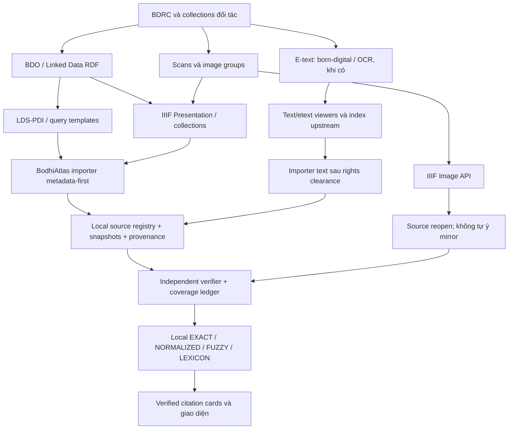

# Technology Assessment — BDRC / BUDA archive and data ecosystem

**Mã:** P51 · **Dự án:** BodhiAtlas · **Ngày khảo sát:** 2026-11-16 (Asia/Ho_Chi_Minh)  
**Nguồn đích:** https://github.com/buda-base · https://www.bdrc.io/buda-archive/  
**Phân loại kiểm chứng:** `ecosystem` (catalogue/linked-data/IIIF/etext + mã nguồn dịch vụ, **không** phải OCR/search engine độc lập cho corpus của người dùng).  
**Analyst:** nhóm thẩm định kỹ thuật độc lập, qua nghiên cứu web, GitHub repository/file API và các lần đọc API công khai; không có chứng nhận hoặc quan hệ với BDRC.  
**Phương pháp:** đối chiếu PRD BodhiAtlas V1.4 và sổ rủi ro; đọc repo/schema/source code/README/API/license, lấy snapshot commit; đọc 5 URI RDF và 2 IIIF manifest qua công cụ HTTP-fetch; **không** chạy Java/Maven, không tải nguyên corpus, không kiểm toàn bộ từng ảnh, không có tài khoản BDRC.  
**Quy ước:** `[DOC]` tài liệu/chính sách; `[CODE]` mã/schema/template đọc được; `[TESTED]` thử truy xuất HTTP trong phiên (phạm vi ghi cụ thể); `[ISSUE]` issue/report chưa tái hiện; `[INFERRED]` thiết kế/suy luận; `[UNKNOWN]` chưa có chứng cứ. `NOT TESTED` là chưa chạy phép thử được chỉ định. Dấu `N/A` nghĩa là ngoài vai trò, **không phải thất bại**.

**Snapshot (nhánh và commit được xác minh qua GitHub API lúc khảo sát; không phải release):**

| Repository | Branch | Commit SHA | Trạng thái | Vai trò |
|---|---|---|---|---|
| `buda-base/owl-schema` | `master` | `4f3bf4a15582adfe19b0bdf82f24607363638008` | Public, không archived | BDO ontology |
| `buda-base/lds-pdi` | `master` | `0cad5793279cca2516af64988a75326112587ea5` | Public, không archived | RDF/query/export API |
| `buda-base/lds-queries` | `master` | `35af510da5016cf9a865ad2a16fd5d6e86b2910c` | Public, không archived theo trang repo | SPARQL templates |
| `buda-base/buda-iiif-presentation` | `master` | `76fc607e2844c23909f2fd0edbc52402fb741136` | Public, không archived | IIIF Presentation v2.1.1 |
| `buda-base/buda-iiif-server` | `master` | `655c9c2b856256f3fd4ae7ceec6fe0ace843d56e` | Public, không archived | IIIF Image v2.1.1, PDF/ZIP |
| `buda-base/public-digital-library` | `master` | `UNKNOWN` | Public, không archived | Giao diện BUDA/Mirador; không khảo sát sâu |
| `quoctran-2608/bodhi-atlas` | `main` | `d1627ff3e079059e402355bf838a897bd5c1c88b` | Public, không archived | PRD V1.4 + risk register |
| `quoctran-2608/BuddhismDocuments-for-AI` | `main` | `dfdd3cbb79e3dbfb49a855702fa00e4bad3b3410` | Public, không archived | Tài sản/khung corpus đã có |

Snapshot là *commit đầu nhánh*, không đồng nghĩa bản production đang chạy tại BDRC có cùng build. Không xác nhận release/tag chung của toàn ecosystem; `DATE / VERSION` phải hiểu theo từng repository.

## 1. Executive Decision

**Quyết định: `USE AS COMPONENT` (`COMPONENT` trong bảng chuẩn).** Chỉ chọn làm **nguồn thẩm quyền ngoại vi cho metadata, nhận diện ấn bản, liên kết scan/IIIF và e-text có sẵn**, thông qua importer *metadata-first* và liên kết source-reopen. **Không ADOPT BUDA làm search/OCR backend mặc định cho BodhiAtlas.**

- **V1:** bổ sung connector lấy RDF record, quan hệ `Work → Instance → ImageInstance → ImageGroup`, trạng thái quyền/coverage, IIIF stable locator, liên kết out sang BUDA. `NO_FULLTEXT` là kết quả hợp lệ. Tìm kiếm của BodhiAtlas vẫn nằm ở index local xác định bằng code.
- **V2:** chỉ nhập e-text được cấp quyền sau kiểm nguồn; đối chiếu bản số hóa, map line/char offset/page với ảnh; phát hiện witness trùng/khác; cache chọn lọc.
- **V3:** tăng cường đối chiếu với OpenPecha/84000/CBETA/SuttaCentral, federation/từ điển đa ngữ và đối sánh học thuật có provenance. RAG chỉ là lớp phụ.
- **Confidence:** `MED` về **fit vai trò** (schema, code, chính sách, API mẫu có thật); `LOW` về quyền item-level, độ bền locator qua thay đổi, khả năng toàn văn/exact cho corpus đích và tính sẵn sàng hạ tầng production (chưa nghiệm thu).

**Ba rủi ro phải mở gate:** (1) **Rights**: metadata public ≠ quyền tải/mirror/training; BDRC nói không sở hữu bản quyền toàn bộ văn bản, cả giới hạn văn hóa; (2) **Fidelity**: scan, OCR, e-text, instance và vị trí trang không thể suy ra thay nhau; IIIF canvas **không mặc nhiên có bbox chữ**; (3) **Coverage/reliability**: thiếu e-text cho một phần kho và chưa biết SLA/rate limit; không thể dùng “không tìm thấy” như kết luận học thuật toàn kho.

**Gate hiện tại:** `SOURCE_FIDELITY=UNKNOWN` (có đường mở source, chưa POC toàn trình), `CODE_ONLY_EXACT=N/A` (BUDA là nguồn), `MULTILINGUAL=UNKNOWN` (chưa ma trận test), `QUALITY_COVERAGE=UNKNOWN` (chưa census), `RIGHTS_SECURITY=UNKNOWN` (đã thấy policy và code access control nhưng chưa item-level clearance), `PORTABILITY=PARTIAL/đề xuất` (URI/RDF/IIIF phù hợp xuất dữ liệu, phải giữ local pins và snapshots).

## 2. Sources & Evidence Ledger

Các link tới code dùng **commit SHA cố định**; file Markdown API ở commit để có thể so lại. Kết quả `[TESTED]` chỉ là **HTTP GET đọc phản hồi qua công cụ TinyFish fetch**, thời điểm 2026-11-16, không phải test Java/benchmark; một số phản hồi RDF/JSON bị công cụ chuyển thành văn bản hiển thị nên **chưa dùng làm golden raw bytes**.

| claim_id | Claim | Tag | URL/file + line hoặc endpoint | Version/SHA | Note/giới hạn |
|---|---|---|---|---|---|
| E01 | BUDA dùng Linked Open Data và IIIF; có image/e-text viewer, có chức năng truy vấn | [DOC] | https://www.bdrc.io/buda-archive/ | Web 2026-11-16 | Chính BDRC mô tả, không đo recall |
| E02 | Quyền BDRC gồm public domain, copyright-limited, cultural restriction; không sở hữu copyright các text | [DOC] | https://www.bdrc.io/access-policies/ | Web 2026-11-16 | Cần xét riêng từng item |
| E03 | Khách không login xem giới hạn, login cho phép PDF *open-access*; một số record vẫn bị hạn chế | [DOC] | https://www.bdrc.io/access-policies/ ; https://www.bdrc.io/buda-user-guide/frequently-asked-questions/ | Web 2026-11-16 | Chính sách không cấp quyền cloud rehost |
| E04 | BDO có `Work`, `Instance`, `Item`, `ImageInstance`, `Etext`, `EtextPage` | [CODE] | https://github.com/buda-base/owl-schema/blob/4f3bf4a15582adfe19b0bdf82f24607363638008/core/bdo.ttl#L361-L469 ; `#L568-L633` | `4f3bf4a` | BDO không chứng minh mọi record có mọi quan hệ |
| E05 | BDO có `instanceOf`, `instanceHasReproduction`, `workHasInstance` | [CODE] | https://github.com/buda-base/owl-schema/blob/4f3bf4a15582adfe19b0bdf82f24607363638008/core/bdo.ttl#L3262-L3289 ; `#L4597` | `4f3bf4a` | Phân biệt identifiers, không suy rằng 1:1 |
| E06 | Ontology và documentation phát hành CC0 | [DOC] | https://github.com/buda-base/owl-schema/blob/4f3bf4a15582adfe19b0bdf82f24607363638008/README.md | `4f3bf4a` | **Chỉ ontology**, không cấp phép ảnh/text |
| E07 | RDF `/resource/{res}.{ext}`, `/graph/`, `/admindata/`, `/queries`, `/query/table/` | [DOC][CODE] | https://github.com/buda-base/lds-pdi/blob/0cad5793279cca2516af64988a75326112587ea5/API.md ; https://github.com/buda-base/lds-pdi/blob/0cad5793279cca2516af64988a75326112587ea5/src/main/java/io/bdrc/ldspdi/rest/controllers/PublicDataController.java#L370-L450 | `0cad579` | Hành vi production cụ thể ngoài mẫu chưa xác minh |
| E08 | LDS-PDI dùng Jena/SPARQL; có route query theo template, không phải exact full-corpus engine bảo đảm mọi occurrence | [CODE] | https://github.com/buda-base/lds-pdi/blob/0cad5793279cca2516af64988a75326112587ea5/src/main/java/io/bdrc/ldspdi/rest/controllers/LibrarySearchController.java#L96-L124 | `0cad579` | `lib/` query code không phải index của BodhiAtlas |
| E09 | `Etexts_chunks.arq` dùng `text:query` và filter open-access/no-geoblock | [CODE] | https://github.com/buda-base/lds-queries/blob/35af510da5016cf9a865ad2a16fd5d6e86b2910c/public/Etexts_chunks.arq#L1-L31 | `35af510` | Lucene text match ≠ byte-level exact; giới hạn index |
| E10 | Query template `IIIFPres_volumeInfo` có access, copyrightStatus, image group, volume, manifest | [CODE] | https://github.com/buda-base/lds-queries/blob/35af510da5016cf9a865ad2a16fd5d6e86b2910c/public/IIIFPres_volumeInfo.arq#L1-L56 | `35af510` | Trường có thể null; quyền quyết định ở nguồn |
| E11 | IIIF Presentation API v2.1.1 tạo collection/manifest; phân biệt instance, image instance, image group, range | [DOC] | https://github.com/buda-base/buda-iiif-presentation/blob/76fc607e2844c23909f2fd0edbc52402fb741136/API.md | `76fc607` | Đường dẫn documented, không bảo đảm SLA |
| E12 | `ManifestService` tạo canvas gắn filename và có xử lý fair-use/placeholder | [CODE] | https://github.com/buda-base/buda-iiif-presentation/blob/76fc607e2844c23909f2fd0edbc52402fb741136/src/main/java/io/bdrc/iiif/presentation/ManifestService.java#L102-L133 ; `#L284-L338` | `76fc607` | Không thấy bảo đảm bbox OCR trong manifest |
| E13 | IIIF Image API v2.1.1: `igfn:{group}::{filename}` canonical; `igsi` không cam kết bền | [DOC] | https://github.com/buda-base/buda-iiif-server/blob/655c9c2b856256f3fd4ae7ceec6fe0ace843d56e/API.md | `655c9c2` | Filename được *best effort*, không tuyệt đối |
| E14 | `ResourceAccessValidation` có OPEN/FAIR_USE/THUMBNAIL/NOACCESS, có logic vùng địa lý và quyền PDF | [CODE] | https://github.com/buda-base/buda-iiif-server/blob/655c9c2b856256f3fd4ae7ceec6fe0ace843d56e/src/main/java/io/bdrc/iiif/auth/ResourceAccessValidation.java#L83-L123 | `655c9c2` | Chưa penetration test / replay auth |
| E15 | Các lệnh build IIIF Presentation dùng Maven/Java, S3 `dimension.json` | [DOC] | https://github.com/buda-base/buda-iiif-presentation/blob/76fc607e2844c23909f2fd0edbc52402fb741136/README.md | `76fc607` | Không chạy build |
| E16 | Code license: `lds-pdi` Apache-2.0; `buda-iiif-presentation` Apache-2.0; `buda-iiif-server` MIT | [CODE] | LICENSE trong ba repo: https://github.com/buda-base/lds-pdi/blob/0cad5793279cca2516af64988a75326112587ea5/LICENSE ; https://github.com/buda-base/buda-iiif-presentation/blob/76fc607e2844c23909f2fd0edbc52402fb741136/LICENSE ; https://github.com/buda-base/buda-iiif-server/blob/655c9c2b856256f3fd4ae7ceec6fe0ace843d56e/LICENSE | Theo từng commit | License code ≠ data/model |
| E17 | `W1CZ1988.ttl` là ImageInstance, `instanceOf WA1CZ1988`, 2 volumes (`I1CZ2041`,`I1CZ2042`) | [TESTED] | https://purl.bdrc.io/resource/W1CZ1988.ttl | API 2026-11-16 | HTTP GET qua fetch, không checksum body |
| E18 | `W1KG4919.ttl`: ImageInstance, `I1KG5103`, một volume | [TESTED] | https://purl.bdrc.io/resource/W1KG4919.ttl | API 2026-11-16 | BDRC policy nói tác phẩm thuộc copyright-limited |
| E19 | `W1CZ1073.ttl`: ImageInstance, `I1CZ1437`; policy nói có cultural restriction | [TESTED][DOC] | https://purl.bdrc.io/resource/W1CZ1073.ttl ; https://www.bdrc.io/access-policies/ | API 2026-11-16 | **Không** thử truy cập ảnh bị hạn chế |
| E20 | `W8LS20272.ttl`: ImageInstance, `I8LS20274`; policy nói mixed front/back matter copyright | [TESTED][DOC] | https://purl.bdrc.io/resource/W8LS20272.ttl ; https://www.bdrc.io/access-policies/ | API 2026-11-16 | Không tự phân quyền từng trang |
| E21 | `MW22084.ttl` là Instance, `instanceOf WA0BC001`, `instanceHasReproduction W22084`, `numberOfVolumes=103`, có nhãn EWTS, publisher và ghi chú nguồn | [TESTED] | https://purl.bdrc.io/resource/MW22084.ttl | API 2026-11-16 | Không được hiểu số volume là số trang hoặc đã OCR |
| E22 | IIIF manifest 2 volume có canvas URL theo filename (`08860003.tif`, `I1CZ20410003.tif`) | [TESTED] | https://iiifpres.bdrc.io/v:bdr:I0886/manifest ; https://iiifpres.bdrc.io/v:bdr:I1CZ2041/manifest | API 2026-11-16 | Body JSON qua text extractor có escape thay đổi: **chưa** chứng minh raw-byte JSON parse, chưa test ảnh thực, bbox, survival |
| E23 | BUDA FAQ nói e-text không có cho mọi tác phẩm; e-text có loại born-digital lẫn OCR | [DOC] | https://www.bdrc.io/buda-user-guide/frequently-asked-questions/ | Web 2026-11-16 | Tỷ lệ FAQ nêu là lời công bố, không phải census tự đo |
| E24 | `TxtEtextExport` đọc OpenSearch nested chunks `cstart/cend` và text bo/en/hani | [CODE] | https://github.com/buda-base/lds-pdi/blob/0cad5793279cca2516af64988a75326112587ea5/src/main/java/io/bdrc/ldspdi/export/TxtEtextExport.java#L1-L138 | `0cad579` | Không chứng minh Pāli/Việt hoặc exact completeness |
| E25 | `LexicographyController` endpoint `entriesForChunk`, giới hạn `lang` `bo`/`bo-x-ewts` | [CODE] | https://github.com/buda-base/lds-pdi/blob/0cad5793279cca2516af64988a75326112587ea5/src/main/java/io/bdrc/ldspdi/rest/controllers/LexicographyController.java#L35-L65 | `0cad579` | Không phải lexicon theo nghĩa liên ngữ hoàn chỉnh |
| E26 | BodhiAtlas yêu cầu local code-only lookup, immutable raw, source map, coverage và trạng thái verified tách tầng | [DOC] | https://github.com/quoctran-2608/bodhi-atlas/blob/d1627ff3e079059e402355bf838a897bd5c1c88b/docs/PRD.md ; https://github.com/quoctran-2608/bodhi-atlas/blob/d1627ff3e079059e402355bf838a897bd5c1c88b/docs/ACADEMIC_RISKS_AND_VERIFICATION.md | `d1627ff` | Đọc trực tiếp hai file |
| E27 | Repo tài sản hiện có tự mô tả 13 upstream pinned, provenance, SQLite/FTS derived không sở hữu nguyên văn | [DOC] | https://github.com/quoctran-2608/BuddhismDocuments-for-AI/blob/dfdd3cbb79e3dbfb49a855702fa00e4bad3b3410/README.md | `dfdd3cb` | Không xác nhận 13 upstream đang sync đầy đủ |
| E28 | 84000 có repo `data-tei` với TEI và trong mẫu có `sourceDesc work="W22084"`; CBETA có `xml-p5`; SuttaCentral có `sc-data` | [DOC] | https://github.com/84000/data-tei/blob/master/sections/118_0828-0844-old_tantras.xml ; https://github.com/cbeta-org/xml-p5 ; https://github.com/suttacentral/sc-data | Đọc public web | Đối chiếu ID cụ thể chưa POC |
| E29 | Rate limit, public SLA, rights for LLM-training, bulk dataset license, end-to-end item verification chưa xác minh | [UNKNOWN] | Không tìm thấy trong nguồn đã đọc đủ để kết luận | UNKNOWN | Không suy từ việc repo public |

**Độ bao phủ điều tra:** đã đọc 8 file code/template lõi gồm `bdo.ttl`, `PublicDataController.java`, `LibrarySearchController.java`, `TxtEtextExport.java`, `LexicographyController.java`, `ManifestService.java`, `IIIFImageApiController.java`, `ResourceAccessValidation.java`, cộng `Etexts_chunks.arq`, `IIIFPres_volumeInfo.arq`, API/README/pom/licenses. Đã thấy thư mục `src/test` trong các repo Java, **không chạy tests** và không diễn giải sự hiện diện của test file là `[TESTED]`. Chưa review đầy đủ issue/PR; không phát biểu đã tái hiện bug. Hai commit IIIF 2026-10 có thông điệp chống thread/worker starvation; đó là bối cảnh bảo trì, không phải benchmark ổn định.

## 3. Architecture & Data Flow

**Sơ đồ data lineage và ranh giới tin cậy**, không giả định có thể triển khai toàn bộ BUDA bằng một package:



- **Authority BDRC:** canonical `bdr:` URI, metadata/resource relations, IIIF endpoints và quyền thực tế do upstream áp dụng. **Authority BodhiAtlas:** checksum file đã được phép nhập, version extraction/index, evidence/claim verification, local source map, nhãn coverage.
- **Không đồng nhất `Work` với file, `Instance` với một lần scan, `ImageGroup` với trang in, hay e-text với OCR đã xác nhận.** Một Instance có thể nhiều volumes; một Work nhiều Instance; image-group có page/canvas; `bdo:EtextPaginated` tồn tại nhưng không phải mọi e-text đều paginated.
- **Ranh giới pháp lý:** URL có thể dẫn tới ảnh hạn chế; chỉ lưu metadata/preview/link hợp lệ, không đọc/vượt access control bằng crawler.

## 4. Feature Fit–Gap Matrix

Trạng thái là **mức hỗ trợ của BDRC/BUDA đối với yêu cầu BodhiAtlas**, không phải điểm tổng; `N/A` nghĩa chức năng thuộc engine khác. Công sức `S/M/L` ước tính **thiết kế**, chưa đo giờ công.

| ID | Yêu cầu | Status | Evidence | Effort | Gap và cách bù |
|---|---|---|---|---|---|
| C01 | Multi-format ingest PDF/EPUB/DOCX/MD/TEI | `N/A` | E01,E26 | M | Kho lưu trữ ngoại vi không phải pipeline ingest file riêng; viết importer BodhiAtlas, dùng TEI adapters riêng |
| C02 | OCR, layout, reading order | `N/A` | E23,E26 | L | BUDA có kết quả e-text/OCR của một số record, không cung cấp OCR service general-purpose có bbox; dùng Docling/MinerU/OCR phù hợp ngoài BUDA |
| C03 | Canonical text & source map | `EXTENSION` | E04,E12,E24 | L | Text slices/paginated alignment có thể hữu ích; cần immutable bytes, PDF bbox/EPUB CFI và independent verification |
| C04 | Works/editions/witnesses | `NATIVE` (core), `EXTENSION` (witness mapping) | E04,E05,E21 | M | Giữ Work/Instance/Item/scan khác nhau; lập `witness_relations` với confidence và nguồn |
| C05 | Exhaustive EXACT all occurrences | `N/A` | E09,E26 | M | `text:query` là retrieval candidate có giới hạn; local byte/Unicode matcher + offsets + 100% audited index |
| C06 | Normalized multilingual search | `EXTENSION` | E23,E24,E25 | L | BUDA có hỗ trợ tìm Tạng/Wylie theo docs; pipeline riêng cho Việt/Hán giản-phồn/Pāli/Sanskrit; chưa đạt gate |
| C07 | Fuzzy/near-duplicate/OCR errors | `N/A` | E09,E26 | M | BodhiAtlas tự tạo fuzzy index, diff và warning; không coi score là chứng thực |
| C08 | Sense-aware lexicon | `EXTENSION` | E25,E26 | L | Có endpoint Tibetan lexical, chưa có sense-graph cross-language được xác minh |
| C09 | Semantic/hybrid/RAG | `N/A` | E01,E26 | M | Phần AI V2+, retrieval có dẫn chứng local trước |
| C10 | Verified citation card/source reopen | `EXTENSION` | E11,E12,E13,E22 | L | IIIF image locator có thật; thiếu verified card, hash, independent text/page/meaning checks, bbox OCR |
| C11 | Notes/wiki/claim memory | `N/A` | E01,E26 | M | Là mô-đun BodhiAtlas, không giao cho kho nguồn |
| C12 | API/MCP/export | `NATIVE` API; MCP `UNKNOWN` | E07,E11,E13 | M | RDF/JSON-LD, IIIF, query; chưa xác minh API rate/SLA/bulk; MCP BodhiAtlas wrapper cần xây |
| C13 | Quality coverage + incremental | `EXTENSION` | E23,E24 | M | `NO_FULLTEXT`, `SCAN_ONLY`, gaps theo page, sync revisions/ETag/checksums; không đếm lời công bố là coverage thực |
| C14 | Auth/licensing/privacy/backup | `CONFIG` + `EXTENSION` | E02,E03,E10,E14,E16 | L | BDRC có policy/access enforcement; BodhiAtlas phải phân quyền cache, consent, audit, mirror/LLM policy và backup riêng |
| C15 | Operational simplicity/independent deploy | `EXTERNAL` (hosted); self-host `UNKNOWN` | E07,E15,E24 | M khi chỉ API; L self-host | Hệ Maven/Java/S3/Jena/OpenSearch/cache/auth không phải triển khai 1-click; V1 ưu tiên hosted connector + fallback |

## 5. Deep Technical Findings

### 5.1. Hệ thành phần repos/API, mô hình Work/Instance/Witness

BDO trong `owl-schema/core/bdo.ttl` xác định `bdo:Work`, `bdo:Instance`, `bdo:ImageInstance`, `bdo:Item`, `bdo:Etext`, `bdo:EtextPage`, `bdo:EtextPaginated`. `lds-pdi` phục vụ `/resource/{id}.ttl|jsonld`, query template; `lds-queries` lưu `.arq`; `buda-iiif-presentation` tạo collections/manifests; `buda-iiif-server` phục vụ image và PDF/ZIP; `public-digital-library` có viewer, trong `BDRC_Embedded_Reader.md` tham khảo collection `wio:bdr:MW22084`. [E04–E13]

`Work` (tác phẩm trừu tượng) **không** tự động đồng nhất `Instance` (phiên bản/ấn bản); `ImageInstance` là bản thể số hóa; `ImageGroup` là tập ảnh. **Witness:** BDO có các thực thể Item/Instance/physical/image, nhưng chưa chứng minh có một class `Witness` với semantics đúng hoàn toàn yêu cầu BodhiAtlas; importer dùng bảng witness nội bộ, giữ các quan hệ gốc thay vì gộp mọi `WA/W/MW/IE/UT` vào một mã. FAQ BDRC nói prefix `WA` chỉ Work, `MW` thường là Version/Instance. [E04,E21,E23]

### 5.2. Metadata và provenance có bằng chứng nào?

**Quan sát trực tiếp** `https://purl.bdrc.io/resource/MW22084.ttl` có `skos:prefLabel` Tạng EWTS, `bdo:creator` liên kết agent, `bdo:publisherName`, `bdo:publisherLocation`, `bdo:instanceEvent` kèm `notBefore/notAfter`, `bdo:hasPart`, `bdo:hasTitle`, `bdo:note` và `bdo:noteSource`; `instanceOf WA0BC001`, `instanceHasReproduction W22084`. Các noteSource và các sự kiện cho phép **truy lần nguồn khai báo**, song độ tin cậy lịch sử của mỗi mô tả **chưa xác minh độc lập**; không gộp niên đại tác phẩm, in ấn, scan và chú giải. [E21]

**Scan provenance** `W1CZ1988.ttl` có `bdo:scanInfo` nêu trung tâm scan và ảnh lấy từ bản khắc; `W1KG4919.ttl` có scan-info với năm xử lý được mô tả. Đây là *metadata do BDRC phát biểu*, không phải biên bản chain-of-custody kiểm định. Người nhập phải lưu `claim_source_uri`, `observed_at`, `status=SOURCE_ASSERTED` và các quan hệ có mã nội bộ. [E17,E18]

**Coverage metadata**: không thấy bảo đảm trường tác giả/dịch giả/nơi xuất bản/niên đại/collection luôn tồn tại cho mọi record; phải lưu `null` + `reason=ABSENT_UPSTREAM` khi thiếu, không nội suy từ họ tên người khác hoặc work khác.

### 5.3. Bibliographic record → scan → page → quay về ID

Luồng **có chứng cứ trên mẫu**:

1. `MW22084` → `bdo:instanceHasReproduction W22084`; `W22084`/image instance → image group `I0886` theo ví dụ IIIF API trong tài liệu; với mẫu khác `W1CZ1988` → volume `I1CZ2041` + `I1CZ2042`. [E17,E21,E11]
2. Collection: `https://iiifpres.bdrc.io/collection/wio:bdr:MW22084`; manifest `https://iiifpres.bdrc.io/v:bdr:I0886/manifest`, và `https://iiifpres.bdrc.io/v:bdr:I1CZ2041/manifest`. [E11,E22]
3. Trong **manifest response đã đọc** thấy canvas filename `https://iiifpres.bdrc.io/v:bdr:I0886/canvas/08860003.tif` và `https://iiifpres.bdrc.io/v:bdr:I1CZ2041/canvas/I1CZ20410003.tif`. Từ canonical image-group + file name có dạng Image API `igfn:bdr:{group}::{filename}` như API doc. [E13,E22]
4. Lưu cả `BDRC instance_uri`, `image_instance_uri`, `image_group_uri`, `manifest_uri`, `canvas_uri`, `image_filename`, `last_observed_at`. Reverse map qua group/instance relation. Số image sequence, filename, folio label, trang in là **những trục khác nhau**; chỉ ghi trang in khi BVM/outline hoặc xác minh bằng mắt có chứng cứ.

**Chưa chứng minh:** IIIF annotation chữ ở tọa độ `xywh`, PDF bounding boxes, tốc độ/stability canvas URI sau đổi manifest, quyền hiển thị từng ảnh. Trong `ManifestService` có `Canvas`/image annotations theo IIIF Presentation nhưng annotation cho *hình ảnh* không đồng nghĩa annotation OCR-bbox. `igsi` (index-based) không được BDRC cam kết ổn định, ưu tiên `igfn` (best-effort). [E12,E13]

### 5.4. Fulltext, OCR, transcript và confidence

- BDO định nghĩa riêng `Etext`, `EtextPaginated`, `EtextNonPaginated`, `EtextPage`, `EtextChunk` và `EtextInstance`; e-text có thể có raw Unicode layer + annotations. Không vì record có image group mà suy ra có một lớp này. [E04,E23]
- FAQ BDRC khẳng định **không có e-text cho mọi tác phẩm** và e-text có thể sinh bởi con người đánh máy hoặc OCR. Đây là nhãn xuất xứ, **không xác minh CER/WER/confidence từng trang**. [E23]
- `Etexts_chunks.arq` tìm `:chunkContents` qua Lucene `text:query`; `TxtEtextExport` lấy chunks từ OpenSearch, có fields `cstart`,`cend`,`text_bo`,`text_en`,`text_hani` trong code. Không tìm thấy cam kết rằng API trả mọi lần xuất hiện cho chuỗi 300 ký tự hoặc bảo toàn dấu và offsets qua mọi normalization. [E09,E24]
- **Chưa xác minh** số record Etext, tỷ lệ scan-only thực tế, API raw TEI/JSON cho toàn kho, confidence OCR. File `tibetan-etext-tools`/`ao_etexts` có thể là upstream ETL riêng; không coi repo ETL là bằng chứng mỗi BUDA item có TEI tương ứng.

**Rule importer:** `metadata_only`/`NO_FULLTEXT` mặc định; chỉ chuyển `FULLTEXT_PRESENT` khi endpoint text được xác minh, có quyền, có byte-level snapshot/hash và nguồn-đích map; khi OCR chưa rà soát dùng `FULLTEXT_OCR_UNVERIFIED`, không dùng `VERIFIED_TEXT`.

### 5.5. Tạng/Wylie/Pāli/Hán/Việt, tài liệu nào hậu thuẫn?

BDRC hỗ trợ tìm tiếng Tạng/Unicode và Wylie theo FAQ, từ các nhãn `bo-x-ewts`; riêng endpoint `LexicographyController.entriesForChunk` giới hạn `bo`, `bo-x-ewts`. Trường OpenSearch text code thấy `bo`, `en`, `hani`, **không được suy rộng** ra chính sách hỗ trợ Pāli/Sanskrit/tiếng Việt hoặc biến thể giản-phồn. Multi-language platform là tuyên bố bao quát, không phải test-case cụ thể. [E01,E23–E25]

### 5.6. Quyền item-level và các mục đích sử dụng

- BDRC ghi rõ không sở hữu copyright tất cả text; có *open access*, *limited access due copyright*, *restricted/cultural access*. Ví dụ chính sách: `W1CZ1988` open; `W1KG4919` copyright limited; `W1CZ1073` culturally restricted; `W8LS20272` mixed copyright. Các URI RDF của 4 record đọc được **không** cấp quyền bypass ảnh. [E02,E17–E20]
- `IIIFPres_volumeInfo.arq` có `access`, `copyrightStatus`; `ResourceAccessValidation` kiểm `OPEN/FAIR_USE/THUMBNAIL/NOACCESS` và vùng địa lý. Nhưng **code branch ≠ quyết định pháp lý cho item cụ thể tại runtime**. [E10,E14]
- **Phân 5 lớp cấp phép:** (i) code Apache/MIT, (ii) ontology CC0, (iii) RDF metadata item/source (quyền sử dụng lại chưa xác minh toàn bộ), (iv) image/scan/derivative/PDF, (v) e-text/transcript/translation cùng quyền tác giả. Quyền local cache, cloud mirror, AI training/LLM use và commercial reuse: **UNKNOWN item-level cho đến khi kiểm chính sách/được BDRC xác nhận bằng văn bản**.

### 5.7. API: rate, export, versioning, permanent identifiers

`lds-pdi/API.md` nêu RDF theo `.ttl`, `.jsonld`, `.rdf` và query templates; `buda-iiif-presentation/API.md` nêu IIIF v2.1.1 collections/manifests; `buda-iiif-server/API.md` nêu Image v2.1.1, URL canonical và download PDF/ZIP theo group. BDO URI `http://purl.bdrc.io/resource/<ID>` hướng đến identity bền, **không xác minh bằng cách theo dõi biến động một năm**. [E07,E11,E13]

- **Rate limit/throttling:** `UNKNOWN` cho public API; đề xuất local 1–2 RPS, exponential backoff là **giới hạn chủ động do BodhiAtlas đặt**, không phải quota chính thức.
- **Bulk export/corpus dump:** BDRC mô tả Linked Data cho phép export và query dữ liệu; chưa có chứng cứ bảo đảm public unrestricted bulk metadata+image+text với license thống nhất. [E01]
- **Versioning:** pin commit cho **code/schema**, còn **mỗi RDF response** cần lưu `fetched_at`, `ETag`/`Last-Modified` nếu server trả, local SHA-256 của raw bytes khi được phép. Không gán commit repo làm checksum nội dung record phục vụ production.
- **Citation:** lưu canonical URI + BDRC attribution, upstream edition metadata, retrieval timestamp; trích dẫn học thuật cần trường nguồn/ấn bản riêng. **Không lấy số trang in từ image index**.

### 5.8. Liên hệ OpenPecha, 84000, DharmaNexus, duplicate/witness

84000 `data-tei` cung cấp bản dịch TEI; một mẫu `sections/118_0828-0844-old_tantras.xml` có `sourceDesc work="W22084"`, là đầu mối **đối chiếu ID có thật** nhưng không chứng minh mọi `W22084` trùng chính xác mọi ấn bản hoặc là cùng văn bản dòng chữ. CBETA `xml-p5` là kho TEI Hán; SuttaCentral `sc-data` có text, parallel và metadata. OpenPecha thuộc lớp transcription/stand-off annotation đối với nguồn Tạng, có khả năng phối hợp BDRC nhưng mapping ID trực tiếp chưa kiểm trong POC này. Đối với **DharmaNexus**, chưa xác minh sơ đồ ID chính thức/contract phù hợp trong khảo sát: `UNKNOWN`, không khẳng định tích hợp native. [E28]

Giải pháp đối chiếu: bảng `external_identifier(namespace, id, entity_type, source_uri)`, bảng `equivalence_assertion(left,right,relation,justification,confidence,reviewer)` với quan hệ `SAME_INSTANCE`, `SAME_WORK`, `TRANSLATION_OF`, `PART_OF`, `POSSIBLE_DUPLICATE` riêng; không dùng `sameAs` vì giống nhan đề. Dedupe bản bytes bằng SHA-256 chỉ chứng thực *file trùng*, không chứng thực *ấn bản trùng*.

### 5.9. Metadata-first importer và coverage state

Chức năng tối thiểu: fetch canonical record → parse RDF graph → kiểm type/URI → walk quan hệ Work/Instance/ImageGroup → lấy manifest hợp lệ nếu có → kiểm quyền và cache policy → upsert revision snapshot → lập source status → (tùy quyền) import text → giữ all source map/quality flags. Các lỗi 401/403, 404/5xx, timeout, manifest invalid và item không có text phải được phân biệt và còn dấu vết.

**Trạng thái đề xuất:** `CATALOGUED`, `METADATA_PARTIAL`, `SCAN_AVAILABLE_REMOTE`, `SCAN_RESTRICTED`, `NO_FULLTEXT`, `FULLTEXT_OCR_UNVERIFIED`, `FULLTEXT_TRANSCRIPTION`, `FULLTEXT_VERIFIED`, `SOURCE_BROKEN`, `RIGHTS_REVIEW_REQUIRED`. Có thể kết hợp hai chiều `asset_status` + `text_status`, tránh một enum triệt tiêu thông tin.

### 5.10. Chi phí lưu trữ ảnh đa trang/cloud mirror

Bản ảnh TIF/gốc và derivatives không có cùng dung lượng. Không đưa giá đô-la hoặc ước tính tổng TB của BDRC khi chưa có sampling. Mô hình công thức điều kiện:

`storage_monthly = N_pages × avg_stored_MB/page ÷ 1024 × price_per_GiB_month × replica_factor`

`egress_monthly = N_page_views × avg_delivered_MB/view ÷ 1024 × egress_price_per_GiB`.

Ví dụ **giả định minh họa, không phải đo BDRC**: `20.000` trang × `2 MiB/trang` × `2 replicas` ≈ `78,1 GiB` dung lượng copy. Thêm GET, tile-cache, log, snapshot version và retrieval/egress; ngân sách thực sự cần báo giá hạ tầng và quyền mirror. **V1 ưu tiên bookmark/link IIIF từ hosted BUDA, tránh nhân bản toàn kho.**

## 6. Source Fidelity & Provenance

**Chuỗi bằng chứng cho một citation card** (đề xuất contract, không tuyên bố BUDA cung cấp sẵn):

```json
{
  "work_id": "local:work:<uuid>",
  "external_work_uri": "http://purl.bdrc.io/resource/WA0BC001",
  "edition_id": "local:instance:<uuid>",
  "external_instance_uri": "http://purl.bdrc.io/resource/MW22084",
  "file_id": null,
  "sha256": null,
  "witness_id": "local:witness:<uuid>",
  "source_type": "SCAN_ONLY_OR_UNKNOWN",
  "text_original": null,
  "original_text_status": "NOT_AVAILABLE_FROM_THIS_CHECK",
  "image_group_id": "bdr:I0886",
  "iiif_manifest": "https://iiifpres.bdrc.io/v:bdr:I0886/manifest",
  "canvas_uri": "https://iiifpres.bdrc.io/v:bdr:I0886/canvas/08860003.tif",
  "pdf_page_number": null,
  "printed_page": null,
  "bbox_xywh": null,
  "epub_href": null,
  "match_type": null,
  "ocr_status": "UNKNOWN",
  "text_verified": false,
  "position_verified": false,
  "meaning_verified": false,
  "coverage_note": "Đã đọc metadata/manifest mẫu; chưa đối chiếu chữ hoặc trang in",
  "rights_status": "REVIEW_REQUIRED"
}
```

**Lưu ý:** tất cả chuỗi `local:<...>` là placeholder schema, **không phải UUID đã được tạo**. `WA0BC001`, `MW22084`, `I0886` và canvas là định danh xuất hiện trong nguồn/manifest đã khảo sát; các trường null là chủ ý, không được bịa.

**Fidelity protocol:** (1) source raw bytes bất biến+hash nếu thực sự tải hợp pháp; (2) RDF snapshot có `source_url`, timestamp, checksum raw; (3) mapping `work/edition/file/witness` 1–n; (4) locator IIIF `canvas_id + filename + manifest_version + folio_label` và image URI; (5) mọi e-text có text-offset/line/page map + extraction version; (6) `quote_verified`, `locator_verified`, `meaning_verified` **tách biệt**; (7) no-index/no-OCR được thể hiện ở phạm vi kết luận. `Bbox` chỉ ghi khi một OCR/annotation service cung cấp và verifier đối chiếu ảnh; `pdf_page` không bằng folio hay canvas index.

**Phản ví dụ bắt buộc:** Hán OCR sai chữ phủ định; bản scan thiếu folio; câu dài qua ngắt dòng/cột; e-text không paginated; nhiều `Instance` có cùng tiêu đề; normalization giản-phồn biến chữ; link ổn nhưng nội dung edition đổi; chứng cứ chỉ là metadata chứ không phải câu văn. Mỗi lỗi phải **hạ cấp trạng thái verified** và hiển thị giới hạn thay vì trích dẫn tưởng tượng. [E26]

## 7. Multilingual & Retrieval Behavior

| Trường hợp | BUDA/BDRC chứng minh | BodhiAtlas cần làm | Trạng thái gate |
|---|---|---|---|
| `anatta`, `anattā`, `anātman`, `vô ngã`, `vo nga`, `無我` | Nguồn có tài liệu nhiều ngôn ngữ; không có chứng cứ API này thực hiện chuỗi equivalence theo nghĩa | Index per script, explicit transliteration/lexicon/sense links, review cross-lingual map | `UNKNOWN` |
| `無常` ↔ `无常` | Không thấy test giản–phồn trong code đã đọc | Mapping có version + preserve original, trả `NORMALIZED` | `NOT TESTED` |
| `dukkha` / `duḥkha` | Không có test Pāli/Sanskrit cross-form | NFD/NFC, IAST, phụ âm/dấu và từ điển theo nghĩa | `NOT TESTED` |
| Tạng Unicode ↔ EWTS/Wylie | Có labels `bo-x-ewts`, docs tìm Wylie, `entriesForChunk` hỗ trợ Tạng và EWTS | Tách search literal và chuyển tự, kiểm normalization, collation, syllable boundaries | `PARTIAL DOC/CODE` |
| Việt có/không dấu | Không có chứng cứ native | Normalized FTS phụ, giữ original; ambiguous results | `NOT TESTED` |
| Exact 200–300 ký tự, 5 occurrence trong cùng file | `Etexts_chunks` Lucene candidate search, không đảm bảo exhaustive raw occurrence | Scan original indexed canonical text theo charset/codepoints, report all offsets + source map | `N/A` upstream |
| `FUZZY` với OCR lỗi, 2 cột, ngắt trang | Không thấy coverage bảo đảm | Fuzzy candidate + character diff; OCR warning; page-level validation | `N/A` upstream |
| `LEXICON` theo sense | Tibetan `entriesForChunk` là chức năng lexical cục bộ | Lexicon theo sense, tradition, context, provenance; không bắc cầu vô hạn | `EXTENSION` |
| `SEMANTIC`/hybrid/RAG | Dịch vụ BUDA không phải verifier ngữ nghĩa độc lập | Chế độ 2 dùng người/AI để diễn giải, Chế độ 1 đối chiếu nguyên văn | `EXTERNAL` |

Với câu nghiên cứu *“Trong các tài liệu tôi có, những tác giả nào phân biệt giữa vô thường và khổ? Họ lập luận như thế nào? Cho tôi vị trí chính xác trong sách.”*: **chế độ code-only** có thể dùng metadata BDRC để lọc tác giả/tác phẩm và local `EXACT/NORMALIZED/LEXICON` để tìm **ứng viên**; **không** được khẳng định ai lập luận thế nào khi chưa đọc và đối chiếu ngữ cảnh; **không** trả trang in hoặc báo đã tìm khắp BDRC khi chỉ có scan/metadata.

## 8. Integration Options for BodhiAtlas

### Phương án A — Hosted metadata-first + remote IIIF (ưu tiên V1)

- **Input:** `bdr:` URI/ID từ catalogue hoặc người dùng, `fetch_policy`, thời điểm đồng bộ, phạm vi nguồn, quyền công khai.
- **Processing:** HTTP fetch `.ttl`/`.jsonld`, validate RDF, extract relations và literal đa ngữ; request IIIF collection/manifests có kiểm tốc độ; lưu record graph snapshot và rights state; không tải ảnh PDF số lượng lớn.
- **Output:** `SourceRecord` + `ExternalIdentity` + `Edition/WitnessCandidate` + `RemoteAssetLocator` + `CoverageResult`; **không** xuất text nếu không có văn bản được cho phép/đã kiểm.
- **Source of truth:** BDRC cho thư mục ngoài; BodhiAtlas cho nguồn được tải, verified claims, checksum, local index. Stable IDs: URI BDRC + local UUID bền; `entity_relation` lưu provenance và provenance revision.
- **Failure:** 401/403→`SCAN_RESTRICTED`; 404→`SOURCE_BROKEN`; manifest lỗi→`REMOTE_VIEW_UNVERIFIED`; e-text vắng→`NO_FULLTEXT`; 429/5xx→retry/backoff/last snapshot.
- **Rollback:** tắt connector; giữ nguyên immutable local metadata snapshot, source links, trích dẫn từng được verification độc lập; không xóa IDs hoặc gộp editions khi upstream biến đổi.
- **Effort:** `medium` nhưng cần rights gate trước tải tài sản.

### Phương án B — Rights-cleared selective e-text/scan ingest (V2 POC)

- **Input:** `approved_item_id`, quyết định rights bằng chứng, text URL hoặc file đã được phép tải, image group/canvas links, declared edition/witness, expected SHA/checksum nếu có.
- **Processing:** download allowlisted content, sha256, giữ raw; map text/segments/page, tạo OCR flags; index local code-only; verify substrings/offsets against raw and image where available.
- **Output:** `ImmutableSourceAsset`, `TextLayer(version, sha256, method)`, `PageMap`, `SearchCoverage`, `CitationEvidence`, `AccessAudit`.
- **Source of truth:** BDRC cho rights/source metadata; **local bytes hash + edition mapping + human verification** cho local quotations. External corpus update **không** tự overwrite bất biến.
- **Failure/rollback:** checksum mismatch→quarantine; rights revoked→disable redistribution/AI/index and preserve permitted metadata audit; alignment fails→downgrade citation; re-index bug→rollback index snapshot.
- **Effort:** `high` khi cần page/bbox alignment và QA; không triển khai hàng loạt trước POC.

### Phương án C — Self-host toàn hệ sinh thái (không đề xuất V1)

Java/Spring Boot, Jena/Fuseki, OpenSearch, S3/dimension manifests, images, authentication và cache; tự vận hành còn vấn đề quyền dữ liệu upstream. Không làm chỉ để có nguồn metadata đang public. `TRIAL ONLY` nếu sau này có yêu cầu offline legal và nhân sự DevOps đủ năng lực. [E07,E15,E24]

**Contract dữ liệu gợi ý:**

```text
SourceRecord { upstream_uri, type, titles[{text,lang}], creators[{uri,role}],
  event_dates[{kind,from,to,source}], collection_uris[], notes[{source_uri,text}],
  relations[{predicate,object_uri}], upstream_observed_at, upstream_snapshot_sha256 }
RemoteAssetLocator { instance_uri, image_group_uri, manifest_uri, canvas_uri,
  filename, sequence_index?, folio_label?, access_status, retrieved_at }
TextLayer { source_asset_sha256, extraction_version, text_kind, text_sha256,
  original_encoding, confidence?, coverage_pages[], source_map_status }
Evidence { source_work_id, source_edition_id, source_file_id?, quote,
  exact_span?, page_locator?, match_type, verified_quote, verified_position,
  verified_meaning, indexed_scope, evidence_uri }
```

**Migration & ID policy:** lưu mapping namespaced `bdrc:<id>` thay vì canonicalize IDs bằng cắt tiền tố; chuyển `WA`/`MW`/`W` theo predicate thực; kiểm broken links/later aliases; version `mapping_policy_v1`; export được JSONL/SQLite/JSON-LD, không khóa vào vector/chunk ID.

## 9. Practical POC / Reproduction Plan

**Kết quả thực hiện giới hạn trong phiên:** TC01 **PARTIALLY TESTED** (5 GET RDF nhưng loại không đủ đa dạng), TC02 **PARTIALLY TESTED** (2 manifest mở được, không kiểm persistence/ảnh), TC03–TC06 **NOT TESTED**; các test mở rộng TC07–TC09 **NOT TESTED**. Không có benchmark CER/WER/recall/latency tổng thể; thời gian phản hồi do fetch tool thấy chỉ là quan sát mạng công cụ, **không dùng làm hiệu năng BUDA**.

| TC | Fixtures, thao tác/commands đề xuất | Gold answer / expected output | Metrics/gate | Kết quả trong phiên |
|---|---|---|---|---|
| TC01 5 record | `curl -fL -D hdr.txt -o W1CZ1988.ttl 'https://purl.bdrc.io/resource/W1CZ1988.ttl'` lặp `W1KG4919`,`W1CZ1073`,`W8LS20272`,`MW22084`; dùng RDF parser, không regex production | `W1CZ1988→I1CZ2041,I1CZ2042`, `W1KG4919→I1KG5103`, `W1CZ1073→I1CZ1437`, `W8LS20272→I8LS20274`, `MW22084→WA0BC001` + 103 volumes; đều có ID không gộp | Parse success; ID mapping precision; missing field coverage | **PARTIALLY TESTED** GET bodies, chưa test RDF parser/raw checksum; 4 scan + 1 Instance, chưa đủ loại |
| TC02 2 scans | `curl -fL -o I0886.json 'https://iiifpres.bdrc.io/v:bdr:I0886/manifest'`; tương tự `I1CZ2041`; parse JSON bằng `python -m json.tool`, lấy canvas filename, thực mở ảnh theo rights, lặp sau 7/30 ngày | First canvas observed `.../I0886/canvas/08860003.tif` và `.../I1CZ2041/canvas/I1CZ20410003.tif`; label có thể khác sequence | `SOURCE_REOPEN_SUCCESS`, canvas stability | **PARTIALLY TESTED** 2 manifest trả body/canvas; chưa kiểm image GET hoặc tái mở sau thời gian |
| TC03 No-fulltext | Chọn một record bằng query/type `ImageInstance` **và kiểm không có e-text accessible**, import catalogue-only, query token không liên quan | `NO_FULLTEXT`, `EXACT` không báo 0 kết quả như bằng chứng phủ định toàn kho, card chỉ metadata | `FALSE_VERIFIED_CITATION=0`; missing-text status coverage 100% | **NOT TESTED**; không khẳng định bất kỳ mẫu trên không có e-text chỉ vì RDF thiếu thuộc tính |
| TC04 Multi-edition/witness | Chọn Work với ≥2 instances từ live RDF; xuất graph, map `Instance`/`ImageInstance`/`Item`, compare | 1 `Work`/≥2 `Instance`, mỗi instance riêng local edition/witness; `possible_duplicate` không `same_as` vô điều kiện | Split/merge errors; edition provenance | **NOT TESTED**; fixture chưa được lựa chọn/xác nhận |
| TC05 Import + citation | Fixture gồm `MW22084`, `W1CZ1988`, 1 e-text đã cấp quyền; run importer, export `citation.jsonl` và validate JSON Schema, reindex + reopen | Scan-only: `quote=null`, `bbox=null`; e-text: text hash/version và offsets; missing rights: blocked | `SOURCE_REOPEN_SUCCESS`, `FALSE_VERIFIED_CITATION`, round-trip import/export | **NOT TESTED**; importer BodhiAtlas này mới là đề xuất |
| TC06 Rights | Tự kiểm access/rights RDF + BUDA UI theo chính sách mẫu `W1CZ1988`, `W1KG4919`, `W1CZ1073`, `W8LS20272`, hỏi BDRC về cache/training | Open ≠ all usage; restricted/mixed không tự mirror; lưu PDF/image/text permissions riêng | `UNAUTHORIZED_CACHE_COUNT=0`; rights coverage; manual sign-off | **NOT TESTED** item-level access; chỉ **đã đọc** chính sách và code access |
| TC07 Multilingual | Gold corpus tự tạo 6 chuỗi: `anattā`, `anatta`, `無常`, `无常`, `vô ngã`, `མི་རྟག་པ་`; thêm EWTS; giữ raw | `EXACT` chỉ ký tự gốc; `NORMALIZED` liên kết theo rule đúng; `LEXICON` qua sense, không giả semantic equivalence | full exact recall theo fixture; false normalization | **NOT TESTED**; tính năng thuộc local engine |
| TC08 Long quote/repeated | Fixture Unicode 300 ký tự xuất hiện 5 lần ở nhiều lines/pages, 2 columns, OCR sửa lỗi/mất phủ định | `EXACT` trả 5 offsets nguyên văn với context, loại bỏ đoạn chưa index khỏi denominator; OCR lỗi không verified | `EXACT_FULL_RECALL=1.0` mục tiêu trên fixture đã index; no invented bbox | **NOT TESTED** |
| TC09 Negative/availability | Fixture 403, 404, timeout, invalid manifest, e-text absent, changed ETag, revoked rights | retry/backoff; `SOURCE_BROKEN` vs `SCAN_RESTRICTED`, never silently index; stable IDs & rollback | failure-classification 100% fixture; migration stability | **NOT TESTED** |

**Cách tái lập kiểm tra đã thực hiện:** công cụ web HTTP fetch `TinyFish.fetch_content(urls=[...], format='markdown', ttl=0)` đã yêu cầu chính xác 5 `.ttl` và 2 manifest như URLs trong E17–E22. Môi trường: sandbox không có outbound DNS (thử `requests` tới `api.github.com` báo `NameResolutionError`); GitHub files được đọc qua GitHub connector; **không** chạy curl trong sandbox, **không** chấm `mvn test`. Text extractor có thể thêm escape trong body JSON nên bộ POC tiếp theo phải tải bytes thẳng bằng curl ở máy có mạng, lưu headers và SHA256 rồi validate JSON/RDF thật.

**Định nghĩa metrics, không có số đo giả:** `EXACT_FULL_RECALL = correct_occurrences_returned / all_golden_occurrences_in_indexed_scope`; `FALSE_VERIFIED_CITATION = number_of_unjustified_verified_cards`; `SOURCE_REOPEN_SUCCESS = successful_verified_reopens / attempted_eligible_reopens`; `ERROR_COVERAGE = declared_failed_assets / known_failed_assets`; CER/WER chỉ đo trên gold transcription đã đối soát trang, `precision/recall@k` chỉ trên candidate retrieval có labeled set. Thu thập P50/P95 latency, data bytes, failure logs trong một lần POC chạy thật trước quyết định scale.

## 10. Deployment, Security, Legal, Cost

**Deployment:** Với hosted API, cần client HTTP, RDF parser (`rdflib`/Jena tương ứng), IIIF manifest parser, local SQLite/Postgres + object store, kiểm checksum/audit. Nếu self-host: `lds-pdi` Maven/Spring Boot 3.3.2, Java 17, Jena/Fuseki và OpenSearch; `buda-iiif-server` Maven/Spring Boot 3.3.2, source Java 11, phụ thuộc tile/image libs và iText; `buda-iiif-presentation` cần S3 `dimension.json` và credential provider theo README. Đây là dấu vết dependency được đọc, **không** là bill of materials bảo mật đã audit. `mvn test` chưa chạy. [E15,E24]

**License matrix:**

| Lớp | Điều đã xác minh | Quyết định triển khai |
|---|---|---|
| Ontology/schema | `owl-schema` CC0 [E06] | Có thể dùng vocabulary với version pin, ghi attribution thích hợp |
| LDS-PDI/queries | Code Apache-2.0 [E16], `lds-queries` Apache-2.0 theo README | Tuân thủ NOTICE/license khi phân phối code |
| IIIF Presentation | Apache-2.0 [E16] | Khả năng tái dùng code, không trao quyền scan |
| IIIF Image server | MIT [E16] | Rà soát dependency, đặc biệt giấy phép thư viện PDF/iText trước phân phối |
| RDF metadata record | BDO/record URI public, license dataset **UNKNOWN** | Metadata link/snapshot theo terms; kiểm bulk reuse và attribution |
| Scan/photo/page/PDF | BDRC public-domain hoặc limited/restricted/cultural, theo item [E02] | Chỉ lưu/link theo quyền, không đồng loạt mirror |
| e-text/OCR/transcription/translation | Nhiều nguồn gốc, từng bản có copyright và OCR errors [E23] | Rights-cleared ingestion; AI/LLM/training **UNKNOWN** nếu không được cấp phép |
| Model weights | Không phải thành phần lõi BUDA được thẩm định | `N/A`; không giả license model chung |

**Security/privacy:** token/cookie không lưu trong logs; không copy URL tạm/signed token vào citation public; SSRF allowlist `*.bdrc.io`/purl allowlist theo exact host, chống redirect vượt allowlist; ẩn image tài liệu restricted, geofencing/hợp đồng, rate/backoff; RBAC `can_view_metadata`, `can_view_remote`, `can_cache_local`, `can_export`, `can_use_for_ai`; opt-in trước gửi tài liệu riêng của người dùng tới bất kỳ dịch vụ cloud nào. BDRC privacy policy cảnh báo hình ảnh IIIF của bên thứ ba có thể gửi IP/telemetry tới host nguồn; tích hợp viewer remote cần disclosure. https://www.bdrc.io/privacy-policy/ [E02,E14]

**Backup/portability:** sao lưu `raw_source`, metadata snapshot RDF, rights decision, identifier crosswalk, independent claims/quotes, verified page maps, checksum manifest và code/index version; index FTS/vector là derivative có thể dựng lại. 3-2-1 backup/restore drill và cảnh báo nguồn bị rút quyền; lưu nội dung chỉ trong phạm vi được phép.

**Cost (giả định, không phải benchmark):** hosted catalogue link thấp hơn mirror; cost phụ thuộc số records, request rate, số canvas, bytes/image, replicas, egress, legal review & human verification. Ví dụ minh họa ở §5.10; **không** tự dự đoán chi phí USD/tháng vì thiếu giả định giá hạ tầng và image-size sampling thực. Ứng viên phải qua rights gate trước mọi quyết định cloud mirror.

## 11. Comparison & Trade-offs

Các ứng viên **khác lớp nhưng cùng chức năng cấp nguồn corpus**; so theo metadata/witness/source image/text, **không** xếp hạng như các full-stack search engines.

| Tiêu chí | BDRC/BUDA | 84000 `data-tei` | OpenPecha | CBETA `xml-p5` | SuttaCentral `sc-data` |
|---|---|---|---|---|---|
| Sứ mệnh chính | Metadata multi-collection + scan/IIIF + e-text chọn lọc | Bản dịch TEI/ấn bản 84000 | Kho/công cụ văn bản Tạng, annotations (cần xác minh cụ thể version) | Corpus Hán TEI P5 | Corpus Phật giáo nguyên thủy + translations/parallels/metadata |
| Source fidelity phù hợp | Có URI Work/Instance/ImageGroup/canvas, page image; text không phủ hết | Có TEI structure, provenance và `sourceDesc` trong mẫu | Stand-off/pecha align tiềm năng; cần xác thực record/ID | TEI Hán có cấu trúc và dị tự, mapping nguồn cần kiểm | IDs/paragraph segmentation và parallels trong dữ liệu |
| Tồn tại full-text | **Không phải mọi item** | Nhiều bản dịch là text; coverage kiểm theo repo | Vary per pecha, không mặc định | XML text là trọng tâm | Text/JSON là trọng tâm |
| Ảnh/IIIF | **Ưu thế nổi bật** | Không giả IIIF scan đồng bộ toàn kho | Tuỳ source | Không phải chức năng chính | Không phải chức năng chính |
| Witness/edition | Schema BDO rõ; relationship phải giữ riêng | SourceDesc và text edition; link BDRC trong một mẫu | Có annotations, relationship cần kiểm | Tạng Hán/ấn bản TEI; cần normalize IDs | Parallel/segment; không thay thế image witness |
| Quyền | Item-level phức tạp/cultural restrictions | Rà từng license text/dịch giả | Rà từng pecha/source | Rà CBETA redistribution terms | Rà text/translation license riêng |
| Chi phí tích hợp | **M** hosted metadata, **L** full ingest | M TEI parser | M–L annotations | M TEI parser/gaiji | M JSON importer |
| Gate chưa đạt cho BodhiAtlas | Rights + full citation + comprehensive exact | Exact/image source mapping cần local verifier | Provenance/license mapping | Gaiji/version/rightsmapping | Edition/source locator & rights mapping |

**Trade-off:** BDRC nên là **authority layer bổ sung** ấn bản/scan và định danh, không loại 84000/OpenPecha/CBETA/SuttaCentral khỏi bảng nguồn. Khi cần full text, chọn *corpus text primary* có license/edition rõ; khi cần chứng cứ ảnh và metadata tác phẩm, liên kết BUDA. `84000/data-tei` có `sourceDesc work="W22084"` trong một file có thể làm bridge thử nghiệm, **không được suy diễn toàn bộ hai corpus cùng partition/witness**. [E28]

## 12. Decision Record for Master Synthesis

| Field | Value | Evidence/assumption |
|---|---|---|
| TARGET | BDRC / BUDA archive and data ecosystem | E01 |
| CLASS | ecosystem | Nhiều services, ontology, external content, E04–E15 |
| DATE / VERSION / COMMIT | 2026-11-16; BDO `4f3bf4a`; LDS-PDI `0cad579`; Queries `35af510`; IIIFPres `76fc607`; IIIF Image `655c9c2`; production build UNKNOWN | GitHub commit API; snapshot bảng đầu |
| PRIMARY_ROLE | External authoritative metadata + work/instance links + scan/IIIF + selectively licensed e-text | E04,E07,E11,E17–E23 |
| BEST_FIT_V1_CORE | partial | V1 cần local ingest/search/verification mà BUDA không thay thế, E26 |
| SOURCE_FIDELITY_GATE | unknown | IIIF/locator sample pass retrieval, chưa end-to-end citation reopen+checksum+bbox E22 |
| CODE_ONLY_EXACT_GATE | n/a | Không phải nhiệm vụ BUDA trong BodhiAtlas; local verifier mới chịu gate E09,E26 |
| MULTILINGUAL_GATE | unknown | Có multilingual metadata, thiếu test hệ chữ/normalization theo tập query E23–E25 |
| OCR_COVERAGE_GATE | n/a | BUDA là archive/etext source, không phải OCR pipeline cho file bất kỳ; coverage item UNKNOWN E23 |
| RIGHTS_SECURITY_GATE | unknown | Có policy/access control, chưa rights-clearance item-level/LLM/cache E02,E14 |
| INTEGRATION_COST | medium | Metadata-first qua RDF+IIIF; fulltext mapping/mirror là high [INFERRED] |
| MAINTENANCE_RISK | medium | Hosted API dependency, schema changes + permissions; SLA unknown [INFERRED] |
| RECOMMENDATION | COMPONENT | `USE AS COMPONENT` trong Executive Decision |
| CONFIDENCE | medium | Mã, docs, 5 RDF + 2 IIIF fetch; không local Java POC |
| NEXT_POC | TC01/02 hoàn tất raw-byte parser/reopen, TC03 scan-only, TC04 witness split, TC05 rights-cleared citation, TC06 rights review; multilingual TC07/08 | §9 |

**5 findings cho master synthesis**

1. BDO có mô hình và URI tách Work/Instance/ImageInstance/Item/Etext; thật sự hữu ích cho edition/witness registry. [E04,E05]
2. RDF API `.ttl/.jsonld` và query templates có route code/docs rõ; 5 record RDF mẫu truy xuất được. [E07,E17–E21]
3. IIIF Collection/Manifest v2.1.1 có canvas filename; 2 volume manifest đã đọc được. [E11,E22]
4. `igfn` canonical best-effort; `igsi` không bảo đảm stable, nên lưu filename và kiểm lại. [E13]
5. Rights model nhiều tầng, có restriction trong chính sách lẫn enforcement code; metadata public không hàm ý quyền reuse content. [E02,E14]

**5 blockers / điều kiện chưa đạt**

1. Chưa có rights matrix item-level cho ảnh, text, translation, download/mirror/LLM.
2. Chưa hoàn tất nguồn→ảnh→bbox/chữ→citation verified với local checksum.
3. Chưa thống kê scan-only / Etext / OCR quality trên tập đại diện.
4. Chưa hợp đồng public rate limit/SLA, cache validators/bulk export rõ ràng.
5. Chưa test normalization đa ngôn ngữ và all-occurrence `EXACT` trong local index.

**5 experiments trước mở rộng quy mô**

1. Tải bytes nguyên vẹn 5 RDF và validate graph types, rights, ETag, SHA.
2. Lặp 2 IIIF manifest + image GET qua 7/30 ngày, thử canvas/filename stability.
3. Import 1 metadata-only + 1 e-text có rights + 1 restricted, kiểm negative results.
4. Chọn Work có ≥2 Instance, đối soát witness/edition với 84000 hoặc OpenPecha có nguồn.
5. Chạy local exact/normalized test (5 occurrence, 300 ký tự, Tạng/Wylie, Hán/VN/Pāli, OCR error) với measured report.

**3 quyết định chờ chủ dự án**

1. V1 có chấp nhận **chỉ link ảnh remote** và không mirror mặc định? **Đề xuất: có.**
2. Chính sách nội bộ với tài liệu BDRC chưa xác minh license: **metadata-only; không AI/training/cache** đến khi có quyền? **Đề xuất: có.**
3. Nên ưu tiên nguồn nào cho POC fulltext kèm scan (một tác phẩm thuộc public-domain đã xác minh, hay corpus riêng đã có quyền)? **Đề xuất:** tác phẩm public-domain mẫu `W1CZ1988` cho IIIF, nhưng cần tìm/chọn riêng e-text hợp lệ và xác minh trước khi ghép.

## 13. Appendix

### A. Canonical links và các mẫu GET được đọc

- Tổng quan BUDA: https://www.bdrc.io/buda-archive/
- BDRC access policy: https://www.bdrc.io/access-policies/
- FAQ/IDs/e-text: https://www.bdrc.io/buda-user-guide/frequently-asked-questions/
- Privacy/third-party IIIF: https://www.bdrc.io/privacy-policy/
- Org: https://github.com/buda-base
- BDO: https://github.com/buda-base/owl-schema
- LDS-PDI: https://github.com/buda-base/lds-pdi
- Query templates: https://github.com/buda-base/lds-queries
- IIIF Presentation: https://github.com/buda-base/buda-iiif-presentation
- IIIF Image: https://github.com/buda-base/buda-iiif-server
- UI: https://github.com/buda-base/public-digital-library
- Sample RDF GET: `https://purl.bdrc.io/resource/{W1CZ1988,W1KG4919,W1CZ1073,W8LS20272,MW22084}.ttl` (ký hiệu `{...}` là cách viết tắt, không phải URL thật; URL riêng ở E17–E21)
- IIIF manifest đã đọc: https://iiifpres.bdrc.io/v:bdr:I0886/manifest ; https://iiifpres.bdrc.io/v:bdr:I1CZ2041/manifest
- Collection đã đọc: https://iiifpres.bdrc.io/collection/wio:bdr:MW22084
- BodhiAtlas PRD: https://github.com/quoctran-2608/bodhi-atlas/blob/main/docs/PRD.md
- BodhiAtlas Risk: https://github.com/quoctran-2608/bodhi-atlas/blob/main/docs/ACADEMIC_RISKS_AND_VERIFICATION.md
- Existing corpus: https://github.com/quoctran-2608/BuddhismDocuments-for-AI
- Comparison: https://github.com/84000/data-tei ; https://github.com/cbeta-org/xml-p5 ; https://github.com/suttacentral/sc-data ; https://github.com/OpenPecha

### B. POC commands — **đề xuất, NOT RUN** trong sandbox

```bash
set -euo pipefail
mkdir -p poc51/raw poc51/logs
for id in W1CZ1988 W1KG4919 W1CZ1073 W8LS20272 MW22084; do
  curl --fail --location --retry 3 --connect-timeout 10 \
    -D "poc51/logs/${id}.headers" \
    -o "poc51/raw/${id}.ttl" \
    "https://purl.bdrc.io/resource/${id}.ttl"
done
for ig in I0886 I1CZ2041; do
  curl --fail --location --retry 3 \
    -D "poc51/logs/${ig}.headers" \
    -o "poc51/raw/${ig}.manifest.json" \
    "https://iiifpres.bdrc.io/v:bdr:${ig}/manifest"
  python -m json.tool "poc51/raw/${ig}.manifest.json" >/dev/null
done
sha256sum poc51/raw/* | tee poc51/logs/sha256.txt
# Sau đó dùng RDF parser (rdflib/Jena), validate JSON, export registry,
# đối soát quyền, và mở lại ảnh/chữ thủ công theo TC01–TC06.
```

**Tái lập build riêng (NOT RUN, cần cấu hình/hạ tầng):**

```bash
# Trong repo lds-pdi đã checkout và pin SHA:
mvn test
mvn spring-boot:run -Dldspdi.configpath=/my/configfile/dir/ -Dspring.profiles.active=local
# Trong repo buda-iiif-presentation đã checkout và pin SHA:
mvn test
mvn package
java -Dserver.port=8080 -Dspring.profiles.active=local \
  -Diiifpres.configpath=src/main/resources \
  -jar target/buda-iiif-presentation-exec.war
```

Không chạy các lệnh trên trên prod nếu chưa hiểu S3 credentials, rights, storage và external services. Không đặt `bdrc` auth token trong script/log.

### C. Các file/entrypoint đã kiểm tra

- `owl-schema/core/bdo.ttl`: Work ~L1655, Instance ~L593, ImageGroup ~L568, ImageInstance ~L578, Etext ~L361, Item ~L632, instanceOf ~L3282, workHasInstance ~L4597.
- `owl-schema/lang-tags.md`: BCP47/Unicode/EWTS concerns; không tự đổi case language-tag làm mất RDF literal equality.
- `lds-pdi/src/main/java/io/bdrc/ldspdi/rest/controllers/PublicDataController.java`: `/resource/{res}`, `/graph`, `/admindata`, headers/ETag.
- `lds-pdi/src/main/java/io/bdrc/ldspdi/rest/controllers/LibrarySearchController.java`: `/lib/{file}` SPARQL query.
- `lds-pdi/src/main/java/io/bdrc/ldspdi/export/TxtEtextExport.java`: OpenSearch nested chunks, `cstart/cend`, `bo/en/hani`.
- `lds-pdi/src/main/java/io/bdrc/ldspdi/rest/controllers/LexicographyController.java`: `entriesForChunk`, bo/EWTS.
- `lds-queries/public/Etexts_chunks.arq`: Lucene text query; no exhaustive exact promise.
- `lds-queries/public/IIIFPres_volumeInfo.arq`: access/copyrightStatus/manifest/volume metadata.
- `buda-iiif-presentation/src/main/java/io/bdrc/iiif/presentation/ManifestService.java`: canvas/image resource, fair-use handling.
- `buda-iiif-server/src/main/java/io/bdrc/iiif/controllers/IIIFImageApiController.java`: image route + access validation call.
- `buda-iiif-server/src/main/java/io/bdrc/iiif/auth/ResourceAccessValidation.java`: allowed levels + geo restrictions.
- `buda-iiif-server/pom.xml`, `buda-iiif-presentation/README.md`, `lds-pdi/pom.xml` và LICENSE của ba repos.

### D. Giới hạn, thiếu quyền và điều KHÔNG được kết luận

1. Tool đọc được 5 Turtle response và 2 IIIF manifest, **không** có raw response stored with checksum. Không sử dụng phản hồi đã text-extract để đo nội dung/kiểm valid RDF/JSON bytes. Chưa kiểm HTTP status/header cụ thể; đã thấy response body.
2. Sandbox không có Internet DNS để chạy trực tiếp `curl/requests`, không có clone hạ tầng; tests thực thi Java/Maven, local OCR, JSON schema, source re-open sau cập nhật và bulk export đều `NOT TESTED`.
3. Không có tài khoản BDRC hoặc quyền truy cập nội dung hạn chế. `W1CZ1073` chỉ đọc được metadata, không xem ảnh bị giới hạn.
4. Không kiểm các record không nằm trong sample, Pāli/Hán/Việt search query, API rate limit, true up-to-date coverage hoặc hệ thống production release.
5. Không có giấy phép để mirror toàn bộ ảnh, sử dụng e-text cho LLM training hoặc phát hành bản dịch của đối tác. Những quyền đó phải được xác nhận riêng theo item và use-case.
6. Không khảo sát đầy đủ toàn bộ mã của 173 repos trong tổ chức, issue/PR triage/bug reproduction, data corpus manifest và lịch sử thay đổi các ID; không phát biểu ecosystem đã qua audit bảo mật.
7. BDRC data model là **nguồn metadata**, không thay thế bất biến học thuật BodhiAtlas: exact text, vị trí, nghĩa, sự thật lịch sử là các lớp xác minh độc lập.

**Final disposition:** tích hợp BDRC/BUDA **như thành phần nguồn bên ngoài**: metadata/Work–Instance–ImageGroup IDs + IIIF locator và e-text được quyền; BodhiAtlas vẫn phải tự xây importer nguồn bất biến, `NO_FULLTEXT`/coverage, index code-only, normalized multilingual/lexicon, source mapper, independent verifier và rights/security layer. Chỉ mở rộng sau POC TC01–TC06 với fixture/log/checksum/rights sign-off; các điểm chưa chứng minh giữ `UNKNOWN/NOT TESTED`, không nâng thành claim verified.
