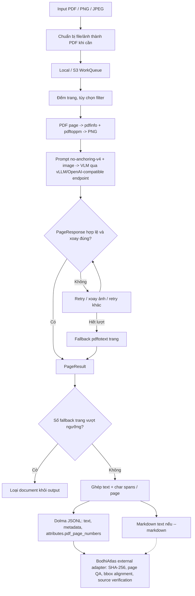

# Technology Assessment — olmOCR

**Mã khảo sát:** P52 · **Ngày chốt nguồn:** 2026-11-16 (Asia/Ho_Chi_Minh) · **Đối tượng:** [allenai/olmocr](https://github.com/allenai/olmocr) · **CLASS:** `component` (toolkit OCR/linearization và bộ benchmark liên quan; không phải thư viện học thuật/search platform).

**Snapshot có thể tái kiểm:** default branch `main`, HEAD [`f7cfe4c22098b154c76b6ec950d1c0a464eecf8d`](https://github.com/allenai/olmocr/commit/f7cfe4c22098b154c76b6ec950d1c0a464eecf8d), commit 2026-03-25; công khai và `archived=false` tại thời điểm khảo sát. Release GitHub mới nhất thấy được là [`v0.4.27`](https://github.com/allenai/olmocr/releases/tag/v0.4.27), phát hành 2026-03-12, tag *annotated* trỏ tới commit [`1e139a5ea61f1668164e6b63357d7284a8391615`](https://github.com/allenai/olmocr/commit/1e139a5ea61f1668164e6b63357d7284a8391615). `olmocr/version.py` ở HEAD ghi `0.4.27`; release tag và HEAD **không phải cùng commit**. Không đánh đồng phiên bản phần mềm và phiên bản model weights.

**Bản model được CLI chọn mặc định theo mã HEAD:** [`allenai/olmOCR-2-7B-1025-FP8`](https://huggingface.co/allenai/olmOCR-2-7B-1025-FP8), dựa trên Qwen2.5-VL-7B-Instruct, fine-tune với olmOCR-mix-1025 và GRPO theo model card. Mã thư viện Apache-2.0, model card bản weights này Apache-2.0, benchmark dataset card ghi ODC-BY-1.0; quyền tài liệu PDF gốc/ảnh/bản dịch phải thẩm định riêng.

**Analyst/phương pháp:** thẩm định độc lập bằng đọc URL chính thức, GitHub REST/API qua GitHub connector, đọc file mã theo commit cố định, docs, tests, issues, card model/dataset và đối chiếu tài liệu BodhiAtlas; không thử suy luận OCR, không chạy GPU/model; các đề xuất kiến trúc/POC được đánh nhãn `[INFERRED]`. Nguồn BodhiAtlas đã đọc tại commit [PRD/rủi ro `3c45129c…`](https://github.com/quoctran-2608/bodhi-atlas/commit/3c45129cafecd835f146c8508bb943d837f1f00d) và tài sản corpus [`dfdd3cbb…`](https://github.com/quoctran-2608/BuddhismDocuments-for-AI/commit/dfdd3cbb79e3dbfb49a855702fa00e4bad3b3410). Những khẳng định `[DOC]` là lời tác giả công bố, không có nghĩa đã kiểm nghiệm.

**Quy ước:** `[CODE]` đã đọc mã ở commit nêu trên; `[DOC]` đã đọc mô tả chính thức; `[ISSUE]` báo cáo cộng đồng chưa tái hiện; `[INFERRED]` thiết kế/suy luận có căn cứ; `[UNKNOWN]` thiếu bằng chứng; `[TESTED]` chỉ dùng nếu chính khảo sát này chạy thực tế. Trong báo cáo này **không có kết quả OCR `[TESTED]`**. Trạng thái chức năng: `NATIVE / CONFIG / EXTENSION / EXTERNAL / MISSING / UNKNOWN / N/A`; `N/A` là ngoài vai trò, **không phải điểm trừ**.

## 1. Executive Decision

**Quyết định: `TRIAL ONLY` (Master field: `TRIAL`). Confidence: `MED` cho nhận định phù hợp về kiến trúc; `LOW` cho chất lượng đầu ra trên corpus BodhiAtlas vì `NOT TESTED`.** olmOCR là ứng viên **fallback OCR theo trang hoặc batch xử lý ngoại tuyến**, không phải nguồn chuẩn của câu trích và không thay thế catalog, parsers đa định dạng, tìm kiếm code-only hay verifier. Chỉ nâng lên `USE AS COMPONENT` sau khi POC vượt các cổng không đánh đổi.

- **V1 Core:** thử tùy chọn OCR cho trang PDF/ảnh khó khi đường trích xuất text/layout chính thất bại hoặc trang có vùng scan; lưu kết quả như bản dẫn xuất **chưa kiểm**. Khi trang digital có text layer tốt, ưu tiên bảo toàn text layer và bbox nguyên thủy, không buộc cả trang đi qua VLM.
- **V2:** batch/re-OCR theo model version, so sánh chéo, hàng đợi thủ công duyệt vị trí/nhận dạng; chỉ nhập vào search sau khi ghi trạng thái chất lượng/phạm vi đầy đủ. Corpus chuẩn dạng TEI, JSON line/segment không cần qua OCR.
- **V3:** nghiên cứu domain-adaptation/finetuning hoặc OCR cho scan khó hơn, chỉ khi có gold set độc lập, quyền sử dụng tư liệu và ngân sách; không mặc định cần làm.

**Ba rủi ro lớn:** (1) văn bản sinh bởi VLM bỏ/thêm chữ, phủ định, đổi dấu phụ hoặc làm mất ngữ cảnh; (2) chỉ có page-level char spans chứ không có bbox/word offsets/confidence OCR, do đó không đủ làm citation verifier; (3) kiểm thử đa ngữ và bản quyền/chi phí triển khai local–cloud chưa được chứng minh trên nguồn thực của BodhiAtlas.

**Gate sơ bộ:** `SOURCE_FIDELITY=unknown` (chưa nghiệm thu end-to-end, thiếu bbox); `CODE_ONLY_EXACT=n/a` (olmOCR không làm search); `MULTILINGUAL=unknown`; `OCR_COVERAGE=unknown`; `RIGHTS_SECURITY=unknown` (license dự án được đọc, quyền từng nội dung và hệ thống cần kiểm); `PORTABILITY=partial ở khâu export`, nhưng stable IDs/sao lưu/verifier phải xây ngoài. **Không có gate nào được tuyên bố PASS.**

## 2. Sources & Evidence Ledger

**Đóng băng liên kết:** phần lớn path code bên dưới gắn với SHA `f7cfe4c22098b154c76b6ec950d1c0a464eecf8d` (ký hiệu `S`); `P` = BodhiAtlas commit `3c45129cafecd835f146c8508bb943d837f1f00d`; `A` = corpus commit `dfdd3cbb79e3dbfb49a855702fa00e4bad3b3410`. Mọi dòng `[CODE]` thực sự được đọc; link có `#Lx-Ly` để đối chiếu dòng. Nếu URL ngoài repo là `main`/Hugging Face không pin được thì ghi rõ bản đọc ngày khảo sát, không ngầm coi nó bất biến.

| claim_id | claim | [DOC/CODE/TESTED/ISSUE/INFERRED/UNKNOWN] | URL/file+line | version/SHA | note |
|---|---|---|---|---|---|
| E01 | Repo công khai, không archived; CLI nhằm OCR/linearization | [DOC] | [Repo](https://github.com/allenai/olmocr); [README](https://github.com/allenai/olmocr/blob/f7cfe4c22098b154c76b6ec950d1c0a464eecf8d/README.md) | S | Trạng thái từ GitHub repository API |
| E02 | Latest release quan sát được `v0.4.27`; tag commit `1e139a5…` | [DOC] | [Releases](https://github.com/allenai/olmocr/releases/tag/v0.4.27), [tag](https://api.github.com/repos/allenai/olmocr/git/ref/tags/v0.4.27) | `v0.4.27` | Không suy ra model version từ release |
| E03 | Package Python `>=3.11`, entrypoint `olmocr.pipeline:cli_main`, optional GPU vLLM 0.11.2 | [CODE] | [`pyproject.toml` L21–56](https://github.com/allenai/olmocr/blob/f7cfe4c22098b154c76b6ec950d1c0a464eecf8d/pyproject.toml#L21-L56) | S | Dependency pin khác theo extras |
| E04 | Mỗi trang render PNG bằng `pdfinfo` + `pdftoppm` | [CODE] | [`renderpdf.py` L8–52](https://github.com/allenai/olmocr/blob/f7cfe4c22098b154c76b6ec950d1c0a464eecf8d/olmocr/data/renderpdf.py#L8-L52) | S | Không tái sử dụng bbox của PDF text |
| E05 | Prompt runtime v4 nhận ảnh trang, yêu cầu text tự nhiên, LaTeX và bảng HTML | [CODE] | [`pipeline.py` L106–146](https://github.com/allenai/olmocr/blob/f7cfe4c22098b154c76b6ec950d1c0a464eecf8d/olmocr/pipeline.py#L106-L146), [`prompts.py` L164–170](https://github.com/allenai/olmocr/blob/f7cfe4c22098b154c76b6ec950d1c0a464eecf8d/olmocr/prompts/prompts.py#L164-L170) | S | `temperature` được set theo retry |
| E06 | Schema trang chỉ có ngôn ngữ, xoay, cờ bảng/sơ đồ, `natural_text`; **không có** bbox/confidence | [CODE] | [`prompts.py` L66–142](https://github.com/allenai/olmocr/blob/f7cfe4c22098b154c76b6ec950d1c0a464eecf8d/olmocr/prompts/prompts.py#L66-L142) | S | Phân biệt cờ response với độ tin cậy chữ |
| E07 | Model response parse front matter; lỗi request/retry riêng | [CODE] | [`pipeline.py` L149–231](https://github.com/allenai/olmocr/blob/f7cfe4c22098b154c76b6ec950d1c0a464eecf8d/olmocr/pipeline.py#L149-L231) | S | `is_valid` không phải CER/confidence |
| E08 | Khi VLM thất bại, fallback sang text từ `pdftotext` | [CODE] | [`pipeline.py` L233–251](https://github.com/allenai/olmocr/blob/f7cfe4c22098b154c76b6ec950d1c0a464eecf8d/olmocr/pipeline.py#L233-L251) | S | Ngược với ý tưởng “olmOCR fallback cho parser”: cần router ngoài |
| E09 | Pipeline thử sửa xoay 90/180/270 và retry; test code dùng mock API | [CODE] | [`pipeline.py` L281–374](https://github.com/allenai/olmocr/blob/f7cfe4c22098b154c76b6ec950d1c0a464eecf8d/olmocr/pipeline.py#L281-L374), [`test_pipeline.py` L57–300](https://github.com/allenai/olmocr/blob/f7cfe4c22098b154c76b6ec950d1c0a464eecf8d/tests/test_pipeline.py#L57-L300) | S | Test file đã đọc **không phải** TESTED |
| E10 | Trang xử lý đồng thời; có ngưỡng lỗi fallback và có thể loại tài liệu | [CODE] | [`pipeline.py` L518–570](https://github.com/allenai/olmocr/blob/f7cfe4c22098b154c76b6ec950d1c0a464eecf8d/olmocr/pipeline.py#L518-L570) | S | BodhiAtlas cần manifest trang bị loại |
| E11 | Dolma `text` + `attributes.pdf_page_numbers` là `[start_char,end_char,page_num]` | [CODE] | [`pipeline.py` L602–651](https://github.com/allenai/olmocr/blob/f7cfe4c22098b154c76b6ec950d1c0a464eecf8d/olmocr/pipeline.py#L602-L651) | S | Page-level source map hữu ích, **không** phải bbox |
| E12 | ID Dolma dùng SHA-1 của text sinh, không phải SHA-256 file gốc | [CODE] | [`pipeline.py` L622–641](https://github.com/allenai/olmocr/blob/f7cfe4c22098b154c76b6ec950d1c0a464eecf8d/olmocr/pipeline.py#L622-L641) | S | Không dùng làm stable `file_id`/`edition_id` |
| E13 | Markdown được ghi từ `doc['text']`, không kèm map char spans trong chính file `.md` | [CODE] | [`pipeline.py` L764–798](https://github.com/allenai/olmocr/blob/f7cfe4c22098b154c76b6ec950d1c0a464eecf8d/olmocr/pipeline.py#L764-L798) | S | Ưu tiên Dolma JSONL khi tích hợp |
| E14 | WorkQueue dùng local hoặc S3; có lock/done flags | [CODE] | [`work_queue.py` L82–240](https://github.com/allenai/olmocr/blob/f7cfe4c22098b154c76b6ec950d1c0a464eecf8d/olmocr/work_queue.py#L82-L240), [L238–433](https://github.com/allenai/olmocr/blob/f7cfe4c22098b154c76b6ec950d1c0a464eecf8d/olmocr/work_queue.py#L238-L433) | S | Không đồng nghĩa exactly-once theo file SHA-256 |
| E15 | CLI có `--server`, `--markdown`, `--max_page_error_rate`, cấu hình GPU | [CODE] | [`pipeline.py` L1190–1287](https://github.com/allenai/olmocr/blob/f7cfe4c22098b154c76b6ec950d1c0a464eecf8d/olmocr/pipeline.py#L1190-L1287) | S | API trong CLI là inference API, không phải search/MCP API |
| E16 | olmOCR-Bench là kiểm chứng thuộc tính trên trang đơn; normalize NFC, dấu nối, có fuzzy match | [DOC] | [`bench/README.md` L1–15,L236–270](https://github.com/allenai/olmocr/blob/f7cfe4c22098b154c76b6ec950d1c0a464eecf8d/olmocr/bench/README.md#L236-L270) | S | Score benchmark không đo exact full recall |
| E17 | Bộ benchmark có lớp `present/absent/order/table/math/footnote`, kiểm tra khác nhau | [CODE] | [`bench/tests.py` L23–90,L129–229,L342–740](https://github.com/allenai/olmocr/blob/f7cfe4c22098b154c76b6ec950d1c0a464eecf8d/olmocr/bench/tests.py#L23-L90) | S | Đã đọc code, chưa thực chạy benchmark |
| E18 | README báo kết quả `olmOCR v0.4.0` trên benchmark của nhóm, không phải phép đo P52 | [DOC] | [README benchmark](https://github.com/allenai/olmocr/blob/f7cfe4c22098b154c76b6ec950d1c0a464eecf8d/README.md) | S | Không dùng số làm tiêu chí BodhiAtlas |
| E19 | Báo cáo issue #485 nêu 38 test benchmark bị nghi ngờ gán nhãn sai | [ISSUE] | [Issue #485, 2026-11-10](https://github.com/allenai/olmocr/issues/485) | Chưa phản hồi/tái hiện ở thời điểm đọc | **Cáo buộc của người báo**, không kết luận dataset thật sự có 38 lỗi |
| E20 | Repo LICENSE Apache 2.0 | [CODE] | [`LICENSE`](https://github.com/allenai/olmocr/blob/f7cfe4c22098b154c76b6ec950d1c0a464eecf8d/LICENSE), [`pyproject.toml` L12–42](https://github.com/allenai/olmocr/blob/f7cfe4c22098b154c76b6ec950d1c0a464eecf8d/pyproject.toml#L12-L42) | S | Không phủ lên bản quyền sách |
| E21 | Model weights `olmOCR-2-7B-1025-FP8` model card Apache-2.0, fine-tune từ Qwen2.5-VL | [DOC] | [Model card](https://huggingface.co/allenai/olmOCR-2-7B-1025-FP8) | HF ngày 2026-11-16 | Phải pin revision khi triển khai |
| E22 | Dataset olmOCR-bench card ODC-BY-1.0, thiên về tiếng Anh theo metadata | [DOC] | [Dataset card](https://huggingface.co/datasets/allenai/olmOCR-bench) | HF ngày 2026-11-16 | Không chứng minh coverage Hán/Tạng/Pāli |
| E23 | PRD yêu cầu bản gốc/ấn bản/định vị, exact mọi vị trí và OCR status | [DOC] | [`docs/PRD.md` §2–4](https://github.com/quoctran-2608/bodhi-atlas/blob/3c45129cafecd835f146c8508bb943d837f1f00d/docs/PRD.md) | P | Tiêu chuẩn nghiệm thu, không phải tính năng olmOCR |
| E24 | Rủi ro R01–R05, R07–R11, R20, R24, R27 và 3 lớp trạng thái kiểm chứng | [DOC] | [`ACADEMIC_RISKS_AND_VERIFICATION.md` §2–3](https://github.com/quoctran-2608/bodhi-atlas/blob/3c45129cafecd835f146c8508bb943d837f1f00d/docs/ACADEMIC_RISKS_AND_VERIFICATION.md) | P | Là quy tắc BodhiAtlas phải thực thi |
| E25 | Corpus hiện có 13 upstream pin, local FTS, schema nguồn/quan hệ, Quick/Research khác nhau | [DOC] | [`README.md`](https://github.com/quoctran-2608/BuddhismDocuments-for-AI/blob/dfdd3cbb79e3dbfb49a855702fa00e4bad3b3410/README.md), [`corpus-sources.json`](https://github.com/quoctran-2608/BuddhismDocuments-for-AI/blob/dfdd3cbb79e3dbfb49a855702fa00e4bad3b3410/config/corpus-sources.json) | A | README mô tả nghiệm thu của repo đó, chưa tái chạy trong P52 |
| E26 | Chưa đo tính trung thành, bbox, latency hay VRAM trên sách BodhiAtlas | [UNKNOWN] | Không có log/fixture OCR của P52 | N/A | `NOT TESTED` — không điền con số |

**Ghi chú benchmark:** dataset card hiện mô tả 1.403 PDF/7.010 unit tests và `English`; README repo ghi “over 7,000/1,400”. Đây là các con số do nguồn dự án công bố, **không phải phép kiểm toán độc lập**. Một issue phát hành 2026-11-10 đặt nghi vấn về gold labels; phải kiểm tra mẫu gốc trước khi dùng làm thước đo chất lượng P52.

## 3. Architecture & Data Flow



**Bằng chứng đường code:** `olmocr.pipeline:cli_main` → `main` → `WorkQueue` → `process_single_pdf` → `process_page` → `build_page_query`/`try_single_page` → `build_dolma_document`; render `olmocr/data/renderpdf.py::render_pdf_to_base64png`; prompt `olmocr/prompts/prompts.py::build_no_anchoring_v4_yaml_prompt`; types `PageResponse`, `PageResult`. Local/S3 and Markdown writer được xác nhận trong `pipeline.py`, `work_queue.py`.

**Hai điểm thường bị hiểu sai:**

1. **Không có router “text PDF tốt thì giữ nguyên, vùng scan mới OCR” ở pipeline trang chính**: `process_single_pdf` gửi trang qua `process_page`; `build_page_query` tạo ảnh cho VLM. `--apply_filter` lọc tài liệu theo điều kiện khác, không phải router ROI. `pdftotext` ở `make_fallback_result` là đường **cứu lỗi sau VLM**, không phải chiến lược trộn text layer & OCR theo vùng. Router phù hợp BodhiAtlas phải xây ngoài.
2. **Output JSON có source map mức trang thực sự**: `attributes.pdf_page_numbers = [[start_char,end_char,pdf_page_1based],...]`; đây là index char trong *text được mô hình sinh*, không phải tọa độ raster hay PDF bbox. Xuất `.md` thuần không nhúng trực tiếp metadata map này. Nếu có sơ đồ/hình, prompt có thể yêu cầu placeholder tên ảnh chứa số tọa độ, nhưng không tương đương với một schema bbox cho từ/câu hoặc hệ quy chiếu đã hiệu chuẩn.

## 4. Feature Fit–Gap Matrix

**Cách đọc:** status cho *vai trò thực có trong olmOCR*; `N/A` không chấm âm. Công sức tích hợp là ước lượng định tính của BodhiAtlas (`low/medium/high`), **không phải số đã đo**. Mọi yêu cầu ngoài OCR phải làm ở hệ thống chính/corpus đã có.

| ID / capability | Status | Evidence / vai trò cụ thể | Gap, bổ sung bắt buộc | Effort |
|---|---|---|---|---|
| C01 Multi-format ingest | `NATIVE` (PDF/PNG/JPEG); `EXTERNAL` (EPUB/DOCX/TEI) | E01,E03,E04; ảnh chuyển qua PDF trước OCR | Detector, EPUB/DOCX/TEI parser bên ngoài; file hash và dedup | medium |
| C02 OCR/layout/reading order | `NATIVE` | E04–E10, E18: sinh tuyến tính markdown/html table, xoay ảnh | Gold 2 cột, chú thích, bảng, Hán/Tạng/Pāli; bảo toàn vùng bị bỏ | high |
| C03 Canonical text/source map | `NATIVE` (page char spans); `EXTERNAL` (canonical/bbox) | E06,E11–E13: Dolma text + page spans | Bảo toàn text gốc, offset hai chiều, bbox/printed page verifier, version | high |
| C04 Works/editions/witnesses | `N/A` | E11,E12: chỉ source file path, SHA-1(text) | Dùng schema catalog BodhiAtlas, work/edition/file SHA-256 riêng | medium |
| C05 Exhaustive EXACT | `N/A` | E03,E11: OCR không có search engine | Scanner deterministic trên text đã kiểm/index; all occurrences + gaps | medium |
| C06 Normalized multilingual search | `N/A` | E06,E22: `primary_language` không phải query engine | NFC/NFD, fold có ghi provenance; Hán variants, Wylie | high |
| C07 Fuzzy/near-duplicate/OCR errors | `N/A` | E16–E17 fuzzy *benchmark*, không phải corpus search | Dùng FTS/trigram và verifier độc lập, không gắn fuzzy là verified | medium |
| C08 Sense-aware lexicon | `N/A` | E03,E25 không có nghĩa/sense module ở olmOCR | Hệ từ điển BodhiAtlas, từng nghĩa và quan hệ được duyệt | high |
| C09 Semantic/hybrid/RAG | `N/A` | VLM dùng **tạo text OCR**, không phải retrieval | V2/V3 optional search, không quyết định citation | medium |
| C10 Verified citation card/source reopen | `EXTERNAL` | E11 cho page chars, E06 không bbox; E23,E24 quy định | Source adapter + kiểm ảnh file/edition/locator và 3 lớp trạng thái | high |
| C11 Note/wiki/claim memory | `N/A` | Không có claim store trong pipeline OCR | Dùng lớp Research/knowledge BodhiAtlas | low |
| C12 API/MCP/export | `CONFIG` (CLI/Dolma/Markdown/S3); `EXTERNAL` (MCP) | E03,E11,E13–E15 | Adapter/API riêng, validate JSONL, version contract, auth; VLM server ≠ MCP | medium |
| C13 Quality coverage + incremental | `CONFIG` (retry/queue, fallback count); `EXTERNAL` (audit từng trang) | E07–E10,E14 | Manifest đầy đủ trang, lỗi/unknown, stale-index, per-page fallback | high |
| C14 Auth/licensing/privacy/backup | `EXTERNAL` | E20–E22 code/weights/data license; local/S3/API mode E14,E15 | IAM, encryption, ACL corpus, permission cloud, backup restore | high |
| C15 Operational simplicity + independent deploy | `CONFIG` | E03,E14,E15: Python, Poppler, vLLM GPU hoặc remote server | Tách process, khóa versions, giám sát, GPU cost/cold start; không platform lock-in | medium–high |

**Các cổng:** `SOURCE_FIDELITY` và `QUALITY_COVERAGE` chưa PASS vì không có kiểm chứng bbox/per-page và chưa POC; `CODE_ONLY_EXACT=N/A` đúng vai trò; `MULTILINGUAL=UNKNOWN`; `RIGHTS_SECURITY=UNKNOWN` cho ứng dụng thực; `PORTABILITY` đạt điều kiện **khả thi theo thiết kế** nhờ JSONL/Markdown nhưng chưa nghiệm thu restore/migration. Quyết định không dựa tổng điểm C01–C15.

## 5. Deep Technical Findings

### 5.1 Architecture model, rendering, inference, batch, text-layer vs scan

[CODE] Model CLI mặc định chọn `allenai/olmOCR-2-7B-1025-FP8` (`pipeline.py` khoảng L1200). [DOC] Model card mô tả Qwen2.5-VL-7B-Instruct fine-tune với olmOCR-mix-1025, GRPO; FP8 quantization. Mỗi trang render `pdftoppm` và gửi image+prompt qua `/chat/completions` OpenAI-compatible (`build_page_query`, `try_single_page`). `WorkQueue` điều phối nhóm công việc local/S3; `process_single_pdf` đếm trang, chạy song song, ghép `PageResult`. `--server` là lựa chọn endpoint ngoài; không có nghĩa cloud bắt buộc nếu tự vận hành model. Không thấy native dispatcher “embedded text đạt thì skip VLM” trong các function đã đọc. **Kết luận:** phân luồng scan/text ROI, giữ nguyên text layer và checksum phải làm ở adapter.

### 5.2 Đầu ra và độ phân giải nguồn

[CODE] `PageResponse(primary_language, is_rotation_valid, rotation_correction, is_table, is_diagram, natural_text)`; metadata Dolma `Source-File`, `olmocr-version`, `pdf-total-pages`, `total-input-tokens`, `total-output-tokens`, `total-fallback-pages`; attributes page spans và cờ theo trang; tùy chọn `.md`. **Có** page boundary đủ để xác định một đoạn OCR nằm ở trang PDF nào nếu giữ JSONL. **Không thấy** fields `word_bbox`, `span_bbox`, `ocr_confidence`, `token_confidence`, `printed_page`, `edition_id`, `file_sha256`, `per_page_is_fallback`. `is_valid` của pipeline xét finish/context/parse, **không đại diện xác suất đúng từng chữ**. Một placeholder hình có thể có tọa độ trong tên file prompt, nhưng không thể suy thành word-level bbox verified.

### 5.3 Sách Phật học: cột, footnotes, Hán, Tạng, Pāli/Sanskrit

[DOC] README nói hỗ trợ multi-column/footnote, bảng/toán và natural reading order; bench README có nhóm `multi_column`, `headers_footers`, `footnote`. **Chưa có thử độc lập** trên corpus BodhiAtlas: chữ Hán cổ/đơn tự, phồn/giản, chữ Tạng dạng Uchen, phiên Wylie, Pāli/Sanskrit dấu dưới (ṭ ḍ ṇ ṃ ḥ), chữ ghép hoặc ghi chú chạy dọc, ảnh hai cột lẫn đối chiếu. Dataset card ghi tiếng Anh, nên không suy rộng. Đặc biệt mục đích loại bỏ header/footer có thể đồng thời làm mất số trang in/chú thích quan trọng; phải lưu ảnh và transcript chưa biến đổi để đối chứng.

### 5.4 Hallucination và kiểm phủ định

[INFERRED] Sinh text bằng VLM là bước dự đoán, có nguy cơ bỏ/chèn/chuẩn hóa chữ không đúng, nhất là `không`, `chẳng`, `na`, `not`, tên riêng, dấu phụ và ký tự chữ Hán dễ lẫn; prompt “do not hallucinate” không phải bộ bảo đảm. [DOC] README v0.3.0 nêu sửa hallucinations trên trang trắng, tức nhóm dự án từng công bố vấn đề cần xử lý. Kế hoạch đo: căn trang/câu với gold được gõ đôi, tính CER/WER từ edit distance, insertion/deletion/substitution theo loại ký tự, `negation_flip_rate`, số **hallucinated spans** không có trên ảnh/gold, missing page rate, false verified citations = 0 theo quy trình verifier. So sánh cả transcript raw và normalized; không lấy CER của text đã fold dấu thay cho CER ký tự gốc.

### 5.5 Rotated/skew/blur và số trang in

[CODE] `process_page` retry khi model báo `is_rotation_valid=false`, dùng correction 0/90/180/270; code test dùng mock check xoay. Đó là cơ chế **xoay góc vuông**, chưa chứng minh deskew vài độ, dewarp trang cong, ảnh mờ hay repair scan. Số trang in **không có field riêng**. POC gồm ảnh lệch 2°/8°, xoay 90/180°, trang trắng, trang cuối thiếu, trang in “xii” trong PDF page 18; khi không chắc trả `OCR_UNCERTAIN`/`PRINTED_PAGE_UNKNOWN`, đưa ảnh vào duyệt; không tự suy số trang từ PDF index.

### 5.6 License, local/no-cloud, GPU, VRAM, inference cost

[CODE/DOC] Code Apache-2.0; HF model weights FP8 ghi Apache-2.0; benchmark dataset ODC-BY-1.0; **không kéo theo** quyền scan/tái xuất bản/bản dịch/ảnh trang. README khuyến nghị GPU NVIDIA đã thử RTX 4090/L40S/A100/H100, tối thiểu **12 GB VRAM** và ~30 GB đĩa khi local — đó là **điều kiện do README khai báo, chưa đo P52**. `pip install olmocr[gpu]` cần CUDA/PyTorch/vLLM, Poppler; `pip install olmocr` + `--server` là client nhẹ. Remote endpoint có thể gửi toàn bộ hình trang tới nhà cung cấp: phải xét quyền trước khi dùng, không coi remote là private/local. Chi phí thực chưa đo: lưu prompt/output tokens, GPU-hours, retry count, dữ liệu truyền và log rồi tính theo giá hợp đồng hiện hành.

### 5.7 Khi thiếu source coordinates: alignment đúng vai trò

[INFERRED] PDF born-digital: dùng PyMuPDF/pdfplumber để lấy word spans và bbox trên file gốc, tra exact/alignment trên cùng trang sau khi so raw text với OCR, đánh dấu những từ lệch. PDF scan: dùng page image/IIIF canvas làm locator thẩm quyền, một OCR engine có polygon/word boxes hoặc text detector phụ để lấy boxes; align theo thứ tự đọc và token, xác nhận vùng bằng image crop. Với câu giao nhiều cột/chú thích/2 trang, lưu **danh sách polygon** + trạng thái `UNRESOLVED`, không ép bbox giả. Hệ tọa độ phải ghi `cropbox/mediabox/rotation/dpi/image_width_height/origin`, biến đổi pixel→PDF point, chạy test round-trip. Quy trình kiểm lại phải reopen đúng `SHA-256 file + edition + PDF page + bbox`; sai match thì hạ `TEXT_ONLY`/`OCR_NEEDS_REVIEW`.

### 5.8 Benchmark độc lập, sourcing, leakage

[DOC/CODE] olmOCR-Bench dựa trên unit tests thuộc tính trên single-page PDFs, không đo tất cả glyph hay exact recall mọi occurrence; `normalize_text` và fuzzy matching có thể bỏ qua một số khác biệt quan trọng cho câu trích học thuật. Bench README mô tả thu thập từ arXiv/Internet Archive/crawl và hỗ trợ mô hình khác; một số test được đề xuất bằng model/heuristic rồi duyệt. [ISSUE] #485 ngày 2026-11-10 cáo buộc có 38 test “verified” không nhất quán với trang, chưa kiểm chứng trong khảo sát này; cần thẩm định issue và commit dataset trước khi kết luận. **Leakage: UNKNOWN**, không khẳng định có hoặc không overlap train/eval. Gold BodhiAtlas phải lấy nguồn/licensed riêng, hash và freeze bản, cách ly tác phẩm với dữ liệu huấn luyện khi có thể; công bố sampling theo ngôn ngữ, thể loại, scan quality và điều kiện đánh giá. Không chọn model chỉ vì bảng xếp hạng do chính repo đưa ra.

### 5.9 Fallback routing và confidence

[CODE] `make_fallback_result` là `pdftotext` sau **thất bại của VLM**, nên nếu định “olmOCR fallback của parser chính” thì router của BodhiAtlas phải gọi olmOCR **chỉ khi cần**, không dựa nhầm cờ `is_fallback` có sẵn. [INFERRED] Adapter nhận các tín hiệu độc lập: tỉ lệ ký tự hợp lệ, vùng ảnh chưa trích, text-layer empty, layout anomaly, lang-specific regex, checksum/độ phủ trang và xác minh bằng quy tắc; gắn `route_reason`, `parser_primary_version`, `ocr_model_revision`. `is_valid` từ model không đủ cho confidence; thiết kế `confidence_method=heuristic|gold_calibrated|human`, để `null` nếu chưa có calibration. Document bị pipeline loại vì `max_page_error_rate` phải **vẫn** xuất coverage record `FAILED/PARTIAL`, không được biến mất khỏi catalog.

### 5.10 So cùng sample với MinerU/Marker/Docling

[INFERRED] Lấy **cùng tập PDF bytes**, cùng trang/định dạng/độ phân giải, cùng gold độc lập; xuất raw text, structure, page map và bbox riêng; đo `CER`, `WER`, `negation_flip`, `reading_order`, `footnote_recall`, `bbox_reopen_success`, `page_coverage`, latency, VRAM, retries, cloud leakage. So sánh model OCR VLM và hybrid parser với cùng mức kiểm chứng, không áp bảng điểm của các tác giả lên corpus này. Đặt thêm Tesseract/OCRmyPDF làm baseline low-cost; ghi N/A ở chỉ số nào tool không xuất ra và không cho điểm bù.

## 6. Source Fidelity & Provenance

**Nhận định:** olmOCR có ích cho khôi phục văn bản từ ảnh, nhưng `[CODE]` nó **không chứng thực** rằng `natural_text` trùng nguyên văn nguồn, cũng không cung cấp đủ tọa độ chứng minh câu trích. Tác giả/dịch giả/ấn bản/nhân chứng là dữ liệu **bên ngoài**. SHA-1 text trong Dolma dùng nhận diện bản output, không thay thế SHA-256 raw asset hay file-id. Cần lưu ba lớp và trạng thái kiểm chứng tách rời.

**Contract phiếu truy nguyên do BodhiAtlas quản lý (đề xuất):**

```json
{
  "work_id": "WORK_ID_FROM_CATALOG",
  "edition_id": "EDITION_ID_FROM_CATALOG",
  "witness_id": "WITNESS_ID_OR_NULL",
  "file_id": "FILE_ID_FROM_CATALOG",
  "source_sha256": "64_LOWERCASE_HEX_FROM_REAL_FILE",
  "author": null,
  "translator": null,
  "source_kind": "original|translation|commentary|other",
  "source_format": "PDF",
  "extraction_id": "FILE_HASH+ENGINE+MODEL_REVISION+CONFIG_HASH",
  "transcript_exact": "TEXT_FROM_STORED_TRANSCRIPT_NOT_FROM_CHAT_MODEL",
  "pdf_page_1based": null,
  "printed_page": null,
  "printed_page_evidence": null,
  "text_char_range": [null, null],
  "boxes": null,
  "coordinates_system": null,
  "match_type": "EXACT|NORMALIZED|FUZZY|LEXICON|SEMANTIC_CANDIDATE",
  "ocr_status": "OCR_UNCERTAIN",
  "text_verification": "UNVERIFIED",
  "locator_verification": "UNVERIFIED",
  "meaning_assessment": "NOT_ASSESSED",
  "scope": {"indexed_pages": [], "failed_pages": [], "missing_pages": []},
  "verifier_id": null,
  "verified_at": null
}
```

Các giá trị `null`/placeholder ở trên **là schema minh họa, không phải dữ liệu trích dẫn có thật**; không thể tự biến thành một citation đã kiểm. Mỗi ghi nhận cần `source_sha256` thật, snapshot, relative path, OCR model+weights revision+config; map exact ra page qua spans Dolma; offset thay đổi khi model/normalization thay đổi thì tạo `extraction_id` mới. Duy trì raw transcript không fold dấu và một normalized shadow-index với mapping offset có khả năng round-trip. Không tạo bản ghi `TEXT_AND_LOCATOR_VERIFIED` từ `is_valid=true` của olmOCR.

**Trình tự xác nhận:** (1) match text bằng code trên transcript đúng bản → (2) đối chiếu ảnh/file và bbox độc lập (nếu scan, người hoặc hai pipeline có căn cứ) → (3) riêng đánh giá ý nghĩa/ngữ cảnh; trích đoạn thiếu phủ định/đứt cột thất bại ở (1)/(2) dù “đọc tự nhiên”. Trang có lỗi ghi `OCR_NEEDS_REVIEW` và báo corpus scope; không trả lời “không thấy” như kết quả toàn bộ thư viện nếu missing pages.

## 7. Multilingual & Retrieval Behavior

**Phân tách năng lực:** “model nhận được ngôn ngữ” ≠ “chuỗi output chính xác” ≠ “có hệ chỉ mục/lexicon”. Các phép tìm dưới đây **đều là EXTERNAL đối với olmOCR**; các biến thể nghĩa gần nhau không mặc nhiên tương đương.

| Query/góc thử | Khả năng native olmOCR | Phần BodhiAtlas phải làm, không dùng model bịa vị trí | POC/status |
|---|---|---|---|
| `anatta` vs `anattā` vs `anātman` | OCR nhận ảnh và sinh text; mức trung thành `UNKNOWN` | EXACT bảo toàn dấu; NORMALIZED có quy tắc; LEXICON gắn sense Pāli/Sanskrit | `NOT TESTED` |
| `vô ngã` vs `vo nga`, `無我` | `UNKNOWN` về OCR tiếng Việt/Hán trên scan | Unicode NFC, fold tiếng Việt ở index phụ; Hán–Việt qua lexicon có nguồn | `NOT TESTED` |
| `無常` ↔ `无常` | OCR chữ Hán `UNKNOWN` | Hán phồn/giản là `NORMALIZED/LEXICON`, không gắn `EXACT` | `NOT TESTED` |
| `dukkha` vs `duḥkha`; Pāli `ṭ/ḍ/ṇ/ṃ` | `UNKNOWN` đặc biệt glyph diacritic | Không xóa dấu ở transcript gốc; mapping biến thể có kiểm | `NOT TESTED` |
| Tạng Unicode/Wylie | `UNKNOWN` | Search Unicode và Wylie→Unicode theo tiêu chuẩn/chữ viết, phân biệt chuẩn hoá và dịch nghĩa | `NOT TESTED` |
| Phrase 200–300 ký tự qua cột/trang | Page output được ghép bằng newline | EXACT trên raw/locator bền vững; nối trang/paragraph khi có căn cứ; kiểm tất cả hit | `NOT TESTED` |
| 5 occurrences trong 1 file | Không có search | Scanner trả **5 offsets** + page/locator nếu transcript chứa đúng 5 | `NOT TESTED` |
| “Tác giả nào phân biệt giữa vô thường và khổ; lập luận thế nào; cho vị trí chính xác?” | Không có semantic retrieval hay academic verifier | Code tìm ứng viên, nhóm theo work/edition; người/AI diễn giải riêng; citation chỉ từ verifier | `NOT TESTED` |

**Quy tắc triển khai:** `EXACT` so byte/Unicode code-point trên canonical text theo chính sách đã công bố, không dùng search phrase của BM25 coi như exact. `NORMALIZED` ghi phép biến đổi và giữ map offset. `FUZZY` chỉ trả candidate và diff. `LEXICON` tra sense/biến thể có nguồn, không suy nghĩa bắc cầu. `SEMANTIC`/RAG là optional về sau, không cấp verified citation. Corpus BuddhismDocuments-for-AI hiện có schema nguồn/pins/FTS theo README nhưng phải kiểm runtime/coverage tại môi trường triển khai cụ thể trước khi coi là hạ tầng đã nghiệm thu.

## 8. Integration Options for BodhiAtlas

### Option A — Router ưu tiên text layer, olmOCR fallback theo trang (`PREFERRED POC`)

**Input contract:** `{file_id, edition_id, raw_sha256, local_or_secure_uri, pdf_page_1based, rights_policy, primary_parser_version, routing_reason, render_config}`. `rights_policy` chứa `ALLOW_LOCAL_OCR` và `ALLOW_EXTERNAL_AI=false` mặc định. `source of truth` luôn là raw PDF/ảnh bất biến và metadata catalog BodhiAtlas. Flow: `primary extractor` (PyMuPDF/Docling/Marker hoặc tương đương) giữ text layer + bbox; phát hiện trang trắng/sai thứ tự/cột/text layer lỗi; gửi **chỉ trang được phép** qua olmOCR; nhận Dolma per-document rồi tách về page spans; lưu side-by-side text A/B, không ghi đè; optional alignment để tạo bbox candidate và reviewer. Nếu CLI không hỗ trợ page-select trực tiếp theo contract, tạo **derivative single-page PDF** (có manifest mapping page gốc, checksum và rotation) hoặc wrapper stage chọn trang, không sửa file gốc.

**Output contract của adapter:** `{extraction_id, input_file_sha256, parent_pdf_page, raw_text, ocr_text, page_char_spans, boxes_or_null, primary_engine, fallback_engine, per_page_status, warnings, runtime, model_revision, output_checksum}`. `per_page_status` được tính ở adapter và không suy từ aggregate `total-fallback-pages`. **Failure/rollback:** timeout/OOM/metadata mismatch, page omitted, conflicting transcript → `PARTIAL/OCR_NEEDS_REVIEW`; quay lại extraction trước, không làm mất source; rollback bằng switching `active_extraction_id` thay vì overwrite.

**Lợi ích:** giảm số trang VLM, không phơi dữ liệu born-digital không cần thiết, giữ tọa độ nguyên thủy. **Giá phải trả:** router, single-page mapping, alignment và QA phức tạp (high). Chưa chứng minh olmOCR vượt các OCR khác ở nhóm trang cần fallback.

### Option B — Batch OCR ngoại tuyến cho kho scan khó, quarantine trước khi index

**Input:** danh sách PDF/ảnh có quyền local OCR, raw file SHA-256, manifest trang và job key `{sha256, model_revision, config_hash}`; isolated GPU workspace local, không có Internet outbound nếu nguồn nhạy cảm. **Output:** raw Dolma JSONL, Markdown tham khảo, log retry, count trang, `Source-File`, page spans; adapter xuất `OCR_DRAFT` và coverage vào staging. Chỉ sau QA/đối chiếu mới đưa text với provenance vào catalog/search; verified status riêng. **Source of truth:** raw assets + catalog, không phải Dolma `id` (SHA-1 text). **Migration:** giữ JSONL thô/version, reindex SQLite/FTS có thể dựng lại; model version khác = extraction mới; backup raw/verified claims ngoài workspace olmOCR. **Failure/rollback:** thiếu trang/vượt fallback rate → `FAILED/PARTIAL`, giữ thất bại trong manifest thay vì im lặng bỏ file. Phù hợp khi scan bulk, ngân sách GPU và quyền cho phép.

### Option C — Không lựa chọn: olmOCR làm nền tảng search/verified citations độc lập

**REJECT AS ROLE**, không phải `REJECT` toàn bộ repo: thiếu works/editions, exact search, multilingual normalization, lexicon, verified source card, claim assessment và bbox. Đổi OCR model không thay các thành phần bắt buộc của PRD. Không triển khai kiểu “text Markdown đẹp là chứng cứ đúng”.

**Kết nối tài sản đang có:** corpus hiện phân loại 13 upstream (`suttacentral-bilara`, CBETA TEI, 84000 TEI, OpenPecha, v.v.), kèm manifest pin và local FTS; chỉ **scan PDF/ảnh không có authoritative text** mới là diện ứng viên. Không OCR lại TEI/Bilara để thay nguyên văn có nguồn. Khi phát hiện nguồn có quyền và định danh, adapter gắn `corpus/source/witness/edition/file` của BodhiAtlas, không dùng folder name của olmOCR làm tác phẩm.

## 9. Practical POC / Reproduction Plan

**Tình trạng chung: `NOT TESTED`.** Trong môi trường khảo sát này có `pdftoppm`, `torch`, `PyMuPDF`, `pypdf`, nhưng không có `olmocr`, `vllm` hoặc GPU NVIDIA được xác nhận; GitHub public code đọc qua connector, không tải model/corpus để chạy. Không có inference log, CER hay VRAM thật. Tất cả lệnh bên dưới **là hướng tái lập**, không phải log đã thực thi. Gold phải được chủ dự án cấp quyền và hai người độc lập duyệt từng chữ/ảnh; pin SHA-256, script version, random seed và model revision.

| TC | Fixture / gold độc lập | Steps/lệnh tái lập (đề xuất) | Metrics/expected output | Status |
|---|---|---|---|---|
| TC01 Text fidelity | 10 trang cân bằng: digital clean, noisy scan, 2 cột, footnote, PDF bị lỗi text layer; transcript double-keyed với line IDs | Render từng page giữ DPI và chạy các engine; align output Unicode với gold gốc | CER, WER, insert/delete/substitute, missing page; JSON per-page và diff; không có điểm số giả | `NOT TESTED` |
| TC02 Negation/exception | ≥5 câu chứa `không`, `chẳng`, `not`, Pāli/Sanskrit negation, chữ Hán phủ định có câu trước/sau; gold đối chiếu ảnh | `negation_gold.tsv`→token align→tách false deletions/insertions | `negation_flip_count`, false verified citation; gate **không được có false-verified claim** | `NOT TESTED` |
| TC03 Multiscript/layout | Tối thiểu Hán phồn/giản, Tạng Uchen, Pāli/Sanskrit dấu phụ, Việt 2 cột, chú giải cạnh văn bản, rotated/skew 2–8° | Chạy cùng file, cùng DPI; benchmark theo language/script/edition, giữ vùng không đọc được | CER theo script, line order, footnote coverage, unknown region count; không áp English benchmark | `NOT TESTED` |
| TC04 Page/box reopen | 10 câu trên ≥3 PDF có page index khác số in; vài câu nhiều bbox, câu qua 2 cột | Parse Dolma page spans; PyMuPDF lấy text boxes cho digital; secondary detector cho scan; crop overlay và human review | `SOURCE_REOPEN_SUCCESS`, `bbox_iou` nếu có gold box, no fabricated printed-page; pass/fail từng câu | `NOT TESTED` |
| TC05 Local GPU/CPU/remote cost | 10 trang TC01 và 100 trang được phép, model weights pin revision | Vận hành isolated NVIDIA GPU; log `nvidia-smi`, tokens, wall time, S3/HTTP bytes, retries; so inference external nếu được phép | latency/page P50/P95, GPU peak VRAM, retries, tokens, $ per page theo **giá thực**, egress; không đo thì UNKNOWN | `NOT TESTED` |
| TC06 Head-to-head engines | Chính 10/100 trang trên, cùng gold, cùng quyền và preproc | olmOCR vs MinerU/Marker/Docling + OCRmyPDF/Tesseract; khóa phiên bản, không dùng scores marketing | CER/WER, missing pages, reading order, localization, runtime, setup; bảng riêng theo từng nhóm trang | `NOT TESTED` |
| TC07 Search integration | Dữ liệu phrase 200–300 ký tự qua newline/page; 5 lần lặp trong cùng PDF, cả 2 ấn bản và một trang OCR lỗi | Import extraction + code-only scanner, đối chiếu toàn bộ occurrences với gold; query `anatta`/`anattā`/`無常` và các variants | `EXACT_FULL_RECALL` theo **phạm vi indexed**, `FALSE_VERIFIED_CITATION=0`, missing coverage visible | `NOT TESTED` |
| TC08 Failure/rollback/security | PDF 1 trang trắng, 1 trang fail decode, một quyền `LOCAL_ONLY`, một file bị đổi bytes | Chạy qua queue, inject timeout, diff SHA-256, thử restore và API egress guard | Không được ghi nhận READY cho tài liệu bị loại, không gửi cloud nếu bị cấm; restore nguyên chứng cứ | `NOT TESTED` |

**Bộ lệnh tham khảo, không chạy ở phiên khảo sát:**

```bash
# Debian/Ubuntu + NVIDIA GPU; cần tự kiểm phiên bản CUDA và quyền tải model
sudo apt-get install poppler-utils
python3.11 -m venv .venv-olmocr
source .venv-olmocr/bin/activate
python -m pip install 'olmocr[gpu]' --extra-index-url https://download.pytorch.org/whl/cu128

# Chỉ chạy trên PDF/ảnh đã được cấp quyền, trong working directory cô lập
olmocr ./poc-workspace --markdown --pdfs ./fixtures/authorized_scan.pdf

# Remote inference chỉ khi được phê duyệt chuyển ảnh trang tới endpoint:
# olmocr ./poc-workspace --server https://APPROVED_ENDPOINT/v1 \
#   --model allenai/olmOCR-2-7B-1025-FP8 --markdown --pdfs ./fixtures/authorized_scan.pdf

# Không suy diễn .md có bbox; đọc JSONL để lấy attributes.pdf_page_numbers
find ./poc-workspace -type f -name '*.jsonl'
```

**Hướng tái lập benchmark repo** (đọc từ `olmocr/bench/README.md`; license dataset và quyền PDF phải kiểm trước): `pip install 'olmocr[bench]'`, tải dataset từ `huggingface.co/datasets/allenai/olmOCR-bench`, convert outputs cùng `olmocr/bench/convert.py`, chạy `python -m olmocr.bench.benchmark --dir ./olmOCR-bench/bench_data`; chỉ so sánh tham khảo. **Không thay thế** POC trên gold BodhiAtlas.

**Hướng dẫn ghi evidence khi chạy:** `run_manifest.json` (timestamp UTC, hardware/driver/CUDA, OS, Python, poppler, model ID+revision/hash, params, sha256 fixtures, rights, engine versions), raw predictions JSONL, page images/crops được phép, `gold.tsv`, `metrics.json`, command stdout/stderr, failure cases và chữ ký người duyệt. Mọi giá trị đo phải phân biệt per-script, per-genre, per-edition và `indexed_pages` vs `failed_pages`.

**Tiêu chí gate trước khi chấp thuận:** `SOURCE_FIDELITY`: 100% card được gọi “verified” phải reopen đúng file/edition/page/box hoặc có locator có chứng cứ, không có citation fabricated; `CODE_ONLY_EXACT` do hệ search chịu trách nhiệm và trả mọi vị trí trong `indexed_pages`; `MULTILINGUAL` phải có gold ở từng script; `QUALITY_COVERAGE` phải ghi chính xác mọi trang fail/skip; `RIGHTS_SECURITY` không vượt permission và khôi phục nguyên chứng cứ; `PORTABILITY` phục hồi raw, metadata, verified claims và tái lập index trên engine khác. **Ngưỡng CER, throughput, VRAM ngân sách chưa được chủ dự án chốt; không tự dựng target PASS.**

## 10. Deployment, Security, Legal, Cost

- **Runtime/dependencies:** Python 3.11+, package `olmocr` và extras `gpu`, `vllm==0.11.2` tại snapshot, Poppler (`pdfinfo`, `pdftoppm`, `pdftotext`), fonts; Pillow, pypdf/pypdfium2, boto3 tùy đường chạy; Docker images theo README có biến thể kèm weights. Đặt service bên cạnh hệ chính, hạn chế cấp quyền ghi vào raw assets.
- **Hardware:** README khai local model cần GPU NVIDIA ≥12 GB VRAM và ~30 GB đĩa; **không có đo độc lập**. FP8 KV-cache/context, max page image dimension, concurrency/parallelism ảnh hưởng VRAM, latency; kiểm bằng TC05. Không khẳng định CPU-only phục vụ 7B VLM hiệu quả; remote client chạy CPU không đồng nghĩa model inference CPU.
- **Privacy/security:** policy `LOCAL_ONLY/REMOTE_ALLOWED/NO_AI` theo file; outbound deny by default; vô hiệu debug log chứa dữ liệu nhạy cảm, bảo vệ workspace S3 (IAM, encryption, versioning, TTL), tránh lưu API key trong command history, dùng secrets manager; process HTML do model tạo là nội dung *untrusted*, sanitize khi render; kiểm prompt injection trong trang tài liệu, không trao tool permissions cho output.
- **Copyright/licensing:** repo code Apache-2.0 (LICENSE), model weights card `olmOCR-2-7B-1025-FP8` Apache-2.0, dataset olmOCR-bench `ODC-BY-1.0`, nguồn model upstream và dependency cần kiểm NOTICE/terms riêng; các PDF công bố trong benchmark hay scan Phật học **không mặc nhiên public domain**. Không xuất ảnh/bản dịch ra remote API/benchmark mà chưa có quyền. Licensing Marker/MinerU/Docling tách riêng khi so sánh.
- **Backup/portability:** backup raw SHA-256, edition graph, original page raster (nếu được phép), Dolma/Markdown/QA report, extracted spans, verified claims và audit separately; test restore làm lại index. `id=sha1(text)` của olmOCR không ổn định khi đổi OCR engine và không đủ làm định danh tác phẩm.
- **Cost model, KHÔNG có kết quả đo:** local = `GPU_hours × đơn_giá_GPU + storage/egress + reviewer_hours × đơn_giá_công`; remote = `input_tokens/10^6 × price_input + output_tokens/10^6 × price_output + egress/retries`. README công bố claim “less than $200/million pages” và bảng provider token prices nhưng **không dùng làm giá POC/thực tế 2026**, vì thay đổi theo vùng/nhà cung cấp, loại ảnh, inference retries và khối lượng. Cần điền từ TC05 với đơn giá hóa đơn/quote chính thức.
- **Availability/operations:** kiểm đóng băng container digest + model revision, timeout, retry backoff, resource quotas, job idempotency, batch orphaned jobs, metrics, canary rollback, vulnerability scans và hệ quyền; issue [#470](https://github.com/allenai/olmocr/issues/470) hỏi về chạy đồng thời trên cùng workspace nên không giả định concurrency semantics đã nghiệm thu nếu chưa thử.

## 11. Comparison & Trade-offs

**Các ứng viên cùng lớp cần so sánh trên cùng file/gold.** Thông tin sau `[DOC]` là từ README chính thức được đọc ngày 2026-11-16, không phải điểm thực nghiệm P52. Bảng tránh so công cụ OCR/linearization với search engine/corpus.

| Candidate | Role/evidence chính thức | Lợi thế có thể kiểm | Điểm cần thẩm định và quyền | Mức công sức dự kiến |
|---|---|---|---|---|
| **olmOCR** | PDF/image → text/Markdown/Dolma, VLM whole-page; [README](https://github.com/allenai/olmocr), E04–E15 | Hỗ trợ scans/layout phức tạp theo tài liệu, page spans, batch local/S3; model weights đã có bản Apache | Thiếu word bbox/confidence; full-page VLM có thể biến text layer; multi-script chưa POC | medium–high |
| **MinerU** | Native doc parser nhiều định dạng, tiers + structured outputs, SDK/API; [README](https://github.com/opendatalab/MinerU) | Có thể phù hợp primary multi-format/layout parser hơn; candidate per-page structured map | Đầu ra bbox và license code/weights cần kiểm trên revision triển khai; phải test vùng/câu thực, không chỉ Markdown | medium–high |
| **Marker** | Hybrid `no_ocr/fast/balanced/vllm`, PDF text + layout và JSON/HTML/chunks; [README](https://github.com/datalab-to/marker) | Có mode giữ embedded text và routing, có thể giảm full VLM | README tách code Apache-2.0 với **model weights modified Open RAIL-M** và điều kiện thương mại; phải xác minh quyền cụ thể | medium |
| **Docling** | Multi-format parser, `DoclingDocument`, JSON lossless, layout/reading-order/OCR; [README](https://github.com/docling-project/docling) | Schema tài liệu giàu, có thể hỗ trợ source map và primary parser | Code MIT nhưng model components có license riêng; OCR/script/box fidelity và complexity cần đo | medium |
| **PaddleOCR** | OCR và document parsing nhiều mô hình, hỗ trợ outputs structured; [README](https://github.com/PaddlePaddle/PaddleOCR) | Có biến thể text detector/recognizer, lựa chọn tọa độ ký tự ở một số pipeline | “100+ languages” không xác nhận đúng Hán cổ/Tạng/Pāli; so theo model riêng và license weights | medium–high |

**Trade-off chính:** (a) **full-page VLM** có thể cải thiện natural reading order nhưng không bảo đảm trùng nguyên văn hay tọa độ; (b) **hybrid PDF-text + OCR** giữ text layer tốt hơn về truy nguyên trong born-digital, nhưng gặp scanned/nonstandard fonts; (c) parser cấu trúc giàu mang lại bbox/cell/block nhưng cũng cần verifier độc lập; (d) OCR ký tự/box thường tiện alignment nhưng có thể kém trên bảng/cột phức tạp. **Không chốt engine** trước POC; một pipeline hai nhánh text-layer primary + fallback model có thể là kết quả tốt hơn việc chọn một công cụ cho mọi trang.

## 12. Decision Record for Master Synthesis

| Field | Value | Evidence/assumption |
|---|---|---|
| TARGET | olmOCR | E01 |
| CLASS | component | E01,E03; toolkit OCR/benchmark, không phải search platform |
| DATE / VERSION / COMMIT | 2026-11-16 / repo version `0.4.27`; latest tag `v0.4.27` → `1e139a5ea61f1668164e6b63357d7284a8391615`; assessed HEAD `f7cfe4c22098b154c76b6ec950d1c0a464eecf8d` | E02,E03; đừng nhập nhằng tag/HEAD/model |
| PRIMARY_ROLE | candidate fallback OCR / offline PDF-image linearization | E04–E15 |
| BEST_FIT_V1_CORE | partial | OCR thành phần, không thực hiện catalog/search/verified citations |
| SOURCE_FIDELITY_GATE | unknown | Có page spans nhưng thiếu bbox; chưa POC; E06,E11,E26 |
| CODE_ONLY_EXACT_GATE | n/a | Không đảm nhiệm exact search, cần scanner/verifier BodhiAtlas |
| MULTILINGUAL_GATE | unknown | Cần Hán/Tạng/Pāli/Sanskrit/Việt gold; E22,E26 |
| OCR_COVERAGE_GATE | unknown | Có retries/fallback count, thiếu nghiệm thu per-page coverage; E08–E10 |
| RIGHTS_SECURITY_GATE | unknown | Đã đọc code/weights/dataset license nhưng chưa kiểm quyền corpus/deployment; E20–E22 |
| INTEGRATION_COST | high | Router, alignment bbox, quality/rights, schema migration; ước lượng `[INFERRED]` |
| MAINTENANCE_RISK | medium | Repo active, GPU/vLLM/model version phải pin, queue/S3 complexity; chưa vận hành `[INFERRED]` |
| RECOMMENDATION | TRIAL | Thẩm định bổ sung trước khi `COMPONENT` |
| CONFIDENCE | medium | Kiến trúc/code xác minh; chất lượng thực LOW do NOT TESTED |
| NEXT_POC | TC01–TC08, ưu tiên TC01/02/03/04 trên gold BodhiAtlas, head-to-head primary parser | Chưa có CER/source reopen logs |

**5 findings:**

1. `[CODE]` Có output Dolma page char spans, hữu ích làm bridge từ OCR text → số trang PDF (E11).
2. `[CODE]` Chưa có bbox, word offsets hay OCR confidence trong `PageResponse` chuẩn; không đủ tự cấp verified citation (E06).
3. `[CODE]` Runtime OCR cả trang qua image VLM; embedded PDF text chỉ xuất hiện ở fallback khi VLM lỗi, không phải router chính (E04–E08).
4. `[CODE]` Stable ID cần làm ngoài vì Dolma `id` hash SHA-1 của text dẫn xuất (E12).
5. `[DOC]` local GPU và remote endpoint đều khả thi theo README; benchmark tiếng Anh không xác thực đa ngữ Phật học (E21,E22).

**5 blockers chưa vượt:**

1. `NOT TESTED` CER/WER và đặc biệt missing/added negations trên gold real scans.
2. `NOT TESTED` source reopening bbox + printed page/edition + offset cross-page.
3. `UNKNOWN` Hán/Tạng/Pāli/Sanskrit diacritics và 2 cột/footnotes ở sách Phật học.
4. `UNKNOWN` rights policy từng nguồn, local-only GPU resource/cost và cloud egress.
5. Chưa tích hợp manifest per-page failures/partially indexed với catalog, verified evidence/backup.

**5 experiments ưu tiên:** (i) 10 gold pages CER/negation (`TC01/02`); (ii) multiscript/layout/rotation (`TC03`); (iii) 10 citation reopen page/bbox, printed page mapping (`TC04`); (iv) cùng gold với MinerU/Marker/Docling/Tesseract (`TC06`); (v) fail/rollback/rights + local performance (`TC05/07/08`).

**3 quyết định chờ chủ dự án:** (i) cấp tập PDF/scan **được phép xử lý** và người làm gold, cùng quy trình xác minh ảnh; (ii) chọn ưu tiên “offline-only” hay cho phép endpoint ngoài theo quyền tài liệu và ngân sách GPU; (iii) chốt ngưỡng chấp thuận chất lượng theo script/genre và mức review thủ công (không chỉ một CER tổng).

**Kết luận tích hợp:** có thể tái sử dụng **VLM OCR trang, batch pipeline, retry/rotation và page-span export**; BodhiAtlas vẫn phải xây/duy trì **raw asset immutability, works/editions/witnesses, multilingual normalization, code-only exact all-occurrences, lexicon, bbox alignment, verified citation, per-page coverage, rights/IAM, backup/migration**. Điều kiện còn thiếu để quyết định `USE AS COMPONENT` là **POC có gold độc lập, logs và kiểm nguồn end-to-end**.

## 13. Appendix

### A. Primary sources và permalinks

1. Repo [olmOCR](https://github.com/allenai/olmocr), [`main` SHA](https://github.com/allenai/olmocr/commit/f7cfe4c22098b154c76b6ec950d1c0a464eecf8d), [v0.4.27 release](https://github.com/allenai/olmocr/releases/tag/v0.4.27), [LICENSE](https://github.com/allenai/olmocr/blob/f7cfe4c22098b154c76b6ec950d1c0a464eecf8d/LICENSE).
2. Mã lõi đã đọc: [`olmocr/pipeline.py`](https://github.com/allenai/olmocr/blob/f7cfe4c22098b154c76b6ec950d1c0a464eecf8d/olmocr/pipeline.py); [`olmocr/prompts/prompts.py`](https://github.com/allenai/olmocr/blob/f7cfe4c22098b154c76b6ec950d1c0a464eecf8d/olmocr/prompts/prompts.py); [`olmocr/prompts/anchor.py`](https://github.com/allenai/olmocr/blob/f7cfe4c22098b154c76b6ec950d1c0a464eecf8d/olmocr/prompts/anchor.py); [`olmocr/data/renderpdf.py`](https://github.com/allenai/olmocr/blob/f7cfe4c22098b154c76b6ec950d1c0a464eecf8d/olmocr/data/renderpdf.py); [`olmocr/datatypes.py`](https://github.com/allenai/olmocr/blob/f7cfe4c22098b154c76b6ec950d1c0a464eecf8d/olmocr/datatypes.py); [`olmocr/work_queue.py`](https://github.com/allenai/olmocr/blob/f7cfe4c22098b154c76b6ec950d1c0a464eecf8d/olmocr/work_queue.py); [`olmocr/bench/benchmark.py`](https://github.com/allenai/olmocr/blob/f7cfe4c22098b154c76b6ec950d1c0a464eecf8d/olmocr/bench/benchmark.py); [`olmocr/bench/tests.py`](https://github.com/allenai/olmocr/blob/f7cfe4c22098b154c76b6ec950d1c0a464eecf8d/olmocr/bench/tests.py), [`pyproject.toml`](https://github.com/allenai/olmocr/blob/f7cfe4c22098b154c76b6ec950d1c0a464eecf8d/pyproject.toml).
3. Tests đã **đọc**, chưa chạy: [`tests/test_pipeline.py`](https://github.com/allenai/olmocr/blob/f7cfe4c22098b154c76b6ec950d1c0a464eecf8d/tests/test_pipeline.py), [`tests/test_integration.py`](https://github.com/allenai/olmocr/blob/f7cfe4c22098b154c76b6ec950d1c0a464eecf8d/tests/test_integration.py) (path được kiểm qua repo tree nhưng nội dung **chưa kiểm sâu**), [fixture PDFs](https://github.com/allenai/olmocr/tree/f7cfe4c22098b154c76b6ec950d1c0a464eecf8d/tests/gnarly_pdfs) (chỉ quan sát danh sách, **chưa mở/đo**).
4. [Bench README](https://github.com/allenai/olmocr/blob/f7cfe4c22098b154c76b6ec950d1c0a464eecf8d/olmocr/bench/README.md), [bench dataset card](https://huggingface.co/datasets/allenai/olmOCR-bench), [model card](https://huggingface.co/allenai/olmOCR-2-7B-1025-FP8), [Issue #485](https://github.com/allenai/olmocr/issues/485), [Issue #470](https://github.com/allenai/olmocr/issues/470).
5. BodhiAtlas [PRD V1.4](https://github.com/quoctran-2608/bodhi-atlas/blob/3c45129cafecd835f146c8508bb943d837f1f00d/docs/PRD.md), [Academic Risks](https://github.com/quoctran-2608/bodhi-atlas/blob/3c45129cafecd835f146c8508bb943d837f1f00d/docs/ACADEMIC_RISKS_AND_VERIFICATION.md); tài sản [BuddhismDocuments-for-AI README](https://github.com/quoctran-2608/BuddhismDocuments-for-AI/blob/dfdd3cbb79e3dbfb49a855702fa00e4bad3b3410/README.md), [corpus-source mapping](https://github.com/quoctran-2608/BuddhismDocuments-for-AI/blob/dfdd3cbb79e3dbfb49a855702fa00e4bad3b3410/config/corpus-sources.json).
6. Đối thủ: [MinerU](https://github.com/opendatalab/MinerU), [Marker](https://github.com/datalab-to/marker), [Docling](https://github.com/docling-project/docling), [PaddleOCR](https://github.com/PaddlePaddle/PaddleOCR). Ở đây chỉ khảo sát README định hướng so sánh; không thẩm định toàn bộ code/weights từng đối thủ.

### B. Paths, schema, flags, reproduce notes

- Entry point: `olmocr = "olmocr.pipeline:cli_main"`; code `process_single_pdf`, `process_page`, `try_single_page`, `make_fallback_result`, `build_dolma_document`; `PageResponse` trong `olmocr/prompts/prompts.py`.
- Dolma contract thực quan sát: `doc.text`, `doc.metadata.Source-File`, `doc.metadata.olmocr-version`, `doc.metadata.pdf-total-pages`, `doc.metadata.total-fallback-pages`, `doc.attributes.pdf_page_numbers`, `doc.attributes.primary_language`, `doc.attributes.is_rotation_valid`, `doc.attributes.rotation_correction`, `doc.attributes.is_table/is_diagram`.
- CLI flags quan trọng: `--pdfs`, `--markdown`, `--server`, `--api_key`, `--model`, `--workers`, `--max_page_retries`, `--max_page_error_rate`, `--target_longest_image_dim`, `--guided_decoding`, `--stats`, `--gpu-memory-utilization`, `--max_model_len`, `--tensor-parallel-size`. Không kết luận bbox chỉ từ `--markdown`.
- Tái lập git snapshot cần quyền mạng bên chạy: `git clone https://github.com/allenai/olmocr.git && cd olmocr && git checkout f7cfe4c22098b154c76b6ec950d1c0a464eecf8d`; hoặc dùng tag release `v0.4.27` nhưng **phải nêu SHA khác**; khóa riêng model weights revision/HF snapshot.
- Manifest chuẩn POC: `id`, `raw_sha256`, `rights`, `pdf_page`, `printed_page_reference`, `gold_transcript`, `gold_bbox`, `script`, `layout`, `noise`, `source_version`; giữ raw bytes và license tags riêng.

### C. Limitations / những gì không thể xác minh trong phiên này

- Không clone toàn bộ repo bằng git từ sandbox (network DNS ngoài connector không hoạt động); mã file được đọc thực qua GitHub connector, có repo tree đầy đủ và commit SHA từ GitHub REST.
- Không có CUDA GPU/vLLM/olmOCR được cài; không tải weights, không chạy trang scan; **mọi số CER/WER, hallucination rate, throughput, VRAM, giá vận hành, quality per language đều `UNKNOWN/NOT TESTED`**.
- Chưa đọc bytes/copyright notice của các PDF trong bộ bench/corpus; không phát biểu về quyền bản dịch/ảnh ngoài giấy phép được chứng minh; chưa kiểm tra content overlap training–gold.
- Không xác thực độc lập nội dung Issue #485/#470; issue là phản hồi cộng đồng, không phải regression đã tái hiện.
- Không audit sâu version/commit code các đối thủ, không được biến so sánh README thành benchmark independent. Thông tin live của model/dataset trên Hugging Face chưa được pin exact revision; đội triển khai phải pin trước POC.
- Không có đầu ra/source maps thật của 10 trang BodhiAtlas để xác minh printed-page mapping, polygon alignment, source-reopen. Các ví dụ schema là giả lập cấu trúc, không phải trích dẫn từ sách.

**Điều kiện tái đánh giá:** khi có fixtures/gold, rights và môi trường GPU có khóa versions, cập nhật báo cáo bằng một phụ lục `[TESTED]` riêng có hash/config/command/log và đổi gate/status **dựa trên kết quả**. Không sửa nhãn `UNKNOWN` thành `PASS` chỉ vì đọc thêm brochure.
