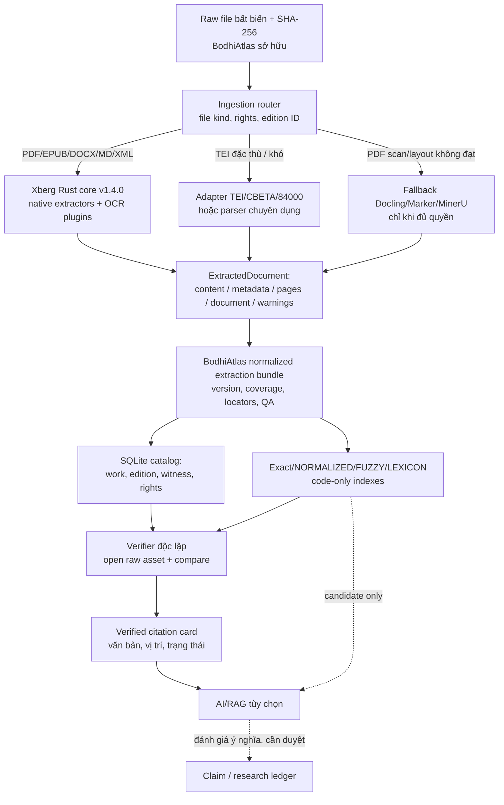

# Technology Assessment — Xberg / Kreuzberg (xberg-io)

**Mã đánh giá:** P53 · **Ngày khảo sát:** 2026-11-16 (Asia/Ho_Chi_Minh) · **Đơn vị sử dụng:** BodhiAtlas · **Phân loại:** `component` (bộ trích xuất/tầng nạp đa định dạng), **không phải** hệ thống thư viện-trích dẫn hoàn chỉnh.

- **Nguồn chính:** https://github.com/xberg-io/xberg
- **Snapshot ổn định đánh giá:** `v1.4.0`, commit **`f319f78c368a3e017f8e062d74b14896c080cd07`** (GitHub tag ref); release công bố **2026-11-13**: https://github.com/xberg-io/xberg/releases/tag/v1.4.0.
- **Lưu ý phiên bản:** `main` tại thời điểm kiểm tra là `a9bc10c4b889a79dced50c017a82d0aa9588d48f` và **không** phải snapshot đánh giá; thay đổi sau tag và issue gắn nhãn v1.4.1 không được mặc định đã phát hành.
- **Tiền thân:** Kreuzberg v4 LTS ở https://github.com/kreuzberg-dev/kreuzberg-lts; tổ chức cũ xác nhận rename sang Xberg và tạo chuỗi phiên bản v1 mới. README tại tag vẫn có liên kết cũ không nhất quán; xem mục 5.
- **Analyst/phương pháp:** thẩm định độc lập bằng đọc trực tiếp repository/tag, các file Rust cốt lõi, README, Cargo manifest, schema/types, tests, issues, release, LICENSE, PRD BodhiAtlas và kho corpus hiện hữu; đối chiếu tài liệu chính thức của đối thủ. Phân loại bằng chứng `[DOC]`, `[CODE]`, `[ISSUE]`, `[INFERRED]`, `[UNKNOWN]`. **Không thực thi Xberg trên tài liệu corpus**; `NOT TESTED`. Một số công cụ tải repository không sẵn do môi trường không có DNS ra GitHub; có thể đọc nguồn qua GitHub API được kết nối. `xberg` CLI và Python package `xberg` không cài trong sandbox, không có `rustc/cargo`.
- **Quy ước:** `NATIVE` = có trong mã Xberg khi cấu hình/build phù hợp; `CONFIG` = cần bật option/feature/model; `EXTENSION` = phải viết adapter/logic BodhiAtlas; `EXTERNAL` = hệ thống khác thực hiện; `MISSING` = không có năng lực được chứng minh trong phạm vi Xberg; `UNKNOWN` = chưa đủ bằng chứng; `N/A` = không thuộc vai trò cần đánh giá. **Một loại dữ liệu xuất hiện trong struct không chứng minh chất lượng trên dữ liệu thật**. Link mã nguồn đóng băng theo commit trên.

## 1. Executive Decision

**Quyết định: `TRIAL ONLY`** (mã bảng tổng hợp: `TRIAL`), **confidence `MEDIUM`** về kiến trúc, **LOW** về chất lượng OCR/citation thực tế trên corpus BodhiAtlas.

**Giả thuyết được ủng hộ một phần:** Xberg có tiềm năng làm **bộ nhận dạng/trích xuất đa định dạng và một nhánh trong ingestion router** cho V1. Mã tại `v1.4.0` có parser PDF/EPUB/DOCX/Markdown/XML, OCR backend và plugin, `ExtractedDocument`, per-page text, cấu trúc node, bbox tùy trường hợp, warning/quality và API/batch. Nhưng **không chứng minh** Xberg là source-of-truth, catalog works/editions/witnesses, công cụ tìm `EXACT` toàn bộ vị trí, hoặc verifier độc lập.

**Đề xuất theo phiên bản BodhiAtlas:**

- **V1 Core:** thử nghiệm **local library/CLI, không public REST**, với 5 định dạng cần thiết. Giữ raw SHA-256, catalog, manifest coverage, source map đã kiểm, SQLite/FTS5 và reopener riêng. **Chỉ nhận thành phần sau POC đạt cổng.**
- **V2:** có thể tận dụng output structure, OCR, embeddings/reranker như **candidate generator** tùy chọn; AI không tạo hoặc tự xác minh citation.
- **V3:** nghiên cứu gateway/worker từ xa có auth, hạn mức và tenant isolation do BodhiAtlas cung cấp; chưa phê duyệt Xberg REST/MCP mặc định cho upload tư liệu nhạy cảm.

**Ba rủi ro quyết định:**

1. **Source fidelity chưa khép kín:** `DocumentStructure::node_rendered_offset` **luôn trả `None`** tại `v1.4.0`; bbox/page có điều kiện, không có ánh xạ source→rendered text hoàn chỉnh hay CFI EPUB được chứng minh. ID node phụ thuộc text/page/index.
2. **OCR/đa ngữ/chất lượng chưa nghiệm thu:** không có phép đo độc lập cho Pāli dấu phụ, Hán giản/phồn, chữ Tạng/Wylie, PDF scan/hai cột/chú thích. OCR và `quality_score` **không** tương đương xác nhận chữ/vị trí hay coverage hoàn chỉnh.
3. **REST security mặc định không phù hợp public:** tại tag, CORS cho phép mọi origin, không thấy lớp authentication trong router; issue chính thức #3165 xác nhận. Chỉ triển khai sau khi đặt sau reverse proxy/auth/ACL, khóa outbound/LLM và test hostile uploads.

**Hard gates trước quyết định ADOPT/USE AS COMPONENT:** `SOURCE_FIDELITY`, `MULTILINGUAL`, `QUALITY_COVERAGE` và `RIGHTS_SECURITY` đều cần test thực; `CODE_ONLY_EXACT` là chức năng **N/A đối với parser**, nhưng **bắt buộc PASS ở lớp search riêng**. Không dùng điểm tổng để bù cổng trượt.

## 2. Sources & Evidence Ledger

Dưới đây là các claim có nguồn; link code khóa ở SHA `f319f78…` (= `v1.4.0`), trừ khi ghi khác. Những phát biểu của upstream về số format/benchmark/độ chính xác chỉ là `[DOC]`, không được suy thành đo kiểm.

| claim_id | claim | evidence | URL/file+line | version/SHA | note |
|---|---|---|---|---|---|
| E01 | Kreuzberg đổi thành Xberg, v4 có LTS riêng | `[DOC]` | [Tổ chức cũ](https://github.com/kreuzberg-dev); [migration changelog](https://docs.xberg.io/changelog-1.0-1.2/) | docs, tra 16/11 | Chứng minh lịch sử, **không** gộp phiên bản 4.x với 1.x |
| E02 | `v1.4.0` release 13/11/2026, tag SHA trên | `[DOC]` | [release](https://github.com/xberg-io/xberg/releases/tag/v1.4.0); [tag ref](https://api.github.com/repos/xberg-io/xberg/git/ref/tags/v1.4.0) | `f319f78…` | Release khác `main` |
| E03 | Workspace Rust 2024, `rust-version=1.99`, license MIT, nhiều crates | `[CODE]` | [Cargo.toml L1-L39](https://github.com/xberg-io/xberg/blob/f319f78c368a3e017f8e062d74b14896c080cd07/Cargo.toml#L1-L39) | v1.4.0 | `xberg`, `xberg-cli`, `xberg-native-pdf`, OCR variants, bindings |
| E04 | Bộ core có feature flags PDF native/Pdfium, Office, XML, HTML; mặc định không bật tất cả | `[CODE]` | [crates/xberg/Cargo.toml L104-L200](https://github.com/xberg-io/xberg/blob/f319f78c368a3e017f8e062d74b14896c080cd07/crates/xberg/Cargo.toml#L104-L200) | v1.4.0 | Phân biệt khả năng trong repo và binary đang cài |
| E05 | Upstream tuyên bố 107 formats/141 extensions/15 bindings và CLI/API/MCP | `[DOC]` | [README](https://github.com/xberg-io/xberg/blob/f319f78c368a3e017f8e062d74b14896c080cd07/README.md) | v1.4.0 | **Không** chứng minh parser fidelity cho mỗi MIME |
| E06 | `ExtractedDocument` có `content`, `metadata`, tables, `chunks`, `pages`, `images`, method | `[CODE]` | [types/extraction.rs L137-L206](https://github.com/xberg-io/xberg/blob/f319f78c368a3e017f8e062d74b14896c080cd07/crates/xberg/src/types/extraction.rs#L137-L206) | v1.4.0 | `pages` và `document` tùy config |
| E07 | Có `document`, `ocr_elements`, `quality_score`, `processing_warnings` | `[CODE]` | [types/extraction.rs L231-L315](https://github.com/xberg-io/xberg/blob/f319f78c368a3e017f8e062d74b14896c080cd07/crates/xberg/src/types/extraction.rs#L231-L315) | v1.4.0 | `quality_score` chấm chữ giữ lại, **không** là completeness |
| E08 | `PageBoundary` là **UTF-8 byte offsets trong extracted content**, không phải byte-range của PDF gốc | `[CODE]` | [types/page.rs L12-L66](https://github.com/xberg-io/xberg/blob/f319f78c368a3e017f8e062d74b14896c080cd07/crates/xberg/src/types/page.rs#L12-L66) | v1.4.0 | Rủi ro nhầm source bytes và output bytes |
| E09 | `PageContent` có text, table, ảnh, layout, OCR confidence và `native_content` khi cấu hình | `[CODE]` | [types/page.rs L187-L307](https://github.com/xberg-io/xberg/blob/f319f78c368a3e017f8e062d74b14896c080cd07/crates/xberg/src/types/page.rs#L187-L307) | v1.4.0 | `native_content` chỉ PDF và điều kiện cụ thể |
| E10 | `DocumentNode` có page, bbox, content layer, ID từ text/page/index | `[CODE]` | [types/document_structure.rs L21-L60](https://github.com/xberg-io/xberg/blob/f319f78c368a3e017f8e062d74b14896c080cd07/crates/xberg/src/types/document_structure.rs#L21-L60), [L255-L300](https://github.com/xberg-io/xberg/blob/f319f78c368a3e017f8e062d74b14896c080cd07/crates/xberg/src/types/document_structure.rs#L255-L300) | v1.4.0 | ID không bền nếu parser đổi segmentation |
| E11 | `node_rendered_offset` deprecated, **always None** | `[CODE]` | [types/document_structure.rs L171-L213](https://github.com/xberg-io/xberg/blob/f319f78c368a3e017f8e062d74b14896c080cd07/crates/xberg/src/types/document_structure.rs#L171-L213) | v1.4.0 | **Blocker** mapping node↔rendered text |
| E12 | PDF extractor trả text, table, pages/boundaries, internal document và warning | `[CODE]` | [extractors/pdf/extraction.rs L1-L41](https://github.com/xberg-io/xberg/blob/f319f78c368a3e017f8e062d74b14896c080cd07/crates/xberg/src/extractors/pdf/extraction.rs#L1-L41) | v1.4.0 | Không chứng minh mọi ký tự đều có bbox |
| E13 | EPUB đọc OPF/spine/xhtml qua ZIP/Rust; có metadata Dublin Core | `[CODE]` | [extractors/epub/mod.rs L1-L45](https://github.com/xberg-io/xberg/blob/f319f78c368a3e017f8e062d74b14896c080cd07/crates/xberg/src/extractors/epub/mod.rs#L1-L45); [metadata.rs L1-L70](https://github.com/xberg-io/xberg/blob/f319f78c368a3e017f8e062d74b14896c080cd07/crates/xberg/src/extractors/epub/metadata.rs#L1-L70) | v1.4.0 | Spine order ≠ EPUB CFI đã xuất |
| E14 | EPUB ghi nhận offset drift của link annotation sau normalize whitespace | `[CODE]` | [extractors/epub/mod.rs L607-L654](https://github.com/xberg-io/xberg/blob/f319f78c368a3e017f8e062d74b14896c080cd07/crates/xberg/src/extractors/epub/mod.rs#L607-L654) | v1.4.0 | Cần giữ raw XHTML anchor/href độc lập |
| E15 | EPUB giới hạn 16 MiB cho từng member đọc và không thay thế ký tự UTF lỗi âm thầm | `[CODE]` | [extractors/epub/parsing.rs L11-L26](https://github.com/xberg-io/xberg/blob/f319f78c368a3e017f8e062d74b14896c080cd07/crates/xberg/src/extractors/epub/parsing.rs#L11-L26), [L106-L135](https://github.com/xberg-io/xberg/blob/f319f78c368a3e017f8e062d74b14896c080cd07/crates/xberg/src/extractors/epub/parsing.rs#L106-L135) | v1.4.0 | Bảo vệ đầu vào, vẫn có khả năng skip/degrade |
| E16 | DOCX parse Word XML, tạo node và page counter nội bộ | `[CODE]` | [extractors/docx.rs L1-L28](https://github.com/xberg-io/xberg/blob/f319f78c368a3e017f8e062d74b14896c080cd07/crates/xberg/src/extractors/docx.rs#L1-L28), [L99-L110](https://github.com/xberg-io/xberg/blob/f319f78c368a3e017f8e062d74b14896c080cd07/crates/xberg/src/extractors/docx.rs#L99-L110) | v1.4.0 | Không thay số trang in/render Word |
| E17 | XML extractor là parser cấu trúc XML tổng quát, không thấy chứng minh xử lý TEI witness/critical apparatus đặc thù | `[CODE]`/`[INFERRED]` | [extractors/xml.rs L1-L30](https://github.com/xberg-io/xberg/blob/f319f78c368a3e017f8e062d74b14896c080cd07/crates/xberg/src/extractors/xml.rs#L1-L30), [L229-L336](https://github.com/xberg-io/xberg/blob/f319f78c368a3e017f8e062d74b14896c080cd07/crates/xberg/src/extractors/xml.rs#L229-L336) | v1.4.0 | TEI adapter riêng |
| E18 | OCR backend trait: Tesseract, PaddleOCR, Candle/custom; semantics confidence khác nhau | `[CODE]` | [plugins/ocr.rs L16-L58](https://github.com/xberg-io/xberg/blob/f319f78c368a3e017f8e062d74b14896c080cd07/crates/xberg/src/plugins/ocr.rs#L16-L58), [L131-L199](https://github.com/xberg-io/xberg/blob/f319f78c368a3e017f8e062d74b14896c080cd07/crates/xberg/src/plugins/ocr.rs#L131-L199) | v1.4.0 | Model/weights, script coverage phải xét riêng |
| E19 | Có content-hash cache theo raw bytes + config cho bytes input, **không** là catalog SHA-256 | `[CODE]` | [engine/extract_impl.rs L77-L93](https://github.com/xberg-io/xberg/blob/f319f78c368a3e017f8e062d74b14896c080cd07/crates/xberg/src/engine/extract_impl.rs#L77-L93), [L273-L309](https://github.com/xberg-io/xberg/blob/f319f78c368a3e017f8e062d74b14896c080cd07/crates/xberg/src/engine/extract_impl.rs#L273-L309) | v1.4.0 | Cache không thay processing ledger |
| E20 | Cấu hình có giới hạn ZIP/XML/size; `max_pages` mặc định `None`, không được áp với DOCX | `[CODE]` | [extractors/security.rs L21-L121](https://github.com/xberg-io/xberg/blob/f319f78c368a3e017f8e062d74b14896c080cd07/crates/xberg/src/extractors/security.rs#L21-L121) | v1.4.0 | Phải đặt quota theo sản phẩm |
| E21 | Router có `/extract`, async jobs, cache endpoints; concurrency chủ yếu bảo vệ extract routes | `[CODE]` | [api/router.rs L240-L317](https://github.com/xberg-io/xberg/blob/f319f78c368a3e017f8e062d74b14896c080cd07/crates/xberg/src/api/router.rs#L240-L317) | v1.4.0 | Không phải multi-tenant governance |
| E22 | CORS mặc định allow-all; router không thấy auth middleware | `[CODE]`/`[ISSUE]` | [api/router.rs L165-L193](https://github.com/xberg-io/xberg/blob/f319f78c368a3e017f8e062d74b14896c080cd07/crates/xberg/src/api/router.rs#L165-L193); [#3165](https://github.com/xberg-io/xberg/issues/3165) | v1.4.0 + issue 15/11 | **Không public exposed** |
| E23 | Request config chặn các trường URL/API key tùy vị trí; chưa đồng nghĩa hoàn toàn chặn cloud egress | `[CODE]` | [core/config/request_security.rs L1-L65](https://github.com/xberg-io/xberg/blob/f319f78c368a3e017f8e062d74b14896c080cd07/crates/xberg/src/core/config/request_security.rs#L1-L65) | v1.4.0 | Kiểm cả operator env |
| E24 | MCP HTTP có allow-list Host, mặc định loopback, không đồng nghĩa user auth | `[CODE]` | [mcp/allowed_hosts.rs L1-L60](https://github.com/xberg-io/xberg/blob/f319f78c368a3e017f8e062d74b14896c080cd07/crates/xberg/src/mcp/allowed_hosts.rs#L1-L60) | v1.4.0 | Không nhầm Host validation với authorization |
| E25 | MIT áp cho code Xberg; quyền model/dữ liệu/ảnh không tự đi theo | `[CODE]`/`[INFERRED]` | [LICENSE](https://github.com/xberg-io/xberg/blob/f319f78c368a3e017f8e062d74b14896c080cd07/LICENSE); [ATTRIBUTIONS](https://github.com/xberg-io/xberg/blob/f319f78c368a3e017f8e062d74b14896c080cd07/ATTRIBUTIONS.md) | v1.4.0 | Audit từng artifact/model cần dùng |
| E26 | `SECURITY.md` ghi bảng support 5.x dù repo/release là 1.4.0 và ghi không outbound network dù có URL/LLM features | `[DOC]` | [SECURITY.md L1-L55](https://github.com/xberg-io/xberg/blob/f319f78c368a3e017f8e062d74b14896c080cd07/SECURITY.md#L1-L55), [README](https://github.com/xberg-io/xberg/blob/f319f78c368a3e017f8e062d74b14896c080cd07/README.md) | v1.4.0 | **Tài liệu không nhất quán**, không tin default từ một file |
| E27 | Issue #3175 báo cancel OCR bị gói thành plugin error trên 1.4.0 | `[ISSUE]` | [issue #3175](https://github.com/xberg-io/xberg/issues/3175) | 16/11 | Reporter có repro, **không phải test của báo cáo này** |
| E28 | Issue #3167 báo gap async jobs, env key, MCP paths và leak path | `[ISSUE]` | [issue #3167](https://github.com/xberg-io/xberg/issues/3167) | 15/11 | Đòi xác nhận lại theo tag/build triển khai |
| E29 | PRD yêu cầu file–edition–witness, exact mọi vị trí, citation re-open và biết giới hạn | `[DOC]` | [BodhiAtlas PRD V1.4](https://github.com/quoctran-2608/bodhi-atlas/blob/main/docs/PRD.md) | PRD đọc 16/11 | Mục 2–6, nghiệm thu mục 8 |
| E30 | Risk register ưu tiên lỗi OCR, sai edition, normalization và thiếu trang là P0 | `[DOC]` | [Academic Risks](https://github.com/quoctran-2608/bodhi-atlas/blob/main/docs/ACADEMIC_RISKS_AND_VERIFICATION.md) | ngày tài liệu 15/11 | R01–R05, R07, R20, R24, R27 |
| E31 | Corpus đã có 13 upstream pinned, index local SQLite/FTS và resolver Bilara/CBETA/84000 riêng | `[DOC]` | [BuddhismDocuments-for-AI README](https://github.com/quoctran-2608/BuddhismDocuments-for-AI/blob/main/README.md) | đọc 16/11 | Tái sử dụng, không thay bằng Xberg |
| E32 | Chưa chạy extraction, CER/recall/page reopen/latency chưa có số | `[UNKNOWN]` | Môi trường thẩm định; lệnh kiểm `command -v xberg`, Python `find_spec('xberg')`, `git ls-remote` | 16/11 | CLI/package thiếu; GitHub DNS lỗi trong sandbox |

**Độ bao phủ điều tra mã:** đọc `Cargo.toml`/core `Cargo.toml`, `types/extraction.rs`, `types/page.rs`, `types/document_structure.rs`, `types/metadata.rs`, `extractors/pdf/extraction.rs`, `extractors/epub/{mod,content,metadata,parsing}.rs`, `extractors/docx.rs`, `extractors/xml.rs`, `engine/extract_impl.rs`, `plugins/ocr.rs`, `core/config/{page,ocr,request_security}.rs`, `api/{router,config}.rs`, `mcp/allowed_hosts.rs`, `extractors/security.rs`, `LICENSE`, `SECURITY.md`; nhìn thấy test files `doc_cjk_text.rs`, `epub_*`, `gh2109_right_margin_note_column_order.rs`, `extraction_confidence.rs`… **Không gọi các test có sẵn là `[TESTED]`**. Không đọc toàn bộ dự án khổng lồ hay toàn bộ đường thực thi từng format; mức `UNKNOWN` được giữ tương ứng.

## 3. Architecture & Data Flow



**Ranh giới thẩm quyền:** file gốc + checksum và catalog/verified positions thuộc BodhiAtlas; Xberg thuộc **derived extraction**. Chunks, vectors, `NodeId` và cache Xberg **không** là định danh citation ổn định. Xberg có 3 bề mặt gọi: native library/bindings (`extract`, `extract_batch`), CLI, và REST/MCP; tất cả cần kiểm `feature flags`, config, runtime dependencies.

**Luồng định dạng:** PDF native parser (`xberg-native-pdf` qua `pdf-native`), tùy chọn Pdfium engine; scan → OCR backend (Tesseract binding, PaddleOCR ONNX/FFI, Candle local hoặc VLM provider); EPUB → ZIP/OPF/spine/XHTML; DOCX → ZIP + Word XML/parser; Markdown → text/structure; XML → generic XML tree. Có các bộ xử lý chất lượng/heading/table/layout ở giữa. Đầu ra có thể là text, structured nodes, page content, table/image/OCR elements. **Không** suy từ `document` có bbox sang bbox đúng cho mỗi ký tự.

## 4. Feature Fit–Gap Matrix

**Bảng C01–C15.** Mức công sức là **ước lượng kỹ thuật định tính**, không phải giờ/ngày đã đo. Khi một năng lực có hai phần, status chỉ biểu thị mức phù hợp đối với **vai trò parser**; phần BodhiAtlas cần làm ghi rõ bên cạnh.

| ID | Capability | Status | Evidence (ledger) | Gaps / work to integrate | Effort |
|---|---|---|---|---|---|
| C01 | Multi-format ingest | `NATIVE` | E03–E06, E12–E17 | Router, MIME/rights allowlist, format-specific routing, fallback | `MEDIUM` |
| C02 | OCR/layout/reading order | `CONFIG` | E12, E18, E27 | Pin models/languages, test two-column, order, image coordinates, exceptions | `HIGH` |
| C03 | Canonical text/source map | `EXTENSION` | E08–E11, E14 | Raw-vs-rendered mapping; page bbox↔text span; EPUB href/CFI; versioned gold checks | `HIGH` |
| C04 | Works/editions/witnesses | `EXTERNAL` | E29–E31 | BodhiAtlas catalog, provenance graph, translation/parallel relation | `MEDIUM` |
| C05 | Exhaustive EXACT | `N/A` | E05–E06, E29 | Xberg parser; phải xây exact substring index/scan + all-occurrences verifier | `MEDIUM` |
| C06 | Normalized multilingual search | `N/A` | E29–E30 | Separate reversible normalized indexes, script/term rules | `HIGH` |
| C07 | Fuzzy/near-duplicate/OCR errors | `EXTERNAL` | E07, E29–E30 | Search engine, score calibration, diff display, no verification upgrade | `MEDIUM` |
| C08 | Sense-aware lexicon | `N/A` | E29–E31 | Separate sense ID/lexicon, references, tradition/context | `HIGH` |
| C09 | Semantic/hybrid/RAG | `CONFIG` | E05–E06 | Xberg has embedding/chunk/rerank hooks; persistent query/corpus indexes and governance external | `MEDIUM` |
| C10 | Verified citation card/reopen | `EXTERNAL` | E08–E11, E29–E30 | Independent source opener, evidence card, verified states, edition/page checks | `HIGH` |
| C11 | Note/wiki/claim memory | `N/A` | E29–E31 | Use existing BodhiAtlas research ledger, not Xberg | `LOW` for reuse |
| C12 | API/MCP/export | `NATIVE` | E05, E21–E24 | Local permissions, gateway, stable JSON contract, version pin | `MEDIUM` |
| C13 | Quality coverage + incremental | `EXTENSION` | E07, E15, E19, E20, E27 | Coverage manifest, page statuses, retry/quarantine, SHA-256 diff, async job ledger | `HIGH` |
| C14 | Auth/licensing/privacy/backup | `EXTERNAL` | E22–E28 | Auth/proxy, outbound deny, model/data license ledger, encrypted asset backup | `HIGH` |
| C15 | Operational simplicity + independent deploy | `CONFIG` | E03–E05, E20–E24 | Local Rust/Python easiest trial; model weight & native libs/runtime may be heavy | `MEDIUM` |

**Cổng không được đánh đổi:**

| Gate | Result for Xberg component now | Diễn giải |
|---|---|---|
| `SOURCE_FIDELITY` | `unknown` | Có page+bbox có điều kiện; `node_rendered_offset=None` và EPUB drift chưa được bù và kiểm |
| `CODE_ONLY_EXACT` | `n/a` | Parser không đảm nhiệm; BodhiAtlas search layer bắt buộc đạt `pass` |
| `MULTILINGUAL` | `unknown` | Chưa đo CJK/Tạng/Pāli/Việt trên data có gold |
| `QUALITY_COVERAGE` | `unknown` | Warnings có, nhưng tổng hợp trạng thái đủ/thiếu/chưa đọc là nhiệm vụ ngoài |
| `RIGHTS_SECURITY` | `fail` **cho REST trực tiếp public**, `unknown` cho local | Router không có auth mặc định, CORS all origins; license quyền OCR artifacts chưa audit |
| `PORTABILITY` | `unknown` | Có JSON/text; phụ thuộc adapter map + independent IDs/verified ledger không buộc vào node/chunk |

`N/A` **không phải điểm trừ**. `fail` security là đánh giá **cấu hình public REST mặc định**, không khẳng định core local có lỗ hổng exploitable chưa chứng minh.

## 5. Deep Technical Findings

### 5.1. Danh tính, phiên bản, package

- Tổ chức `kreuzberg-dev` thông báo rename/move, `kreuzberg-dev/kreuzberg-lts` giữ v4; Xberg bắt đầu stable `1.0.0` ngày **2026-07-27**. `v1.4.0` ra **2026-11-13**. **Không** gọi v4.9.x là “v1.4.0” hoặc trộn build/tag legacy với new. [E01–E02]
- Packages được công bố: Python `xberg`, Rust crate `xberg`, npm `@xberg-io/xberg`, Go `github.com/xberg-io/xberg/packages/go`, Maven `io.xberg:xberg`, NuGet `XbergIo.Xberg`; CLI `xberg`, container `ghcr.io/xberg-io/xberg`. **Tên package cần khóa theo phiên bản thực cài**, không dùng tên `kreuzberg` legacy khi tích hợp mới. [README v1.4.0](https://github.com/xberg-io/xberg/blob/f319f78c368a3e017f8e062d74b14896c080cd07/README.md)
- README tag còn trỏ đến đường legacy `kreuzberg-v4-lts` không nhất quán với repo LTS thực `kreuzberg-lts`. Đối chiếu với repo thực/organization official, không xem link stale là bằng chứng tồn tại repo đó.

### 5.2. Rust core, parsers, SDK/CLI/server

- `Cargo.toml` workspace liệt kê core, CLI, FFI, Python/Node, PDF, Tesseract, Paddle/Candle và bindings. `Cargo.lock` có mặt; Rust 1.99 theo `rust-version`. `crates/xberg/Cargo.toml` bật **mặc định** `tokio-runtime` + `simd-utf8`, parser/ML phụ thuộc flags. Tức **build tối thiểu không tự đồng nghĩa full extraction stack**. [E03–E04]
- PDF: có `pdf-native` và tùy chọn `pdf-pdfium`; luồng `extractors/pdf/extraction.rs` tập hợp native text, page boundaries, bảng, ảnh, annotations, warnings; layout/reading-order có module riêng. Đặc tính `page + bbox` được thể hiện trong document types nhưng không cam kết universal.
- EPUB: `extractors/epub/{mod,metadata,content,parsing}.rs` mở ZIP/OPF, spine XHTML theo thứ tự, Dublin Core. `EpubSpineDocument.file_path` tồn tại nội bộ nhưng **không đủ bằng chứng** rằng mỗi đoạn JSON output luôn có href/CFI chính xác. `[CODE]`
- DOCX: `extractors/docx.rs` + `extraction/docx/parser.rs`, trích Word XML/heading/table/comment/footnote tùy trường hợp. Page counter nội bộ không thể tự xác nhận “trang in” do Word layout thay đổi theo font/renderer. `[CODE]` / `[INFERRED]`
- Markdown/HTML/XML: có extractors riêng; XML generic có cấu trúc element nhưng **không thấy** `TEI.2`, `<app>/<rdg>/<wit>` hay quan hệ witness được mô hình hóa như catalog học thuật. Cần parser/adapter TEI.
- Output chính: `ExtractedDocument.content` **cùng với** optional `pages`, `document`, `ocr_elements`, `images`, `chunks`, `metadata`, `quality_score`, `processing_warnings`. Plain-text/Markdown/Djot/HTML/JSON tree/DocTags là hình thức biểu diễn; **không** có nghĩa mỗi output giữ cùng một source map.

### 5.3. Page, byte offsets, structure, provenance

- `PageBoundary.byte_start/end` theo UTF-8 byte offset **trong chuỗi `content`**, page number 1-index. Không phải byte offset của raw PDF, và không phải geometry cho mọi hit. [E08]
- `PageContent.content`, `layout_regions`, `ocr_confidence` (nếu bật) và `native_content` (khi OCR thay thế PDF text layer và `pages.keep_native_content=true`); `PageConfig` mặc định `extract_pages=false`. Không coi `None` là “trang không có chữ” nếu chưa bật cấu hình. [E09, `core/config/page.rs`](https://github.com/xberg-io/xberg/blob/f319f78c368a3e017f8e062d74b14896c080cd07/crates/xberg/src/core/config/page.rs#L8-L64)
- `DocumentStructure` có nodes/relationships, `DocumentNode.page`, `.page_end`, `.bbox`, layers (body/header/footnote), annotations; **nhưng** `node_rendered_offset()` đánh dấu deprecated và luôn `None` do renderer không duy trì node→text byte map. Đây là **giao điểm cần adapter/đối chiếu**, không được ghi vào phiếu trích dẫn “position verified” chỉ vì một node có bbox. [E10–E11]
- `NodeId` hashing deterministic **theo node type/text/page/index**; parser version, normalization hoặc segmentation đổi có thể đổi ID. Các citation ID của BodhiAtlas phải độc lập.
- Byte range cho **code source** tại `CodeDataNode` là offset gốc của các định dạng dữ liệu có structural extractor; **không suy rộng** sang PDF scan/EPUB bản in. [types/metadata.rs L132-L235](https://github.com/xberg-io/xberg/blob/f319f78c368a3e017f8e062d74b14896c080cd07/crates/xberg/src/types/metadata.rs#L132-L235)
- `content_cache_key` dùng content/config fingerprint cho `bytes` inputs; không thấy tuyên bố `SHA-256` canonical ID, file-level chain-of-custody hay persist checksum trong `ExtractedDocument`. Do đó BodhiAtlas **tự SHA-256 raw bytes và ghi extractor/model/config/version**. [E19]

### 5.4. OCR, model và ngôn ngữ

- `OcrBackend` Rust trait cho backends/custom, `OcrBackendType::{Tesseract,PaddleOCR,Candle,Custom}`; VLM/remote có thể cấu hình qua provider. Tesseract native binding không có nghĩa **traineddata cho Pāli/Tạng/Hán** đã được bundle hoặc hoạt động trong môi trường hiện hành. Paddle/Candle là model stack riêng với quyền artifact/ONNX weights cần kiểm. [E18]
- CPU là đường khả thi với native parser/Tesseract và một số model; GPU/ORT/Candle và dung lượng model tùy build/engine. Không đặt số GB RAM/VRAM cụ thể khi chưa chọn model và thử. `PP-DocLayout-V3` được changelog coi là thử nghiệm; mô tả có tải model ~131 MB và chưa qualified so với RT-DETR — **con số upstream là metadata mô hình, không phải benchmark của báo cáo**. [CHANGELOG](https://github.com/xberg-io/xberg/blob/f319f78c368a3e017f8e062d74b14896c080cd07/CHANGELOG.md)
- Xberg phân biệt native/OCR/mixed ở `ExtractionMethod`. `PageOcrConfidence` ghi rõ score chỉ phục vụ triage, **không so ngang backend**. `quality_score` của chữ *đã giữ lại* không là coverage/accuracy toàn file. [E06–E07, E09]
- Ngôn ngữ Hán/Tạng/Pāli/Sanskrit/Việt **chưa có measured accuracy**. Cần kiểm NFD/NFC, nguyên âm dài, dấu dưới, tổ hợp Sanskrit `duḥkha`, chữ Hán phồn/giản, chữ Tạng/stacked Unicode/Wylie, ký tự phủ định, dòng nối trang, headings/footnotes.

### 5.5. Batch, API, retry/backpressure, incremental

- `engine/extract_impl.rs` có `extract`, `extract_batch`, cache by bytes+config, per-input work; CLI và Python có API async. File/URI semantics khác: cache key raw bytes chỉ áp ở bytes path trong đoạn code đã xem. Cần job ledger riêng `queued/running/partial/failed/succeeded` và immutable fixture of config.
- REST `api/router.rs`: `/extract`, `/extract-async`, `/jobs/{job_id}`, `/detect`, health/formats, cache endpoints; một concurrency limiter mặc định khoảng `2*CPU`, clamp 4–32, **chỉ áp nhánh extraction**. Có body-size cap và job timeout; không suy ra QoS/queue/tenant isolation đầy đủ. `#3167` đặt nghi vấn async job bypass limiter, error leakage, operator key fallback. [E19–E21, E28]
- `SecurityLimits` giới hạn ZIP size/ratio/iterations/XML depth/etc.; `max_pages=None` mặc định và không áp dụng DOCX. Bộ limits chỉ là một lớp, không thay OS process isolation, ulimit, filesystem readonly, egress policy hay virus scanning.
- Độ tin cậy incremental: **BodhiAtlas** phải dùng key `(raw_sha256, extractor_name, extractor_version, config_hash, model_digest)` và idempotency; khi thay parse result phải invalidate derived index nhưng không hủy verified claim, chỉ chuyển trạng thái `RECHECK_REQUIRED`.

### 5.6. Security, documentation drift và issues

- Tại `v1.4.0`, `build_cors_layer()` cho phép tất cả origins theo mặc định; router không có auth layer. GitHub issue #3165 (15/11/2026) xác nhận tình trạng. MCP HTTP Host allowlist **chống DNS rebinding**, không phải permission per-user/per-document. Đề nghị **local CLI/lib** cho POC; không mở port 0.0.0.0/public API theo README nếu chưa bổ sung bảo vệ. [E21–E24]
- `request_security.rs` chặn các credential/transport overrides do caller gửi, nhưng issue #3167 nêu operator environment LLM key fallback và MCP local paths; coi đây là **vấn đề cần kiểm**, không tự khẳng định mọi nhánh chịu ảnh hưởng ở v1.4.0. 
- `SECURITY.md` tại snapshot có **drift rõ**: support table ghi “5.x” trong khi bản release Xberg là 1.4.0; dòng “never makes outbound network requests” không tương thích với README mô tả URL ingestion và hosted LLM/VLM. Không thể dùng câu này để cam kết offline/air-gapped. Nên chọn build/profile có egress disabled và xác nhận bằng network test. [E26]
- `#3175` mô tả lỗi cancel OCR khi toàn bộ trang thất bại trên Xberg 1.4.0 (repro của người báo cáo, không do phiên này thực thi). `#3170` còn yêu cầu nối discretionary hyphen cho OCR scan; `#3172` nói tới cảnh báo đồng thời bị gán sai, nhiều hàm dài và một số tests skip khi thiếu corpus. Đây là tín hiệu thiết kế POC chứ **không** là chứng cứ tổng kết chất lượng. [issues](https://github.com/xberg-io/xberg/issues)

## 6. Source Fidelity & Provenance

**Chính sách BodhiAtlas:** không cho một output parser tự biến thành trích dẫn “đã xác minh”. Kiểm 4 lớp **câu chữ**, **vị trí**, **ngữ nghĩa**, **phạm vi coverage** độc lập; mỗi lớp có tình trạng và người/máy phê duyệt thích hợp.

**Khả năng hiện thấy / giới hạn từng định dạng:**

| Format | Source evidence hiện có | Không được giả định | Adapter/verifier cần có |
|---|---|---|---|
| PDF text | `pages`, `PageBoundary`, `DocumentNode.page/bbox`, native-content option | bbox mọi ký tự, trang in, thứ tự cột luôn đúng, PDF raw byte mapping | mapping text spans→bbox/page, print-page evidence, re-render/compare |
| PDF scan | OCR text/elements, confidence/regions tùy backend | OCR = nguyên văn; bbox không bị lệch do crop/rotation | screenshot/raster verification, confidence per region, QA `OCR_NEEDS_REVIEW` |
| EPUB | OPF/spine, chapter/path nội bộ, node & link annotations | EPUB CFI/href + range ổn định xuất đầy đủ, “page” là trang giấy | giữ manifest href/fragment/DOM path và resolver CFI; chống offset drift |
| DOCX | XML paragraphs, headings, comments/footnotes | exact page in Word bất biến | OOXML paragraph/bookmark locator, `w14:paraId` nếu có, fallback XPath |
| MD | file bytes + line/char offsets dễ tự tính bằng code | generated/rendered Markdown đồng nhất với raw byte offsets | raw line/byte map, CRLF/encoding |
| TEI/XML | generic XML tree | `<app>/<rdg>/<wit>` được hiểu thành edition/witness | TEI-aware parser, XPath/xml:id, witness labels, xml:lang |

**Mẫu hợp đồng phiếu nguồn (định nghĩa BodhiAtlas, KHÔNG phải schema Xberg):**

```json
{
  "work_id": "WORK_ID",
  "edition_id": "EDITION_ID",
  "witness_id": "WITNESS_ID_OR_NULL",
  "file_id": "FILE_ID",
  "raw_sha256": "<64 lowercase hex>",
  "authors": [], "translators": [],
  "text_role": "original|translation|commentary|quotation",
  "extractor": {"name": "xberg", "version": "1.4.0", "tag_commit": "f319f78c368a3e017f8e062d74b14896c080cd07", "config_sha256": "...", "ocr_backend": null, "model_digest": null},
  "verbatim_text": "...",
  "locator": {
    "type": "pdf|epub|docx|md|tei",
    "pdf_page_index_1": null, "pdf_bbox": null,
    "printed_page": null, "printed_page_evidence": null,
    "epub_href": null, "epub_cfi": null,
    "paragraph_id": null, "xml_id": null, "xpath": null
  },
  "match_type": "EXACT|NORMALIZED|FUZZY|LEXICON|SEMANTIC",
  "ocr_state": "NATIVE|OCR_UNCERTAIN|REVIEWED|N/A",
  "verification": {"text": "UNVERIFIED", "locator": "UNVERIFIED", "meaning": "NOT_ASSESSED"},
  "coverage": {"state": "PARTIAL|READY|NOT_INDEXED|SOURCE_UNAVAILABLE", "omitted_units": [], "warnings": []},
  "scope": {"index_snapshot_id": "...", "searched_file_ids": [], "unavailable_file_ids": []}
}
```

**Gating:** `TEXT_AND_LOCATOR_VERIFIED` chỉ khi **mở lại đúng raw SHA-256, edition**, đối chiếu chữ với nguồn đáng tin và tính lại locator. Nếu text đúng nhưng bbox/CFI sai: `TEXT_ONLY`; nếu OCR chưa duyệt: `OCR_NEEDS_REVIEW`. `printed_page` là `null` trừ khi có số in thật/OCR validated/cross-reference rõ. Với match `NORMALIZED/FUZZY` giữ nguyên input/query transform và delta, không gắn `EXACT`. Phân biệt `not found in indexed scope` khỏi `source absent/unreadable`.

**Các trường hợp phá vỡ citation phải thử:** hai cột đổi reading order, footnote xen văn bản, `không`/`不`/`མི་` bị mất, exact qua page/chunk boundary, 5 occurrence cùng file, trích 200–300 ký tự, cùng text ở 2 editions, sửa OCR/model, thay một file trùng nội dung khác bytes, EPUB whitespace/link offset drift, DOCX track changes.

## 7. Multilingual & Retrieval Behavior

**Xberg là nguồn trích xuất candidate, không phải engine kiểm chứng truy vấn học thuật toàn corpus.** README có embeddings/search features nhưng **không** tìm thấy bằng chứng ở phần mã đã xem về index searchable persistent với exhaustive character-exact semantics và tất cả vị trí trong tập BodhiAtlas. Đánh giá từng lớp:

| Mode | Vai trò Xberg | BodhiAtlas cần thực hiện | Test/rủi ro |
|---|---|---|---|
| `EXACT` | `N/A` parser; cung cấp text candidate | scan theo Unicode codepoint/UTF-8 byte trên raw/verified canonical text, **all matches**, kể cả qua chunk; kết hợp source map | câu dài 200–300 ký tự + 5 hits + phủ định |
| `NORMALIZED` | `N/A` search; text có thể đã được parse/render | **chỉ index phụ** NFD/NFC, dấu Việt, biến thể Hán đã kiểm; giữ raw, explain transform | `anatta/anattā`, `vô ngã/vo nga`, `無常/无常` |
| `FUZZY` | warnings/quality hỗ trợ triage, không phải search | trigram/edit distance/candidate scorer, nguyên văn + difference view | `dukkha/duḥkha`, OCR nhầm ký tự |
| `LEXICON` | `N/A` | mapping qua **sense_id**, truyền thống, chứng cứ thuật ngữ, không bắc cầu vô hạn | `anātman` ↔ `無我` ↔ `vô ngã` theo từng nghĩa |
| `SEMANTIC`/hybrid | `CONFIG` optional embeddings, chunk, rerank | vector index external, scope filter, verifier/claim ledger | query quan điểm học giả và lý giải, không giả “đã đọc” |
| CJK/Tạng | Unicode text path là ứng viên `[CODE]`; chất lượng `UNKNOWN` | tokenizer, script detection, Wylie↔Tibetan riêng, OCR language profiles | test GB/T variants, chữ Tạng có stack, Sanskrit diacritics |

**Bộ truy vấn bắt buộc:** `anatta`, `anattā`, `anātman`, `vô ngã`, `vo nga`, `無我`, `無常`, `无常`, `dukkha`, `duḥkha`, chữ Tạng Unicode và Wylie với quy tắc chuyển tự đã xác nhận. **Không coi** `anatta/anātman/無我` là literal equivalent; nếu mở rộng, ghi nhãn lexical candidate và `sense_id`.

**Câu hỏi luận đề** “Trong các tài liệu tôi có, những tác giả nào phân biệt giữa vô thường và khổ? Họ lập luận như thế nào? Cho tôi vị trí chính xác trong sách.”: lớp code tìm nguồn có khả năng liên quan (từ vựng + context + metadata + parallel/translation links đã xác nhận) và xuất citation candidates; con người/AI đọc ngữ cảnh, phân loại tác giả có thực sự **phân biệt** hay chỉ **nhắc cùng từ**, đánh giá luận đề, đối chứng và gắn lại những phiếu nguồn `TEXT_AND_LOCATOR_VERIFIED`. Không có kết quả/AI trả lời ≠ kết luận corpus không có.

## 8. Integration Options for BodhiAtlas

### Option A — **Local Xberg extraction adapter + existing BodhiAtlas index** (ưu tiên POC)

- **Input contract:** `{file_id, immutable_uri, raw_sha256, mime, rights_policy, work_id, edition_id, witness_id?, expected_pages?, extractor_profile}`.
- **Processing:** `rights gate → sha256 verify → xberg extract bytes/URI local → typed extraction bundle → QA → source-map verifier → derived indexes`. Với format đặc thù gọi TEI/Bilara/CBETA/84000 adapters hiện có, không ép qua Xberg.
- **Output contract:** `{raw_sha256, extractor_tag, config_hash, model_ids, content, pages, nodes, warnings, coverage_state, review_queue, candidate_locators, extraction_version}`. **Only VERIFIED** được vào kho citation.
- **Source of truth:** raw assets + versioned BodhiAtlas catalog/relations + verification ledger; Xberg JSON là *rebuildable derivative*. Stable IDs do BodhiAtlas cấp (`file_id`, `edition_id`, `locator_id`), không dùng chunk hash hoặc Xberg NodeId lâu dài.
- **Migration/rollback:** version-extraction immutable; switch index alias, giữ output cũ; re-verify trước khi thăng cấp; restore index/citation ledger từ snapshot và raw store khi parse mới giảm quality.
- **Trade-off:** đơn giản/không public service; vẫn phải tự xây canonical/source-map adapter và QA. **Ưu tiên sau POC**.

### Option B — **Router nhiều engine, Xberg fast path + fallback chuyên dụng**

- **Input/output contract:** giống A, thêm `strategy={xberg,docling,marker,mineru,tei}` và `decision_reason`. Router dispatch PDF born-digital sang Xberg fast path; PDF scan/complex layout so comparator; EPUB/DOCX/MD vào Xberg nếu fidelity đạt; TEI into specialist.
- **Quality decision:** gate theo OCR uncertainty, missing/contradictory page counts, lost footnotes, layout failure, source map mismatch. Có thể chạy *dual extraction* tại những trang nghi vấn và giữ cả bản cùng provenance.
- **Source of truth:** không thay đổi. Comparator không được tự ghi verified citation. Mỗi output có engine/model/config/rights attribution.
- **Rollback:** mỗi job lưu input+profile+output hashes, `fallback_reason`, dấu vết manual review; đổi engine theo từng MIME/edition mà không sửa raw ids.
- **Trade-off:** resilience và khả năng so sánh tốt hơn, nhưng operational/QA complexity `HIGH`.

### Option C — Xberg REST/MCP as independent ingestion microservice (CHƯA khuyến nghị V1)

Chỉ sau authn/authz, isolation, egress deny-by-default, job queue, size/time/CPU limits, cost quotas, audit logs, malware scanning và kiểm `/cache` endpoints; local environment proxy pin image digest. REST/MCP chỉ cho **đọc và extract input được phép**, không làm “verified citation service”. Không đồng nhất prompt MCP `semantic_search` với index có thẩm quyền.

**Tận dụng corpus hiện có:** repo `BuddhismDocuments-for-AI` đã có pinned upstreams, SQLite/FTS và resolver cho Bilara JSON/CBETA TEI/84000 TEI; nên Xberg thử nạp **sách định dạng chung chưa được parser hiện hữu xử lý tốt**, không thay resolver đã có hay đổi quy tắc nguồn.

## 9. Practical POC / Reproduction Plan

**Tình trạng:** `NOT TESTED` cho **TC01–TC09**. Không có fixture từ BodhiAtlas được tải/cấp quyền vào sandbox và Xberg CLI/Python package chưa có. Việc đọc các unit/integration tests trong GitHub là `[CODE]`, không là kết quả thực chạy. Đề xuất khóa `xberg==1.4.0` hoặc CLI/image bằng **digest**, record exact environment, cấu hình, trọng số/OCR engine, timestamp, raw and output SHA-256.

**Bootstrap kiểm tra phiên bản (đề xuất, chưa chạy):**

```bash
python -m venv .venv
. .venv/bin/activate
python -m pip install "xberg==1.4.0"
python -c "import xberg; print(xberg)"
xberg version
xberg doctor
xberg formats
xberg extract --help
xberg batch --help
sha256sum fixtures/* > outputs/raw-sha256.txt
```

**Python API smoke snippet dựa trên README của package** (chưa chạy; các field cấu hình nâng cao phải so lại binding của wheel 1.4.0):

```python
import asyncio
from pathlib import Path
from xberg import ExtractInput, extract

async def main():
    for p in sorted(Path("fixtures").glob("*")):
        if not p.is_file():
            continue
        output = await extract(ExtractInput(kind="uri", uri=str(p)))
        for i, d in enumerate(output.results):
            print(p.name, i, len(d.content), d.content[:160].encode("unicode_escape"))

asyncio.run(main())
```

Mọi POC phải lưu **raw source**, config JSON, `xberg version`, wheel/container digest, stdout/stderr, `ExtractedDocument` JSON toàn bộ, warnings, perf metrics, gold answer/reviewer sign-off. **Không sửa fixtures để làm pass.**

| TC | Fixture và gold answers (phải soạn trước khi chạy) | Commands / steps | Metrics / expected artifacts | Status |
|---|---|---|---|---|
| TC01: Format | 1 PDF native, 1 PDF scan, 1 EPUB với `spine`, 1 DOCX có footnote, 1 MD UTF-8; gold title+paragraph counts+raw text anchors | install pinned; `xberg doctor`; Python `extract` từng file, save JSON+logs | recognized MIME, exact gold span count, `processing_warnings`, result completeness; no missing files silently | `NOT TESTED` |
| TC02: Locators | 10 câu/đoạn có gold PDF page+bbox / EPUB href+element / DOCX bookmark; cùng câu ở 2 editions | bật `pages.extract_pages`, `include_document_structure`; tạo 10 draft citation cards, reopen raw independently | `SOURCE_REOPEN_SUCCESS` (#passed/10), `FALSE_VERIFIED_CITATION` (target 0), locator mismatch list | `NOT TESTED` |
| TC03: OCR providers | scanned page Hán, Việt, Pāli, Tạng (nếu có quyền và model); ảnh chữ mờ và phủ định | Tesseract local + optional Paddle/Candle, **pin** `tessdata`/model digest; force OCR, compare disabled/enabled | CER/WER per script/page, `ocr_confidence`, warning, model/license dependencies, CPU/RAM/time | `NOT TESTED` |
| TC04: Unicode + layout | NFC/NFD pairs; `anattā/anātman`, `無常/无常`, `dukkha/duḥkha`, Tibetan Unicode/Wylie, 2-column+footnote | extract + compare Unicode codepoints/reading order against hand checked text | exact preserved chars, lost diacritics/negation, order error, normalization log | `NOT TESTED` |
| TC05: Security/failure | bad ZIP EPUB, oversized member, malformed XML, long PDF many pages, recursive archive, encrypted PDF, corrupted DOCX | strict limits: `max_pages`, content/ZIP limits, extraction timeout; monitor process | typed errors, `PARTIAL/FAILED`, no silent success; time/peak RSS; cancel status | `NOT TESTED` |
| TC06: Comparator | **same files/gold** as TC01+02, especially scan/layout/footnotes | Xberg vs Apache Tika vs Docling; optional Marker/MinerU PDF subset | per-file exact anchors, source locator preservation, OCR CER, warnings, throughput same hardware | `NOT TESTED` |
| TC07: All-occurrences | Text with the same 200–300 char phrase repeated 5 times across boundaries; 2 editions; one altered negation | index Xberg content with independent exact scanner + FTS; enumerate all UTF-8 span offsets | `EXACT_FULL_RECALL=all expected / all gold` across **indexed** scope; must equal 1.0 for curated gold; no hallucinated hits | `NOT TESTED` |
| TC08: Incremental and rollback | replace 1 raw byte, keep same text; edit config and OCR backend; remove one source | recompute SHA-256/config/model keys; rebuild index; reopen 10 cards; restore old index | stale IDs invalidated, verified citation remains with correct raw ID or `RECHECK_REQUIRED`, backup restore pass | `NOT TESTED` |
| TC09: API threat model | synthetic benign/hostile uploads, malicious config, CORS browser origin, untrusted MCP host/path | local isolated REST+proxy; inspect auth, `/cache/clear`, `/extract-async`, outbound connections | unauthorized blocked, no default public access, quotas held, no secret/env leakage; OS limits measured | `NOT TESTED` |

**Gold set minimum:** mỗi fixture có `raw_sha256`, edition, quyền sử dụng, script/language, số trang thật, expected lines/paragraphs, `gold_exact_spans`, `gold_locator`, `gold_ocr_text`, `known_missing_units`. Reviewer kiểm trực tiếp ảnh/trang gốc, không dựa vào output của đối thủ. Nếu không có quyền corpus thật, dùng fixtures tự tạo/public domain, ghi rõ giới hạn external validity.

**Chỉ số:** `EXACT_FULL_RECALL = recovered_gold_occurrences / total_gold_occurrences_in_indexed_scope`; `FALSE_VERIFIED_CITATION = count(cards flagged verified without matching raw text+location)`; `SOURCE_REOPEN_SUCCESS = reopened-and-matched / cards attempted`; OCR `CER/WER` tách theo trang/script/backend; `QUALITY_COVERAGE = correctly labeled processed/failed/missing units / gold units`; timing median/p95, peak RSS and total model bytes trên máy ghi rõ. **Không có measured values trong báo cáo hiện tại.**

**Điều kiện nghiệm thu POC tối thiểu đề xuất:** `FALSE_VERIFIED_CITATION=0` trong curated gold; `EXACT_FULL_RECALL=1.0` cho fixture code-only đã index đầy đủ; 10/10 source reopen cho citation thuộc tập gold; tất cả page/format failure hiển thị `PARTIAL/FAILED` thay vì `READY`; security public routes bị chặn. Ngưỡng CER/latency chưa ấn định, chờ thiết kế gold set và budget người dùng.

## 10. Deployment, Security, Legal, Cost

**Deployment profile:**

1. **Local prototype (đề nghị):** pin Python wheel hoặc Rust crate 1.4.0, chạy trong worker không egress, file input readonly, output riêng, OCR Tesseract theo ngôn ngữ được cấp phép. `xberg doctor` kiểm runtime; verify actual optional features and model files.
2. **Optional heavy OCR:** PaddleOCR ONNX/Candle/ORT/VLM backend tùy model; pin weights/licensing và bật rõ. Remote VLM **tắt mặc định** trong BodhiAtlas đối với tư liệu riêng tư/có bản quyền nếu chưa có permission cụ thể.
3. **Service:** reverse proxy with auth token/OIDC, per-user ACL, rate/size/time quota, localhost binding, separate low-privilege processing containers, egress allowlist/deny, disk temp purge, cache permission, health/audit, vulnerability scanning. Router của tag 1.4.0 chưa thay thế các lớp này. Nhớ bảo vệ cache mutation endpoints và `/extract-async`.

**Native dependencies:** Rust engine + dependencies đã ghi trong `Cargo.lock`, Tesseract backend binding/language data; Pdfium tùy feature; ONNX Runtime/Candle/ML weights tùy OCR/layout; không mặc định “zero install” ở mọi OS/binding. `rust-version=1.99` nếu tự compile. Bản wheel/container có tập feature có thể khác source build.

**Giấy phép & quyền:**

- **Code core Xberg:** MIT tại `LICENSE` (copyright 2025–2026 Kreuzberg, Inc.). **Không** suy ra quyền của `model weights`, traineddata, ONNX model downloads, data benchmark, bản dịch Phật học, ảnh scan hoặc đầu ra chia sẻ. [E25]
- **Attributions/third-party:** xem `ATTRIBUTIONS.md`, `THIRD_PARTY_LICENSES.md`, kiểm LICENSE/usage policy của **từng model và fixture**. Test docs upstream có thể mang quyền khác code. Marker comparator có model weight/commercial constraints; không trộn license code với weights.
- **Rights policy per asset:** `local_only`, `cloud_allowed`, `ai_allowed`, `redistribution_allowed`, `quote_allowed`, `retention_days`, `owner_approved`, có mốc reviewer; deny public/offsite by default.
- **Backup/export:** raw store giữ SHA-256 và immutable version; catalog (works/editions/witnesses), processing ledger, verified cards và relations sao lưu riêng khỏi Xberg cache/vector DB. Thử restore + re-index. Không khóa IDs vào Xberg/Docling.
- **Privacy:** extraction text, OCR images, logs, embedded documents và LLM prompts đều có thể chứa dữ liệu nhạy cảm; xóa temp, scrub logs, kiểm metadata/sidecar, tách tenant khi service.

**Chi phí** (công thức, **không giả giá thị trường**): `storage = raw_bytes + derived_outputs + index + backup_versions + (OCR_models if used)`; `compute = parse_cpu_seconds + OCR_cpu/gpu_seconds + retries + comparator sampling`; `cloud = request_tokens×provider_unit_price` chỉ khi chính chủ tài liệu cho phép; `engineering = adapters + source-map QA + security + tests + maintenance`. CPU/GPU, latency, token và dollar cost đều `UNKNOWN` cho đến POC; không lấy con số vendor benchmark làm TCO BodhiAtlas.

## 11. Comparison & Trade-offs

**So cùng lớp parsing/extraction**, không so dựa GitHub stars. Mọi nhận xét sau là `[DOC]`/`[INFERRED]` theo các repo upstream, **NOT TESTED** trên cùng gold set.

| Engine | Vai trò phù hợp | Điểm có lợi so Xberg | Trade-off / điều chưa chứng minh | Khuyến nghị |
|---|---|---|---|---|
| **Xberg v1.4.0** | General ingestion, Rust core, bindings, OCR plugins | Interface thống nhất, nhiều parser, batch/cache/API, typed structure, warning | node↔rendered offset thiếu; auth/CORS REST default; Pāli/Hán/Tạng OCR chưa thử | **TRIAL** local fast path |
| **Apache Tika** | MIME detection, metadata/text extraction đa format | Mature file-type router, Java parser ecosystem; Tika 4.x output Markdown/metadata | Tika text/metadata không mặc định là PDF bbox/CFI proof; Java service + OCR backend tùy setup | Baseline metadata/format comparison |
| **Docling** | PDF layout/document model với provenance; multi-format | Structured `DoclingDocument`/pipeline PDF, kiểm bbox/table có thể thuận lợi | Cần test exact source reopening, model/OCR/perf; native service/extra packages | **Comparator ưu tiên** PDF/layout |
| **Marker** | PDF→Markdown/JSON + OCR/layout | Focus vào PDFs khó, table/formula handling | Weights & commercial-use limits tùy bản; không là catalog/source verifier | Fallback POC cho PDF scan khó, audit license |
| **MinerU** | Complex PDF/image/Office ingestion + layout | OCR/layout & structured output, current upstream nói có PDF/Office workflows; có thêm tier/library theo bản mới | Model/deployment lớn hơn tùy tier; “stable locator” của upstream phải kiểm độc lập; format/rights vary | Comparator PDF scan/complexity |

Nguồn đối chiếu: [Tika official](https://github.com/apache/tika), [Docling](https://github.com/docling-project/docling), [Marker](https://github.com/datalab-to/marker) (URL chính thức, redirect từ `VikParuchuri/marker`; cần pin version khi POC), [MinerU](https://github.com/opendatalab/MinerU). **Không** sử dụng dữ liệu stars/marketing benchmark, và không khẳng định bản nào “accurate hơn” cho Hán/Tạng/Pāli nếu chưa A/B bằng gold.

**Trade-offs kỹ thuật:**
- Chọn **Xberg** khi mục tiêu chính là breadth và API chung, vận hành local, có cơ chế fallback; thêm source fidelity adapter.
- Chọn **Docling/MinerU/Marker** ở những PDF có layout phức tạp nếu A/B tốt hơn *trên cùng tài liệu*, không lấy chất lượng Markdown làm đủ chứng cứ locator.
- Dùng **Tika** như router/metadata baseline nếu độ bao phủ định dạng quan trọng hơn layout.
- Dùng **TEI-aware** và resolver corpus hiện hữu cho witness/variant; không ép cả corpus qua parser đa dụng.
- Nếu tất cả parser không dựng được locator kiểm chứng cho một loại nguồn, chuyển sang **metadata-only / OCR uncertain**, không chế citation.

## 12. Decision Record for Master Synthesis

**Bảng quyết định chuẩn — field names giữ nguyên:**

| Field | Value | Evidence/assumption |
|---|---|---|
| TARGET | Xberg / Kreuzberg (xberg-io) | E01–E02 |
| CLASS | component | Rust extraction + OCR component; E03–E06 |
| DATE / VERSION / COMMIT | 2026-11-16 / `v1.4.0` / `f319f78c368a3e017f8e062d74b14896c080cd07` | E02 |
| PRIMARY_ROLE | Local multi-format parser / candidate ingestion layer | E04–E18 |
| BEST_FIT_V1_CORE | partial | C01 good potential; C03/C04/C05/C10 outside / missing |
| SOURCE_FIDELITY_GATE | unknown | E08–E11, E14; no source-reopen POC |
| CODE_ONLY_EXACT_GATE | n/a | Parser role; BodhiAtlas separately must pass exact |
| MULTILINGUAL_GATE | unknown | No cross-script gold tests executed |
| OCR_COVERAGE_GATE | unknown | Backends present, quality/coverage untested |
| RIGHTS_SECURITY_GATE | fail | **Public REST defaults** E21–E24, #3165; local build rights remain unknown |
| INTEGRATION_COST | high | Source map + TEI + catalog + verifier + security; qualitative |
| MAINTENANCE_RISK | medium | Recent active releases, rapid API evolution, unresolved issues; no stability test |
| RECOMMENDATION | TRIAL | POC local before component adoption |
| CONFIDENCE | medium | Code architecture medium; performance/accuracy low |
| NEXT_POC | TC01+TC02+TC04+TC08+TC09; then TC03/TC06 | All NOT TESTED |

**5 findings phục vụ tổng hợp:**
1. [CODE] Có structured output, per-page content, optional OCR geometry; không chỉ string.
2. [CODE] `node_rendered_offset()` luôn `None`, không thể lấy citation-grade full mapping sẵn có.
3. [CODE] `PageBoundary` nói về byte offsets của extracted text, không phải raw PDF.
4. [CODE] EPUB annotation link offset drift được chính tác giả mã ghi nhận sau whitespace normalization.
5. [CODE]+[ISSUE] REST CORS all + thiếu auth mặc định; local first, gateway required.

**5 blockers (hiện chưa đạt):**
1. Chưa có 10/10 proof re-open citation qua PDF, EPUB, DOCX/TEI.
2. Chưa có OCR CER/reading order/coverage thực tế trên corpus Hán/Tạng/Pāli/Việt.
3. Chưa có end-to-end `EXACT_FULL_RECALL` trên canonical text + 5 occurrences.
4. Chưa audit runtime/model/data/translation rights và enforce local/cloud permission.
5. Chưa kiểm security/async jobs, API authentication và restore/migration.

**5 experiments nên ưu tiên:**
1. PDF native vs scan: map bbox/page/footnote/chữ phủ định trên 10 citations.
2. EPUB spine/href/CFI/Unicode annotation drift → canonical locator.
3. Cross-script OCR/normalization: Pāli/Hán/Tạng/Wylie/Việt với gold.
4. Search all-occurrences 200–300 ký tự, 5 hits, across chunks and editions.
5. Security + portability: malicious formats, async job saturation, auth/egress, re-index/rollback.

**3 quyết định chờ chủ dự án:**
1. Cho phép POC local với **bộ fixture nào**, trong đó các file thật/bản dịch nào có quyền xử lý máy và quyền giữ kết quả?
2. Có chấp nhận **Xberg làm fast path có fallback**, trong khi catalog, SQLite/FTS5 và verifier của BodhiAtlas vẫn là source of truth?
3. Ngưỡng ngân sách và mức security bắt buộc (offline-only, OCR models cho phép, triển khai local hay có nhu cầu remote)?

**Decision trigger:** sau TC01/02/04/08/09 đạt cổng kỹ thuật và rights, nâng `TRIAL` → `COMPONENT` chỉ cho các loại file có gold evidence. Không chuyển sang `ADOPT` tổng platform nếu thiếu exact search, source verifier và catalog.

## 13. Appendix

### A. Source links và snapshot

- [Xberg repo](https://github.com/xberg-io/xberg), [v1.4.0 release](https://github.com/xberg-io/xberg/releases/tag/v1.4.0), [frozen tree](https://github.com/xberg-io/xberg/tree/f319f78c368a3e017f8e062d74b14896c080cd07), [LICENSE](https://github.com/xberg-io/xberg/blob/f319f78c368a3e017f8e062d74b14896c080cd07/LICENSE), [SECURITY](https://github.com/xberg-io/xberg/blob/f319f78c368a3e017f8e062d74b14896c080cd07/SECURITY.md), [third-party licenses](https://github.com/xberg-io/xberg/blob/f319f78c368a3e017f8e062d74b14896c080cd07/THIRD_PARTY_LICENSES.md).
- [Former org rename](https://github.com/kreuzberg-dev), [Kreuzberg v4 LTS](https://github.com/kreuzberg-dev/kreuzberg-lts), [Xberg v1 migration](https://docs.xberg.io/changelog-1.0-1.2/).
- [BodhiAtlas PRD](https://github.com/quoctran-2608/bodhi-atlas/blob/main/docs/PRD.md), [risk register](https://github.com/quoctran-2608/bodhi-atlas/blob/main/docs/ACADEMIC_RISKS_AND_VERIFICATION.md), [corpus existing](https://github.com/quoctran-2608/BuddhismDocuments-for-AI).
- Official comparison repos: [Tika](https://github.com/apache/tika), [Docling](https://github.com/docling-project/docling), [Marker](https://github.com/datalab-to/marker), [MinerU](https://github.com/opendatalab/MinerU).

### B. Paths đã khảo sát hoặc định vị

```text
Cargo.toml
Cargo.lock
crates/xberg/Cargo.toml
crates/xberg/src/types/{extraction,page,document_structure,metadata}.rs
crates/xberg/src/engine/extract_impl.rs
crates/xberg/src/extractors/pdf/extraction.rs
crates/xberg/src/extractors/epub/{mod,content,metadata,parsing}.rs
crates/xberg/src/extractors/{docx,xml,markdown,security}.rs
crates/xberg/src/extraction/docx/parser.rs
crates/xberg/src/core/config/{page,ocr,request_security}.rs
crates/xberg/src/plugins/ocr.rs
crates/xberg/src/api/{router,config}.rs
crates/xberg/src/mcp/allowed_hosts.rs
crates/xberg/tests/{doc_cjk_text,epub_hardening_tests,epub_spine_semantics_tests,
                    extraction_confidence,gh2109_right_margin_note_column_order}.rs
LICENSE
SECURITY.md
ATTRIBUTIONS.md
THIRD_PARTY_LICENSES.md
```

`crates/xberg/tests/*` ở đây được **định vị** trong cây mã và tham chiếu để xây fixture; không khẳng định đã phân tích/thi hành toàn bộ các test đó.

### C. Verification commands để tái lập snapshot

```bash
git clone https://github.com/xberg-io/xberg.git
cd xberg
git fetch --tags
git checkout --detach f319f78c368a3e017f8e062d74b14896c080cd07
git rev-parse HEAD
git describe --tags --exact-match HEAD
git status --short
sha256sum Cargo.lock LICENSE
# optional pinned local build; runtime/model dependencies may be required:
cargo test -p xberg --features "pdf,office,html,xml" --locked
```

Các lệnh ở phần C **được đề xuất, không phải lệnh đã chạy**. Riêng bước Git remote ở sandbox này trả lỗi DNS `Could not resolve host: github.com`; không thể cấp logs extraction. Release/tag được xác nhận qua GitHub API, không đoán SHA.

### D. Điều chưa xác minh / giới hạn

- **NOT TESTED:** install, PDF/EPUB/DOCX/MD/XML conversions, OCR, CPU/GPU/memory, malformed-file behavior, Tika/Docling/Marker/MinerU A/B, real citation reopen, save/restore.
- **UNKNOWN:** stable EPUB CFI, PDF character-level bbox alignment trên đủ corpus, metadata witness/printed-page proof, bản đồ model licenses cụ thể, actual availability và compatibility của mọi 15 bindings/107 formats trên host sẽ triển khai.
- **Nguồn đọc được:** PRD V1.4, risk register, repo corpus README, core Xberg source/release/LICENSE/SECURITY/issues; **không đọc toàn bộ** 13 upstream datasets của corpus hoặc full tests/lock dependencies, do đó không báo đã kiểm tất cả data.
- **Không dùng làm bằng chứng chất lượng:** star counts, số format marketing, upstream benchmarks, repo unit tests chỉ nhìn thấy, issue reproductions do người khác báo, LLM statement.
- **Cần lưu ý:** `SECURITY.md`/README có drift; chưa xác định policy support/hardware/model weights như một contract được chứng minh. Khi thực thi nên khóa release/image checksum và kiểm từng flags theo installed artifact.
- **Quy tắc cuối:** không có kết quả `NOT TESTED` nào được gắn nhãn `pass`. Mọi trích dẫn/ấn bản/trang trong nghiên cứu Phật học phải tái mở file thẩm quyền độc lập, có quyền sử dụng và phạm vi xác minh minh bạch.

---

**Kết luận:** **Tái sử dụng Xberg để trích xuất đa định dạng, OCR/plugin, page/structure candidates và batch/API nội bộ** là hướng đáng làm thử. **BodhiAtlas vẫn phải sở hữu** raw immutable + SHA-256, work/edition/witness catalog, text canonical/source map, exact exhaustive search, multilingual normalization/lexicon, source reopener, verified citation cards, coverage ledger, auth/rights/backup. **Chưa có phép thử độc lập** trên dữ liệu và hạ tầng mục tiêu, nên quyết định hiện tại là `TRIAL`, không `ADOPT`.
