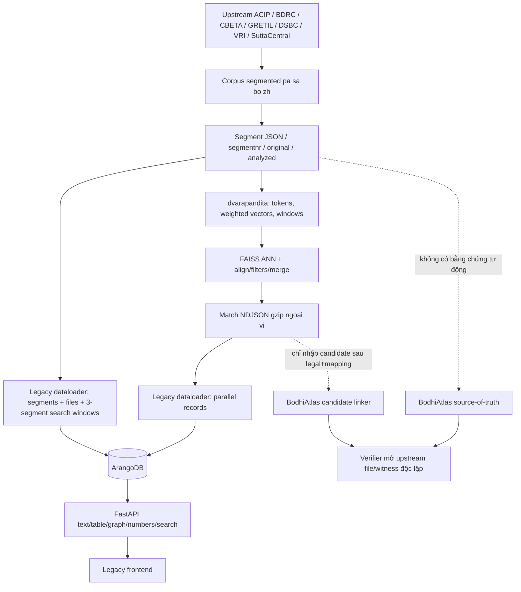

# Technology Assessment — BuddhaNexus legacy

**Mã nghiên cứu:** P55 · **Dự án đích:** BodhiAtlas · **Ngày khảo sát:** 2026-11-16 (Asia/Ho_Chi_Minh)  
**Đối tượng:** [BuddhaNexus GitHub Organization](https://github.com/BuddhaNexus), hệ thống phát hiện văn bản song hành lịch sử; không đồng nhất với sản phẩm DharmaNexus hiện hành.  
**Snapshot backend:** [`BuddhaNexus/buddhanexus@cdd8c1370198ee0ea6ffeb1627b6e3ba47c8bff1`](https://github.com/BuddhaNexus/buddhanexus/tree/cdd8c1370198ee0ea6ffeb1627b6e3ba47c8bff1), nhánh `master`, HEAD ngày 2025-07-20; repository **archived**. `api/main.py` khai báo FastAPI app `0.2.1`, `setup.py` khai báo package `0.1.0`; **không** lấy hai chuỗi này làm release/tag đã được xác minh. Tag phát hành chính thức: `UNKNOWN`.  
**Phân loại:** `legacy` (nền tảng phát hiện song hành + công cụ hiển thị/tìm theo đoạn + các corpus dẫn xuất), **không** phải một OCR engine hay thư viện PDF.  
**Analyst:** thẩm định kỹ thuật độc lập bằng đọc tài liệu chính thức, GitHub API/repository metadata, file mã nguồn, schema, hướng dẫn triển khai, nghiên cứu đã công bố; **không triển khai Docker, không tải toàn corpus, không thực hiện benchmark**. Dấu `[TESTED]` không được cấp cho việc chỉ đọc file test.

**Các hệ chuẩn BodhiAtlas đã thực sự đọc:** [PRD V1.4](https://github.com/quoctran-2608/bodhi-atlas/blob/3c45129cafecd835f146c8508bb943d837f1f00d/docs/PRD.md), [Academic Risks & Verification](https://github.com/quoctran-2608/bodhi-atlas/blob/3c45129cafecd835f146c8508bb943d837f1f00d/docs/ACADEMIC_RISKS_AND_VERIFICATION.md), [BuddhismDocuments-for-AI README](https://github.com/quoctran-2608/BuddhismDocuments-for-AI/blob/dfdd3cbb79e3dbfb49a855702fa00e4bad3b3410/README.md). Các yêu cầu quyết định là file gốc bất biến/SHA-256, works–editions–witnesses, locator trở lại file, `EXACT` đầy đủ mọi vị trí, truy vấn chuẩn hóa đa ngữ bằng code, báo coverage/OCR thiếu, và kiểm chứng riêng *câu chữ–vị trí–ý nghĩa*.

**Quy ước đọc:** `[DOC]` lời khẳng định của nguồn được đọc; `[CODE]` hành vi có thể thấy trong mã/cấu hình nhưng **chưa xác nhận khi chạy**; `[INFERRED]` đánh giá suy luận; `[UNKNOWN]` không có đủ chứng cứ. `NOT TESTED` chỉ trạng thái thực thi. Thời gian cập nhật repo không phải thời gian release sản phẩm. Các đường dẫn commit-pinned tham chiếu snapshot ngày khảo sát, không bảo đảm các website đang còn phục vụ.

## 1. Executive Decision

**Quyết định:** **`TRIAL ONLY`** để nghiên cứu thuật toán, corpus provenance, kiểm toán liên kết segment và làm baseline lịch sử; **loại BuddhaNexus legacy khỏi shortlist ứng viên nền tảng V1**. Quyết định dùng lại một thành phần/dữ liệu cụ thể chỉ được mở lại sau POC và xét quyền upstream. **Độ tin cậy: `HIGH`** với quyết định không chọn làm nền tảng V1; `MEDIUM` với các cơ hội tái sử dụng cụ thể vì không có dữ liệu match đầy đủ và chưa thử chạy.

| Trục quyết định | Kết luận | Cơ sở |
|---|---|---|
| Vai trò ở V1 | Không làm platform; chỉ có thể nhận *parallel candidates* từ pipeline tách biệt nếu đã qua kiểm quyền và map locator | [E02], [E08], [E10], [E14] |
| Vai trò ở V2 | Thử nghiệm nhập *legacy segment/match* như lớp gợi ý `PROPOSED`, so sánh với MITRA-parallel v3 và matcher độc lập | [E06], [E18], [E20] |
| Vai trò ở V3 | Tư liệu phương pháp và benchmark hồi cứu; không là nơi lưu chứng cứ học thuật | [E15], [E19] |
| `SOURCE_FIDELITY` | Không đủ để cấp thẻ dẫn chứng đã xác minh; khả năng đối chiếu từng nguồn upstream phải kiểm độc lập | [E09], [E10], [E13] |
| `CODE_ONLY_EXACT` | **Không đạt nếu đặt làm search engine V1:** `PHRASE` theo analyzer + top limit + gộp kết quả | [E11], [E12] |
| `MULTILINGUAL` | Có đường xử lý `pa/sa/bo/zh`, nhưng **không chứng minh** chuỗi bài test hoặc xuyên ngôn ngữ đủ mức PRD | [E11], [E12] |

**Ba rủi ro lớn, không bù bằng điểm trung bình:**

1. **Fidelity/provenance:** bản chuyển đổi segment và score song hành không đồng nghĩa văn bản đúng bản gốc hoặc locator PDF/EPUB; trang UI là trang chia `PAGE_SIZE=100` đoạn, **không** phải trang in/PDF. [CODE, E09–E10]
2. **Khôi phục dữ liệu/khả năng bảo trì:** backend đòi dữ liệu matches ngoài GitHub và volume `dharmanexus-data`, hướng dẫn hiện dẫn tới repo 404 qua truy vấn GitHub; phục hồi toàn hệ thống không có manifest/pin toàn bộ phụ thuộc. [DOC/CODE/UNKNOWN, E03–E05]
3. **Quyền và kiểm soát API:** code GPL-3.0, nhưng tài liệu Hán/Tạng/Pāli/Sanskrit và ảnh/trang của upstream có điều kiện riêng; tài liệu DharmaNexus hạn chế dùng API/database API để nạp ứng dụng khác khi chưa có phép. [DOC, E16–E18]

**Điều kiện đổi quyết định:** (a) có bộ dữ liệu và license được phê duyệt; (b) chứng minh mapping ≥10 định danh cũ–mới và mở lại được đúng witness; (c) POC đo được chất lượng tìm *candidate* trên gold set, không gán score thành chứng cứ; (d) export dữ liệu hoàn toàn tự chủ, không phụ thuộc dịch vụ cũ. **Không khuyến nghị fork nguyên backend**, kể cả khi fork hợp pháp.

## 2. Sources & Evidence Ledger

**Snapshot nguồn**: truy cập các đường dẫn dưới đây ngày **2026-11-16**, bằng GitHub API/read-only và đọc các trang nghiên cứu/chính thức. Mã `[E##]` dùng thống nhất trong báo cáo. Commit SHA là **commit của repository** tại ngày quan sát (không phải SHA-256 nội dung văn bản thư viện); link `blob/<commit>/path` được ghim để kiểm lại.

| claim_id | claim | Evidence class | URL/file+line hoặc permalink | version/SHA | note |
|---|---|---|---|---|---|
| E01 | Tổ chức BuddhaNexus tự công bố đây là tập repository legacy | [DOC] | [Org README](https://github.com/BuddhaNexus/.github/blob/4617cc1b54a35c5600defe60089067bb369b9a99/README.md) | `.github@4617cc1` | Tự thuật dự án, không xác nhận tất cả chức năng |
| E02 | Backend là legacy; instance năm 2022 không còn được cập nhật; phát triển chuyển sang DharmaNexus | [DOC] | [backend/README.md](https://github.com/BuddhaNexus/buddhanexus/blob/cdd8c1370198ee0ea6ffeb1627b6e3ba47c8bff1/README.md) | `cdd8c137` | Chứng cứ chính thức về successor, **không** chứng minh tương thích ID |
| E03 | Thông báo sunset ghi nền tảng BuddhaNexus cũ không còn database trực tuyến | [DOC] | [Dharmamitra sunset notice](https://dharmamitra.org/pub/sunset.html) | trang thông báo 2025-12; site version `N/A` | Không diễn giải URL backend còn tồn tại là dịch vụ hoạt động |
| E04 | Backend dùng FastAPI, ArangoDB, Redis; `compose` công khai cổng các dịch vụ; Dockerfile Python 3.8 | [CODE] | [docker-compose.yml](https://github.com/BuddhaNexus/buddhanexus/blob/cdd8c1370198ee0ea6ffeb1627b6e3ba47c8bff1/docker-compose.yml), [Dockerfile-fastapi](https://github.com/BuddhaNexus/buddhanexus/blob/cdd8c1370198ee0ea6ffeb1627b6e3ba47c8bff1/setup/Dockerfile-fastapi) | `cdd8c137` | Quan sát config; chưa chạy hoặc quét an ninh |
| E05 | Hướng dẫn khởi động đòi `LOCAL_MATCHES_PATH` bên ngoài repo và volume segment từ `dharmamitra/dharmanexus-data` | [DOC/CODE] | [backend/README.md](https://github.com/BuddhaNexus/buddhanexus/blob/cdd8c1370198ee0ea6ffeb1627b6e3ba47c8bff1/README.md), [compose](https://github.com/BuddhaNexus/buddhanexus/blob/cdd8c1370198ee0ea6ffeb1627b6e3ba47c8bff1/docker-compose.yml) | `cdd8c137` | GitHub API `repos/dharmamitra/dharmanexus-data/contents` trả **404** ở snapshot; quyền/migration `UNKNOWN` |
| E06 | Có 7 repo lõi archived, thêm 5 repo không archived; danh sách đủ 12 repo public ở thời điểm truy vấn | [DOC] | [GitHub Org](https://github.com/orgs/BuddhaNexus/repositories), [API search](https://api.github.com/search/repositories?q=org%3ABuddhaNexus) | nhiều SHA, xem §5.1 | `archived=false` không đồng nghĩa được bảo trì |
| E07 | Backend khai báo FastAPI `0.2.1`, package `0.1.0`, CORS rộng và cache GET public | [CODE] | [api/main.py](https://github.com/BuddhaNexus/buddhanexus/blob/cdd8c1370198ee0ea6ffeb1627b6e3ba47c8bff1/api/main.py), [setup.py](https://github.com/BuddhaNexus/buddhanexus/blob/cdd8c1370198ee0ea6ffeb1627b6e3ba47c8bff1/setup.py) | `cdd8c137` | Không xác nhận API đã triển khai vẫn chạy |
| E08 | Match schema có `root_segnr`, `par_segnr`, score, offset, văn bản đoạn; không có SHA-256 gốc/PDF bbox | [CODE] | [dataloader/dataloader_models.py](https://github.com/BuddhaNexus/buddhanexus/blob/cdd8c1370198ee0ea6ffeb1627b6e3ba47c8bff1/dataloader/dataloader_models.py) | `cdd8c137` | Sự vắng mặt trong schema đã đọc không chứng minh mọi metadata ngoài repo đều vắng |
| E09 | Loader giữ file key/segment, tạo search window **3 đoạn**, `PAGE_SIZE=100`; metadata chỉ giữ tập cột hạn chế | [CODE] | [load_segments.py](https://github.com/BuddhaNexus/buddhanexus/blob/cdd8c1370198ee0ea6ffeb1627b6e3ba47c8bff1/dataloader/load_segments.py), [load_metadata.py](https://github.com/BuddhaNexus/buddhanexus/blob/cdd8c1370198ee0ea6ffeb1627b6e3ba47c8bff1/dataloader/load_metadata.py), [dataloader_constants.py](https://github.com/BuddhaNexus/buddhanexus/blob/cdd8c1370198ee0ea6ffeb1627b6e3ba47c8bff1/dataloader/dataloader_constants.py) | `cdd8c137` | UI page là pagination theo segment; folio không tương đương PDF bbox |
| E10 | `load_parallels` nhập match NDJSON gzip, thêm key, bỏ `root_string/par_string` và segment text khỏi DB record | [CODE] | [dataloader/load_parallels.py](https://github.com/BuddhaNexus/buddhanexus/blob/cdd8c1370198ee0ea6ffeb1627b6e3ba47c8bff1/dataloader/load_parallels.py) | `cdd8c137` | Cần rejoin `segments` để kiểm đoạn |
| E11 | Search Arango `SEARCH PHRASE`, tối đa 1.000 hit/subquery; endpoint `all` không gồm `zh` | [CODE] | [search_query_builder.py](https://github.com/BuddhaNexus/buddhanexus/blob/cdd8c1370198ee0ea6ffeb1627b6e3ba47c8bff1/api/queries/search_query_builder.py), [endpoints/search.py](https://github.com/BuddhaNexus/buddhanexus/blob/cdd8c1370198ee0ea6ffeb1627b6e3ba47c8bff1/api/endpoints/search.py) | `cdd8c137` | Không phải exhaustive exact ký tự; endpoint single `zh` vẫn có |
| E12 | Fuzzy `levenshtein_ngram`, giữ kết quả ưu tiên theo segment, cắt tối đa 200; Hán chưa có normalize phồn–giản | [CODE] | [api/search/search_utils.py](https://github.com/BuddhaNexus/buddhanexus/blob/cdd8c1370198ee0ea6ffeb1627b6e3ba47c8bff1/api/search/search_utils.py) | `cdd8c137` | Không suy ra mọi vị trí exact; nghi vấn thứ tự rank `[::-1]` phải thử |
| E13 | Tibetan corpus đến từ ACIP/BDRC/Karma Delek; nguồn tự thừa nhận lỗi/chênh lệch quy ước và sửa kỹ thuật | [DOC] | [segmented-tibetan README](https://github.com/BuddhaNexus/segmented-tibetan/blob/7f0b85fb12fb14ef2d2fee94bad04450856c0309/README.md) | `7f0b85f` | Cần phân biệt witness, file nguồn và bản chuyển đổi |
| E14 | Sanskrit từ GRETIL/DSBC, README tự cảnh báo nhiều lỗi; Pāli gộp VRI, World Tipitaka, SuttaCentral với segment split/merge | [DOC] | [Sanskrit README](https://github.com/BuddhaNexus/segmented-sanskrit/blob/8ba2ab31e116e3363f8d048b3ceb44e717693873/README.md), [Pāli README](https://github.com/BuddhaNexus/segmented-pali/blob/60d3af5bb4d0692832e05114099f1163450ff49d/README.md) | `8ba2ab3` / `60d3af5` | Corpus public không phải nguyên bản hoàn hảo |
| E15 | `dvarapandita` tạo vector, chỉ mục FAISS, lọc match theo stopword/length và xuất match JSON | [CODE/DOC] | [README](https://github.com/dharmamitra/dvarapandita/blob/20a544a657c8046d4c667d9a5f82026b3a3f748a/README.md), [create_vectors.py](https://github.com/dharmamitra/dvarapandita/blob/20a544a657c8046d4c667d9a5f82026b3a3f748a/code/create_vectors.py), [calculate_index.py](https://github.com/dharmamitra/dvarapandita/blob/20a544a657c8046d4c667d9a5f82026b3a3f748a/code/calculate_index.py), [filter_matches.py](https://github.com/dharmamitra/dvarapandita/blob/20a544a657c8046d4c667d9a5f82026b3a3f748a/code/filter_matches.py) | **2026 HEAD** `20a544a` | Đừng coi snapshot 2026 này là thuật toán nguyên trạng năm 2020 |
| E16 | Backend và `dvarapandita` đều có file license GPL v3 | [CODE/DOC] | [backend/LICENSE](https://github.com/BuddhaNexus/buddhanexus/blob/cdd8c1370198ee0ea6ffeb1627b6e3ba47c8bff1/LICENSE), [dvarapandita/LICENSE](https://github.com/dharmamitra/dvarapandita/blob/20a544a657c8046d4c667d9a5f82026b3a3f748a/LICENSE) | commit như trên | Không suy ra license các corpora, model weights |
| E17 | Corpus Hán là bản phân đoạn dựa trên CBETA; Bilara có ID segment và metadata giấy phép bản dịch/phát hành | [DOC] | [Chinese README](https://github.com/BuddhaNexus/segmented-chinese/blob/068082747ea11d02cb5dbdfeec50f5072422713e/README.md), [bilara-data README](https://github.com/BuddhaNexus/bilara-data/blob/0bebb73d13a13a5fc13d04e424d3d483037795ca/README.md) | `0680827` / `0bebb73` | Phân biệt record metadata với quyền hiện tại từng bản dịch |
| E18 | DharmaNexus là hệ hiện hành; hướng dẫn quyền sử dụng dịch vụ không cho phép lấy API/DB API làm nguồn nạp app ngoài khi chưa được phép | [DOC] | [DharmaNexus official guide](https://dharmamitra.github.io/dharmamitra-guides/dharmanexus/), [site](https://dharmamitra.org/nexus) | trang web, ngày cập nhật `UNKNOWN` | Không dùng web API làm nguồn ingest mặc định |
| E19 | Bài nghiên cứu 2020 mô tả vector từ/token, SWEM + ANN + alignment, có đánh giá trên gold set công bố | [DOC] | [Nehrdich 2020, JADH](https://www.jstage.jst.go.jp/article/jjadh/5/2/5_6/_html/-char/ja) | xuất bản 2020 | Benchmark của tác giả, **không** `[TESTED]` ở đây |
| E20 | MITRA-parallel **v3** là release ghi trong README 2026-10, 1.690.655 alignment records cho ba cặp Sanskrit/Tạng/Hán | [DOC] | [MITRA-parallel root](https://github.com/dharmamitra/mitra-parallel/blob/0a770d98283b826134da0d8ec4d75259350faaa0/README.md), [v3 README](https://github.com/dharmamitra/mitra-parallel/blob/0a770d98283b826134da0d8ec4d75259350faaa0/v3/README.md) | `0a770d9` | Số lượng do tác giả công bố, không đo lại; v3 mới hơn v2 |
| E21 | Bài LREC 2022 về SansTib mô tả corpus song song Sanskrit–Tạng và phương pháp đánh giá | [DOC] | [ACL Anthology LREC 2022](https://aclanthology.org/2022.lrec-1.724/) | 2022 | Không tự coi corpus là quyền tái phân phối |
| E22 | Test API có kiểm response shape, nhưng không có chứng cứ đã chạy trong cuộc khảo sát | [CODE] | [tests/api/test_text_view.py](https://github.com/BuddhaNexus/buddhanexus/blob/cdd8c1370198ee0ea6ffeb1627b6e3ba47c8bff1/tests/api/test_text_view.py) | `cdd8c137` | Trạng thái hiện tại `NOT TESTED` |
| E23 | PRD yêu cầu tìm exact **mọi vị trí** và PDF bbox/EPUB CFI, còn lớp 1.0 có SQLite/FTS và các nguồn pinned | [DOC] | [PRD](https://github.com/quoctran-2608/bodhi-atlas/blob/3c45129cafecd835f146c8508bb943d837f1f00d/docs/PRD.md), [tài sản sẵn có](https://github.com/quoctran-2608/BuddhismDocuments-for-AI/blob/dfdd3cbb79e3dbfb49a855702fa00e4bad3b3410/README.md) | `3c45129` / `dfdd3cb` | Không đo lại các claim nghiệm thu 1.0/2.0 của dự án chủ quản |
| E24 | Không tìm thấy bằng chứng công khai về mapping 10 ID cũ sang mới, package match đầy đủ có pin, hoặc cấp quyền API third-party | [UNKNOWN] | [backend/README](https://github.com/BuddhaNexus/buddhanexus/blob/cdd8c1370198ee0ea6ffeb1627b6e3ba47c8bff1/README.md), [DharmaNexus guide](https://dharmamitra.github.io/dharmamitra-guides/dharmanexus/) | snapshot 2026-11-16 | Đây là *chưa xác minh*, không khẳng định không tồn tại |
| E25 | Nghiên cứu `CollateX` và `passim` mô tả chức năng collation và phát hiện tái sử dụng văn bản, khác lớp backend thư viện | [DOC] | [CollateX docs](https://collatex.net/doc/), [passim repo](https://github.com/dasmiq/passim) | phiên bản `UNKNOWN` | Dùng so sánh đúng vai trò; không benchmark |

**Giới hạn ledger:** Không kiểm trực tiếp ngày lập lịch các release/tag của tất cả repo, đầy đủ issues/PR, lịch sử từng thuật toán ở commit năm 2020, quyền riêng từng tác phẩm hoặc toàn bộ file xuất match. Thấy `README`, `CODE` và các bài báo khác với chạy lại thuật toán trên cùng môi trường. Các số liệu công bố được phân biệt nghiêm ngặt khỏi kết quả tự đo.

## 3. Architecture & Data Flow

Đây là **kiến trúc ghép từ các file đã đọc**; nhánh `dvarapandita` có snapshot mã **2026** (không mặc nhiên trùng pipeline 2020). Mũi tên ghi dữ liệu/việc làm; hai bộ repo không tự động là cùng một release hoàn chỉnh:



**Các ranh giới chất lượng bắt buộc:**

- `original` trong một `Segment` là câu chữ **đã phân đoạn/chuyển đổi**, không phải chứng minh PDF/page original hoặc văn bản chứng thực của upstream. So lại bản nguồn riêng. [E08, E13–E14]
- `score` trong `Match` là mức gần giống/alignment của pipeline; dù có threshold vẫn là **candidate**. `root_segnr`, `par_segnr` có thể nối đến chuỗi đoạn nhưng phải đối chiếu edition/witness và stable key. [E08, E15]
- `files.segment_pages` là UI pagination theo 100 đoạn; `folio` có thể là locator lịch sử nếu được nguồn chứng minh, nhưng không thể gán thành PDF page/bbox. [E09]
- `DharmaNexus` hiện hành không phải một fork đã chứng minh tương thích dữ liệu với tất cả format và API của legacy. Chuyển repository phát triển ≠ migration proof. [E02, E18, E24]

**Schema logic đọc được** (tối giản):

```text
Segment {segmentnr, original, stemmed, ...}
Match {id, score, src_lang, tgt_lang,
       root_segnr[], par_segnr[], root_segtext[], par_segtext[],
       root_string, par_string, root_offset_beg/end, par_offset_beg/end,
       inquiry_pos_beg/end, target_pos_beg/end, root_length, par_length}
ArangoDB collections: segments, files, parallels, search_index_{pa,sa,bo,zh}, ...
POST /search/                  # text search theo analyzer
POST /text-view/text-parallels/ # hiển thị đoạn và match IDs
POST /text-view/middle/        # nội dung đoạn song hành
```

Không tìm thấy ở các schema đọc được các trường bắt buộc của thẻ chứng cứ BodhiAtlas (`file_sha256`, immutable original, exact witness, PDF `page+bbox`, EPUB `href/CFI`, `ocr_confidence`, `citation_verified`, `claim_review`). Kết luận này chỉ áp dụng schema/path đã kiểm tra.

## 4. Feature Fit–Gap Matrix

**Nhãn trạng thái:** `NATIVE` có mã native cho đúng phần đã chỉ rõ; `CONFIG` cần cấu hình; `EXTENSION` cần viết thêm đáng kể; `EXTERNAL` công cụ ngoài đảm nhiệm; `MISSING` không có/không đáp ứng contract trong code đã đọc; `UNKNOWN` chứng cứ chưa đủ; `N/A` ngoài vai trò parallel legacy. Cột **effort** là ước lượng tương đối `low/medium/high/unknown`, **không phải đo thời gian**. `N/A` không phải điểm trừ.

| ID | Năng lực | Status | Bằng chứng / đúng vai trò | Gap với BodhiAtlas và cách bù | Effort |
|---|---|---|---|---|---|
| C01 | Multi-format ingest PDF/EPUB/DOCX/MD/TEI | **N/A** | Backend nhận **segment JSON/match** đã chuẩn bị [E05,E09] | Ingest dùng parser/OCR độc lập của V1; không yêu cầu legacy làm importer | n/a |
| C02 | OCR/layout/reading order | **N/A** | Không phải OCR engine [E02,E09] | Dùng pipeline OCR/layout khác, lưu confidence/bbox và coverage | n/a |
| C03 | Canonical text + source map | **EXTENSION** | Có đoạn gốc và ID, folio nhưng không SHA-256/locator gốc [E08–E10] | Adapter `segment → canonical work/edition/file/witness/locator`; nếu không chứng minh thì chỉ `CANDIDATE` | high |
| C04 | Works/editions/witnesses | **EXTENSION** | Có files/metadata/filter và upstream khác nhau [E09,E13,E14] | Tạo bảng định danh riêng và metadata theo witness, cấm nhập nhầm ấn bản | high |
| C05 | Exhaustive code-only EXACT | **MISSING** | `SEARCH PHRASE` analyzer, `LIMIT 1000`, cắt `200`, loại theo segment [E11,E12] | Dùng exact engine riêng trên canonical text + trả toàn bộ offsets; *không* sửa kết quả tìm kiếm của legacy thành exact | high nếu cố dùng legacy; thấp hơn khi dùng engine V1 sẵn có |
| C06 | Normalized multilingual search | **EXTENSION** | Có preprocess cho pa/sa/bo/zh, Chinese no simp/trad [E11,E12] | Unicode normalization, Việt không dấu, phồn–giản, Wylie, diacritics + full test suite | high |
| C07 | Fuzzy/near-duplicate/OCR error candidates | **NATIVE** (candidate only) | Levenshtein ngram và parallel score [E12,E15] | Độc lập đánh giá recall, false positives, score calibration; OCR từ bên ngoài | medium |
| C08 | Sense-aware lexicon | **N/A** | Không phải hệ từ điển theo sense [E02] | Lexicon V1 do BodhiAtlas dựng, liên kết có kiểm chứng | n/a |
| C09 | Semantic/hybrid/RAG | **EXTERNAL** | Legacy match generation liên quan vector, nhưng không phải RAG V1; DharmaNexus/MITRA là sản phẩm khác [E15,E18] | Không chuyển score thành semantic evidence; optional V2+ | medium–high |
| C10 | Verified citation/source reopen | **MISSING** | Match offset theo segment, không có độc lập SHA-256/file+bbox/CFI [E08–E10] | BodhiAtlas verifier reopen original + human review cho vị trí/ý nghĩa | high |
| C11 | Note/wiki/claim memory | **N/A** | Parallel discovery không phải notes/claims [E02] | Hệ luận điểm/notes riêng, lưu cạnh candidate và review | n/a |
| C12 | API/MCP/export | **EXTENSION** | Có FastAPI POST JSON và một số endpoint download, **MCP chưa được xác minh** [E07,E10,E22] | Schema adapter/export NDJSON, auth; tránh dùng API DharmaNexus ngoài thỏa thuận [E18] | medium |
| C13 | Quality coverage + incremental | **MISSING** | Loader có batch/split nhưng không thấy coverage OCR/parsing và manifest lỗi bất biến [E09,E10] | Audit ingest lineage, bộ đếm eligible/failed/missing, incremental build | high |
| C14 | Auth/licensing/privacy/backup | **MISSING** (như host độc lập) | CORS `*`, dịch vụ mở cổng, `.env` mẫu mật khẩu test; thiếu xác minh rights upstream [E04,E07,E16–E18] | Chặn cổng public, secret manager, auth/RBAC, quyền theo file, backup/restore và legal gates | high |
| C15 | Operational simplicity + independent deploy | **MISSING** | Docker + DB + Redis + external volume matches và data repo không xác minh [E04,E05] | Không dựng full legacy cho V1; chỉ cô lập ETL/offline container và export | high |

**Gate độc lập trước khi chấp thuận:** `SOURCE_FIDELITY`: `n/a` cho vai trò gợi ý candidate, **fail** nếu trình bày như verified citation; `CODE_ONLY_EXACT`: **fail** nếu dùng làm engine V1; `MULTILINGUAL`: **unknown** đến khi có fixtures thực, không suy từ 4 mã ngôn ngữ; `QUALITY_COVERAGE`: **fail** nếu dùng làm toàn bộ ingestion V1, `n/a` cho match candidate; `RIGHTS_SECURITY`: **unknown/blocked** cho dữ liệu chưa rõ quyền; `PORTABILITY`: **unknown** đến khi chứng minh export/ID có thể rehydrate không cần hệ cũ. Những trạng thái này không phải benchmark tự chạy.

## 5. Deep Technical Findings

### 5.1. Inventory 12 repositories thuộc chính tổ chức BuddhaNexus — TC01

Danh sách dưới đây từ truy vấn repository metadata thuộc **chủ sở hữu `BuddhaNexus`**, không phải từ khóa tìm kiếm trùng tên. Thời điểm khảo sát 2026-11-16; ngày là timestamp commit gần nhất được GitHub trả về, **không** phải ngày lần cuối website được deploy. `archived` là cờ GitHub, không phải đánh giá license hoặc mức sử dụng học thuật. GitHub cờ `archived=false` của năm repository phụ không chứng minh có bảo trì hiện tại.

| Repository | Archived? | Default branch | HEAD commit (rút gọn) | Latest commit UTC | Vai trò quan sát |
|---|---|---|---|---|---|
| [`buddhanexus`](https://github.com/BuddhaNexus/buddhanexus) | **yes** | master | `cdd8c1370198` | 2025-07-20 | Backend/API/dataloader |
| [`buddhanexus-frontend`](https://github.com/BuddhaNexus/buddhanexus-frontend) | **yes** | master | `b2d6e43ebca0` | 2022-06-02 | Frontend thế hệ cũ |
| [`buddhanexus-frontend-next`](https://github.com/BuddhaNexus/buddhanexus-frontend-next) | **yes** | master | `029611aa7444` | 2024-10-10 | Frontend kế tiếp, nhưng vẫn legacy |
| [`segmented-chinese`](https://github.com/BuddhaNexus/segmented-chinese) | **yes** | master | `068082747ea1` | 2022-06-03 | Corpus Hán dẫn xuất CBETA |
| [`segmented-pali`](https://github.com/BuddhaNexus/segmented-pali) | **yes** | master | `60d3af5bb4d0` | 2024-04-29 | Corpus Pāli dẫn xuất VRI/SuttaCentral |
| [`segmented-sanskrit`](https://github.com/BuddhaNexus/segmented-sanskrit) | **yes** | master | `8ba2ab31e116` | 2022-12-04 | Corpus Sanskrit GRETIL/DSBC/... |
| [`segmented-tibetan`](https://github.com/BuddhaNexus/segmented-tibetan) | **yes** | master | `7f0b85fb12fb` | 2021-06-08 | Corpus Tạng ACIP/BDRC/... |
| [`bilara-data`](https://github.com/BuddhaNexus/bilara-data) | no | published | `0bebb73d13a1` | 2021-10-21 | Mirror Bilara; không đồng nghĩa upstream mới nhất |
| [`js-ebt`](https://github.com/BuddhaNexus/js-ebt) | no | master | `73d9cc9f4d60` | 2020-08-03 | Utility JS; không phải core mới |
| [`paper-slider`](https://github.com/BuddhaNexus/paper-slider) | no | master | `94ac51520363` | 2020-02-09 | UI phụ |
| [`cypress-output`](https://github.com/BuddhaNexus/cypress-output) | no | main | `967c393b52c4` | 2023-12-20 | Artifact/test phụ; không có dữ liệu lõi chứng minh |
| [`.github`](https://github.com/BuddhaNexus/.github) | no | main | `4617cc1b54a3` | 2025-07-20 | Tài liệu tổ chức |

**Số repo quan sát được:** 12 = 7 archived + 5 không archived. Chưa audit toàn bộ tag/commit/license của 12 repository; riêng backend và bốn repo corpus đã kiểm README, một số file/chứng cứ ở mức sâu. Version/tag chính thức của từng corpus: `UNKNOWN`. Không suy từ số commit/ngày để kết luận được cập nhật thường xuyên. [E01–E06, E13–E14, E17]

**Chứng cứ migration:** README backend nói **active development moved to [DharmaNexus](https://github.com/dharmamitra/dharmanexus)** và [sunset notice](https://dharmamitra.org/pub/sunset.html) xác nhận chuyển sản phẩm. **Không có bằng chứng được kiểm** rằng repository backend mới là fork hoàn toàn tương thích, endpoint path giữ nguyên, collection Arango giống nhau, hoặc có crosswalk tất cả ID. `dharmamitra/dharmanexus-data` trong README cũ không truy cập được qua GitHub API snapshot; loại nó khỏi phụ thuộc đã xác minh, đánh dấu `UNKNOWN` nguyên nhân 404 (có thể đổi tên, private hoặc xóa).

### 5.2. Thuật toán phát hiện parallel, representation, similarity, threshold, cross-language

**Phải chia hai niên đại:**

- **Đời nghiên cứu BuddhaNexus, tài liệu công bố 2020 [DOC, E19]:** Bài báo Nehrdich và cộng sự mô tả một thí nghiệm phát hiện văn bản Hán song hành dựa trên token/word embeddings, *smooth inverse frequency* hoặc trung bình/cộng gộp embedding theo cửa sổ (SWEM avg/max/hier), chỉ mục xấp xỉ lân cận gần (HNSW), ghép lân cận thành chuỗi tương đồng và local alignment. Bài báo trình bày gold set đánh giá và các điểm mạnh/yếu. Các tham số như cửa sổ, ngưỡng cosine, số láng giềng, tiêu chuẩn merge phải trích **theo cấu hình đúng phiên bản dùng trong thử nghiệm**; **không gán mặc định cho backend HEAD 2025 hoặc pipeline HEAD 2026**. Theo bài báo, ví dụ setup có k-nearest-neighbors và ngưỡng khoảng cách trên dữ liệu Hán; đó là thí nghiệm gắn corpus, không chứng minh tìm kiếm xuyên Hán–Tạng ở mọi ngữ cảnh.
- **Pipeline `dharmamitra/dvarapandita` tại commit 2026 [CODE, E15]:** `code/create_vectors.py::create_vec_df` tách dạng `analyzed` thành token, tạo vector theo từ/weight và tính `sumvectors` trên cửa sổ; có nhánh PCA. `code/calculate_index.py::_init_faiss_index` xây FAISS `IndexHNSWFlat(dim, 32)` ở CPU hoặc `IndexFlatL2` trên GPU; chuẩn hóa L2 vector trước add. `code/utils/indexing.py` (chưa đọc sâu toàn hàm) là lớp gọi tạo kết quả ANN và alignment; `code/run_workstation.sh` chạy các pha `create-vectorfiles → create-new-index → get-results-from-index → merge-results-for-db-exp`. `code/filter_matches.py` áp dụng các rule phụ thuộc ngôn ngữ, stopwords, chuỗi ký tự và `root_length/par_length` trước khi xuất candidate match.
- **Threshold tìm được trong mã 2026, không chuyển thành thước đo chính xác:** Tibetan loại hai chuỗi có stopword ratio >0,7, có nhánh cho `par_length >= 14` hoặc chuỗi ngắn với điều kiện bổ sung; Hán có nhánh >=9 cả hai chiều và kiểm hình dạng ký tự Hán; Sanskrit/Pāli có nhánh >=30. Những ngưỡng này là **heuristic lọc** không phải xác suất đúng và có nguy cơ loại mất song hành ngắn/khác bản dịch. Thử nghiệm lại với `TC02/TC04` trước khi quyết định.
- **Phạm vi cross-language:** Sự hiện diện của dữ liệu bốn ngôn ngữ và mô hình token **không** chứng minh phát hiện cặp dịch xuyên ngôn ngữ với recall định lượng; pipeline hiện hành của MITRA-parallel v3 có ba cặp ngôn ngữ Sanskrit–Tạng, Sanskrit–Hán, Hán–Tạng nhưng là **hệ dữ liệu/pipeline khác**, không nhập nhằng với BuddhaNexus backend cũ. [E18, E20]

**Thực tế về “fingerprint/ngram”:** `api/search/search_utils.py` dùng `fuzzysearch.levenshtein_ngram` để định vị chuỗi gần đúng **bên trong một segment đã truy hồi**. Đây không phải chứng cứ rằng match-generation dùng minhash/fingerprint n-gram corpus-wide. Phương pháp tạo matches được xác nhận là vector+ANN+alignment trong các nguồn đã đọc; cấu hình fingerprint chung: `UNKNOWN`. Không khẳng định có một thuật toán n-gram nào nếu chưa xem code cụ thể.

### 5.3. Dữ liệu corpus/alignments: hiện vật, định danh, quyền tải

| Nhóm | Đã xác nhận bằng chứng | Vấn đề phải giải trước tái sử dụng |
|---|---|---|
| Hán | `segmented-chinese` chứa `cbeta_files.json`, `cbeta_headers.json`, `data/chn-files.json`, các file như `files_segmented_by_taisho_number/T01n0001_001.json.gz`; README dẫn về CBETA [E17] | Đọc sample record/tham số Taishō, đối chiếu CBETA current witness, version, license; chưa có PDF bbox |
| Tạng | `segmented-tibetan/files/*.json`; nhiều upstream ACIP, BDRC, Karma Delek; README xác nhận khác biệt quy ước, lỗi gõ và chuẩn hóa kỹ thuật [E13] | Cần canonical witness, phương thức quy đổi Wylie/Unicode, BDRC locator/folio kiểm chứng, quyền từng upstream |
| Sanskrit | `segmented-sanskrit/segmented_files`, `checkedjson`; GRETIL, DSBC và một số SuttaCentral; `checkedjson` dùng số câu thơ, khác phân đoạn tự động [E14] | Không gộp tự động hai định danh segment; metadata niên đại/ấn bản/độ tin cậy cần bổ sung |
| Pāli | `segmented-pali/inputfiles`, `inputfiles_cut_segments_on_space`, `inputfiles_cut_segments_on_typography`, `metadata/pli-files.json`; kết hợp VRI/World Tipiṭaka, các tác phẩm từ SuttaCentral; vài bộ đã gộp [E14] | Đối chiếu số `segment` SC từng bản, phân biệt commentarial VRI với kinh điển SC, license và bản dịch |
| Legacy matches | Schema `Match` và loader kỳ vọng `.ndjson.gz` cục bộ, không ở backend repo; không tìm được manifest toàn bộ có checksum [E05,E08,E10] | Tình trạng tải, SHA256, license, lineage và khả năng tái dựng `UNKNOWN` |
| Bilara mirror | JSON `segment-ID → text`, `_publication.json` có metadata xuất bản/bản dịch; branch `published` được README hướng dẫn dùng, `unpublished` hạn chế [E17] | Cần kiểm *từng* publication/license, chứng minh mirror trùng upstream pinned và quyền tái phân phối |

**Định danh ổn định:** `segmentnr` là key hữu ích trong *corpus cụ thể*, không được coi là ID vĩnh cửu xuyên mọi phiên bản/chuyển corpus. Từ `shared/utils.py` và dataloader thấy `get_filename_from_segmentnr`, nhưng không có bảng crosswalk có phiên bản `old_segment_id ↔ new_segment_id ↔ BodhiAtlas witness + locator` được kiểm. Tính ổn định cặp ID `UNKNOWN` cho trước khi chạy TC03. `T01n0001_001` là dấu vết file/đơn vị số hóa, **không phải trang PDF của chính file người dùng**.

### 5.4. Giao diện/API cũ và DharmaNexus mới

| Chủ đề | BuddhaNexus legacy đã đọc | DharmaNexus hiện hành: bằng chứng, giới hạn |
|---|---|---|
| Backend/UI | FastAPI `POST /search/`, `/text-view/text-parallels/`, `/text-view/middle/`, table/graph/numbers views; ArangoDB + Redis, frontend riêng [E07,E11] | [DharmaNexus guide](https://dharmamitra.github.io/dharmamitra-guides/dharmanexus/) ghi trình duyệt song hành/đoạn ở sản phẩm kế nhiệm, có tích hợp MITRA Search; **endpoint compatibility `UNKNOWN`** |
| API contract | `api/endpoints/models` dùng Pydantic custom schema; nhiều endpoint đưa `filename`, `page`, `parallel_ids`, `score` [E08,E22] | API/dữ liệu mới chưa xem OpenAPI bằng môi trường thực; không có chứng cứ thay thế drop-in |
| Text search | Arango analyzer query và fuzzy postprocess như §7; hiện tại `language="all"` bỏ `zh` trong `query_languages` [E11] | Nền tảng hiện hành dùng dịch vụ MITRA Search theo hướng dẫn; không suy ra giữ tính năng của API cũ [E18] |
| Alignment/data | Nạp matches từ `LOCAL_MATCHES_PATH` và segmented JSON; `Match` gồm score/segment pairs [E05,E08] | MITRA-parallel v3 có `root_segnr`/`par_segnr`, `root_string`/`par_string`, score; **gần schema không đồng nghĩa giữ ID hoặc tương thích score/offset** [E20] |
| Dữ liệu bị bỏ/đổi | Danh mục chức năng loại bỏ cụ thể so với bản 2022: `UNKNOWN` | Cần đối chiếu 10 URL cũ, sitemap/API, một cặp witness, xét những bộ văn bản không còn hiện diện |

Chính sách dịch vụ đích hạn chế dùng API để thu gom thành corpus cho app bên ngoài. Không chạy crawler/scraper để “phục hồi” dữ liệu. Xin phép chủ quản hoặc ưu tiên tải từ upstream với giấy phép tự xác minh. [E18]

### 5.5. Nghiên cứu và gold set công bố; ranh giới khoa học

- **BuddhaNexus 2020:** [Bài nghiên cứu trên JADH](https://www.jstage.jst.go.jp/article/jjadh/5/2/5_6/_html/-char/ja) mô tả kiến trúc phát hiện tái sử dụng văn bản Hán (token embedding/ANN/SWEM/alignment) và thí nghiệm có tập nhãn. Đây là **benchmark được tác giả báo cáo**, không phải phép kiểm đã chạy lại ở đây. Mọi điểm số được đưa vào synthesis phải kèm bộ dữ liệu, phiên bản thuật toán, cách chọn negative và độ lệch truyền bản; không được quy về recall trên tập BodhiAtlas.
- **SansTib (LREC 2022):** [bài trên ACL Anthology](https://aclanthology.org/2022.lrec-1.724/) về song hành Sanskrit–Tạng có corpus và thẩm định nghiên cứu; khác bài toán chứng minh quote PDF hoặc quan hệ lịch sử giữa truyền bản.
- **MITRA-parallel v3 (2026):** [README v3](https://github.com/dharmamitra/mitra-parallel/blob/0a770d98283b826134da0d8ec4d75259350faaa0/v3/README.md) mô tả margin-scored nearest-neighbor anchors, monotone span mining, vecalign và post-corrector, triangle fill, shape filter; thống kê 1.690.655 aligned records **do tác giả công bố**, `NOT TESTED` trong P55. Tập test độc lập cần ngăn rò rỉ huấn luyện và trùng văn bản.
- **Điều không được suy diễn:** cặp gần giống có thể là công thức kinh văn phổ biến, vay mượn, đồng thuật ngữ hoặc bản dịch tương ứng; *similarity* không xác nhận nguồn nào trước, niên đại, tác giả, nghĩa giáo lý, quan hệ phụ thuộc, hoặc vị trí trích nguyên văn chính xác.

### 5.6. Trích lọc thành phần hợp pháp hay phục hồi whole stack?

**Có thể nghiên cứu/trích ý tưởng:** thuật toán token windows/ANN shortlist, design `Match`, quy trình candidate mining có khả năng tách biệt khỏi UI, các quy tắc bảo vệ khỏi common formula; code GPLv3 cần **đáp ứng điều kiện GPL** nếu chép/chỉnh sửa/phân phối chương trình phái sinh; thiết kế lại thuật toán từ mô tả dưới quyền truy cập và license phù hợp là quyết định khác với sao chép mã.

**Không khuyến nghị fork platform:** `python:3.8-bookworm`, ArangoDB, Redis `latest`, frontend thế hệ cũ, nhiều phụ thuộc không khóa chặt, sample `.env` mật khẩu `test`, CORS rộng, external volumes/giấy phép chưa xác nhận. Dù có `make run-dev`, không đạt điều kiện chạy độc lập để làm platform dài hạn trong snapshot. `dvarapandita` HEAD 2026 có dependency list riêng và nhiều thay đổi mới, phải pin nếu POC. [E04,E05,E07,E15,E16]

**Lỗi logic cần kiểm trước khi tách mã:** `api/search/search_utils.py::remove_duplicate_results` có thể mất vị trí xuất hiện trong cùng segment; `postprocess_results` có đảo mảng sau sort; `api/endpoints/search.py` chế độ `all` không đưa `zh` vào danh sách; `dataloader/load_segments.py::_load_segments_to_search_index` chỉ tạo cửa sổ ba segment, có thể bỏ phrase dài hơn. Đây là **code review finding**, không tuyên bố bug đã tái hiện. [E09,E11,E12]

### 5.7. Đặc thù nhiều truyền bản Hán/Tạng và bẫy alignment

1. **Segmentation drift:** dấu câu, xuống dòng, độ dài đoạn khác nhau khiến các offset của bản chuyển đổi không thể áp vào source khác; các file Pāli/Sanskrit tự thừa nhận split/merge. [E14]
2. **Common formulas:** những công thức nhiều lần xuất hiện tạo nhiều match có similarity cao nhưng ít giá trị chứng minh độc lập; cần phân tích stopword, IDF và ngữ cảnh.
3. **OCR/input errors:** corpus self-reports typos; không biết CER/WER vì thiếu ground truth. [E13–E14]
4. **Multiple translators/versions:** cùng kinh không đồng nhất với cùng bản dịch/witness; so score trong đúng cặp edition và có đường mapping.
5. **Cyclic references:** khi hai text cùng thừa hưởng nguồn thứ ba thì “phát hiện song hành” không chỉ ra hướng phụ thuộc; cần thông tin niên đại/sử học riêng.
6. **Script conversions:** Tạng Unicode↔Wylie, Hán phồn–giản, IAST và ký tự kết hợp Unicode có thể tạo false positive/false negative; giữ nguyên string gốc và version normalization.
7. **Negative/exception:** một nguồn nói “không X” có nhiều token giống nguồn nói “X”; chunk candidate không thay thế được đọc ngữ cảnh, phát ngôn bị trích trong phủ định và điều kiện.

### 5.8. Dùng lại dữ liệu/baseline và risk maintenance

**Ưu tiên 1:** giữ snapshot code và các README/paper làm **baseline thuật toán lịch sử**, không đòi vận hành production. **Ưu tiên 2, có điều kiện:** lập adapter read-only cho `Match`/`Segment` hoặc MITRA-parallel v3 sau khi xác minh quyền và upstream; all relations `PROPOSED` đến khi BodhiAtlas reopen gốc. **Không ưu tiên:** khôi phục website cũ/ArangoDB để vận hành production.

Ước lượng **không có con số benchmark/chi phí thực đo**: baseline offline `medium`; phục hồi full stack `high` (đòi dependency, volume corpus, secrets, QA, bảo trì UI/DB); riêng legal và source mapping `high/unknown` vì phụ thuộc đơn vị sở hữu bản dịch/corpus. Nếu phục hồi không đạt contract độc lập, rollback bằng cách xóa index/candidate dẫn xuất, **không tác động** source-of-truth và verified claims của BodhiAtlas.

### 5.9. Giấy phép code/dataset upstream

- GPL-3.0 được xác nhận qua hai file `LICENSE` của **backend** và **`dvarapandita`** [E16]. Không suy ra GPL cấp phép tự động dữ liệu upstream, ảnh PDF, translation, embedding/model weights hoặc tổng hợp match đặc thù.
- Các repo `segmented-*` được xem README và root: **không tìm thấy file LICENSE ở các root đã kiểm** (đã xác nhận 404 khi hỏi `segmented-pali/LICENSE`); **giấy phép phân phối toàn corpus `UNKNOWN`**, không dùng mặc định cho redistributable product.
- SuttaCentral Bilara có trường license từng publication/translation và branch `published` theo README [E17]; phải đọc record thực, tác giả, năm và trạng thái published trước dùng. Không lấy quyền bản dịch từ quyền của văn bản Pāli nguyên ngữ.
- Tại root MITRA-parallel v3 **không thấy LICENSE** trong danh sách root đã đọc; license của archive matches/weights cụ thể: `UNKNOWN` cho đến khi có xác nhận từ maintainer/metadata chính thức. Không chép khối dữ liệu vào BodhiAtlas chỉ vì GitHub public.
- [DharmaNexus guide](https://dharmamitra.github.io/dharmamitra-guides/dharmanexus/) nêu giới hạn API/DB API cho công cụ bên thứ ba. Các access token/permission phải do chủ sở hữu cấp; **không** xây pipeline lấy hàng loạt từ API công khai rồi coi là corpus của mình.

### 5.10. Kết luận kỹ thuật có thể kiểm

**Khẳng định được:** có backend historical cho parallel candidates; code lưu cặp segment, offset, score và chức năng đọc kết quả; các corpus đa ngữ có upstream được nêu; có bài báo về phương pháp; đã xuất hiện successor chính thức. [E01–E21]  
**Chưa khẳng định:** chạy toàn pipeline từ clean machine, chính xác ID cũ→mới, quyền tái sử dụng mọi match, benchmark precision/recall theo lĩnh vực, exact exhaustive cho phrase 200–300 ký tự, chi phí máy, full uptime, clone và backup khả thi. Tất cả `UNKNOWN/NOT TESTED`.  
**Quyết định:** `keep-as-reference`; `reuse-component` **chỉ sau** legal + locator POC; `discard-as-platform` cho V1.

## 6. Source Fidelity & Provenance

### 6.1. Mức độ chứng cứ mà BuddhaNexus legacy thực sự mang

`Match.root_segnr[]`/`par_segnr[]`, text segments và offsets gắn với bản chuyển đổi có thể giúp người nghiên cứu nhảy tới **đoạn** của corpus hiện hành trong snapshot. `filename`, `collection`, `category`, `link`, `link2`, `folio` có thể trợ giúp định vị. Nhưng chưa có chứng cứ cho bất kỳ hợp đồng máy nào sau đây: file gốc bất biến với **SHA-256**, chứng minh tác giả/dịch giả/ấn bản/witness riêng, PDF page+bbox, bản in theo chứng cứ, EPUB href/CFI, câu chữ **đã so lại original**, phép kiểm OCR và trạng thái ý nghĩa. [E08–E10,E13–E14]

**Bắt buộc chia ba cấp:**

| Cấp | Dấu xác nhận | Legacy đủ không? | Quy trình BodhiAtlas |
|---|---|---|---|
| **Text candidate** | Có `segmentnr + text/span` trong bản derived | Có cấu trúc, nhưng dữ liệu và run chưa kiểm | `PROPOSED_TEXT`; pin upstream + checksum |
| **Verified text & locator** | Cùng chữ trong đúng file/edition, locator reopen stable, hash khớp | **Không chứng minh** | Source verifier đối chiếu file bất biến; người duyệt nếu OCR/locator không chắc |
| **Verified academic meaning** | Ngữ cảnh hỗ trợ luận điểm, phân biệt phản chứng/cùng nguồn/truyền bản | **Không thuộc algorithm** | Human review/AI hỗ trợ, lưu status ý nghĩa riêng |

**Phiếu BodhiAtlas đề xuất (schema tích hợp, không phải schema native BuddhaNexus):**

```json
{
  "candidate_id": "ba:parallel:candidate:<digest>",
  "source": {"system": "buddhanexus-legacy", "repo_commit": "cdd8c137...", "match_id": "<upstream-id>"},
  "root": {"work_id": "<id>", "edition_id": "<id>", "witness_id": "<id>", "file_id": "<id>", "file_sha256": "<sha256>", "segment_id": "<id>", "char_range": [0, 0], "locator": null},
  "target": {"work_id": "<id>", "edition_id": "<id>", "witness_id": "<id>", "file_id": "<id>", "file_sha256": "<sha256>", "segment_id": "<id>", "char_range": [0, 0], "locator": null},
  "match_type": "PARALLEL_CANDIDATE",
  "scores": {"legacy_similarity": null},
  "source_text_verification": "UNVERIFIED",
  "source_position_verification": "UNVERIFIED",
  "meaning_verification": "UNVERIFIED",
  "ocr_status": "UNKNOWN",
  "coverage_status": "UNKNOWN",
  "rights_status": "UNREVIEWED",
  "upstream_locator_reopen": "NOT_TESTED"
}
```

Các placeholder `file_sha256` **chỉ được điền khi có bytes thật**; không tạo digest giả. `char_range [0,0]` là placeholder schema, **không phải kết quả định vị**; dùng `null` cho vị trí chưa biết trong implementation. Không lấy điểm `score` làm `source_text_verification`. ID BodhiAtlas cần ổn định theo `upstream corpus + corpus SHA/version + witness + original segment key`, giữ mapping phiên bản; `candidate_id` tính từ canonical serialisation sau khi có IDs chính thức. Mọi thay đổi index là dẫn xuất, có thể build lại.

### 6.2. Mở lại tài liệu và phạm vi không bao phủ

Với Hán từ CBETA: resolver cần Taishō/work/juan/đoạn hợp lệ, sau đó đối chiếu đúng bản CBETA hoặc ấn bản PDF đã nhập; **không** đoán trang in từ số thứ tự `segmentnr`. Với Tạng: resolver tới BDRC/ACIP/witness rõ ràng và folio chỉ khi metadata chứng minh; nhiều nhân chứng có thể dùng cùng tựa kinh. Với Pāli: chứng minh `segmentnr` thuộc SuttaCentral branch/version nào hay VRI; không đồng nhất hai nguồn. Với Sanskrit: phân biệt GRETIL checkedjson/segmented_files và DSBC. [E13–E14,E17]

**Coverage:** đưa vào record `eligible_source_count`, `loaded_source_count`, `failed_segmentation`, `missing_alignments`, `OCR_unavailable`, `restricted_rights`, `mapping_ambiguous`, `last_checked_at`. Không được tuyên bố *“không tồn tại song hành”* nếu match pipeline loại vì threshold, corpus chưa load, quyền chưa đủ hoặc liên kết ID thất bại.

**Cổng BodhiAtlas liên quan:** G1 ingest coverage, G2 citation, G3 claim, G4 external provenance, G5 lexicon, G6 publish trong [Academic Risks & Verification](https://github.com/quoctran-2608/bodhi-atlas/blob/3c45129cafecd835f146c8508bb943d837f1f00d/docs/ACADEMIC_RISKS_AND_VERIFICATION.md). Đây là rào chắn độc lập; legacy similarity chỉ đưa *ứng viên*, tuyệt đối không chuyển trực tiếp thành citation `VERIFIED`.

## 7. Multilingual & Retrieval Behavior

| Truy vấn / năng lực | Mã/nguồn cho biết | Vai trò thực tế | Kết luận theo PRD |
|---|---|---|---|
| `anatta` / `anattā` / `anātman` | Sanskrit/Pāli có Aksharamukha→IAST và morphology handler; không có taxonomy sense đầy đủ [E12] | `NATIVE` preprocessing, `CUSTOM/EXTENSION` cho lexicon | Không chứng minh ba cách dùng tương đương nghĩa; test exact và normalized riêng |
| `vô ngã` / `vo nga` / `無我` | Không thấy Vietnamese analyzer, Hán `zh` chỉ trả chuỗi cleaned [E11,E12] | Việt `MISSING`, Hán `NATIVE` phrase trong analyzer, crosslingual `EXTERNAL` | Cần mapping lexicon có sense, dấu tiếng Việt và quy tắc phồn–giản riêng |
| `無常` ↔ `无常` | `_process_chinese` return cleaned string, không có conversion phồn–giản [E12] | `EXTENSION` | Không xem khớp tương đương native |
| `dukkha` / `duḥkha` | Mã xử lý Pāli/Sanskrit như transliterate + processor, nhưng không có verified mapping [E12] | `EXTENSION` | Test do normalization + lexicon hữu chứng |
| Chữ Tạng Unicode ↔ Wylie | `pyewts.pyewts().toWylie` và analyzer Tạng [E12] | `NATIVE` path, correctness `UNKNOWN` | Fixture NFC, tsheg, Wylie ambiguity, đọc bản thực |
| Search nguyên văn 200–300 ký tự | 3-segment window và PHRASE analyzer [E09,E11] | `MISSING` cho exact exhaustive | Nếu phrase vượt cửa sổ, có thể miss; phải test bằng canonical exact engine |
| 5 lần xuất hiện trong **cùng file** | `remove_duplicate_results` có gộp theo segment; limit 200 và 1.000/subquery [E11,E12] | `MISSING` exhaustive | Exact trả **5 offsets** độc lập; legacy không chứng minh được |
| `FUZZY` gần giống câu/scan lỗi | Levenshtein ngram và score matching, không đo OCR error [E12,E15] | `NATIVE` candidate, OCR `EXTERNAL` | Fuzzy candidate kèm diff; đừng tự gắn verified |
| `LEXICON` theo nghĩa | Không có sense-tag dictionary được kiểm [E08–E12] | `N/A` cho legacy | BodhiAtlas xây nghĩa/từ nguyên/translation riêng với provenance |
| `SEMANTIC` cross-language | Nền tảng mới MITRA Search/MITRA-parallel, không phải bộ trích dẫn V1 [E18,E20] | `EXTERNAL` | Hỗ trợ discovery, không loại bỏ code-only search |

**Đặc điểm truy vấn `all`:** Trong `api/endpoints/search.py`, nhánh `filters.language == "all"` chọn `['sa','bo','pa']` chứ **không có `zh`** trong snapshot mã. Điều này khác với hỗ trợ `zh` khi chọn từng language, và là **phát hiện code** cần TC07 trước khi xác nhận kết quả runtime. `api/queries/search_query_builder.py` dùng Arango analyzer `PHRASE` theo `d.analyzed` hoặc `d.original`; `PHRASE` trên analyzer không đồng nghĩa so byte/ký tự gốc. [E11]

**Trả lời truy vấn luận điểm mẫu:** *“Trong các tài liệu tôi có, những tác giả nào phân biệt giữa vô thường và khổ? Họ lập luận như thế nào? Cho tôi vị trí chính xác trong sách.”* 

1. **Code-only** của BodhiAtlas phân tích/tra chuỗi `vô thường`, `khổ`, `anicca`, `dukkha`, `無常`, `苦` và lexicon sense đã kiểm, chọn ứng viên từ *thư viện thực có*, truy các parallel có rights hợp lệ, hiển thị danh sách đầy đủ nguồn đã/quên index.
2. **Verifier** mở lại đúng file/edition/witness và trích mọi đoạn liên quan với locator gốc; không dùng đoạn ghép của legacy làm trang PDF. Điểm matching chỉ định thứ tự đọc, không chứng minh quan điểm tác giả.
3. **Người nghiên cứu/AI có kiểm soát** mới đánh giá “tác giả phân biệt thế nào”, văn bản đó có thật là lời tác giả hay chỉ trích lời người khác, ngoại lệ/phủ định và sự khác biệt theo bản dịch. Khi thiếu bằng chứng thì trả `INSUFFICIENT`, không sinh trích dẫn giả.

**Không có số measured:** `EXACT_FULL_RECALL`, `SOURCE_REOPEN_SUCCESS`, precision/recall@k, CER/WER, multilingual recall, latency và pricing cho dữ liệu BodhiAtlas đều **`NOT TESTED`** trong P55.

## 8. Integration Options for BodhiAtlas

### Phương án A — Import *parallel candidates* có kiểm soát (ưu tiên thử, không ưu tiên production)

**Vai trò:** một upstream adapter dẫn xuất, nằm **ngoài** repository source-of-truth của BodhiAtlas. Dùng cho V2 hoặc phòng thí nghiệm; với V1 chỉ có thể đọc dữ liệu đã được kiểm quyền và chứng minh định danh.

**Contract đầu vào:**

```text
LegacyParallelInput {
  upstream_dataset_id, upstream_repo_commit, upstream_data_sha256,
  upstream_license_record_id, match_id, src_lang, tgt_lang,
  root_segnr[], par_segnr[], root_string?, par_string?, score?,
  root_offset_beg?, root_offset_end?, par_offset_beg?, par_offset_end?
}
+ immutable segmentation manifests + authoritative upstream witness records
```

**Contract đầu ra:**

```text
BodhiAtlasParallelCandidate {
  id, engine="buddhanexus-legacy", engine_version, upstream_data_sha256,
  root:{work_id,edition_id,witness_id,file_id,file_sha256,locator?,char_offsets?},
  target:{work_id,edition_id,witness_id,file_id,file_sha256,locator?,char_offsets?},
  candidate_score, raw_match_ref, normalization_profile, status="PROPOSED",
  mapping_status, rights_status, text_verified=false, position_verified=false,
  meaning_verified=false, coverage_scope, failure_reason?
}
```

- **Source of truth:** file/corpus gốc của BodhiAtlas và bản upstream đã pin trong `BuddhismDocuments-for-AI`, **không** phải ArangoDB cũ hoặc `root_string` derived. Metadata về tác giả, edition và witness chỉ lấy từ metadata đã xác minh, không tái diễn giải tên `filename`.
- **Stable IDs:** khóa tổng hợp `(source-system, source-commit, data-checksum, corpus/witness, segment-id)`. Crosswalk có bảng `old_id`, `new_id`, `ba_id`, `mapping_method`, `evidence_url`, `version`, `reviewer`, `status`. Không tự thay `old_id` bằng `new_id` khi mơ hồ.
- **Migration:** hợp thức hóa dữ liệu + checksum → parse valid records → check schema/score/offset → resolve 2 đầu sang đúng `edition/witness/segment` → reopen original → ghi vào bảng candidate **tách biệt**; chỉ reviewer thông qua mới tạo verified edge/citation.
- **Failure/rollback:** `RIGHTS_BLOCKED`, `MISSING_SOURCE`, `ID_UNMAPPED`, `AMBIGUOUS_WITNESS`, `OFFSET_DRIFT`, `OCR_UNCERTAIN`, `UNSUPPORTED_LANG`, `SOURCE_HASH_CHANGED`. On fail **không** phát hành verified claim; có thể xóa toàn bộ candidate theo `import_batch_id`, không sửa file gốc/chỉ mục EXACT, không xóa note/claim đã xác minh độc lập.
- **Cost/risk:** tích hợp `medium–high` do mapper; legal/provenance `high/unknown`; chất lượng alignment chưa đo.

### Phương án B — Dùng như baseline nghiên cứu và bộ dữ liệu *gold-set challenger* (khuyến nghị mặc định)

**Vai trò:** so phương pháp BuddhaNexus lịch sử, `dvarapandita` tại commit được ghim, MITRA-parallel v3, passim (khi phù hợp), cùng một tập nguồn có bản quyền cho phép. **Không** nhập legacy into production.

**Contract đầu vào:** `BenchmarkPair {id, root_file_sha256, root_witness_id, target_file_sha256, target_witness_id, gold_spans[], relation_type, reviewer, license_scope}` và các corpus upstream bản đã pin.

**Contract đầu ra:** `BenchmarkRun {run_id, engine_sha, dataset_sha256, config_hash, env, measured_precision_at_k, measured_recall_at_k, false_candidates, exclusions, runtime, memory, output_manifest_sha256, error_log}`. Tất cả giá trị metric để `null` cho đến khi chạy.

**Source of truth:** fixture/gold có kiểm chứng bởi nghiên cứu viên; detector chỉ dự báo. **ID:** work/edition/witness/file SHA độc lập với vector index. **Migration:** không cần di chuyển database; chỉ nhập kết quả thử nghiệm thành báo cáo. **Failure/rollback:** nếu model/license/weights thiếu, đánh dấu run `BLOCKED/NOT TESTED`; xóa sandbox mà không ảnh hưởng V1. **Cost:** `medium` cho mẫu nhỏ, `high` cho full corpus/nghiên cứu reproducibility.

### Phương án C — Chỉ học thuật toán, thiết kế lại *candidate matcher* tối thiểu

**Vai trò:** tận dụng ý tưởng SWEM/ANN/word windows, tách khỏi FastAPI/ArangoDB, output chỉ theo `PROPOSED` và quyền dữ liệu đã xác minh. **Contract:** input `[{witness_id,file_sha256,segments,rights_policy}]` → output `candidate links + source offsets + detector params + provenance`. Không dùng copy/paste code GPL vào sản phẩm phân phối với license không tương thích; tư vấn pháp lý trước khi chép code. **Failure:** false matches/rights violation/offset drift → tắt module, giữ intact exact/citation path. Đây là lựa chọn **tốn công kỹ thuật** nhưng tránh legacy runtime.

**Trade-off cả ba:** B luôn hợp lý nhất nếu quyền cung cấp dữ liệu chưa rõ. A chỉ đáng làm khi đã tìm được dữ liệu và mapping; C chỉ khi POC chứng minh thuật toán mang lợi ích so baseline hiện hữu. Tuyệt đối không dùng DharmaNexus live API để gom corpus app thứ ba khi chưa có phép. [E16,E18,E23–E24]

## 9. Practical POC / Reproduction Plan

**Trạng thái chung:** toàn bộ benchmark/runtime `NOT TESTED` trong cuộc khảo sát. Truy vấn GitHub metadata và **đọc mã** đã diễn ra, được ghi `[DOC]/[CODE]`, **không** ghi `[TESTED]`. Fixtures dưới đây là thiết kế để người khác thực hiện sau khi xác nhận quyền. Môi trường mục tiêu: Linux/WSL trong container cách ly, `python3`, Git, công cụ đọc JSON/NDJSON, tùy phase Docker/ArangoDB/Redis; pin commit và ghi `uname`, `python -V`, image digests, dependency lock, corpus SHA-256. Không kéo dữ liệu chưa rõ quyền.

| TC | Fixture / tiền điều kiện | Command/steps tái lập (đề xuất, **chưa chạy**) | Gold/expected output | Metric & gate | Kết quả |
|---|---|---|---|---|---|
| **TC01** repo inventory | Org public; thời điểm snapshot UTC; GitHub REST access | `gh api 'orgs/BuddhaNexus/repos?per_page=100&type=public' --paginate` → lưu JSON; với từng repo lấy `HEAD SHA`, `archived`, `license`, last commit | Danh sách 12 repos đã quan sát ở §5.1 dùng làm baseline **ngày 2026-11-16**, không mặc nhiên kỳ vọng bất biến về sau | Inventory completeness trong API response, snapshot diff; 404/permission riêng | **NOT TESTED** cho script; metadata đã đọc riêng |
| **TC02** tái chạy một match nhỏ | 2 witness được phép dùng, mỗi bên có 10–30 đoạn; gold expert xác nhận ≥1 positive, ≥1 negative/common formula | Pin `dvarapandita@20a544a`; đọc `code/run_workstation.sh`, giảm `LANG/threads/buckets`, tạo vector→ANN→filter→`merge-results-for-db-exp`; lưu commands+stdout+git status | File NDJSON có `root_segnr/par_segnr`, score, offsets; manual label gắn positive/negative, không khẳng định tái tạo thành công | Precision@k, recall@k, false match rate, runtime, RAM; gate: không fail silently/missing license | **NOT TESTED**: thiếu fixture/gold đã duyệt và data weights/rights |
| **TC03** ID/URL legacy→new | **10 ID/URI cũ** lấy từ 4 repo corpus và UI links có chứng cứ; kho cùng phiên bản nếu tiếp cận được | `python scripts/map_legacy_ids.py --input ids10.csv --old-manifest ... --new-manifest ... --out crosswalk.csv` (script **cần viết**, không có sẵn); reopen từng cặp ở upstream; ghi screenshot/record | Với mỗi dòng nhãn `EXACT_SAME_WITNESS`, `SAME_WORK_DIFFERENT_WITNESS`, `AMBIGUOUS` hoặc `UNMAPPED`, kèm URL kiểm lại; **không đặt giả 10/10 thành công** | `mapped_verified/10`, `reopen_success/10`, wrong-witness count; 0 false verified citations | **NOT TESTED**: chưa có verified crosswalk |
| **TC04** cùng một pair BuddhaNexus vs DharmaNexus/MITRA | 1–5 cặp văn bản có license, work/edition/segments same-ish và gold pair spans | Export legal old matches (nếu có), đọc MITRA v3 `.ndjson.gz` legal, chạy adapter canonicalization; so diffs bằng `python scripts/compare_matches.py ...` (**cần viết**) | Bảng 3 cột engine/candidate_span/gold; `NOT_AVAILABLE` nếu legacy match không được cung cấp; không tự biến missing thành 0 recall | P/R@k, overlap-span IoU, false positives, contextual correctness; báo riêng cross-language | **NOT TESTED**; dữ liệu legacy chưa truy cập |
| **TC05** clean-room deploy | Sandbox cô lập, compose port binding sửa thành loopback, license match+segments hợp lệ, immutable volume | `git clone ...; git checkout cdd8c137...; docker compose config; make run-dev; make create-db; make load-data; pytest -q` (**chỉ nếu** dữ liệu/quyền đã giải quyết); ghi digest và logs | Có sức sống API `/docs`, data load đúng count, test output thực; nếu thiếu external dataset, ghi **BLOCKED** có log | Time-to-first-success, memory/disk, dependency errors, test pass/fail; không lấy chỉ số ước lượng làm measured | **NOT TESTED**; `dharmanexus-data` 404 và matches ngoài repo |
| **TC06** decision keep/reuse/discard | Kết quả TC01–05 cùng quyền pháp lý và chi phí thật | Viết ADR và chạy rule gate; không dùng tổng điểm để phủ quyết quality gates | Một trong `KEEP_AS_REFERENCE`, `REUSE_COMPONENT` (có evidence/owner approval), `DISCARD_AS_PLATFORM`; default P55 = keep reference + discard platform | 100% candidate bị chặn nếu rights/source fidelity fail; rollback thử trên sandbox | **NOT TESTED** như acceptance; hiện là đề xuất quyết định |
| **TC07** Exact/multilingual regression | 1 fixture Unicode có 5 lần `anattā` trong **cùng file**, một câu 200–300 ký tự qua >3 segments, Hán phồn–giản, Tạng Unicode/Wylie, Pāli/Sanskrit, Việt có/không dấu và một phủ định | Run `BodhiAtlas exact oracle` trên raw canonical bytes; run legacy `/search/` riêng (nếu chạy được); so JSON `expected_offsets.json` do người kiểm trước; assert exact offsets | Exact oracle phải trả **đủ 5 offsets** và đúng nguyên văn, tìm được long phrase; legacy có thể không làm được nên ghi fail/N/A đúng vai trò, **không giả kết quả** | `EXACT_FULL_RECALL=100%` là **tiêu chuẩn chấp nhận của V1**, không phải đo; `FALSE_VERIFIED_CITATION=0` theo gold; coverage/error report | **NOT TESTED**; hiện chỉ có code finding dự báo rủi ro |
| **TC08** source card/copyright gate | 2 text witnesses có original PDF/TEI/EPUB có quyền, 1 file thiếu/scan lỗi, 1 source restricted | Resolver mở file bằng file SHA, so quote+locator/witness; fallback restricted=deny, OCR uncertainty=flag; export evidence card | Đúng file/edition, bbox hoặc href/CFI **khi thật có**; nguồn thiếu trả `SOURCE_UNAVAILABLE`, không bịa trang | `SOURCE_REOPEN_SUCCESS`, false_verified_citation, error coverage, restricted ingest denied | **NOT TESTED**, vì chưa có fixtures rights-gated |

**Hướng dẫn tối thiểu lưu bằng chứng cho từng run:** `README_run.md`, `commands.sh`, `env.txt`, `git_shas.txt`, `requirements-lock.txt`, `input-manifest.json` (license+checksums), `gold.json`, `outputs/*.ndjson`, `stderr.log`, `metrics.json` (cho phép giá trị `null` nếu blocked), `decision.md`. Kết quả `[TESTED]` chỉ được cấp sau khi các file này thực sự tồn tại và có đo từ run.

**Các lệnh có trong repo, để tham chiếu chứ không phải execution log:** backend README `make run-dev`, `make create-db`, `make load-data`; backend `pytest`; pipeline `dvarapandita/code/run_workstation.sh` và Invoke tasks `create-vectorfiles`, `create-new-index`, `get-results-from-index`, `merge-results-for-db-exp`. Đường dẫn làm việc và tham số pipeline được hardcode trong script, phải đọc/sửa trước khi POC; không copy nguyên mặc định 64 workers lên máy cá nhân. [E05,E15,E22]

**Metric definitions:** `EXACT_FULL_RECALL = true_exact_occurrences_retrieved / gold_exact_occurrences_within_indexed_scope`; `FALSE_VERIFIED_CITATION = count(citation marked VERIFIED but wrong quote/file/locator)`; `SOURCE_REOPEN_SUCCESS = reopened_and_matched/eligible_candidate_sources`; `P@k/R@k` chỉ tính trên gold cặp song hành đã duyệt; `CER/WER` chỉ khi có OCR gold; `error coverage` nêu cả missing/unindexed/copyright-blocked. Bắt buộc nêu denominator và nguồn bị loại; **không có giá trị measured nào trong báo cáo này**.

## 10. Deployment, Security, Legal, Cost

### Runtime, dependencies và bảo mật triển khai

| Hạng mục | Quan sát đã đọc | Rủi ro | Khuyến nghị |
|---|---|---|---|
| Ngôn ngữ/framework | `setup.py` `python_requires>=3.7`, `setup/Dockerfile-fastapi` dùng `python:3.8-bookworm`, FastAPI, pyArango/pyarango, Pydantic | Runtime cũ, min-version không lock, library compatibility `UNKNOWN` | Không production; pin Python/container + chạy riêng CI trong sandbox |
| DB/search | `docker-compose.yml` ArangoDB `3.12.3`, Redis `latest`, FastAPI/Next frontend; dataset volume ngoài | Drift Redis tag, disk/memory index, nhiều moving parts, failed migration | Với POC ghi image digest; backup+restore DB/volumes nếu bắt buộc |
| Ports | Compose publish `8529:8529`, `6379:6379`, `8000:8000`, frontend 3000 | Nếu chạy không firewall sẽ lộ DB/cache/API | Bind loopback, auth, firewall; không dùng `.env.example` trong production |
| Authentication/CORS | `.env.example` mẫu `ARANGO_ROOT_PASSWORD=test`; `api/main.py` cấu hình CORS `allow_origins=["*"]` | Không chứng minh mọi endpoint an toàn/chặn quyền theo nguồn | RBAC/auth từ gateway mới, secrets manager; review full route list |
| Caching | GET `Cache-Control: public, max-age=864000, immutable`, Redis shared | Không phù hợp cache nguồn mật/private và nhiều version | Phân lớp public/private; versioned cache invalidation; cấm cache riêng tư public |
| Data loading | external `LOCAL_MATCHES_PATH`, `dharmanexus-data` volume; import NDJSON gzip | Không reproducible khi data/version/rights thiếu | Tạo manifest+SHA256, chặn build khi missing; không mirror API trái phép |
| Backup/export | Source segmented GitHub có thể pin; DB/Redis có thể dump về mặt kỹ thuật nhưng chưa thử | Chưa có recovery plan/bảo đảm code + corpus đủ khôi phục | Snapshot immutable raws, export NDJSON/CSV crosswalk, restore drill, separate verified claims |
| API/MCP | FastAPI đã thấy, MCP `UNKNOWN` | API không có hợp đồng auth/permission BodhiAtlas | Adapter phía BodhiAtlas; MCP nếu cần phải viết và quản quyền độc lập |

**Không có security test hoặc pentest đã chạy.** Những rủi ro lộ cổng/mật khẩu là dấu hiệu rõ trong cấu hình, không có chứng cứ rằng dịch vụ production đã bị khai thác.

### Quyền sử dụng từng lớp — gate bắt buộc

| Lớp | License/trạng thái từ nguồn đã kiểm | Điều kiện sử dụng an toàn |
|---|---|---|
| Code `BuddhaNexus/buddhanexus` | **GPL-3.0**, file `LICENSE` [E16] | Tuân thủ GPL đối với sửa đổi/phân phối mã phái sinh và notices; tham vấn pháp lý khi tích hợp sâu |
| Code `dharmamitra/dvarapandita` | **GPL-3.0**, file `LICENSE` [E16] | Tách POC; pin commit và nghĩa vụ GPL nếu tái sử dụng mã |
| `segmented-chinese` / CBETA | Repo công khai, license cụ thể cho corpus/derived dataset chưa xác minh | Cần điều khoản CBETA và ấn bản/ảnh sử dụng; không coi root README là license |
| `segmented-tibetan` ACIP/BDRC/Karma Delek | `UNKNOWN` mỗi upstream/witness [E13] | Xin phép và ghi quyền từng nguồn; chặn redistributable export nếu không rõ |
| `segmented-sanskrit` GRETIL/DSBC/SuttaCentral | `UNKNOWN` ở mức aggregate [E14] | Metadata nguồn/chọn edition; xác nhận scope và disclaimer |
| `segmented-pali` SuttaCentral/VRI/World Tipitaka | Có nhiều nguồn và bản quyền độc lập [E14] | Phân loại từng tác phẩm; không đồng nhất rights toàn thư viện |
| `bilara-data` | README nêu metadata `license`, publication và điều kiện `published`; không mặc định toàn mirror cùng quyền [E17] | Kiểm mỗi publication/bản dịch và license file metadata |
| MITRA-parallel v3 | GitHub public, LICENSE tại root không tìm thấy trong bước kiểm; archive license/weights `UNKNOWN` | Hỏi maintainer/đọc data/model cards trước ingest hoặc chia sẻ |
| Site/API DharmaNexus | Có hạn chế dùng API/DB API để cấp dữ liệu ứng dụng ngoài [E18] | Xin phép rõ hoặc dùng upstream được phép; không dựa vào endpoint public |
| PDF scan, ảnh sách, bản dịch hiện đại | `UNKNOWN` theo file cá nhân | Quyền local/cloud/AI theo từng file; không cho upload hoặc embedding nếu policy cấm |

### Mô hình công sức/chi phí theo giả định (không giả số tiền)

| Kịch bản | Phụ thuộc | Công sức tương đối | Chi phí vận hành/sự cố | Quyết định |
|---|---|---|---|---|
| Sưu tầm tài liệu thuật toán, không nạp dữ liệu | README, paper, snapshot Git | **low** | Chủ yếu review kỹ thuật | **Có thể làm ngay** |
| POC matcher nhỏ trên corpus có phép | Gold set, Python/FAISS deps, CPU/RAM phù hợp, analyst | **medium** | Thời gian labeling + tuning, tài nguyên chưa đo | Có điều kiện |
| Import legacy matches offline | Rights, data archive, checksum, crosswalk, source verifier | **medium–high** | Ambiguous ID, coverage và rebuild | Thử nếu TC02/03 đạt |
| Phục hồi full BuddhaNexus server | ArangoDB, Redis, frontend, match data, external repo, security patching | **high/unknown** | Maintenance/security/licensing lâu dài | **Không đề xuất** |
| Tích hợp trực tiếp API DharmaNexus | Thỏa thuận sử dụng API, rate/access, legal, stable schema | **unknown** | Vendor/terms dependence, thay đổi endpoints | **Blocked** khi chưa có phép |

**Môi trường dự kiến:** POC cần Linux/WSL, Python, Docker tùy nhánh và khả năng chạy FAISS; GPU/CPU/RAM/disk/corpus size chính xác: `UNKNOWN` cho mục tiêu BodhiAtlas. Không gán chi phí tháng, latency, tốc độ index, số GB GPU hoặc benchmark suy đoán. Rủi ro vận hành **cao** nếu dùng whole stack, thấp hơn nếu chỉ giữ tư liệu.

## 11. Comparison & Trade-offs

Đối chiếu theo **chức năng thật sự**, không dùng GitHub stars hoặc tên thương hiệu như KPI; các đánh giá dưới là từ tài liệu/code, **không phải benchmark P55**.

| Giải pháp | Đúng lớp chức năng | Điểm mạnh với BodhiAtlas | Gap/giới hạn | Fit đề xuất |
|---|---|---|---|---|
| **BuddhaNexus legacy** | Historical parallel discovery + API/backend + segmented corpus | Match schema/IDs, lịch sử phương pháp, các corpus upstream và đối chiếu phổ biến | Archived, match archive ngoài repo, khó chứng minh quyền/locator, không exhaustive exact hay OCR, maintenance high [E02–E16] | **TRIAL ONLY / baseline**, không platform V1 |
| **DharmaNexus** | Kế nhiệm nền tảng khám phá và xem parallel, đi cùng MITRA Search | Sản phẩm còn phát triển, giao diện và hỗ trợ text-parallel theo hướng dẫn [E18] | Không biết contract export/ID equivalence; điều khoản API third-party, không thay PDF/EPUB verifier | **External research reference**, API chỉ khi được phép |
| **MITRA-parallel v3 (2026)** | **Dataset** alignments Sanskrit–Tạng–Hán | Dữ liệu NDJSON bản v3 có record định danh/điểm và phương pháp provenance được mô tả, không cần revive backend [E20] | Pāli không có trong v3; score không xác nhận câu chữ/ý nghĩa; rights, corpus mapping, gold tại BodhiAtlas chưa thử | **Ứng viên dataset candidate V2** sau legal+mapper |
| **CollateX** | Collation nhiều witness đã chọn; variants và alignment | Hợp lý khi đã có ấn bản/witness và muốn đối chiếu dị bản theo chuỗi | Không tìm song hành toàn corpus, không OCR, không proven PDF locator, không crosslanguage semantic native [E25] | **Component cho collation**, không thay search |
| **passim** | Text-reuse/near-duplicate detection theo n-gram/align | Hữu ích phát hiện vay mượn/gần trùng trong ngôn ngữ/hệ token phù hợp, chạy batch offline [E25] | Không bảo đảm cặp bản dịch xuyên ngôn ngữ, exact exhaustive hay citation gốc; cần preprocessing, license check | **Baseline candidate**, không platform |

**So sánh với tài sản đã có:** `BuddhismDocuments-for-AI` công bố 13 upstream pinned, local SQLite/FTS và resolver; giữ nguyên asset/chính sách của dự án, **không** thay bằng ArangoDB chỉ để đọc matches. [E23] Một kiến trúc có thể dùng *FTS/exact canonical engine* cho tìm mọi vị trí, *CollateX* cho biến thể giữa witnesses, *passim/MITRA candidates* cho tái sử dụng/song hành, *DharmaNexus* chỉ làm công cụ tra cứu tham khảo, và *BodhiAtlas verifier* là nơi duy nhất cấp verified claim.

**Các gate không thể đánh đổi:**

- Nếu source locator không reopen đúng edition/witness, **không cấp verified citation**, dù candidate P@k cao.
- Nếu exact chưa exhaustively enumerate theo index scope, **không thay V1 exact engine** bằng điểm similarity cao.
- Nếu multilingual chỉ kiểm một bộ Sanskrit/Tạng, không tuyên bố đáp ứng Việt/phồn–giản/Pāli.
- Nếu chưa đủ quyền dữ liệu, không tích hợp tự động, dù public repo có thể clone.
- Nếu engine không export stable source keys, không giữ nó làm source-of-truth.

## 12. Decision Record for Master Synthesis

### Bảng quyết định chuẩn P01–P39 (giữ nguyên field names)

| Field | Value | Evidence/assumption |
|---|---|---|
| TARGET | BuddhaNexus legacy | Org + backend [E01–E03] |
| CLASS | legacy | Historical platform/parallel candidate ecosystem; không phải OCR hoặc general library |
| DATE / VERSION / COMMIT | 2026-11-16; backend `cdd8c1370198ee0ea6ffeb1627b6e3ba47c8bff1`; api `0.2.1` / pkg `0.1.0`; release/tag `UNKNOWN` | [E02,E07]; 2 version strings khác scope |
| PRIMARY_ROLE | Historical parallel-text discovery; algorithm/corpus reference và candidate producer offline | [E08,E15,E19] |
| BEST_FIT_V1_CORE | no | Không đáp ứng raw immutable/SHA+locator, exhaustive exact, coverage [E09–E12,E23] |
| SOURCE_FIDELITY_GATE | n/a | Với *candidate producer* cần independent verifier; nếu làm platform verified citation: fail [E08–E10] |
| CODE_ONLY_EXACT_GATE | fail | Có text search nhưng không exhaustive EXACT; `PHRASE` analyzer/limits/dedup [E11–E12] |
| MULTILINGUAL_GATE | unknown | Có pa/sa/bo/zh code paths, không có test BodhiAtlas; Việt và phồn–giản missing [E11–E12] |
| OCR_COVERAGE_GATE | n/a | Ngoài nhiệm vụ detector; V1 OCR giải bên ngoài [E02,E09] |
| RIGHTS_SECURITY_GATE | unknown | Code GPL; data rights/API permissions chưa đầy đủ; không được coi pass [E16–E18] |
| INTEGRATION_COST | high | Phục hồi stack, mapping, source verify, legal; với baseline offline chỉ medium [E04,E05,E24] |
| MAINTENANCE_RISK | high | Archived core, runtime/deps cũ, data volume outside repo [E02,E04–E05] |
| RECOMMENDATION | TRIAL | Master token `TRIAL` tương ứng quyết định executive **TRIAL ONLY**, exclude-as-platform |
| CONFIDENCE | high | High về no-adopt V1; reuse/legal specifics medium/unknown; không runtime tested |
| NEXT_POC | TC02 mini pipeline + TC03 crosswalk 10 IDs + TC04 MITRA v3 comparison sau legal gate | Không bước nào có kết quả measured |

### Năm findings tổng hợp

1. `F55-01` **BuddhaNexus là tiền nhiệm đã được tuyên bố sunset**, với bảy repo lõi archived; đích hiện hành là DharmaNexus, không bảo đảm migration tương thích. [E01–E03,E06]
2. `F55-02` **Backend thiên về tra candidate/view**; Match schema hữu ích ở cấp `segmentnr/offset/score`, nhưng không có contract file gốc bất biến + SHA256 + PDF bbox/EPUB CFI. [E08–E10]
3. `F55-03` **Legacy search không đạt V1 exact exhaustive** vì Arango analyzer/giới hạn, có code path `all` thiếu zh và postprocess gộp kết quả. [E11–E12]
4. `F55-04` **Thuật toán lịch sử có nền tảng nghiên cứu**, nhưng không thể đồng nhất code `dvarapandita` 2026 với cấu hình thí nghiệm 2020. [E15,E19]
5. `F55-05` **Bốn corpus có provenance phức tạp và license độc lập**; mirror/data public không cho phép suy ra quyền đối với mọi tác phẩm và ứng dụng thứ ba. [E13–E18]

### Năm blockers

1. `B55-01`: Match archive **không có manifest/version/checksum/public download được kiểm** và README trỏ volume data repository 404. [E05,E24]
2. `B55-02`: Không có crosswalk ≥10 ID/URI cũ→new với source reopen được kiểm. [E24]
3. `B55-03`: Chưa xác minh legal scope của corpus upstream, dataset alignment và API DharmaNexus. [E16–E18]
4. `B55-04`: Không có measured source fidelity, precision/recall@k, negative/common-formula, cross-language/long phrase; chưa tái chạy stack. [E19,E22]
5. `B55-05`: Full-stack legacy mang chi phí bảo trì và risk security, không đủ cơ sở thay search/citation V1. [E04,E07,E11]

### Năm experiments ưu tiên

1. `X55-01`: TC03 crosswalk 10 IDs phân bố 4 ngôn ngữ, nêu exact/ambiguous/unmapped.
2. `X55-02`: TC02 lấy một cặp witness có giấy phép, pin algorithm commit và chạy candidate repeatability.
3. `X55-03`: TC04 so một cặp đã gold-label với MITRA-parallel v3, đo recall và false positive.
4. `X55-04`: TC07 exact/multilingual adversarial: 5 occurrences, long phrase, phồn–giản, Unicode/Wylie, phủ định.
5. `X55-05`: TC08 source reopen + rights block, zero false verified citation; test rollback candidate batch.

### Ba quyết định chờ chủ dự án

1. **D55-01:** Cho phép dùng các corpus upstream nào trong phạm vi `local-only`, `cloud`, `AI processing`, `redistribution` và có nguồn/giấy phép đã duyệt? Không có phê duyệt thì chỉ nghiên cứu tài liệu.
2. **D55-02:** Duyệt ngân sách/ưu tiên POC nhỏ để kiểm lợi ích *parallel candidates* so với `BuddhismDocuments-for-AI`/MITRA v3, hay chỉ lưu research reference và dừng?
3. **D55-03:** Nếu POC đạt, lưu candidate trong module dữ liệu dẫn xuất riêng (khuyến nghị) hay theo đuổi phục hồi backend legacy? P55 đề xuất **chỉ module rời**, không platform.

**Final disposition:** `KEEP_AS_REFERENCE` = **yes**; `REUSE_COMPONENT` = **conditional, pending legal+POC**; `DISCARD_AS_V1_PLATFORM` = **yes**. Không xóa những vật chứng thuật toán/corpus; không khẳng định đã xác minh các parallel candidates cụ thể.

## 13. Appendix

### A. Canonical URLs, snapshot, file paths trọng yếu

- [GitHub BuddhaNexus Organization](https://github.com/BuddhaNexus), [organization history](https://github.com/BuddhaNexus/.github/blob/4617cc1b54a35c5600defe60089067bb369b9a99/README.md), [backend repo snapshot](https://github.com/BuddhaNexus/buddhanexus/tree/cdd8c1370198ee0ea6ffeb1627b6e3ba47c8bff1).
- [Sunset notice](https://dharmamitra.org/pub/sunset.html), [DharmaNexus official site](https://dharmamitra.org/nexus), [DharmaNexus guide/terms](https://dharmamitra.github.io/dharmamitra-guides/dharmanexus/).
- [Backend README](https://github.com/BuddhaNexus/buddhanexus/blob/cdd8c1370198ee0ea6ffeb1627b6e3ba47c8bff1/README.md), `setup.py`, `setup/Dockerfile-fastapi`, `setup/requirements-fastapi.txt`, `docker-compose.yml`, `.env.example`, `Makefile`, `LICENSE`.
- Backend code đã xem: `api/main.py`, `api/endpoints/search.py`, `api/endpoints/text_view.py`, `api/search/search_utils.py`, `api/queries/search_query_builder.py`, `api/queries/text_view_queries.py`, `api/db_connection.py`, `api/endpoints/models/search_models.py`; `dataloader/dataloader_models.py`, `dataloader/dataloader_constants.py`, `dataloader/load_segments.py`, `dataloader/load_parallels.py`, `dataloader/load_metadata.py`.
- Backend tests đã đọc/nhìn thấy: `tests/api/test_text_view.py` và cây `tests/api/test_graph_view.py`, `test_menu.py`, `test_table_view.py`, `dataloader/tests/test_validate_schema.py`; **không chạy**.
- Match-generator snapshot [dvarapandita@20a544a657c8046d4c667d9a5f82026b3a3f748a](https://github.com/dharmamitra/dvarapandita/tree/20a544a657c8046d4c667d9a5f82026b3a3f748a): `code/create_vectors.py`, `code/calculate_index.py`, `code/filter_matches.py`, `code/run_workstation.sh`, `code/requirements.txt`, `code/tasks.py`, `LICENSE`; `code/utils/indexing.py` **chưa kiểm toàn bộ**.
- Corpus Hán: [repo](https://github.com/BuddhaNexus/segmented-chinese/tree/068082747ea11d02cb5dbdfeec50f5072422713e), `cbeta_files.json`, `cbeta_headers.json`, `data/chn-files.json`, `files_segmented_by_taisho_number/T01n0001_001.json.gz`.
- Corpus Pāli: [repo](https://github.com/BuddhaNexus/segmented-pali/tree/60d3af5bb4d0692832e05114099f1163450ff49d), `metadata/pli-files.json`, `inputfiles/`, `inputfiles_cut_segments_on_space/`, `inputfiles_cut_segments_on_typography/`.
- Corpus Sanskrit: [repo](https://github.com/BuddhaNexus/segmented-sanskrit/tree/8ba2ab31e116e3363f8d048b3ceb44e717693873), `segmented_files/`, `checkedjson/`, `skt_stopwords.txt`.
- Corpus Tạng: [repo](https://github.com/BuddhaNexus/segmented-tibetan/tree/7f0b85fb12fb14ef2d2fee94bad04450856c0309), `files/K01D0001_H0001.json` (chỉ tên file được xác minh ở inventory, **chưa kiểm bytes**).
- [Bilara mirror](https://github.com/BuddhaNexus/bilara-data/tree/0bebb73d13a13a5fc13d04e424d3d483037795ca), `_publication.json`, root/translation/comment, branch `published`.
- [MITRA-parallel v3](https://github.com/dharmamitra/mitra-parallel/tree/0a770d98283b826134da0d8ec4d75259350faaa0/v3), `v3/README.md` và các `.ndjson.gz` cho đúng ba cặp `sa-bo`, `bo-zh`, `sa-zh` theo hai chiều (6 file); **không có Pāli trong v3**. Root repo HEAD snapshot 2026-10-16.
- [JADH 2020 BuddhaNexus paper](https://www.jstage.jst.go.jp/article/jjadh/5/2/5_6/_html/-char/ja), [LREC SansTib 2022](https://aclanthology.org/2022.lrec-1.724/), [CollateX docs](https://collatex.net/doc/), [passim repo](https://github.com/dasmiq/passim).
- [BodhiAtlas PRD V1.4](https://github.com/quoctran-2608/bodhi-atlas/blob/3c45129cafecd835f146c8508bb943d837f1f00d/docs/PRD.md), [rủi ro và xác minh](https://github.com/quoctran-2608/bodhi-atlas/blob/3c45129cafecd835f146c8508bb943d837f1f00d/docs/ACADEMIC_RISKS_AND_VERIFICATION.md), [tài sản hiện hữu](https://github.com/quoctran-2608/BuddhismDocuments-for-AI/blob/dfdd3cbb79e3dbfb49a855702fa00e4bad3b3410/README.md).

### B. Các lệnh tham chiếu phục vụ tái lập (CHƯA CHẠY)

```bash
# Metadata GitHub, không download corpus
# gh cần được cài và có quyền truy cập API GitHub
gh api 'orgs/BuddhaNexus/repos?per_page=100&type=public' --paginate > org-repos.json

# POC trong sandbox có quyền; chỉ khi có đủ dataset và license
# git clone https://github.com/BuddhaNexus/buddhanexus.git
# cd buddhanexus && git checkout cdd8c1370198ee0ea6ffeb1627b6e3ba47c8bff1
# docker compose config
# cp .env.example .env  # BẮT BUỘC đổi password, network/ports và data paths
# make run-dev; make create-db; make load-data
# pytest -q

# Match generation (đọc và sửa path, workers, LANG cho dữ liệu có phép)
# git clone https://github.com/dharmamitra/dvarapandita.git
# cd dvarapandita && git checkout 20a544a657c8046d4c667d9a5f82026b3a3f748a
# cd code && ./run_workstation.sh -h
```

Không dùng `make` pipeline trực tiếp trên máy có dữ liệu cá nhân: chưa audit lệnh tải, giá trị kết nối, port, quyền lưu, bộ nhớ và license. Các dòng có `#` là đề xuất lệnh **không có log chạy**, đúng `NOT TESTED`.

### C. Unknowns, quyền truy cập thiếu và điều **không** được giả định

1. Không có các file corpus/match tải về để đọc đầy đủ sample record, tính checksum hoặc đo data size thực; inventory qua GitHub directory listing không phải audit toàn corpus.
2. Không chạy backend ArangoDB/Redis/FastAPI/frontends, không chạy `dvarapandita`, không chạy test suite; không chứng minh tất cả dependency có thể install.
3. `dharmamitra/dharmanexus-data` do backend README nêu nhưng GitHub REST trả 404 trong snapshot; **không có migration redirect tài liệu chính thức đủ tin cậy** được xác nhận.
4. Không tìm thấy manifest cặp match cũ đầy đủ, license archive matches, nguồn cho mọi `score`, tài liệu schema mới hoặc 10 crosswalk IDs được nghiệm thu.
5. Không xác minh license của toàn bộ upstream CBETA/BDRC/GRETIL/VRI/ACIP/Karma Delek và các bản dịch/ảnh scan cụ thể, cũng không xác minh license data MITRA v3; không có quyền truy cập corpus private hay API thu gom.
6. Không có gold set cho đúng tập BodhiAtlas hoặc benchmark hiệu năng/chi phí tự chạy; paper score/size là **tác giả báo cáo**.
7. Không đánh giá bảo mật ngoài code/config snapshot, không có kiểm thử auth thực hoặc data exposure audit.
8. Không suy từ `folio`, `page`, `segmentnr`, `score` thành trang PDF, trang in, tọa độ, nguồn chứng thực hoặc quan hệ tác giả/niên đại.
9. Không xác minh đầy đủ frontend-next routes, release/tag/issue history, phản hồi của maintainer hoặc sự khác biệt chức năng từng edition; cần audit riêng nếu quyết định phục hồi website.
10. Các repository code có license GPL v3 **không tự cấp** giấy phép cho corpora, raw page images, model weights, bản dịch, hoặc quyền gọi website API vào hệ thống khác.

### D. Phương pháp audit và quy tắc chống nhầm nguồn

Đọc nguồn chuẩn PRD/rủi ro/BuddhismDocuments-for-AI trước khi chấm fit; truy vấn tổ chức GitHub và commit; đọc ít nhất 8 file code backend và 4 file generator; theo dõi đường `corpus → segments → matches → loader → API → UI`; kiểm schema và search limit trực tiếp; đọc paper/sunset/guides và ghi riêng rights. `CODE` khác `TESTED`; `DOC` khác chứng nhận độc lập; `UNKNOWN` khác “không có”; `N/A` khác “thất bại”.

**Kết luận dứt khoát:** BuddhaNexus legacy **có thể cung cấp ý tưởng phát hiện văn bản song hành, schema gợi ý theo đoạn và corpus provenance để nghiên cứu/benchmark**. BodhiAtlas **vẫn phải tự bảo đảm** ingest file bất biến, edition/witness IDs, OCR/coverage, source maps, exhaustive EXACT & normalized/lexicon, source reopen, quyền và thẻ trích dẫn verified. **Chưa được quyết định nhập dữ liệu hoặc triển khai lại backend** cho đến khi TC02–TC04/TC08 có bằng chứng thực chạy và license/ID mapping đạt gate. Quyết định P55: **TRIAL ONLY cho nghiên cứu; không chọn legacy làm nền tảng V1**.
