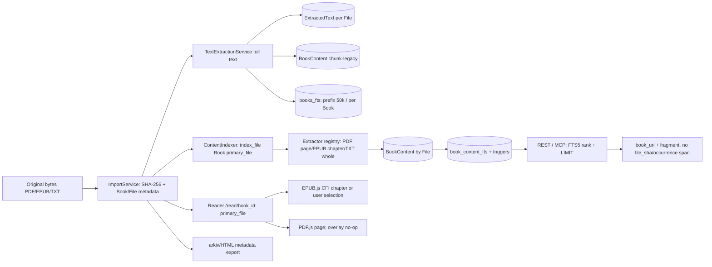

# P57 — Thẩm định kỹ thuật độc lập `queelius/book-memex` cho BodhiAtlas V1 Core

**Mã:** REPORT_57_BOOK_MEMEX · **Ngày nghiên cứu:** 23/11/2026 (Asia/Ho_Chi_Minh) · **Phạm vi:** source review + đối chiếu PRD + POC cô lập, **không** phải chứng nhận triển khai · **Tác giả:** đánh giá độc lập dựa trên mã nguồn truy cập trong phiên này.

**Nguồn chuẩn:** `queelius/book-memex` tại [`master@7230f8c06b28966055ebd85abae392e4162ce673`](https://github.com/queelius/book-memex/commit/7230f8c06b28966055ebd85abae392e4162ce673); BodhiAtlas tại [`main@aa874008ff4c6a6e9d66e6fee34c55e0370d6820`](https://github.com/quocgempro361/bodhi-atlas/commit/aa874008ff4c6a6e9d66e6fee34c55e0370d6820). Mọi trích dẫn file upstream dưới đây ghim SHA; đánh giá phản ánh **snapshot được truy cập**, không mặc nhiên áp dụng cho các commit/release tương lai.

**Quy tắc đọc kết quả:** `[DOC]` văn bản upstream/PRD; `[CODE]` đã mở mã hoặc test ở SHA; `[TESTED-ISOLATED]` đã tự chạy một phép thử độc lập tái tạo *thuật toán/schema* đã đọc, **không** chạy chính repo; `[TESTED]` dành cho upstream chạy thật (**không có ca nào**); `[ISSUE]` báo cáo sự cố của bên khác; `[PLAN]` chưa triển khai; `[INFERRED]` hệ quả có lý do từ code; `[CONFLICT]` tài liệu ≠ mã/hành vi; `[UNKNOWN]` chưa đủ chứng cứ. `NATIVE` trong Fit–Gap chỉ là khả năng có mã, **không phải PASS G1/G2**. Mức tin cậy HIGH/MED/LOW chỉ định mức chứng cứ, không phải thang điểm sản phẩm.

---

## 1. Executive Decision

### Quyết định và lý do

**Quyết định đối với `book-memex`: `USE AS COMPONENT` — có điều kiện; không lấy làm nền mã authoritative của BodhiAtlas V1.** **Kiến trúc ưu tiên duy nhất:** **D — Minimal new BodhiAtlas evidence core**, một kho SQLite + raw-object store có catalog Work–Expression–Edition–Witness–SourceFile, extraction revisions, exhaustive EXACT và Citation Checker độc lập; xem `book-memex` như mẫu triển khai thư viện/reader và ứng viên tái sử dụng nhỏ sau POC. Đây **không** phải đề xuất ghép toàn bộ các repo hoặc dựng plugin framework tổng quát.

**Confidence:** **HIGH** về những thiếu hụt nhìn trực tiếp trong mô hình/search/reader của HEAD; **MED** rằng core hẹp mới có tổng chi phí sửa chữa/rủi ro thấp hơn fork; **LOW** về LOC, hiệu năng, số giờ và chất lượng production vì chưa chạy POC A–F trên cùng fixture.

- **HEAD ≠ stable release:** HEAD `7230f8c...` ngày commit **19/10/2026 07:49:31 UTC**, nhánh mặc định `master`, repository public, không archived theo metadata đã kiểm; `pyproject.toml` vẫn ghi **0.5.1**, Python **>=3.10**, MIT. Changelog mô tả tag `v0.5.1` ngày **13/03/2026** và các thay đổi “Unreleased” sau đổi tên `ebk` → `book-memex`. **Chưa xác minh trực tiếp danh sách release/PyPI hiện tại**: `v0.5.1` là release gần nhất *được tài liệu snapshot xác nhận*, không khẳng định tuyệt đối là latest published artifact. [Package](https://github.com/queelius/book-memex/blob/7230f8c06b28966055ebd85abae392e4162ce673/pyproject.toml#L5-L64), [Changelog](https://github.com/queelius/book-memex/blob/7230f8c06b28966055ebd85abae392e4162ce673/CHANGELOG.md).
- **Demo:** Có thể dùng reader EPUB/PDF, catalog và FTS5 rất nhanh với HEAD nếu upstream setup/test qua; đối với demo *đọc sách* A có thể thắng. **V1 Core nghiệm thu G1/G2:** `Book` đang gộp ấn bản ở một field; FTS trả ranked **segments** có `LIMIT` thay vì mọi **occurrence**; kết quả API thiếu file hash/edition; reader chọn `primary_file` bất kể hit; EPUB CFI chỉ đến chapter-root, PDF không giữ bbox. Các điều này là chênh lệch về **hợp đồng chứng cứ**, không chỉ thiếu giao diện. [Model](https://github.com/queelius/book-memex/blob/7230f8c06b28966055ebd85abae392e4162ce673/book_memex/db/models.py#L66-L114), [MCP search](https://github.com/queelius/book-memex/blob/7230f8c06b28966055ebd85abae392e4162ce673/book_memex/mcp/tools.py#L782-L887), [reader REST](https://github.com/queelius/book-memex/blob/7230f8c06b28966055ebd85abae392e4162ce673/book_memex/server.py#L390-L446).
- **Không suy ra upstream hỏng production:** đã đọc trên 30 file/test và chạy phép thử **cô lập** về SQLite/PDF, nhưng `git clone`/upstream pytest/EPUB browser thực **NOT RUN** vì máy thực thi không phân giải được GitHub (`Could not resolve host: github.com`) và thiếu `ebooklib`. Vì vậy giả thuyết symptom của multi-format import tuy có chỉ dấu code rõ vẫn cần regression thật.
- **Điều kiện đổi quyết định sang A/fork:** TC04–TC05–TC06–TC09 trên HEAD + release pinned **PASS** sau sửa gọn, không sai edition/file, 100% exhaustive EXACT trong gold corpus, ZERO false `VERIFIED`, locator reopen đúng range, provenance theo revision bất biến; đo **diff hữu hạn** và upkeep fork rẻ hơn D ở cùng contract. Nếu `book-memex` bổ sung native `file_id`/revision/sourcemap + verifier rồi có regression và migration an toàn, đánh giá lại. Nếu D phải tự viết reader/catalog nhiều hơn dự báo và A sửa ít lớp hơn *đã đo*, đảo sang `TRIAL AS CORE` trước, chưa ADOPT thẳng.
- **Điều kiện bỏ cả component:** không chứng minh được license/dependency compliance, raw rights, hoặc không chặn rò rỉ tài liệu qua REST/MCP; reimport làm dẫn chứng không thể truy lại; maintenance buộc patch liên tục vào schema/API.

**Quy tắc ra quyết định:** không chấp nhận điểm trung bình “nhiều tính năng” bù một sai `VERIFIED`/sai ấn bản; RAG/AI, MCP, notes và UI là phụ trợ, không được sở hữu authoritative evidence. **Production hardening** (ACL/quyền/backup/corruption recovery) chưa đạt mức kiểm chứng, khác với khả năng demo local.

## 2. Sources & Evidence Ledger

### 2.1. Ledger khẳng định trọng yếu

| ID | Khẳng định và điểm phản chứng | Nhãn | Bằng chứng SHA + dòng | Confidence / Giới hạn | Kế thừa? / Ngưỡng bác bỏ |
|---|---|---|---|---|---|
| E01 | Repo `master`; HEAD `7230f8c...`; public, không archived; commit 19/10/2026 | `[DOC]` metadata GitHub được tra trực tiếp | [HEAD commit](https://github.com/queelius/book-memex/commit/7230f8c06b28966055ebd85abae392e4162ce673) | HIGH ở thời điểm tra; release list chưa kiểm API | Chỉ ghim SHA; revalidate trước build |
| E02 | `pyproject` 0.5.1, Python >=3.10, MIT, web/MCP là extras | `[CODE]` | [pyproject L5–96](https://github.com/queelius/book-memex/blob/7230f8c06b28966055ebd85abae392e4162ce673/pyproject.toml#L5-L96) | HIGH HEAD, không đại diện wheel published | Có; kiểm release artifact độc lập |
| E03 | `Book.edition`, `rights`, `source` là scalar; nhiều `File`, contributors có role nhưng không phải Work/Expression/Edition/Witness | `[CODE]` | [models L66–115](https://github.com/queelius/book-memex/blob/7230f8c06b28966055ebd85abae392e4162ce673/book_memex/db/models.py#L66-L115), [Contributor L259–270](https://github.com/queelius/book-memex/blob/7230f8c06b28966055ebd85abae392e4162ce673/book_memex/db/models.py#L259-L270) | HIGH về schema; chưa tìm mọi migration cũ | Không dùng làm identity core |
| E04 | `File.file_hash` tính SHA-256 byte, có unique toàn DB | `[CODE]` | [models L300–337](https://github.com/queelius/book-memex/blob/7230f8c06b28966055ebd85abae392e4162ce673/book_memex/db/models.py#L300-L337) | HIGH; hash không tự mã hóa edition/rights | Tái dùng ý tưởng CAS, không đồng nhất edition |
| E05 | `primary_file` ưu tiên PDF rồi EPUB và các định dạng khác | `[CODE]` | [models L124–134](https://github.com/queelius/book-memex/blob/7230f8c06b28966055ebd85abae392e4162ce673/book_memex/db/models.py#L124-L134) | HIGH; runtime import ordering chưa đo | Chỉ dùng default UX, không dùng citation |
| E06 | ID sách dùng ISBN hoặc MD5(title:creators), biết lỗi split khi thêm ISBN/đổi metadata | `[CODE]` | [ident L99–127](https://github.com/queelius/book-memex/blob/7230f8c06b28966055ebd85abae392e4162ce673/book_memex/ident.py#L99-L127) | HIGH; collision thực tế chưa thử | Không dùng làm immutable scholarly ID |
| E07 | REST ISBN import tạo một ID khác là MD5(`isbn:`+isbn) | `[CODE]` `[CONFLICT]` | [server L1005–1017](https://github.com/queelius/book-memex/blob/7230f8c06b28966055ebd85abae392e4162ce673/book_memex/server.py#L1005-L1017), [ident L118–127](https://github.com/queelius/book-memex/blob/7230f8c06b28966055ebd85abae392e4162ce673/book_memex/ident.py#L118-L127) | HIGH về hai code path; duplicate symptom chưa chạy | Bắt buộc TC11 |
| E08 | Import ghi legacy `ExtractedText` + `chunk-legacy` và sau đó gọi segment index | `[CODE]` | [import L128–146](https://github.com/queelius/book-memex/blob/7230f8c06b28966055ebd85abae392e4162ce673/book_memex/services/import_service.py#L128-L146), [text_extraction L129–165](https://github.com/queelius/book-memex/blob/7230f8c06b28966055ebd85abae392e4162ce673/book_memex/services/text_extraction.py#L129-L165) | HIGH về 2 paths; mức duplicate qua UI chưa test | Không lấy segment làm canonical mặc định |
| E09 | Import gọi `indexer.index_file(book.primary_file)`, không phải `file` mới | `[CODE]` + symptom `[INFERRED]` | [import L70–151](https://github.com/queelius/book-memex/blob/7230f8c06b28966055ebd85abae392e4162ce673/book_memex/services/import_service.py#L70-L151) | HIGH code, **NOT TESTED** symptom multi-file | Blocker trước fork; TC04/05 đảo quyết định |
| E10 | `BookContent` không có `extraction_revision`/source char span, chỉ segment/anchor/version/status | `[CODE]` | [models L358–396](https://github.com/queelius/book-memex/blob/7230f8c06b28966055ebd85abae392e4162ce673/book_memex/db/models.py#L358-L396) | HIGH schema | Không là evidence canonical |
| E11 | Segment PDF dùng `pypdf`, mỗi trang 1-based, `no_text_layer`, không bbox/OCR | `[CODE]` | [pdf L17–44](https://github.com/queelius/book-memex/blob/7230f8c06b28966055ebd85abae392e4162ce673/book_memex/services/content_extraction/pdf.py#L17-L44) | HIGH; layout quality trên thực liệu UNKNOWN | Có thể tái dùng page extractor như candidate |
| E12 | EPUB extractor tạo **chapter-root CFI** từ spine, collapse whitespace, không tạo quote-range CFI | `[CODE]` | [epub L18–79](https://github.com/queelius/book-memex/blob/7230f8c06b28966055ebd85abae392e4162ce673/book_memex/services/content_extraction/epub.py#L18-L79) | HIGH về code, resolve trên mọi EPUB UNKNOWN | Không dùng như precise citation |
| E13 | TXT decode UTF-8 `errors='replace'` và anchor không đủ mapping byte ↔ Unicode | `[CODE]` `[INFERRED]` | [txt L14–30](https://github.com/queelius/book-memex/blob/7230f8c06b28966055ebd85abae392e4162ce673/book_memex/services/content_extraction/txt.py#L14-L30) | HIGH code; offset behavior với invalid bytes chưa upstream test | Chỉ dùng kèm byte-map mới |
| E14 | `books_fts` giới hạn **50.000 ký tự** của lượt extraction đưa vào index | `[CODE]` | [text_extraction L283–311](https://github.com/queelius/book-memex/blob/7230f8c06b28966055ebd85abae392e4162ce673/book_memex/services/text_extraction.py#L283-L311) | HIGH; không nhầm `book_content_fts` | Không dùng `books_fts` bảo đảm recall |
| E15 | `book_content_fts` external-content, triggers insert/update/delete, `porter unicode61` | `[CODE]` | [migration L843–917](https://github.com/queelius/book-memex/blob/7230f8c06b28966055ebd85abae392e4162ce673/book_memex/db/migrations.py#L843-L917) | HIGH code; migration chạy thật chưa thử | Tái dùng như candidate index, không oracle |
| E16 | Indexer xóa rows per file trước, commit riêng; aggregate `ok` nếu **bất kỳ** trang ok | `[CODE]` | [indexer L41–116](https://github.com/queelius/book-memex/blob/7230f8c06b28966055ebd85abae392e4162ce673/book_memex/services/content_indexer.py#L41-L116) | HIGH; rollback interaction chưa test | Cần revision staging + per-page ledger |
| E17 | REST/MCP search trả ranked segment `LIMIT=50/20`, không occurrence offsets, `file_id`/hash/edition | `[CODE]` | [server L277–291](https://github.com/queelius/book-memex/blob/7230f8c06b28966055ebd85abae392e4162ce673/book_memex/server.py#L277-L291), [server L1250–1358](https://github.com/queelius/book-memex/blob/7230f8c06b28966055ebd85abae392e4162ce673/book_memex/server.py#L1250-L1358), [MCP L782–887](https://github.com/queelius/book-memex/blob/7230f8c06b28966055ebd85abae392e4162ce673/book_memex/mcp/tools.py#L782-L887) | HIGH code; performance/count UNKNOWN | Bác bỏ exhaustive claim; TC06 |
| E18 | `get_segment(book_id,type,index)` dùng `.first()` qua tất cả file cùng book | `[CODE]` | [MCP L887–911](https://github.com/queelius/book-memex/blob/7230f8c06b28966055ebd85abae392e4162ce673/book_memex/mcp/tools.py#L887-L911) | HIGH: định danh mơ hồ; sai bản cụ thể chưa thử | API mới phải nhận file SHA/revision |
| E19 | Reader `/read/{book_id}` luôn lấy `primary_file`; PDF overlay `addHighlight` là no-op | `[CODE]` | [server L390–446](https://github.com/queelius/book-memex/blob/7230f8c06b28966055ebd85abae392e4162ce673/book_memex/server.py#L390-L446), [reader.js L375–402](https://github.com/queelius/book-memex/blob/7230f8c06b28966055ebd85abae392e4162ce673/book_memex/server/static/reader.js#L375-L402) | HIGH, browser reopen actual UNKNOWN | Dùng UI mẫu, không G2 |
| E20 | EPUB manual selection có CFI range; đây **không phải** CFI backend search | `[CODE]` | [reader.js L188–230](https://github.com/queelius/book-memex/blob/7230f8c06b28966055ebd85abae392e4162ce673/book_memex/server/static/reader.js#L188-L230), [epub L48–63](https://github.com/queelius/book-memex/blob/7230f8c06b28966055ebd85abae392e4162ce673/book_memex/services/content_extraction/epub.py#L48-L63) | HIGH; range reopen browser UNKNOWN | Tái dùng CFI capture sau TC10 |
| E21 | `Marginalia` liên kết Book, `page_number/position` JSON, không pin File/ExtractionRevision | `[CODE]` | [models L540–565](https://github.com/queelius/book-memex/blob/7230f8c06b28966055ebd85abae392e4162ce673/book_memex/db/models.py#L540-L565) | HIGH | Notes UI có ích, citation ledger phải mới |
| E22 | Arkiv chỉ export Book metadata/Marginalia/ReadingSession; import không kèm file | `[CODE]` | [arkiv L284–362](https://github.com/queelius/book-memex/blob/7230f8c06b28966055ebd85abae392e4162ce673/book_memex/exports/arkiv.py#L284-L362), [import L230–245](https://github.com/queelius/book-memex/blob/7230f8c06b28966055ebd85abae392e4162ce673/book_memex/services/arkiv_import.py#L230-L245) | HIGH về arkiv **không** suy backup CLI cũng thiếu | Không dùng làm portable evidence archive |
| E23 | MCP SQL SELECT-only với read-only SQLite + authorizer; vẫn đọc được dữ liệu được phép bởi DB | `[CODE]` `[INFERRED]` | [sql_executor L1–68](https://github.com/queelius/book-memex/blob/7230f8c06b28966055ebd85abae392e4162ce673/book_memex/mcp/sql_executor.py#L1-L68) | HIGH về write guard; ACL/remote UNKNOWN | Không expose trước auth/redaction |
| E24 | README nói PDF `page+bbox`, TXT `byte offset` nhưng segment code không thực hiện | `[CONFLICT]` | [README L41–49](https://github.com/queelius/book-memex/blob/7230f8c06b28966055ebd85abae392e4162ce673/README.md#L41-L49), [PDF L26–44](https://github.com/queelius/book-memex/blob/7230f8c06b28966055ebd85abae392e4162ce673/book_memex/services/content_extraction/pdf.py#L26-L44), [TXT L20–30](https://github.com/queelius/book-memex/blob/7230f8c06b28966055ebd85abae392e4162ce673/book_memex/services/content_extraction/txt.py#L20-L30) | HIGH discrepancy; có thể tính năng ngoài đường được audit nhưng không thấy trong segment contract | Không coi mô tả là locator contract |
| E25 | Test import chỉ **một EPUB** và test e2e một EPUB; không chứng minh multi-edition | `[CODE]` | [test index import L21–55](https://github.com/queelius/book-memex/blob/7230f8c06b28966055ebd85abae392e4162ce673/tests/test_content_indexer_on_import.py#L21-L55), [test e2e L34–52](https://github.com/queelius/book-memex/blob/7230f8c06b28966055ebd85abae392e4162ce673/tests/test_phase2_e2e.py#L34-L52) | HIGH test scope; không có nghĩa toàn repo không có test khác | Bắt buộc thêm TC04–05 |
| E26 | Thử cô lập FTS `anatta` khác `anattā`, CJK đơn ký tự miss, một segment 5 occurrence chỉ thành 1 hit | `[TESTED-ISOLATED]` | [algorithm](https://github.com/queelius/book-memex/blob/7230f8c06b28966055ebd85abae392e4162ce673/book_memex/core/fts.py#L19-L45), [schema](https://github.com/queelius/book-memex/blob/7230f8c06b28966055ebd85abae392e4162ce673/book_memex/db/session.py#L63-L81), log `P57_ISOLATED_POC.log` | HIGH cho SQLite isolated; **NOT upstream executable** | FTS chỉ accelerator; đo gold oracle |
| E27 | PRD V1.4 bắt exhaustive exact, phân biệt mode và kiểm đúng source/locator | `[DOC]` | [PRD L105–123](https://github.com/quocgempro361/bodhi-atlas/blob/aa874008ff4c6a6e9d66e6fee34c55e0370d6820/docs/PRD.md#L105-L123), [Core L90–158](https://github.com/quocgempro361/bodhi-atlas/blob/aa874008ff4c6a6e9d66e6fee34c55e0370d6820/docs/V1_CORE_FOUNDATION.md#L90-L158) | HIGH về benchmark, không phải upstream feature | Gate cứng |
| E28 | G1–G6 phân biệt nguồn/quote/claim/rights/publish; `VERIFIED` phải có independent source check | `[DOC]` | [Academic Risks L154–170](https://github.com/quocgempro361/bodhi-atlas/blob/aa874008ff4c6a6e9d66e6fee34c55e0370d6820/docs/ACADEMIC_RISKS_AND_VERIFICATION.md#L154-L170) | HIGH benchmark | Gate cứng |
| E29 | Bang-ha schema có source_version/SHA và passage edition_id, pipeline publish staging | `[CODE]` | [common L87–115](https://github.com/quoctran-2608/Bang-ha-giac-ngo/blob/4345737ae16638b19226ea1b11007e6ffa4faf62/tools/local_corpus_framework/corpus/common.py#L87-L115), [publication L150–190](https://github.com/quoctran-2608/Bang-ha-giac-ngo/blob/4345737ae16638b19226ea1b11007e6ffa4faf62/tools/local_corpus_framework/corpus/publication.py#L150-L190) | MED: private repo hiện đã đọc 2 file gốc; corpus rights POC chưa qua | Ứng viên connector corpus, không lấy nguyên ledger |
| E30 | BCR có `evidence_gate` với host `source_reader` pin nguồn, nhưng CJK query route >=3 codepoints | `[CODE]` | [verification L223–285](https://github.com/quoctran-2608/BuddhismDocuments-for-AI/blob/dfdd3cbb79e3dbfb49a855702fa00e4bad3b3410/tools/corpus_research/verification.py#L223-L285), [retrieval L218–240](https://github.com/quoctran-2608/BuddhismDocuments-for-AI/blob/dfdd3cbb79e3dbfb49a855702fa00e4bad3b3410/tools/corpus_research/retrieval.py#L218-L240) | MED tích hợp, code có mặt ≠ đã reuse/check pass trên PDF | Tham khảo verifier/resolver trong phạm vi nguồn pin |

### 2.2. Danh sách code/test thực sự đã mở

**Package/kiến trúc (4):** `README.md`, `pyproject.toml`, `LICENSE`, `docs/development/architecture.md`. **Schema/identity (6):** `book_memex/db/models.py`, `db/session.py`, `db/migrations.py`, `ident.py`, `core/uri.py`, `core/fts.py`. **Pipeline/search (9):** `services/import_service.py`, `services/text_extraction.py`, `services/content_extraction/__init__.py`, `content_extraction/pdf.py`, `epub.py`, `txt.py`, `services/content_indexer.py`, `search_parser.py`, `library_db.py`. **Reader/API/MCP/export (10):** `server.py`, `server/static/reader.js`, `mcp/tools.py`, `mcp/server.py`, `mcp/sql_executor.py`, `services/marginalia_service.py`, `services/reading_session_service.py`, `exports/arkiv.py`, `exports/html_app.py`, `services/arkiv_import.py`. **Tests (8):** `tests/test_phase2_e2e.py`, `test_content_extraction.py`, `test_reader_endpoints.py`, `test_mcp_content_tools.py`, `test_content_indexer_on_import.py`, `test_migration_11_book_content.py`, `test_migration_12_fts.py`, `test_arkiv_import.py`. **Tổng: 37 file thực sự được đọc từ connector (nội dung đầy đủ hoặc các đoạn xác định), 8 file test; không coi đây là đọc toàn bộ repository.**

Test source đã xem gồm single-EPUB E2E, PDF `no_text_layer`, EPUB CFI tồn tại, migration 11/12, reader trả HTML và thư viện JS vendored, MCP segment paging, arkiv import. **Không một test upstream nào được chính lượt này thực thi.** Tên `tests/test_security.py`, `test_sql_executor.py`, `test_import_service.py`, `test_arkiv_export.py` khi truy cập **404**; đây chỉ chứng minh **path không tồn tại tại SHA này**, không chứng minh không có test tương đương dưới tên khác. Chưa audit đủ CI workflows, issue counts, binary JS notices, release sdist và toàn bộ REST endpoint; phần này `UNKNOWN` có trọng lượng.

**BodhiAtlas nguồn thực đọc:** `docs/PRD.md`, `docs/V1_CORE_FOUNDATION.md`, `docs/ACADEMIC_RISKS_AND_VERIFICATION.md` cùng P39/P03/P20/P12 tại SHA BodhiAtlas nêu trên; P39/P03 là **nhận xét của tác giả các báo cáo**, không chuyển tự động sang `[TESTED]` ở P57. `REPORT_56_OPEN_NOTEBOOK.md` **ACCESS BLOCKED — UNKNOWN (đường dẫn yêu cầu trả NOT FOUND)** tại BodhiAtlas HEAD; thay vào đó chỉ đối chứng README chính của `lfnovo/open-notebook` ở SHA riêng, không tuyên bố P56 đã hoàn tất. PRD GitHub ghi rõ **V1.4**; không có bản PRD V1.4 khác được đính kèm trong lượt này để xác nhận khác biệt.

### 2.3. Nhật ký truy cập/thử nghiệm

| Hoạt động | Kết quả | Phân loại |
|---|---|---|
| GitHub connector `get_repo`, `search_commits`, `fetch_file` ghim SHA book-memex/BodhiAtlas/Bang-ha/BCR | **RUN**, truy cập mã và metadata như ở ledger | `[CODE]` / `[DOC]` |
| `git ls-remote https://github.com/queelius/book-memex.git` từ container | **FAILED**: DNS `Could not resolve host: github.com`; không clone | `[TESTED-ISOLATED]` về môi trường, không phải upstream bug |
| `python /mnt/data/P57_ISOLATED_POC.py` (SQLite FTS + synthetic PDF) | **RUN**; dữ liệu synthetic tự tạo; log trong `/mnt/data/P57_ISOLATED_POC.log` | `[TESTED-ISOLATED]` |
| `pytest` upstream + Python `book_memex` + đa định dạng + Playwright/browser + MCP remote | **NOT RUN**; không có checkout; môi trường thiếu `ebooklib` | `[UNKNOWN]` |
| Bench p50/p95/RAM/throughput/export roundtrip | **NOT RUN** | `[UNKNOWN]` |

## 3. Architecture & Data Flow

### 3.1. Luồng hiện có theo code, không theo sơ đồ marketing



**Điểm đứt hợp đồng:** search hit xuất `book_uri#fragment` không mang `File.id`/SHA/edition; reader lựa chọn file theo format priority, **không phải file đã sinh hit**. Ở multi-edition, không có invariant bảo đảm search và reader đang xem cùng một witness. Sơ đồ là luồng source đã thấy, không nói các component chắc chắn thành công trên mọi input.

### 3.2. Entity graph hiện hữu vs cần thiết

```text
book-memex HEAD:
Author *<-- book_authors -->* Book(id, unique_id, edition:text, rights:text, source:text)
                                  | 1:N         | 1:N             | M:N
                              File(id,sha256)  Contributor(role)  Marginalia(position JSON)
                                  | 1:1                   | 1:N ReadingSession
                              ExtractedText
                                  | 1:N (separate)
                              BookContent(file_id,type,index,anchor,extractor_version,status)
                                  --> FTS external-content (derived)

BodhiAtlas proposed authoritative graph:
Work --1:N--> Expression(language,translator,relation)
                  --1:N--> Edition(publisher,date,print_pagination,rights)
                               --1:N--> Witness(source_role,variant)
                                            --1:N--> SourceFile(sha256,immutable_bytes,rights)
                                                        --1:N--> ExtractionRevision(profile,coverage)
                                                                      --1:N--> Passage/SourceSpan
                                                        <-- CitationEvidence(source_sha,revision,range,status)
```

`File` được hash đúng nhưng `Book` đang đại diện cho một đơn vị tiện quản lý eBook, **không phải đồ thị thư mục học thuật**. `BookContent` có `file_id` ở DB, nhưng schema API lược bỏ nó. `Book.edition` là chuỗi dùng chung cho tất cả File thuộc Book; Contributor có role nhưng không có edition-scope hay liên kết authority work/translator. Không suy rằng toàn bộ model là không thể mở rộng; vấn đề là **độ lan truyền thay đổi** qua import/search/reader/export/MCP.

### 3.3. DB, transaction, index và API boundary

- `library.db`: SQLite/SQLAlchemy; `PRAGMA foreign_keys=ON`; `books_fts` FTS5 `porter unicode61` tạo ở `db/session.py`; không tìm thấy PRAGMA WAL được bật trong đoạn session đã đọc, **không kết luận mọi deployment luôn journal mặc định**.
- `book_content`: external-content FTS5 và trigger insert/update/delete theo migration 12. Triggers chỉ giữ chỉ mục gần đồng bộ với row, **không** đảm bảo canonical coverage hay identity edition.
- `ContentIndexer.index_file` bắt đầu bằng delete old segments, `flush`, thêm segments, rồi tự `commit`; khi lỗi `rollback` cả session. Phải bổ sung staging/extraction revision và transaction boundary có kiểm soát, thay vì tuyên bố đã có atomic revision; không khẳng định hiện tại mất dữ liệu nếu chưa tái hiện.
- `books_fts` hướng vào metadata + full text bị cắt 50k; `book_content_fts` hướng vào page/chapter/chunk segments, có thể gồm cả `chunk-legacy`; khác coverage và matching semantics.
- REST/MCP là **access surfaces** cho ứng viên, không phải nguồn phán quyết học thuật. Python `Library.open(path)` có thể dùng **in-process** không cần web server; tuy vậy `Library` kéo DB/import/extraction models và các side effects nên không đồng nhất với API module độc lập thuần túy.

## 4. Fit–Gap Matrix C01–C15

*Các trạng thái nói về `book-memex` HEAD đáp ứng hợp đồng BodhiAtlas; “NATIVE” = đã có mã đúng **phần năng lực nói rõ**; “EXTENSION” = phải thêm logic/schema; “EXTERNAL” = cần thành phần khác; “MISSING” = không có theo các module đã audit, không phải chứng minh không tồn tại ở mọi nhánh. Effort L/M/H/VH là ước lượng tương đối, **không phải giờ đã đo**. Mọi `CODE` có link ở Ledger E01–E30; cột dẫn riêng để đối chiếu nhanh.*

| ID | Năng lực | Trạng thái | Bằng chứng | Fit, gap, blockers / risk | Effort | Ưu tiên |
|---|---|---|---|---|---|---|
| C01 | Multi-format ingest | **EXTENSION** | `[CODE]` [registry](https://github.com/queelius/book-memex/blob/7230f8c06b28966055ebd85abae392e4162ce673/book_memex/services/content_extraction/__init__.py#L47-L85) | PDF/EPUB/TXT segments NATIVE; full-text còn MD, nhưng DOCX/HTML/TEI/Markdown **không** có segment extractor tương ứng; bytes có hash; G1 phải phân biệt supported/unsupported | H | V1 |
| C02 | OCR/layout/reading order | **EXTERNAL** | `[CODE]` [PDF](https://github.com/queelius/book-memex/blob/7230f8c06b28966055ebd85abae392e4162ce673/book_memex/services/content_extraction/pdf.py#L20-L44) | pypdf page-text, `no_text_layer` theo ngưỡng 5 ký tự; không OCR/layout/multicolumn/footnote quality; **G1/G2** | H/VH | V1 |
| C03 | Canonical text & Source Map | **MISSING** theo G2 | `[CODE]` [BookContent](https://github.com/queelius/book-memex/blob/7230f8c06b28966055ebd85abae392e4162ce673/book_memex/db/models.py#L358-L396) | ExtractedText không versioned immutable revision, thiếu reversible normalization, source char span/bbox/range CFI; **G2 blocker** | VH | V1 |
| C04 | Work/Edition/Witness | **MISSING** theo G2 | `[CODE]` [Book](https://github.com/queelius/book-memex/blob/7230f8c06b28966055ebd85abae392e4162ce673/book_memex/db/models.py#L66-L115) | Edition/rights scalar + multi-file; split/collision ID; **G2 blocker** | VH | V1 |
| C05 | Exhaustive EXACT | **MISSING** | `[CODE]` [MCP FTS](https://github.com/queelius/book-memex/blob/7230f8c06b28966055ebd85abae392e4162ce673/book_memex/mcp/tools.py#L782-L887), `[TESTED-ISOLATED]` | Ranked segments giới hạn, không occurrence offsets; cross-boundary không bảo đảm; **G1/G2 blocker** | H | V1 |
| C06 | Normalized multilingual | **EXTENSION** | `[CODE]` [FTS parser](https://github.com/queelius/book-memex/blob/7230f8c06b28966055ebd85abae392e4162ce673/book_memex/core/fts.py#L19-L45), `[TESTED-ISOLATED]` | Một số diacritics folded bởi `unicode61`; tiếng Việt dấu/không dấu, NFC/NFD, đ/d, Hán giản/phồn, Tạng/Wylie cần analyzers có version và maps | H | V1 |
| C07 | Fuzzy retrieval | **EXTERNAL** | `[CODE]` [search parser](https://github.com/queelius/book-memex/blob/7230f8c06b28966055ebd85abae392e4162ce673/book_memex/search_parser.py#L79-L86) | Relevance BM25 ≠ fuzzy OCR; phải tách candidate/false positive | M | V2 (các ca thiết yếu V1) |
| C08 | Sense-aware lexicon | **EXTERNAL** | `[CODE]` [models](https://github.com/queelius/book-memex/blob/7230f8c06b28966055ebd85abae392e4162ce673/book_memex/db/models.py#L66-L115) | Có concept/relations không phải lexicon lemma/sense với nguồn/phạm vi/truyền thống; **G5** | H | V2/V3 |
| C09 | Semantic/RAG | **EXTERNAL** | `[DOC/CODE]` [changelog](https://github.com/queelius/book-memex/blob/7230f8c06b28966055ebd85abae392e4162ce673/CHANGELOG.md), [MCP](https://github.com/queelius/book-memex/blob/7230f8c06b28966055ebd85abae392e4162ce673/book_memex/mcp/server.py#L236-L296) | MCP phục vụ AI; không bắt buộc LLM/embedding cho core; optional ranking không authoritative | L/M | V2/V3 |
| C10 | Verified citation & reopen | **MISSING** | `[CODE]` [search response](https://github.com/queelius/book-memex/blob/7230f8c06b28966055ebd85abae392e4162ce673/book_memex/server.py#L277-L291), [reader](https://github.com/queelius/book-memex/blob/7230f8c06b28966055ebd85abae392e4162ce673/book_memex/server.py#L390-L446) | Missing file hash/edition/quote-range/independent checker; wrong-file reader; PDF overlay no-op; **G2 blocker nghiêm trọng** | VH | V1 |
| C11 | Wiki/notes/claims | **EXTENSION** | `[CODE]` [Marginalia](https://github.com/queelius/book-memex/blob/7230f8c06b28966055ebd85abae392e4162ce673/book_memex/db/models.py#L540-L565) | Highlight/notes/sessions NATIVE; independent claim/evidence/counterevidence revision/checker thiếu; G3 | H | V2 |
| C12 | REST/MCP/export | **EXTENSION** | `[CODE]` [MCP](https://github.com/queelius/book-memex/blob/7230f8c06b28966055ebd85abae392e4162ce673/book_memex/mcp/tools.py#L693-L920), [arkiv](https://github.com/queelius/book-memex/blob/7230f8c06b28966055ebd85abae392e4162ce673/book_memex/exports/arkiv.py#L284-L362) | REST/MCP/OPDS/JSONL/HTML có code nhưng không full files/segments/locators/rights/citation, ACL chưa được chứng minh | H | V1 |
| C13 | Coverage/incremental | **EXTENSION** | `[CODE]` [indexer](https://github.com/queelius/book-memex/blob/7230f8c06b28966055ebd85abae392e4162ce673/book_memex/services/content_indexer.py#L41-L116) | `status ok` che partial no-text, delete/rewrite không pin revision, stale notes; **G1/G2** | H | V1 |
| C14 | Auth/privacy/license/backup | **EXTENSION** | `[CODE]` [CORS](https://github.com/queelius/book-memex/blob/7230f8c06b28966055ebd85abae392e4162ce673/book_memex/server.py#L316-L355), [SQL executor](https://github.com/queelius/book-memex/blob/7230f8c06b28966055ebd85abae392e4162ce673/book_memex/mcp/sql_executor.py#L1-L68) | MIT code, local bind; request-level user/ACL not established; vendor/dependency/corpus rights pending; backup CLI cần roundtrip; **G4/G6** | H | V1 |
| C15 | Operability/portability | **EXTENSION** | `[CODE]` [pyproject](https://github.com/queelius/book-memex/blob/7230f8c06b28966055ebd85abae392e4162ce673/pyproject.toml#L5-L96), [migrations](https://github.com/queelius/book-memex/blob/7230f8c06b28966055ebd85abae392e4162ce673/book_memex/db/migrations.py#L750-L918) | CLI/in-process, SQLite, migrations NATIVE; old `ebk` config, HEAD/release drift, maintenance/upgrades/DB transaction/restore untested | M/H | V1 |

**Gate summary:** Không mục nào được phong “BodhiAtlas G1/G2 PASS” chỉ vì `NATIVE` hoặc vì upstream có test. C03/C04/C05/C10 là **blockers nguyên tắc**, C02/C06/C13/C14 là blockers triển khai theo corpus thực tế. Các mục V2/V3 không nên kéo vào V1 khi chưa đo lợi ích.

## 5. Deep Technical Findings — A–G và kiểm chứng giả thuyết

### A. Bản chất sản phẩm, ranh giới module, trưởng thành kỹ thuật

`book-memex` về thực chất là **thin personal eBook domain archive / library utility**: ORM catalog + file store, Typer CLI, FastAPI REST/OPDS, MCP, browser reader, text search, notes. Nó **không** phải full library-management system theo nghĩa MARC/FRBR/RDA/circulation/authority work; cũng **không** phải RAG app cần vector DB để chạy. `README` mô tả một phần của hệ sinh thái federation `*-memex`; mã MCP thực thi record/segment URI, SQL, annotations, nhưng **chưa audit repo memex federation ngoại vi**, nên không suy rằng federation đảm bảo ACL, provenance hoặc citation. [README L1–19](https://github.com/queelius/book-memex/blob/7230f8c06b28966055ebd85abae392e4162ce673/README.md#L1-L19), [architecture L1–117](https://github.com/queelius/book-memex/blob/7230f8c06b28966055ebd85abae392e4162ce673/docs/development/architecture.md#L1-L117), [MCP server L1–50](https://github.com/queelius/book-memex/blob/7230f8c06b28966055ebd85abae392e4162ce673/book_memex/mcp/server.py#L1-L50).

**Không yêu cầu GPU/LLM/embedding/vectors cho code-only search.** `book_content_fts` và `books_fts` dùng SQLite FTS5; `pyproject` có `similarity` optional extra cho numpy/scikit-learn, `mcp` optional; changelog ghi đã loại bỏ lớp AI/LLM của `ebk` cũ từ v0.5.0. Đây là lợi thế thực sự cho local-first. Nhưng không được nâng từ “FTS5 code-only” thành “khớp nguyên văn toàn bộ câu” vì FTS là tokenizer/ranking. [pyproject L35–95](https://github.com/queelius/book-memex/blob/7230f8c06b28966055ebd85abae392e4162ce673/pyproject.toml#L35-L95).

**Granularity tái sử dụng:**

| Module | Gọi in-process? | Phụ thuộc/biên chính | Tính độc lập để lấy một phần | Phán đoán |
|---|---|---|---|---|
| `core/fts.safe_fts_query` | Có, pure function | Python `re` | **L** | Có thể lấy ý tưởng code với kiểm license, nhưng chỉ dùng cho FTS candidate |
| `content_extraction.{pdf,epub,txt}` | Có khi dependencies cài đủ | pypdf/ebooklib/bs4, `Segment` contract | **L/M** | Chỉ reference extractor; thay locator contract |
| `content_extraction` registry | Có | registry global + `Segment` đơn giản | **L** | Có thể áp dụng pattern, không cần framework plugin |
| `Library`, `db.models`, `db.session` | Có | SQLAlchemy, migrations, paths/file handling | **H** | Import nguyên sẽ kéo authority sai |
| `ImportService`, `TextExtractionService`, `ContentIndexer` | Có qua ORM session | models, commit, storage, duplicate index paths | **H** | Không lấy nguyên cho evidence ingest |
| `server.py` REST/reader | Cần FastAPI/runtime | `Library`, global singleton, auth/URI/file priority | **H** | Chỉ reuse UI patterns/vendored assets nếu license kiểm |
| `reader.js` EPUB/PDF adapter | Browser | DOM, EPUB.js/PDF.js, global BOOK, REST contract | **M/H** | Có thể port dưới file-specific reader contract |
| MCP tools/server | Có qua Library/Session | SQL model, URI, REST-equivalent semantics | **H** | Nên viết thin read-only MCP proxy trên evidence API đã kiểm ACL |
| `arkiv`/HTML app | Có | DB book/notes/sessions, serializer | **M** | Reuse metadata export riêng, không full evidence backup |

Bằng chứng trưởng thành: có 12 migration theo kiến trúc, test unit/E2E theo từng đường, ORM relationships, scoped sessions, CLI và changelog; không chứng minh test suite toàn hệ luôn xanh hoặc compatibility v0.5.1 ↔ HEAD. `tests/test_reader_endpoints.py` test vendored assets được phục vụ, XSS `<script>` escaping trong title, `Range` **chấp nhận 200 hoặc 206** nên không chứng minh partial-byte semantics. Về CI, issue tồn đọng, số test toàn repo, coverage report, historical release API và các tệp vendored: **UNKNOWN**; không dùng GitHub stars để quyết định. [reader tests L76–116, L145–186](https://github.com/queelius/book-memex/blob/7230f8c06b28966055ebd85abae392e4162ce673/tests/test_reader_endpoints.py#L76-L186).

**Chi phí nếu fork:** phải đụng ORM + migration, importer, 2 extraction paths, index/search SQL, MCP/REST output, reader URL+highlight, export+backup, tests, configuration. Thay đổi sâu vào semantic DB khiến upstream rebase khó, không thể tuyên bố fork “nhỏ”. **Chi phí nếu bỏ fork:** BodhiAtlas phải tự làm catalog/ingest/reader wiring/UI nền và maintenance, nhưng có thể giữ các hợp đồng hẹp đúng G1/G2 ngay từ đầu. Cần đo số lớp/file/LOC ở TC15; phần này còn giả định.

### B. Danh tính Book/Edition/File — rào cản then chốt

- **`Book.unique_id` không phải scholarly stable ID.** `compute_unique_id` ưu tiên ISBN rồi MD5 title+creators, nên nhập không ISBN sau đó thêm ISBN, hoặc sửa title/tên tác giả, có thể tạo Book khác. Có `book-memex check --identity` theo docstring nhưng chức năng phát hiện mismatch không thay thế immutable alias migration. Đáng chú ý REST ISBN importer lại tạo MD5 của chuỗi `isbn:...`, **khác chính hàm compute_unique_id**; đây là mâu thuẫn mã thật cần TC11.
- **`File.file_hash` hash byte có giá trị**, đảm bảo một chuỗi byte không bị nhập hai lần toàn thư viện (unique constraint). Nhưng hai PDF khác edition/sửa một từ sẽ có hash khác và **có thể bị gộp vào cùng `Book`** nếu `unique_id` metadata giống. Ngược lại một tác phẩm có 2 bản eBook byte khác nhau vẫn có thể là cùng edition, cần xác nhận bởi metadata/nguồn.
- **`primary_file` là mặc định UX, không là nguồn citation.** Ưu tiên PDF trước EPUB bất kể click/search hit ở EPUB. Hai PDF cùng format chỉ được chọn theo thứ tự ổn định tương đối của relationship, không phải edition; download endpoint `files/{file_format}` cũng chọn first matching format, không có `file_id`. [models L124–134](https://github.com/queelius/book-memex/blob/7230f8c06b28966055ebd85abae392e4162ce673/book_memex/db/models.py#L124-L134), [download L1063–1088](https://github.com/queelius/book-memex/blob/7230f8c06b28966055ebd85abae392e4162ce673/book_memex/server.py#L1063-L1088).
- **`File` không bằng `SourceFile` bất biến theo học thuật.** Có file hash, path, MIME, kích thước, ngày; chưa có manifest pin raw bytes + provenance source rights + acquisition consent + `witness/edition` FK độc lập + parse-run pin. `BookContent` lưu `file_id` nhưng mỗi lần reindex xóa/thay rows; quote note không gắn exact run cũ. Soft-delete `archived_at` có mã, nhưng cần kiểm restore với source snapshots/FTS/notes.

**Thay đổi tối thiểu mà không phá mô hình:** tạo bảng **Work**, **Expression**, **Edition**, **Witness** (định danh opaque, không tính từ title), **SourceFile** (sha256, immutable path, source URL, rights, acquisition snapshot, edition/witness FK), **ExtractionRevision** (source_sha, tool/profile/version, coverage/error map, immutable), **Passage** (revision FK, char spans, segment boundaries), **SourceMap** (locator precision/correspondence), **CitationEvidence** (quote, hash, locator, checker/reviewer statuses). Nếu tập V1 còn nhỏ, có thể gộp `SourceMap` thành bảng `PassageLocator` và các `work/expression` cột reference kèm constraint rồi tách sau, **nhưng không** gộp edition/file và không dùng title-hash làm FK. Đề xuất là schema cho **D**, không khẳng định upstream đã implement.

### C. Import/extraction/index — phân tích luồng và phản ví dụ

**Hai đường upstream thực tế:**

1. `ImportService.import_file()` → `TextExtractionService.extract_and_chunk_all(file)` → `ExtractedText` (1/file), `BookContent` `chunk-legacy` + `books_fts` full text **chỉ 50k ký tự đầu**. `_extract_pdf_text` thử **PyMuPDF** rồi `pypdf` fallback; EPUB đi qua toàn bộ items document chứ không bảo đảm cùng thứ tự `spine` của segment extractor; `_clean_text` thay đổi whitespace/header. [text full L74–165](https://github.com/queelius/book-memex/blob/7230f8c06b28966055ebd85abae392e4162ce673/book_memex/services/text_extraction.py#L74-L165), [PDF fallback L170–208](https://github.com/queelius/book-memex/blob/7230f8c06b28966055ebd85abae392e4162ce673/book_memex/services/text_extraction.py#L170-L208), [books FTS L283–311](https://github.com/queelius/book-memex/blob/7230f8c06b28966055ebd85abae392e4162ce673/book_memex/services/text_extraction.py#L283-L311).
2. `ContentIndexer.index_file()` → registry `PdfExtractor/EpubExtractor/TxtExtractor` → per-segment `BookContent` → `book_content_fts` trigger. `pdf-v1` dùng `pypdf` per-page, `epub-v1` dùng `ebooklib` spine + BeautifulSoup + **chapter-root CFI**, `txt-v1` decode UTF-8 replace. Nguồn FTS là segment rows (có thể chứa `chunk-legacy` cùng file) không phải canonical full text source map.

**Sai lệch tham chiếu file trong import:** code ghi comment “index for newly imported file” nhưng gọi `primary = book.primary_file; indexer.index_file(primary)`. Trong `Book` có PDF+EPUB, nếu PDF có sẵn và nạp EPUB mới, `primary_file` vẫn PDF; `index_file(PDF)` sẽ xóa/recreate PDF `BookContent`, không tạo EPUB chapter segments từ đường 2. EPUB vẫn có thể có `chunk-legacy` của đường 1 nên một câu EPUB có thể xuất hiện ở FTS dưới locator nghèo, tạo cảm giác “search đã có”. **Đây là kết quả suy luận trực tiếp từ code nhưng chưa chạy import thật**, còn tùy SQLAlchemy relationship loading/flush. Đảo chiều nhập EPUB→PDF khiến PDF trở thành primary và có segment; cần TC04/05 với câu khác nhau theo edition/format và kiểm `BookContent.file_id` thật trước khi kết luận symptom. [import L70–151](https://github.com/queelius/book-memex/blob/7230f8c06b28966055ebd85abae392e4162ce673/book_memex/services/import_service.py#L70-L151).

**Vấn đề per-file transaction:** indexer xóa trước, gọi extractor và `commit` sau; exception -> `session.rollback()`, trả `extractor_error`, tức khi chỉ xét một session sạch và atomic DB transaction có khả năng rollback khôi phục old rows, **không khẳng định delete làm mất rows sau lỗi**. Nhưng commit bên trong `ImportService.import_file` có thể chốt giao dịch giữa import, giảm khả năng xử lý all-or-nothing; cần mutation test exception trước/giữa/sau extract, disk full và trigger integrity. `IndexResult.status='ok'` nếu chỉ một trang `ok` dù các trang khác `no_text_layer`; trạng thái trang ở row vẫn có thể đọc, nhưng aggregate **không đủ tiêu chuẩn G1 coverage**. Với file scan 100% trống, `no_text_layer` không tương đương “confirmed blank” hoặc “OCR performed”.

**Precision per format:**

| Format | Đường upstream hiện hành | Locator thực sự có | Không được suy diễn |
|---|---|---|---|
| PDF | `pypdf.PdfReader`, 1 segment/trang | `page` 1-based, `start_page/end_page` | Không bbox native, print page, rotations/columns/footnotes/OCR, page char span |
| EPUB | `ebooklib` spine + Soup, 1 segment/document | `cfi` đến root `!/4`, title/chapter | Không quote `range CFI`, exact DOM text node position, locale reflow verified |
| TXT | đọc bytes, UTF-8 `errors='replace'` | `offset:0`, `length` toàn text, không per-hit | Không byte span được chứng minh nếu decode replacement/Unicode khác |
| MD | full text path có | segment registry **không đăng ký** `md` | Không suy MD được locator chính xác |
| DOCX/HTML/TEI | không thấy segment extractor mặc định | `unsupported_format` nếu gọi registry | Không coi raw storage là searchable canonical text |

**Tương thích Docling/MinerU/content-core:** Registry `register(fmt, extractor)` dễ thay implementation, nhưng `Segment` chưa chứa source offset map/precision flags/bbox quality/OCR confidence/run ID. Thêm parser trực tiếp vào object `Segment` hiện tại **có nguy cơ hạ precision** (ví dụ Docling item bbox, charspan bị vứt hoặc gán thành trang giả). Đúng hướng là adapter trả `ExtractionRevision + Passage + Locator{type, precision, evidence}`; status `PAGE_ONLY/CHAPTER_ONLY/CHAR_RANGE/BBOX_CONFIRMED` do dữ liệu thật cho phép; `unmapped` phải xuất hiện công khai. P12 Docling trong BodhiAtlas là **báo cáo của bên khác** để tạo test hypothesis, chưa kiểm lại Docling ở P57.

### D. Search code-only, EXACT và tokenization

**Phân biệt năm đường tìm:** `Library.search` dựa metadata/`books_fts` với limit/offset; REST `/api/books/{book_id}/search` và `/api/search/content` dựa `book_content_fts`; MCP `search_book_content`/`search_library_content` chia sẻ `_run_fts_search` rank BM25 `LIMIT`; `get_segments` phân trang per-book nhưng **không trả tự động từng occurrence**; `safe_fts_query` escape FTS syntax nhưng mỗi token thành phrase riêng. Không tồn tại proof rằng bất kỳ đường nào là exhaustive EXACT. [Library L209–326](https://github.com/queelius/book-memex/blob/7230f8c06b28966055ebd85abae392e4162ce673/book_memex/library_db.py#L209-L326), [FTS safety](https://github.com/queelius/book-memex/blob/7230f8c06b28966055ebd85abae392e4162ce673/book_memex/core/fts.py#L19-L45), [MCP](https://github.com/queelius/book-memex/blob/7230f8c06b28966055ebd85abae392e4162ce673/book_memex/mcp/tools.py#L782-L887).

**Tách khái niệm:**

- `EXACT_RAW`: khớp chuỗi chữ nguyên của nguồn text-native đã được bảo đảm byte/Unicode mapping; PDF không có chuỗi raw human readable tương đương file bytes nên nguồn chốt là bytes + display/ground truth.
- `EXACT_EXTRACTED`: khớp chuỗi Unicode **nguyên xi** trong canonical extraction revision và trả mọi `(start,end)` cùng source-file/revision; **không chứng minh OCR khớp ảnh**.
- `NORMALIZED`: match qua bản index dẫn xuất, nêu rõ transform NFC/NFD, casefold, accent folding, giản/phồn, `đ↔d` nếu bật; cần vị trí ánh xạ về bản gốc.
- `FUZZY`: ứng viên edit distance/typo/OCR, có khoảng cách + ngưỡng, không tự VERIFIED.
- `LEXICON/RELATED/SEMANTIC/CANDIDATE`: quan hệ nghĩa/đồng hiện/ranking, **không gọi EXACT** và không ngầm khẳng định một mệnh đề.

**Oracle có thể kiểm chứng:** pin `(source_sha, extraction_revision_id)`; quét canonical text theo Unicode code points, trả **mọi** occurrence kể cả overlapping bằng vòng `find(..., start+1)` nếu semantics cho phép; trong mỗi revision chặn duplicate khi phân đoạn trùng/chồng nhau; các đoạn vượt page/chunk phải có một stream canonical nối với **separator policy** công bố, dùng mapping `global_char -> (passage/page, local char, locator)`. Với PDF page boundary, chỉ cho match xuyên trang nếu stream được định nghĩa rõ và locator có thể chỉ ra cả hai trang; không tự nối không dấu câu. Query chọn scope bằng edition/witness/file/extraction, report `eligible_text_length, indexed_pages, skipped_pages, unknown_ranges`; FTS là prefilter **chỉ** khi đã chứng minh recall=100% trên analyzer/format đó, còn không fallback scan exact toàn scope.

**Untrusted candidate không được thành citation:** Snippet MCP tìm từ đầu tiên theo token sau lowercasing, dựng HTML `<mark>` bằng regex; fragment Book URI + `page=N`/chapter CFI là định vị segment, không phải span match. `get_segment(book_id,type,index)` dùng `.first()` không file id, dễ trả một segment của file khác cùng Book trong trường hợp có trùng `type/index`. Các API cần thêm `source_file_id|sha256`, `revision_id`, `range`, `match_type`, `coverage`, `count`, stable `cursor`; `LIMIT` cho trang UI vẫn được phép nhưng tổng occurrence phải độc lập và có `next_cursor` có kiểm bất biến snapshot.

### E. Reader, highlight, source provenance

**Có code reader thực:** `reader.js` gọi EPUB.js `rendition.display(anchor.cfi)`, `onSelected` ghi `cfiRange` của **chọn thủ công**; PDF.js render page và có text selection browser; book metadata được escape để tránh chèn `</script>`. Reader assets được **vendored**, nhưng chưa đọc version header/license của từng thư viện JS trong phiên này. `FileResponse` có thể hỗ trợ HTTP range tùy Starlette nhưng `test_file_endpoint_supports_range` chấp nhận `200` lẫn `206`, nên **UNKNOWN** rằng browser được phục vụ `206 Content-Range` đúng trên mọi tổ hợp server/version. [reader.js L135–231](https://github.com/queelius/book-memex/blob/7230f8c06b28966055ebd85abae392e4162ce673/book_memex/server/static/reader.js#L135-L231), [test range L145–151](https://github.com/queelius/book-memex/blob/7230f8c06b28966055ebd85abae392e4162ce673/tests/test_reader_endpoints.py#L145-L151).

**Không có G2 precise reopening:** `read/{book_id}` luôn mở `primary_file`; EPUB search dùng chapter root CFI tới đầu document, không giữa câu; PDF `jumpToFragment` chỉ `page=N`, `addHighlight(){}` deferred; bounding box từ DOM selection là **tọa độ viewport**, không phải PDF native bbox xác minh trên raw PDF. `Marginalia` giữ quote và JSON `position` gắn Book, không đủ để pin edition/file/extraction revision; thay file hay OCR hoặc EPUB reflow khiến note có thể `STALE` mà code chưa có trạng thái đó.

**Thiết kế V1 cần:** `GET /sources/{source_file_id}/bytes?sha=...` quyền-kiểm + immutable, `GET /read/{file_sha}?rev=...&locator=...`, `POST /citations/verify` thực thi **không** dùng search index làm oracle, và `GET /citations/{id}` trả trạng thái verification riêng. EPUB ưu tiên source DOM `href + XPath/text node offsets` và CFI range có replay test; PDF cần page-native quad/bbox từ parser có khả năng, so raw render, nếu không chỉ `PAGE_ONLY`. Mọi highlight do user tạo là `NOTE` không phải `VERIFIED`.

### F. REST/MCP/export và tránh lock-in

MCP tools cung cấp search segments, schema, read-only SQL, write metadata/notes. Đường `_content_row_to_dict` có `content_id,book_id,book_uri,segment_type,index,anchor,start/end_page,extractor_version,status`, có thể `text`; **thiếu file ID, SHA, edition, rights, revision, confidence**. Search trả snippet/rank/fragment nhưng không có count/offset occurrence. `get_segment` chỉ nhận `(book_id,type,index)` nên **mơ hồ** khi nhiều file cùng Book. SQL `SELECT`/read-only authorizer là guard **chống ghi**, không là policy “được đọc những Book nào”: câu lệnh SELECT toàn bộ `ExtractedText` vẫn có thể được phép ở database chỉ có một ACL DB-level. [MCP serializer L693–920](https://github.com/queelius/book-memex/blob/7230f8c06b28966055ebd85abae392e4162ce673/book_memex/mcp/tools.py#L693-L920), [SQL executor](https://github.com/queelius/book-memex/blob/7230f8c06b28966055ebd85abae392e4162ce673/book_memex/mcp/sql_executor.py#L1-L68).

**Export formats khác scope:** `arkiv` JSONL chứa Book metadata + marginalia + sessions; `html_app` tạo SQLite tối giản từ ba nhóm đó; không chứa raw book bytes/BookContent/extraction revisions/citation statuses. Điều này **không phủ nhận** `book-memex lib backup/restore` có command; **chưa xem source code implement backup CLI/round-trip**, phải kiểm TC12 riêng. `arkiv` README có thể dùng như portable **personal book registry** nhưng **không** là evidence archive; nếu dùng sidecar, file bytes và provenance vẫn thuộc BodhiAtlas, export bằng manifest hoàn chỉnh của authoritative core. [arkiv L284–362](https://github.com/queelius/book-memex/blob/7230f8c06b28966055ebd85abae392e4162ce673/book_memex/exports/arkiv.py#L284-L362), [html_app L84–144](https://github.com/queelius/book-memex/blob/7230f8c06b28966055ebd85abae392e4162ce673/book_memex/exports/html_app.py#L84-L144).

**Nếu sidecar thật sự cần:** `BodhiAtlas(SourceFile.sha256, Edition.id, Witness.id, rights, revision)` → **one-way publication** sang `book-memex` (`source_uuid` alias ↔ `Book.unique_id`,`File.id`), không sửa canonical từ phía sidecar; mỗi sync có manifest `source_sha, revision, checksum, transform_version`, reconcile deletes/updates, `READ_ONLY` alias. Khi API không expose file-level source filter, connector phải tự làm SQL/read path hoặc fork, tăng số DB, backup, migrations và đường rò dữ liệu. Một REST wrapper *không tự giải quyết* thiếu source identity.

### G. An ninh, quyền, hoạt động và maintainability

- **Network:** server có CORS allowlist localhost, tài liệu/CLI mặc định loopback, opt-in remote `--allow-remote`. CORS chỉ kiểm browser origin, **không auth**, các endpoint GET raw, POST import/URL/OPDS và DELETE sách không cho thấy authorization dependency ở những đoạn audit. Không deploy tài liệu nhạy cảm lên Internet trước khi chạy TC13; cần bind private + reverse proxy auth, OAuth/RBAC hoặc single-user boundary, CSRF protection nếu dùng cookies, SSRF allowlist cho URL/OPDS, path canonicalization cho imports, rate limits và audit log. Không suy rằng đã khai thác thành công SSRF/path traversal từ việc thấy endpoint. [server L316–355](https://github.com/queelius/book-memex/blob/7230f8c06b28966055ebd85abae392e4162ce673/book_memex/server.py#L316-L355), [OPDS L822–945](https://github.com/queelius/book-memex/blob/7230f8c06b28966055ebd85abae392e4162ce673/book_memex/server.py#L822-L945).
- **Data exposure:** MCP `execute_sql` read-only không thực hiện object-level policy, khi kênh MCP bị cấp cho AI/cloud có thể truyền text copyrighted/private. Giới hạn tool capability bằng server-side ACL và source-policy trước mọi response; không gửi raw content cho mô hình nếu không có quyền.
- **Concurrency/recovery:** SQLite + `scoped_session`, commits bên trong services và global Library cho FastAPI cần concurrency regression dưới simultaneous imports/search/reindex. Chưa thấy WAL bật ở init, không xác nhận race hay corruption trên thật; migration 11/12 phải test from release DB, rollback, trigger rebuild. File store trên filesystem `files/<hash-prefix>/<hash>.<ext>` cần backup đồng bộ với DB và verify SHA sau restore; encryption at rest cho private doc là trách nhiệm deploy.
- **Copyright:** MIT ở root LICENSE áp dụng code nguồn project theo license đó, **không cấp quyền** với tác phẩm, bản dịch, corpus bên ngoài hoặc JS vendored tự động. Dependency PyMuPDF có chế độ cấp phép cần rà theo phiên bản/kiểu phân phối; ebooklib/pypdf/PDF.js/EPUB.js/JSZip/`arkiv` notices và model OCR cần SBOM cụ thể. Quyền `READ_LOCAL`, `COPY`, `REDISTRIBUTE`, `QUOTE`, `SEND_TO_AI` phải lưu theo SourceFile + Edition; unknown → fail closed.
- **Vận hành:** local single-user có thể đơn giản và đủ POC, không cần cloud microservices. Multi-user/cloud đòi ACL từng source/tenant, DB connection pool, checkpoint, job queue/worker, migration rollback, object storage, retention và observability. Không áp đặt microservices ngay. Fork kéo theo upstream rebase cho ORM/schema/migrations/API/reader; chọn component thay vì fork để tránh ownership conflict.

### 5.8. Kết quả kiểm tra 12 giả thuyết cụ thể từ prompt

| Giả thuyết | Phán định đối với HEAD | Giới hạn kiểm chứng |
|---|---|---|
| H01 Python/SQLite/CLI/REST/MCP/reader không LLM bắt buộc | **CONFIRMED `[CODE]`** | Build full environment NOT RUN |
| H02 `Book.edition` scalar, multi-file; `BookContent` thiếu char spans/revision | **CONFIRMED `[CODE]`** | Thiết kế có thể mở rộng, hiện chưa đạt |
| H03 PDF segments pypdf/page 1-based, không bbox | **CONFIRMED `[CODE]`** | OCR/reading order trên corpus thật UNKNOWN |
| H04 EPUB chapter-root CFI và collapse whitespace | **CONFIRMED `[CODE]`** | CFI resolve cho EPUB đặc biệt UNKNOWN |
| H05 EPUB selection range, PDF overlay placeholder | **CONFIRMED `[CODE]`** | UI browser NOT RUN |
| H06 MCP ranked segments LIMIT, không offsets/file SHA | **CONFIRMED `[CODE]`** | Không đo actual ranked retrieval |
| H07 importer dùng `book.primary_file` | **CONFIRMED `[CODE]`**; wrong-file outcome **NOT TESTED** | TC04/TC05 bắt buộc |
| H08 `books_fts` giới hạn 50k, khác content FTS | **CONFIRMED `[CODE]`** | UI coverage messaging chưa full audit |
| H09 identity theo ISBN hoặc title/creator | **CONFIRMED `[CODE]`**; bổ sung REST ISBN-ID divergence | collision/split thực nghiệm NOT RUN |
| H10 SQL SELECT-only, REST remote cần auth | **CONFIRMED `[CODE]`** phần guard; full threat model **UNKNOWN** | Không gọi lỗ hổng đã bị khai thác |
| H11 arkiv không đầy đủ file/raw/revision | **CONFIRMED `[CODE]`** với **arkiv**, không nói về mọi backup | TC12 round-trip NOT RUN |
| H12 snapshot 7230f8 và tag v0.5.1 | HEAD **CONFIRMED** qua GitHub hiện tại; `v0.5.1` **DOC** | Latest GitHub release/PyPI API **UNKNOWN** |

**Kết luận kỹ thuật A–G:** Mã thể hiện một thư viện cá nhân khả dụng và nhiều quyết định tốt cho nhu cầu đọc; nhưng ấn bản, source map, exhaustive occurrence, verification độc lập và quyền theo file là những invariant *không có ở boundary*. Một fork sẽ không thể “thêm 2 bảng là xong” nếu giữ API hit/reader cũ.

## 6. Source Fidelity / Provenance & Citation

### 6.1. Phản ví dụ: một từ phủ định, hai ấn bản, nhầm file

Fixture giả định hợp pháp do nhóm tự biên soạn (không trích kinh sách bản quyền):

- `Work W1`, `Expression E1` (bản Việt giả định), `Edition Ed-2025` file **PDF SHA=A**, câu trang 7: “Đoạn văn này **không** xác nhận giả thuyết.”
- `Edition Ed-2026` file **EPUB SHA=B**, chương 2: “Đoạn văn này xác nhận giả thuyết.”
- Cả hai nhập metadata `title=Ví dụ phủ định`, `creators=[Tác giả giả định]`, thiếu ISBN → có nguy cơ cùng `Book.unique_id`, dù là **hai editions** khác nhau. Nếu search hit sinh từ EPUB nhưng `/read/{book_id}` mở PDF primary (PDF ưu tiên), người dùng có thể thấy câu trái nghĩa. Nếu sai index_file(primary) khiến chỉ có `chunk-legacy` EPUB, kết quả có thể chỉ tới book không chính xác hơn. **Đây là kịch bản kiểm thử và suy luận logic, không phải bug đã tái hiện runtime**.

**Phải có `CitationEvidence`:** `work_id=W1`, `expression_id=E1`, `edition_id=Ed-2026`, `witness_id`, `source_file_id`, `source_sha256=B`, `extract_revision=...`, `matched_exact_text`, `start/end` trong canonical text, `EPUB[href,DOM-node offset,range-CFI]` khi kiểm được, `coverage_status`, `verifier_version`, `source_check_time`, `quote_hash`, `rights_policy`, `verification_status`. `BookURI#chapter CFI` không đủ, và URL của search index không thể thay thế bất biến file SHA.

### 6.2. Phản ví dụ OCR mất chữ và suy luận sai

Ảnh PDF scan chứa câu “**không** tương đương”; OCR chỉ cho “tương đương”, trang bị index thành ứng viên và search match “tương đương”. Kể cả Oracle EXACT trả khớp nguyên văn **trong extracted text**, nó **không chứng minh ảnh gốc** thiếu chữ “không”. Vì vậy `EXACT_EXTRACTED` có thể đúng nhưng `TEXT_AND_LOCATOR_VERIFIED` **không được cấp** khi OCR vùng rủi ro chưa rà mắt với ảnh nguồn. Gate G2 phải so raw page render hoặc ground truth reviewer, ghi `OCR_NEEDS_REVIEW` / `TEXT_ONLY`; nếu không có bbox thì chỉ `PAGE_ONLY` và không cho precise quote highlight.

### 6.3. Chain of custody cần thiết

```text
Acquisition URL / rights statement / timestamp / creator
  -> immutable original bytes + computed SHA-256 + chain-of-custody audit
  -> file-specific bibliographic link: Work/Expression/Edition/Witness
  -> ExtractionRevision(tool, version, profile, model hashes, input SHA, coverage)
  -> CanonicalText (unchanged for revision) + reversible normalization map
  -> Passage/SourceSpan with locator precision label
  -> SearchHit(type, all occurrence spans, coverage, source_sha)
  -> CitationChecker (freshly loads pinned original, verifies quote and locator)
  -> Reviewer approval if image OCR / semantic claim / rights review required
  -> CitationEvidence(status, tests, checked_at, verifier/version, link to raw)
```

**Status đề xuất (ba trục tách biệt):** (i) nguồn `READY/PARTIAL/UNAVAILABLE/RIGHTS_RESTRICTED`; (ii) câu và vị trí `CANDIDATE/TEXT_ONLY/TEXT_AND_LOCATOR_VERIFIED/OCR_NEEDS_REVIEW/MISMATCH/STALE`; (iii) luận điểm `NOT_ASSESSED/SUPPORTS/PARTIAL/CONTRARY/DISPUTED/INSUFFICIENT`. Không dùng một boolean `verified` bao trùm. Khi reprocess source SHA giữ nguyên nhưng revision thay, cite pin revision cũ hoặc chuyển `STALE_PENDING_RECHECK`; never silent rebind to new chunk id.

### 6.4. Verifier độc lập: contract đề xuất, không tự nhận đã có

```python
# Pseudocode — design proposal, NOT IMPLEMENTED/TESTED

def verify_citation(candidate, pinned_store, catalog, locator_resolver, reviewer):
    file_bytes = pinned_store.open(candidate.source_sha256)
    assert sha256(file_bytes) == candidate.source_sha256
    edition = catalog.resolve_edition(candidate.edition_id, candidate.source_sha256)
    assert edition is not None and edition.rights.allow_local_verification
    revision = catalog.load_revision(candidate.extraction_revision_id)
    assert revision.source_sha256 == candidate.source_sha256
    observed = locator_resolver.reopen_original(file_bytes, candidate.locator)
    if not observed.locator_verified or observed.precision < candidate.required_precision:
        return 'TEXT_ONLY' if revision.text_contains(candidate.exact_quote) else 'UNVERIFIABLE'
    if observed.is_ocr and not reviewer.confirmed_region(candidate, observed):
        return 'OCR_NEEDS_REVIEW'
    if observed.original_quote != candidate.exact_quote:
        return 'MISMATCH'
    return 'TEXT_AND_LOCATOR_VERIFIED'  # never auto SUPPORTS
```

Nhiệm vụ verifier với PDF text-native/scan và EPUB DOM khác nhau; `verify_citation` phải yêu cầu mức precision theo loại nguồn, không coi mọi text extraction có byte-for-byte text gốc. BCR có cơ chế `source_reader` pinned với các corpus được hỗ trợ; **không copy chữ `VERIFIED` ra bất kỳ PDF/EPUB mới nào** nếu resolver chưa được thiết kế/test. [BCR gate](https://github.com/quoctran-2608/BuddhismDocuments-for-AI/blob/dfdd3cbb79e3dbfb49a855702fa00e4bad3b3410/tools/corpus_research/verification.py#L223-L285).

## 7. Multilingual & Retrieval Semantics

### 7.1. Phương pháp POC cô lập, ranh giới đo

Đã chạy `/mnt/data/P57_ISOLATED_POC.py` bằng Python 3.13.5, `sqlite3` **3.46.1**, `pypdf` **5.9.0**, PyMuPDF **1.26.7** trên Linux x86_64. Script tạo SQLite FTS5 `tokenize='porter unicode61'` giống cấu hình ở code và mô phỏng `safe_fts_query` đúng phép tách token/quote của hàm đã đọc; dùng text synthetic có Unicode literal, đối chiếu Python substring oracle. **Không import package upstream**, không cài ebooklib, không gọi upstream REST/MCP, không có dữ liệu kinh điển thực; mọi số bên dưới **chỉ là đo lường của fixture cô lập**, không phải benchmark book-memex hay của phiên bản release.

| Query / fixture | Expected `EXACT_EXTRACTED` | Measured FTS5 candidate | Kết luận, mức chứng cứ |
|---|---|---|---|
| `anatta` vs document `anatta`, `anattā` | `anatta` chỉ raw `anatta` (trong fixture còn doc thứ ba chứa chuỗi này) | `anatta` FTS hit cả doc chứa `anattā` | `[TESTED-ISOLATED]`: diacritic folding tạo **non-exact**; FTS không gắn EXACT |
| `anattā` | chỉ doc có `anattā` | FTS cũng hit `anatta` | `[TESTED-ISOLATED]`: candidate không bảo đảm exact |
| `vô thường` vs `vo thuong` | hai chuỗi tách biệt | FTS trả các document khác nhau trong fixture | `[TESTED-ISOLATED]`: `unicode61` không tự làm toàn bộ bỏ dấu tiếng Việt như mong muốn |
| `無常` vs `无常` | khác theo code point | FTS mỗi query nhận đúng dạng tương ứng trong fixture | `[TESTED-ISOLATED]`: không có conversion giản/phồn tự động |
| `無` / `常` / `无` (CJK 1 ký tự) | `無` có trong `無常`; `常` có trong cả `無常`, `无常` | FTS **0** hit cho cả ba query | `[TESTED-ISOLATED]`: tokenizer không phải substring oracle cho chữ Hán 1 ký tự |
| NFC `á` vs NFD `a\u0301` | Python raw substring phân biệt hai chuỗi | FTS trả cả hai | `[TESTED-ISOLATED]`: phải ghi transform, không nhầm exact |
| `d` vs `đ` | ký tự khác nhau | FTS tách biệt trong fixture | `[TESTED-ISOLATED]`: không có `đ→d` mặc định |
| `foo bar` vs lưu `foo\nbar` | raw substring `foo bar` **0** | FTS **1** hit vì token matching | `[TESTED-ISOLATED]`: whitespace normalization phải có nhãn mode |
| `anatta` lặp 5 lần cùng `BookContent` | **5** occurrences `(0,6),(7,13),(14,20),(21,27),(28,34)` | FTS **1** row | `[TESTED-ISOLATED]`: đoạn/row ≠ occurrence |
| PDF synthetic 3 trang, giữa trống | page2 `no_text_layer`/coverage 2-of-3 text-bearing; không verified page2 | pypdf trích trang1 42 ký tự, trang2 0, trang3 28; không bbox | `[TESTED-ISOLATED]`: mô phỏng phân trang, **không** chứng minh OCR/layout real |

**Important:** `unicode61` không nhất thiết có cùng hành vi khi SQLite compile flags, Unicode version, PRAGMA extension thay đổi; khóa tokenizer + SQLite version cùng schema revision rồi dùng truth oracle test mọi profile. CJK 2 ký tự đôi khi match nếu token trùng toàn bộ; **không tự suy substring của mọi 1–2 char được index**. Pāli/Sanskrit composed/decomposed, tiếng Việt `đ`, tiếng Tạng/Wylie và chữ Hán truyền thống/giản thể phải có bộ biến đổi phân tách ở index phụ, có nguồn chính thống để map đồng nghĩa. Không bỏ dấu/loại chữ gốc ngay trong canonical text.

### 7.2. Gold oracle và phép thử chưa chạy

Golden fixture đề xuất lưu mỗi row: `source_sha, edition_id, revision_id, original_text, extracted_text, expected_occurrences{query,start,end,match_mode}, locator_precision, rights, per_page_coverage`. Với query CJK cả 1/2/3 chữ, Pāli phụ âm/diacritics, Việt NFC/NFD, Sanskrit `duḥkha`, Tibetan script và Wylie, nhãn `EXPECTED` chỉ khi nguồn corpus/ground truth và biến đổi đã được kiểm bằng người hiểu ngôn ngữ. Bảng ở 7.1 là **measured SQLite isolated**; các ca Tibetan/Wylie, giản/phồn semantics và PDF đa cột/chú thích **NOT RUN**. Không bịa tỷ lệ recall/false positive trên corpus thật.

### 7.3. Thiết kế search V1 có thể nghiệm thu

1. Store canonical extraction per file/revision (không thay đổi text khi index lại), có global offset và `source_map` tới trang/DOM/segment; normalize chỉ trong derived index có bảng `normalized_offset→raw_range` (nếu phép biến đổi làm nhập nhiều raw char, giữ 1:N mapping).
2. Đối với `EXACT_EXTRACTED`, scan toàn canonical scope pinned; dùng paginated cursor ổn định `revision_id + raw_start + tie_breaker` và `count_total` trước nếu đủ resources. Với tài liệu rất lớn, prefilter FTS/trigram chỉ bật khi chứng minh **100% recall** bằng unit/properties với tokenizer/chunk boundaries; fallback scan cho CJK ngắn/Unicode bất thường.
3. `NORMALIZED` chuẩn hóa NFC/casefold/accent folds/simplified–traditional có version, hiển thị `query_original`, `query_expanded`, transform source, `match_type`; `FUZZY` có edit distance/CER candidate, không đếm như raw exact.
4. Mọi hit mang `file_sha256`, `edition_id`, `extract_revision_id`, `canonical_start/end`, context và locator precision; lỗi index/unsupported/no-text phải làm hẹp `eligible_scope` được báo cho người dùng, không kết luận “không có trong tác phẩm”.
5. Hệ search chạy khi tắt LLM/embeddings, tests TC06–08 phải PASS 100% oracle trong vùng đã coverage đủ. `G2` kiểm lại raw độc lập hoàn toàn, không dùng FTS snippet.

## 8. Integration & Reuse Options — cùng một hợp đồng, một data owner

### 8.1. Sáu ứng viên cạnh tranh, không cộng điểm vì số dịch vụ

| Phương án | Authoritative owner | Phần có mã sẵn (chứng cứ) | Phải xây/sửa để G1/G2 | Mặt trái và điều kiện chọn |
|---|---|---|---|---|
| **A — book-memex-led/fork** | DB `library.db` sau khi mở rộng | File SHA, catalog cá nhân, ingest PDF/EPUB/TXT, REST/MCP, reader, notes, FTS; `[CODE]` E03–E25 | Nâng identity Work/Expression/Edition/Witness; revision/map; replace exhaustive search; file-specific reader/API; verifier; rights; migration | Demo nhanh; song schema/contract sẵn gắn `Book` nên chi phí chạm nhiều lớp. Chỉ thắng nếu TC04/05/06/09 fix **đã đo** rẻ hơn D + upstream rebase manageable |
| **B — Bang-ha-led** | Local corpus SQLite/source snapshots của Bang-ha | `[CODE]` 2 file trực tiếp: schema `sources/passages/translations` có edition_id/SHA và staging publication; bổ sung báo cáo P39 chỉ là nguồn thứ cấp | EPUB/PDF file manager, OCR, bounding boxes, CFI reader, general metadata/work-expression, occurrence offsets, verifier G2 nghiêm | Tốt nếu V1 ưu tiên Nikāya/Āgama có source IDs/rights đã được phê duyệt; repo **private**, corpus rights/deployment chưa được chứng nhận trong P57; scholarly ledger mặc định VERIFIED phải đặc biệt audit trước reuse |
| **C — BCR-led** | Pin Git corpus/resolvers + new file store | `[CODE]` BCR `source_reader/evidence_gate` có host-pinned verification; lexical corpus index | Ingest personal files, edition/file catalog, PDF/EPUB locator, OCR/coverage, occurrence search, reader/auth | Khỏe nhất về kiểm nguồn corpus *trong phạm vi resolver*; mạo hiểm nếu lấy 13 corpus làm giả định quyền/coverage đã hoàn tất. Có thể thắng D khi V1 corpus-first và giấy phép rõ |
| **D — Minimal BodhiAtlas evidence core — ƯU TIÊN** | **Một** SQLite authoritative + CAS file bytes, derived indexes | SQLite/FTS5, PyMuPDF/pypdf, EPUB.js/PDF.js; có thể tham khảo BCR resolver theo hợp đồng | Tự xây catalog hẹp, ingest job/revision, source map adapters, exhaustive oracle, verifier, reader thin API/UI, migration/export | Chi phí bootstrap cao hơn reader-demo A; nhưng source identity, mutable boundaries, ACL/quality gates thiết kế ngay đúng. Rủi ro tự xây cần TC15 đo, không giả định được ít LOC hơn A |
| **E — book-memex sidecar** | BodhiAtlas core authoritative, `book-memex` chỉ cache/reading | Giữ app hiện hành ít sửa, có UI/notes | One-way sync, alias mapping, permissions, 2 DB, staleness and dual backup, file-level search/reader boundary, reconcile | Dễ demo nhưng “2 nguồn chân lý” nguy hiểm nếu không ép sidecar derived-only; chỉ cân nhắc nếu UI/reading workflow thật sự tiết kiệm hơn vận hành 2 stores |
| **F — Open Notebook/RAGFlow-first** | Notebook/RAG stack sẽ phải thêm evidence store authoritative | `[DOC]` Open Notebook README có AI knowledge workflows/fulltext/vector; RAGFlow chỉ đối chứng kiến trúc, chưa audit HEAD trực tiếp | File/edition identity, exact occurrence, raw source maps, independent G2, OCR rightness, RAG disable mode, deterministic APIs, security/rights | Không phù hợp nếu “RAG top-k trả nguồn” bị hiểu là exhaustive; lợi thế tương tác chỉ đáng chọn làm optional consumer ở V2/V3, không core |

**Lưu ý tính công bằng:** P39/P03/P12/P20 đã tồn tại trong BodhiAtlas nhưng quan điểm của chúng không phải verdict độc lập P57; ở đây B và C được **mở trực tiếp một phần code** để xác nhận thế mạnh/hạn chế cụ thể. Với B, GitHub kết nối xác nhận `quoctran-2608/Bang-ha-giac-ngo` **private** ở `4345737...`, không dùng 404 công khai làm bằng chứng repo không tồn tại. Với F, trực tiếp mới đọc README Open Notebook tại `0c1e7...`, chưa mở modules RAGFlow và không chạy stack: confidence F thấp hơn A/D; thứ tự cần POC thực.

### 8.2. Ma trận công sức tích hợp — ESTIMATE (assumptions), không phải LOC/time measured

**Định nghĩa số lớp:** lớp = boundary dữ liệu/domain, ingest/parser, search/index, verifier, API/MCP, reader/UI, export/ops. Một chức năng có thể chạm nhiều file/lớp; số dưới đây là **khoảng phỏng đoán** từ các entrypoints đã đọc, không phải “số file phải sửa” đã diff. L/M/H/VH là mức thấp/trung bình/cao/rất cao và rủi ro mất chứng cứ nếu migration thất bại.

| Phần cần có | Book-memex hiện đã đáp ứng? | Lớp cần sửa nếu A (ước lượng) | So với B/C/D | Có thể lấy từ upstream? | Rủi ro fidelity |
|---|---|---:|---|---|---|
| Work/Expression/Edition/Witness/File | Một Book + File SHA, **chưa** taxonomy đúng | 5–7 | B/C đã giữ một phần nguồn/corpus, D thiết kế mới | Models metadata/Identifier chỉ là gợi ý | **Critical:** nhầm ấn bản |
| File hash + immutable releases | SHA bytes NATIVE, không pin edition/source release | 2–4 | B có publish snapshot, C có git pin, D phải xây CAS | `File.compute_hash`, prefix store pattern | High: stale bytes |
| Extraction revision + page/CFI/bbox map | `BookContent` phiên bản extractor, không revision/source span | 4–6 | D xây contract từ đầu, B/C thiếu PDF/EPUB | Page extractor, registry chỉ reference | **Critical** |
| Exhaustive EXACT + Unicode | FTS5 rank LIMIT, **không** occurrence | 3–5 | B có substring records không offsets, C top-K, D oracle mới | `core/fts` sanitizer, SQLite FTS | **Critical** |
| Citation Checker độc lập | Không thấy trong search/reader/model | 4–6 | C gần hơn vì source_reader verifier; D adapter cần mới | BCR verifier *ý tưởng/contract* | **Critical** |
| PDF/EPUB reopen/highlight | Browser reader có, thiếu file binding/range/bbox | 2–4 | A/E demo mạnh; D build thin viewer | `reader.js` patterns + JS nếu rights rõ | High |
| OCR/coverage/error ledger | PDF text-layer/no_text flag | 3–5 | Tất cả cần parser/OCR adapter; D kiểm precision ngay | pypdf, Docling/MinerU integration sau POC | **Critical** |
| Corpus connectors Pāli/Hán | Không native | 2–4 | **B/C mạnh hơn** (IDs/resolvers) | B/C adapter, không copy corpus vô điều kiện | High rights / witness |
| Export/backup/restore | Arkiv metadata; CLI backup source chưa audit | 3–5 | D phải làm full manifest, B release source, C git snapshots | Arkiv format chỉ metadata | **Critical** nếu mất raw/revisions |
| Auth/permissions | CORS loopback, SQL read-only, không row ACL đã thấy | 3–6 | Tất cả cần ACL và rights; D least privilege mặc định | Framework auth tùy host | High privacy / G4/G6 |

**Không đồng nhất lớp và LOC.** Đối với A, ít nhất các boundary sau đều phải đổi: `db/models.py` + `db/migrations.py`; `ident.py`, `import_service.py`, `text_extraction.py`, `content_indexer.py`, `content_extraction/*`; `library_db.py`, `server.py`, `mcp/tools.py`, `reader.js`, `exports/*` và tests. Đây là **danh sách các entrypoints đã biết**, không phải final implementation diff. So sánh D bằng chính code thực thi trên cùng fixtures TC15, không sử dụng ước lượng làm kết quả định lượng cuối cùng.

### 8.3. Hợp đồng tích hợp hẹp khi chọn D

**Data owner duy nhất:** `BodhiAtlas Core` sở hữu **raw bytes + source hash + bibliographic entity IDs + rights + extraction revisions + citation statuses**. Everything else (FTS5 indexes, extracted token candidates, preview HTML, RAG embeddings, notebooks, personal reading progress, OPDS) là **derived/consumer**. Một process/API local trong V1, SQLite WAL có kiểm nghiệm trước khi bật; không tạo queue/event bus nếu sync in-process đã đủ.

**Source APIs (đề xuất, chưa có code):**

```text
POST /sources          -> source_file_id, sha256, rights_status, dedup_status
POST /extract-runs     -> revision_id, tool/profile hashes, page/section coverage
GET  /search?mode=EXACT_EXTRACTED&scope=...&cursor=... -> occurrences + count/coverage
GET  /sources/{sha}/locators/{locator_id}              -> file-specific raw reopen
POST /citations/check  -> independent checker status (never semantic SUPPORTS)
GET  /exports/evidence-manifest?revision=...           -> full portable bytes+metadata+links
```

BCR/Bang-ha corpus connectors chỉ gửi `source_native_id, edition/witness, pinned upstream snapshot, rights, passage_original, source_locator, hash` qua import adapter một chiều; **không tái-OCR TEI/Bilara gốc** nếu đã có parser/locator đáng tin, không chuyển source-native ID thành title slug. `book-memex` không cần chạy sidecar trong V1; nếu dùng `reader.js`, thay `BOOK.file_url` bằng endpoint file-specific, tuyệt đối không dùng `primary_file` khi có search hit.

### 8.4. Migration/rollback/anti-lock-in

1. **Stage 0:** Snapshot metadata `Book`, `File`, `BookContent`, Marginalia, hash tất cả raw file và config; `book_uri` chỉ là legacy alias, không là canonical ID.
2. **Stage 1:** Map từng `File.id` → SourceFile SHA; **không tự động khẳng định edition**. Nếu nhiều file chung `Book`, tạo `edition=UNRESOLVED` và workflow reviewer, từ chối citation verified cho tới khi phân biệt.
3. **Stage 2:** Tạo extraction revision mới và normalizers; golden oracle so source snapshots; rebuild indexes non-destructively; cũ vẫn đọc được read-only.
4. **Stage 3:** Port notes có JSON position, gắn `source_file_id` chỉ khi xác thực được; nếu không `UNANCHORED/STALE`, vẫn giữ nội dung notes nguyên; không ép locator cấp byte khi upstream chỉ chapter/page.
5. **Stage 4:** Import/export manifest có SHA per blob + schema_version + rights + versions + artifact hashes; restore clean rồi verify toàn bộ links/citations. Rollback: chuyển active revision pointer về index trước; **không** delete raw bytes đang có citation.
6. **Kill switch:** Khi connector/fork upgrade làm đổi semantic ID/index/tokenizer hoặc độ bao phủ mà thiếu migrate+regression, tắt “verified search” của module đó, chuyển thành `CANDIDATE`, sử dụng oracle core.

### 8.5. Costs of keeping vs abandoning upstream

**Giữ/fork:** lợi ích reader/catalog/FTS/notes/CLI sớm; cái giá là migration chính dữ liệu Book-centric và theo dõi upstream 2 extraction paths, SQL FTS trigger, REST/MCP payload, reader vendored/library versions. **Bỏ làm nền:** mất sẵn UI/notes/OPDS/export cá nhân và phải viết ít nhất import GUI/file chooser/index flow, nhưng source-first core ít đổi biên semantic. **Sidecar:** không sửa upstream nhiều nhưng đồng bộ state/fingerprint, duplicate bytes, hai database locks/backups, auth xuyên hai ứng dụng. **BCR-led/Bang-ha-led:** rất tốt khi corpus-first nhưng sẽ phải đóng gói personal files bằng module mới; không được dùng rights và academic verification chưa qua gold test như đã hoàn thành.

## 9. Practical POC / Reproduction — TC01–TC15

### 9.1. Trạng thái chạy và môi trường

**Chỉ có phép thử cô lập ở §7 được RUN**; mọi **TC01–TC15 full end-to-end trên actual repository** đều **NOT RUN**. Riêng **subset của TC02/TC06/TC07 đã RUN trong một independent SQLite/PDF model**, kết quả **không được cộng thành TC PASS**. Chưa có log upstream pytest hay UI screenshot, không tạo số p95, RAM, CER, WER, success rate giả.

```bash
# Reproduction plan — NOT executed successfully in this assessment
set -euo pipefail
mkdir -p /tmp/p57 && cd /tmp/p57
# Network / entitlement prerequisite: public GitHub DNS must work

git clone https://github.com/queelius/book-memex.git
cd book-memex
git checkout 7230f8c06b28966055ebd85abae392e4162ce673
python3.11 -m venv .venv
. .venv/bin/activate
python -m pip install --upgrade pip
python -m pip install -e '.[dev]'
python -m pytest -q tests/test_content_extraction.py \
  tests/test_content_indexer_on_import.py \
  tests/test_migration_12_fts.py \
  tests/test_reader_endpoints.py \
  tests/test_mcp_content_tools.py
python -m pytest -q
# Pin lock/transitive wheels and save pip freeze before calling any test reproducible
python -m pip freeze > /tmp/p57/freeze-head.txt
```

**Release comparison (separate environment):** checkout `v0.5.1` *only after verifying tag exists and tag SHA*, same tests/fixtures, compare `pyproject` and public API; do not assume all HEAD capabilities in published wheel. Add `uname -a`, Python/SQLite versions, `pip freeze`, commit/dirty status, user-only test filesystem paths; do not reuse production library. Current container clone failure exact text: `fatal: unable to access 'https://github.com/queelius/book-memex.git/': Could not resolve host: github.com`. Run actual local test code only in an isolated temp library; do **not** bind REST/MCP to external interface with private/source-protected books.

**Independent test already executed:**

```bash
python /mnt/data/P57_ISOLATED_POC.py | tee /mnt/data/P57_ISOLATED_POC.log
# Tested in this analysis, not a script delivered by book-memex upstream.
```

Environment observed: Python `3.13.5`, SQLite `3.46.1`, fitz `1.26.7`, pypdf `5.9.0` on Linux x86_64. **Không có venv repo/head được cài**, vì GitHub bị DNS block. Phiên bản Python 3.13 hiện tại cao hơn nhóm classifier package 3.10–3.12; nên target 3.11/3.12 cho reproduction chính.

### 9.2. Gold fixture hợp pháp (do nhóm tự tạo, không sao chép corpus bản quyền)

```text
fixtures/
  manifest.json                    # authorship=synthetic, rights=CC0/self-authored, sha256
  ed2025_text.pdf                  # text PDF; printable page 1-3; same title, contains 'không'
  ed2026.epub                      # EPUB spine 3 chapters, nav irregular, inline em/span; no 'không'
  ed2026_alt.pdf                   # second PDF with same metadata different edition
  repeated.txt                     # 5 times 'anatta' in a single text segment
  unicode.txt                      # anatta/anattā, vô thường/vo thuong, 無常/无常, á NFC/NFD, d/đ
  page-boundary.pdf                # sentence split page; line-hyphen, footnote and column data
  scan.pdf                         # one raster scan page with a deliberately obscured 'không'
  unsupported.xyz                  # bytes not supported by registry
  rights.json                      # purpose-specific local/copy/redistribute/send-to-AI permissions
  truth.jsonl                      # manual gold per query: fileSHA+edition+revision+char offsets+locator
```

Sử dụng ReportLab/PyMuPDF, `ebooklib` hoặc ZIP/XHTML hợp lệ để tạo fixture; PDF scan từ ảnh tự vẽ, không cần tài liệu cá nhân. `truth.jsonl` phải pin file SHA bằng `hashlib.sha256(Path(...).read_bytes())`, track từng occurrence, expected source locator type và corpus eligible coverage. Một trang trống chủ ý phải là `BLANK_CONFIRMED` sau reviewer, còn trang scan không đọc text là `NO_TEXT_LAYER/OCR_PENDING`, không gộp. Text includes contradictory `không` one-word difference to detect wrong file/edition.

**Cách đo:**

```python
# Oracle reference, NOT upstream implementation

def occurrences(text: str, needle: str):
    starts = []
    pos = 0
    while needle:
        idx = text.find(needle, pos)
        if idx < 0:
            break
        starts.append((idx, idx + len(needle)))
        pos = idx + 1   # captures overlapping occurrences, if contract permits
    return starts

# exact_occurrence_recall = found_gold_offsets / total_gold_offsets
# false_verified_count = number of VERIFIED citations failing independent reopen
# wrong_file_or_edition_count = number of hits opening a different source SHA / edition
# locator_reopen_success = exact quote and specified locator reopened / eligible locators
```

**Các ngưỡng HARD: zero sai file/edition, zero false `VERIFIED`, EXACT recall = 100% *trong phạm vi text đã xử lý và đủ coverage*; các vùng thiếu phải ghi `PARTIAL/UNKNOWN` chứ không tính âm tính thật. Perf p50/p95/storage/peak RAM/effort được ghi theo cùng fixtures/hardware, **không đặt threshold giả khi chưa có hardware budget PRD**. Human academic support judgment là G3 riêng, không đo bằng exact lexical recall.

### 9.3. Bảng TC01–TC15 — input, expected, replay, trạng thái

| ID | Fixture và cách thực hiện | Gold/pass-fail condition | Trạng thái P57 / blocker |
|---|---|---|---|
| **TC01** | Clone HEAD clean, install venv, `book-memex lib init`; import PDF/EPUB/TXT/XYZ vào temp library; inspect DB/files | Raw SHA đúng, no invalid format silently READY, rights manifest, no private OS paths | **NOT RUN** (clone DNS blocked); unsupported import có test **seen** |
| **TC02** | PDF 3 trang: text, scan no-text, hai cột/footnote; compare per-page data/QA | Per-page coverage, `NO_TEXT_LAYER`/errors, wrong reading order exposed; no OCR→VERIFIED | **NOT RUN full**; `[TESTED-ISOLATED]` pypdf synthetic 3 trang: page2 empty, không bbox |
| **TC03** | EPUB nav+3 chương+inline markup; search cụm giữa chương → browser reopen range and quote | Locator đúng file/edition và exact range, không chỉ chapter root; reopen after reflow | **NOT RUN**; code emits chapter-root => **code-level GAP** |
| **TC04** | 1 Book two editions, PDF “không” vs EPUB no “không”, same title/creators; query 1 form | Hit includes SHA, edition; no cross-open/contradiction; `wrong_file_or_edition_count=0` | **NOT RUN**; code `primary_file`/search payload is blocker |
| **TC05** | PDF→EPUB, EPUB→PDF, two PDFs; index/reindex twice; inspect `(BookContent.file_id,segment_type,index)` and FTS | Segments only for correct File, no ghost/duplicate, file-specific idempotency; restore after injected exception | **NOT RUN**; importer uses `book.primary_file`, predicted failure needs runtime |
| **TC06** | TXT one segment with 5 same substrings + overlapping optional; compare oracle offsets to REST/MCP; remove default LIMIT and cursor all | 5 exact starts/ends, all page results, stable `count`, no false exact | **NOT RUN upstream**; `[TESTED-ISOLATED]` FTS yields 1 row/5 matches |
| **TC07** | Unicode fixtures Pāli, Việt, simplified/traditional, NFC/NFD, CJK 1/2 chars, Tibetan/Wylie | `EXACT` raw distinction, `NORMALIZED/LEXICON` separately labeled and mapped | **NOT RUN upstream**; `[TESTED-ISOLATED]` subset as §7; Tibetan/Wylie not tested |
| **TC08** | Punctuation, newline, page/chunk boundary, word-hyphen, footnote | Defined concat policy, no silent misses/false cross-boundary, source range multi-page if supported | **NOT RUN**; global canonical stream currently not established |
| **TC09** | Reparse same PDF with Docling/version changed; old notes+citations pinned | SHA unchanged; old revision reproducible or cite `STALE`, never silently VERIFIED | **NOT RUN**; revision model absent in upstream |
| **TC10** | EPUB select mid-chapter, persist/reopen; PDF text bbox and overlay when available | Manual note stays separate; EPUB range correct after reopen; PDF overlay exact or status PAGE_ONLY | **NOT RUN**; PDF `addHighlight` no-op in code |
| **TC11** | Title/author edit, ISBN added, import path REST ISBN, 2 editions, merge/split | Stable immutable IDs and aliases; no unrelated auto-merge; migration reports ambiguity | **NOT RUN**; two ID functions inconsistent in code |
| **TC12** | Export arkiv, CLI backup, HTML app; restore to clean environment; recompute SHA all raw/files/revisions/status | Full evidence manifest roundtrips or reports missing fields; file integrity verified | **NOT RUN**; **arkiv** proven incomplete by code; backup CLI UNKNOWN |
| **TC13** | FastAPI TestClient + remote process, unauthorized GET raw/MCP SELECT, import URL SSRF, DELETE, path traversal, XSS/CSRF and parallel requests | Deny unauthorized reads/writes, no SSRF/outside paths, audit, fail closed, no race corruptions | **NOT RUN**; CORS/local bind not ACL; security tests need authoring |
| **TC14** | Ingest *licensed* Bang-ha/BCR sample (e.g. synthetic Bilara/TEI with native ID) into D/A/C | Preserve source-native IDs/repo commit/rights/locator/quote across adapter; no synthesized witness equivalence | **NOT RUN**; direct code snippets inspected but rights/test corpus not cleared |
| **TC15** | Build minimal A-fork vs B/C connector vs D core (E/F where feasible) same fixture; record git diff, layer changes, runtime/deps | Same G1/G2 hard gates; measure LOC, touched modules, p50/p95, RAM, storage, services, human+AI effort, upgrade burden | **NOT RUN**; ranking currently hypothesis with assumptions |

### 9.4. Cách chạy regression sau khi clone thành công

```bash
# Suggested new test file tests/test_p57_gold.py — PLAN, not upstream existing
pytest -q tests/test_p57_gold.py -k 'multi_file_identity or import_order or exact_five or reparse_stale' -vv
pytest -q tests/test_p57_gold.py -k 'unicode or epub_reopen or pdf_bbox or export_roundtrip' -vv
pytest -q tests/test_p57_gold.py -k 'security or source_rights' -vv
# Instrument: pytest --durations=20; /usr/bin/time -v ...; record SQLite EXPLAIN QUERY PLAN
# Repeat with pinned v0.5.1 artifact after establishing its real tag SHA / actual APIs.
```

**Không giả test file đang tồn tại:** lệnh trên chỉ thực thi sau khi nhóm **tạo** file `tests/test_p57_gold.py`; đây là kế hoạch cấu hình/câu lệnh, không phải logfile. Nếu upstream đã có tương đương test, import suite test riêng vẫn cần gold fixture nguồn và G1/G2 conditions. Với UI cần Playwright/Selenium chụp hit/click/reopen và so DOM/CFI/text against ground truth; screenshot chỉ khi chạy thật.

### 9.5. POC theo thứ tự chi tiêu ít nhất nhưng đủ bác bỏ

**Phase 0 — audit tài sản/rights và cài đặt:** TC01, library import/wheel+license list. **Phase 1 — kill tests:** **TC04 → TC05 → TC06 → TC09** trước mọi viết UI/LLM; một failure buộc ước lượng repair của A và so D/C/B. **Phase 2:** TC02/03/07/08/10/11/12/13/14. **Phase 3:** TC15 cost compare và production operational gates. Cổng `STOP`: bất kỳ wrong-edition/false-verified nào trong adversarial fixture, mọi source được cấp VERIFIED không có raw reopen, hoặc quyền tài liệu không được chấp thuận. `STOP` ở đây nghĩa **không adopt module như authoritative**, không cấm dùng sandbox candidate UI.

### 9.6. Metric và reproducible logs cần xuất

| Metric | Định nghĩa | Baseline hiện có P57 | Pass tiêu chí |
|---|---|---|---|
| `exact_occurrence_recall` | số raw occurrence tìm đúng / số gold trong eligible canonical coverage | **UNKNOWN upstream**; isolated FTS 1 row/5 offsets | **1.000** tại fixtures đủ coverage |
| `false_verified_count` | citation được cấp VERIFIED nhưng raw quote/edition/locator không khớp | **UNKNOWN** | **0** |
| `wrong_file_or_edition_count` | hit/reopen trỏ khác SHA/edition gold | **UNKNOWN** | **0** |
| `locator_reopen_success` | successful source-specific quote+position reopen / eligible precision locators | **UNKNOWN** | **100% cho những locator gắn verified precision** |
| `coverage_by_page` | trạng thái từng trang, `raw page count`, OCR reviewed text coverage | isolated 3 pages, page2 no text; **không là corpus score** | Không che trang thiếu; mọi thiếu lộ rõ |
| `reindex_integrity` | count/hash/contents trước–sau + recover injected error | **UNKNOWN** | No wrong/deleted historical citations; stable revisions |
| `metadata_identity_stability` | source/edition IDs và aliases sau sửa title/ISBN | **UNKNOWN** | No broken IDs, no silent merging |
| `storage`, `peak_RAM`, `p50/p95_latency` | trên same machine, query corpus, CJK short/long, cold/warm | **NOT MEASURED** | So A/B/C/D với budget thực, không bịa |
| `human+AI integration effort`, `services operated`, `token cost` | git diff LOC, reviewer+debug hours, actual tool tokens/time | **NOT MEASURED** | Chọn phương án ít TCO trong quality pass |

**Evidence bundle của POC tương lai:** `environment.json`, `HEAD.sha`, `lock.txt`, `source_manifest.jsonl`, `gold.jsonl`, `pytest.xml`, `coverage_by_page.csv`, `ftsmatches.jsonl`, `oracle.jsonl`, `citation_recheck.jsonl`, `security_audit.md`, `diffstat.csv`, `perf_raw.csv` và tổng hợp pass/fail. `PASS` chỉ khi bundle đó tồn tại và có thể lặp lại, không lấy upstream README để thay.

## 10. Deployment / Security / License / Cost

### 10.1. Legal/software/corpus inventory

| Tài sản / lớp | Điều đã xác minh | Quyền/obligation và blocker còn thiếu |
|---|---|---|
| Source `book-memex` | `[CODE]` root [LICENSE](https://github.com/queelius/book-memex/blob/7230f8c06b28966055ebd85abae392e4162ce673/LICENSE) là **MIT**, package self-declares MIT | Giữ copyright/license notice trong redistributions/fork; không đồng nghĩa quyền với corpus/translation |
| `PyMuPDF` | dependency `PyMuPDF>=1.23.0` trong `pyproject`; full-text PDF path import fitz | **LICENSE REVIEW REQUIRED**: xác minh AGPL/commercial applicability cho phiên bản và distribution thực, không coi MIT của wrapper phủ dependencies |
| `pypdf`, `ebooklib`, BeautifulSoup, lxml, SQLAlchemy, Pillow, Jinja2, `arkiv` | Manifest dependencies trong `pyproject` | Pin actual versions, SBOM, notices, transitive dependencies; repo package chưa được cài/scan ở P57 |
| Vendored `epub.min.js`, `pdf.min.mjs`, `pdf.worker.min.mjs`, `jszip.min.js`, possible SQL.js assets | Reader test có tên file, served local | **UNKNOWN** actual version hashes/license files/notices; phải mở binary headers/source maps, SBOM trước bundle/redistribute |
| Personal PDF/EPUB, dịch phẩm, corpora | Có `Book.rights` text, `source` text; `File` SHA | Quyền per-work/edition/file `READ/COPY/QUOTE/REDISTRIBUTE/SEND_TO_AI`, DRM, provenance; unknown → không cloud/share/export raw |
| Bang-ha private corpus | Code nguồn private đã đọc có rights chưa kiểm cho từng item | Không tái host/redistribute theo việc có Git read permission; permission repo khác giấy phép nội dung |
| BCR 13 pinned upstream corpus | Code verifier có pin, report P03 mô tả rộng hơn | Clearance riêng per corpus/translation/version; `license UNKNOWN` không chuyển thành free redistribution |
| Docker/cloud/backup service | Chưa triển khai | Kiểm base image, network bind, encryption, secrets, keys rotation, restore drill và audit events trước deployment |

**Không tự nhận SPDX đầy đủ:** audit hiện chưa mở nội dung trực tiếp các vendored JS minified files/lockfile, nên không kết luận có hay không vi phạm notice. Quyết định fork chịu nghĩa vụ MIT **và** review tất cả dependency runtime/build, không chỉ LICENSE root.

### 10.2. Threat model theo bề mặt tấn công

| Boundary | Threat / hiện trạng có mã | Biện pháp V1 & test |
|---|---|---|
| Local REST `GET /read/.../file`, `/api/books/.../files` | Raw bytes có thể được trả từ FileResponse; auth per-resource **không thấy** trong route đã đọc | Default loopback; gắn ACL server-side mỗi request; signed nonce không thay policy; TC13 unauthorized raw fetch |
| Upload/import/URL/OPDS | Parser lỗi, malicious EPUB/HTML/PDF, URL import SSRF, arbitrary filesystem sources, oversized content | Isolated workers, file type signatures, path allowlist+realpath, URL DNS/IP allowlist/rebinding protection, quotas, timeouts; TC13 negative |
| MCP SQL | SQLite authorizer chặn write, nhưng SELECT có thể lộ raw/all private file text | Không expose raw SQL MCP trên corpus nhạy cảm; chỉ cung cấp domain tools ACL-scope. Nếu bật SQL phải row/column filtering enforced ngoài query text |
| CORS/CSRF | Local origin allowlist không chứng nhận caller; cookie auth (nếu thêm) cần CSRF | OAuth/session with same-site CSRF, documented trusted origins, browser tests; remote default off |
| PDF/EPUB rendering | HTML inline, external references, JS payload, iframe/selection, pdf code memory | CSP, sandbox iframe/EPUB scripts disallowed as needed, sanitization and security patched vendors; test XSS/path/file injections |
| Extraction + index transactions | Two paths, per-file commit, rollback, readonly concurrent search, WAL policy unknown | Serialize writes per library or job queue *if needed*, test simultaneous operations; stage revisions and atomically activate verified revision |
| Export/backup | Arkiv exports personal notes/metadata but not raw bytes; another backup path not audited | Distinguish metadata export from evidence backup; encrypted comprehensive backups, restore SHA checks, key/rights retention; TC12 |
| AI/model access | MCP/LLM may read copyrighted private excerpts | Cap on returned text, policy by rights and per-user, explicit grant for send-to-AI, audit and disable by default |

### 10.3. Local vs cloud rollout, deployment gates

**V1 POC/local:** one user + one local SQLite + immutable raw store + Python service/CLI, optional embedded browser reader; no external AI, no `0.0.0.0` bind, no cloud keys. Enforce source rights, disk quotas, isolated temporary paths, `PRAGMA foreign_keys=ON`, WAL only after concurrent/recovery tests, FTS rebuild strategy, backups of DB+files+manifest. **V1 production single-user:** CI reproducibility, signed lock artifacts, migration backup/rollback dry-run, restore drill on a clean machine, ACL even if only localhost if users/libraries share host, operation log plus recovery. **V2 cloud/multi-user:** true authentication+authorization per file, blob encryption/key mgmt, tenant-scope DB or rows, isolated workers/object storage, async processing and legal permissions; no premature microservice promise.

**Sẵn sàng triển khai:** vì chưa chạy upstream tests, không thể gọi HEAD “production ready”; release/snapshot drift là một rủi ro rõ. Một POC không vượt G2 có thể vẫn mở EPUB PDF có ích như thư viện đọc cá nhân, nhưng phải gắn nhãn **reader/candidate, not verified source**.

### 10.4. TCO và chi phí con người/AI token

**Không có benchmark về giờ/LOC/token đã đo.** Bảng sau là **độ phức tạp tương đối và giả định** dựa các dependency boundaries; không phải báo giá kỹ thuật, không dùng để tự chứng minh D ít LOC hơn A.

| Cost dimension | A fork `book-memex` | D minimal evidence core | E sidecar | B/C-led |
|---|---|---|---|---|
| Bootstrap catalog + EPUB/PDF UI | **Thấp** (UI có sẵn) | **Cao hơn** (làm thin viewer) | Thấp để xem, cao hơn khi sync | Trung bình/cao (ebook reader chưa đầy đủ) |
| G2 revision/edition/source-map migration | **Rất cao** do nhiều boundary cũ | **Cao**, thiết kế từ đầu không migrate Book-centric | Rất cao vì canonical ↔ sidecar mismatch | Cao cho personal PDF/EPUB |
| FTS exhaustive + normalized | Cao: thay query API, lấy char offsets | Trung bình/cao: oracle code-first | Cao: tách search của sidecar | Trung bình/cao: đều cần occurrence search |
| Rebase/upstream drift | Cao khi thay ORM/REST/reader | Thấp ở source core; dependencies parser vẫn cần update | Trung bình: API/schema sync contract | Trung bình/cao tùy private upstream/corpus pins |
| Number of authoritative DBs | 1 sau fork | **1** | 1+1 (1 authoritative, 1 derived) | 1 nếu tích hợp chặt, nhưng corpus snapshots riêng |
| Operational security/cloud | Phải thêm ACL/harden app+MCP | Phải xây auth, có thể giữ local-only | Phải harden 2 surfaces | Phải harden corpus/local services |
| License/rights risk | MIT wrapper + JS/deps + books | Same third-party deps nhưng clear owned catalog | Hai app/dependency sets + raw sync | Corpus license complexity tăng |

**Các đơn vị cần đo ở TC15:** (1) actual application-specific LOC mới/sửa, (2) `git diff --stat` mỗi hệ, (3) số service/DB/worker, (4) dependency graph/SBOM, (5) số lần convert raw→text→index/sidecar, (6) restore steps, (7) p95/peak RAM on same machine, (8) reviewer time + AI usage tokens chỉ khi có logs, (9) upstream breaking changes và rebase conflicts theo một upgrade drill. **Chi phí bảo dưỡng nhiều năm thường chi phối một lần bootstrap**, nhưng chưa đủ số liệu để tính NPV/time cụ thể. If A after fixing G1/G2 has demonstrably smaller diff/TCO than D, đảo quyết định.

## 11. Architecture Comparison & Trade-offs — hai bảng xếp hạng có thể đảo

### 11.1. Bảng 1 — nhanh có bản demo hữu dụng (không đồng nghĩa G1/G2)

*Đối tượng demo ở đây: nhập 1 PDF text layer + 1 EPUB, search FTS, đọc/đánh dấu đơn giản trên máy local, **không** cần chứng nhận nguồn. Thứ tự dự báo, không đo giờ/LOC.*

| Hạng dự báo | Phương án | Vì sao xếp ở đây | Điều kiện có thể đảo thứ tự |
|---:|---|---|---|
| **1** | **A — book-memex-led** | Already CLI/catalog/import/FTS/reader/notes, test mẫu EPUB ở source; rút ngắn UI bootstrap | Nếu HEAD không cài sạch, migrations lỗi, UI không mở đúng browser target, tụt hạng |
| **2** | **E — sidecar book-memex** | Có thể chạy app như personal library demo mà không sửa core | Nếu buộc sync canonical IDs trước demo, có thể chậm hơn D |
| **3** | **F — Open Notebook-first** | UI knowledge workflows và docs hỗ trợ nhiều nội dung; tính năng AI hấp dẫn demo | Cần SurrealDB/worker/provider config và data sources khiến bootstrap khó, hoặc no-LLM mode bắt buộc: tụt hạng; **RAGFlow chưa audit trực tiếp** |
| **4** | **D — minimal evidence core** | Cần tạo catalog/reader endpoints, exact oracle đầu tiên | Nếu tái dùng tốt JS PDF/EPUB và CLI starter, vượt E/F; nếu V1 demo phải có G2, D có thể lên số 1 |
| **5** | **B — Bang-ha-led** | Corpus/search tốt nếu demo kinh Pāli/Hán có sẵn, nhưng personal PDF/EPUB/reader chưa đầy đủ | Nếu demo chỉ là tìm kinh có structured corpus đã licensed, B có thể lên #1–2 |
| **6** | **C — BCR-led** | Verifier/resolver corpus mạnh, không phải thư viện eBook cá nhân instant | Nếu demo là kiểm một quote Bilara/CBETA đã pin, C có thể lên top |

**Không thưởng cho UI nếu demo mục tiêu là citation G2.** “Nhanh” chưa được đo bằng đồng hồ; đây là xếp hạng **theo chi phí bootstrap chức năng thư viện eBook** từ code khả dụng, confidence LOW/MED.

### 11.2. Bảng 2 — ít tổng chi phí/rủi ro nhất để đạt V1 G1/G2 bền vững

*Giữ cùng golden fixtures, quyền sử dụng và cổng 0 false VERIFIED/0 wrong edition/100% exact recall. Thứ tự là **giả thuyết thiết kế**, không phải kết quả POC TC15.*

| Hạng dự báo | Phương án | Luận cứ G1/G2 | Rủi ro đối chứng / lý do phải POC |
|---:|---|---|---|
| **1** | **D — minimal evidence core (ưu tiên)** | Có thể đặt SourceFile SHA + edition/witness + revision + source map + verifier + exact oracle làm contract đúng ngay từ đầu, 1 authoritative store | Có thể viết nhiều code hoặc phải làm reader phức tạp hơn dự báo; TC15 là phép bác bỏ |
| **2** | **C — BCR-led** | Verifier pinned source có mã gốc (Bilara/TEI) và source resolver, có ranh giới provenance tốt hơn eBook archive | Thiếu personal PDF/EPUB/catalog/locator/OCR, rights; nếu G2 cho PDF là trọng tâm, chi phí đội lên |
| **3** | **B — Bang-ha-led** | Có source/version/SHA, passage/edition IDs và release stage/rollback trong source code | Private + rights chưa phê duyệt, exact chỉ record-level theo P39, scholarly VERIFIED default rủi ro; audit sâu mới dùng được |
| **4** | **A — book-memex-led** | Nhiều utility/reader sẵn; có thể đạt nếu sửa được pipeline và model gọn | Book/File semantic mismatch nhiều lớp, FTS limitations, no revision/verification; fork/rebase risk |
| **5** | **E — sidecar** | Có thể giữ authoritative BodhiAtlas đúng trong core và dùng book-memex cho UX | Sync/alias drift, dual DB/permissions/backup, search hit và reader 2 systems; khó chứng minh nguồn hiển thị là đúng |
| **6** | **F — Open Notebook/RAGFlow-first** | RAG/notes có giá trị V2; không là G2 source authority | Search top-k/source summaries không cung cấp mọi occurrence, edition pinned locator/citation check; thêm infra không làm mất việc xây core |

**Đối thủ mạnh nhất của D:** (1) **A** nếu `book-memex` được sửa bằng một patch nhỏ đo được, giữ reader UX/backup tốt, qua G1/G2; (2) **C** nếu V1 trên thực tế chủ yếu là corpus structured + verification Bilara/TEI và không cần personal ebook vào giai đoạn đầu. Đây là **hai hướng có thể giành lại vị trí**, không phải “kết hợp tất cả”. Một integration tối ưu có thể chọn **D core và gọi một BCR source resolver cho corpus**, vẫn là D-led owner duy nhất; nhưng chỉ sau TC14/rights, không bắt buộc ở V1.

### 11.3. Evidence decision table — sáu tuyên bố dễ đánh đồng

| Kết luận/claim | Nhãn + nguồn pinned | Kết quả/độ tin cậy | Nên kế thừa? | Khi nào phải bác bỏ / nâng cấp |
|---|---|---|---|---|
| “Đọc EPUB và mở đúng câu được” | `[CODE]` [EPUB extractor L48–63](https://github.com/queelius/book-memex/blob/7230f8c06b28966055ebd85abae392e4162ce673/book_memex/services/content_extraction/epub.py#L48-L63), [reader L153–231](https://github.com/queelius/book-memex/blob/7230f8c06b28966055ebd85abae392e4162ce673/book_memex/server/static/reader.js#L153-L231) | Reader có manual range CFI, **search chỉ chapter-root**, chưa PASS re-open; HIGH code | Chỉ UI/selection helper | TC03/10 reopen exact quote across nav/reflow, file-specific, 100% gold |
| “Không bỏ sót occurrence” | `[CODE]` [MCP FTS L782–887](https://github.com/queelius/book-memex/blob/7230f8c06b28966055ebd85abae392e4162ce673/book_memex/mcp/tools.py#L782-L887) + `[TESTED-ISOLATED]` | **REFUTED** như contract upstream hiện tại: `LIMIT` segments, không offsets; HIGH | FTS chỉ candidate | TC06/07 count/offset exhaustive pass mọi files/revisions |
| “Một Book chứa nhiều edition là an toàn” | `[CODE]` [Book fields](https://github.com/queelius/book-memex/blob/7230f8c06b28966055ebd85abae392e4162ce673/book_memex/db/models.py#L66-L114), [reader primary](https://github.com/queelius/book-memex/blob/7230f8c06b28966055ebd85abae392e4162ce673/book_memex/server.py#L390-L446) | Không được bảo đảm; CODE shows ambiguous edition, runtime NOT RUN; HIGH | Không như authoritative | TC04/05 zero wrong file, edition mandatory in hit and reader |
| “Đổi parser không hỏng citation” | `[CODE]` [indexer delete/rewrite](https://github.com/queelius/book-memex/blob/7230f8c06b28966055ebd85abae392e4162ce673/book_memex/services/content_indexer.py#L41-L116), [BookContent](https://github.com/queelius/book-memex/blob/7230f8c06b28966055ebd85abae392e4162ce673/book_memex/db/models.py#L358-L396) | No immutable revision/quote span, chưa chứng minh; HIGH gap | Parser registry pattern only | TC09 pin old revision or mark STALE after reindex |
| “Có thể độc lập kiểm lại file gốc” | `[CODE]` [MCP hit fields](https://github.com/queelius/book-memex/blob/7230f8c06b28966055ebd85abae392e4162ce673/book_memex/mcp/tools.py#L693-L731), [BCR gate](https://github.com/quoctran-2608/BuddhismDocuments-for-AI/blob/dfdd3cbb79e3dbfb49a855702fa00e4bad3b3410/tools/corpus_research/verification.py#L223-L285) | upstream book-memex search không trả đủ evidence chain; BCR có **narrow corpus verifier**, chưa general PDF; MED/HIGH | Lấy nguyên tắc từ BCR, tự kiểm raw | G2 raw-byte+edition+range and OCR review on gold |
| “Portable export đủ rời fork” | `[CODE]` [arkiv](https://github.com/queelius/book-memex/blob/7230f8c06b28966055ebd85abae392e4162ce673/book_memex/exports/arkiv.py#L284-L362), [arkiv_import](https://github.com/queelius/book-memex/blob/7230f8c06b28966055ebd85abae392e4162ce673/book_memex/services/arkiv_import.py#L230-L245) | **REFUTED cho arkiv/html_app** (thiếu bytes/revisions); CLI backup chưa test; HIGH scope-specific | Metadata export only | TC12 full roundtrip clean install SHA/citation test |

### 11.4. Quy tắc đảo quyết định công khai

**Đổi D → A (trial fork) khi đồng thời:** (i) A có unit/regression/hardware logs chạy từ clean clone ở pinned SHA; (ii) sửa được `index_file(file)`, file-specific search/reader, DOI/ISBN identity alias và revision/citation contract mà không đổi quá nhiều boundary/không phá upstream API khó migrate; (iii) TC01–TC15 liên quan V1 qua G1/G2; (iv) measured future maintenance/rebase/cost **thấp hơn D** trên cùng scope, không chỉ screenshot đẹp. **Đổi D → C** khi roadmap được xác nhận *corpus-first*, source rights đã cleared, BCR resolver scope bao phủ các witness trọng yếu và tests verify pinned sources đã chạy; PDF/EPUB cá nhân bị hoãn theo quyết định PRD hợp lệ (không tự hạ yêu cầu PRD trong P57). **Đổi D → B** nếu rights private + exact offsets/rollback/verifier đã chứng minh, corpus scope được xác nhận, và reader/import mới có TCO thấp hơn D. **Chọn E** chỉ nếu kinh tế 2 DB/sync thực được đo rẻ hơn port reader; **chọn G = REJECT book-memex** nếu serious rights/security blocker không thể xử lý và bất kỳ integration nào lộ source.

## 12. Decision Record for Master Synthesis

### 12.1. Machine-friendly decision fields

| Field | Giá trị P57 (ngày 23/11/2026) |
|---|---|
| **TARGET** | `queelius/book-memex` |
| **CLASS** | `thin_eBook_library_archive + file_store + reader + FTS + REST/MCP` |
| **ACCESS** | Public GitHub source **READ via authorized connector**; container `git clone` blocked DNS; upstream runtime **NOT TESTED** |
| **OWNER** | `queelius` (repository owner; maintainer package: Alex Towell theo `pyproject`) |
| **HEAD_SHA** | `7230f8c06b28966055ebd85abae392e4162ce673` · `master` · commit 2026-10-19T07:49:31Z |
| **RELEASE** | `pyproject 0.5.1`; changelog v0.5.1 2026-03-13; actual current GitHub Releases/PyPI **UNKNOWN**; HEAD contains unreleased features |
| **LICENSE** | MIT **root code**; third-party JS/deps and copyrighted books **PENDING LICENSE/RIGHTS REVIEW** |
| **PRIMARY_ROLE** | Useful personal library/catalog/reader candidate, **not** authoritative academic evidence core |
| **BEST_FIT_V1** | In-process file hashing/import UX, read EPUB/PDF as candidate, FTS5 accelerator pattern, selection/marginalia patterns — only behind source-specific IDs |
| **BEST_FIT_V2_V3** | Optional personal reading UI, OPDS, marginalia, RAG/MCP consumer access (after ACL and revision-safe boundaries) |
| **SOURCE_FIDELITY_GATE** | **FAIL CODE-LEVEL** for full BodhiAtlas: no Work/Expression/Edition/Witness schema, revision/source map/bbox/precise CFI; G2 not passed |
| **CODE_ONLY_EXACT_GATE** | **FAIL CONTRACT**: ranked FTS segments `LIMIT`, missing exhaustive offsets; `[TESTED-ISOLATED]` demonstrates tokenizer/occurrence distinction |
| **MULTILINGUAL_GATE** | **PARTIAL/UNKNOWN**: `unicode61` behavior measured isolated; no proven whole Vietnamese/Pāli/CJK/Tibetan normalizer + reversible map |
| **QUALITY_COVERAGE_GATE** | **NOT PASS**: page `no_text_layer` exists, aggregate `ok` masks partial, no verified coverage ledger/revision |
| **RIGHTS_SECURITY_GATE** | **PENDING**: MIT wrapper, rights per source unknown; no request-level ACL shown in relevant REST/MCP; SQL read-only ≠ data authorization |
| **INTEGRATION_COST** | Relative **H/VH for fork A**, **M/H for selective UI/reference modules**, precise LOC/hours/TCO **UNKNOWN until TC15** |
| **MAINTENANCE_RISK** | **HIGH if fork core** because modifications cross DB/import/index/search/reader/export; **MED if referencing thin components only**, upstream release lag |
| **RECOMMENDATION** | **`USE AS COMPONENT` (conditional)** for book-memex; **select D: minimal new BodhiAtlas authoritative evidence core**; no mandatory sidecar |
| **CONFIDENCE** | HIGH source-code fit/gap, MED architecture preference, LOW empirical effort/perf/production |
| **NEXT_POC** | TC04 → TC05 → TC06 → TC09, then TC01/02/03/07/08/10/11/12/13/14/15; compare A–F same gold |

### 12.2. Top 5 strengths (có bằng chứng)

1. **SHA-256 raw file dedup + content-addressed file path** và metadata quản lý đơn giản: [File model](https://github.com/queelius/book-memex/blob/7230f8c06b28966055ebd85abae392e4162ce673/book_memex/db/models.py#L300-L337), [import](https://github.com/queelius/book-memex/blob/7230f8c06b28966055ebd85abae392e4162ce673/book_memex/services/import_service.py#L70-L116).
2. **Code-only SQLite FTS5 + REST/MCP/in-process Python Library** dùng được ở mức candidate, tắt LLM vẫn có search: [migrations FTS](https://github.com/queelius/book-memex/blob/7230f8c06b28966055ebd85abae392e4162ce673/book_memex/db/migrations.py#L843-L917).
3. **Reader EPUB.js/PDF.js local** có UI open, manual EPUB CFI range và notes; thuận tiện cho exploration: [reader.js](https://github.com/queelius/book-memex/blob/7230f8c06b28966055ebd85abae392e4162ce673/book_memex/server/static/reader.js#L135-L231).
4. **Extractor registry và `BookContent` segment status** là điểm nối hợp lý để thử parser khác, dù contract thiếu provenance cần nâng: [registry](https://github.com/queelius/book-memex/blob/7230f8c06b28966055ebd85abae392e4162ce673/book_memex/services/content_extraction/__init__.py#L17-L83).
5. **Có migration/FTS triggers và tests unit/E2E** bảo vệ một số hành vi API, parser, XSS/title escaping: [migration 12 test](https://github.com/queelius/book-memex/blob/7230f8c06b28966055ebd85abae392e4162ce673/tests/test_migration_12_fts.py#L36-L103), [reader tests](https://github.com/queelius/book-memex/blob/7230f8c06b28966055ebd85abae392e4162ce673/tests/test_reader_endpoints.py#L162-L188).

### 12.3. Top 5 blockers / không được đánh đồng

1. **Edition/file ambiguity**: Book scalar edition, ID suy từ metadata, primary PDF; search hit không có SHA/edition; **G2 hard fail**.
2. **Exhaustive EXACT không có**: FTS BM25 + `LIMIT` segment, 50k text index khác, duplicate legacy chunks, thiếu offsets và Unicode oracle; **G1/G2 hard fail**.
3. **Extraction source map/revision thiếu**: PDF page-only, EPUB chapter-root, TXT replacement decoding, no PDF bbox, no immutable version; **G1/G2 hard fail**.
4. **Independent verifier và provenance/coverage chưa có**: EPUB manual highlight không chứng nhận quote; `no_text_layer`/OCR status không đo missing words; mixed status `ok` che partial, reindex có thể stale.
5. **Security/rights/portability**: REST/MCP ACL chưa chứng minh; `arkiv` thiếu raw bytes, JS/dependency notices và corpus rights chưa check; production gating unknown.

### 12.4. Top 5 experiments quyết định (thứ tự)

1. **TC04 multi-edition mismatch**: cùng Book, 2 formats, 1 chữ phủ định, search→reader file SHA/edition đúng?
2. **TC05 import ordering/reindex**: PDF→EPUB/EPUB→PDF, `BookContent.file_id` và trigger index đúng, no ghost?
3. **TC06 exhaustive oracle**: một segment 5 occurrences, CJK 1 chữ, Unicode mode labels và offsets/cursor 100%?
4. **TC09 source-fidelity revision**: reparse/upgrade parser, citation cũ pin được hoặc `STALE`, no silent VERIFIED?
5. **TC12/13/15 decisive roundtrip, security, TCO**: export bytes/rights/revisions; deny unauthorized REST/MCP; measured A-vs-D+B/C effort/hardware/rebase.

### 12.5. Kiến trúc khuyến nghị một câu

**Triển khai BodhiAtlas V1 trên một core SQLite/CAS *source-first* mới, sở hữu Work–Expression–Edition–Witness–File–ExtractionRevision–SourceMap–CitationEvidence và exhaustive EXACT/verifier, dùng `book-memex` chỉ như tài liệu tham khảo/component candidate cho import UI/FTS sanitizer/reader, và kết nối corpus BCR/Bang-ha một chiều khi nguồn–quyền–locator được chứng minh.**

## 13. Appendix — nguồn, log, inventory, checklist, glossary

### 13.1. Bộ permalink/commit để tái mở độc lập

| Dataset | Pin chuẩn | Những file mấu chốt đã mở |
|---|---|---|
| book-memex | [`7230f8c06b28966055ebd85abae392e4162ce673`](https://github.com/queelius/book-memex/commit/7230f8c06b28966055ebd85abae392e4162ce673) | [`models.py`](https://github.com/queelius/book-memex/blob/7230f8c06b28966055ebd85abae392e4162ce673/book_memex/db/models.py), [`import_service.py`](https://github.com/queelius/book-memex/blob/7230f8c06b28966055ebd85abae392e4162ce673/book_memex/services/import_service.py), [`content_indexer.py`](https://github.com/queelius/book-memex/blob/7230f8c06b28966055ebd85abae392e4162ce673/book_memex/services/content_indexer.py), [`server.py`](https://github.com/queelius/book-memex/blob/7230f8c06b28966055ebd85abae392e4162ce673/book_memex/server.py), [`reader.js`](https://github.com/queelius/book-memex/blob/7230f8c06b28966055ebd85abae392e4162ce673/book_memex/server/static/reader.js), [`MCP tools`](https://github.com/queelius/book-memex/blob/7230f8c06b28966055ebd85abae392e4162ce673/book_memex/mcp/tools.py) |
| BodhiAtlas | [`aa874008ff4c6a6e9d66e6fee34c55e0370d6820`](https://github.com/quocgempro361/bodhi-atlas/commit/aa874008ff4c6a6e9d66e6fee34c55e0370d6820) | [`PRD v1.4`](https://github.com/quocgempro361/bodhi-atlas/blob/aa874008ff4c6a6e9d66e6fee34c55e0370d6820/docs/PRD.md), [`V1 Core`](https://github.com/quocgempro361/bodhi-atlas/blob/aa874008ff4c6a6e9d66e6fee34c55e0370d6820/docs/V1_CORE_FOUNDATION.md), [`G1–G6`](https://github.com/quocgempro361/bodhi-atlas/blob/aa874008ff4c6a6e9d66e6fee34c55e0370d6820/docs/ACADEMIC_RISKS_AND_VERIFICATION.md), [`P39`](https://github.com/quocgempro361/bodhi-atlas/blob/aa874008ff4c6a6e9d66e6fee34c55e0370d6820/research/technology-assessments/REPORT_39_BANG_HA_GIAC_NGO.md), [`P03`](https://github.com/quocgempro361/bodhi-atlas/blob/aa874008ff4c6a6e9d66e6fee34c55e0370d6820/research/technology-assessments/REPORT_03_BUDDHISMDOCUMENTS_FOR_AI.md), [`P20`](https://github.com/quocgempro361/bodhi-atlas/blob/aa874008ff4c6a6e9d66e6fee34c55e0370d6820/research/technology-assessments/REPORT_20_SQLITE_FTS5_TRIGRAM.md), [`P12`](https://github.com/quocgempro361/bodhi-atlas/blob/aa874008ff4c6a6e9d66e6fee34c55e0370d6820/research/technology-assessments/REPORT_12_DOCLING.md) |
| Bang-ha (private) | [`4345737ae16638b19226ea1b11007e6ffa4faf62`](https://github.com/quoctran-2608/Bang-ha-giac-ngo/commit/4345737ae16638b19226ea1b11007e6ffa4faf62) | [`common.py#L87-L115`](https://github.com/quoctran-2608/Bang-ha-giac-ngo/blob/4345737ae16638b19226ea1b11007e6ffa4faf62/tools/local_corpus_framework/corpus/common.py#L87-L115), [`publication.py#L150-L190`](https://github.com/quoctran-2608/Bang-ha-giac-ngo/blob/4345737ae16638b19226ea1b11007e6ffa4faf62/tools/local_corpus_framework/corpus/publication.py#L150-L190) · requires authorized access |
| BCR | [`dfdd3cbb79e3dbfb49a855702fa00e4bad3b3410`](https://github.com/quoctran-2608/BuddhismDocuments-for-AI/commit/dfdd3cbb79e3dbfb49a855702fa00e4bad3b3410) | [`verification.py#L223-L285`](https://github.com/quoctran-2608/BuddhismDocuments-for-AI/blob/dfdd3cbb79e3dbfb49a855702fa00e4bad3b3410/tools/corpus_research/verification.py#L223-L285), [`retrieval.py#L218-L276`](https://github.com/quoctran-2608/BuddhismDocuments-for-AI/blob/dfdd3cbb79e3dbfb49a855702fa00e4bad3b3410/tools/corpus_research/retrieval.py#L218-L276) |
| Open Notebook đối chứng | [`0c1e7abbd77411057d8feef02fc4588ec9a556d6`](https://github.com/lfnovo/open-notebook/commit/0c1e7abbd77411057d8feef02fc4588ec9a556d6) | [`README`](https://github.com/lfnovo/open-notebook/blob/0c1e7abbd77411057d8feef02fc4588ec9a556d6/README.md#L1-L80); **ACCESS BLOCKED — UNKNOWN / P56 report path NOT FOUND** ở BodhiAtlas path đã thử |

**Tài liệu P57 gốc:** file người dùng đính kèm `P57_BOOK_MEMEX.md`, 13 phần §8, rules §1, kỹ thuật §3 A–G, hypotheses §4, A–F §5, TC01–TC15 §6, C01–C15 §7. **Bảng P57 sử dụng đối với BodhiAtlas PRD v1.4 hiện hành ở GitHub:** không có bản v1.4 thứ hai đã được người dùng cung cấp trong lượt này để kiểm diff; không sửa PRD.

### 13.2. Test logs thực tế và giới hạn truy cập

```text
Research date: 2026-11-23 Asia/Ho_Chi_Minh
book-memex HEAD: 7230f8c06b28966055ebd85abae392e4162ce673
master commit date: 2026-10-19 07:49:31 UTC
BodhiAtlas SHA: aa874008ff4c6a6e9d66e6fee34c55e0370d6820
book-memex license: MIT; pyproject version 0.5.1, Python >=3.10
Source review: 37 core/doc/test files via GitHub connector, 8 are tests
Git clone: FAILED; could not resolve host github.com
Upstream test suite: NOT RUN
Browser EPUB/PDF: NOT RUN
Clean import multi-edition: NOT RUN
REST/MCP ACL penetration test: NOT RUN
Export/backup round-trip: NOT RUN
Actual corpus benchmarks: NOT RUN

Isolated SQLite/PDF model: RUN
Runtime: Python 3.13.5 / SQLite 3.46.1 / pypdf 5.9.0 / fitz 1.26.7
FTS sample: anatta candidate IDs [1,2,12], exact [1,12]
FTS sample: anattā candidate IDs [1,2,12], exact [2]
FTS sample: CJK single '無' IDs [], exact IDs [5]
FTS sample: '常' IDs [], exact IDs [5,6]
FTS sample: 'foo bar' FTS [11], exact [] for source 'foo\nbar'
Occurrence sample: 5 raw 'anatta' positions in one row, 1 FTS result row
PDF synthetic pages: 3; page 2 pypdf empty; no bbox emitted in page-level test
Log: /mnt/data/P57_ISOLATED_POC.log
Code: /mnt/data/P57_ISOLATED_POC.py
```

Lưu ý tính tái lập: local `/mnt/data` là nơi giữ **tệp hỗ trợ POC trong cuộc trò chuyện này**, không là upstream GitHub permalink. Nếu chuyển report sang repo nghiên cứu, nên đi kèm script/log trong thư mục `reproduction/P57/` dưới commit riêng và pin interpreter/dependencies. Các số đo isolated trên **dữ liệu tổng hợp**, không được copy thành hệ số đo của book-memex.

### 13.3. Open-source inventory và tương quan quyền

- `book-memex`: code MIT, archived=false HEAD; Python SQLAlchemy/SQLite, CLI Typer, web FastAPI, MCP, pypdf+PyMuPDF, EPUB ebooklib+BeautifulSoup, reader static EPUB.js/PDF.js/JSZip theo test. Những thành phần này **không tự có cùng license với root**.
- BCR: repository public có source readers pinned/resolvers, license corpus và quy trình publishing từng nguồn vẫn phải kiểm; report P03 không thay giấy phép.
- Bang-ha: private repository source đã truy cập được theo quyền connector, không có quyền tái phân phối nội dung đi theo quyền đọc.
- Open Notebook: source README đã kiểm, phạm vi notebook/AI; chưa audit source map G2/versions của background DB tại P57. RAGFlow chưa truy cập trực tiếp trong lượt này nên không tuyên bố chi tiết source-level.
- Parser optional (Docling/MinerU): P12/P45 là các nghiên cứu riêng, cần kiểm upstream source and license khi hiện thực adapter; công việc này chưa thực hiện tại P57.

**License gate checklist:** (i) SPDX + notices cho library code/vendored binaries; (ii) license/commercial obligations của PyMuPDF và mọi dependencies theo runtime thật; (iii) rights per book/edition/corpus translation; (iv) không xuất file nguồn ngoài quyền; (v) model OCR weights/corpus/remote AI transfers; (vi) retention/deletion/backup encryption. `UNKNOWN` về quyền thì không phát hành hoặc đưa ra cloud theo mặc định.

### 13.4. Checklist các bằng chứng phải bổ sung trước ADOPT

- [ ] Có reproducible clean install trên Python 3.11/3.12; GH HEAD/release tags/wheel hashes/CI identified; upstream tests + new P57 gold RUN.
- [ ] TC04/TC05 chứng minh import giữ đúng file id/hash, không nhầm edition dưới cả hai thứ tự/2 PDF; migration/rollback tests green.
- [ ] TC06/07/08 exact occurrence recall 100% trên full eligible canonical corpus, Unicode mode labels đúng, stable cursors và count.
- [ ] TC02/03/09/10 source map precision/coverage/revision/version đủ; EPUB range reopens; PDF bbox only when truly computed; reviewer OCR no false Verified.
- [ ] `CitationEvidence` G2 độc lập opener từ raw file SHA và edition, reviewer G3 tách, rights G4/G6 fail closed.
- [ ] TC12 full byte-for-byte restore và source id/note/locator/citation status preserved, no arkiv-only assumption.
- [ ] TC13 request-level auth/CSRF/CORS/SSRF/XSS/path traversal/concurrent import tested, SQL MCP restricted by user rights.
- [ ] TC15 đo được LOC/touchpoints/dependencies/hours/AI tokens nếu ghi nhận/peak RAM/p95/storage/upstream upgrade rebase và review security/licenses.
- [ ] Quyết định cập nhật nếu PRD được chủ dự án phê chuẩn sửa scope; không tự giảm chuẩn V1 vì demo.

### 13.5. Glossary ngắn để tránh ngộ nhận

| Thuật ngữ | Ý nghĩa trong P57 |
|---|---|
| `Book` | Đơn vị catalog upstream; không mặc nhiên là bibliographic Work hoặc một Edition duy nhất |
| Work / Expression / Edition / Witness | Tác phẩm / thể hiện ngôn ngữ-bản dịch / ấn bản / nhân chứng văn bản; phân biệt bản nguồn và dị bản |
| `SourceFile` | Raw bytes bất biến có SHA-256, rights và liên kết edition/witness; không chỉ path tương đối |
| `ExtractionRevision` | Snapshot bất biến của một lần trích xuất, pin tool/profile/model/coverage và text/locator |
| `BookContent` | Segment upstream với `segment_type/index/anchor`; không phải passage verified hoặc stable citation span |
| `books_fts` | Index book-level gồm metadata và **prefix** extracted text, không toàn bộ sách với bảo đảm recall |
| `book_content_fts` | FTS5 per-segment external-content derived index, có trigger nhưng không enumerate occurrence |
| `candidate` | Trả theo lexical/FTS/fuzzy/semantic để xem tiếp; không là exact/verified tự động |
| `EXACT_EXTRACTED` | Chuỗi match nguyên xi trong một canonical extraction revision với offsets thật; OCR vẫn cần G2 raw-image check |
| `source map` | Bảng ánh xạ char span canonical extraction về đúng file/page/DOM/CFI/bbox với nhãn độ chính xác |
| `locator precision` | `PAGE_ONLY`, `CHAPTER_ONLY`, `CHAR_RANGE`, `BBOX_CONFIRMED`, `UNMAPPED`; không tạo precision giả |
| `VERIFIED` / G2 | Câu chữ + vị trí đúng file/edition sau checker độc lập và xét OCR/rights; khác G3 SUPPORTS |
| `G1–G6` | Các cổng intake/citation/claim/external/lexicon/publishing của BodhiAtlas; hard gates, không average score |
| `[CODE]`, `[TESTED]`, `[TESTED-ISOLATED]` | Đã đọc hàm; đã tự chạy upstream; đã chạy mô phỏng/thử nghiệm cô lập không phải upstream — **ba mức khác nhau** |
| `sidecar` | Ứng dụng/cache phụ đồng bộ một chiều từ authoritative core; không tạo second truth |

---

### Final answer to the P57 decision question

**Nếu trực tiếp triển khai BodhiAtlas V1 với nguồn lực và AI token hữu hạn, tôi sẽ KHÔNG fork `book-memex` làm nền mã chính; tôi chọn Minimal BodhiAtlas evidence core (D) làm authoritative owner duy nhất.** Tôi sẽ **kế thừa có điều kiện** mô hình CAS SHA-256, kỹ thuật `safe_fts_query` (chỉ làm FTS candidate sanitizer), cấu trúc registry extractor (thay `Segment` bằng hợp đồng revision/source-map có precision), và **thử port phần chọn file/selection/reader.js** sau khi kiểm license vendored assets, chứ không kéo `Book` ORM/migrations, `ImportService` dual extraction, `ContentIndexer` commit semantics, `book_uri` search result, `get_segment(book_id,type,index)`, `arkiv` metadata export hoặc raw SQL MCP làm lõi học thuật. **Các file/giao diện cần sửa trước nếu thử nhánh fork A** là `services/import_service.py` (`index_file(file)`), `db/models.py` + `db/migrations.py` (immutable edition/source/revision), `services/content_indexer.py` + extractors (revision/source map/coverage), `mcp/tools.py` + `server.py` (file SHA, edition, exact occurrences, ACL), `reader.js` + `/read` (file-specific, range locator), export/restore và regression tests. **TC04 → TC05 → TC06 → TC09** trên cùng golden fixtures, sau đó TC12/13/15 với số liệu effort/rights/maintenance thật, là những phép thử đủ sức làm tôi **đổi sang A-trial hoặc C-led** nếu kết quả chứng minh sửa ít hơn, đúng G1/G2 và có TCO thấp hơn D; cho tới lúc đó, quyết định là **`USE AS COMPONENT` có điều kiện**, không ADOPT core và không tuyên bố đã kiểm nghiệm upstream.
