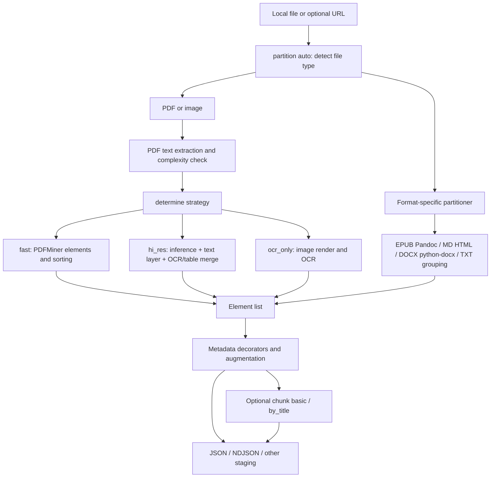
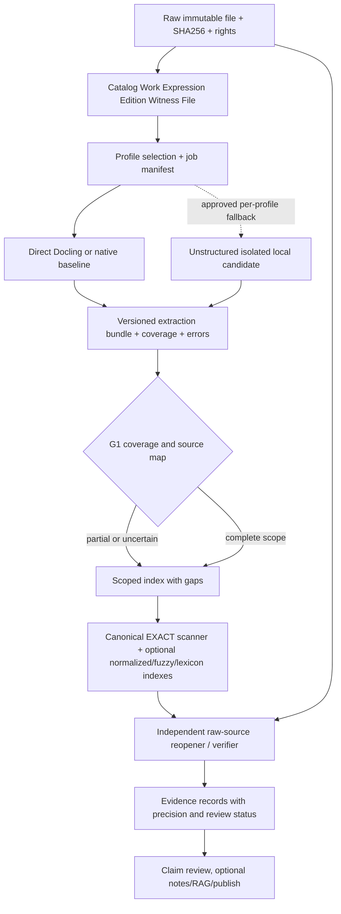

# REPORT 58 — Thẩm định kỹ thuật độc lập Unstructured cho BodhiAtlas

**Ngày:** 25/11/2026 · **Đối tượng:** `Unstructured-IO/unstructured` OSS Python · **Phạm vi:** tiền xử lý tài liệu local, không đánh giá SaaS như tính năng OSS.  
**Snapshot:** `2653935aa783e72b89b345cf63a74324962cdd75` (0.27.38) · **BodhiAtlas:** `c5dfe50613dfd492407bf1db1061c1cfc9d30e8e`.  
**Trạng thái R2 — bổ sung thực nghiệm:** thẩm định tĩnh + 4 phép thử logic ban đầu + chạy 2 module upstream nguyên bản (kiểm Git blob SHA, strategy có mock dependency) + thí nghiệm dependency thực trên PDF/EPUB và 8 lượt OCR đa ngữ. **Chưa cài/chạy toàn package Unstructured hoặc Docling; chưa benchmark head-to-head.** Không sửa repository; không gửi tài liệu hay tải weights.

## 1. Executive Decision

**Khuyến nghị chính: `DEFER` đưa Unstructured vào dependency V1; chọn D — direct Docling + parser native theo format, giữ Unstructured là challenger POC có phạm vi.** Vai trò có thể nâng lên `USE AS COMPONENT` cho một profile cụ thể (B), không mặc định thay toàn bộ parser hay làm authority của chứng cứ. D ở đây là baseline cần kiểm nghiệm, không phải tuyên bố Docling đã đạt G1/G2 hay đã được duyệt production. Confidence **MEDIUM** về quyết định đầu tư, **HIGH** về các giới hạn contract tĩnh đã chỉ ra, **LOW** về chất lượng OCR, tốc độ và TCO tương đối.

Lý do không chọn A ngay: Unstructured thực sự có routing, layout/OCR, element types, metadata và JSON; có thể rút ngắn demo đa định dạng. Nhưng phần việc khó nhất của BodhiAtlas là bảo toàn file/ấn bản/revision, kiểm coverage, nối locator độc lập và vét mọi occurrence. Đổi parser không làm những trách nhiệm ấy biến mất. Đặc biệt, TXT/MD/EPUB đi qua thao tác phân đoạn hoặc chuyển đổi, PDF auto chọn ở cấp tài liệu, chunking có overlap và có thể bỏ `orig_elements` ở một số split lớn. Đây là các rủi ro được thấy từ mã, không phải số liệu lỗi trên corpus.

| Ba blocker trước production | Bằng chứng | POC quyết định |
|---|---|---|
| 1. G1: danh sách element không phải manifest coverage; PDF có text ở một trang có thể được chọn fast cả file, fallback phụ thuộc dependency | E05–E09 | TC02/03/04: mixed PDF, blank và scan, cột và phủ định |
| 2. G2: bbox block và text đã xử lý không phải offset nguồn; EPUB qua Pandoc; ID không gắn hash file/revision | E10–E16, E20 | TC05/07/10/13/15: viewer roundtrip, edition và revision, zero false VERIFIED |
| 3. Chi phí bổ sung và an toàn: extras/binary/model/telemetry; không có số đo lợi ích so với baseline | E02–E04, E21–E23 | TC01/16: một môi trường pinned, so đúng profile với Docling/native, deny egress |

**Spike ít nhất:** chọn một PDF 3 trang mixed, một PDF hai cột text và một EPUB hai spine. Trước hết làm oracle, chạy direct native/Docling baseline và Unstructured fast/auto, không cài hi_res weights nếu chưa thấy lợi ích. Nếu thiếu trang không thể phát hiện hoặc locator không thể ánh xạ bằng extension nhỏ, dừng profile; giữ parser output như ứng viên nếu còn hữu ích. Nếu chỉ cần format nhẹ, thử HTML/DOCX có cấu trúc trước; TXT/MD/TEI/Bilara ưu tiên đọc trực tiếp. Không fork, không thêm server, không mua SaaS để hoàn thành V1.

**Ngưỡng đảo:** một profile của Unstructured chỉ được thay baseline khi G1/G2 trong scope đạt, all-occurrence ở canonical gold đủ, không có wrong-file/edition hay false VERIFIED, không phát sinh egress trái phép, và đo được ít công mapping/triển khai/bảo trì hơn hoặc giải quyết một lớp tài liệu baseline không đạt với chi phí chấp nhận được. Nếu không, DEFER tiếp. V2 có thể thử chunking phục vụ semantic, không dùng chunk làm chứng cứ; V3 chỉ xem xét workflow tích hợp khi có nhu cầu cụ thể.

**Bổ sung R2 — tác động đến quyết định:** 2 module upstream thực sự được chạy cô lập: `coordinates.py` và `strategies.py` (6 case mock dependency, 1 phép chuyển tọa độ khứ hồi và 1 counterexample crop offset). PDF 3 trang tự tạo cho thấy PDFMiner giữ thứ tự cột ở trang chữ, hai trang scan/blank đều không có text; upstream router với cờ any-text chọn fast. Pandoc sandbox giữ hai câu trùng nhưng làm mất ID đoạn và đường dẫn đầy đủ; Tesseract 5.5.0 OCR sai dấu Pāli/Việt, sai chữ Hán và thêm codepoint zero-width ở Sanskrit trong fixture nhỏ. Đây là lý do tăng ưu tiên **native locators + page inventory + OCR candidate**, không phải bằng chứng Unstructured có chất lượng OCR kém hơn Docling. Không thay recommendation DEFER: nâng `USE AS COMPONENT` chỉ khi có profile thắng baseline qua TC16. Bổ sung bản đồ hàm/module → tầng BodhiAtlas → cách lấy → phần phải viết → điều kiện dừng (§8.1), thực nghiệm (§9.7), log và runner (§13.5). Confidence về các phản ví dụ cục bộ tăng; production/TCO vẫn LOW.

## 2. Sources & Evidence Ledger

### 2.1. Snapshot, access và phương pháp

| Nguồn | Định danh đã kiểm | Phạm vi |
|---|---|---|
| [Unstructured GitHub](https://github.com/Unstructured-IO/unstructured) | Owner `Unstructured-IO` (Organization), public, default branch `main`, [HEAD](https://github.com/Unstructured-IO/unstructured/commit/2653935aa783e72b89b345cf63a74324962cdd75), 24/11/2026 20:03:59 UTC | GitHub connector đọc file theo SHA, directory listing, commit, release; không clone được từ sandbox |
| [Release 0.27.38](https://github.com/Unstructured-IO/unstructured/releases/tag/0.27.38) | API release published 24/11/2026 21:10:09 UTC; tag resolve cùng HEAD; [version file](https://github.com/Unstructured-IO/unstructured/blob/2653935aa783e72b89b345cf63a74324962cdd75/unstructured/__version__.py#L1) | [PyPI 0.27.38](https://pypi.org/project/unstructured/0.27.38/) có wheel/sdist ngày 24/11 và provenance cùng SHA; chưa tải/kiểm digest hay cài. Trang releases được index cũ còn hiển thị 0.27.37, không lấy đó thay API tag/PyPI mới hơn |
| [BodhiAtlas](https://github.com/quoctran-2608/bodhi-atlas) | Public, `main`, [HEAD](https://github.com/quoctran-2608/bodhi-atlas/commit/c5dfe50613dfd492407bf1db1061c1cfc9d30e8e), 25/11/2026 11:26:47 UTC | Đọc 5 văn bản và 10 báo cáo đối chứng tại snapshot; trích đoạn tập trung vào phần quyết định và hợp đồng, chưa tái kiểm tất cả upstream đối chứng |
| Môi trường thử | Linux 6.18.57 x86_64/glibc 2.41, Python 3.13.5, SQLite 3.46.1; 5 CPU logic hiển thị, Xeon Platinum 8573C, MemTotal 6.090.668 kB; GPU UNKNOWN (không thấy `nvidia-smi`) | `unstructured` và `docling` không cài; DNS GitHub thất bại; không cố tải package/model; Python stdlib chạy được |

Phân loại: `[DOC]` nội dung tài liệu thực đọc; `[CODE]` mã/test thực đọc (không mặc nhiên chạy); `[TESTED]` chạy upstream/integration đầy đủ có log — **0/16**; `[TESTED-MODULE]` (R2) chạy đúng blob upstream độc lập, không phải package end-to-end; `[TESTED-DEPENDENCY]` (R2) chạy trực tiếp dependency/native reader đã cài, không đại diện output partition; `[TESTED-ISOLATED]` phép kiểm Python độc lập, không phải upstream; `[ISSUE]` báo lỗi người khác (không có claim dựa vào issue riêng chưa đọc); `[PLAN]` chưa chạy; `[INFERRED]` suy luận có tiền đề; `[UNKNOWN]` chưa đủ dữ kiện; `[CONFLICT]` mâu thuẫn có scope. Không xếp điểm dựa sao, số format quảng cáo, ví dụ đẹp hay benchmark khác domain. Không gửi corpus vào GitHub/API. Giới hạn: không có clone, lockfile/model card đầy đủ, không chạy weights, chưa audit mọi converter; đọc chọn lọc file dài theo hàm/đoạn liên quan, không tuyên bố review từng dòng repo.

### 2.2. Ledger claim có thể truy ngược

| ID | Loại | Claim tại snapshot và nguồn dòng/hàm | Giới hạn |
|---|---|---|---|
| E01 | DOC/CODE | [README L112–128,139–176](https://github.com/Unstructured-IO/unstructured/blob/2653935aa783e72b89b345cf63a74324962cdd75/README.md#L112-L176), [version](https://github.com/Unstructured-IO/unstructured/blob/2653935aa783e72b89b345cf63a74324962cdd75/unstructured/__version__.py#L1): local Python package và extras; không cần platform SaaS cho các đường parser local đã đọc | Chưa install; không suy SaaS feature vào OSS |
| E02 | CODE | [pyproject L4–22,53–143](https://github.com/Unstructured-IO/unstructured/blob/2653935aa783e72b89b345cf63a74324962cdd75/pyproject.toml#L4-L143): Python >=3.11,<3.14, khai báo Apache-2.0, extras theo format; inference/ingest có dependency riêng, marker theo nền tảng | Chưa resolve dependency theo OS/wheel; lockfile tồn tại, chưa audit toàn bộ |
| E03 | DOC | [LICENSE.md L1–202](https://github.com/Unstructured-IO/unstructured/blob/2653935aa783e72b89b345cf63a74324962cdd75/LICENSE.md): Apache-2.0 cho project; quyền tái phân phối có điều kiện | Không bao hàm model, OCR language data, corpus hay cloud contract |
| E04 | CODE | [telemetry.py L25,144–169,516–561](https://github.com/Unstructured-IO/unstructured/blob/2653935aa783e72b89b345cf63a74324962cdd75/unstructured/telemetry.py#L144-L169) và [utils.py L187–235](https://github.com/Unstructured-IO/unstructured/blob/2653935aa783e72b89b345cf63a74324962cdd75/unstructured/utils.py#L187-L235): startup/runtime telemetry tới `packages.unstructured.io/python-telemetry`; opt-out DO_NOT_TRACK hoặc SCARF_NO_ANALYTICS nonempty | Chưa packet capture; không khẳng định có truyền nội dung sách; local không đồng nghĩa không mạng |
| E05 | CODE | [auto.py L147–225](https://github.com/Unstructured-IO/unstructured/blob/2653935aa783e72b89b345cf63a74324962cdd75/unstructured/partition/auto.py#L147-L225): detect filetype hoặc URL; augment url/data_source/filetype, mặc định skip infer table ở PDF và một số ảnh | URL không được phép dùng trong worker ingest private; metadata không phải authority |
| E06 | CODE | [auto.py L227–284](https://github.com/Unstructured-IO/unstructured/blob/2653935aa783e72b89b345cf63a74324962cdd75/unstructured/partition/auto.py#L227-L284): dispatch PDF/image, JSON/NDJSON riêng, EMPTY trả `[]` | `[]` không tự nói blank hợp lệ hay lỗi; format native khác cần kiểm riêng |
| E07 | CODE | [strategies.py L8–84,104–126](https://github.com/Unstructured-IO/unstructured/blob/2653935aa783e72b89b345cf63a74324962cdd75/unstructured/partition/strategies.py#L8-L84), [auto strategy](https://github.com/Unstructured-IO/unstructured/blob/2653935aa783e72b89b345cf63a74324962cdd75/unstructured/partition/strategies.py#L104-L126): hi_res nếu cần table/image, fast nếu text extractable, ocr_only nếu không; image auto hi_res; fallback do dependency | Không phải per-page coverage; fast image không hợp lệ |
| E08 | CODE | [pdf.py L338–394](https://github.com/Unstructured-IO/unstructured/blob/2653935aa783e72b89b345cf63a74324962cdd75/unstructured/partition/pdf.py#L338-L394): `any(_has_text_element(...))` trên các trang; prepass exception log rồi bỏ text extraction; explicit fast vượt decoding limit raise | Suy luận mixed PDF có nguy cơ thiếu scan; chưa test actual |
| E09 | CODE | [pdf.py L405–466](https://github.com/Unstructured-IO/unstructured/blob/2653935aa783e72b89b345cf63a74324962cdd75/unstructured/partition/pdf.py#L405-L466): default eng nếu languages None; ba đường trả elements; actual strategy ghi qua telemetry hook; [pdf L1605–1743](https://github.com/Unstructured-IO/unstructured/blob/2653935aa783e72b89b345cf63a74324962cdd75/unstructured/partition/pdf.py#L1605-L1743) sorting và OCR qua image | Chưa chứng minh trường output ổn định báo actual strategy hay typed per-page errors; không sử dụng telemetry để lấy provenance |
| E10 | CODE | [pdf.py L574–739](https://github.com/Unstructured-IO/unstructured/blob/2653935aa783e72b89b345cf63a74324962cdd75/unstructured/partition/pdf.py#L574-L739): enumerate từ starting_page_number, PDFMiner page layout, PixelSpace, clean whitespace, page metadata; [sorting.py L99–185](https://github.com/Unstructured-IO/unstructured/blob/2653935aa783e72b89b345cf63a74324962cdd75/unstructured/partition/utils/sorting.py#L99-L185): BASIC/XY-cut | PDF text bbox là region/layout; không bảo đảm char range, đọc cột hay trang in |
| E11 | CODE | [coordinates.py L7–109](https://github.com/Unstructured-IO/unstructured/blob/2653935aa783e72b89b345cf63a74324962cdd75/unstructured/documents/coordinates.py#L7-L109): chiều và hướng screen/cartesian, chuyển qua relative; [elements.py L55–104,787–814](https://github.com/Unstructured-IO/unstructured/blob/2653935aa783e72b89b345cf63a74324962cdd75/unstructured/documents/elements.py#L55-L104), [convert](https://github.com/Unstructured-IO/unstructured/blob/2653935aa783e72b89b345cf63a74324962cdd75/unstructured/documents/elements.py#L787-L814) | Scale/flip đơn thuần không xử lý đầy đủ crop offset, rotation và renderer matrix |
| E12 | CODE | [elements.py L149–223,381–472](https://github.com/Unstructured-IO/unstructured/blob/2653935aa783e72b89b345cf63a74324962cdd75/unstructured/documents/elements.py#L149-L223), [serialize](https://github.com/Unstructured-IO/unstructured/blob/2653935aa783e72b89b345cf63a74324962cdd75/unstructured/documents/elements.py#L381-L472): optional metadata, orig_elements, page, parent, languages, html; field ad-hoc không mặc định serialize | Không hứa mọi trường có ở mọi mode; không thấy contract raw byte/char spans, edition/revision |
| E13 | CODE | [elements.py L816–843](https://github.com/Unstructured-IO/unstructured/blob/2653935aa783e72b89b345cf63a74324962cdd75/unstructured/documents/elements.py#L816-L843): id_to_hash dùng filename+text+page+sequence, cắt SHA256 còn 32 hex; property id sinh UUID nếu chưa có | Không phải hash raw file; cùng nội dung ở hai ấn bản hoặc khác profile có thể trùng; ID thay đổi cũng không tự stale |
| E14 | CODE | [epub.py L27–64](https://github.com/Unstructured-IO/unstructured/blob/2653935aa783e72b89b345cf63a74324962cdd75/unstructured/partition/epub.py#L27-L64), [file_conversion.py L14–26,60–82](https://github.com/Unstructured-IO/unstructured/blob/2653935aa783e72b89b345cf63a74324962cdd75/unstructured/file_utils/file_conversion.py#L60-L82): Pandoc -> HTML -> partition_html, metadata tên file/type | Không có explicit mapping từ output về OPF spine/href/CFI trong đường này; không khẳng định mọi anchor bị mất |
| E15 | CODE | [docx.py L155–199,299–318,406–434](https://github.com/Unstructured-IO/unstructured/blob/2653935aa783e72b89b345cf63a74324962cdd75/unstructured/partition/docx.py#L299-L318), [iter document](https://github.com/Unstructured-IO/unstructured/blob/2653935aa783e72b89b345cf63a74324962cdd75/unstructured/partition/docx.py#L406-L434): iter section/body, có page counter nhưng None khi không biết rendered break | Không tự suy page in; native paragraph/note locator và footnote coverage chưa chứng minh |
| E16 | CODE | [text.py L73–110,220–223](https://github.com/Unstructured-IO/unstructured/blob/2653935aa783e72b89b345cf63a74324962cdd75/unstructured/partition/text.py#L73-L110), [md.py L121–138](https://github.com/Unstructured-IO/unstructured/blob/2653935aa783e72b89b345cf63a74324962cdd75/unstructured/partition/md.py#L121-L138), [html/partition.py L218–293](https://github.com/Unstructured-IO/unstructured/blob/2653935aa783e72b89b345cf63a74324962cdd75/unstructured/partition/html/partition.py#L218-L293): grouping/strip, Markdown→HTML, HTML v1/v2 | Các đường biến đổi không thay thế raw-byte or DOM range map |
| E17 | CODE | [basic.py L24–104](https://github.com/Unstructured-IO/unstructured/blob/2653935aa783e72b89b345cf63a74324962cdd75/unstructured/chunking/basic.py#L24-L104), [title.py L23–118](https://github.com/Unstructured-IO/unstructured/blob/2653935aa783e72b89b345cf63a74324962cdd75/unstructured/chunking/title.py#L23-L118): basic/by_title, char/token options, overlap, orig_elements; title grouping có multipage | Chunks là derived representation, không phải occurrence authority |
| E18 | CODE | [chunking/base.py L45–57,247–302,439–452](https://github.com/Unstructured-IO/unstructured/blob/2653935aa783e72b89b345cf63a74324962cdd75/unstructured/chunking/base.py#L45-L57), [options](https://github.com/Unstructured-IO/unstructured/blob/2653935aa783e72b89b345cf63a74324962cdd75/unstructured/chunking/base.py#L247-L302), [validation](https://github.com/Unstructured-IO/unstructured/blob/2653935aa783e72b89b345cf63a74324962cdd75/unstructured/chunking/base.py#L439-L452): cap 1.000.000 chars tổng text/HTML/image cho oversized split orig_elements, overlap validation | Giới hạn có chủ ý giảm phình output; mất metadata nguồn ở split lớn là counterexample cho bảo đảm chung H06 |
| E19 | CODE | [elements.py L511–587](https://github.com/Unstructured-IO/unstructured/blob/2653935aa783e72b89b345cf63a74324962cdd75/unstructured/documents/elements.py#L511-L587), [staging/base.py L170–280,420–428,591–615](https://github.com/Unstructured-IO/unstructured/blob/2653935aa783e72b89b345cf63a74324962cdd75/unstructured/staging/base.py#L170-L280), [JSON](https://github.com/Unstructured-IO/unstructured/blob/2653935aa783e72b89b345cf63a74324962cdd75/unstructured/staging/base.py#L591-L615): consolidation, gzip+base64 orig elements, reconstruct, precision adjustment ở export | Roundtrip element != roundtrip source; kiểm actual precision/field loss và cap giải nén |
| E20 | CODE | [image.py L15–37,52–70](https://github.com/Unstructured-IO/unstructured/blob/2653935aa783e72b89b345cf63a74324962cdd75/unstructured/partition/image.py#L15-L70), [pdf.py L1208–1236,1319–1348,1488–1530](https://github.com/Unstructured-IO/unstructured/blob/2653935aa783e72b89b345cf63a74324962cdd75/unstructured/partition/pdf.py#L1208-L1236), [OCR](https://github.com/Unstructured-IO/unstructured/blob/2653935aa783e72b89b345cf63a74324962cdd75/unstructured/partition/pdf_image/ocr.py#L37-L106): hi_res local inference, rotation correction, kết hợp text layer/OCR/table | Code xử lý rotation là điểm cộng, không chứng minh viewer transform cho mọi CropBox/MediaBox |
| E21 | CODE | [ocr_interface.py L28–54,74–97](https://github.com/Unstructured-IO/unstructured/blob/2653935aa783e72b89b345cf63a74324962cdd75/unstructured/partition/utils/ocr_models/ocr_interface.py#L28-L54), [tesseract_ocr.py L41–101,175–198](https://github.com/Unstructured-IO/unstructured/blob/2653935aa783e72b89b345cf63a74324962cdd75/unstructured/partition/utils/ocr_models/tesseract_ocr.py#L41-L101): OCR agent theo config, module whitelist, Tesseract text/layout | Tree còn google_vision_ocr.py/paddle_ocr.py; chưa audit từng backend. Chỉ whitelist local agent đã review ở worker |
| E22 | CODE | [pdf.py L742–825,926–1158](https://github.com/Unstructured-IO/unstructured/blob/2653935aa783e72b89b345cf63a74324962cdd75/unstructured/partition/pdf.py#L742-L825), [complexity](https://github.com/Unstructured-IO/unstructured/blob/2653935aa783e72b89b345cf63a74324962cdd75/unstructured/partition/pdf.py#L926-L1158): page/pixel/decoding limits và complexity heuristics | Có cơ chế bảo vệ thực; chưa thử bomb/timeout/password, không thay OS sandbox |
| E23 | CODE | [PDF test L235–312,647–884,1861–1923](https://github.com/Unstructured-IO/unstructured/blob/2653935aa783e72b89b345cf63a74324962cdd75/test_unstructured/partition/pdf_image/test_pdf.py#L647-L884); [rotation tests](https://github.com/Unstructured-IO/unstructured/blob/2653935aa783e72b89b345cf63a74324962cdd75/test_unstructured/partition/pdf_image/test_pdf.py#L235-L312), [limit tests](https://github.com/Unstructured-IO/unstructured/blob/2653935aa783e72b89b345cf63a74324962cdd75/test_unstructured/partition/pdf_image/test_pdf.py#L1861-L1923): test fast, fallback, rotation, limits | Test source hiện hữu, NOT TESTED; nhiều test dùng monkeypatch, không chứng minh OCR production |
| E24 | CODE | [EPUB tests L12–76](https://github.com/Unstructured-IO/unstructured/blob/2653935aa783e72b89b345cf63a74324962cdd75/test_unstructured/partition/test_epub.py#L12-L76), [DOCX tests L136–329](https://github.com/Unstructured-IO/unstructured/blob/2653935aa783e72b89b345cf63a74324962cdd75/test_unstructured/partition/test_docx.py#L136-L329): assertions text/type/filename, table/header/page; [coordinates tests](https://github.com/Unstructured-IO/unstructured/blob/2653935aa783e72b89b345cf63a74324962cdd75/test_unstructured/documents/test_coordinates.py#L16-L90) | Không thay TC07 native reopen hay scan QA |
| E25 | CODE | [basic tests L124–145,225–304](https://github.com/Unstructured-IO/unstructured/blob/2653935aa783e72b89b345cf63a74324962cdd75/test_unstructured/chunking/test_basic.py#L124-L145), [overlap cases](https://github.com/Unstructured-IO/unstructured/blob/2653935aa783e72b89b345cf63a74324962cdd75/test_unstructured/chunking/test_basic.py#L225-L304): orig elements, overlap negative scenarios, table header repetition option | Không chứng minh every occurrence raw hoặc huge orig_elements retention |
| E26 | DOC | [PRD L105–123,213–254,342–385](https://github.com/quoctran-2608/bodhi-atlas/blob/c5dfe50613dfd492407bf1db1061c1cfc9d30e8e/docs/PRD.md#L105-L123), [citation](https://github.com/quoctran-2608/bodhi-atlas/blob/c5dfe50613dfd492407bf1db1061c1cfc9d30e8e/docs/PRD.md#L213-L254): code-only và provenance; [Core L96–158](https://github.com/quoctran-2608/bodhi-atlas/blob/c5dfe50613dfd492407bf1db1061c1cfc9d30e8e/docs/V1_CORE_FOUNDATION.md#L96-L158) | Chuẩn hệ thống, không phải kết quả của parser |
| E27 | DOC | [Risk handbook L154–190](https://github.com/quoctran-2608/bodhi-atlas/blob/c5dfe50613dfd492407bf1db1061c1cfc9d30e8e/docs/ACADEMIC_RISKS_AND_VERIFICATION.md#L154-L190) G1–G6, T01–T16; [L90–112](https://github.com/quoctran-2608/bodhi-atlas/blob/c5dfe50613dfd492407bf1db1061c1cfc9d30e8e/docs/ACADEMIC_RISKS_AND_VERIFICATION.md#L90-L112) tách trạng thái | Gate phải do host chứng minh |
| E28 | TESTED-ISOLATED | Python fixture TC10/11/12/13/15, log §9 và script §13 | Không import Unstructured; phản ví dụ logic, không tính là upstream pass |
| E29 | INFERRED | E08/E12/E14/E18 + E26/E27: nguồn chuẩn và evidence layer phải độc lập parser; D giảm dependency mặc định | Giả thuyết về TCO, chưa đo adapter code hay benchmark |
| E30 | UNKNOWN | Model weights, model/data licenses, cold/warm performance, actual fallback metadata, source offsets, all format coverage, CVE/SBOM | Chưa quyết quyền phân phối model hay production readiness |

| E31 | TESTED-MODULE | [coordinates.py L12–109](https://github.com/Unstructured-IO/unstructured/blob/2653935aa783e72b89b345cf63a74324962cdd75/unstructured/documents/coordinates.py#L12-L109), Git blob `903a7d61a4655ade6e1fd9ec60d4cdefbd4f3481` verified; screen→point→screen đúng; crop translation không thuộc API | Thực thi nguyên module stdlib, gold synthetic; chưa viewer roundtrip full PDF |
| E32 | TESTED-MODULE | [strategies.py L24–126](https://github.com/Unstructured-IO/unstructured/blob/2653935aa783e72b89b345cf63a74324962cdd75/unstructured/partition/strategies.py#L24-L126), Git blob `51f4c6a0e405294f89cd767ad1a51657836be515` verified; 6/6 expected strategy/exception | Mock đúng constants/logger/dependency_exists; không chạy partition_pdf, không chứng minh dependency load thật |
| E33 | TESTED-DEPENDENCY | PDFMiner 20251230 + PyMuPDF 1.26.7 đọc PDF mixed tự tạo: text page 1, không có text trang 2 scan và 3 blank; page inventory phân biệt image count | Không phải Unstructured FAST; PDFMiner high-level default khác upstream config; không khẳng định mọi layout |
| E34 | TESTED-DEPENDENCY | [file_conversion.py L13–21,60–81](https://github.com/Unstructured-IO/unstructured/blob/2653935aa783e72b89b345cf63a74324962cdd75/unstructured/file_utils/file_conversion.py#L13-L21): chạy trực tiếp `pypandoc.convert_file(..., 'html', format='epub', sandbox=True)` với bản local; mất native href đầy đủ và id đoạn trên fixture hai spine, giữ 2 câu | Không chạy partition_html; bản Pandoc local 3.1.11.1 (không xác nhận version wheel bundled), không tổng quát mọi EPUB |
| E35 | TESTED-DEPENDENCY | [Tesseract agent L41–57](https://github.com/Unstructured-IO/unstructured/blob/2653935aa783e72b89b345cf63a74324962cdd75/unstructured/partition/utils/ocr_models/tesseract_ocr.py#L41-L57); direct Tesseract 5.5.0, 8 lượt OCR fixture sạch/rotate/đa script, gold và log §9.7/13.5 | Direct CLI psm 6/7, không upstream wrapper/preprocessing; không phải CER corpus |
| E36 | CODE | [Google Vision OCR agent L19–55](https://github.com/Unstructured-IO/unstructured/blob/2653935aa783e72b89b345cf63a74324962cdd75/unstructured/partition/utils/ocr_models/google_vision_ocr.py#L19-L55) tạo client và gửi PNG bytes trong `document_text_detection` khi chọn agent này; [constants L17–21](https://github.com/Unstructured-IO/unstructured/blob/2653935aa783e72b89b345cf63a74324962cdd75/unstructured/partition/utils/constants.py#L17-L21) strategy strings | Không gọi cloud; opt-out telemetry không vô hiệu hóa cloud OCR; whitelist local-only bắt buộc |
| E37 | CODE | [elements.py L539–587](https://github.com/Unstructured-IO/unstructured/blob/2653935aa783e72b89b345cf63a74324962cdd75/unstructured/documents/elements.py#L539-L587): metadata merge drop coordinates, parent_id, detection_origin, link_start_indexes; page_number FIRST; [metadata.py L191–220](https://github.com/Unstructured-IO/unstructured/blob/2653935aa783e72b89b345cf63a74324962cdd75/unstructured/partition/common/metadata.py#L191-L220) decorator docstring nhắc SHA1, thực tế E13 SHA256 truncated | CONFLICT docstring vs implementation; chunk metadata không phải source map, giữ từng element ngoài chunk |

### 2.3. Đối chứng đọc từ GitHub

Tất cả tên dưới đây đã fetch thành công tại commit BodhiAtlas nói trên. Đây là **báo cáo nguồn thứ cấp**, không nhập lại kết quả test của tác giả như tự chạy. Đã đọc trọng tâm kết luận/ledger và phần contract liên quan; không tái audit các repository đối chứng trong P58.

| Tài liệu | Điểm đối chứng có tác động quyết định |
|---|---|
| [PRD v1.4](https://github.com/quoctran-2608/bodhi-atlas/blob/c5dfe50613dfd492407bf1db1061c1cfc9d30e8e/docs/PRD.md) | Mục 4–5: literal search, provenance; §7 kiến trúc và nghiệm thu |
| [V1_CORE_FOUNDATION](https://github.com/quoctran-2608/bodhi-atlas/blob/c5dfe50613dfd492407bf1db1061c1cfc9d30e8e/docs/V1_CORE_FOUNDATION.md) | §2–3 raw→map→deterministic retrieval, phiếu chứng cứ, không ép AI |
| [ACADEMIC_RISKS_AND_VERIFICATION](https://github.com/quoctran-2608/bodhi-atlas/blob/c5dfe50613dfd492407bf1db1061c1cfc9d30e8e/docs/ACADEMIC_RISKS_AND_VERIFICATION.md) | §5–6 G1–G6/T01–T16; R04/R07/R08 chống silent redirect và normalize nhầm |
| [Research README](https://github.com/quoctran-2608/bodhi-atlas/blob/c5dfe50613dfd492407bf1db1061c1cfc9d30e8e/research/technology-assessments/README.md) | Danh mục 57 đề tài; phân biệt component với evidence core; báo cáo không đồng nghĩa adoption |
| [REPORT_TEMPLATE](https://github.com/quoctran-2608/bodhi-atlas/blob/c5dfe50613dfd492407bf1db1061c1cfc9d30e8e/research/technology-assessments/REPORT_TEMPLATE.md) | 10 phần gốc; P58 triển khai chi tiết 13 phần |
| [P12 Docling L14–27](https://github.com/quoctran-2608/bodhi-atlas/blob/c5dfe50613dfd492407bf1db1061c1cfc9d30e8e/research/technology-assessments/REPORT_12_DOCLING.md#L14-L27) | Báo cáo trước chọn component có điều kiện, EPUB mapping vẫn là risk; baseline không phải chuẩn vàng |
| [P45 MinerU L10–25](https://github.com/quoctran-2608/bodhi-atlas/blob/c5dfe50613dfd492407bf1db1061c1cfc9d30e8e/research/technology-assessments/REPORT_45_MINERU.md#L10-L25) | Nhánh PDF OCR trial; Doclib FTS cap/ranking không là exhaustive EXACT |
| [P46 Marker L9–19](https://github.com/quoctran-2608/bodhi-atlas/blob/c5dfe50613dfd492407bf1db1061c1cfc9d30e8e/research/technology-assessments/REPORT_46_MARKER_DATALAB.md#L9-L19) | PDF layout component; block polygon chưa là char spans, model license khác code |
| [P47 GROBID L11–26](https://github.com/quoctran-2608/bodhi-atlas/blob/c5dfe50613dfd492407bf1db1061c1cfc9d30e8e/research/technology-assessments/REPORT_47_GROBID.md#L11-L26) | Article/reference TEI, không universal parser; OCR ngoài |
| [P52 olmOCR L13–23](https://github.com/quoctran-2608/bodhi-atlas/blob/c5dfe50613dfd492407bf1db1061c1cfc9d30e8e/research/technology-assessments/REPORT_52_OLMOCR.md#L13-L23), [L89–99](https://github.com/quoctran-2608/bodhi-atlas/blob/c5dfe50613dfd492407bf1db1061c1cfc9d30e8e/research/technology-assessments/REPORT_52_OLMOCR.md#L89-L99) | Fallback OCR, page text spans không bbox |
| [P53 Xberg/Kreuzberg L12–30](https://github.com/quoctran-2608/bodhi-atlas/blob/c5dfe50613dfd492407bf1db1061c1cfc9d30e8e/research/technology-assessments/REPORT_53_XBERG_KREUZBERG.md#L12-L30) | Multi-format challenger local, gate chưa chứng minh |
| [P56 Open Notebook L13–29](https://github.com/quoctran-2608/bodhi-atlas/blob/c5dfe50613dfd492407bf1db1061c1cfc9d30e8e/research/technology-assessments/REPORT_56_OPEN_NOTEBOOK.md#L13-L29), [L71](https://github.com/quoctran-2608/bodhi-atlas/blob/c5dfe50613dfd492407bf1db1061c1cfc9d30e8e/research/technology-assessments/REPORT_56_OPEN_NOTEBOOK.md#L71) | Content Core wrapper có nguy cơ mất typed mapping; direct parser là baseline ít lớp hơn |
| [P57 Book Memex L11–22](https://github.com/quoctran-2608/bodhi-atlas/blob/c5dfe50613dfd492407bf1db1061c1cfc9d30e8e/research/technology-assessments/REPORT_57_BOOK_MEMEX.md#L11-L22) | Reader/locator hữu ích nhưng không thay catalog/occurrence/revision |
| [P39-R2 L7–17](https://github.com/quoctran-2608/bodhi-atlas/blob/c5dfe50613dfd492407bf1db1061c1cfc9d30e8e/research/technology-assessments/REPORT_39_BANG_HA_GIAC_NGO_INDEPENDENT_REVIEW.md#L7-L17) | Bang-ha corpus/adapter; độc lập verify; không lấy claim ledger thay G2 |
| [BCR Evidence Engine L65–88](https://github.com/quoctran-2608/bodhi-atlas/blob/c5dfe50613dfd492407bf1db1061c1cfc9d30e8e/research/technology-assessments/REPORT_BCR_EVIDENCE_ENGINE.md#L65-L88) | Resolver/gate đáng thử reuse; chưa chứng minh exhaustive occurrence search |

## 3. Architecture & Data Flow

### 3.1. Kiến trúc upstream — theo đường code thực tế (E05–E25)



Sơ đồ ở mức call path, không ngụ ý mọi decorator luôn chạy sau mọi chunk: từng partitioner có decorator riêng; auto gọi direct rồi augment. `partition()` nhận filename/file/URL; detect_filetype, chọn loader, áp option chung; direct entrypoint phù hợp khi cần kiểm profile. `partition_pdf()` chuyển vào `partition_pdf_or_image()`. Hàm chuẩn bị PDFMiner config, complexity và extractable flag; quyết strategy, rồi gọi `_partition_pdf_with_pdfparser`, `_partition_pdf_or_image_local` hoặc `_partition_pdf_or_image_with_ocr`. Ở hi_res, inference sinh layout, text layer và OCR bổ sung/merge; render và model là dependency, không phải một dịch vụ mặc định bắt buộc. `partition_image` chia sẻ PDF/image pipeline. EPUB gọi Pandoc rồi HTML; DOCX duyệt OOXML thông qua python-docx; HTML parser hai version; TXT grouping/strip; MD render HTML. Staging chuyển element list thành dict/JSON/NDJSON/MD; chunking tùy chọn. Telemetry là side effect cần tắt/chặn, không phải nguồn coverage.

Data model: `Element` có `id`, `metadata`, subtype `Text`, `Title`, `NarrativeText`, `ListItem`, `Table`, `Header`, `Footer`, `PageBreak`, `FigureCaption`…; `ElementMetadata` chứa trường tùy chọn về trang, tọa độ, hierarchy, ngôn ngữ, tên file, table HTML, source metadata, orig_elements. `CoordinatesMetadata` mang points và hệ tọa độ. Đây là element-centric representation, tốt cho preprocessing, không phải ontology Work/Expression/Edition/Witness. Không thấy authority catalog, snapshot chứng cứ hay verified status trong đường list output đã kiểm.

### 3.2. Kiến trúc đề xuất — một authority, nhiều profile có thể thay



| Thành phần | Owner và bất biến |
|---|---|
| Original bytes, file identity, rights | BodhiAtlas catalog/object store; immutable SHA256, chỉ đọc trong worker |
| Extraction output | Extractor tạo candidate; host pin version, model assets, effective profile, revision, raw hash, manifest; lưu unchunked output |
| Canonical text và map | Host adapter; phân biệt raw text layer, OCR transcription, normalized derivative và AI content; mỗi span có scope/role |
| Index | Host/reuse BCR nếu contract phù hợp; SQLite + scanner, index rebuild được, không phải evidence authority |
| Evidence verification | Independent source reader/resolver + human scan review; không tin lại index/chunk là kiểm chứng độc lập |
| Claim/lexicon/publish | Host academic review; optional V2/V3 semantic/notes đọc evidence một chiều |

Không thêm queue server, graph DB, microservice, vector DB vì parser này. Nếu conflict native libs thì subprocess/venv offline với JSON artifact là biên đơn giản nhất. Quyền sở hữu raw/derived/index/evidence không đổi khi parser swap.

## 4. Fit–Gap C01–C15

Scope: đánh giá OSS local như extractor/optional chunker. `NATIVE` có mã không nghĩa đã pass; `CONFIG` cần thiết lập; `EXTENSION` cần adapter; `EXTERNAL` do lớp khác thực hiện; `MISSING` contract cần cho vai trò nhưng không thấy; `UNKNOWN` chưa đủ; `N/A` ngoài vai trò. Effort L/M/H/VH là tương đối về phần host còn thiếu (không nhân-ngày, không cộng điểm); `—` nếu N/A. V1 ưu tiên G1/G2; V2/V3 là tùy chọn.

| ID | Năng lực / giai đoạn | Trạng thái theo role | Bằng chứng | Gap / owner | Effort | Gate | Test |
|---|---|---|---|---|---|---|---|
| C01 | Multi-format ingest V1 | NATIVE + CONFIG | E01/02/05/06/14–16 | Host router, extras, format rights; TEI/Bilara direct | M | G1 | TC01/07–09/14 |
| C02 | OCR/layout/reading order V1 | NATIVE + CONFIG | E07–11/20/21 | Profile/language, gold, per-page review, model license | H | G1/G2 | TC02–06/12 |
| C03 | Canonical text & source map V1 | EXTENSION + MISSING (raw span contract) | E10–19 | Host offsets, native locator, transform, mapping qua thay đổi text | H | G1/G2 | TC05/07–09/11/15 |
| C04 | Work/Edition/Witness V1 | EXTERNAL | E12/13/26 | Catalog giữ file hash và scholarly relation; extractor không authority | M | G1/G2/G4 | TC10/13 |
| C05 | Exhaustive EXACT V1 | N/A (parser), EXTERNAL hệ thống | E17/18/26/28 | Scanner all occurrences, không top-K/chunk; host/BCR extension | M | G2 | TC11/12/15 |
| C06 | Normalized multilingual V1 | EXTERNAL; language metadata NATIVE | E09/12/21 | Host normalization reversible map, label, unicode tests | H | G2/G5 | TC03/12 |
| C07 | Fuzzy retrieval V1 | N/A; EXTERNAL | E26 | Host candidate retrieval + explain difference | M | G2 | T03/T04 |
| C08 | Sense-aware lexicon V1/V2 | N/A; EXTERNAL | E26/27 | Lexicon sense + curator + evidence | H | G5 | T05/T06 |
| C09 | Semantic/RAG V2/V3 | N/A retrieval; NATIVE chunk preparation | E17–19 | Optional embeddings elsewhere; not authority | M | G3 | TC11/T12 |
| C10 | Verified citation/reopen V1 | EXTENSION; verifier EXTERNAL | E10–16/20 | Independent raw viewer and quote check, precision/status; host | H | G2 | TC05/07/10/13/15 |
| C11 | Wiki/notes/claims V2/V3 | N/A; EXTERNAL | E27 | Host reviewer; claim context and dissent | H | G3/G6 | T08/T09/T14/T15 |
| C12 | APIs/MCP/export V1/V2 | NATIVE Python/JSON; MCP N/A | E05/19 | Typed host adapter and read-only API if needed; SaaS excluded | L–M | G1/G2 | TC01/11/15 |
| C13 | Coverage/incremental V1 | MISSING typed coverage in examined return path; EXTERNAL incremental | E06–09/22 | Page manifest, retries, job idempotence, extraction revision, stale | H | G1/G2 | TC04/13/14 |
| C14 | Auth/privacy/license/backup V1 | CONFIG + EXTERNAL + UNKNOWN model rights | E02–04/21/22/30 | Host authorization, deny egress, SBOM, rights and restore | H | G4/G6 | TC01/14/T16 |
| C15 | Operability/portability V1 | CONFIG + UNKNOWN measured | E01/02/22 | Version/asset lock, CPU env, logs, retry, resource cap | M–H | G1/G4 | TC01/14/16 |

### Gates tách riêng (không chấm điểm trung bình)

| Gate | Đánh giá extractor | Trạng thái hệ thống P58 |
|---|---|---|
| G1 ingest | `CODE GAP`: list elements, warnings và giới hạn không đủ manifest per-page/region | `NOT DEMONSTRATED` TC04/14/15 chưa chạy |
| G2 citation | `CODE GAP` đối với raw locator/identity/independent verifier; bbox chỉ candidate | `NOT DEMONSTRATED`; OCR review và raw reopen chưa test |
| G3 claim | `N/A` | `NOT DEMONSTRATED`; host human review |
| G4 external | `N/A` quản trị quyền/nguồn; worker egress CONFIG | `NOT DEMONSTRATED` rights/security audit chưa đủ |
| G5 lexicon | `N/A` | `NOT DEMONSTRATED`; sense-level evidence host |
| G6 publish | `N/A` | `NOT DEMONSTRATED`; không xuất VERIFIED theo parser |

Không có gate production PASS; không ghi FAIL do chưa có upstream test thất bại. `CODE GAP` khác `FAIL` runtime. Các thử nghiệm cô lập đạt oracle của chính chúng không nâng gate.

## 5. Deep Technical Findings

### 5.1. Routing, installation và policy cho PDF

- `partition` tiện lợi cho demo, nhưng MIME/extension detection chỉ là lựa chọn partitioner, không phải xác nhận format hợp lệ hay toàn vẹn. File 0 byte đi nhánh EMPTY trả `[]` (E06); nếu host thấy job success rồi đánh READY là lỗi host. Chặn `url` ở worker, chỉ mở object đã kiểm hash, không tin `metadata_filename` như identity. Explicit format profile giảm biến số và dễ pin hơn auto.
- `fast` dùng PDFMiner text layer; không cần OCR cho PDF chữ tốt, tránh sửa chữ do OCR. Không có nghĩa text layer luôn đúng ảnh (font cmap, hidden OCR layer, ligatures, glyph ordering, cột). PDFMiner config và cleaning/sorting có tác động output (E08/10). Auto quyết theo flag tài liệu, không chứng minh mọi trang. `infer_table_structure`/image extraction làm auto chọn hi_res; auto routing mặc định bỏ infer table cho một số format (E05/07). Đặt strategy rõ ràng và đo actual; không âm thầm đổi từ hi_res sang fast khi thiếu inference.
- `hi_res` là ứng viên khi layout phức tạp; có code xoay, merge inference/OCR/text layer, table reconstruction (E20). Có thể tốn tài nguyên và lỗi phân loại block; block nhỏ, footnote, vertical CJK, annotation, table qua trang cần oracle riêng. Không mặc định tốt hơn fast về giữ ký tự phủ định, reading order hay exact.
- `ocr_only` dựa trên ảnh và OCR; không dùng fast cho image. Tesseract agent có text/layout methods và option language; default English nếu không chỉ định (E09/21). Hiện code có confidence filter trong backend nhưng không chứng minh mỗi char/word uncertainty có trong final metadata. Không đồng nhất OCR engine confidence với xác minh học thuật.
- Phân giải fallback: thiếu inference khi yêu cầu hi_res có thể đổi ocr_only hoặc fast; thiếu pytesseract khi yêu cầu ocr_only có thể đổi fast hoặc hi_res. Điều kiện `dependency_exists` chỉ chứng minh importability, không kiểm model file, GPU, language pack, binary khả dụng. Cần ghi requested/effective strategy bằng đường quan sát đã kiểm (test hook, instrumentation nhẹ hoặc fail nếu fallback không thể chứng minh); log warning không đủ contract. `set_partition_strategy_used` là telemetry hook, không được bật telemetry để thu provenance.

**Counterexample tĩnh đáng ưu tiên:** PDF gồm trang 1 chữ, trang 2 scan chứa câu duy nhất, trang 3 chữ. Flag `any` cho toàn tài liệu đúng; auto không cần table chọn fast. Page 2 có thể không sinh element text; search zero không có nghĩa không tồn tại. Đây là khả năng logic từ E08/07, full upstream TC04 chưa chạy; module/dependency probe R2 §9.7. Host phải inventory trang từ raw, tách blank được xác nhận với missing text và lỗi; reroute đúng trang cần OCR, không đánh đồng pagebreak với page success.

### 5.2. Page, coordinates và reading order

Fast path enumerate trang bắt đầu từ `starting_page_number=1`, có thể override (E09/10); đây không là printed page label. Metadata page có thể None ở format khác. Block polygon theo hệ PixelSpace/PointSpace; tên PixelSpace không tự chứng minh tọa độ là pixel vật lý ở mọi path: PDFMiner dùng layout width/height; hi_res/OCR dùng ảnh render. Giữ system, dimension, source path và matrix. XY-cut/BASIC là heuristic; title, cước chú, cột hai, caption, header/footer có thể bị reorder hoặc ghép sai. Kiểm các gold edges, không chỉ sort theo y toàn trang.

Tọa độ chuyển hệ qua relative scale/orientation (E11). Phép biến đổi không giữ CropBox origin, rotation, DPI nếu adapter chỉ nhận width/height; phải lấy raw page geometry độc lập. Code hi_res đã có rotation corrections cho PDFMiner, điểm mạnh so với chỉ flip y, nhưng chưa kiểm crop/rotation qua viewer. `CoordinatesMetadata` serialize points + hệ; `staging` có precision adjustment. Đừng tạo char bbox bằng nội suy chiều ngang block (font tỷ lệ, ligature, bidi, cột, nhiều dòng). Bbox block có thể hỗ trợ mở đúng vùng nhưng không chứng minh câu trích nằm đúng glyph.

### 5.3. EPUB, DOCX, HTML/MD, native corpus

| Format | Quan sát mã | Quyết định profile V1 |
|---|---|---|
| EPUB | `partition_epub` convert Pandoc HTML rồi `partition_html`, giữ file type và metadata tên file. Không có href/spine/CFI mapping explicit trong return path (E14) | Native OPF/spine/XHTML reader + stable DOM locator; Unstructured chỉ candidate role/text nếu map đối chiếu được. Không suy href từ thứ tự element |
| DOCX | `partition_docx` duyệt document sections/paragraph/table; rendered pagebreak không có thì page_number None; test có header/footer, merged tables, wrapper (E15/24) | Native OOXML part+paragraph/run/note ID làm định vị; thử Docling vs Unstructured theo fidelity. Không bịa page in; footnotes/endnotes/comments, tracked changes, text box cần gold riêng |
| HTML | v1/v2, cấu trúc và role hữu ích; options bỏ header/footer hoặc alt text; `etree.fromstring`/ontology path (E16) | Local DOM snapshot, XPath/ID + text-node range; URL chỉ khi quyền cho phép, lưu raw snapshot. Chọn rõ include hidden/nav/footnote |
| Markdown | markdown→HTML→elements; extension config thay đổi output (E16) | Native byte+line/column hoặc AST source spans; rendered element chỉ derived view |
| TXT | grouping/split/strip có thể thay whitespace (E16), `paragraph_grouper=False` giảm biến đổi nhưng vẫn split/strip | Decode bytes explicit encoding + offset map; không thêm parser cho exact literal |
| TEI/Bilara | Chưa audit generic XML/JSON paths; generic list không chứng minh bảo toàn xml:id, milestone, note, segment ID | Bypass: adapter native giữ language/witness/segment/role, XML secure parse; không flatten `itertext()` rồi coi như nguyên bản |

Footnote và notes là scope riêng; nếu parser đưa text chú thích vào thân hoặc bỏ footnote, G1/role coverage phải phát hiện. DOCX test còn cho thấy auto TOC có thể intentionally unread và table HTML bị omit với grid quá lớn (test_docx L532,1843–1860). Đây là behavior đáng test, không khẳng định mất mọi TOC hay table. Khác biệt text xuất ra không luôn là bug; có thể là policy chọn role, nhưng scope phải công khai và không âm thầm biến mất.

### 5.4. Element identity, cleaning, serialization và chunking

`Element.id` UUID nếu chưa gán; `id_to_hash` dùng filename/text/page/sequence, không raw hash/edition/extractor revision. ID hữu ích để nối hierarchy nội bộ một extraction run. Hai file cùng basename, cùng element text/page/sequence nhưng khác ở chỗ khác có thể cùng ID; không cần tấn công SHA để xảy ra. Cùng bytes đổi tên hay thay phân đoạn có thể đổi ID; không dùng làm public citation anchor. Test cô lập E28 tái hiện công thức, không import upstream. Parent_id không là scholarly work relation.

`ElementMetadata` optional, serialization schema có trường khai báo, ad-hoc field không tự serialize (E12). `to_dict`/JSON có thể giữ coordinates và `orig_elements` nén gzip/base64; reconstruct elements không tự reconstruct raw file, transform, edit history. JSON/NDJSON dùng làm candidate artifact; Markdown/HTML view có thể bỏ locator hoặc table formatting; không lưu view thay source. Nếu extension thêm metadata tùy ý, phải encode trong sidecar schema của host, test roundtrip, không phụ thuộc unknown ad-hoc field. Giới hạn giải nén, JSON sizes, payload images base64.

Chunking basic/by_title có ích giảm kích thước input LLM, grouping theo title, optional multipage, overlap, table chunk/repeated headers. Default `include_orig_elements=True` không phải bảo đảm source map toàn bộ: E18 cap 1.000.000 chars bao gồm text, HTML, image payload; split từ element vượt cap có thể không giữ `orig_elements`. Metadata consolidation có thể drop/merge fields; chunk cross-page không có single reliable bbox; orig element không có char-to-raw map thì giữ cả element cũng không cho offset nguồn. Overlap tạo duplicate candidate occurrence; split giữa chuỗi gây miss nếu tìm từng chunk không overlap đủ. Repeated table header có thể tăng số lần literal không có trong nguồn. Vì vậy giữ unchunked artifact trước chunking; canonical occurrence key gồm `file_id, extraction_revision, stream_id, start_cp, end_cp`. Chunk key riêng, liên kết danh sách span, không tính search trực tiếp trên chunk là exhaustive.

Cleaning cần ledger từng biến đổi: whitespace normalization, dehyphenation, ligature, Unicode composition, trimming, reorder; map one-to-many/many-to-one hoặc flag `UNMAPPED`. Fast path `clean_extra_whitespace_with_index_run` và index adjustment có cơ chế cục bộ; không thấy contract tổng quát export toàn bộ raw-to-canonical spans. Không vì có index adjustment nội bộ mà suy mỗi char có native span. Nếu không thể reversible thì giữ original extraction riêng và hạ precision; normalized không được ghi EXACT.

### 5.5. Error path và điều kiện fail-closed

| Đối kháng | Mã/quan sát | Host policy / kiểm tiếp |
|---|---|---|
| 0 byte / unknown MIME | EMPTY `[]` (E06); auto detect | typed EMPTY/UNSUPPORTED, không READY mặc định; raw SHA vẫn giữ |
| PDF password/malformed | `password` được forward; prepass broad exception log (E08/09) | `ENCRYPTED`, `INVALID`, `PARTIAL` theo inventory; không log password; kiểm đúng/thiếu/sai key TC14 |
| Mixed blank/scan/trang lỗi | any text flag, per-page enumerate, pagebreak optional | trạng thái `TEXT`, `OCR_CANDIDATE`, `BLANK_CONFIRMED`, `MISSING`, `ERROR`; actual coverage không suy từ element count |
| Missing language pack, model or binary | fallback checks import packages; Tesseract external assets | preflight asset digest và language pack; fail typed; không download trong job; no silent switch |
| Very large PDF/image/table | E22 limits/complexity, DOCX tests grid limits | OS memory/time/process/size limits + capped output; verify native error mapping; no infinite retries |
| Rotation, crop, unexpected dimension | E11/E20 correction exists | compare viewer raw matrix and image; reject out-of-range bbox, NaN/inf, missing transform |
| ZIP/OOXML/EPUB/XML, malicious HTML | converters/temp files, parse XML/HTML | reject traversal/symlink/outside path, ZIP ratio/entry cap, disable external entity/network, check nested files, sanitize rendering; actual upstream security audit incomplete |
| Timeout/killed worker/partial output | chưa kiểm all return paths | temp artifact then atomic commit; job timeout no READY; keep prior revision active; retry only bounded idempotent |
| Multi-page table/caption | layout/table HTML and chunk repeated headers | mark per-page roles, link logical table separately; preserve source row occurrences, reject synthetic header as source text |

### 5.6. H01–H12 — kiểm cả hai chiều

`CODE GAP` dưới đây là thiếu contract trong phạm vi mã đã đọc, không giả làm thất bại runtime. Mỗi H còn cần oracle thực nghiệm.

| H | Evidence thuận | Evidence ngược / scope | Trạng thái hiện tại | Phép thử / điều kiện đảo |
|---|---|---|---|---|
| H01 local OSS đủ format không SaaS | E01/02/05/14–16 local entrypoints | TEI/Bilara semantic adapters không chứng minh; assets, OS extras cần lock | PARTIAL / UNKNOWN | TC01/07–09 đủ format cần dùng, offline; chỉ công nhận format đã đạt |
| H02 auto luôn đúng | E07 heuristic có table/text flag và fallback | E08 any text cấp file, thiếu deps, warnings; không per-page QA | Bác bỏ bảo đảm phổ quát ở thiết kế; actual UNKNOWN | TC04 mixed/blank, TC14 missing deps; dùng explicit profile + manifest nếu hiệu quả |
| H03 page/coordinates đủ G2 | E10/11/20 bbox và rotation | E12/13 không raw span/edition/verifier, crop/print label chưa chứng minh | CODE GAP | TC05/10/15 independent reopen, hạ precision nếu chỉ block |
| H04 hi_res luôn tốt hơn | E20 layout/merge/table | thêm OCR/model có thể sửa chữ, fast giữ native text tốt, chưa đo | UNKNOWN, không chấp nhận tuyệt đối | TC02/03/06/16 per page gold; chọn strategy theo mục tiêu |
| H05 EPUB/DOCX giữ native structure | E14/15 role/table metadata | intermediate HTML, DOCX page None; no explicit native locator contract | PARTIAL/CODE GAP | TC07/08 roundtrip every requested href/note/range hoặc hạ precision |
| H06 chunk giữ map, không mất/trùng | E17/19 orig elements, tests | E18 cap, overlap, repeated header; E28 isolated duplicate | Bác bỏ bảo đảm chung; NOT TESTED upstream | TC11 oversized + overlap/split; giữ prechunk, exact recall 1 |
| H07 đa ngữ đủ tin cậy | E09/21 languages/OCR agents | default eng, model/language uncertainty, cleaning/normalization | UNKNOWN | TC03/12 gold Việt/Pāli/Hán/Tạng/Sanskrit, zero false VERIFIED |
| H08 coverage đủ PARTIAL | E22 limits, warnings, page_number | E06/08/09 list output, empty/prepass skip | CODE GAP | TC04/14 typed manifest independent inventory, no false READY |
| H09 ID ổn định và revision-aware | E13 deterministic hash option | UUID path, basename/text/page/sequence không revision/hash raw; E28 | Bác bỏ revision-aware ID contract; run stability UNKNOWN | TC10/13 same profile and swap, old evidence reopen/stale |
| H10 adapter ít công hơn direct Docling | E12/19 simple element JSON | cần mapping thêm, hai dependency profiles; đối chứng P12/P56 chỉ thứ cấp | UNKNOWN | TC15/16 measure same acceptance, LOC/files/deps/build and rollback |
| H11 weights/deps local offline rights | Apache-2.0 project, local paths | E02/04/21/30 model/data/deps riêng, telemetry optout, downloads chưa audit | PARTIAL / UNKNOWN | TC01 offline clean install, SBOM+model hash/license, egress test |
| H12 thay mọi parser | multi-format routing | E14/16 lossy transforms, native IDs, specialized OCR/artifacts, no universal proof | Không đủ căn cứ; DEFER A | TC16 per-format thắng baseline + gates; chỉ thay từng profile |

## 6. Source Fidelity & Provenance

### 6.1. Contract tối thiểu (đề xuất, không phải upstream schema)

Không tạo framework tổng quát. Một bundle JSON + SQLite rows là đủ cho spike; raw store bất biến, foreign keys/checks. Mọi file/edition phải xác định độc lập catalog. `extraction_revision` là ID immutable của lần trích xuất công bố, chứa key của file SHA, extractor version, code/adapter version, effective profile, model/assets digest, dependency lock digest, config và output digest. Retry cùng key không ghi đè kết quả đã công bố khác digest; nondeterminism tạo revision mới hoặc quarantine. Không đồng nhất revision với SHA nguồn hoặc ID element.

```json
{
  "file_id": "example-file-id",
  "sha256": "<computed from original bytes>",
  "edition_id": "example-edition",
  "extractor": {"name": "unstructured", "version": "0.27.38", "requested_profile": "fast", "effective_profile": null, "assets_digest": null},
  "extraction_revision": "example-revision",
  "coverage": {"status": "PARTIAL", "scope": "pdf_pages", "expected_pages": [0,1,2], "pages": [{"index":0,"status":"TEXT_CANDIDATE"},{"index":1,"status":"MISSING"},{"index":2,"status":"BLANK_CONFIRMED"}]},
  "errors": [{"page_index":1,"code":"MISSING_TEXT","retryable":true}],
  "blocks": [{"stream_id":"p0:body","start_cp":0,"end_cp":5,"text":"Không","role":"body","native_locator":{"type":"pdf","page_index":0,"printed_label":null,"polygon":null,"transform":null},"precision":"PAGE","text_origin":"PDF_TEXT_LAYER","verification":"TEXT_ONLY"}]
}
```

Ví dụ giả lập, không phải output đã chạy; `effective_profile:null` là unknown phải chặn READY nếu policy yêu cầu profile known. Page status tách ingest coverage, text trust và academic claim status. `BLANK_CONFIRMED` chỉ khi inventory/renderer độc lập xác nhận blank theo scope. Empty page khác error và missing scan. `READY` chỉ trong declared scope đủ coverage; UI báo missing/uncertain pages và đừng suy zero hits = không tồn tại khắp sách.

### 6.2. PDF locator roundtrip

1. Mở exact raw object bằng file_id và verify SHA; so edition/witness; xác định page_index zero-based từ reader độc lập, không lấy printed label từ page_number. Với extractor `starting_page_number=s`, chỉ chuyển `index=page_number-s` khi biết extractor đã duyệt toàn bộ tài liệu đúng thứ tự; split page subset phải giữ map local→original. Lưu print label từ PDF PageLabels/ảnh được xác minh, UNKNOWN nếu không có.
2. Lưu polygon nguyên upstream + coordinate system + width/height, DPI nếu raster, raw MediaBox, CropBox, rotation, UserUnit, transform render-to-page và precision. Không ghi `pixel=point`. Nếu screen coordinates và page chưa crop/rotate, normalized `(u,v)=(x/w,y/h)`; canonical Cartesian y có thể flip `1-v`. Mapping tổng quát dùng affine matrix nghịch của **renderer thực tế** tới PDF user space, gồm translation crop và rotation; scale/flip giản lược không đủ. Renderer matrix phải đối chiếu gold corners và roundtrip trên cùng file/page; ghi convention (origin, unit, inclusive/exclusive ranges).
3. Native text reader đọc page chars/glyphs/word spans theo source order/geometry; đối chiếu text/role và align với extracted block, xử lý repeated phrase bằng distinct ranges/positions. Nếu chỉ biết block polygon, chỉ cấp BLOCK precision, không gán char bbox bằng interpolation. Nếu nhiều span/multiline, giữ danh sách quads/ranges; nếu align ambiguous thì TEXT_ONLY/UNVERIFIABLE, không chọn bừa.
4. Scan: đối chiếu ảnh raw render độc lập; OCR transcription chưa phải verified nguyên văn. Human review cho phủ định, diacritics, nghi ngờ hoặc kết quả rủi ro; ghi reviewer/time/evidence digest. OCR confidence không phải proof. Kiểm lại context và quote trước G2; G3 xem câu sau/phản biện riêng.
5. Bbox metric IoU theo gold cùng page coordinate frame, report distribution và precision class. Không đặt IoU chung thay đúng file/edition; lỗi page/edition hoặc ambiguous repeated quote không được VERIFIED dù IoU cao. Gold page/region/câu phải phân loại mức vị trí; UI có quyền hiển thị highlight block nhưng nhãn đúng mức.

### 6.3. Non-PDF locator và revisions

EPUB: raw zip entry path đã validate, OPF manifest+spine index, canonical href, DOM ID/XPath hoặc text node path/range, optional CFI đã kiểm với reader; fragment anchor không đồng nghĩa CFI hợp lệ. Cùng câu ở hai spine phải có hai occurrence. Footnote backlink và text roles lưu riêng. DOCX: package part (`word/document.xml`, `word/footnotes.xml`, `word/endnotes.xml` nếu có), paragraph identifier/path, run/text range; section/page break evidence riêng; không suy pagination cố định. HTML: raw snapshot, DOM node/offset, source role policy. Markdown/TXT: byte ranges + decoded code point offsets, newline/encoding policy. TEI: namespace-aware XPath/xml:id, milestone/page and note role, Bilara segment ID và language/witness. Native adapters có thể tốt hơn converter cho những format giàu cấu trúc; không cần parser universal cho mọi format.

Giữ canonical stream không đổi theo revision. EXACT qua nhiều block chỉ khi declared join policy bảo toàn logical text, có map cho synthetic separator hoặc không cho cross-gap match. Offset code point half-open; lưu byte map khi cần, JS UTF-16 offset phải chuyển rõ. Không tự nối qua trang bị thiếu; `MISSING` tạo ranh giới gap. Reindex thay index version không đổi evidence target. Parser swap tạo revision mới, old citation dùng old raw/map; nếu artifact hết hoặc raw hash không khớp thì `STALE/UNVERIFIABLE`, không redirect đến chunk text giống nhất. Reverify explicit và giữ history, G2 fail-closed.

## 7. Multilingual & Retrieval Behavior

Unstructured không được đánh giá như search engine. Language metadata là gợi ý routing/hiển thị, không chứng minh fidelity của Pāli/Hán/Tạng hay semantic equivalence. OCR agent và language packs pin theo script; Pāli Latin có dấu phụ, Sanskrit Devanagari/IAST, Việt tổ hợp dấu, Han phồn/giản, Tạng script và Wylie cần gold riêng. Không bỏ `đ`→`d` trong EXACT; không tự suy từ phủ định bị OCR mất. `languages` có thể multi và default eng (E09), language detection per element là config; không giao việc quyết nghĩa từ vựng cho detector. Nguồn mixed-script ngắn dễ gây sai language identification; actual unknown.

| Mode | Hợp đồng BodhiAtlas | Kỹ thuật/owner |
|---|---|---|
| EXACT | Mọi literal occurrence, phân biệt case/dấu/Unicode theo declared canonical stream; phạm vi, offsets, gaps; không đồng nghĩa ảnh đã xác minh | deterministic scanner trên toàn scope, kể cả overlap query `aa` trong `aaa`; FTS chỉ candidate nếu chứng minh không bỏ, fallback scan; host/reuse BCR nếu đáp ứng |
| NORMALIZED | Khớp dạng biến đổi có khai báo, original text và map về offsets | separate index; NFC/NFD, casefold, whitespace policy, diacritics optional; maps many-to-one/one-to-many; không tự ghi EXACT |
| FUZZY | Ứng viên nhiễu OCR/biến thể, không source truth | edit distance và threshold explainable; no top-K claim completeness, show diffs |
| LEXICON | sense-aware curated relation, từ/nghĩa theo ngữ cảnh/witness, không gộp tương đương toàn phần | host lexicon; BCR/Bang-ha adapters chỉ sau test; Pāli/Sanskrit/Han parallels không literal synonyms |
| SEMANTIC | optional related passages, không đủ evidence tự động | V2/V3 embedding/RAG on derived chunk projection, raw citation independently checked |

Negative cases: `vô` NFC vs `vo\u0302` NFD: literal không match, normalized có thể match và map cả combining mark. `Không` vs `Có` hoặc mất chữ `Không` là thay đổi nội dung dù CER nhỏ. Han query 1–2 chars không dựa tokenize top-K; `無常` và `无常` không EXACT lẫn nhau. Wylie transliteration là relation/transform có label, không tự thay chữ Tạng. Câu lặp hai ấn bản cần mọi occurrence riêng; cùng query qua nhiều chunk overlap không được double count. `TEXT_ONLY` trong scan candidate vẫn có EXACT trên extracted stream với scope rõ, không cấp `TEXT_AND_LOCATOR_VERIFIED` chỉ vì query match. Đo extraction fidelity và retrieval correctness độc lập; mọi retrieval benchmark sau phải biết scope ingest thiếu.

## 8. Integration Options

| Phương án | Giá trị thật | Chi phí/rủi ro | Quyết định |
|---|---|---|---|
| A: Unstructured OSS default | Một entrypoint multi-format, elements/metadata, local model options | Thay baseline và tăng migration test cho mọi format; mixed pages, EPUB conversion, metadata gaps, model/telemetry | DEFER; không có head-to-head proof |
| B: profile/format/fallback | Cô lập lợi ích vào một loại PDF/layout hoặc DOCX/HTML có gold; không buộc all-docs | Router thêm một branch, adapter coverage/mapping, thêm dependency lock/QA | Challenger ưu tiên **chỉ sau spike**; điều kiện nâng USE AS COMPONENT |
| C: CLI/subprocess/service riêng | Giải quyết xung đột binary/weights; kill worker, deny egress, cap resources | IPC, serialization, temp storage, monitoring; server làm auth/network phức tạp | Chỉ subprocess nếu dependency conflict thực đo; service chỉ khi có nhu cầu concurrency và isolation rõ |
| D: direct Docling + native parsers | Không thêm Unstructured dependency; dùng mapping typed của baseline nếu đạt; native EPUB/TXT/TEI/Bilara | Vẫn phải làm coverage, locator, verifier; Docling cũng cần model/assets và audit | **Ưu tiên V1 hiện tại**, không phải endorsement production |
| E: reuse kỹ thuật, không runtime | Học cách dùng metadata types, role, explicit profiles, overlap/chunk projection; đọc code Apache-2.0 | Code copy kéo license/maintenance; không reinvent OCR/layout | Áp dụng thiết kế cần thiết, không copy cả module; lựa chọn phụ của D |
| SaaS đối chứng | Có thể có mô hình/workflow khác | Data egress/rights, variable cost, lock-in, cloud features khác OSS | N/A với POC local; không gửi dữ liệu mặc định |

Biên tích hợp tối thiểu: `extract(raw_path, profile) -> bundle` + `validate(bundle, independent_inventory)` + `index(bundle)` + `reopen(file_id, revision, locator)`. Một adapter cho output của từng approved profile, không bắt tất cả engine implement full framework. Host catalog có tables `source_file`, `edition`, `extraction_revision`, `coverage_unit`, `text_stream`, `source_span`, `occurrence/evidence`, `review_log`; schema names minh họa, ưu tiên hợp đồng hiện có thay vì tạo song song authority. `source_file.sha256` hash bytes; `extraction_revision` immutable; `coverage_unit` PK `(revision, unit_id)`; `source_span` FK stream và native locator; `evidence` FK file+revision, store quote digest/range/precision/status. Index derivative rebuildable. `source_map` mapping many-to-many nếu cleaning; không bắt buộc char mapping khi thực tế chỉ PAGE nhưng verifier không vượt precision.

Incremental: dedup by raw digest trong store (không gộp edition metadata nếu khác), job keyed profile+assets+adapter version; atomic finalize only after manifest; compare changed revisions, no update-in-place; roll back active pointer/index snapshot, keep evidence old references. Migration: import baseline and challenger side-by-side, shadow test no publication, switch per profile after gate; if failure, disable challenger and rebuild derived index from prior revision. Backup/restore: raw + catalog SQLite consistent snapshot + manifest/revisions/evidence + configs and permissions; derived FTS/semantic rebuild; test old citation after restore. No changes to BCR pins or Bang-ha source release pointer in research.

Stop rule: if TC04 or TC07 shows missing mapping requires rebuilding the converter or private fork, stop that profile; if TC10/13 detects wrong file or stale silent redirect, stop rollout; if TC01 rights/egress unknown, block install for private data. For TC16, report actual diff (new adapter LOC, test LOC, modules touched, transitive dependencies, binary/model artifacts, number services, build/upgrade/rollback minutes) against direct baseline; decision based on compliant total cost, not number of files alone. No person-day estimate without measurement.

### 8.1. R2 — bản đồ tái sử dụng ở mức module/hàm (không tạo framework)

Phân biệt **lấy ý tưởng** (không dependency), **gọi public API** (khi POC thắng), **vendor hẹp** (chỉ sau license/maintenance review), và **không lấy**. Tên file BodhiAtlas dưới đây là *đề xuất module trách nhiệm*, không khẳng định repo hiện có file tương ứng. Không đề xuất copy nguyên `unstructured` hoặc chia thành microservice. Mỗi dòng có một điểm dừng để tránh nghiên cứu thêm nếu baseline đã giải quyết được.

| Upstream cụ thể / evidence | Ghép vào đâu | Hình thức ưu tiên | Phần host còn sở hữu / tiêu chí dừng |
|---|---|---|---|
| [auto.partition](https://github.com/Unstructured-IO/unstructured/blob/2653935aa783e72b89b345cf63a74324962cdd75/unstructured/partition/auto.py#L147-L248), [determine_pdf_or_image_strategy](https://github.com/Unstructured-IO/unstructured/blob/2653935aa783e72b89b345cf63a74324962cdd75/unstructured/partition/strategies.py#L24-L84) E05–E09/E32 | V1 ingest router | Lấy nguyên tắc explicit profiles, **không copy auto default** | `ingest/router`: MIME sniff + per-page inventory, ghi requested/effective strategy và typed errors. Nếu direct native/Docling đã tốt thì dừng. Không cho fallback làm READY. |
| [partition_pdf](https://github.com/Unstructured-IO/unstructured/blob/2653935aa783e72b89b345cf63a74324962cdd75/unstructured/partition/pdf.py#L338-L466), `_partition_pdf_with_pdfparser` E10/E33 | V1 born-digital PDF | API profile fast challenger; so với PDFMiner/native/Docling trước | `ingest/pdf`: SHA, page label, role, raw span, print-page unknown; TC02/05/15/16. Nếu chỉ là thêm wrapper quanh PDFMiner không đem thêm fidelity, không tích hợp. |
| [sort_page_elements](https://github.com/Unstructured-IO/unstructured/blob/2653935aa783e72b89b345cf63a74324962cdd75/unstructured/partition/utils/sorting.py#L99-L185) | V1 reading order | So thuật toán XY-cut khi baseline nhiều cột lỗi; chưa vendor | Gold edges, chú thích/caption không ghép vào body; giữ original ordering và derived ordering riêng; không đo bằng CER đơn độc. |
| [CoordinateSystem](https://github.com/Unstructured-IO/unstructured/blob/2653935aa783e72b89b345cf63a74324962cdd75/unstructured/documents/coordinates.py#L20-L109) E31 | V1 Source Map / viewer | Học relative scale/axis orientation, dùng ma trận của reader; không cần package chỉ vì hàm này | `locator/pdf`: affine gồm crop origin/rotation/UserUnit/render scale, polygon precision, independent roundtrip. Dừng vendor nếu reader có API đủ. |
| [Tesseract OCRAgent](https://github.com/Unstructured-IO/unstructured/blob/2653935aa783e72b89b345cf63a74324962cdd75/unstructured/partition/utils/ocr_models/tesseract_ocr.py#L41-L101) E35 | V1 scan fallback | Ưu tiên kiểm Tesseract trực tiếp hoặc engine đang dùng; U OCR_ONLY challenger | `ingest/ocr`: language packs, rotation, raw image provenance, confidence, QA; tuyệt đối không VERIFIED từ exit 0 hay điểm CER. |
| [hi_res OCR/layout merge](https://github.com/Unstructured-IO/unstructured/blob/2653935aa783e72b89b345cf63a74324962cdd75/unstructured/partition/pdf_image/ocr.py#L37-L106) E20 | V1 tài liệu layout phức tạp | API có điều kiện, không vendor model pipeline | Chỉ thử khi TC02/06 baseline thất bại; model rights, local asset hash, memory/time, layout/table role, tránh duplicate native/OCR text. |
| [partition_epub](https://github.com/Unstructured-IO/unstructured/blob/2653935aa783e72b89b345cf63a74324962cdd75/unstructured/partition/epub.py#L50-L64) E34 | V1 EPUB | **Không lấy làm extractor canonical**; direct ZIP/OPF/XHTML | `ingest/epub`: href path, spine index, DOM locator, text ranges; Pandoc chỉ enrichment derived nếu cần. Không khôi phục href từ chunk index. |
| [partition_docx](https://github.com/Unstructured-IO/unstructured/blob/2653935aa783e72b89b345cf63a74324962cdd75/unstructured/partition/docx.py#L155-L199) E15 | V1 Word | API thử theo format nếu table/heading cần | Native OOXML part/paragraph/note ranges; kiểm headers/footer, footnotes, nested tables; nếu map tốn hơn native thì bỏ. |
| [partition_text](https://github.com/Unstructured-IO/unstructured/blob/2653935aa783e72b89b345cf63a74324962cdd75/unstructured/partition/text.py#L73-L110), [partition_md](https://github.com/Unstructured-IO/unstructured/blob/2653935aa783e72b89b345cf63a74324962cdd75/unstructured/partition/md.py#L121-L138), HTML partition | V1 TXT/MD/HTML/TEI/Bilara | Không dùng U cho canonical literal; HTML role parser tùy chọn | Native UTF-8/DOM/TEI/Bilara ID; normalize/index riêng; Markdown rendering không được thay raw source. |
| [ElementMetadata](https://github.com/Unstructured-IO/unstructured/blob/2653935aa783e72b89b345cf63a74324962cdd75/unstructured/documents/elements.py#L149-L223), `id_to_hash` E12/E13 | V1 extraction adapter | Lấy vocabulary role + optional fields, không dùng IDs làm authority | Mapping versioned, preserve original type; `file_id`, `edition_id`, raw SHA, revision, offsets/precision do host; parent_id chỉ cấu trúc cục bộ. |
| [elements_to_dicts](https://github.com/Unstructured-IO/unstructured/blob/2653935aa783e72b89b345cf63a74324962cdd75/unstructured/staging/base.py#L420-L428) E19 | V1 adapter IO | API export lossless-as-possible, lưu prechunk sidecar | Kiểm field omission và precision; raw output JSON là artifact chứ không thay canonical map; cap base64/gzip; không dùng Markdown export làm source authority. |
| [chunk_elements](https://github.com/Unstructured-IO/unstructured/blob/2653935aa783e72b89b345cf63a74324962cdd75/unstructured/chunking/basic.py#L24-L104), [chunk_by_title](https://github.com/Unstructured-IO/unstructured/blob/2653935aa783e72b89b345cf63a74324962cdd75/unstructured/chunking/title.py#L23-L118), metadata consolidation E18/E37 | V2 RAG/Second Brain | Ý tưởng hoặc public API **chỉ khi** lợi hơn chunker nhỏ của host | Chunks tham chiếu `revision + span_ids`; overlap chỉ projection; drop/first metadata không đủ; không đưa chunk IDs vào evidence. |
| [Google Vision OCR](https://github.com/Unstructured-IO/unstructured/blob/2653935aa783e72b89b345cf63a74324962cdd75/unstructured/partition/utils/ocr_models/google_vision_ocr.py#L19-L55) + telemetry E36/E04 | V1 security boundary | Không lấy cloud path; disable telemetry | Allowlist local backends, deny egress ngoài process, kiểm model resolver, không log text/credential; không vì code Apache mà cho phép upload sách. |

**Ưu tiên thực tế:** (1) lấy khái niệm role + per-profile routing + precision contract ngay ở design, không cần install; (2) thử một challenger fast trên PDF text nếu native/Docling có gap; (3) nếu scan là gap, thử OCR engine trực tiếp trước rồi mới U hi_res; (4) V2 chunking chỉ khi có use case. Không fork nếu một adapter gọn đủ. Apache-2.0 có nghĩa vụ notice/license với code vendor; chưa đề xuất vendor cụ thể. `G1/G2` chịu trách nhiệm độc lập, BCR resolver/gate chỉ reuse sau POC và Bang-ha adapter chỉ với corpus rights/source IDs. Các phần khác (catalog, evidence, exact all-occurrence, lexicon, review, publish) **không lấy** từ Unstructured vì sai vai trò.

**Contract minh họa nhỏ (PLAN, chưa tích hợp):** một `ExtractionBundle` có `raw_sha256`, `extractor_version`, `requested_profile`, `effective_profile` (nullable nếu không chứng minh được), `revision_id`, `expected_units`, `unit_results[]`, `blocks[]`; mỗi `block` có `text`, `role`, `native_locator` (nullable), `precision` (`PAGE|BLOCK|SPAN|UNKNOWN`), `upstream_element_id` (opaque). `unit_results` phân biệt `TEXT_EXTRACTED`, `IMAGE_NEEDS_OCR`, `CONFIRMED_BLANK`, `ERROR`, `UNKNOWN`; image count chỉ là heuristic, không xác nhận blank. `canonical_span` là host-owned; chỉ `verify(raw, locator, quote, edition, revision)` từ independent reader/human mới gắn `TEXT_AND_LOCATOR_VERIFIED`. Không import `orig_elements` của chunk để xây canonical text. Host API chỉ một adapter interface và một raw reader; không dựng registry framework trước use case.

## 9. Practical POC & Reproduction Plan

### 9.1. Runtime, scope và nhật ký thật

GitHub connector cho phép đọc đúng source/tag/release và 15 văn bản đối chứng; container không có DNS trực tiếp GitHub và package chưa cài. Không cài thử từ mạng, không tải weights, không có corpus được cấp quyền. Do đó **0/16 TC upstream/integration hoàn tất**. R1 chạy bốn kiểm logic độc lập trên chuỗi tự tạo; R2 bổ sung module/dependency runtime tại §9.7, không phải Unstructured/Docling. TC10/15 dùng chung một fixture/scanner; TC11/12/13 là biến thể logic. Không coi kết quả dưới đây là benchmark parser.

```text
$ git ls-remote https://github.com/Unstructured-IO/unstructured.git HEAD
fatal: unable to access 'https://github.com/Unstructured-IO/unstructured.git/': Could not resolve host: github.com
$ git ls-remote https://github.com/quoctran-2608/bodhi-atlas.git HEAD
fatal: unable to access 'https://github.com/quoctran-2608/bodhi-atlas.git/': Could not resolve host: github.com
$ python [environment probe]
Linux-6.18.57-x86_64-with-glibc2.41 3.13.5 3.46.1
unstructured False
docling False
reportlab True
fitz True
pypdf True
docx True
PIL True
cpu 5
MemTotal: 6090668 kB
CPU: INTEL(R) XEON(R) PLATINUM 8573C
```

Tesseract và pdftoppm tồn tại; `tesseract --list-langs` liệt kê 161 language entries, gồm `vie`, `eng`, `chi_sim`, `chi_tra`, `bod`, `san`, `Latin`, `osd`; R1 chưa OCR; R2 đã chạy 8 lượt direct Tesseract và hash 6 traineddata (§9.7/13.5); không suy chất lượng corpus. GPU unknown. Thử isolated code stdlib không cần dependency/weights. Không đo RSS/page/s/VRAM/cost; measured_cost=null.

### 9.2. Gold fixture plan (R2 đã tạo subset F01/F02/F05; fixture đầy đủ vẫn PLAN)

Lập gold trước chạy extractor; fixture synthetic hoặc public-domain xác nhận quyền, ghi `sha256sum` raw bytes, seed, font assets/license, generation code/version, page size, PDF crop/rotation labels, OPF spine, OOXML parts. Không cho ứng viên sinh oracle. Hai người review transcription scan rủi ro hoặc ít nhất một người review ảnh độc lập; lưu disagreement. Một bảng `gold_occurrences.json` liệt kê file SHA/edition/page or href/role/range/text/expected status, `gold_regions.json` polygons trong PDF user space, `gold_coverage.json` expected per page/role. Với fixtures chưa tạo raw digest **null**, không bịa SHA. Khi tạo, freeze file + gold digests trong manifest trước output.

| Fixture | Gold lập trước extraction | Rights |
|---|---|---|
| F01 PDF 2 cột text | 2 cột đọc theo cột, title trên, footnote riêng; repeated phrase, negation, 2 page labels khác index | synthetic text + font license kiểm |
| F02 PDF mixed/scan | P0 text, P1 scan xoay có chữ `Không`, `anattā`, P2 blank thực; biến thể P1 hỏng riêng | synthetic raster, lưu raster gold |
| F03 geometry | CropBox origin khác, rotate 0/90/180/270; phrase lặp hai vùng, multi-line; gold quads | synthetic PDF |
| F04 multi-page table | header repeated thật ở một trang, synthetic header không được count thêm, cell/row/caption/note role | synthetic |
| F05 EPUB | 2 XHTML spine, same phrase, inline `<em>`, href/anchor note/backlink; exact DOM ranges | self-authored zip |
| F06 DOCX | heading, 2 sections, table merged cell, rendered break variant, footnote/endnote | self-authored OOXML |
| F07 structured | HTML visible/hidden; MD markup; TEI xml:id, witness, note, pb; Bilara segment IDs; UTF-8 TXT | synthetic |
| F08 editions | A/B cùng basename ở hai thư mục, khác phủ định, repeated unchanged element; SHA khác | synthetic |
| F09 error set | 0 byte, password known/missing/wrong, truncated/corrupt, bounded ZIP expansion, missing model/lang, timeout | safe bounded sandbox-only fixtures |
| F10 multilingual | NFC/NFD Việt, đ/d, Pāli/Sanskrit, Han phồn/giản & short query, Tạng/Wylie; gold script-specific | synthetic Unicode |
| F11 huge chunks | single large element vượt cap, table repeated header, sentence split and overlap | synthetic; bounded by memory |

### 9.3. TC01–TC16 đầy đủ (expected trước run; actual null nếu chưa upstream)

Ký hiệu `U=0.27.38` commit trên, `D=Docling` baseline phải pin release/commit tương ứng (P12 là reference, không lấy version cũ làm version cài hiện tại), `N=native reader` pin package. Profile manifest ghi requested/effective, model SHA, OCR agent/languages, DPI, table flags, chunking none, OS/env. Lệnh `runner`/`qa` là tên minh họa script **chưa triển khai**, dùng entrypoint snippet §13 khi có venv; không trình bày như log thực. `P0` hard gate; P1 quality/operability. Mỗi actual upstream null, status NOT TESTED; isolated được ghi riêng.

| TC | Input / lệnh dự kiến | Expected / oracle & metric | Actual / status / severity / lỗi |
|---|---|---|---|
| TC01 | offline wheelhouse, `pip install --no-index --require-hashes ...`; runner `--profile fast`; deny egress | version/hash lock, CPU-only, no unauthorized requests; assets/licenses known, cold/warm | null; NOT TESTED / P0; package/network blocked |
| TC02 | F01, `partition_pdf(strategy="fast")`, U/D/N same pages | CER/WER codepoints/words, gold reading edges/title/note; no missing/mixed text undetected | null; NOT TESTED / P0; no upstream |
| TC03 | F02, `partition_pdf(strategy="ocr_only",languages=["vie","eng"])` then hi_res only if necessary | compare original image, rotated region, Pāli/Việt marks; uncertain flags, no false VERIFIED | null; NOT TESTED / P0; full Unstructured OCR pipeline/weights not evaluated; direct OCR §9.7 |
| TC04 | F02 mixed + middle corrupted/blank variant, `strategy="auto"` vs explicit profile | raw page inventory, each page status, print label distinct, no false READY, missing/error different from blank | null; NOT TESTED / P0; full upstream null; E32/E33 module + dependency result §9.7 |
| TC05 | F03 `fast`/`hi_res`, independent PDF viewer roundtrip | exact SHA/page, compare quads/IoU by precision; repeated phrase unique range; wrong file/page=0 | null; NOT TESTED / P0; full viewer unknown; E31 module probe §9.7 |
| TC06 | F04 `hi_res,infer_table_structure=True`, baseline D | gold table cells/role/caption/footer, reading order and page spans, count true headers only | null; NOT TESTED / P1→P0 if omitted evidence silently |
| TC07 | F05 `partition_epub`, native spine/DOM reader | href/spine/range/CFI if supported roundtrip or missing explicit; repeats separated | null; NOT TESTED / P0; full partition null; E34 Pandoc dependency probe §9.7 |
| TC08 | F06 `partition_docx`, raw OOXML independent reader | paragraph/part/note locators, table role, no fabricated print page | null; NOT TESTED / P0; no upstream |
| TC09 | F07 `partition_html`, `partition_md`, native TEI/Bilara | role/anchor/id, text transformations declared, direct native if loss | null; NOT TESTED / P0; XML/JSON generic paths not audited fully |
| TC10 | F08 runner for A/B, independent reopener | zero wrong file/edition, same basename not identity, exact all occurrences | null upstream; isolated oracle A/B PASS (§9.4) / P0 |
| TC11 | F11 basic/by_title, `overlap=...`, `include_orig_elements=True`, JSON roundtrip | prechunk canonical source intact; overlap no duplicate evidence, split no miss, huge orig_elements omission detected | null upstream; isolated duplicate demonstrated / P0 |
| TC12 | F10 canonical scanner vs normalized mapper; U/D extraction | literal distinct NFC/NFD/đ/d, Han short matches, Wylie separate relation; codepoint/range correctness | null upstream; isolated selected literals PASS / P0 |
| TC13 | F08 rerun pinned, then profile/model change | same profile deterministic or new artifact revision; old locator reopen or stale; no silent redirect | null upstream; isolated ID formula collision across sources / P0 |
| TC14 | F09 malformed/password/time/memory limits, deny egress | typed error, no outside-path read, no secret log, no false READY, bounded retry | null; NOT TESTED / P0 |
| TC15 | unchunked U output→adapter→scanner→raw reopener; F01/F02/F08 | all-occurrence P/R=1 on gold canonical scope, independent quote/file/locator; zero false VERIFIED | null upstream; isolated scanner only PASS / P0 |
| TC16 | same fixtures/profile U vs D/N; MinerU/Marker only if baseline fails hard layout | gold fidelity, per-page coverage, resource metrics, adapter LOC and build/rollback; choose per-format cost | null; NOT TESTED / P1 economic, hard gates P0 |

### 9.4. Isolated execution (actual, no package)

Oracle literals and offsets specified before run in script (§13). SHA below calculated from UTF-8 bytes of synthetic text, **not** PDF raw hashes. `TC10/15`: A=`Không anattā. Không anattā.`, B=`Có anattā. Không anattā.`, query `Không`, gold A ranges `[0,5),[14,19)`, B `[11,16)`. Actual matches; the test doesn't implement catalog/edition/reopener, just checks scanner. `TC13`: same element text/page/sequence/filename and distinct whole-source bytes produce same hash-ID expression (E13). `TC12`: NFC/NFD, Han repeated, overlapping literal; `TC11`: overlap copies same occurrence. Logs actual:

```text
TC10/15-isolated {"sha_A": "ab97f9a496c3f87748f284986055fec2cb7380510bb45f0e8bb32763b1d861cc", "sha_B": "7ee7ee72054c914eeabf10049eb6c7da55e45f4fc052cd05708d5886f8c174ac", "expected": {"A": [[0, 5], [14, 19]], "B": [[11, 16]]}, "actual": {"A": [[0, 5], [14, 19]], "B": [[11, 16]]}}
TC13-isolated different source SHA, same element-id formula: 468bfc797621fb06d85fc3a8a598358b 468bfc797621fb06d85fc3a8a598358b
TC12-isolated {"nfc_sha": "ee4d7ec067186a8ef03239d509509517d74cfd55552a4c81e79faf19d87d63a8", "nfd_sha": "5a90507c6d41609a21e0ae77e56542314154e0b564bbfb1c1f4d0ac884ccd9ec", "literal": [], "han": [[0, 2], [2, 4]], "overlap": [[0, 2], [1, 3]]}
TC11-isolated {"sha": "4913a8b0a085930e2a4f4d6929592cd4597f4e48fc751a629a437b82d0919412", "expected": [[4, 9]], "naive": [[4, 9], [4, 9]], "dedup": [[4, 9]]}
```

Exit 0, no stderr emitted. All isolated assertions succeeded. No full upstream claim from R1; no false VERIFIED metric measured because independent verifier not implemented. For TC13 counterexample identical element ID is expected from expression, not assertion upstream bug: host misuse would be bug. TC11 simulated chunks not actual `chunk_elements`, duplicate naive count illustrates danger.

### 9.5. Metrics và acceptance

- Extraction fidelity: CER = Levenshtein character edits/gold character count, WER analogous word tokens; report codepoint vs grapheme policy explicitly, punctuation/spaces included for strict literal view, supplementary normalized metrics separate. For Han/Tibetan choose meaningful tokens per script and report CER primary; do not silently normalize when strict. Gold reading order as ordered role spans and pairwise edge violations; table gold cell structure/row spans/header roles; report omitted and extra text, critical negation errors separately. Human-set thresholds per script/profile based on task; not a universal CER acceptance. Report per page/script and worst cases, not aggregate hiding a negation.
- Coverage: expected units from raw independent inventory; counts complete/blank-confirmed/partial/missing/error; readiness predicate requires all declared units known, no hidden gaps. Report recall for evidence-bearing roles (body/footnotes/captions/table) and unresolved gaps. Hash raw unchanged before/after.
- Retrieval: set of occurrence keys `(file,revision,stream,start,end)` vs independently labeled gold; precision=TP/(TP+FP), recall=TP/(TP+FN), separately report empty gold negatives and FP. Both =1 on checked scope; no limit or top-K replacing all-occurrence. Missing scope explicitly not full-library recall. G2 precision class PAGE/BLOCK/SPAN; same-file edition+quote+source locator independent; zero false VERIFIED and wrong file/edition/page on gold negatives; no false READY. If no negative test, report unknown, not zero.
- Performance: same machine and assets per engine, input bytes/page counts, CPU threads, cold model load and warm runs, median/range/p95 if adequate repetitions, peak RSS incl children, GPU VRAM only if GPU, wall time/page/s, output bytes prechunk and chunk, failure rates and recovery time, dependency count/wheels/model sizes/disk; do not hide startup download. No end-to-end cost metrics measured; R2 records single-run wall time for direct dependencies, not head-to-head cost. `measured_cost=null`. Compare engineering diff and actual integration/maintenance tasks; report person-hours only measured. No cost optimization until hard gates pass.

### 9.6. T01–T16 của Risk Handbook — traceability

Theo [Risk Handbook L169–190](https://github.com/quoctran-2608/bodhi-atlas/blob/c5dfe50613dfd492407bf1db1061c1cfc9d30e8e/docs/ACADEMIC_RISKS_AND_VERIFICATION.md#L169-L190). P58 không ép extractor làm mọi gate; cột cuối là **plan**, ngoài isolated đã ghi. Không tuyên bố T nào production PASS.

| T | Mapping | Expected / owner |
|---|---|---|
| T01 scan hai cột, phủ định | TC02/03/06 | extractor candidate + human review, no false VERIFIED |
| T02 hai ấn bản/trang in lệch | TC05/10/13 | catalog+reader exact file, printed vs PDF index |
| T03 vo thuong/無常/无常 | TC12 | host labeled mode, no semantic masquerade |
| T04 Tạng/Wylie/typo | TC12 | lexicon/transliteration/fuzzy owner; disclose scope |
| T05 two senses | downstream N/A | lexicon curator separates evidence by sense |
| T06 Nikāya/Āgama parallel difference | TC09 source IDs; downstream | adapter preserves witness; relation curated |
| T07 three translations same base | downstream N/A | catalog lineage avoids independent-evidence double count |
| T08 universal claim with exception | downstream N/A | G3 reviewer tests context, scope |
| T09 manuscript date vs event | downstream N/A | separate date types and evidence; no inferred historical date |
| T10 missing page, zero hits | TC04/15 | PARTIAL scope, not absence claim |
| T11 DOI/abstract only | downstream G4 | record access level, no invented quote |
| T12 webpage prompt injection | TC09/14 downstream | parser treats content as untrusted data, AI never follows document commands |
| T13 reindex changes chunks | TC11/13 | immutable old revision reopen/stale |
| T14 contradictory chapter definitions | downstream G5/G6 | note/review inconsistency, cite sources |
| T15 direct quote followed by rejection | TC15 locator + downstream | context expanded; G2 not G3 |
| T16 copyright restrictions | TC01/14 | rights/access policy, deny egress/publication |

### 9.7. R2 — chạy mã nguyên bản theo blob và thí nghiệm dependency thật

**Scope:** không có wheel Unstructured/Docling cài sẵn, tìm local wheelhouse không thấy; không tải từ mạng, không chạy weights. Dùng GitHub connector fetch chính xác hai file source (copy nguyên bytes, `git hash-object` so với GitHub blob). `coordinates.py` chỉ stdlib, import chạy thật; `strategies.py` chạy nguyên implementation nhưng stub 3 import (logger, constants giữ literal giá trị từ source, dependency_exists theo mock set). Đây là **TESTED-MODULE** chứ không phải package install/partition. Dependency probe trực tiếp chạy PDFMiner, PyMuPDF, pypandoc/Pandoc và Tesseract trên fixture tự tạo, không gọi API. Không tính TC nào đầy đủ PASS production. Hai ảnh raster và các fixture generated không phải văn bản kinh điển được kiểm định học thuật; chuỗi test do người nghiên cứu thiết kế, không cần bản quyền corpus. Font/model package rights để phân phối lại vẫn cần review; không chia sẻ font/model.

**Kết quả runtime** (gold set trước output, script §13.5):

| TC liên quan | Expected độc lập | Actual | Đánh giá trong scope |
|---|---|---|---|
| TC02 / F01 subset | TITLE → LEFT ONE → LEFT TWO → RIGHT ONE → RIGHT TWO → NOTE | PDFMiner đúng 6/6 dòng/thứ tự; PyMuPDF insertion order đan cột, sort=True ghép cùng hàng | PASS PDFMiner **fixture nhỏ**; FAIL reading order mặc định PyMuPDF cho gold này; Unstructured/Docling actual=null |
| TC04 / F02 subset | 3 trang: text, image có chữ, blank; không lấy `[]` làm blank | Hai engine trả text page1, rỗng page2+3; image counts `[0,1,0]`, any-text=true; upstream strategy input any-text chọn `fast` | Phản ví dụ cho doc-level any-text; inventory phải tách scan/blank/error; full U partition actual=null; chưa biến thể damaged/print labels |
| TC05 / geometry isolated | Pixel (200,300), 1200×1600 → point (100,650), 600×800; reverse (200,300). Nếu crop origin +40,+70, media absolute (140,720) | Upstream đúng scale/flip/roundtrip, output vẫn (100,650) nếu không bổ sung translation | PASS transform cục bộ; FAIL nếu lạm dụng scale/flip làm media-absolute; viewer actual=null |
| TC01/04 strategy module | 6 case gồm auto mixed/scan/table, missing inference/OCR, no deps/no text | 6/6 trả đúng expected, 2 case fallback có warnings, no deps scan ValueError | PASS code branch với mock; actual install/engine/weights null |
| TC07 / F05 subset | Hai spine `Text/a.xhtml#same` và `Text/b.xhtml#same`, cùng literal | Native OPF/XHTML match 2/2 tuple. Pandoc giữ hai câu, sinh `a.xhtml`, `b.xhtml` span nhưng không giữ full href và `id="same"` trong HTML output | PASS native scoped mapping; FAIL full locator retention của conversion stage; full U partition actual=null; chưa CFI/footnote/backlink |
| TC03/12 / OCR dependency | Chữ đúng nguyên codepoint; rotated 90° không tự nhận verified | 8 lượt direct Tesseract (bảng dưới); mọi lệnh exit 0 dù 7/8 khác gold | Không dùng exit 0/CER để cấp VERIFIED; actual U OCR/hi_res null, không suy thống kê |
| TC16 subset | So cùng input, so rõ scope | Có PDFMiner/PyMuPDF/native XML/Pandoc trực tiếp; không có Docling/U package | NOT DEMONSTRATED cho quyết định TCO; không xếp hạng U vs D |

**OCR trực tiếp:** Tesseract 5.5.0, psm=6 cho dòng Việt/Pāli, psm=7 cho Hán/Tạng/Sanskrit. Ảnh Noto Serif/CJK/Tibetan/Devanagari, PIL RAQM đối với multi-script. CER = Levenshtein theo Unicode codepoint trên gold và stdout `.strip()` (bỏ whitespace đầu/cuối; giữ nội bộ, dấu, dấu câu, zero-width; không NFC/NFKC). CER có thể >100% nếu insert nhiều; không diễn giải là % ký tự nhận sai riêng lẻ. Ảnh 90° cố ý không deskew; kiểm phản ví dụ default PSM, không phải tối ưu OCR orientation. Đây là smoke test rất nhỏ, không đại diện chữ khắc, scan xấu hay corpus; không đặt ngưỡng CER chung cho mọi script.

| Input / language | Gold | Actual | edit/gold | CER | wall s (1 lượt) |
|---|---|---|---:|---:|---:|
| Việt/Pāli 0° / `eng` | Không anattā. Vô thường. | Khong anatta. V6 thuong. | 5/24 | 20.83% | 0.175 |
| Việt/Pāli 0° / `vie+eng` | Không anattā. Vô thường. | Không anatta. Võ thường. | 2/24 | 8.33% | 0.237 |
| Việt/Pāli 90° / `eng` | Không anattā. Vô thường. | oY) / Sq / Xe) / Ss / G / ~ / <O / > / Te / > / se) / cq / (a0) / ole) / S / <O / G / Na | 53/24 | 220.83% | 0.29 |
| Việt/Pāli 90° / `vie+eng` | Không anattā. Vô thường. | b0 / = / Xe) / Ss / r= / — / <O / > / Te / > / œ / = / œ / So / = / <O / G / ` | 44/24 | 183.33% | 0.257 |
| han_trad / `chi_tra` | 無常 無我 | 無吊 無我 | 1/5 | 20.00% | 0.406 |
| han_simp / `chi_sim` | 无常 无我 | 无吊 无我 | 1/5 | 20.00% | 0.202 |
| tib / `bod` | མི་རྟག་པ། | མི་རྟག་པ། | 0/9 | 0.00% | 0.069 |
| san / `san` | अनित्य अनात्मन् | अनित्य अनात्मन् [U+200C] | 1/15 | 6.67% | 0.137 |

Tạng khớp đúng một dòng (không chứng minh toàn corpus); Hán cả hai script nhận `常` thành `吊`; Sanskrit thêm U+200C, cần lưu literal và xử lý normalization phụ riêng. Việt+eng cải thiện so với eng nhưng vẫn mất macron `ā` và sai dấu `vô`; không tự sửa để tạo nguyên văn. 8/8 lệnh thành công về exit code, chỉ 1/8 exact trong phạm vi các lượt này. SHA raw PDF/EPUB giữ nguyên. `No false VERIFIED` chưa đo bởi chưa có verifier production; **không có claim rằng 7 lỗi trên là lỗi của Unstructured**, vì pipeline có preprocessing/rotation/layout/merge khác.

**Decision impact:** E31–E35 củng cố yêu cầu per-page inventory, native EPUB/OOXML, glyph/spans và OCR QA; E32 chứng minh router chọn fast trên bool text có thật, nhưng chưa xác nhận kết quả đầu cuối của `partition_pdf`. Không gán FAIL toàn thư viện; nếu engine baseline không đạt layout, vẫn có lý do thử U hi_res. Không nâng recommendation, không đo TCO từ vài dòng. Nếu direct Tesseract đủ cho một nhóm scan, không kéo thêm toàn U chỉ để gọi OCR. Nếu U hi_res thắng về reading-order/footnotes/locator coverage qua gold và không tăng nhiều chi phí, chuyển B. R2 bổ sung thực nghiệm đúng scope, không hạ tiêu chuẩn G1/G2.

## 10. Deployment, Security, Legal, Cost

### 10.1. Local-first deployment và reproducibility

`pyproject.toml` yêu cầu Python >=3.11,<3.14, phân nhóm extras; README nêu hệ thống cần libmagic, poppler, tesseract và language packs tùy profile; Pandoc được cung cấp qua pypandoc-binary trong một số platform markers. Mã hi_res dùng `unstructured-inference`, OCR backend và model assets riêng. Không suy tất cả extras cài được ở Python 3.13.5/Linux hoặc Windows từ manifest. Chọn một môi trường CPU-only Linux/Python tương thích đã resolve (đề xuất Python 3.12 cho spike, chưa thử), không `all-docs` mặc định. Lock transitive dependency hashes, wheelhouse, native binaries/container digest, OCR language pack digests, weights/config, fonts. Mọi model download chỉ làm bước chuẩn bị đã được phép; worker offline không tự tải, fail typed khi thiếu. Đo asset size thực, cache and restore; nếu không có license hoặc sha thì không đưa vào production.

Telemetry là phát hiện đáng lưu ý tại 0.27.38, không chỉ analytics lúc import mà còn partition runtime (E04). Thiết lập `DO_NOT_TRACK=1` và `SCARF_NO_ANALYTICS=1` trước import. Source telemetry có opt-out; không coi env là sandbox. Deny network thật ở process/container, cả DNS/proxy; kiểm bằng network monitor trong môi trường test synthetic (TC01/14). Không dùng URL input, cloud OCR, API key, remote connector; whitelist OCR backend explicit, strip secrets/env, no mounts to private home. Không tuyên bố payload telemetry chứa text tài liệu; cần review `_prepare_invocation`, `_summarize_elements`, `_deliver` và packet test trước cho egress bất kỳ. Google Vision file có trong tree nhưng chưa audit implementation; không bật. Không dùng thương mại SaaS làm chuẩn tính năng local.

### 10.2. Threat model và operational safety

Inputs untrusted: PDF streams/encryption, corrupt files, archive/XML bombs, external links, malformed metadata, malicious document instructions. Worker chạy unprivileged, read-only raw file path (resolve and verify hash), dedicated bounded temp dir, no symlinks/path traversal, no arbitrary URL or remote image fetch, process/memory/CPU/time/disk limits, max archive entries and expanded bytes; XML external entities/network disabled, HTML sanitization viewer, no script execution. Validate numeric coordinate bounds and metadata shape, cap compressed payload and unpack size. E22 cho thấy upstream có limits, nhưng không chứng minh tất cả path fail-closed. Never auto-log book text/password or API token; redacted logs with job ID, error code, revision and page; artifact access subject to same rights as raw. On partial failure, retain error manifest, do not publish partial as complete. Pin dependency versions and scan CVEs/SBOM before rollout; no claim known vulnerabilities absent. Supply-chain review for model pickles/executable deserialization, verify checksums; disallow arbitrary model code. Rollback pin and disable affected profile when security issue.

### 10.3. Legal boundaries

| Artifact | Tình trạng | Hành động |
|---|---|---|
| Unstructured OSS project code | `[DOC]` Apache-2.0, [LICENSE.md](https://github.com/Unstructured-IO/unstructured/blob/2653935aa783e72b89b345cf63a74324962cdd75/LICENSE.md) và [manifest](https://github.com/Unstructured-IO/unstructured/blob/2653935aa783e72b89b345cf63a74324962cdd75/pyproject.toml#L11-L22) | Dùng/copy/sửa và phân phối theo điều kiện giấy phép, giữ license/notice và ghi thay đổi khi phù hợp; không xem logo/trademark là granted. Root tree không có file NOTICE riêng, chưa audit notice trong wheel/third-party |
| Python deps, libmagic, Poppler, Tesseract, Pandoc, OCR assets | `[UNKNOWN]` từng phiên bản và nghĩa vụ | SBOM và legal review theo artifact thực; bundled binaries/data có thể khác code license |
| Inference/weights/config/training data | `[UNKNOWN]` model cards, terms, pinned files, redistribution | Không tải hay ship trước khi verify từng model asset; không tự coi Apache-2.0 áp dụng weights |
| Commercial API/Platform/cloud OCR, ingest connectors | Ngoài scope, điều khoản/DPA/retention chưa kiểm | Không trial private corpus, chỉ đối chứng synthetic khi owner cấp quyền và duyệt data handling; giá/terms UNKNOWN |
| BodhiAtlas corpus, ấn bản dịch, fonts, figures | Quyền tùy tác phẩm/ấn bản; repo public không bảo đảm permission | Catalog rights: read/index/quote/share/model-egress riêng; default deny sharing, review G4/G6 |

Không chấp thuận sao chép code/dữ liệu khác từ Bang-ha/BCR chỉ vì báo cáo đối chứng. Backup raw và derived theo quyền, encrypted access nếu cần; test restore và deletion policy có audit, không xóa lịch sử evidence im lặng. Chưa thực hiện full license/security review cho package distribution hoặc model. Không phải ý kiến pháp lý.

### 10.4. TCO và ops (qualitative, không số giả)

TCO compliant = setup/lock/asset management + adapter/provenance/QA + compute/storage + reader/verifier + maintenance/upgrades/regression + security/legal review + incident recovery. Chi phí chung catalog/verifier không thể xóa bằng universal parser; so phần incremental của từng option. D không thêm dependency nếu Docling/native đã dùng; B tăng thêm lock/profile/fixtures nhưng có thể giảm công layout/OCR hoặc phục hồi format khó. A có thể giảm router ban đầu nhưng tăng migration+mapping và QA all-format; C thêm worker ops, server chỉ nếu có lý do; E ít runtime nhưng copy code không miễn maintain. Cold/warm, peak RSS, model disk, page/s, cost per 1k pages, maintenance time **UNKNOWN**. Không dùng pricing SaaS hoặc benchmark marketing làm local TCO. D là prior thấp rủi ro, có thể bị B hoặc A đảo nếu TC16 chứng minh lợi ích và hard gates cùng đạt.

### 10.1. R2 — kiểm cloud path và supply-chain thực tế

E36 xác nhận `OCRAgentGoogleVision` không phải local OCR: mã tạo `ImageAnnotatorClient` và chuyển PNG bytes vào `document_text_detection`. Đó là đường có thể truyền ảnh tài liệu ra ngoài khi được chọn, **không có bằng chứng mặc định mọi OCR đi cloud**. Không chọn agent này; allowlist Tesseract/local backend cụ thể, set both telemetry opt-outs before import, disable URL ingestion in private worker, enforce deny-egress outside process. Tesseract version/pack hash ở §13.5; rights/SBOM/CVE của wheel/weights/native libraries chưa đủ; không suy package license cho traineddata/corpus. Không tạo service mới trừ khi dependency conflict/isolation thật sự bắt buộc.

## 11. Comparison & Trade-offs

So đúng vai trò. Bảng tổng hợp các quan sát từ **báo cáo đối chứng đã mở** và audit P58; không phải benchmark mới, không xếp hạng số. `Fastest useful demo` được diễn giải là ít bước hiển thị candidate text, không đồng nghĩa production. `Lowest compliant total cost` chưa đo, đề xuất D theo prior.

| Ứng viên | Scope thực tế | Lợi thế khả dĩ | Hạn chế liên quan | So trực tiếp khi nào |
|---|---|---|---|---|
| Unstructured OSS | Multi-format partition + optional chunks | Local Python direct, metadata, auto routing, layout options | E08/14/18 identity/coverage/map gaps, assets/telemetry | TC01/02/04/07/15/16; profile cụ thể |
| Docling (P12) | Multi-format document converter, typed document model | Structured document candidate và provenance output | EPUB native mapping, PDF glyph and independent verify cần test, model/deps | Baseline pinned direct; không wrap mất typed output |
| Native parsers/readers | TXT, EPUB/OOXML/XML/JSON, PDF text layer/geometry | Native IDs/offsets và kiểm raw độc lập; ít transform | Layout complex/OCR scan cần specialized engine; code mapping có công | Mọi format giàu cấu trúc; PDF baseline independent |
| MinerU (P45) | PDF OCR/layout/doclib | Layout/structured PDF candidates | Extra model/runtime, doclib FTS không exhaustive | Khi F01/F02/F04 không đạt profile baseline |
| Marker (P46) | PDF structured layout/OCR | Block polygons/roles candidate | Character mapping, model license theo báo cáo | Chỉ nhánh PDF cần thêm layout; kiểm weights rights |
| GROBID (P47) | Article/reference parsing TEI | Citation/bibliographic structure | Không universal OCR/books; domain mismatch | V2 scholarly article references, không ép V1 all-format |
| olmOCR (P52) | OCR/fallback per page | Text + page spans candidate | Page spans không bbox, model resource/rights | Khi scan khó và cost justified, verify image |
| Kreuzberg/Xberg (P53) | Multi-format challenger | Local library/CLI potential | Source fidelity và coverage còn unknown | Chỉ nếu native/Docling/U không giải quyết format profile |
| Open Notebook/Content Core (P56) | Workspace/wrapper | Research UX, orchestration | Mất typed locator khi flatten, authority gap | V2 optional downstream only; không thêm wrapper parser V1 |
| Book Memex (P57) | Reader/catalog/search | PDF/EPUB reopen UX | Edition/revision/occurrence gap | Test reader module độc lập TC05/07/13 |
| Bang-ha/BCR (P39-R2/BCR) | Corpus adapters, evidence gate, deterministic retrieval candidates | Native corpus IDs, independent resolver/gate reuse | BCR LIMIT/exhaustive gap, Bang-ha claim vs G2; rights | Downstream integration contract, không so OCR accuracy với parser |

### 11.1. Kịch bản lựa chọn

- PDF text tốt: native text extraction/Docling direct và independent reader trước. Unstructured fast có thể là fastest useful demo nếu local extras đã cài; chưa đo. Nếu TC02/05/15 đạt với ít mapping hơn, chọn B cho PDF text. Nếu chỉ đạt candidate text nhưng baseline đã làm tốt, không thêm.
- PDF scan/mixed/layout: route theo inventory từng page. OCR only cho scan cần text, hi_res khi layout/table giúp tăng fidelity đã đo. Không OCR đè text layer tốt mặc định; preserve both candidate streams if comparing. Nếu baseline thất bại TC03/06 và Unstructured giải quyết được với quyền/asset/coverage pass, B. Nếu không, thử **một** specialized contender theo lỗi cụ thể (MinerU hoặc Marker; olmOCR khi OCR khó), không cài cả bộ.
- EPUB/DOCX/HTML/MD/TXT/TEI/Bilara: native anchors/byte ranges thường trực tiếp hơn converter; U có thể giúp semantic segmentation/roles nếu không phá map. EPUB TC07 là điều kiện mạnh: không native map thì không default. DOCX role extraction có thể thắng một profile nếu map OOXML part/note và QA đủ. TEI/Bilara bypass.
- V2 semantic: U chunking tiện dụng nhưng giữ canonical text/locators outside; nếu native chunk projection đủ đơn giản thì không thêm U chỉ để chunk. Cần TC11 huge payload/overlap.

Điều kiện thay D bằng A: ít nhất tất cả **format thực sự cần** có gold/gates pass, quyền và offline pass, cost/maintainability thắng (không chỉ demo), native IDs và mapping được giữ hoặc adapter nhỏ đã đo; không bắt A phải làm G3/G5. Nếu chỉ thắng subset thì B, không thay toàn hệ thống. Nếu P12 baseline không đạt hard gate, D phải giữ native fallback/alternative candidate hoặc PARTIAL, không tự tuyên bố compliant. Nếu không contender nào đạt G2, hạ precision/giữ candidate/manual verification thay vì mua thêm framework.

## 12. Decision Record for Master Synthesis

| Field | Value |
|---|---|
| target | Unstructured OSS Python `Unstructured-IO/unstructured` |
| class | component / multi-format extractor + optional chunker |
| snapshot | HEAD/tag 0.27.38 `2653935aa783e72b89b345cf63a74324962cdd75` |
| license | Apache-2.0 project code; deps/model/data/cloud UNKNOWN |
| access_status | GitHub source/docs/release read successful; runtime network/package blocked; 15 BodhiAtlas docs/reports fetched |
| primary_role | local partition into elements; optional layout/OCR/derived chunk preparation |
| best_fit_v1 | DEFER default dependency; only profile-specific challenger after gold spike |
| best_fit_v2_v3 | optional chunk/metadata preparation, not evidence authority |
| source_fidelity_gate | NOT DEMONSTRATED; CODE GAP native source map in examined paths |
| exact_gate | N/A parser; downstream NOT DEMONSTRATED |
| multilingual_gate | NOT DEMONSTRATED U full; direct OCR fixture mismatch E35 (không tính U FAIL) |
| coverage_gate | CODE GAP per-page manifest; NOT DEMONSTRATED host |
| rights_security_gate | UNKNOWN; code license verified, model/deps/egress test missing |
| integration_cost | qualitative M–H for added profile; measured UNKNOWN |
| maintenance_risk | MEDIUM–HIGH qualitative if all-docs/models, lower for one light profile; unmeasured |
| recommendation | DEFER (D baseline; B conditional) |
| confidence | MEDIUM architecture/decision, LOW runtime and economic comparison |
| tests_executed | full upstream 0/16; 4 logic checks R1; R2 2 exact upstream modules (6 strategy mocks + coordinate roundtrip/crop), direct PDF/EPUB probes và 8 Tesseract OCR lượt |
| measured_cost | null |
| next_poc | TC02/03/04 then TC10/13 + TC07/05/15 as necessary; TC01 asset/egress precondition; TC16 only surviving profiles |

```json
{
  "target": "Unstructured-IO/unstructured",
  "class": "component",
  "snapshot": {"branch":"main","sha":"2653935aa783e72b89b345cf63a74324962cdd75","commit_utc":"2026-11-24T20:03:59Z","tag":"0.27.38","package_version":"0.27.38","release_utc":"2026-11-24T21:10:09Z","bodhi_atlas_sha":"c5dfe50613dfd492407bf1db1061c1cfc9d30e8e"},
  "license": {"code":"Apache-2.0","dependencies":"UNKNOWN","weights":"UNKNOWN","data":"UNKNOWN","commercial_cloud":"UNKNOWN"},
  "access_status": {"github":"READ_OK_PINNED","bodhi_atlas":"READ_OK_PINNED","runtime":"ACCESS_BLOCKED_DNS_AND_PACKAGE_ABSENT","distribution_provenance":"PYPI_METADATA_READ_NOT_INSTALLED"},
  "primary_role": "Local multi-format document partition into elements, optional OCR/layout and derived chunks",
  "best_fit_v1": "D: direct Docling plus native parsers, Unstructured deferred; B only for a profile proven better",
  "best_fit_v2_v3": "Optional candidate chunking/enrichment, never evidence authority",
  "source_fidelity_gate": "NOT_DEMONSTRATED_CODE_GAP_RAW_LOCATOR",
  "exact_gate": "N/A_EXTRACTOR; downstream NOT_DEMONSTRATED",
  "multilingual_gate": "NOT_DEMONSTRATED_FULL_PACKAGE; DIRECT_OCR_FIXTURE_MISMATCH_E35",
  "coverage_gate": "CODE_GAP_PER_UNIT_MANIFEST; downstream NOT_DEMONSTRATED",
  "rights_security_gate": "UNKNOWN_BEYOND_CODE_LICENSE",
  "integration_cost": "M-H qualitative, measured UNKNOWN",
  "maintenance_risk": "MEDIUM-HIGH qualitative for broad extras/models",
  "recommendation": "DEFER",
  "confidence": {"decision":"MEDIUM","static_contract":"HIGH","runtime_tco":"LOW"},
  "tests_executed": {"upstream":0,"upstream_planned":16,"isolated":["TC10/15 scanner","TC13 element-id formula","TC12 unicode/literal","TC11 chunk-overlap model"],"upstream_modules":{"coordinates":"exact Git blob; scale/flip roundtrip; crop gap","strategies":"exact Git blob; 6 mocked branch cases"},"direct_dependency":{"pdfminer_pymupdf":"synthetic mixed PDF","pandoc_native_epub":"two spine fixture","tesseract_runs":8},"full_parser_benchmark":false},
  "measured_cost": null,
  "next_poc": {"first":["TC01 preflight","TC02","TC03","TC04","TC10","TC13"],"then_if_survives":["TC05","TC07","TC15","TC16"],"hard_gates":"no false READY, no wrong source/edition, zero false VERIFIED, exact all-occurrence precision and recall 1 on gold scope, immutable source SHA, approved rights and no unauthorized egress"}
}
```

**Top 5 strengths (mã/tài liệu, chưa production):** (1) local Python format-specific entrypoints; (2) real PDF strategy/layout/OCR paths; (3) typed element categories and optional coordinate metadata; (4) JSON roundtrip and optional orig_elements/chunking; (5) resource limits, fallback and tests exist, can be pinned to published version.

**Top 5 blockers:** (1) doc-level text extractability and no per-page coverage manifest contract; (2) raw char/native locator and independent verification outside parser, block bbox != verified span; (3) EPUB/MD/TXT transforms and native source anchor gap; (4) IDs not raw/revision identity, chunk overlap and orig_elements cap; (5) runtime/weights/rights/telemetry and comparative TCO unknown. None is compensated by number of formats or demo quality.

Nâng `USE AS COMPONENT` chỉ một profile khi TC01+relevant G1/G2/TC15 pass and TC16 proves benefit. Nâng `ADOPT` default only after all required profiles, migration and rights verified, not proposed now. Giữ DEFER nếu benefit marginal or unresolved gate; REJECT a profile nếu measured repeated P0 failure without a small correction or cost disproportionate; không reject toàn library chỉ vì không làm search/claims. Decision can be reversed by new upstream release that exposes explicit per-unit coverage/source span mappings and/or reproducible better results. Rerun gold after upgrades, keep old revisions. Không có quyết định chấp thuận cài production trong P58.

## 13. Appendix

### 13.1. Inventory source và audit coverage

Đã fetch file theo SHA qua GitHub, tree root và selected subdirectories. Đọc trích đoạn theo câu hỏi/hàm, không tuyên bố audit full repository. Inventory dưới gồm 32 files upstream (code/tests/docs/manifest), không tính directory listing. Mỗi liên kết ghim commit. File `LICENSE` và `setup.py` path cũ không có tại snapshot (404), thay `LICENSE.md` và `pyproject.toml`; `test_unstructured/partition/test_pdf.py` 404, tìm đúng trong `pdf_image/test_pdf.py`. Root tree có `Dockerfile`, `uv.lock`, `.github` nhưng **chưa đọc nội dung**; không tính vào files inspected. No NOTICE root file seen; no comprehensive third-party audit. Inference dependency repository/model card chưa đọc; scope là call boundary, không pretend internals.

| File | Phần đã kiểm / ledger |
|---|---|
| [README.md](https://github.com/Unstructured-IO/unstructured/blob/2653935aa783e72b89b345cf63a74324962cdd75/README.md) | E01 local installation/format extras |
| [LICENSE.md](https://github.com/Unstructured-IO/unstructured/blob/2653935aa783e72b89b345cf63a74324962cdd75/LICENSE.md) | E03 license |
| [pyproject.toml](https://github.com/Unstructured-IO/unstructured/blob/2653935aa783e72b89b345cf63a74324962cdd75/pyproject.toml) | E02 project/extras |
| [unstructured/__version__.py](https://github.com/Unstructured-IO/unstructured/blob/2653935aa783e72b89b345cf63a74324962cdd75/unstructured/__version__.py) | E01 |
| [partition/auto.py](https://github.com/Unstructured-IO/unstructured/blob/2653935aa783e72b89b345cf63a74324962cdd75/unstructured/partition/auto.py) | E05/06 route/augment |
| [partition/strategies.py](https://github.com/Unstructured-IO/unstructured/blob/2653935aa783e72b89b345cf63a74324962cdd75/unstructured/partition/strategies.py) | E07 fallback/auto |
| [partition/pdf.py](https://github.com/Unstructured-IO/unstructured/blob/2653935aa783e72b89b345cf63a74324962cdd75/unstructured/partition/pdf.py) | E08–10/20/22 |
| [partition/image.py](https://github.com/Unstructured-IO/unstructured/blob/2653935aa783e72b89b345cf63a74324962cdd75/unstructured/partition/image.py) | E20 shared pipeline |
| [partition/epub.py](https://github.com/Unstructured-IO/unstructured/blob/2653935aa783e72b89b345cf63a74324962cdd75/unstructured/partition/epub.py) | E14 |
| [file_utils/file_conversion.py](https://github.com/Unstructured-IO/unstructured/blob/2653935aa783e72b89b345cf63a74324962cdd75/unstructured/file_utils/file_conversion.py) | E14 Pandoc |
| [partition/docx.py](https://github.com/Unstructured-IO/unstructured/blob/2653935aa783e72b89b345cf63a74324962cdd75/unstructured/partition/docx.py) | E15 sections/pages |
| [partition/html/partition.py](https://github.com/Unstructured-IO/unstructured/blob/2653935aa783e72b89b345cf63a74324962cdd75/unstructured/partition/html/partition.py) | E16 v1/v2 |
| [partition/text.py](https://github.com/Unstructured-IO/unstructured/blob/2653935aa783e72b89b345cf63a74324962cdd75/unstructured/partition/text.py) | E16 grouping |
| [partition/md.py](https://github.com/Unstructured-IO/unstructured/blob/2653935aa783e72b89b345cf63a74324962cdd75/unstructured/partition/md.py) | E16 HTML transform |
| [partition/common/metadata.py](https://github.com/Unstructured-IO/unstructured/blob/2653935aa783e72b89b345cf63a74324962cdd75/unstructured/partition/common/metadata.py) | metadata decorator/hierarchy; inspected L1–240 only |
| [documents/elements.py](https://github.com/Unstructured-IO/unstructured/blob/2653935aa783e72b89b345cf63a74324962cdd75/unstructured/documents/elements.py) | E11–13/19 |
| [documents/coordinates.py](https://github.com/Unstructured-IO/unstructured/blob/2653935aa783e72b89b345cf63a74324962cdd75/unstructured/documents/coordinates.py) | E11 |
| [staging/base.py](https://github.com/Unstructured-IO/unstructured/blob/2653935aa783e72b89b345cf63a74324962cdd75/unstructured/staging/base.py) | E19 |
| [chunking/base.py](https://github.com/Unstructured-IO/unstructured/blob/2653935aa783e72b89b345cf63a74324962cdd75/unstructured/chunking/base.py) | E18 options/cap |
| [chunking/basic.py](https://github.com/Unstructured-IO/unstructured/blob/2653935aa783e72b89b345cf63a74324962cdd75/unstructured/chunking/basic.py) | E17 |
| [chunking/title.py](https://github.com/Unstructured-IO/unstructured/blob/2653935aa783e72b89b345cf63a74324962cdd75/unstructured/chunking/title.py) | E17 |
| [partition/utils/sorting.py](https://github.com/Unstructured-IO/unstructured/blob/2653935aa783e72b89b345cf63a74324962cdd75/unstructured/partition/utils/sorting.py) | E10 |
| [partition/pdf_image/ocr.py](https://github.com/Unstructured-IO/unstructured/blob/2653935aa783e72b89b345cf63a74324962cdd75/unstructured/partition/pdf_image/ocr.py) | E20 merge boundary |
| [partition/utils/ocr_models/ocr_interface.py](https://github.com/Unstructured-IO/unstructured/blob/2653935aa783e72b89b345cf63a74324962cdd75/unstructured/partition/utils/ocr_models/ocr_interface.py) | E21 |
| [partition/utils/ocr_models/tesseract_ocr.py](https://github.com/Unstructured-IO/unstructured/blob/2653935aa783e72b89b345cf63a74324962cdd75/unstructured/partition/utils/ocr_models/tesseract_ocr.py) | E21 |
| [telemetry.py](https://github.com/Unstructured-IO/unstructured/blob/2653935aa783e72b89b345cf63a74324962cdd75/unstructured/telemetry.py) | E04 |
| [utils.py](https://github.com/Unstructured-IO/unstructured/blob/2653935aa783e72b89b345cf63a74324962cdd75/unstructured/utils.py) | E04 opt-out |
| [test_unstructured/partition/pdf_image/test_pdf.py](https://github.com/Unstructured-IO/unstructured/blob/2653935aa783e72b89b345cf63a74324962cdd75/test_unstructured/partition/pdf_image/test_pdf.py) | E23 selected test declarations and scopes; not executed |
| [test_unstructured/partition/test_epub.py](https://github.com/Unstructured-IO/unstructured/blob/2653935aa783e72b89b345cf63a74324962cdd75/test_unstructured/partition/test_epub.py) | E24 actual assertions read; not executed |
| [test_unstructured/partition/test_docx.py](https://github.com/Unstructured-IO/unstructured/blob/2653935aa783e72b89b345cf63a74324962cdd75/test_unstructured/partition/test_docx.py) | E24 selected declarations; not executed |
| [test_unstructured/documents/test_coordinates.py](https://github.com/Unstructured-IO/unstructured/blob/2653935aa783e72b89b345cf63a74324962cdd75/test_unstructured/documents/test_coordinates.py) | E24 selected declarations; not executed |
| [test_unstructured/chunking/test_basic.py](https://github.com/Unstructured-IO/unstructured/blob/2653935aa783e72b89b345cf63a74324962cdd75/test_unstructured/chunking/test_basic.py) | E25 selected declarations/assertions; not executed |

Inventory BodhiAtlas 15 files: §2.3 links. Read through connector with selective excerpts from long sources; compare contract and decisions, not all details reverified. GitHub release tag and PyPI provenance metadata consulted. No other external corpus/model/cloud use.

### 13.2. Script cô lập đã chạy

Copy into `isolated.py` and run `python isolated.py` with stdlib; oracle fixed before actual execution. Actual log §9.4. This is not upstream test or full evidence integration.

```python
import hashlib, unicodedata, json
# Oracle fixed before execution, offsets are Unicode code points, half-open.
A='Không anattā. Không anattā.'
B='Có anattā. Không anattā.'
Q='Không'
expected={'A':[(0,5),(14,19)],'B':[(11,16)]}
def sha(s): return hashlib.sha256(s.encode('utf-8')).hexdigest()
def allhits(s,q):
    if not q: raise ValueError('empty query')
    out=[]; start=0
    while (i:=s.find(q,start))>=0:
        out.append((i,i+len(q))); start=i+1
    return out
actual={k:allhits(v,Q) for k,v in [('A',A),('B',B)]}
assert actual==expected,(actual,expected)
print('TC10/15-isolated',json.dumps({'sha_A':sha(A),'sha_B':sha(B),'expected':expected,'actual':actual},ensure_ascii=False))
# mirrors expression in elements.py:827-828, not imported upstream.
def surrogate(filename,text,page,n):return sha(f'{filename}{text}{page}{n}')[:32]
assert sha(A)!=sha(B)
x=surrogate('book.pdf','anattā.',1,0); y=surrogate('book.pdf','anattā.',1,0)
assert x==y
print('TC13-isolated different source SHA, same element-id formula:',x,y)
# NFC/NFD query must remain literal; normalized index separately.
nfc='vô'; nfd='vo\u0302'; assert allhits(nfc,nfd)==[]
assert unicodedata.normalize('NFC',nfd)==nfc
assert allhits('無常無常','無常')==[(0,2),(2,4)]
assert allhits('aaa','aa')==[(0,2),(1,3)]
assert allhits('đ','d')==[]
print('TC12-isolated',json.dumps({'nfc_sha':sha(nfc),'nfd_sha':sha(nfd),'literal':allhits(nfc,nfd),'han':allhits('無常無常','無常'),'overlap':allhits('aaa','aa')},ensure_ascii=False))
# Overlap model: two chunks can contain same original occurrence.
source='ABC Không XYZ'; chunks=[(0,9,source[:9]),(4,len(source),source[4:])]
raw_hits=allhits(source,Q); naive=[(base+i,base+j) for base,_,t in chunks for i,j in allhits(t,Q)]
assert raw_hits==[(4,9)] and naive==[(4,9),(4,9)]
print('TC11-isolated',json.dumps({'sha':sha(source),'expected':raw_hits,'naive':naive,'dedup':sorted(set(naive))}))
```

### 13.3. Minimal upstream reproduction (PLAN, chưa chạy)

Prepare approved wheelhouse and native packages in isolated build environment, no private data; verify tag/commit and package digests before run. Commands illustrative, not an executed log; `requirements.lock` and `wheelhouse` must be created/verified outside offline worker, not supplied by P58. Never blindly run unreviewed repo setup with private data. Build separate baseline env if conflicts, pin same hardware; use `uv.lock` as reference after inspection, don't assume it covers exact runtime/OS. Example:

```bash
# PLAN only; run after review and authorized asset preparation.
python3.12 -m venv .venv
. .venv/bin/activate
# lock must include unstructured==0.27.38 and only approved extras/deps
pip install --no-index --find-links ./wheelhouse --require-hashes -r requirements.lock
export DO_NOT_TRACK=1 SCARF_NO_ANALYTICS=1
export HF_HUB_OFFLINE=1 TRANSFORMERS_OFFLINE=1
# enforce network isolation outside process; env variables are not a firewall
python -m pip freeze > installed.txt
python -m pip check
sha256sum fixtures/* > fixture_sha256.txt
# native binaries and assets: capture versions and SHA separately
# run only synthetic fixtures in capped, offline worker
python run_fast.py fixtures/two_columns.pdf
```

```python
# run_fast.py — PLAN, not run; smoke test only, no READY or VERIFIED output.
import hashlib, json, pathlib, sys
from importlib.metadata import version
from unstructured.partition.pdf import partition_pdf
from unstructured.staging.base import elements_to_dicts
p = pathlib.Path(sys.argv[1])
assert version("unstructured") == "0.27.38"
before = hashlib.sha256(p.read_bytes()).hexdigest()
# worker must already enforce filesystem/time/memory/network policy.
# preflight raw-page inventory independently before calling parser.
elements = partition_pdf(filename=str(p), strategy="fast", include_page_breaks=True,
                         languages=["eng"], infer_table_structure=False)
after = hashlib.sha256(p.read_bytes()).hexdigest()
assert before == after
print(json.dumps({"raw_sha256":before,"requested_strategy":"fast",
                  "effective_strategy":None,"status":"CANDIDATE_ONLY",
                  "elements":elements_to_dicts(elements)}, ensure_ascii=False))
# Capture warnings/errors separately; no actual strategy assertion or G1/G2 here.
```

After installing pinned checkout test dependencies, selected upstream tests (PLAN; use repo instructions to resolve dev group, ensure fixtures rights, offline assets):

```bash
pytest -q test_unstructured/partition/pdf_image/test_pdf.py -k 'fast_strategy or falls_back or rotation_corrections'
pytest -q test_unstructured/partition/test_epub.py test_unstructured/documents/test_coordinates.py
pytest -q test_unstructured/chunking/test_basic.py
pytest -q test_unstructured/partition/test_docx.py -k 'page_numbers or merged_cell or header_and_footer'
```

Record exact pytest command, collected/selected/skipped, stdout/stderr, exit code and fixture hashes. Some selected tests monkeypatch dependencies; separate unit results from full integration. Skip model tests only with explicit reasons. Do not infer all tests pass from definitions. To complete TC04/05/07/15 implement tiny independent reader + raw manifest and compare gold; runner and verifier not implemented here. Test both correct/incorrect locator, wrong SHA, repeated phrase, missing page and stale revision. `TC16` is deferred until candidate passes hard gates; do not collect impressive page/s for non-compliant engine.

### 13.4. Open questions, limitations và khác biệt với báo cáo trước

1. Exact effective strategy observable in local output (not telemetry)? Can a small wrapper fail closed on fallback without a fork? Need TC01/04/14.
2. Does hi_res output preserve enough geometry for CropBox/UserUnit/rotation plus character alignment? Can independent reader match repeated phrase without ambiguity? Need TC05.
3. Does EPUB Pandoc preserve useful anchors sufficient to reattach native DOM with low cost, including multiple identical text occurrences? Need TC07. DOCX note and wrapper coverage TC08. No full converter security review.
4. Full dependency lock/weights/models/data rights, offline behavior, native libs and CVE scan unknown. Commercial terms not reviewed because SaaS excluded. No GPU available evidence, no language quality measurements.
5. Comparative effort and throughput not measured. Could U fast be significantly cheaper than Docling on large born-digital corpus? Could U layout fill a real gap? TC16 must settle, not prior report.
6. BCR/Gate and reader integration only compared contracts from prior reports, not retested upstream in P58. Authority schema in §6/8 illustrative; adapt existing system, do not proliferate catalogs.
7. P58 has no earlier independent result to inherit. Unlike copying P12/P56 decision, this assessment isolates current 0.27.38 findings (release just published, telemetry runtime, any-page text flag, orig_elements cap). These are code-specific reasons to defer broad adoption; P12 baseline is not declared superior empirically. No contradictions with prior reports resolved by invented benchmarks. Partial evidence still useful for picking one spike.
8. Scope choices without explicit benchmark gold: use D as conservative prior; choose native parser for structure-heavy inputs; define test offsets as half-open Unicode code points; use qualitative effort, no arbitrary CER threshold. Confirm with owner before adoption. R1 had no upstream runtime or fixture binaries beyond strings. R2 adds 2 exact-blob module tests, PDF/EPUB/image fixtures and dependency probes; full package/runtime/production gates still not demonstrated. No assertion 100% compliance.

**Bibliography:** pinned repository links in §2 ledger and §13 inventory; [release 0.27.38](https://github.com/Unstructured-IO/unstructured/releases/tag/0.27.38), [PyPI distribution and provenance](https://pypi.org/project/unstructured/0.27.38/), BodhiAtlas PRD/core/risk/template and 10 reference reports in §2.3. Sources retrieved 25/11/2026. No external web benchmark used as gold.

**Checklist xuất bản:** 13 phần; C01–C15; H01–H12; TC01–TC16; T01–T16; evidence ledger và pinned links; JSON decision; raw logs isolated; scope/rights/unknown; rollback và tiêu chí đảo. Full upstream runtime chưa nghiệm thu: ghi NOT TESTED, module/dependency pass/fail chỉ đúng scope, không chấm PASS production; no repo writes. Khuyến nghị DEFER V1 default, đầu tư đúng một spike nếu baseline có gap thực.


### 13.5. R2 — provenance, raw logs và tái lập thực nghiệm (đã chạy)

**Ngày:** 25/11/2026, cùng snapshot upstream và BodhiAtlas R1. Không truy cập lại HEAD khác để tránh trộn version. Python 3.13.5; package versions trong log; `tesseract --version` 5.5.0/leptonica 1.84.1, `pandoc --version` 3.1.11.1, pypandoc 1.16.2. Không có installed U/D; không install network; chạy local process với synthetic content. Chưa kiểm network bằng packet capture hoặc enforce deny-egress ở mức OS; TC01 security vẫn NOT DEMONSTRATED. Không có số đo RAM/VRAM/throughput cold/warm; wall time của một invocation là quan sát, không TCO. Mã fixture tự tạo, output nội bộ; không phân phối font hay traineddata. PDF page-0 render được kiểm trực quan; trang 2 scan do script vẽ, trang 3 blank. Không claim IoU hay viewer reopening.

**Source exact blob:** fetch từ GitHub connector; local copy bằng bytes UTF-8; `git hash-object` khớp cả 2 file. Không phải clone/full package. Đã kiểm copy lần đầu strategies không khớp do docstrings; sửa theo source và chỉ chạy sau assert đúng Git blob. Khi tái lập từ approved checkout, chép hai module nguyên bản và đối chiếu:

```bash
# PLAN: tái lập từ checkout đã tải và review tại môi trường được phép
# Pinned commit: 2653935aa783e72b89b345cf63a74324962cdd75
# Trong thư mục test riêng, chỉ lấy file nguyên bản:
git -C /path/to/approved/unstructured show 2653935aa783e72b89b345cf63a74324962cdd75:unstructured/documents/coordinates.py > coordinates.py
git -C /path/to/approved/unstructured show 2653935aa783e72b89b345cf63a74324962cdd75:unstructured/partition/strategies.py > strategies.py
git hash-object coordinates.py # 903a7d61a4655ade6e1fd9ec60d4cdefbd4f3481
git hash-object strategies.py  # 51f4c6a0e405294f89cd767ad1a51657836be515
# Lệnh đã chạy R2 trong workspace chứa file source exact và runner bên dưới:
python probe.py > results.log 2> stderr.log
python strategy_probe.py > strategy.log
python multi.py > multi.log
```

**Actual stdout `results.log` (JSONL có prefix; thời gian đo một lượt):**

```text
PDF {"document_any_text": true, "empty_text_pages": [2, 3], "fitz": [["TITLE", "LEFT ONE", "RIGHT ONE", "LEFT TWO", "RIGHT TWO", "NOTE"], [], []], "fitz_sorted": [["TITLE", "LEFT ONE                               RIGHT ONE", "LEFT TWO                               RIGHT TWO", "NOTE"], [], []], "gold": [["TITLE", "LEFT ONE", "LEFT TWO", "RIGHT ONE", "RIGHT TWO", "NOTE"], ["Không anattā. Vô thường."], []], "image_counts": [0, 1, 0], "pdfminer": [["TITLE", "LEFT ONE", "LEFT TWO", "RIGHT ONE", "RIGHT TWO", "NOTE"], [], []], "sha256": "5922772416c83ce6a0655f7df0f63848ab9c8069888334af17ad1fa41ac76a48", "sha_unchanged": true}
COORD {"actual": [100.0, 650.0], "crop_offset": [40, 70], "expected": [100, 650], "expected_media_absolute": [140, 720], "roundtrip": [200.0, 300.0], "scale_flip_only": [100.0, 650.0], "source_git_blob": "903a7d61a4655ade6e1fd9ec60d4cdefbd4f3481"}
OCR {"CER": 0.208333, "actual": "Khong anatta. V6 thuong.", "angle": 0, "denominator": 24, "edit_distance": 5, "expected": "Không anattā. Vô thường.", "lang": "eng", "psm": 6, "returncode": 0, "sha256": "240586e5d88e12374ab4a69693b756d0d24ca93bc3a58f20d1e242bc4ff78486", "stderr": "", "wall_s": 0.175}
OCR {"CER": 0.083333, "actual": "Không anatta. Võ thường.", "angle": 0, "denominator": 24, "edit_distance": 2, "expected": "Không anattā. Vô thường.", "lang": "vie+eng", "psm": 6, "returncode": 0, "sha256": "240586e5d88e12374ab4a69693b756d0d24ca93bc3a58f20d1e242bc4ff78486", "stderr": "", "wall_s": 0.237}
OCR {"CER": 2.208333, "actual": "oY)\nSq\nXe)\nSs\nG\n~\n<O\n>\nTe\n>\nse)\ncq\n(a0)\nole)\nS\n<O\nG\nNa", "angle": 90, "denominator": 24, "edit_distance": 53, "expected": "Không anattā. Vô thường.", "lang": "eng", "psm": 6, "returncode": 0, "sha256": "b9d841a118a303a7c3b576c2973f0a173d97d489531926d851bd58102b1d8ecd", "stderr": "", "wall_s": 0.29}
OCR {"CER": 1.833333, "actual": "b0\n=\nXe)\nSs\nr=\n—\n<O\n>\nTe\n>\nœ\n=\nœ\nSo\n=\n<O\nG\n`", "angle": 90, "denominator": 24, "edit_distance": 44, "expected": "Không anattā. Vô thường.", "lang": "vie+eng", "psm": 6, "returncode": 0, "sha256": "b9d841a118a303a7c3b576c2973f0a173d97d489531926d851bd58102b1d8ecd", "stderr": "", "wall_s": 0.257}
EPUB {"direct_actual": [["Text/a.xhtml", "same", "Không anattā."], ["Text/b.xhtml", "same", "Không anattā."]], "expected": [["Text/a.xhtml", "same", "Không anattā."], ["Text/b.xhtml", "same", "Không anattā."]], "literal_occurrences": 2, "original_href_in_html": [false, false], "pandoc_output": "<p><span id=\"a.xhtml\"></span></p>\n<h1>A</h1>\n<p>Không <em>anattā</em>.</p>\n<p><span id=\"b.xhtml\"></span></p>\n<h1>B</h1>\n<p>Không <em>anattā</em>.</p>\n", "sha256": "f47fca0d9980dbc7dd71b81115e09b86a301eb2bac5c946cb15a893359ff3129", "sha_unchanged": true, "wall_s": 0.078}
VERSIONS {"Pillow": "12.3.0", "PyMuPDF": "1.26.7", "lxml": "6.1.1", "pdfminer.six": "20251230", "pypandoc": "1.16.2", "reportlab": "4.4.9"}
```

**Actual stderr `probe.py`** (Pandoc translations warning, không che giấu; exit 0; không phải text output bị mất do warning):

```text
[WARNING] Could not load translations for en-US
  data file translations/en.yaml not found
[WARNING] The term Abstract has no translation defined.

```

**Actual stdout `strategy_probe.py` (exit 0, 6 assertions):**

```jsonl
{"case": "auto_mixed_any", "args": {"strategy": "auto", "pdf_text_extractable": true}, "mock_dependencies": ["unstructured_pytesseract", "unstructured_inference"], "expected": "fast", "actual": "fast", "warnings": []}
{"case": "auto_scan", "args": {"strategy": "auto"}, "mock_dependencies": ["unstructured_pytesseract", "unstructured_inference"], "expected": "ocr_only", "actual": "ocr_only", "warnings": []}
{"case": "auto_table", "args": {"strategy": "auto", "pdf_text_extractable": true, "infer_table_structure": true}, "mock_dependencies": ["unstructured_pytesseract", "unstructured_inference"], "expected": "hi_res", "actual": "hi_res", "warnings": []}
{"case": "hires_missing", "args": {"strategy": "hi_res", "pdf_text_extractable": true}, "mock_dependencies": ["unstructured_pytesseract"], "expected": "ocr_only", "actual": "ocr_only", "warnings": ["unstructured_inference is not installed. Cannot use the hi_res partitioning strategy. Falling back to partitioning with another strategy.", "Falling back to partitioning with ocr_only."]}
{"case": "ocr_missing", "args": {"strategy": "ocr_only", "pdf_text_extractable": true}, "mock_dependencies": ["unstructured_inference"], "expected": "fast", "actual": "fast", "warnings": ["pytesseract is not installed. Cannot use the ocr_only partitioning strategy. Falling back to partitioning with another strategy.", "Falling back to partitioning with fast."]}
{"case": "none_scan", "args": {"strategy": "auto"}, "mock_dependencies": [], "expected": "ValueError", "actual": "ValueError", "warnings": []}
```

**Actual stdout `multi.py` (exit 0):**

```jsonl
{"name": "han_trad", "sha256": "5a72b5dd1a873bb4e0cf6fb30ddb9795a0c8f322f08d05bccbf448eaa0ecd1de", "font_sha256": "b76b0433203017ca80401b2ee0dd69350349871c4b19d504c34dbdd80541690a", "lang": "chi_tra", "psm": 7, "gold": "無常 無我", "actual": "無吊 無我", "edit_distance": 1, "gold_codepoints": 5, "CER": 0.2, "exit": 0, "stderr": "", "wall_s": 0.406}
{"name": "han_simp", "sha256": "9b4f9da40c3009ac58510babb39d1c0998da1a8d223eb6dff6c5a8d452cddf12", "font_sha256": "b76b0433203017ca80401b2ee0dd69350349871c4b19d504c34dbdd80541690a", "lang": "chi_sim", "psm": 7, "gold": "无常 无我", "actual": "无吊 无我", "edit_distance": 1, "gold_codepoints": 5, "CER": 0.2, "exit": 0, "stderr": "", "wall_s": 0.202}
{"name": "tib", "sha256": "657124267144c72fbfb836173dc545b6a39a12e7c20a6fc186d41535f5a92338", "font_sha256": "5893c1e0aefb250bcbeff5c0f8ee4bb27cd3dc19b47d14954b154b094e10ee63", "lang": "bod", "psm": 7, "gold": "མི་རྟག་པ།", "actual": "མི་རྟག་པ།", "edit_distance": 0, "gold_codepoints": 9, "CER": 0.0, "exit": 0, "stderr": "", "wall_s": 0.069}
{"name": "san", "sha256": "403e4c878e593d72c2107bae138086eed7a8883baa5c1d09151a85f76f9e8dc9", "font_sha256": "662c3cd6e17dd0561f53fe28ce6c32d7d64e650119f4bb0428fc50206bbc46fe", "lang": "san", "psm": 7, "gold": "अनित्य अनात्मन्", "actual": "अनित्य अनात्मन्‌", "edit_distance": 1, "gold_codepoints": 15, "CER": 0.066667, "exit": 0, "stderr": "", "wall_s": 0.137}
```

**Asset SHA-256** (read-only, không phân phối; các font paths chỉ phục vụ tái lập tại máy có quyền sử dụng; kiểm giấy phép package trước khi triển khai):

```text
79df64caf7bcfb2a27df5042ecb6121e196eada34da774956995747636d5bfa1  vie.traineddata
7d4322bd2a7749724879683fc3912cb542f19906c83bcc1a52132556427170b2  eng.traineddata
529c5b5797d64b126065cd55f2bb4c7fd7b15790798091b1ff259941a829330b  chi_tra.traineddata
a5fcb6f0db1e1d6d8522f39db4e848f05984669172e584e8d76b6b3141e1f730  chi_sim.traineddata
1aab1db8dae337dfc8fa0f94a1c137c47e4c7857c3e6b30093ec726cef912a0b  bod.traineddata
a399958921c64e7d2319369ade1e74b4db2577744ac5bfeabd16663cf743b91c  san.traineddata
9d7583b7dc9e812afd32a14280c5cac3160012efe50c8d08938f4fea266ff67f  NotoSerif-Regular.ttf
b76b0433203017ca80401b2ee0dd69350349871c4b19d504c34dbdd80541690a  NotoSansCJK-Regular.ttc
5893c1e0aefb250bcbeff5c0f8ee4bb27cd3dc19b47d14954b154b094e10ee63  NotoSerifTibetan-Regular.ttf
662c3cd6e17dd0561f53fe28ce6c32d7d64e650119f4bb0428fc50206bbc46fe  NotoSerifDevanagari-Regular.ttf
```

**Runner `probe.py` (đã chạy; fixture gold được khai báo đầu file, dùng file synthetic do script tạo; không pipeline U/D):**

```python
import hashlib,json, pathlib, subprocess, zipfile, re, time, unicodedata, sys
from importlib.metadata import version
from PIL import Image, ImageDraw, ImageFont
from reportlab.pdfgen import canvas
from reportlab.lib.utils import ImageReader
from pdfminer.high_level import extract_text
import fitz,pypandoc
from lxml import etree, html
from coordinates import PixelSpace,PointSpace
D=pathlib.Path(__file__).parent
sha=lambda p:hashlib.sha256(p.read_bytes()).hexdigest()
def emit(name, data):print(name,json.dumps(data,ensure_ascii=False,sort_keys=True),flush=True)
# Oracles fixed before calling candidate engines.
gold_pdf=[['TITLE','LEFT ONE','LEFT TWO','RIGHT ONE','RIGHT TWO','NOTE'],['Không anattā. Vô thường.'],[]]
gold_ocr='Không anattā. Vô thường.'
gold_epub=[('Text/a.xhtml','same','Không anattā.'),('Text/b.xhtml','same','Không anattā.')]
# PDF & multilingual raster: authored, no external corpus.
font='/usr/share/fonts/truetype/noto/NotoSerif-Regular.ttf'
scan=D/'scan.png'; im=Image.new('RGB',(1500,240),'white'); ImageDraw.Draw(im).text((50,55),gold_ocr,font=ImageFont.truetype(font,65),fill='black');im.save(scan)
pdf=D/'mixed.pdf';c=canvas.Canvas(str(pdf),pagesize=(612,792),invariant=1);c.setFont('Helvetica',12)
for x,y,t in [(60,740,'TITLE'),(60,690,'LEFT ONE'),(350,690,'RIGHT ONE'),(60,670,'LEFT TWO'),(350,670,'RIGHT TWO'),(60,60,'NOTE')]:c.drawString(x,y,t)
c.showPage();c.drawImage(ImageReader(scan),50,500,width=512,height=82);c.showPage();c.showPage();c.save(); before=sha(pdf)
def lines(s):return [v.strip() for v in s.splitlines() if v.strip()]
with fitz.open(pdf) as d:
    actual=[lines(p.get_text()) for p in d]; sorted_actual=[lines(p.get_text(sort=True)) for p in d]; imgs=[len(p.get_images()) for p in d]; n=len(d)
    for i,p in enumerate(d):p.get_pixmap(matrix=fitz.Matrix(.5,.5)).save(D/f'page-{i}.png')
miner=[lines(extract_text(pdf,page_numbers=[i])) for i in range(n)]
assert n==3 and imgs==[0,1,0] and before==sha(pdf)
emit('PDF',{'sha256':before,'gold':gold_pdf,'fitz':actual,'fitz_sorted':sorted_actual,'pdfminer':miner,'image_counts':imgs,'document_any_text':any(actual),'empty_text_pages':[i+1 for i,v in enumerate(actual) if not v],'sha_unchanged':before==sha(pdf)})
# Coordinate source module copied verbatim from GitHub, verified before import in shell.
p=PixelSpace(1200,1600); q=PointSpace(600,800); expected=(100,650); actual=p.convert_coordinates_to_new_system(q,200,300);back=q.convert_coordinates_to_new_system(p,*actual);assert all(abs(a-b)<1e-8 for a,b in zip(expected,actual));assert all(abs(a-b)<1e-8 for a,b in zip(back,(200,300)))
# Source crop has lower-left offset (40,70) not represented in upstream API.
expected_crop=(140,720); assert actual!=expected_crop
emit('COORD',{'source_git_blob':hashlib.sha1(f'blob {len((D/"coordinates.py").read_bytes())}\0'.encode()+(D/'coordinates.py').read_bytes()).hexdigest(),'expected':expected,'actual':actual,'roundtrip':back,'crop_offset':(40,70),'expected_media_absolute':expected_crop,'scale_flip_only':actual})
def ed(a,b):
    row=list(range(len(b)+1))
    for i,x in enumerate(a,1):
        nr=[i]
        for j,y in enumerate(b,1):nr.append(min(row[j]+1,nr[-1]+1,row[j-1]+(x!=y)))
        row=nr
    return row[-1]
# Separate actual OCR engine test; not upstream partition.
for angle in (0,90):
    pth=scan if angle==0 else D/'scan90.png'
    if angle:im.rotate(angle,expand=True).save(pth)
    for lang in ('eng','vie+eng'):
        cmd=['tesseract',str(pth),'stdout','-l',lang,'--psm','6']; t=time.perf_counter();a=subprocess.run(cmd,capture_output=True,text=True,timeout=30);elapsed=round(time.perf_counter()-t,3);s=a.stdout.strip();emit('OCR',{'angle':angle,'lang':lang,'psm':6,'sha256':sha(pth),'expected':gold_ocr,'actual':s,'edit_distance':ed(gold_ocr,s),'denominator':len(gold_ocr),'CER':round(ed(gold_ocr,s)/len(gold_ocr),6),'returncode':a.returncode,'stderr':a.stderr[:500],'wall_s':elapsed})
# EPUB fixture (EPUB 3), duplicate local ID across distinct spine docs.
epub=D/'two.epub'
with zipfile.ZipFile(epub,'w') as z:
    def put(name,s):
        i=zipfile.ZipInfo(name,(2020,1,1,0,0,0));z.writestr(i,s)
    put('mimetype','application/epub+zip');put('META-INF/container.xml','<?xml version="1.0"?><container version="1.0" xmlns="urn:oasis:names:tc:opendocument:xmlns:container"><rootfiles><rootfile full-path="OEBPS/content.opf" media-type="application/oebps-package+xml"/></rootfiles></container>')
    put('OEBPS/content.opf','<package xmlns="http://www.idpf.org/2007/opf" version="3.0" unique-identifier="uid"><metadata xmlns:dc="http://purl.org/dc/elements/1.1/"><dc:identifier id="uid">urn:fixture:p58</dc:identifier><dc:title>P58</dc:title><dc:language>vi</dc:language><meta property="dcterms:modified">2020-01-01T00:00:00Z</meta></metadata><manifest><item id="a" href="Text/a.xhtml" media-type="application/xhtml+xml"/><item id="b" href="Text/b.xhtml" media-type="application/xhtml+xml"/><item id="nav" href="nav.xhtml" media-type="application/xhtml+xml" properties="nav"/></manifest><spine><itemref idref="a"/><itemref idref="b"/></spine></package>')
    put('OEBPS/nav.xhtml','<html xmlns="http://www.w3.org/1999/xhtml" xmlns:epub="http://www.idpf.org/2007/ops"><head><title>Nav</title></head><body><nav epub:type="toc"><ol><li><a href="Text/a.xhtml">A</a></li><li><a href="Text/b.xhtml">B</a></li></ol></nav></body></html>')
    for name,label in [('a','A'),('b','B')]:put(f'OEBPS/Text/{name}.xhtml',f'<html xmlns="http://www.w3.org/1999/xhtml"><head><title>{label}</title></head><body><h1>{label}</h1><p id="same">Không <em>anattā</em>.</p></body></html>')
with zipfile.ZipFile(epub) as z:
    opf=etree.fromstring(z.read('OEBPS/content.opf')); hrefs={e.get('id'):e.get('href') for e in opf.xpath('//*[local-name()="manifest"]/*')}; order=[hrefs[e.get('idref')] for e in opf.xpath('//*[local-name()="spine"]/*')]; direct=[]
    for href in order:
        root=etree.fromstring(z.read('OEBPS/'+href));el=root.xpath('//*[@id="same"]')[0];direct.append((href,el.get('id'),''.join(el.itertext())))
assert direct==gold_epub
b=sha(epub);t=time.perf_counter();out=pypandoc.convert_file(str(epub),'html',format='epub',sandbox=True);elapsed=round(time.perf_counter()-t,3);assert b==sha(epub)
emit('EPUB',{'sha256':b,'expected':gold_epub,'direct_actual':direct,'pandoc_output':out,'original_href_in_html':[href in out for href in order],'literal_occurrences':out.count('Không <em>anattā</em>.'),'wall_s':elapsed,'sha_unchanged':b==sha(epub)})
emit('VERSIONS',{m:version(m) for m in ['PyMuPDF','pdfminer.six','Pillow','reportlab','pypandoc','lxml']})
```

**Runner `strategy_probe.py` (đã chạy, mock imports công khai; không copy code upstream trong báo cáo, fetch đúng blob):**

```python
import sys,types,hashlib, pathlib, json
from contextlib import redirect_stderr
P=pathlib.Path(__file__).parent/'strategies.py'; raw=P.read_bytes()
assert hashlib.sha1(f'blob {len(raw)}\0'.encode()+raw).hexdigest()=='51f4c6a0e405294f89cd767ad1a51657836be515'
# Stubs only for three imports; actual strategy implementation untouched.
state=set();warnings=[]
for name in ['unstructured','unstructured.logger','unstructured.partition','unstructured.partition.utils','unstructured.partition.utils.constants','unstructured.utils']:
    sys.modules[name]=types.ModuleType(name)
sys.modules['unstructured.logger'].logger=types.SimpleNamespace(warning=warnings.append)
class PartitionStrategy:
    AUTO='auto'; FAST='fast'; OCR_ONLY='ocr_only'; HI_RES='hi_res'
sys.modules['unstructured.partition.utils.constants'].PartitionStrategy=PartitionStrategy
sys.modules['unstructured.utils'].dependency_exists=lambda dep: dep in state
import strategies
cases=[('auto_mixed_any',{'strategy':'auto','pdf_text_extractable':True},['unstructured_pytesseract','unstructured_inference'],'fast'),('auto_scan',{'strategy':'auto'},['unstructured_pytesseract','unstructured_inference'],'ocr_only'),('auto_table',{'strategy':'auto','pdf_text_extractable':True,'infer_table_structure':True},['unstructured_pytesseract','unstructured_inference'],'hi_res'),('hires_missing',{'strategy':'hi_res','pdf_text_extractable':True},['unstructured_pytesseract'],'ocr_only'),('ocr_missing',{'strategy':'ocr_only','pdf_text_extractable':True},['unstructured_inference'],'fast'),('none_scan',{'strategy':'auto'},[],'ValueError')]
for case,kw,deps,expected in cases:
    state.clear();state.update(deps);warnings.clear()
    try:actual=strategies.determine_pdf_or_image_strategy(**kw)
    except ValueError:actual='ValueError'
    print(json.dumps({'case':case,'args':kw,'mock_dependencies':deps,'expected':expected,'actual':actual,'warnings':warnings},ensure_ascii=False));assert actual==expected
```

**Runner `multi.py` (đã chạy, direct OCR, không tải model):**

```python
from pathlib import Path
from PIL import Image,ImageDraw,ImageFont,features
import subprocess,hashlib,json,unicodedata,time
D=Path(__file__).parent
# gold literal codepoints set before rendering; phrases are synthetic test strings, not citations.
cases=[('han_trad','無常 無我','chi_tra','/usr/share/fonts/opentype/noto/NotoSansCJK-Regular.ttc'),('han_simp','无常 无我','chi_sim','/usr/share/fonts/opentype/noto/NotoSansCJK-Regular.ttc'),('tib','མི་རྟག་པ།','bod','/usr/share/fonts/truetype/noto/NotoSerifTibetan-Regular.ttf'),('san','अनित्य अनात्मन्','san','/usr/share/fonts/truetype/noto/NotoSerifDevanagari-Regular.ttf')]
def ed(a,b):
 row=list(range(len(b)+1))
 for i,x in enumerate(a,1):
  n=[i]
  for j,y in enumerate(b,1):n.append(min(row[j]+1,n[-1]+1,row[j-1]+(x!=y)))
  row=n
 return row[-1]
for name,gold,lang,font in cases:
 p=D/(name+'.png');im=Image.new('RGB',(1400,300),'white');ImageDraw.Draw(im).text((50,40),gold,font=ImageFont.truetype(font,92,layout_engine=ImageFont.Layout.RAQM),fill='black');im.save(p);t=time.perf_counter();r=subprocess.run(['tesseract',str(p),'stdout','-l',lang,'--psm','7'],capture_output=True,text=True,timeout=30);actual=r.stdout.strip();print(json.dumps({'name':name,'sha256':hashlib.sha256(p.read_bytes()).hexdigest(),'font_sha256':hashlib.sha256(Path(font).read_bytes()).hexdigest(),'lang':lang,'psm':7,'gold':gold,'actual':actual,'edit_distance':ed(gold,actual),'gold_codepoints':len(gold),'CER':round(ed(gold,actual)/len(gold),6),'exit':r.returncode,'stderr':r.stderr[:300],'wall_s':round(time.perf_counter()-t,3)},ensure_ascii=False))
```

**R2 closure:** còn phải chạy TC01–TC16 đúng scope full parser/adapter/reader, nhất là TC04/05/07/10/13/15 và TC16 có đối chứng Docling. Chưa đo independent verifier, no false VERIFIED, rights/egress enforcement, complete coverage, old revision reopen, or compliant cost. Không lặp benchmark rộng trước khi có wheelhouse/rights và gap thực sự. R2 hoàn thiện thẩm định sâu và tăng chất lượng bằng chứng, không giả chứng nhận production. Master synthesis dùng Decision Record §12 đã cập nhật và không đánh đồng các cấp TESTED-MODULE/DEPENDENCY với TESTED full integration.
