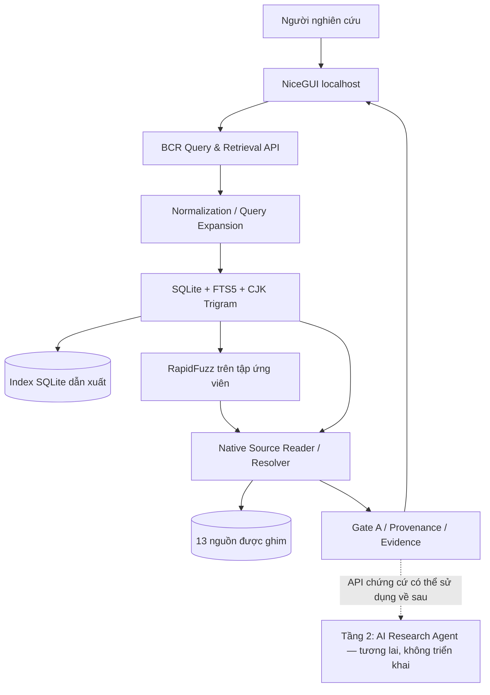

# BÁO CÁO NGHIÊN CỨU CHUYÊN SÂU

## Tái sử dụng mã nguồn mở để nâng cấp BCR Evidence Engine

**Ngày thẩm định của báo cáo gốc:** 16/11/2026  
**Phạm vi:** BCR tầng 1, tra cứu không AI  
**Hình thức:** Kiểm toán mã nguồn và nghiên cứu giải pháp GitHub  
**Ràng buộc:** Không sửa đổi repository, không thay đổi 13 source pins, không triển khai tầng AI  
**Ghi chú xuất bản:** Đây là bản Markdown đầy đủ của báo cáo đã trình bày trong cuộc hội thoại; việc xuất file không đồng nghĩa với tái chạy các benchmark hoặc tái kiểm toán GitHub vào ngày xuất file.

---

# 1. Executive Summary

**Kết luận trọng tâm: BCR nên tiếp tục sử dụng kiến trúc Python + SQLite/FTS5 hiện tại. Chưa có đủ bằng chứng kỹ thuật để biện minh cho việc thay search engine hoặc viết lại hệ thống.**

Ưu tiên đầu tư không phải thay nền tảng, mà là giải quyết những khoảng trống giữa *tìm được ứng viên*, *tìm đầy đủ các vị trí xuất hiện* và *xác minh chính xác câu chữ tại nguồn gốc*.

Kết quả kiểm toán mã BCR cho thấy một số năng lực quan trọng đã tồn tại:

- Chỉ mục SQLite/FTS5, normalization, CJK trigram và hệ thống xếp hạng kết quả có giải thích.
- Cấu trúc quản lý nguồn ghim phiên bản, provenance, witness, text role, quan hệ song hành, dị bản và lemma.
- CLI tra cứu, đọc văn bản/ngữ cảnh, so sánh và truy nguyên nguồn.
- Gate A cùng các module B–E của BCR 2.0, trong đó có cơ chế độc lập mở lại nguồn để xác minh.
- Cơ chế phân biệt dữ liệu dẫn xuất với văn bản gốc và giữ kết quả chưa xác minh ở trạng thái chưa xác minh.

Đây là những tài sản kỹ thuật nên được bảo toàn.

Tuy nhiên, **chưa thể chứng nhận BCR đã đáp ứng đầy đủ yêu cầu tra cứu học thuật đa ngôn ngữ**, đặc biệt là độ đầy đủ của tìm nguyên văn, CJK ngắn, fuzzy passage, tiếng Tạng, xuyên ngôn ngữ theo nghĩa và truy vấn luận đề dài.

## 1.1. Trạng thái repository đã xác minh

| Hạng mục | Kết quả tại thời điểm thẩm định |
|---|---|
| Repository | [`quoctran-2608/BuddhismDocuments-for-AI`](https://github.com/quoctran-2608/BuddhismDocuments-for-AI) |
| Nhánh chính | `main` |
| Commit baseline | `dfdd3cbb79e3dbfb49a855702fa00e4bad3b3410` |
| PR #13 | Open, Draft, chưa merge |
| Phạm vi PR #13 | Đề xuất điều chỉnh chiến lược và tài liệu; không phải phần triển khai tính năng tìm kiếm mới |

Baseline được đối chiếu qua lịch sử commit GitHub trong lần thẩm định. Nguồn: [commit baseline](https://github.com/quoctran-2608/BuddhismDocuments-for-AI/commit/dfdd3cbb79e3dbfb49a855702fa00e4bad3b3410) và [PR #13](https://github.com/quoctran-2608/BuddhismDocuments-for-AI/pull/13).

## 1.2. Giới hạn của lần thẩm định

Việc đọc mã nguồn và test đã được thực hiện trực tiếp qua GitHub connector. Điều này xác minh được sự hiện diện và logic của các chức năng, nhưng **không thay thế cho chạy benchmark trên database BCR thực tế**.

Tệp Markdown đặc tả riêng gồm các mục 4.1–4.5, 5 và 6 được đề cập trong yêu cầu nhưng chưa có dưới dạng tài liệu đính kèm riêng trong lượt thẩm định. Vì vậy, báo cáo sử dụng danh sách yêu cầu chi tiết được nêu trong đề bài, không tự coi đó là bằng chứng chức năng đã hoàn thành.

Không thay đổi mã, branch, PR, source pins hay dữ liệu corpus.

## 1.3. Năm cơ hội tái sử dụng đáng giá nhất

| Ưu tiên | Giải pháp | Giá trị dự kiến | Quyết định |
|---|---|---|---|
| 1 | **SQLite FTS5 + thuật toán tìm literal/offset** | Tăng độ đầy đủ tìm kiếm mà không đổi nền tảng | OPTIMIZE |
| 2 | **NiceGUI** | Xây giao diện tìm kiếm và đọc chứng cứ bằng Python | ADOPT |
| 3 | **RapidFuzz** | Tìm passage gần giống, lỗi đánh máy và nhiễu OCR trên tập ứng viên | ADOPT |
| 4 | **OpenCC** | Mở rộng truy vấn Hán văn giản/phồn thể, không sửa văn bản gốc | ADAPT |
| 5 | **indic_transliteration + pyewts** | Chuyển tự Sanskrit và Tạng, kết hợp chuẩn hóa hiện có | ADAPT |

Các thư viện thứ 4 và 5 nên tích hợp có điều kiện, sau khi xác minh ngôn ngữ và phạm vi dữ liệu thực sự có trong index. Botok là ứng viên kế tiếp cho tiếng Tạng, nhưng cần kiểm nghiệm riêng trước khi đưa vào MVP.

---

# 2. Kiểm toán năng lực BCR hiện tại

## 2.1. Ma trận yêu cầu – mã nguồn – tình trạng

**Ký hiệu đánh giá:**

- **T1:** Có triển khai và đã đọc được test kiểm tra hành vi tương ứng; chưa chạy lại test trong cuộc thẩm định này.
- **T2:** Có triển khai nhưng chưa đủ bằng chứng nghiệm thu trên phạm vi corpus thực.
- **T3:** Có thiết kế hoặc một phần cơ chế, chưa đáp ứng yêu cầu trọn vẹn.
- **T4:** Chưa xác định được triển khai đáp ứng yêu cầu.

| Yêu cầu | Module hoặc hàm đã kiểm tra | Trạng thái | Giới hạn và nhận xét |
|---|---|---|---|
| 4.1. Tìm nguyên văn | `retrieval.search`, `score_record_match` | T1/T2 | Có nhận diện `exact`, nhưng chưa bảo đảm tìm mọi lần xuất hiện |
| 4.1. Câu dài khác xuống dòng | `model.normalize`, `compact`; `verification.verify_quote` | T1/T3 | Có chuẩn hóa khoảng trắng; chưa có exhaustive phrase span matching |
| 4.2. Không dấu Pāli/Việt | `model.fold_diacritics`, `retrieval.search` | T1/T2 | Có cơ chế bỏ dấu; chưa xử lý đầy đủ các trường hợp riêng của tiếng Việt |
| 4.2. Fuzzy/OCR noise | Chưa thấy pipeline passage fuzzy chuyên dụng | T4 | FTS và diacritic folding không tương đương edit-distance fuzzy |
| 4.2. CJK 3+ ký tự | `records_cjk_fts`, `_cjk_substring_query` | T1/T2 | Đã có test dùng văn bản CBETA dài; chưa chứng nhận toàn corpus |
| 4.2. CJK 1–2 ký tự | `retrieval.search` trả limitation | T3 | Không bảo đảm phát hiện mọi chuỗi giữa văn bản |
| 4.3. Xuyên ngôn ngữ | `relations`, `lemmas`, `parallels`, `resolve` | T2/T3 | Có liên kết dựa trên dữ liệu nguồn; chưa có bộ mở rộng thuật ngữ đa nghĩa toàn diện |
| 4.4. Tìm nguồn cho luận đề | `search`, `parallels`, `LocalResearch` | T3 | Có thể hỗ trợ tìm lexical evidence; chưa có bộ phân tích luận đề phi AI đáng tin cậy |
| 4.5. Phân loại kết quả | `MATCH_SCORE`, `match_reasons`, `evidence_class`, `text_role`, `witness` | T1/T2 | Nhiều nhãn đã có; cần tách rõ match type, retrieval ranking và verification status trong UI |
| 5. Truy nguyên nguồn | `provenance`, `LocalHost.source_reader`, `resolve_source` | T1/T2 | Ba resolver chính đã được kiểm bằng test; chưa bao phủ 13 nguồn |
| 5. Xác minh câu trích | `verify_quote`, `evidence_gate`, `LocalHost.quick` | T1/T2 | Tách `VERIFIED_EXACT`/`VERIFIED_NORMALIZED`; không xác nhận fuzzy là nguyên văn |
| 6. Evidence Engine không AI | CLI 1.0, A và E adapters | T1/T2 | Có nền tảng code; chưa có giao diện tra cứu chuyên dụng |
| 6. AI Research Agent tương lai | B–D, P0/2 và research contracts | Đã có mã nền | Bảo toàn nhưng không mở rộng trong giai đoạn này |

**Bằng chứng mã nguồn chính:**

- [`tools/corpus_research/retrieval.py`](https://github.com/quoctran-2608/BuddhismDocuments-for-AI/blob/main/tools/corpus_research/retrieval.py)
- [`tools/corpus_research/model.py`](https://github.com/quoctran-2608/BuddhismDocuments-for-AI/blob/main/tools/corpus_research/model.py)
- [`tools/corpus_research/source_resolvers.py`](https://github.com/quoctran-2608/BuddhismDocuments-for-AI/blob/main/tools/corpus_research/source_resolvers.py)
- [`tools/corpus_research/verification.py`](https://github.com/quoctran-2608/BuddhismDocuments-for-AI/blob/main/tools/corpus_research/verification.py)
- [`schema/corpus-index.sql`](https://github.com/quoctran-2608/BuddhismDocuments-for-AI/blob/main/schema/corpus-index.sql)

## 2.2. Phát hiện kỹ thuật quan trọng nhất: completeness

Trong `retrieval.search()`, các truy vấn FTS chỉ lấy tối đa:

```python
max(limit * 5, 50)
```

ứng viên ở mỗi đường tìm kiếm, sau đó mới thực hiện phân loại exact/normalized/folded và xếp hạng.

Điều này dẫn đến ba khác biệt:

1. **Exact classification:** kết quả trả về chứa đúng chuỗi.
2. **Exhaustive record search:** tìm thấy mọi record chứa chuỗi.
3. **Exhaustive occurrence search:** tìm thấy mọi vị trí xuất hiện trong từng record.

BCR hiện có bằng chứng cho mục 1 trong tập ứng viên được chọn. Chưa có bằng chứng đáp ứng mục 2 và 3 trên toàn bộ phạm vi đã index.

Ngoài ra, `result_count` hiện được tính từ tập đã thu thập và xếp hạng, không phải tổng số lần xuất hiện trong corpus. Vì vậy, UI không được diễn giải trường này thành tổng số kết quả thực tế.

**Khuyến nghị:** tạo đường tra cứu literal exhaustive riêng cho yêu cầu 4.1, giữ `search()` hiện tại làm đường ranked discovery. Không nên ép một API vừa làm tìm kiếm xếp hạng vừa cam kết đầy đủ tuyệt đối.

## 2.3. Unicode và tiếng Việt

Mã `model.py` có ba phép biến đổi:

| Phép biến đổi | Hành vi | Nhận xét |
|---|---|---|
| `normalize` | NFC, casefold, chuẩn hóa khoảng trắng | Phù hợp với so khớp dạng chuẩn hóa |
| `fold_diacritics` | NFKD và loại combining marks | Hữu ích cho Pāli/Việt nhưng chưa đầy đủ với `đ` |
| `compact` | Loại ký tự không phải chữ/số và dấu phân cách | Hữu ích cho đối chiếu không phụ thuộc khoảng trắng/dấu câu |

Ví dụ, cơ chế NFKD không tự biến chữ `đ` thành `d`. Vì thế, những trường hợp như `đạo` và `dao` cần một quy tắc bổ sung nếu sản phẩm muốn coi chúng là truy vấn không dấu tương ứng.

Đây là một sửa đổi nhỏ, có thể kiểm thử riêng, không cần framework NLP.

Một nguyên tắc bắt buộc là **không thay thế văn bản gốc bằng văn bản đã fold**. Mọi phép biến đổi chỉ phục vụ truy vấn hoặc chỉ mục dẫn xuất.

## 2.4. CJK đã có nền tảng tốt nhưng còn lỗ hổng ngắn

[Test CJK hiện hữu](https://github.com/quoctran-2608/BuddhismDocuments-for-AI/blob/main/tests/test_cjk_substring_search.py) sử dụng dòng CBETA thật, kéo dài record, xây lại chỉ mục và kiểm tra đường trigram.

Đây là bằng chứng đáng giữ lại.

Tuy nhiên, tài liệu [SQLite FTS5 chính thức](https://www.sqlite.org/fts5.html) xác nhận full-text trigram không khớp chuỗi ngắn hơn ba ký tự Unicode. Vì thế:

- CJK 3+ ký tự: tiếp tục dùng trigram, kiểm lại completeness.
- CJK 1–2 ký tự: cần đường tra cứu khác, có kiểm soát phạm vi và giới hạn scan.
- Giản thể/phồn thể: cần mở rộng truy vấn bằng mapping, không đồng nhất với trigram.
- Khả năng tìm trong Local index không có nghĩa GitHub Connector đã hỗ trợ `terms/cjk`.

Đây là lý do để bổ sung thuật toán nhỏ, **không phải lý do đủ mạnh để thay SQLite**.

## 2.5. Source verification là tài sản cần bảo vệ

Các hàm quan trọng:

- `verification.verify_quote`: phân biệt câu trích exact, normalized và mismatch.
- `verification.evidence_gate`: kiểm tra các điều kiện bắt buộc trước khi công nhận nguồn.
- `source_resolvers.resolve_source`: giải vị trí văn bản từ Bilara JSON, CBETA TEI và 84000 TEI.
- `LocalHost.verify_record`: mở nguồn và tạo kết quả thẩm định.
- `LocalHost.quick`: giữ tách biệt retrieval hit với `verified_evidence`.

Test đã đọc bao gồm [`test_verification.py`](https://github.com/quoctran-2608/BuddhismDocuments-for-AI/blob/main/tests/test_verification.py) và [`test_source_span_selection.py`](https://github.com/quoctran-2608/BuddhismDocuments-for-AI/blob/main/tests/test_source_span_selection.py).

Các test này kiểm tra nhiều tình huống quan trọng: sai pin/blob, sai đoạn, trích nhầm note, câu nằm ở unit khác, offset tự khai và câu bị ghép qua markup.

Do đó, bất kỳ giao diện hoặc thư viện tìm kiếm mới nào cũng phải đi qua các cổng kiểm chứng hiện hữu. Không tạo một cổng xác minh độc lập thứ hai.

**Giới hạn:** resolver hiện có chỉ hỗ trợ ba họ định dạng nguồn. Việc không giải được một định dạng phải tiếp tục trả `UNVERIFIED`, không sử dụng FTS hit để thay thế xác minh.

---

# 3. Repository Research

Phần này phân biệt **tái sử dụng trực tiếp thư viện**, **tái sử dụng ý tưởng thiết kế**, và **tích hợp một hệ thống khác**. Ba hình thức có chi phí rất khác nhau.

## 3.1. Nhóm A — Giao diện tìm kiếm

### NiceGUI — Lựa chọn ưu tiên

- **Repository:** [zauberzeug/nicegui](https://github.com/zauberzeug/nicegui)
- **License:** MIT.
- **Nền tảng:** Python/FastAPI/Vue/Quasar.
- **Khuyến nghị:** **ADOPT**.

Framework Python-first có table, pagination, filters, event handlers và khả năng gọi trực tiếp hàm Python. Không bắt BCR xây frontend JavaScript riêng.

**Bằng chứng mã:** [`nicegui/elements/table.py`](https://github.com/zauberzeug/nicegui/blob/main/nicegui/elements/table.py) cung cấp bảng, lựa chọn hàng và xử lý pagination. Có thể xây phần tra cứu quanh `retrieval.search`, `LocalHost.quick` và các reader sẵn có.

**Giới hạn:** dùng WebSocket, Uvicorn và nhiều dependency giao diện; không tự bảo đảm read-only hay kiểm nguồn. BCR phải kiểm soát kết nối SQLite và chỉ cung cấp các operation được phép.

Release v4.0.0 ngày 04/11/2026 được ghi nhận trong nghiên cứu gốc là có thay đổi API so với 3.x. Cần khóa phiên bản đã chạy test thay vì cài floating `latest`.

### Datasette — Phương án cạnh tranh mạnh

- **Repository:** [simonw/datasette](https://github.com/simonw/datasette)
- **License:** Apache-2.0.
- **Khuyến nghị:** **ADAPT hoặc DEFER**.

Mã [`datasette/database.py`](https://github.com/simonw/datasette/blob/main/datasette/database.py) có kết nối SQLite read-only và `PRAGMA query_only`. Datasette cung cấp SQL querying, phân trang, xuất dữ liệu và hệ sinh thái plugin.

Phù hợp nếu ưu tiên **browsing/index inspection** hơn giao diện người nghiên cứu chuyên dụng. Để có workflow mở source, Gate A và so sánh song hành, vẫn cần plugin hoặc custom views.

Datasette 1.0a42 ngày 08/11/2026 được ghi nhận trong nghiên cứu gốc là pre-release; phải pin và thử tương thích thay vì mặc định API đã ổn định hoàn toàn.

### Các ứng viên khác

| Ứng viên | License | Điểm mạnh | Quyết định |
|---|---|---|---|
| [Streamlit](https://github.com/streamlit/streamlit) | Apache-2.0 | PoC giao diện rất nhanh, bảng và biểu mẫu tốt | DEFER cho sản phẩm chính; hợp với demo |
| [sqlite-web](https://github.com/coleifer/sqlite-web) | MIT | Duyệt SQLite, chạy localhost, hỗ trợ `--read-only` | ADOPT làm công cụ kỹ thuật, không phải research UI |

Streamlit sử dụng mô hình thực thi và quản lý trạng thái riêng; có thể đơn giản cho demo nhưng cần đánh giá kỹ khi xây một reader nhiều pane, đồng bộ lựa chọn kết quả và trạng thái verification.

sqlite-web có các dependency Flask, Peewee và Pygments. Bằng chứng: [README](https://github.com/coleifer/sqlite-web) và [`sqlite_web/sqlite_web.py`](https://github.com/coleifer/sqlite-web/blob/master/sqlite_web/sqlite_web.py).

**Quyết định nhóm A:** chọn NiceGUI để làm PoC giao diện chính, nhưng giữ Datasette là đối chứng. Không dùng đồng thời hai framework trong MVP.

## 3.2. Nhóm B — Search engine và fuzzy matching

| Dự án | Giấy phép | Có thể tái sử dụng | Giới hạn | Quyết định |
|---|---|---|---|---|
| [SQLite FTS5](https://www.sqlite.org/fts5.html) | SQLite public domain | Search, phrase query, BM25, trigram, prefix, LIKE/GLOB có điều kiện | Không tự giải quyết fuzzy passage/semantic/sense | **KEEP + OPTIMIZE** |
| [RapidFuzz](https://github.com/rapidfuzz/RapidFuzz) | MIT | Edit distance, fuzzy scorers, `extract`, `extractOne`, `cdist` | Không là search index; không bảo đảm recall nếu ứng viên thiếu | **ADOPT** |
| [Meilisearch](https://github.com/meilisearch/meilisearch) | CE MIT; EE có điều khoản riêng | Full-text, typo, filtering, facets | Server riêng, index thứ hai, đồng bộ phức tạp | DEFER |
| [Typesense](https://github.com/typesense/typesense) | GPL-3.0 | Typo-tolerant search, lọc và phục vụ truy vấn nhanh | Server riêng, bộ nhớ, nghĩa vụ license cần đánh giá | DEFER |

Nguồn chính: [FTS5 chính thức](https://www.sqlite.org/fts5.html), [RapidFuzz `process_py.py`](https://github.com/rapidfuzz/RapidFuzz/blob/main/src/rapidfuzz/process_py.py), [Meilisearch](https://github.com/meilisearch/meilisearch), [Typesense](https://github.com/typesense/typesense).

### RapidFuzz: cách tích hợp đúng

RapidFuzz có thể tính độ gần nhau của chuỗi bằng nhiều scorer và giới hạn điểm bằng `score_cutoff`; mã Python có các hàm `extract_iter`, `extractOne`, các backend tăng tốc khác và test riêng.

Nhưng **không nên chạy RapidFuzz trên tất cả records của corpus cho mỗi truy vấn**.

Đường tích hợp hợp lý:

```text
Truy vấn gốc + loại tìm kiếm
           |
           v
FTS5 / trigram / bộ lọc / nguồn song hành
   (Sinh tập ứng viên có kiểm soát)
           |
           v
RapidFuzz trên passage hoặc cửa sổ văn bản
           |
           v
FUZZY_CANDIDATE + điểm + vị trí dự đoán
           |
           v
Mở nguồn thật -> Gate A
   (Chỉ trích dẫn câu chữ thực sự được xác minh)
```

Điểm fuzzy không phải xác suất câu trích đúng, không đo thẩm quyền nguồn và không được đổi thành `VERIFIED_EXACT`.

**Rủi ro quan trọng:** nếu FTS không đưa một đoạn chứa lỗi OCR vào tập ứng viên, RapidFuzz không thể tìm lại đoạn đó. Phải đánh giá recall của candidate generator và fuzzy scorer độc lập.

### Có cần Meilisearch hoặc Typesense?

Chưa.

Meilisearch thực sự cung cấp typo tolerance và xử lý đa ngôn ngữ; nhưng độ chịu lỗi vẫn theo quy tắc cụ thể, không tự bảo đảm đối sánh học thuật. Chẳng hạn, tài liệu chính thức mô tả ngưỡng lỗi thay đổi theo độ dài từ.

Cả Meilisearch và Typesense đều đòi hỏi vận hành một index độc lập bên cạnh source/index BCR. Từ đó phát sinh bài toán versioning, đồng bộ source SHA, cập nhật parser, chuyển kết quả sang record ID và xác minh Gate A.

Đây là chi phí thật, không thể đánh giá chỉ bằng tốc độ truy vấn quảng bá.

## 3.3. Nhóm C — Hán văn, Pāli, Sanskrit và tiếng Việt

| Repository | License | Năng lực được xác nhận | Đề xuất |
|---|---|---|---|
| [BYVoid/OpenCC](https://github.com/BYVoid/OpenCC) | Apache-2.0 | Chuyển đổi chữ Hán phồn/giản theo configuration | ADAPT |
| [indic-transliteration/indic_transliteration_py](https://github.com/indic-transliteration/indic_transliteration_py) | MIT | Chuyển tự IAST, Devanagari, HK, ITRANS và nhiều scheme | ADAPT |
| [cltk/cltk](https://github.com/cltk/cltk) | MIT | NLP cho các ngôn ngữ cổ điển với nhiều pipeline | DEFER |
| BCR `model.py` | Nội bộ BCR | Unicode normalization, diacritic folding và compact | KEEP + OPTIMIZE |

Nguồn xác minh chức năng: [OpenCC Python binding](https://github.com/BYVoid/OpenCC/blob/master/python/opencc/__init__.py), [Indic Sanscript](https://github.com/indic-transliteration/indic_transliteration_py/blob/master/indic_transliteration/sanscript/__init__.py), [CLTK](https://github.com/cltk/cltk).

**OpenCC** là ứng viên có giá trị cao vì giải một vấn đề mà Unicode NFC/NFKD không giải được: quan hệ phồn thể và giản thể. Tuy nhiên, OpenCC có thành phần native/C++ và dữ liệu chuyển đổi. Nên chỉ dùng ở query expansion, lưu rõ configuration và hướng chuyển đổi, rồi kiểm tra văn bản gốc.

Ví dụ `無常` và `无常` có thể được tìm bằng cách mở rộng biến thể chữ viết; điều này không cho phép suy ra rằng mọi cách viết hoặc mọi từ chứa ký tự chuyển đổi đều đồng nghĩa.

**indic_transliteration** phù hợp cho các cặp như IAST ↔ Devanagari. Đây là chuyển hệ chữ, không phải dịch nghĩa. Không được tự suy rằng một từ Sanskrit là từ Pāli tương ứng hoặc tương đương với một thuật ngữ Hán văn.

**CLTK** có khả năng nghiên cứu về morphology, nhưng bộ framework lớn hơn nhu cầu ban đầu. Phiên bản được nêu trong báo cáo gốc còn có các backend GenAI tùy chọn; những phần đó hoàn toàn ngoài phạm vi giai đoạn này. Việc có tên ngôn ngữ trong hệ sinh thái CLTK cũng không chứng nhận chất lượng lemmatization của chính corpus BCR.

Đối với tiếng Việt và Pāli, nên ưu tiên sửa và mở rộng các hàm normalization có sẵn, chỉ thêm library khi gặp trường hợp BCR thật sự không xử lý được bằng các hàm Unicode ngắn.

## 3.4. Nhóm D — Tiếng Tạng

### WeBuddhist/pyewts

- **Repository:** [WeBuddhist/pyewts](https://github.com/WeBuddhist/pyewts) (repository trước đây được dẫn ở OpenPecha).
- **Định hướng:** **ADAPT**.

Có conversion Wylie/EWTS ↔ Tibetan Unicode; mã chính nằm tại [`pyewts.py`](https://github.com/WeBuddhist/pyewts/blob/master/pyewts/pyewts.py). Thích hợp tạo các truy vấn tương đương về mặt chuyển tự.

**Lưu ý license:** file `LICENSE`, header mã và `pyproject.toml` ghi Apache-2.0, nhưng README lại mô tả Python code dưới MIT. Đây là bất nhất cần làm rõ trước khi đóng gói phân phối, dù nguồn chính của repository chỉ ra Apache-2.0.

### WeBuddhist/Botok

- **Repository:** [WeBuddhist/Botok](https://github.com/WeBuddhist/Botok).
- **License:** Apache-2.0.
- **Định hướng:** **ADAPT có điều kiện**.

Đây là thư viện tokenization tiếng Tạng thực sự, khác với bộ chuyển tự. Mã [`wordtokenizer.py`](https://github.com/WeBuddhist/Botok/blob/master/botok/tokenizers/wordtokenizer.py) có `WordTokenizer.tokenize`; hệ thống dùng trie, từ điển, tài nguyên ngôn ngữ và quy tắc tách từ.

Botok có thể có ích cho tìm kiếm theo từ và biến thể hình thái. Nhưng cần kiểm nghiệm với nguồn Tạng đã ghim của BCR, vì lỗi phân từ có thể làm giảm recall. Đồng thời cần kiểm tra chi phí xây trie, tài nguyên từ điển, khả năng offline và tương thích Python.

**Kết luận tiếng Tạng:** triển khai conversion Wylie/EWTS trước nếu nguồn dữ liệu yêu cầu. Chỉ đưa Botok vào chỉ mục chính khi PoC chứng minh rằng nó cải thiện recall hoặc ranking mà không tạo ra quá nhiều false positives.

Chưa có cơ sở xác nhận BCR đã hỗ trợ đầy đủ tìm hình thái Tạng. Việc chuyển tự chính xác không giải quyết được tokenization, từ vựng, dị bản hoặc morphology.

## 3.5. Nhóm E — Hệ thống tra cứu Phật học

| Hệ thống | Tài sản đáng học hỏi | Rủi ro tích hợp | Đề xuất |
|---|---|---|---|
| [SuttaCentral](https://github.com/suttacentral/suttacentral) | Segment ID, trình đọc văn bản và bản dịch, liên kết kinh | Website + API + ArangoDB; BCR đã dùng dữ liệu liên quan | ADAPT thiết kế |
| [Bilara](https://github.com/suttacentral/bilara) | JSON segment keys, nhiều translation/comment cho cùng đoạn | CAT/editor, database và nhiều dịch vụ | KEEP dữ liệu/ý tưởng, không đưa app vào |
| [BuddhaNexus](https://github.com/BuddhaNexus) | Segmentation và đối chiếu passage | Backend cũ, kho đã archive, nguồn tính toán | KEEP upstream pins; DEFER code |
| [OpenPecha ecosystem](https://github.com/OpenPecha) | Tổ chức văn bản Tạng, chú giải, liên kết và workflow | Nhiều định dạng và module riêng | ADAPT chọn lọc |
| [84000 data-tei](https://github.com/84000/data-tei) | TEI, nguồn dịch và cấu trúc văn bản | Phải giữ provenance, role và giấy phép nội dung | KEEP đường đọc hiện tại |
| DharmaNexus | Phương pháp đối chiếu đa ngôn ngữ | Chưa xác minh thư viện độc lập phù hợp, có các chức năng semantic ngoài phạm vi | DEFER |

SuttaCentral là một ứng dụng Flask/PWA với API đọc dữ liệu từ ArangoDB; Bilara là công cụ dịch thuật dùng JSON segment và có thành phần ArangoDB. Do đó, chúng không phải các thư viện thả trực tiếp vào SQLite BCR.

BuddhaNexus công bố các kho legacy đã được lưu trữ và hoạt động phát triển chuyển sang DharmaNexus. Kho `segmented-sanskrit` cũng thừa nhận dữ liệu còn nhiều lỗi cần làm sạch; cần giữ vai trò *computational discovery*, không nâng thành chứng cứ câu chữ có thẩm quyền.

**License và dữ liệu:** mã ứng dụng SuttaCentral có tuyên bố CC0, nhưng giấy phép nội dung cần xét riêng theo từng loại tư liệu và attribution. Bilara không có file LICENSE riêng được xác nhận tại thư mục gốc trong lần đọc này, nên quyền tái sử dụng mã Bilara cần thẩm định thêm. Nội dung 84000 và các nguồn ghim phải tuân theo điều khoản riêng, không suy từ trạng thái public của GitHub.

## 3.6. Kết quả đánh giá mức độ sẵn sàng

| Ứng viên | Mã liên quan | Tests trong repo | License | Đã chạy trực tiếp cùng BCR |
|---|---|---|---|---|
| NiceGUI | Đã đọc | Có | Đã xác minh | Chưa |
| Datasette | Đã đọc | Có | Đã xác minh | Chưa |
| RapidFuzz | Đã đọc | Có | Đã xác minh | Chưa |
| OpenCC | Đã đọc | Có | Đã xác minh | Chưa |
| indic_transliteration | Đã đọc | Có | Đã xác minh | Chưa |
| pyewts | Đã đọc | Chưa xác minh đầy đủ | Bất nhất tài liệu | Chưa |
| Botok | Đã đọc | Có | Đã xác minh | Chưa |
| CLTK | Kiểm tài liệu/API | Có | Đã xác minh | Chưa |
| Meilisearch/Typesense | Kiểm chức năng và license | Có upstream | Đã xác minh | Chưa |

Các kết luận ADOPT/ADAPT là **quyết định đề xuất cho PoC**, chưa phải chứng nhận tương thích phiên bản, hiệu năng hoặc độ chính xác trên BCR thật.

---
# 4. Build-versus-Reuse Matrix

| Năng lực | BCR hiện có | Giải pháp sẵn có | Tích hợp / công sức | Khuyến nghị |
|---|---|---|---|---|
| SQLite index và provenance | Có | SQLite/FTS5 | Không cần thay | KEEP |
| Xếp hạng, match reasons | Có | BCR `retrieval.py` | Nhỏ | OPTIMIZE |
| Tìm exact mọi lần xuất hiện | Chưa được bảo đảm | SQL `instr`, FTS làm candidate | Nhỏ–trung bình | OPTIMIZE |
| CJK 3+ ký tự | Có trigram | SQLite FTS5 | Nhỏ | KEEP |
| CJK 1–2 ký tự | Chưa đầy đủ | Scoped scan hoặc index phụ | Trung bình nếu cần scale | OPTIMIZE |
| Không dấu Việt/Pāli | Có một phần | Unicode stdlib | Rất nhỏ | OPTIMIZE |
| Phồn/giản thể | Chưa có mapping chuyên dụng | OpenCC | Nhỏ | ADAPT |
| Fuzzy passage/OCR | Chưa có pipeline | RapidFuzz | Nhỏ–trung bình | ADOPT |
| Sanskrit chuyển tự | Chưa có chuyên dụng | indic_transliteration | Nhỏ | ADAPT |
| Tibetan EWTS/Wylie | Chưa có chuyên dụng | pyewts | Nhỏ | ADAPT |
| Tibetan word segmentation | Chưa chứng minh | Botok | Trung bình | DEFER tới PoC |
| Morphology cổ điển rộng | Lemma theo corpus | CLTK hoặc dữ liệu chuyên ngành | Trung bình–lớn | DEFER |
| Đối chiếu song hành | Có relations | SuttaCentral/84000/OpenPecha | Tận dụng mapping | KEEP |
| Xác minh câu trích | Có A + resolvers | Code BCR | Không được thay | KEEP |
| Giao diện localhost | Chưa có sản phẩm | NiceGUI | Nhỏ–trung bình | ADOPT |
| Duyệt SQLite nội bộ | Có DB | sqlite-web | Rất nhỏ | ADOPT tùy chọn |
| Tìm lexical xuyên ngôn ngữ | Có một phần dữ liệu | Curated term/sense map | Trung bình | ADAPT |
| Tìm semantic luận đề | Chưa có phi AI đủ tin cậy | Không có giải pháp nhỏ đã chứng minh | Lớn | DEFER |
| Search server mới | Chưa cần | Meilisearch/Typesense | Lớn | DEFER |
| Các module A–E, Quick/Research | Có mã và tests | BCR 2.0 | Không tái cấu trúc | KEEP |

Phân biệt đáng chú ý: một số cải tiến thực sự cần **code BCR mới rất ít**, nhưng vẫn đòi hỏi dữ liệu thuật ngữ, kiểm thử học thuật hoặc các trường hợp chuẩn có đáp án. Những chi phí đó không nên bị che giấu dưới nhãn “tích hợp thư viện nhanh”.

---

# 5. Kiến trúc đề xuất tối thiểu

## 5.1. Giữ hai tầng trách nhiệm, chỉ phát triển tầng 1



Các module B–E hiện có vẫn được giữ nguyên trong repository. Sơ đồ trên chỉ mô tả đường hoạt động cần hoàn thiện cho Evidence Engine, không xóa bỏ hay thay đổi các module đó.

## 5.2. Nguyên tắc tích hợp

**Một lõi truy xuất, nhiều cách dùng.** CLI và web UI nên gọi cùng các module truy xuất BCR, tránh tạo hai phiên bản ranking hoặc normalization. Nếu cần bổ sung một API mới cho exhaustive literal, API đó cũng phải được CLI và UI sử dụng nhất quán.

**Không ghi vào source và index từ giao diện.** Giữ các hàm kết nối read-only. Đặc biệt, `connect_readonly()` hiện dùng SQLite URI `mode=ro&immutable=1` cùng `PRAGMA query_only=ON`. Ứng dụng phải kiểm tra index đã build/chốt đúng, không bỏ qua trạng thái WAL chưa checkpoint.

**Không dùng kết quả index làm trích dẫn cuối cùng.** UI cần phân tách:

| Trạng thái | Người nghiên cứu được hiểu |
|---|---|
| `EXACT_INDEX_MATCH` | Chuỗi khớp trong nội dung chỉ mục |
| `NORMALIZED_MATCH` | Khớp sau chuẩn hóa được khai báo |
| `VARIANT_MATCH` | Khớp qua phép biến đổi chữ viết |
| `FUZZY_CANDIDATE` | Passage gần giống, chỉ là ứng viên |
| `RELATED_BY_SOURCE` | Có quan hệ được metadata nguồn ghi nhận |
| `VERIFIED_EXACT` | Gate A đã kiểm câu trích exact tại nguồn |
| `VERIFIED_NORMALIZED` | Gate A đã kiểm theo chuẩn hóa được phép |
| `UNVERIFIED` | Chưa đủ điều kiện xác minh |
| `REJECTED` | Điều kiện xác minh bắt buộc đã thất bại |

Các nhãn retrieval bổ sung là **đề xuất mới**, không phải trạng thái đã tồn tại trong BCR. Nhãn Gate A hiện có phải được giữ nguyên.

## 5.3. Giao diện tra cứu MVP

Minh họa bố cục chức năng dự kiến, **không phải ảnh chụp hoặc sản phẩm đã triển khai**:

```text
+-------------------------------------------------------------------+
| TRA CỨU PHẬT HỌC — BCR EVIDENCE ENGINE                             |
| [Từ khóa / đoạn trích .... ] [Chế độ] [Corpus] [Ngôn ngữ] [Tìm]    |
| Bộ lọc: witness / text role / verification / coverage             |
+-------------------------------+-----------------------------------+
| KẾT QUẢ TÌM KIẾM              | VĂN BẢN VÀ CHỨNG CỨ                |
|                               |                                   |
| Passage / match type          | Nguyên văn + ngữ cảnh             |
| Số lần xuất hiện              | Segment ID / witness / text role  |
| Nguồn / giới hạn coverage     | Source SHA / đường dẫn ghim       |
| Phân trang / chọn passage     | Kết quả Gate A                    |
+-------------------------------+-----------------------------------+
| SONG HÀNH · DỊ BẢN · TỪ VỰNG                                      |
| Quan hệ lấy từ BCR, kèm vai trò dữ liệu và provenance riêng        |
+-------------------------------------------------------------------+
```

MVP cần có tìm kiếm, bộ lọc, xem nguồn, context, phân trang, phân biệt match type và trạng thái verification. Những chức năng như tài khoản nhiều người dùng, annotation editor, dashboard thống kê phức tạp hay hệ quản lý dự án không cần thiết trong vòng đầu.

## 5.4. Hợp đồng dữ liệu cần bổ sung

Đề nghị thống nhất một cấu trúc kết quả tìm kiếm ở tầng API, gồm ít nhất:

- `query_original`, `query_expansions`, `search_mode`.
- `corpus`, `language`, `work_id`, `segment_id`, `witness`, `text_role`.
- `match_kind`, `score`, `score_explanation`.
- `occurrence_offsets` khi đã xác định được, kèm hệ tọa độ offset.
- `coverage_scope`, `search_complete`, `truncated`, `limitations`.
- `source_path`, `source_sha`, trạng thái index và Gate A.

Không phải tạo tất cả bằng một schema migration. Có thể tạo cấu trúc phản hồi bên ngoài để giữ tương thích `retrieval.search()` và CLI hiện có.

Quan trọng: **`search_complete` chỉ được phép `true` khi thuật toán đã kiểm tra đầy đủ phạm vi được khai báo**. Đạt `limit=20` không phải bằng chứng rằng corpus chỉ có 20 kết quả.

---

# 6. So sánh ba phương án tích hợp

## 6.1. Định nghĩa phương án

**A — Tối thiểu:** giữ SQLite/FTS5, CLI, source pins và Gate A–E; bổ sung exhaustive retrieval, NiceGUI, RapidFuzz và adapters chuyển tự cần thiết.

**B — Trung bình:** giữ core BCR nhưng xây thêm index phụ theo ngôn ngữ hoặc module tìm kiếm chuyên biệt khi phát hiện bottleneck thật.

**C — Thay đổi lớn:** dùng search server độc lập, đồng bộ dữ liệu từ BCR và duy trì cơ chế identity/provenance giữa các hệ thống.

## 6.2. Ma trận quyết định

| Tiêu chí | A — Tối thiểu | B — Trung bình | C — Thay đổi lớn |
|---|---|---|---|
| Code mới | Thấp | Trung bình | Cao |
| Bảo toàn BCR | Rất cao | Cao | Trung bình |
| Dependency | Ít, chọn lọc | Tăng theo ngôn ngữ | Nhiều, thêm service |
| Chi phí kiểm thử | Thấp–trung bình | Trung bình–cao | Rất cao |
| Chi phí bảo trì | Thấp | Trung bình | Cao |
| RAM/dung lượng | Gần hiện tại, có tăng | Tăng tùy index | Tăng đáng kể do index/service |
| Literal exact | Có thể bổ sung trực tiếp | Có | Có nhưng vẫn cần kiểm độc lập |
| Fuzzy passage | RapidFuzz + candidates | Có thể index phụ | Có typo search, không đương nhiên đúng passage |
| Đa ngôn ngữ | Adapter theo yêu cầu | Index chuyên dụng | Có thể nhiều tính năng, không tự giải quyết ngữ nghĩa |
| Provenance/Gate A | Tận dụng trực tiếp | Cần kiểm adapter | Cần ràng buộc hai hệ thống |
| Offline | Có | Có điều kiện | Có thể, nhưng vận hành phức tạp |
| Rủi ro hồi quy | Thấp–trung bình | Trung bình | Cao |

## 6.3. Ước lượng ngày công

**Ước lượng kỹ thuật sơ bộ, không phải số liệu thực đo hoặc cam kết tiến độ:**

| Phương án | Ngày công dự kiến | Phạm vi |
|---|---:|---|
| **A — Tối thiểu** | **20–45** | MVP được kiểm thử cơ bản |
| **B — Trung bình** | **45–90** | Giữ core, thêm index/module tìm kiếm |
| **C — Thay đổi lớn** | **100–220** | Search server và đồng bộ/kiến trúc mới |

Giả định để ước lượng: một lập trình viên Python đã hiểu BCR, nguồn/index hiện hữu có thể sử dụng, không xây lại toàn corpus, không phát triển tầng AI, không thêm cơ chế xuất bản, và phạm vi MVP giới hạn ở localhost. Ngày công bao gồm xây chức năng, test, tích hợp và sửa lỗi cơ bản; không bao gồm công sức làm sạch dữ liệu hay thẩm định học thuật quy mô lớn.

Với phương án A, có thể chia sơ bộ:

| Hạng mục | Ngày công dự kiến |
|---|---:|
| Kiểm coverage và exhaustive literal | 4–8 |
| Giao diện tra cứu + đọc nguồn/Gate A | 6–12 |
| Fuzzy, normalization và query variants chọn lọc | 3–8 |
| Benchmark, regression, đóng gói, sửa lỗi | 7–17 |
| **Tổng** | **20–45** |

Một PoC nội bộ hẹp hơn, không đạt tất cả tiêu chí MVP, có thể nằm khoảng **8–15 ngày công** trong điều kiện thuận lợi.

## 6.4. Điểm quyết định công nghệ

Chỉ chuyển từ A sang B khi benchmark cho thấy một yêu cầu bắt buộc không thể đáp ứng với thời gian/bộ nhớ hợp lý bằng SQLite hoặc một index phụ nhỏ.

Chỉ xem xét C nếu B cũng thất bại và có dữ liệu đo thực tế chứng minh lợi ích vượt chi phí.

**Khuyến nghị đầu tư: phê duyệt nghiên cứu và PoC cho phương án A; không phê duyệt migration sang search server ở thời điểm này.**

---

# 7. Bộ benchmark và các PoC bắt buộc

## 7.1. Nguyên tắc thiết kế benchmark

Bộ benchmark phải có **ground truth độc lập với kết quả do BCR trả về**.

Một truy vấn FTS không được tự tạo ra đáp án chuẩn để rồi dùng chính đáp án đó chấm điểm BCR. Đáp án cần được xác lập từ các nguồn ghim, vị trí văn bản thực tế, witness và quyền kiểm chứng tương ứng.

Mỗi phép thử cần ghi:

- Source pin, build profile, parser version, số nguồn và record thực sự được index.
- Chuỗi truy vấn gốc và tất cả biến thể được tạo.
- Record/segment/span đúng, cùng danh sách tất cả vị trí xuất hiện trong phạm vi kiểm.
- Loại khớp dự kiến và kết quả Gate A.
- Trường hợp không có dữ liệu, chưa index hoặc không mở được nguồn.

## 7.2. Bộ ca kiểm thử

| ID | Tình huống | Điều phải chứng minh | Ưu tiên |
|---|---|---|---|
| B01 | `nibbāna` ↔ `nibbana` | Bỏ dấu tìm được ứng viên nhưng không làm sai nhãn exact | P0 |
| B02 | `vo thuong` ↔ `vô thường` | Đối chiếu tiếng Việt không dấu | P0 |
| B03 | `đạo` ↔ `dao` | Kiểm quy tắc riêng cho chữ `đ` | P0 |
| B04 | `無常` ↔ `无常` | Query expansion giản/phồn thể | P0 |
| B05 | Truy vấn Hán 1, 2, 3 ký tự | So sánh recall của đường tìm ngắn và trigram | P0 |
| B06 | Câu kinh dài khác xuống dòng/khoảng trắng | Tìm normalized phrase, không gán sai nguyên văn | P0 |
| B07 | Câu trích chỉ xuất hiện trong một witness | Xác định đúng witness và không gộp dị bản | P0 |
| B08 | Passage gần giống, sai 1–3 ký tự | Fuzzy recall, thứ hạng và false positives | P0 |
| B09 | Passage có nhiễu OCR thực tế | Chất lượng candidate generation và RapidFuzz | P1 |
| B10 | Wylie/EWTS ↔ Unicode Tạng | Conversion và đối chiếu đúng nguồn Tạng, khi có dữ liệu | P1 |
| B11 | Sanskrit IAST ↔ Devanagari | Chuyển tự chính xác, giữ script gốc | P1 |
| B12 | Mục từ nhiều nghĩa/cách dịch | Không tự gộp các sense khác nhau | P1 |
| B13 | Câu hỏi dài về nghiệp và khổ đau | Tìm nguồn lexical liên quan, không tự khẳng định luận đề | P1 |
| B14 | Truy vấn không có hit trong phạm vi đã index | Trả kết quả rỗng với phạm vi coverage rõ ràng | P0 |
| B15 | Nguồn chưa index hoặc không mở được | Phân biệt thiếu dữ liệu với không tìm thấy | P0 |
| B16 | Sáu segment rỗng trong bản dịch EN MN 135 | Không công nhận câu chữ chưa có ở nguồn | P0 |

Riêng B16, PR #13 công bố đã phát hiện sáu segment tồn tại về key nhưng rỗng và kết quả phải là `UNVERIFIED`. Đây là **bằng chứng được ghi nhận trong hồ sơ dự án**, chưa được tái chạy độc lập trong cuộc nghiên cứu này. Nguồn: [hồ sơ PR #13](https://github.com/quoctran-2608/BuddhismDocuments-for-AI/pull/13).

## 7.3. Các thước đo bắt buộc

| Nhóm | Thước đo | Ý nghĩa |
|---|---|---|
| Completeness | Recall@all trên phạm vi đã index | Có tìm hết các vị trí cần tìm không? |
| Ranking | Recall@k, MRR hoặc nDCG khi có nhãn relevance | Ứng viên đúng xuất hiện sớm đến đâu? |
| Classification | Precision/recall theo `match_kind` | Có nhầm fuzzy thành exact không? |
| Verification | Tỷ lệ xác minh đúng và false verification | Có công nhận nhầm nguồn/câu chữ không? |
| Provenance | Tỷ lệ hit có source pin/path/span hợp lệ | Có truy nguyên và mở lại được không? |
| Performance | p50, p95, p99 latency | Có nhanh trên index thực tế không? |
| Resources | Peak RSS, kích thước index, thời gian build | Phương án có đủ nhẹ không? |
| Usability | Số thao tác, thời gian tìm được passage | Giao diện có giúp người nghiên cứu không? |

Chỉ tính `Recall@all` đối với phạm vi có ground truth đầy đủ. Nếu chỉ biết một số passage đúng, không được coi số passage đã biết đó là tổng số passage thực tế.

Đối với các nhóm phép thử xác minh nguồn, tiêu chuẩn an toàn nên là **không có false VERIFIED trong tập negative được kiểm**. Điều này không đồng nghĩa đã chứng nhận false-positive rate bằng 0 trên toàn bộ corpus.

## 7.4. Năm PoC có khả năng thay đổi quyết định

### PoC 1 — Exhaustive literal search

So sánh `retrieval.search()` với phép kiểm toàn bộ raw text trong một phạm vi index cố định. Xác định số hit/occurrence bị bỏ sót, vị trí trong record và nguyên nhân. Chạy cả bản không index phụ để định lượng chi phí scan.

**Quyết định:** Có đủ dùng SQLite nguyên trạng hay cần index phụ?

### PoC 2 — Unicode/CJK query expansion

Kiểm tra `đ/d`, dấu Việt/Pāli, `無常/无常`, CJK ngắn, các trường hợp nhiều cách chuyển đổi và false positives. So sánh baseline với OpenCC và thay đổi normalization nhỏ.

**Quyết định:** Thêm thư viện nào, cần index dẫn xuất hay chỉ mở rộng truy vấn?

### PoC 3 — Fuzzy passage và lỗi OCR

So sánh RapidFuzz trên raw records, trên cửa sổ passage và trên ứng viên do FTS sinh ra. Đo recall của từng bước, không chỉ tổng thời gian hoặc score.

**Quyết định:** Có cần cách sinh ứng viên mới không?

### PoC 4 — Native span và Gate A regression

Kiểm tra ba resolver trên các ca positive/negative, gồm passage nhiều span, note, witness sai, pin sai, nguồn thiếu và EN MN 135 rỗng.

**Quyết định:** Giao diện có thể cung cấp thao tác trích dẫn mà không làm giảm tiêu chuẩn chứng cứ?

### PoC 5 — NiceGUI so với Datasette

Cùng một bộ ca tìm kiếm, đo số thao tác để mở nguồn/đọc ngữ cảnh/kiểm Gate A, mức sử dụng RAM, độ ổn định Unicode và khả năng không ghi dữ liệu.

**Quyết định:** Framework nào thực sự tiết kiệm công sức đến MVP?

## 7.5. Điều kiện chạy benchmark tái lập

Một phiên benchmark hợp lệ cần dùng cùng source pins, cùng phạm vi index, cùng máy và cùng bộ oracle. Chạy riêng cold/warm cache, ghi phiên bản SQLite/Python, số record, dung lượng DB, cấu hình CPU/RAM, số lần lặp và log kết quả thô.

Đường test hiện có như [`test_acceptance.py`](https://github.com/quoctran-2608/BuddhismDocuments-for-AI/blob/main/tests/test_acceptance.py), [`test_cjk_substring_search.py`](https://github.com/quoctran-2608/BuddhismDocuments-for-AI/blob/main/tests/test_cjk_substring_search.py) và [`test_corpus_integration.py`](https://github.com/quoctran-2608/BuddhismDocuments-for-AI/blob/main/tests/test_corpus_integration.py) là điểm khởi đầu để tránh xây lại test framework.

**Trạng thái benchmark của báo cáo: CHƯA THỰC THI.** Không có số latency, RAM, recall hoặc số lượng kết quả mới nào được tự đặt ra.

---

# 8. Roadmap tiết kiệm công sức

Các PR sau đây chỉ là kế hoạch **sau khi được chủ dự án phê duyệt**, không phải công việc đã thực hiện.

## PR 1 — Coverage contract và benchmark baseline

Bổ sung khả năng báo rõ nguồn nào đã index, parser/build profile nào được dùng, trạng thái index và giới hạn của kết quả. Ghi bộ oracle tối thiểu, không sửa source pins.

**Acceptance:** Nguồn chưa index phải được phân biệt với kết quả truy vấn rỗng.

## PR 2 — Exhaustive literal search

Thêm operation riêng để tìm mọi occurrence trong phạm vi được chọn, trả offset/vị trí, giới hạn kết quả và trạng thái complete/truncated. Bảo toàn `search()` và ranking hiện hành.

**Acceptance:** Khớp tập oracle đầy đủ trên fixture và phạm vi Pilot đã kiểm.

## PR 3 — Web reader tối giản

NiceGUI gọi API hiện hữu, có search/filter/context, mở source và hiển thị kết quả Gate A. Kết nối SQLite read-only, không ghi vào corpus/index.

**Acceptance:** CLI và UI cho cùng kết quả retrieval và Gate A với cùng input.

## PR 4 — Normalization và fuzzy candidates

Sửa `đ/d`, bổ sung nhãn query expansion; thử RapidFuzz trên candidate windows. Tách rõ `FUZZY_CANDIDATE` khỏi chứng cứ đã xác minh.

**Acceptance:** Không tạo false exact/VERIFIED; recall fuzzy được đo độc lập.

## PR 5 — Adapters chữ viết

Chỉ khi có dữ liệu/benchmark phù hợp: OpenCC, Sanskrit transliteration và pyewts; khóa phiên bản và test offline.

**Acceptance:** Original text được bảo toàn và provenance của phép biến đổi có thể truy lại.

## PR 6 — Phần nâng cao có điều kiện

Botok, index CJK ngắn chuyên dụng, sense lexicon hoặc tối ưu quy mô lớn, chỉ triển khai nếu kết quả PoC chứng minh lợi ích.

**Acceptance:** Cải thiện được một tiêu chí bắt buộc với chi phí vận hành chấp nhận được.

## Cổng nghiệm thu sau mỗi PR

Mỗi PR phải chứng minh không làm thay đổi 13 pins, không phá build profiles, không ghi dữ liệu vào nguồn, không làm lỏng Gate A–E, không cấp quyền công bố và không làm mất khả năng dùng CLI hiện hữu.

Regression suite cần bao gồm các ca negative về source identity và quote verification. Nếu một tính năng mới làm giảm độ chính xác xác minh nguồn, cần dừng tích hợp dù ranking hoặc tốc độ có cải thiện.

---

# 9. Những gì không nên làm

**Không nên thay FTS5 bằng Meilisearch, Typesense, Elasticsearch hay Tantivy ở giai đoạn này** chỉ vì các engine có tính năng mới. Search server chưa giải quyết được câu hỏi nền tảng: tìm có đầy đủ trong phạm vi đã index không, và câu chữ có được xác minh ở đúng witness không?

Không nên triển khai các hạng mục sau khi chưa có bằng chứng nhu cầu và benchmark:

- Viết lại indexer, source contract, provenance hoặc các Gate A–E.
- Xây thêm vector database, RAG, semantic embedding, framework agent hay dùng LLM để quyết định câu trích.
- Tạo một bản sao dữ liệu corpus chỉ để phục vụ UI khi có thể dùng SQLite read-only.
- Tự xây tokenizer, stemmer hoặc converter phức tạp nếu thư viện nhỏ đã giải quyết được nhu cầu và có test phù hợp.
- Áp dụng OpenCC, diacritic folding hoặc morphology trực tiếp lên văn bản nguồn.
- Đồng nhất kết quả từ điển, metadata, alignment hoặc lemma với câu chữ nguồn.
- Dùng fuzzy similarity score làm độ tin cậy học thuật.
- Sao chép toàn bộ SuttaCentral/Bilara/BuddhaNexus vào BCR.
- Xây hệ thống phân quyền, xuất bản, nhiều người dùng hoặc editor mới cho một MVP tra cứu localhost.
- Tự động nhập thêm dữ liệu, làm sạch nguồn hoặc thay source pins trước khi có quyết định riêng.

Quan trọng hơn, không được dùng kết quả **không tìm thấy** để khẳng định một câu kinh không tồn tại nếu chưa xác lập được đầy đủ phạm vi bao phủ.

---

# 10. Kết luận dành cho chủ dự án

## 10.1. Trả lời các quyết định chính

| Câu hỏi | Kết luận |
|---|---|
| **Nên giữ lại bao nhiêu phần của BCR?** | Giữ nguyên toàn bộ nền tảng kiến trúc hiện tại: SQLite/FTS5, CLI, source pins, provenance, relations, variants, lemmas và Gate A–E. Chưa có cơ sở để ước lượng một tỷ lệ phần trăm dòng code nên giữ/xóa. |
| **Thư viện nào đáng tích hợp nhất?** | NiceGUI và RapidFuzz; tiếp theo là OpenCC, indic_transliteration và pyewts khi có nhu cầu corpus đã xác minh. |
| **Có cần thay công cụ tìm kiếm lõi không?** | **Không, theo bằng chứng hiện tại.** |
| **Nên dùng framework UI nào?** | NiceGUI là lựa chọn ưu tiên thử nghiệm; Datasette là đối chứng thực tế. |
| **MVP không AI cần bao nhiêu công sức?** | Khoảng 8–15 ngày công cho PoC hẹp; 20–45 ngày công cho MVP có kiểm thử cơ bản, theo các giả định đã nêu. |
| **Yêu cầu nào chưa có giải pháp tốt?** | Tra cứu xuyên ngôn ngữ theo nghĩa, tìm luận đề phi AI, sense disambiguation đa ngôn ngữ, morphology Tạng/cổ điển với độ tin cậy học thuật, và completeness quy mô lớn chưa đo. |
| **Có nên triển khai tầng 2?** | Không. Giữ tài liệu và mã hiện hữu, không phát triển thêm. |

## 10.2. Ba cải tiến nên đầu tư trước tiên

### 01. Bảo đảm độ đầy đủ của tìm nguyên văn và coverage

Đây là ưu tiên về độ đúng. Nếu BCR bỏ sót văn bản, một giao diện đẹp hoặc search engine nhanh không khắc phục được vấn đề học thuật. Đầu tư vào exhaustive literal, offsets, CJK ngắn và phạm vi nguồn là khoản đầu tư nền tảng.

### 02. Giao diện web đọc nguồn và chứng cứ

Dùng NiceGUI để biến các chức năng CLI và Gate A hiện có thành công cụ mà người nghiên cứu có thể sử dụng trực tiếp, giảm thao tác và giảm rủi ro hiểu sai kết quả.

### 03. Chuẩn hóa đa chữ viết và tìm gần đúng có kiểm soát

Tận dụng code normalization BCR, sau đó bổ sung RapidFuzz và adapters nhỏ theo kết quả benchmark. Mục tiêu là tăng recall mà không đánh đổi độ chính xác của citation.

## 10.3. Các quyết định đầu tư đề xuất

| Quyết định | Khuyến nghị |
|---|---|
| Tiếp tục với kiến trúc BCR hiện hành | **Chấp thuận** |
| Đầu tư PoC phương án A | **Chấp thuận về định hướng** |
| Chọn NiceGUI làm ứng viên UI ưu tiên | Chấp thuận thử nghiệm |
| Chọn RapidFuzz làm ứng viên fuzzy | Chấp thuận thử nghiệm |
| OpenCC và transliteration adapters | Chấp thuận có điều kiện |
| Botok và morphology mở rộng | Hoãn đến khi có benchmark |
| Chuyển sang search server mới | Chưa chấp thuận |
| Phát triển AI Research Agent | Không thực hiện |
| Sửa nguồn ghim, Gate A–E, publication | Không thực hiện |

## 10.4. Những điều còn phải xác minh trước khi chốt ngân sách

Bốn điểm có thể làm thay đổi ước lượng và thứ tự ưu tiên là:

1. Phạm vi index thực tế của 13 nguồn, dung lượng, build profile, parser version và các nguồn chưa bao phủ.
2. Recall/exhaustiveness và hiệu năng của các thuật toán exact, CJK ngắn, fuzzy trên dữ liệu thật.
3. Khả năng NiceGUI tương thích với môi trường triển khai BCR, Unicode và chính sách read-only.
4. Độ tin cậy của các bảng biến thể, tokenizer và thuật ngữ xuyên ngôn ngữ trên nguồn Phật học cụ thể.

Những điểm này hiện **CHƯA ĐƯỢC NGHIỆM THU BẰNG BENCHMARK TRONG BÁO CÁO NÀY**.

## Phán quyết cuối cùng

BCR đã có nền tảng tốt ở những nơi khó xây lại nhất: tổ chức nguồn, identity, provenance, source readers, quan hệ tư liệu và xác minh câu trích. Cần khai thác đầy đủ giá trị của những thành phần này trước khi đầu tư vào công nghệ mới.

Cách nâng cấp tiết kiệm và có cơ sở nhất là:

> **Giữ BCR core → sửa completeness và coverage → xây reader localhost → bổ sung fuzzy/normalization có kiểm soát → đo thực tế → chỉ mở rộng kiến trúc nếu benchmark buộc phải làm.**

Như vậy, mục tiêu không phải tạo thêm một hệ thống tìm kiếm lớn, mà là làm cho BCR trở thành một **Evidence Engine có thể tìm đúng, tìm đủ trong phạm vi đã công bố, mở đúng nguồn và giải thích chính xác vì sao một kết quả được phép hoặc chưa được phép dùng làm chứng cứ**.

Đây là phương án được khuyến nghị để chủ dự án xem xét phê duyệt cho giai đoạn phát triển tiếp theo.

---

## Tài liệu tham chiếu chính đã sử dụng trong báo cáo

### BCR: mã nguồn, đặc tả và kiểm thử

- [Repository BCR](https://github.com/quoctran-2608/BuddhismDocuments-for-AI)
- [PROJECT_SPEC.md](https://github.com/quoctran-2608/BuddhismDocuments-for-AI/blob/main/docs/PROJECT_SPEC.md)
- [ARCHITECTURE.md](https://github.com/quoctran-2608/BuddhismDocuments-for-AI/blob/main/docs/ARCHITECTURE.md)
- [CLI.md](https://github.com/quoctran-2608/BuddhismDocuments-for-AI/blob/main/docs/CLI.md)
- [AI_ONBOARDING.md](https://github.com/quoctran-2608/BuddhismDocuments-for-AI/blob/main/docs/AI_ONBOARDING.md)
- [v2/USAGE.md](https://github.com/quoctran-2608/BuddhismDocuments-for-AI/blob/main/docs/v2/USAGE.md)
- [config/corpus-sources.json](https://github.com/quoctran-2608/BuddhismDocuments-for-AI/blob/main/config/corpus-sources.json)
- [schema/corpus-index.sql](https://github.com/quoctran-2608/BuddhismDocuments-for-AI/blob/main/schema/corpus-index.sql)
- [retrieval.py](https://github.com/quoctran-2608/BuddhismDocuments-for-AI/blob/main/tools/corpus_research/retrieval.py)
- [model.py](https://github.com/quoctran-2608/BuddhismDocuments-for-AI/blob/main/tools/corpus_research/model.py)
- [index.py](https://github.com/quoctran-2608/BuddhismDocuments-for-AI/blob/main/tools/corpus_research/index.py)
- [source_resolvers.py](https://github.com/quoctran-2608/BuddhismDocuments-for-AI/blob/main/tools/corpus_research/source_resolvers.py)
- [verification.py](https://github.com/quoctran-2608/BuddhismDocuments-for-AI/blob/main/tools/corpus_research/verification.py)
- [local_host.py](https://github.com/quoctran-2608/BuddhismDocuments-for-AI/blob/main/tools/corpus_research/local_host.py)
- [test_cjk_substring_search.py](https://github.com/quoctran-2608/BuddhismDocuments-for-AI/blob/main/tests/test_cjk_substring_search.py)
- [test_normalization.py](https://github.com/quoctran-2608/BuddhismDocuments-for-AI/blob/main/tests/test_normalization.py)
- [test_source_span_selection.py](https://github.com/quoctran-2608/BuddhismDocuments-for-AI/blob/main/tests/test_source_span_selection.py)
- [test_verification.py](https://github.com/quoctran-2608/BuddhismDocuments-for-AI/blob/main/tests/test_verification.py)
- [PR #13 — strategic realignment](https://github.com/quoctran-2608/BuddhismDocuments-for-AI/pull/13)
- [Baseline commit](https://github.com/quoctran-2608/BuddhismDocuments-for-AI/commit/dfdd3cbb79e3dbfb49a855702fa00e4bad3b3410)

### Các ứng viên công nghệ

- [SQLite FTS5 — tài liệu chính thức](https://www.sqlite.org/fts5.html)
- [NiceGUI](https://github.com/zauberzeug/nicegui) · [table.py](https://github.com/zauberzeug/nicegui/blob/main/nicegui/elements/table.py)
- [Datasette](https://github.com/simonw/datasette) · [database.py](https://github.com/simonw/datasette/blob/main/datasette/database.py)
- [Streamlit](https://github.com/streamlit/streamlit)
- [sqlite-web](https://github.com/coleifer/sqlite-web)
- [RapidFuzz](https://github.com/rapidfuzz/RapidFuzz) · [process_py.py](https://github.com/rapidfuzz/RapidFuzz/blob/main/src/rapidfuzz/process_py.py)
- [Meilisearch](https://github.com/meilisearch/meilisearch)
- [Typesense](https://github.com/typesense/typesense)
- [OpenCC](https://github.com/BYVoid/OpenCC) · [Python binding](https://github.com/BYVoid/OpenCC/blob/master/python/opencc/__init__.py)
- [indic_transliteration](https://github.com/indic-transliteration/indic_transliteration_py) · [Sanscript API](https://github.com/indic-transliteration/indic_transliteration_py/blob/master/indic_transliteration/sanscript/__init__.py)
- [CLTK](https://github.com/cltk/cltk)
- [pyewts](https://github.com/WeBuddhist/pyewts) · [pyewts.py](https://github.com/WeBuddhist/pyewts/blob/master/pyewts/pyewts.py)
- [Botok](https://github.com/WeBuddhist/Botok) · [wordtokenizer.py](https://github.com/WeBuddhist/Botok/blob/master/botok/tokenizers/wordtokenizer.py)
- [SuttaCentral](https://github.com/suttacentral/suttacentral)
- [Bilara](https://github.com/suttacentral/bilara)
- [BuddhaNexus](https://github.com/BuddhaNexus)
- [OpenPecha](https://github.com/OpenPecha)
- [84000 data-tei](https://github.com/84000/data-tei)

**Tuyên bố bằng chứng:** Các đường dẫn GitHub phía trên là tài liệu/tham chiếu của nghiên cứu đã trình bày. Chúng không hàm ý mọi kho đều được benchmark chạy thực tế cùng BCR. Mọi đánh giá thiếu bằng chứng thực thi vẫn phải được xem là đề xuất hoặc chưa xác minh.
